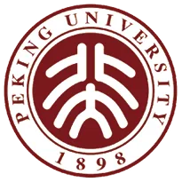
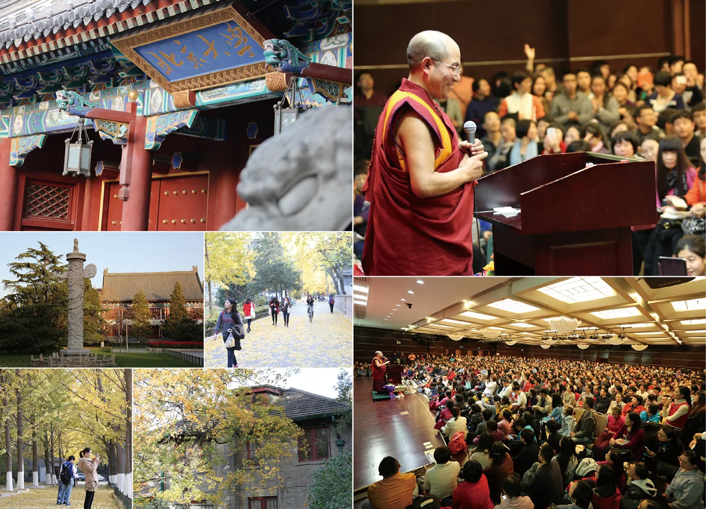
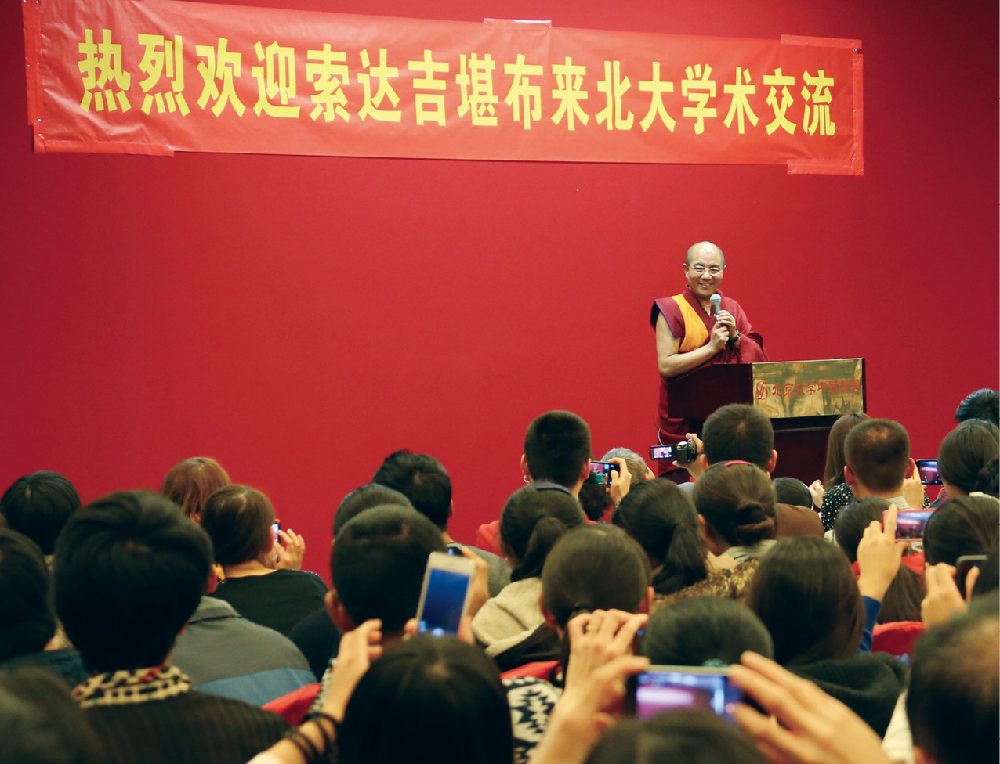
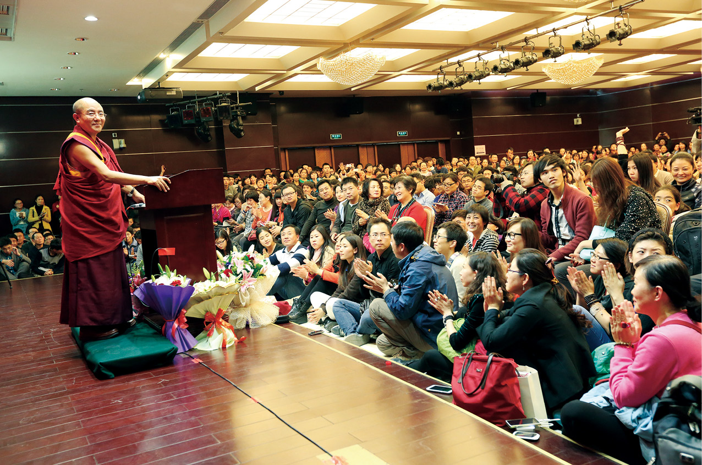

人的善心，

不仅能保护他人，

更能庇佑自己。

第66场

北京大学

Peking University

中国·北京

2013 / 11 / 6

## 生命的成长与完善

## Ever Growing, Ever Perfecting

主持人：

各位老师、各位同学，大家晚上好！欢迎参加由北京大学教育学院主办的学术交流讲座。

高等教育一直是北大教育学院学术研究的重要领域，尤其大学生的发展更是我们关注的焦点。随着我国高等教育的扩招，学生群体多元化、教师在教学投入方面的不足、专业教育和全人培养的矛盾、就业压力增大等方面的挑战以及教育体系外部复杂的社会变革，都是我们需要面对的。作为教育研究者或者未来的教育工作实践者，我们更加迫切地需要了解中国大学生身心发展的规律。在座很多在校的大学生，为了自己未来的良好发展，也需要了解人身心之上的一些规律。但是目前，国内有关大学生身心发展领域的研究，大多以西方心理学理论为基础。深入探索本土化的学生发展理论、了解中国传统文化对自我发展的促进作用，以及本土模式与西方模式的差异，都是目前需要探讨的课题。

今天我们非常荣幸地邀请到了索达吉堪布，从佛教的角度为我们讲解“生命的成长与完善”。堪布学识渊博、智慧深邃，对古今中外各个领域的知识均有涉猎，对儒道释等中国传统文化也能做到融会贯通，而且堪布对汉语的驾驭也是炉火纯青，当然我们更期待堪布的语言带给我们的智慧启迪。

请大家用真诚热烈的掌声欢迎索达吉堪布仁波切——

我来过北京大学好几次，每次跟这里的老师和同学交流，都被你们炽然的智慧和悲心所感染，所以每次的交流对我而言，都是非常好的学习机会。我今天也算不上给大家作讲座，只是谈谈自己对一些问题的看法。你们每个人有不同的视角，也许理解会有所不同。

我个人认为，一个人在成长和完善的过程中，最需要的是什么呢？就是善良、慈悲、科学和理想。

## 一、生命营养素——善良

心地善良是做人的根本。

我的老师法王晋美彭措，是一位在弘扬佛法方面做出了巨大贡献的伟大宗教人士，然而他不仅在宗教领域游刃有余，还深谙很多的人生哲理。他曾经说：善良的心地和贤善的行为是做人的根本，一个人只有具备这两者才能得以成长和完善。

### 1．善心，需要培养

很多人嘴上也会说人要心地善良，但实际上一反观，可能就会发现自心中实际上有很多恶的习气。

而要具备善心，也并非无因无缘，需要依靠一定的教育来培养。所以不论家庭教育、学校教育还是社会教育，都应当致力于向人传递善的能量。尤其对于下一代，从小给他灌输善的理念至关重要。

如果有了外在的教化和影响，人心就会慢慢沿着善的轨迹发展，因为人心之中本来就具备善的种子，所谓“人之初，性本善”。佛教中也讲众生皆具佛性，佛性是什么呢？就是一种最究竟的善。

那么如今的学校中，有没有培养善心的教育呢？有一些，但并不多。反而包括小学、幼儿园在内的很多学校，给学生灌输的常常是对抗的理念。

以前有个专家到学校去调查，专门询问一些孩子：“如果有些同学穿得很单薄，可能会冻死，你们能不能把自己多余的衣服借给他们？”大多数孩子的回答是：“冻死也活该，跟我无关。”

与此同时，很多家长也这样教诫自己的孩子：“如果学校里有人欺负你，你一定要报复，骂回去或者打回去。”在街上遇到一个乞丐就跟孩子说：“这是骗子，不能给钱。”这样从小给孩子灌输种种不善的思想，孩子在以后的人生中不论遇到什么对境，都会以一种恶心或者抵抗心来对待。而如果从小给孩子灌输善的理念，那么他的人生就会呈现另外一幅景象。

法国著名作家雨果（Victor Hugo, 1802-1885）说：“善良是历史中稀有的珍珠。”佛教也讲“心善地道善，心恶地道恶”，一个人如果心地善良，就会给自己的生命营造快乐；反之，如果内心邪恶，就会给自己的人生招来痛苦。

也许有些人想：“某某人做了善事，为什么没有看到他有好报呢？”这实际上是因为他所行的善还比较薄弱，如果这种善力量足够强大，即生或来世必定会感召安乐的果报。

### ２．善心，是对自己的护佑

美国第34任总统艾森豪威尔（Dwight D. Eisenhower, 1890-1969），曾是二战时欧洲盟军最高的统帅，当时有一次他待在法国的一个城市，正准备赶回总部开一个紧急会议。

那一天大雪纷飞，车子一路疾驰。在前不着村后不着店的途中，艾森豪威尔发现一对老夫妇坐在路边，冻得瑟瑟发抖。他马上让司机停车，并命人下车询问。

他的一个参谋说：“我们必须按时赶回总部，时间紧急，这件事可以让当地的警方来处理。”

艾森豪威尔说：“如果等到警方来处理，这对老夫妇可能早就冻死了！”

后来经过询问才知道，这两个老人是要去巴黎看儿子，但行至中途车抛锚了。艾森豪威尔于是让他们坐到自己的车上，将他们送到巴黎儿子的家里，然后才赶回总部。

结果据之后的情报显示，当天德国纳粹分子已经埋伏在艾森豪威尔的必经之路上，准备杀死他。如果他当时没有改变路线，必定会当场丧命，这样第二次世界大战的整个历史也将重写。

这个故事说明了什么呢？说明人的善心不仅保护了他人，而且庇佑了自己。

印度历史上也有类似的故事，有两个孩子去外面乞讨，看到很多出家僧人。一个孩子说：“如果我有权力，就把这些沙门统统杀掉。”另一个孩子说：“如果我变成国王，就供养这些沙门。”发恶心的那个孩子，后来躺在一处交通要道上休息，马车飞奔而过碾在他的脖子上，他当场毙命。而生善心的那个孩子，后来依靠种种因缘，如愿以偿做了国王，并且也供养了僧众。

### ３．善心，是人生的路标

有关善心得善报，还有这样一个故事。

撒哈拉沙漠是世界上最大的沙漠，号称“死亡之海”，因为去那里考古的人都是有去无回。直至1814年，有一个考古队打破了这个死亡咒语，成功走出了沙漠。这究竟是怎样一回事呢？

当时这个考古队在沙漠里行进时，随处可见死者的骸骨，队长总让大家停下来，挖个坑把骸骨掩埋起来，还用树枝或石块竖个简易的墓碑。

但是沙漠中的骸骨实在太多，掩埋工作花费了大量时间。很多队员抱怨：“我们是来考古的，不是来收尸的。”

但是队长很有爱心，他说：“每一堆白骨，都曾是我们的同行，怎能忍心让他们陈尸荒野呢？”

一个星期后他们到达了目的地，在那里发现了一些非常珍贵的古代遗迹和文物。当他们正要满载而归时，突然刮起了暴风，几天几夜飞沙漫空，指南针失灵了，食物和水也越来越匮乏，他们心中的希望开始泯灭。

这时队长说：“不要绝望，我们来的时候做了一些路标。”于是他们沿着来时为死者做的墓碑而行，最终走出了沙漠。

后来在接受《泰晤士报》采访时，考古队员们感慨地说：“善良，是我们为自己留下的路标。”

表面看来，在座的人都非常成功——能够考入这样的大学，但是进入大学后，也并非如你们最初所憧憬的那样快乐，因为我看到你们的笑容也不是那么灿烂，可能每个人也都会有各自的痛苦、烦恼和忧愁，有些人也许正处在迷失方向的状态，此时就需要人生的路标，这个路标就是善良。

一个人如果内心善良，那么无论身处何时何地做任何事情，都不会有那么多的抱怨和忧伤，反而会感受到快乐和安全。

刚才有些老师跟我讲北京大学的学生没有太大的就业压力，这一点跟其他学校不同。即便是这样，这里的学生还是会有其他的压力，因为很多学生对自己的未来定位很高——薪水达到多少、地位达到怎样等等。当一个人的目标越来越高时，由于人的精力和福报有限，就会承受更多的压力和痛苦，就像跳高运动员跳得越高，体力就会越难以跟上一样。所以如果把目标放低一点，就不会有那么多的痛苦。

## 二、生命提升素——慈悲

佛教的“慈悲”跟世间的爱有所不同，佛教的“慈悲”是一种大爱无疆的境界。这种慈悲也有小乘的层次、大乘的层次，以及更高的层次。如果就大乘而言，则不仅针对亲人朋友，甚至对于怨敌，也心怀悲愍。

慈悲自己的敌人，这是很多人难以做到的。比如有些宗教所倡导的爱心，其对境仅局限于自宗的教徒，不包含异教徒，如果异教徒做出不合理的行为，就可以进行杀害。

而大乘佛教的爱心，则是对一切生命的关爱，乃至对于动物，也像爱自己一样地给予爱护。

叔本华（Arthur Schopenhauer, 1788-1860）曾说人类行为的动机有三种：希望自己快乐、希望他人痛苦、希望他人快乐。这三种心中，希望自己快乐的心和希望他人痛苦的心，是自私的心、平庸的心，并非崇高道德的基础；而希望他人快乐的心则是崇高道德的基础。

佛教中也讲：自私心是令人束缚的心，像毒药一样；爱他心是能令人解脱的心，如珍宝一般。

如今的社会中，为什么毒奶粉、地沟油等事件屡见不鲜？就是有些人太自私了，在自私心的驱使下就做出这些伤天害理之事。所以这个社会确实需要利他心。真正崇高的教育，也应当着重培养人的利他心。

《学习的革命》（The Learning Revolution）一书的作者戈登（Gordon Dryden, 1931-）说：“教育的最高境界，应该达到三种和谐：学生与自身生命的和谐、与周围生命的和谐、与大自然万物的和谐。”

人与自身要和谐，就要首先调整好心。如果总是处于心烦意乱的状态，又谈何和谐呢？

现在很多大学生的口头禅常常是“好烦，痛苦，压力好大”，而正面的词语，比如“快乐，幸福，感恩”，都很少听到。

我前段时间在其他学校里也讲，古人口中是没有“压力”这个词的，即便在如今的藏地，很多人也不知道“压力”这个词。但城市里每个人都说“压力好大”——成年人要买房、要买车、要养家，喊着“压力大”；学生要学习、要考试、要就业，也喊着“压力大”。

究其根源，压力是自己制造出来的。如果能学会调心——培养一颗慈悲心，压力也会随之削弱。

## 三、生命助力素——科学

### １．科学的两面性

现在是一个非常崇尚科学的时代，我本人对真正的科学也很感兴趣，用佛教的语言讲就是很有信心。

不可否认，现在交通、信息等方面的很多便利，都是科学带来的。但是也不得不承认，人类的焦虑、压力、战争等灾难也是科学造成的。

以前爆发战争时，人们只是用刀、矛等简单的兵器互相打杀，但现在已经今非昔比，据说很多国家都制造了各种可怕的核武器。虽然说是核武器要控制，但实际上小国有小的核武器、大国有大的核武器，而且都互相瞄准好了，万一某个领导不高兴，他一下命令，后果就不堪设想。再比如，日本地震导致的核泄漏，给全球带来怎样的危害和恐慌，大家都心知肚明。

所以对于科学，一方面我们要心怀敬畏，另一方面也要看到它的负面作用。

### ２．佛学大师早已在山顶等候

中国科技大学前校长朱清时是非常著名的化学家和自然科学家，也是非常著名的院士。他在《第二届世界佛教论坛论文集》上，发表了一篇名为《物理学步入禅境：缘起性空》的文章，文中有句话说“科学家千辛万苦爬到山顶时，佛学大师已经在此等候多时了！”

很多学术界、文化界的人士都对这句话表现出浓厚的兴趣，我也想了解他为什么有如此的论断。

昨天在跟朱清时教授的一个互访中，我特意问：“你作为一个钻研自然科学很多年的科学家，为什么这样说？”

他说：“经过多年的研究，我发现量子力学或化学领域的最究竟观点，其实早已在佛教的《楞严经》《楞伽经》，以及《瑜伽师地论》《成唯识论》等经论中说得非常清楚了。”

很多年轻人如果没有深入了解，就认定佛教是迷信，予以全盘否定，这是很武断的做法。

像朱清时教授这样的科学家，也去南怀瑾老师那里学习佛法近十年。但是现在不要说大学校长，一般的一些大学教授乃至中学老师，都对佛教怀有偏见，害怕被这种“迷信”所毒害。其实如果你真正体会到了佛教慈悲和智慧的甘露妙味，就不会产生丝毫畏惧。佛教不会让你像服毒一样从此对生活、家庭失去感情，反而会让你对人生有新的认识。

如果把现在的量子力学放到19世纪，当时的人们会觉得匪夷所思。同样的，对于佛教的很多甚深道理，现在的一些人也觉得难以置信，但是对于未知的学问，我们要保持一颗开放和探索的心，进行透明、合理、客观地思考，而不是打着科学的幌子轻率地加以否定，如果是这样，这种态度本身就是不科学的。

释迦牟尼佛说过：“对于我的语言，你们也应该千百次地观察，如同提炼纯金一样。观察之后，如果觉得合理，你可以接受；如果觉得不合理，你可以抛弃。而不要因为信仰我就接受我的教理。”

佛陀说的这些话，应该是最为公正、理性和科学的。

如果将当今科学界对于宏观、微观以及人心世界研究所得的结论，与佛陀两千五百多年前的论断，做一个对比，确实可以说“佛学大师早已在山顶等候多时了”。

其实从某个角度而言，我觉得佛教也是一种科学。

广义而言，科学可以有自然科学、社会科学、心灵科学三类。自然科学，比如从16至19世纪这一时期兴起的近代实验自然科学，以及19世纪末至今的现代自然科学；社会科学，比如中国的孔孟、老庄之道，其中宣说了很多为人处世的道理；心灵科学，比如释迦牟尼佛所宣说的种种心灵学问。

所以可以说，佛教是非常先进的科学。

## 四、生命拓展素——理想

我最后要说的是：人应当树立远大的理想。

在座的每位同学心中肯定都有理想，但如果你的理想比较短浅狭隘，那么你的未来可能也不会非常灿烂光明。

### 1．成功开端于一个理想

纵观历史，大凡卓有建树的科学家、思想家，追溯其成功的根源，都是因为最初立下了一个远大的理想。

然而如果我们询问现在的很多同学：“你毕业后要做什么？”得到的答案通常是“我要当公务员”“我要当企业老总”“我要财富很多、家庭美满”，全部都是围绕自己，从来没有想过自己做的研究怎样能改变人类的命运，能为人类做出怎样的贡献。

以前哈佛大学对300多个学生进行了跟踪调查，发现这些学生中最初有远大理想的15个人，20年之后所拥有的财富，远远超过其他85%的人的财富总和。

佛教里也讲“愿大力大”——如果发愿很大，爆发出的力量就会很大。其实每个人的心中都有智慧、悲心等很多方面的潜力，真正开发出来的可能不到10%。佛教中也讲人的如来藏中隐匿着很多宝贝，但是一般人只是挖掘出其中的很小一分，利用它为自己、为家庭服务。

如何使得心中涌现更多、更高的智慧呢？就是发广大的愿。可以说，发愿是获得成功的一种最主要方法。比如大乘佛教徒会发愿：为了利益天下无边的众生，我要成就佛果——证悟宇宙万物的真理。而一旦成佛以后，唯一所做就是利益众生——跟众生宣说真理，让他们也成就佛果。大乘佛教的这种理想，是其他宗教和个人所无法企及的。

你们能来到北大学习，是很多人非常羡慕的，但是你们的心也不要始终局限于自我之中，要树立利他的远大理想。

### ２．成功的秘诀——三个“决不”

有了崇高的理想之后，在实现的过程中也不要有任何的怯懦和退缩。人生不可能一帆风顺，毕竟会经历坎坷，这是一种规律，这个时候关键是不放弃。

佛教里的“菩萨”是什么含义呢？就是“勇士”之义——在帮助他人方面非常勇敢的人。

现在很多人的心理非常脆弱，比如有些人稍微遇到感情上的一点不如意，好像整个人生已经山穷水尽，马上就想自杀；有些人本来事业有成，但是一旦遭遇工作上的一些逆境时，就仿佛世界已经天昏地暗、黯淡无光。其实通往成功的路上出现一些磨难，是正常现象。

丘吉尔曾说自己一生的成功秘诀只有三条：第一个秘诀是“决不放弃”，第二个是“决不，决不放弃”，第三个是“决不，决不，决不放弃”。

怎样做才是不放弃呢？就是在遇到了困难和障碍时，用一颗勇敢的心来面对。如何勇敢地面对呢？就是学会用爱来善待这个世界，善待所有人，当你这样做时，世界会把祝福回馈给你。

我特别喜欢一首歌，歌词说：“普天下没有我不爱的人，普天下没有我不信任的人，普天下没有我不原谅的人，长情大爱遍满虚空永无止境。”

如果我们能善待天下的所有众生，甚至对自己的怨敌也以谅解和爱心来对待，那么生活中就会处处遍满快乐和阳光，忧愁和黑暗也会无迹可寻。

因此希望大家从智慧、慈悲、科学、理想着手，让自己的生命得以成长和完善。

现场互动

问：有的新闻里报道有人帮助遭遇困难的人，后来反遭讹诈。这种情况导致现在很多人不敢帮助他人。您如何看待这个问题？

堪布：我觉得遇到需要帮助的人，还是应该伸手相助，这有可能给你带来不利，但一般不会。虽然有过一些负面的新闻报道，但这只是个别记者为了吸引观众，故意曝光的，实际上这种事大多时候都不会发生。

而且我们也不必跟在别人后面亦步亦趋。丰子恺讲过一种羊群效应：一只羊跑了，其他的羊都跟着跑。我听说鸭子也是这样，一只鸭子跳到水里，其他的也会尾随，一只鸭子浮出水面，其他的也这样做。所以一个人害怕救人，其他人都跟着害怕，最后路上摔倒的老人都没人去扶了。去年有个新闻，标题是“十三亿人没有救到一个人”，虽然有些夸张，但确实反映出当今社会不太乐观的一面。

我刚才在讲座中举“二战”时的那个例子，也是特意让大家反思一下。

其实在国外很多地方，不论古今，只要有人遇到困难，其他人都会乐意伸出援助之手。而我们这里并非如此，即便有人见义勇为，也可能会被媒体曝出一些不好的消息……

确实现今的新闻媒体中常常充斥着凶杀、色情、暴力等内容，正面信息的传播比较薄弱。

一些小说甚至会歪曲事实，比如把藏传佛教的喇嘛、上人描绘成怎样的形象呢？就是武功高强而人品恶劣。我对这些小说的作者有点意见，因为我们藏地的佛教徒没有一个学武功的，但是被小说这样一描写，有人在机场看到我们时，就喊出小说里人物的名字，甚至很多孩子也会这样。

小说、电视、电影等媒体，虽然作为艺术，有自己的一种文化，但是也最好宣传一些正能量的内容，尤其不能歪曲事实。总之，传播善的理念在当今社会是当务之急。

问：堪布您好，扎西德勒！我是北京大学对外汉语教育学院的研究生。我想代表一些藏族学生请教您一个问题。我以前只顾着学汉语和英语，以致现在藏语的文字能力差不多消失了，回家时会有种说不清的失落。我的有些朋友刚好相反，比较排斥学汉语，但考入内地高校后就出现交流上的问题，导致心情受到很大的影响。请问如何平衡学习母语和学习汉语之间的关系？

堪布：今天在这里遇到藏族的学生，非常开心。藏族学生能在这样的大学里学知识很好。

你刚才提的问题非常重要，我认为作为藏族学生，应该学好多种语言。

刚才北京大学的有些老师跟我说他们正在学藏语，而且学习藏语中的不同语系，有些在学拉萨语，有些在学康巴语，有些在学安多语。今年我去了美国的很多学校，比如哈佛大学、哥伦比亚大学、华盛顿大学，这些学校里的很多老师和学生，藏语学得也非常好。

作为一个藏族人，如果连藏语都不懂，那就像汉族人不懂汉语一样，是很值得惭愧的。很多汉族学生，到国外留学六七年回来时，并没有不会说汉语了。但是个别藏族学生到内地读完大学、研究生，回去后藏语不会说、藏文不会写，这是非常遗憾的事。

我希望在内地读书的藏族学生，最好有时能聚在一起探讨一下自己民族的语言。

如果有些藏族学生是在内地长大的，因此而不会藏语，那现在也可以学，就像在学校里学英语一样。我在新闻里看到，今年89岁高龄的金庸，还在北大学习。你们还没有到七八十岁，可以把原来失去的知识找回来。

如今藏地的水源、森林以及矿产，都成为世界上非常重要的自然资源，而藏语也是非常重要的民族文化。因此特别希望你们能继承这种文化，这样对自他的意义都非常巨大。

所以我对藏族学生的第一个希望是：要掌握自己民族的语言。

另一方面，现在汉语是世界上非常重要的语言。所以我对藏族学生的第二个希望是：要精通汉语。

不仅如此，我希望你们还要学英语、日语……现在国外懂十几种语言的人也非常非常多。

问：怎样培养对他人的爱心？

堪布：首先应该学习一些很有加持的大乘佛学，如《亲友书》《入菩萨行论》，这些著作里的教言对培养爱心很有帮助。

其次多阅读一些有关慈善、爱心的案例，像特蕾莎修女的故事、慈济基金会的事迹。通过再再阅读这些故事，也会逐渐引发对他人的爱心。

有些人很想帮助他人，当然短期利他并非难事，但要长期坚持，就需要一定的心力。而这种心力要经由一番努力才能培养出来，不是一两天就可以一蹴而就的。

问：怎样才能获得解脱？

堪布：藏传佛教非常伟大的宗喀巴大师撰写了一部论著——《菩提道次第广论》，这其中宣讲了下士道、中士道、上士道：下士道讲如何获得人天的解脱，中士道讲如何获得小乘的解脱，上士道讲如何获得菩萨的大解脱。

所以，想要获得解脱，可以仔细研读这部著作。

问：在现在的一些新闻中，常常会看到一些有关僧人的负面报道。如果这影响了佛法的普及，您有怎样的智慧可以解决吗？

堪布：确实，你所讲的问题，也是我经常考虑的。但是单凭我个人的力量要完全解决，也十分困难，即便如此我依然在努力。

现在媒体中有关出家人的很多宣传并不符合事实，比如把出家人描绘成专门打斗、专门杀人的。事实上，藏传佛教的出家人根本不会持枪杀人、操刀害人，这种事在我的印象中从未有过；汉传佛教的出家人，不论修禅宗还是净土宗的，威仪也都非常寂静。但是因为媒体的错误宣传，导致很多人认为僧团就是功夫团队，一些小孩子看见汉地和尚就跃跃欲试要比武功。

另外，佛教团体中的个别人确实也有不如法的行为，比如打着佛教的旗号谋求钱财，这确实给佛教造成了不良的影响。

但我认为个人的行为不能代表佛教——不能代表藏传佛教，也不能代表汉传以及南传佛教，因为佛教从来都是教导人修行戒定慧三学的——守持戒律、修行禅定、开启智慧。

再者，佛教徒以慈悲为怀、行事低调，也可能因此而导致常被媒体抹黑，如果换成其他教徒，媒体似乎不敢这样做。这也是目前佛教徒的一个弱点所在。

其实有关佛教的报道，如果不符合事实，佛教徒有权加以制止。比如有些新闻媒体把个别人的过失归咎于整个佛教，这是否合理？如果不合理，佛教徒可以站出来阻止和澄清。

问：如何面对生活中的种种不如意？

堪布：不如意之事谁都会遭遇，如果此时伤心欲绝，甚至自我伤害，这都没有必要。那么如何才能自在地面对逆境呢？

心理学认为成功者需要具备三个因素：智商、情商、逆商。其中的“逆商”是指一个人面对逆境时的勇气和能力。如果逆商比较高，出现任何违缘都可以坦然应对。

那么，如何提升逆商呢？

大乘佛教中专门有将逆境转为道用的方法，对此不断熏修和串习，在遭遇任何不如意时，都能处之泰然。所以，熏习大乘佛法是提升逆商非常好的方法。

问：佛经中的有些公案会让人感觉非常离奇，您是怎么看待这些公案的？

堪布：我看待这些公案的方式，既不偏于理性，也不偏于感性，而是两者结合的方式。

如果仅仅依靠理性来分析，人类有史以来的许多问题都将无法解答。如果仅仅依靠感性来判断，比如单凭信心来判断一件事、一个人，这样也会有失偏颇。

历史上尧舜禹的很多真实故事，现代人看来会觉得难以置信，但实际上在他们那个时代真实存在过。

以前我可能没有这么成熟的智慧，但现在我认为，无论对于佛教的公案，还是世间的事情，乃至科学领域震惊世界的发明，以理性和感性结合的方式来判断，得出的结论会是最准确的。

问：对于心中的种种贪欲，应当如何处理？

堪布：贪欲给人带来的只能是痛苦与束缚，而知足却能让人感受到安乐与祥和，但是这种知足心是当前很多人所缺少的。

尤其现代社会中，人们对财、对人、对名，对很多东西都有一种过度的贪欲。这时贪心已经湮没了爱、智慧和信心，所以需要节制欲望。

当然，这并不是说要把所有欲望都彻底断除，而是说不能过分地膨胀欲望。

大约一百年前，藏传佛教一位非常伟大的诗学家、天文地理学家说：“人不可能断掉所有的欲望，但也不应贪得无厌。”所以，发现心中有很多过分的贪欲时，应该用这句话来提醒自己。

问：我觉得佛法是一种教育，那么应当如何在当今社会更好地推广这种教育？

堪布：这个话题很有意义。著名的思想家、文学家梁启超说过：如果中国的国教是佛教，应该有非常大的利益。

实际上，在唐朝时，就出现过全民信佛的盛况。

我们现在也借助很多方法力图让大学生、中学生多多少少能认可佛教。当然信仰是自由的，不认可也没关系，佛教从来不会勉强任何人，也不需要打广告来壮大队伍，因为如果是无缘之人，佛也无法度化。

但是佛教作为一种善的教育，是当前很多人非常需要的，所以即便你不信仰，也可以用一种公正的态度了解一下佛教。

佛教并不是有些人所想象的——麻痹劳动人民的毒药、影响社会发展的绊脚石，绝对不是这样的。事实上，佛教对人类心灵的提升有着极大的作用。所以，如果用排斥的眼光对待佛教，不仅对自己不利，对你的家庭也会有害，乃至对整个社会也会带来负面的影响。

所以我特别希望能和大家面对面地交流，这样你们对佛教会有新的认识。如果你们中有人认为佛教有不合理之处，我们也可以讨论。

问：现在很多人拜佛，我相信您也拜佛，那么您拜的是什么佛？

堪布：我拜的佛就是释迦牟尼佛、阿弥陀佛为主的这些佛。

其实不论是拜佛像，还是拜观想的佛，都很有意义。今年举办第三届“世界青年佛学研讨会”时，一位香港中文大学的教授说自己每天都拜佛。

我每天早上也会拜佛二十分钟左右，最近在北京也是如此。我希望你也经常拜佛。
