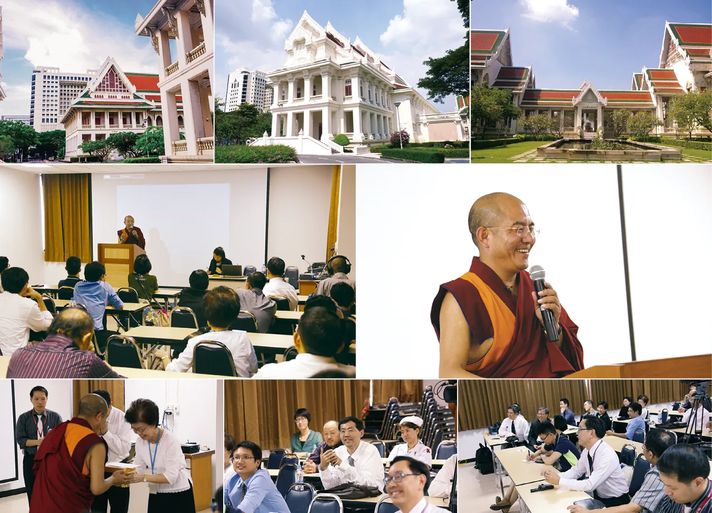
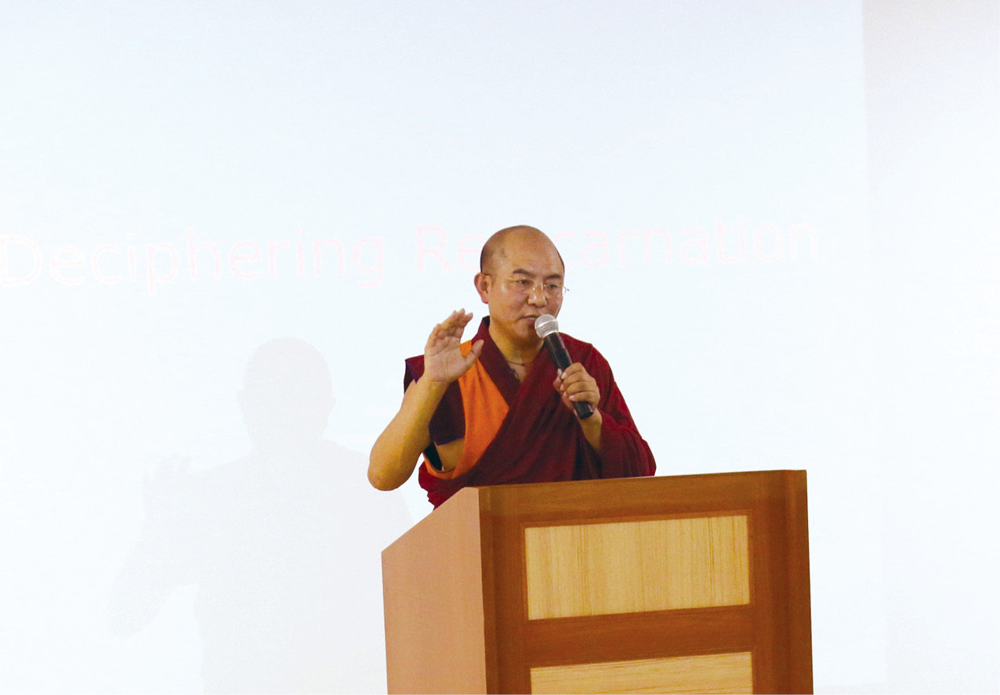
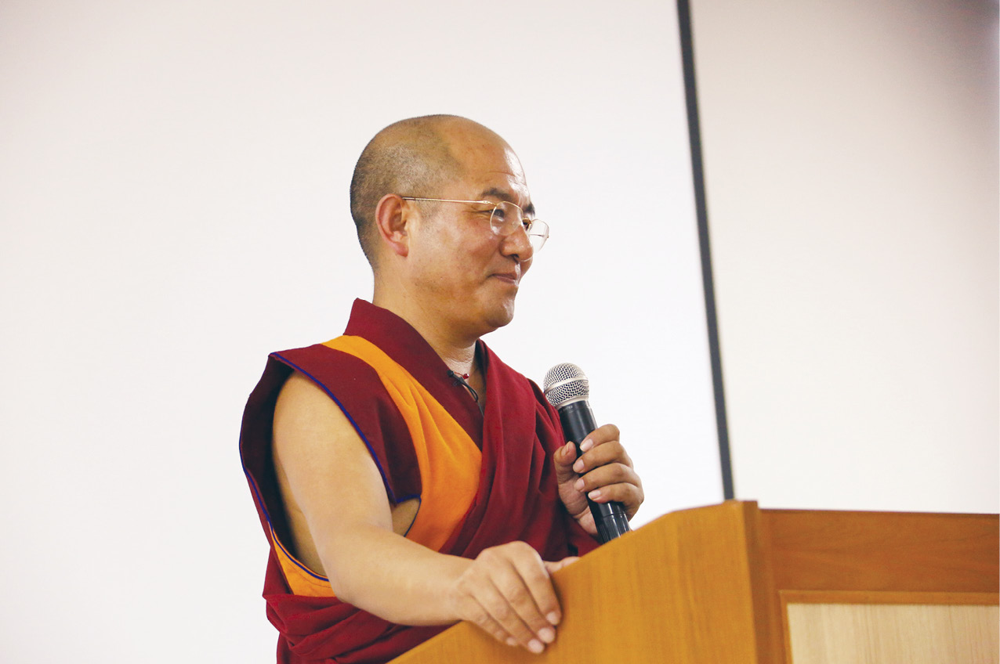

解开轮回的密码究竟是什么呢？

实际上就是无我空性。

第68场

泰国朱拉隆功大学

Chulalongkorn University

泰国·曼谷

2013 / 11 / 12

## 解读轮回密码

## Deciphering the Cyclic Existence

主持人：

大家下午好。我谨代表泰国朱拉隆功大学及医学院，欢迎索达吉堪布的到访！

索达吉堪布依止法王晋美彭措仁波切为根本上师，我们泰国人也对晋美彭措法王非常熟悉，曾被他的言行举止深深打动。对我们而言，藏传佛教的思想非常深刻，对死亡有独到的见解，可以帮助我们引导医院里的临终病人。今天，索达吉堪布会为我们宣讲轮回的原理，以及打破轮回的智慧。下面有请堪布为我们解读“轮回密码”。

很高兴能在这里跟大家一起交流。不知道大家有没有思考过：我们是怎样来到这个世界的？是无缘无故从天上掉下来的，还是从地里长出来的？其实，每个人都是因为一定的因缘才来到这个世界。对于这种因缘，佛教有自己独特的观点，科学界也有相关的讨论。因为绝大部分泰国人从小就信仰佛教，也承认轮回的存在，所以，我想大家对佛教中前世今生的观点都比较清楚。

## 生命是延续的

每个人都应该关注生命的延续性。如果只关注短短的今生，既不思考前世，也不关心后世，那我们就跟旁生没什么差别。很多人都把“善有善报，恶有恶报”挂在嘴边，但恐怕很少有人真正思考过，今生的业力是如何延续到后世，甚至再下一世的。

泰国百分之九十多的人都信仰佛教，而轮回是佛教最关键的观点之一。如果我们不懂轮回，那皈依佛教也只不过是寻求暂时的人天福报，并不究竟。

我曾在其他大学讲过轮回的话题，但因为他们不相信轮回的存在，所以我不得不引用很多科学证据去说服他们，而没有用太多佛教的道理来讲解。但由于泰国人大多从小就信仰佛教，有一定的佛学基础，因此不会对轮回有太多怀疑，这一点和藏族人很像。所以，今天我会从佛教理论的角度讲一下轮回。

我听说，朱拉隆功大学医学院的老师和同学们十分想帮助临终病人，可一两句安慰的话，并不能解决根本问题。要想真正地帮到临终病人，就一定要讲轮回，讲生命的延续性。如果临终病人懂得生命是延续的，他就不会对未来失去希望。而要懂得这个道理，必须先要明白缘起法。

佛陀告诉我们，缘起可分为外缘起和内缘起。外缘起可以通过一棵树的比喻来说明：比如一粒种子，因为地水火风等因缘，长出苗芽，进而产生根、茎、叶、果实，这就叫做外缘起。但更重要的是内缘起。所谓的内缘起是指，每一个人都在轮回中不断地流转，这一世做人，下一世可能做旁生，再下一世也许做天人……总之在没有解脱前，就这样一直不断地在轮回中流转。这个过程我们一定要弄明白，否则，就没有办法通达轮回的原理，更无法真正去关爱别人。

## “十二缘起”——轮回的密码

轮回的存在是有原因的，而最根本的因叫做“我执”，即每一个人对“我”和“我所”的执著，它也叫“无明”。我执是十二缘起中的第一个法，也是一切轮回的根本。

有了无明后，我们的身、口、意会造作善业、恶业，有各种各样的行为，这就是十二缘起中的“行”。可以肯定的是，无论是谁，来到这个世界的因，都是无明和行。

有了种种业以后，不论善业、恶业都会留在阿赖耶上面，这叫做“识”。虽然我们的身体最终会毁坏，但心识却是持续的，即使在死后也会存在。1963年获得诺贝尔奖的艾克里爵士[^1]，从脑神经学的角度说明，在我们死后，还会有一个独立于身体的“灵魂”（心识）存在[^2]。虽然从医学角度讲，去世之后，身体不再受支配，并会逐渐腐败，但如果结合佛教的知识来看，其实我们的心识是一直流转的。从哲学角度说也是这样，比如，叔本华曾说过，我们的身体最终会灭亡，但“意志”却依然存在[^3]。

心识入胎后就有了十二缘起中的第四个法——“名色”。“名”指的是除了色蕴以外的一种心识，而“色”指的是身体尚未发育完全的状态。

十二缘起中的第五个法叫做“六入”，也称“六处”，指的是心识入胎后，胎儿的眼、耳、鼻、舌、身、意等六根刚刚形成，但尚未接触到六尘（色、声、香、味、触、法）的阶段。

第六个法叫做“触”，指的是六根形成以后，接触到外界的六尘，并产生六识（眼识、耳识、鼻识、舌识、身识、意识）的阶段。

在六尘和六根结合后，我们会对悦意的对境产生快乐，对不悦意的对境产生嗔恨，对既不悦意也非不悦意的对境产生不苦不乐的心态，这就是十二缘起中的“受”。

以上所提到的识、名色、六入、触、受，是前世的无明和行在今世所引发的果。有了这几个果之后，即生当中就会产生“爱、取、有”。

所谓的“爱”，就是指喜欢悦意的感受，不喜欢痛苦的感受，这包括种种的贪爱、嗔爱、痴爱。爱，其实相当于是前世的无明。“取”就是有了对各种感受的爱之后，进而接受。有了爱和取这两个因缘以后，就会产生“有”。它是轮回，也是轮回的因。爱、取、有这三者，就是今生当中所造作的后世的因。

因为我们造作了后世的因，所以肯定就会投生后世。十二缘起中，后世的第一个法叫“生”，这也就是前面所提到的识。在投生后世时，我们可能会降生在人道，也可能在其他道。而有了生以后，肯定就会经历“老死”，这包括了从名色到受之间的全部过程，这也是十二缘起中的最后一个法。

从十二缘起来看，今生的因缘会变成后世的因缘，而后世的因缘又会变成再后世的因缘，在没有解脱之前，我们会一直在轮回中流转。

大家可以通过学习《缘起经》来通达十二缘起。轮回是佛教思想的基础，如果没有在理论上通达十二缘起的话，我们恐怕不能称自己是一名合格的佛教徒。

## 解开轮回的密码——无我空性

佛教在泰国非常兴盛，到处都有寺院，人们对出家人十分恭敬，日常生活中也时常面带微笑，心态平和。但这还不够，我们还要明白轮回流转的道理。

我很喜欢泰国，因为这里的人很平和、安详，没有太多的痛苦和烦恼，尤其是我十四年前来的时候，那时人们的心理更加健康。我当时在泰国待了一个礼拜，后来将所见所闻写成了一本《泰国游记》，大概有两三万字。

泰国有这么多人信仰佛教，人们不但对临终者有恰当的关怀，就连小孩子们对轮回也有一定的正确认识，这些都是在佛教不兴盛的国家里难以见到的。其他地方的人，可能对泰国有一些看法，比如人妖，或者动荡的政局等。但作为一个佛教徒，我觉得像泰国这样有广泛佛教信仰的国家是很少见的，泰国人在信仰佛教、行善断恶等方面，非常值得赞叹。

无论是南传佛教、北传佛教，还是藏传佛教，在教义上并没有差别，因此，我们都应该懂得十二缘起，更要懂得轮回流转的痛苦，诚如《法华经》中云：“三界无安，犹如火宅。”因此，打破轮回，应该是每一个人的奋斗目标。

那解开轮回的密码究竟是什么呢？实际上就是无我空性。如果没有空性的力量，我们就没有办法断除轮回的根本——无明。我们能在今生得到人身是非常不容易的，但今后是继续在轮回中流转，做牛做马，还是烧毁无明的种子，从而获得解脱，这完全取决于自己。

所有人都会经历衰老和死亡，这是轮回的一个特征。当年释迦牟尼佛还是王子的时候，就是在看到生老病死后而示现出家，最后断除了轮回的根本。泰国有这么多寺院，寺院当中有很多出家人，其实这些出家人就是在修无我的智慧，前往解脱。

在很多国家，人们只有在生活没有希望时，才会选择出家。但是在泰国，当有人出家的时候，大家都会因为他走上光明之路而祝福他。不仅是出家人有这条光明之路，在家人也可以通过不断地修行，最后用空性智慧斩断无明，获得解脱。

希望大家都可以精进修行，运用空性智慧斩断轮回的根本，从而获得真正的快乐。

现场互动

问：您能再概括一下十二缘起吗？

堪布：十二缘起当中，无明和行属于前一世，中间的识、名色、六入、触、受、爱、取、有这八个是属于今世，生和老死属于来世。所以，在十二缘起中，两个属于前世，八个属于今世，两个属于来世。在今世的八个法当中，前面的五个（识、名色、六入、触、受）是前世的果，而后面的三个（爱、取、有）是后世的因。

在十二缘起中，表面上看来，无明是第一个，但实际上，后面的爱也是无明，无明一直存在，只不过换了名字。

在每座藏传佛教的寺院当中，都会有一个六道轮回图，这也代表人人都需要懂得轮回和十二缘起。

问：为什么十二缘起这么重要呢？

堪布：如果没有搞懂十二缘起，不论是关心别人，还是自己修行，都和非佛教徒没有太大的差别。如果我们认为，今生当中的因缘和前、后世没有关系，那这肯定不是智慧，而是无明。

现在有些佛教徒，虽然承认“善有善报，恶有恶报”，但却不懂得其中的前因后果，这是没有智慧的表现。而我们要获得智慧，就一定要懂得十二缘起的道理。

问：十二缘起是一个循环，那么我们该从哪里入手打破它呢？

堪布：十二缘起当中最关键的就是无明。所谓的无明，就是“我”和“我所”。因为“我”和“我所”并不存在，但是众生却认为它们存在。如果斩断了无明，那以后就不会感受轮回流转的痛苦，就像阿罗汉一样。很多出家人、在家人修行的目标就是斩断无明。如果斩断了无明，以后就再也不会产生轮回，但如果没有斩断，那即使一直做善事，也依然会在轮回当中流转。

问：对于相信轮回的人，我们可以用佛法帮助他们，但对于不相信轮回的人，我们应该如何去帮助他们呢？

堪布：对于相信轮回的人，我们可以直接给他讲佛法的道理，但对于不相信的人，我们可以用佛教中对心识因缘的推理来说服他们。

心识不同于物质，它的直接因就是心识本身，不可能是身体。比如说，一个八岁的孩子，精通八国语言，这种情况的合理解释应该是他前世在心识上留下了某种因缘，否则的话，仅一个八岁的孩子，今生当中是不可能突然精通八国语言的。对于没有信仰的人，刚开始可能要费一番唇舌，但佛教中的推理是很有说服力的。

虽然现代科学对我们身体的研究已经非常深入了，但到目前为止，科学界还无法证明前世不存在。新闻里曾报道过，有一个孩童，虽然家里人都没有信仰，但这个孩童却声称自己前世是斯里兰卡的总统，并可以回忆起很多前世的情况。对于这件事情，科学家们束手无策，完全不知道如何解答。

问：我并不能完全理解十二缘起，但我知道它在描述前世、今生和来世的关系。如果有轮回的话，那是不是就说明，我现在做好事，将来就会有好的果报？

堪布：对。佛教的思想中，最基础的就是六道轮回、十二缘起的观点。而作为佛教徒，必须要研究十二缘起的道理。

如果我们只懂得佛教中最简单的道理，比如要做善事，却不懂更深的道理的话，那我们对佛教的理解就会很片面，这样不能称自己是一个真正的佛教修行者。

问：您刚刚讲的内容很深奥，您能推荐一本这方面的书，帮助我们理解吗？

堪布：十二缘起确实很难，但如果因为难而不去学的话，恐怕我们将永远也无法打破轮回。《缘起经》中将十二缘起的道理阐述得非常清楚。这部经典有藏文、汉文的译本，不知道有没有巴利文、泰文的译本，如果有的话，可以读一读。

问：我在重症护理病房工作。在那里，我们虽然会尽力抢救病人，但也经常遇到一些无能为力的情况，这时候，我们怎么帮助病人呢？

堪布：如果想要帮助病人，那不但要治疗他的身体，更重要的是治疗他的心。

如果临终病人是一名佛教徒，他并不会觉得这是人生的终点，因此，他可能不但不会很伤心，而且心中还向往着来世。

在病人临终时，对他最好的帮助就是放一些佛像在他身边，或者念一些佛的咒语来加持他。

其实我们每一个人都会死亡，但死的时候会有差别。我希望自己去世的时候，可以看到佛像，也能听到旁边的人给我念佛，同时自己的心也能安住在一种慈悲和智慧的境界当中。

佛法是帮助临终病人最有效的方法。因为当病人去世时，任何财产、安慰都没有用，他自己也知道此刻已经无能为力了。在这个时候，最好的帮助就是尽量减少他在来世的痛苦。在有些医院里，专门会有出家或在家人为一些临终病人助念。我们现在也提倡临终助念，这对每一个人都非常重要。

问：作为医生，我们的职责是抢救生命。但抢救病人就会妨碍他们平静地死亡。所以，我们面临一种困境，不知道应该什么时候停止抢救，让病人为死亡做准备。您可以给我们一些建议吗？

堪布：从医生和医院的角度来讲，有必要对病人采取各种各样的抢救措施。但是从病人的角度来讲，不一定要这样。藏地有很多人都不希望医生对自己采取太多的抢救，因为他们都不希望在医院里过世。

至于什么时候停止抢救，这可能要根据病人的情况，以及家属的意愿来做决定。如果病人以及家属愿意抢救，那我们还是应该做一些事情。但如果我们明知道他已经没有希望了，那就应该让他平静安详地走。这是个很复杂的问题，应该根据病人、家属的具体情况来分析。

问：我是一个儿科护士，经常遇到孩子去世的情况。大人可能对死亡有所了解，但我想孩子们根本不了解死亡，也不知道死后会怎样。请问，我该如何引导孩子面对死亡？

堪布：实际上，佛教的道理跟世间道理一样，大人也需要投入大量的时间去学习，否则，很多道理也不一定懂。小孩也一样。我们应该从小就教育他们如何对待生命，他们自己也应该有一些修行。其实，我们从小仅仅有一个信仰是不够的，还需要有智慧，这样才能懂得生活和生存的意义。

问：我同事的母亲要去世了。有一天，他对我说，他越执著母亲，自己就越痛苦，但他又不能控制自己。我该如何帮助他呢？

堪布：佛经中讲到，不论是对家人，还是对财物、地位，越执著就会越痛苦。所以，当身边有人执著时，有必要提醒他不要这样。无论是执著母亲，还是执著其他人，一定会产生痛苦。

佛教讲，看破、放下，完全断掉痛苦有一定的困难，但我们可以通过减少执著来尽量减少痛苦。

问：人死亡以后，心识会在身体中停留多久？

堪布：佛经中讲，人死之后，心识会在三四天内离开身体。所以，一般在人去世以后，三天内都不要处理尸体。而心识一般会在中阴身状态中待四十九天，之后如果没有特殊情况的话，就会继续投生。

问：对此有什么解释依据吗？

堪布：关于心识的知识，主要来源于佛经。很多佛经中都提到过，死亡后，心识一般会在三四天内离开身体。同时，现在有很多人，包括一些医学界人士发现，人在死亡之后，心识还暂时存在于身体中。日本曾有一个专门的心理学研究机构，他们的研究结果和佛经中的描述非常相似。

心识本来是比较神秘的东西，我们凭分别念不一定能了解清楚，但是通过佛经中的教证、自己的智慧和观察，再加上科学的论证，三者结合起来的话，我们还是可以对心识有所了解的。就好像我们需要通过阅读医学书籍来学习医学知识，同样的道理，关于生命和心识上的很多问题，我们需要依靠佛经和相关的书籍来通达。

佛教的生命观已经成为世间的一门专业，因为关于心识方面的很多现象，科学界尚无法给出恰当的解释，但在两千五百多年前的佛经当中，往往都会找到合理的答案。所以，现在新一代的科学家们也不得不参考佛教的知识。

我认为，要想了解生命的奥秘，就一定要大量地翻阅佛教经典，在翻阅的过程中会得到很多启发。现在很多人相信科学，但科学也并非万能。前一段时间，我在北京与原中国科技大学校长朱清时教授有次对话。他曾说过，当科学家千辛万苦爬到山顶的时候，佛教大师已在此等候多时了。我问他，你身为一个科学家，为什么会说这句话呢？他回答说，其实很多科学无法解答的问题，往往都可以在佛教中找到答案。他在中国科技大学担任过十年的校长，一位做了一辈子科学研究的人，最终也需要在佛教经典中寻找答案。他曾在他的上师南怀瑾那里学习了很多佛教经论，比如《瑜伽师地论》《楞严经》等。

问：每个人的心识都是在去世三四天以后离开身体吗？人与人之间有没有区别？

堪布：佛经中讲，心识一般会在三四天内离开身体，但可能每个人的情况有所不同，有些很快就走了。

问：在死后的前三天，心识会感知到身体的状况吗？

堪布：实际上，我们的心识有粗大的感受，也有细微的感受。虽然人去世后，粗大的感受已经没有了，但是细微的感受还在。

在中阴身阶段，因为没有肉体的限制，心识不一定在身体中的某一处，它可能在任何地方，甚至漂泊在外，所以心识可能会偶尔出入身体。因为众生的业不同，心识存在的方式更是多种多样。

佛经中有公案说，有些人的心识只是暂时离开了身体，回来的时候却发现身体已经被当作尸体处理掉了。美国有一个医生叫魏斯（Brian Weiss, 1944-），他收集了两万多个案例，其中有很多都是关于心识的各种状况，比如心识离开身体，或者通过催眠而回忆起前世等等。

问：如果在死后三天之内，尸体被火化了，那心识会怎样呢？

堪布：所以在藏传佛教的传统中，遗体一般要保留三天，否则他回来的时候就没有“家”了。

[^1]: Sir John C. Eccles，1903-1997，神经生理学家，获得1963年诺贝尔生理学医学奖。
[^2]: 出自艾克里爵士的著作《Evolution of the Brain: Creation of the Self》。
[^3]: 出自叔本华著作《作为意志与表象的世界》第二卷。
