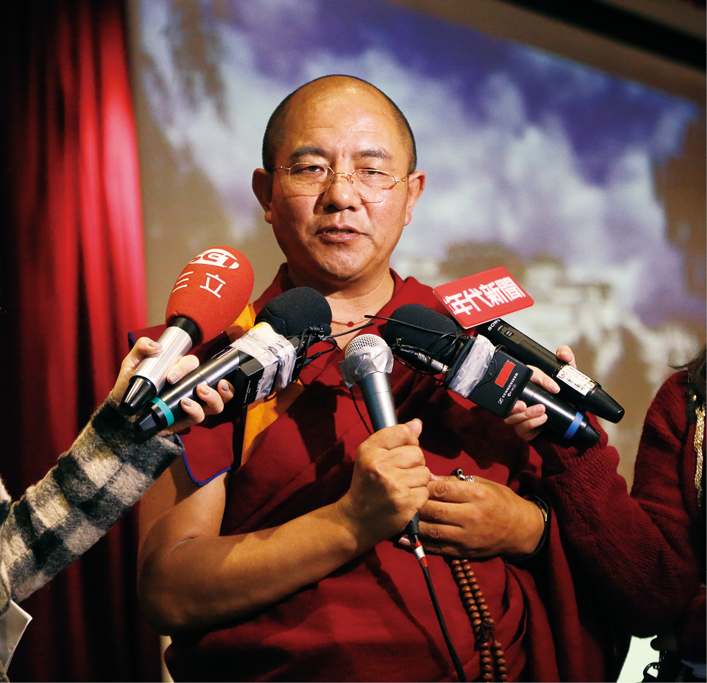
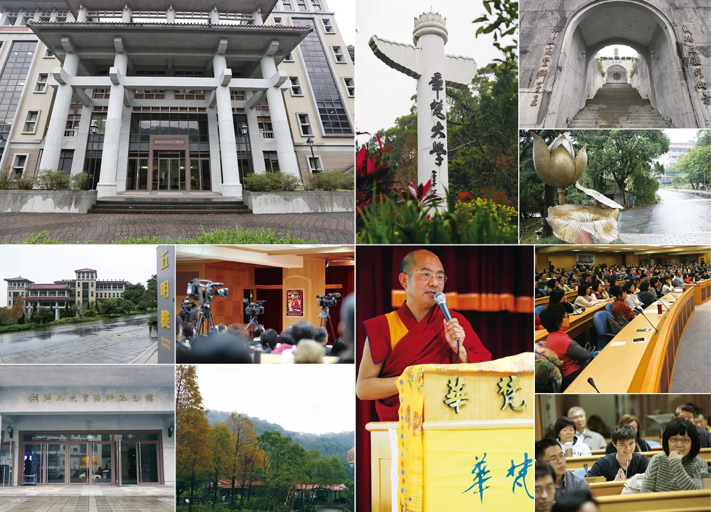
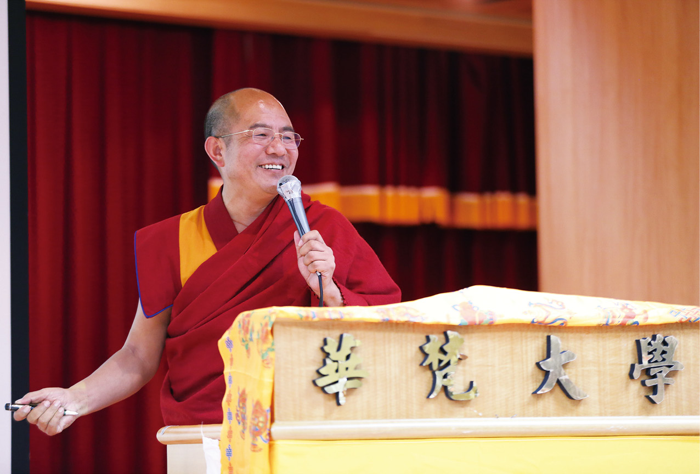
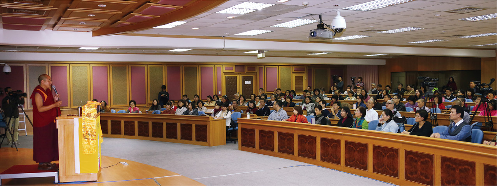
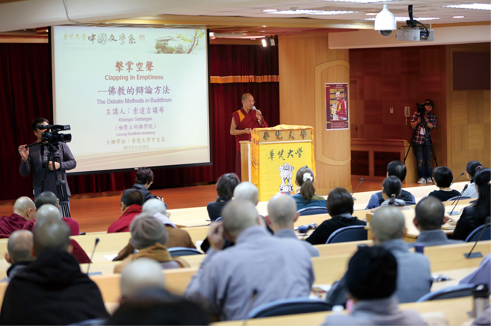

我们不能把辩论看成一种好玩的表演。

它的内容和意义到底是什么？

这是我们更需要知道的。

第74场

台湾华梵大学

Huafan University

中国·新北

2013 / 11 / 28

## 击掌空声·佛教的辩论方法

## Debate Techniques in Tibetan Buddhism

主持人：

大家午安！阿弥陀佛！

我是华梵大学中文系主任。今天非常荣幸，有机会邀请到索达吉堪布来我们学校演讲。这次华梵大学中文系和其他的三个大学一起，联合邀请索达吉堪布来台湾作系列佛学讲座，因缘非常殊胜。堪布的行程很紧凑，礼拜一在台大演讲了“神秘的修心之路”，昨天在师大讲了“藏文化的特色”。今天是第三站，在550公尺高的大仑山上，堪布要演讲的题目是“击掌空声·佛教的辩论方法”。

大仑山入冬以来，今天是最冷的一天，校园里满地枫红，非常美丽。相信各位一定是对佛法有很深的希求心，对堪布有强烈的依止心，这才促成了我们此次相聚，共享佛法的盛宴。

堪布来台湾演讲，这是第二次，距第一次来台湾已过20年。近年来，堪布经常应邀到世界各地演讲交流，包括哈佛大学、哥伦比亚大学、香港大学，以及北大、清华、复旦等，都留下过堪布的身影。所以，这次堪布能来华梵大学，的确是一个非常难得的因缘，极其令人欢喜。

我曾拜读过堪布的一些书，包括《修心七要耳传略释》《般若心经讲解》以及《中观根本慧论讲解》等。尤其是在《中论讲解》里，堪布非常善巧地运用简明的语言，把不堕边的空性智慧浅显易懂地开显给大家，对我启发很大。

堪布不希望我们作太多夸饰的介绍，我相信刚才讲的内容都很平实。

现在，就让我们以一颗至诚恭敬的心，一起欢迎索达吉堪布！

很高兴来到华梵大学。华梵大学坐落在海拔550米的山上，在台湾，这里是比较高的地方。我来自海拔4000米的高原，相对来说，这里就成了很低的地方。你们说今天是最冷的一天，按我所在佛学院的天气来讲，今天却是比较热的一天。同一个事物，感受却截然不同。思想也是一样，我把自己认为很有价值的理念分享给大家，有些人觉得很好，有些人可能会觉得不合理，没什么意义。这很正常。因为不同地区的人，总是会养成不同的思维方式。

今天来到这里，感觉很殊胜。这个大学是晓云老法师在79岁时创办的。她在90多岁的时候示现了圆寂。她的精神非常可嘉。一般人到79岁的时候，很难有心力创办大学，她却有一种菩萨的愿力。让我们感觉到，依靠菩提心和善心，人即便到了晚年，也能做到很多事情。同时，我个人也产生一种勇气，觉得这些大德们的行为，非常值得学习。

台湾还有一些佛教徒创办的其他大学，比如佛光大学、南华大学、慈济大学、法鼓学院等。其中所学的内容，不一定全是佛教，有宗教系，也有其他的学科，可以说是综合性的大学。在这样的佛教徒创办的大学里跟大家交流，我觉得心里有一种力量，也非常开心。

今天跟大家共同学习的是“佛教的辩论方法”。其实，佛教的辩论方法，在一堂课短短几十分钟内，讲也讲不完，听也听不清楚。不过可以跟大家结个善缘，把我的一些观点讲出来，与大家共同交流。

## 藏传佛教辩论的历史

有些世间学校也讲一些逻辑学，像柏拉图和亚里士多德的推理方法，以及古代中国哲学中的一些逻辑方法等。佛教中有一套独特的逻辑推理体系，非常严密。分别念很重的现代人要进入佛教的真理大海，特别需要这套方法。

在藏传佛教中，佛教的逻辑学和辩论学非常兴盛。大约一千多年前，鄂译师建立了五部大论的学习传统，开创了藏传佛教辩论的先河，可以说是做了跨时代的伟业。在此之前，国王赤松德赞之后，印度莲花戒论师跟禅宗的玛哈雅那和尚也有过一场辩论。但是历史学家认为，当时的辩论方式，不一定完全是遵从因明的理路来进行的。鄂译师之后，有一位非常著名的夏瓦秋桑论师，他通过自己的智慧，完善了因明的辩论方法，并进一步弘扬到各个寺院。现在藏传佛教的这种辩论模式，就是从那时继承来的。如今，不仅是寺院，很多世间学校也在学习这种辩论方法。在一些大学的教室里，甚至出现了藏传佛教辩经般的场面。

## 佛教辩论的意义

现在很多人喜欢去藏传佛教寺院，尤其爱看喇嘛们辩经。边看边拍很多照片，还一边说：“哇！藏传佛教辩论很好看啊，你看喇嘛的动作像舞蹈一样！”其实也没有什么好看的，只有一两个动作而已，任何一个小县城文工团的演员，都会跳得更好。动作不是藏传佛教辩论的特色。

我们不能把辩论看成一种稀奇好看的表演。它的真正内容和意义到底是什么？这是我们更需要知道的。

表面上看，藏传佛教的辩论好像是为了获得胜利，实际不是。佛教的辩论是为了辨别真相、发现真理。

人生于世，有很多事理我们根本不了解，还有很多事理，我们一直犹豫不决，说是也不对，说不是也不对，存在许多怀疑。现在人问题特别多，一个原因可能是自己没有认真地学习，另一个也可能确实没有一个有效的途径，疑惑一直没有真正得到解决。除了未知和怀疑，还有很多颠倒的见解。比如：一切万法本来是无常的，但是因为后天教育和环境的影响，认为有些法永远不变；本来善有善报，恶有恶果，却认为因果不存在；本来前世后世是存在的，却认为前后世不存在；等等。这些颠倒的思想叫做邪见。

我们辩论的目的是什么呢？就是为了断除未知、怀疑和颠倒的执著，把这些心态一一推翻。所以辩论非常有意义。

尤其在现在末法时代，科学极其发达，在这种环境下成长起来的人分别念非常复杂。此时，很需要一种特别严密的逻辑推理方法，首先推翻我们相续当中对佛法的各种怀疑、成见和邪执，之后，再树立真正如理如法的定解。这一点非常重要。

但是如果目的不对，辩论就会出现一些误区。比如有些人仅仅在词句上辩论，一直咬文嚼字、吹毛求疵，而不去深入意义，这是没有价值的。藏族有一句谚语说：“有口才的人，让别人寸步难行。”别人说一句话就给他挑一个毛病，这不叫辩论，叫刁难。

真正的辩论，是基于意义的辩论。藏传佛教所有关键的辩论中最重要的一个主题，是把释迦牟尼佛证成为量士夫。喇荣佛学院每年围绕这个题目都会开一些研讨会。它的意思是，释迦牟尼佛是否是通达一切真理的人，是否能作为正确的标准？很多人经常产生类似的怀疑：佛说的话正确还是不正确，可信还是不可信？要想断除这种疑惑，首先要学习陈那论师和法称论师的论典，学习他们树立正量的智慧，然后再进行推断。

陈那论师和法称论师是佛教历史上非常著名的高僧。他们把释迦牟尼佛的真理，以因明的道理广弘于世，是位列“二圣六庄严”的大祖师。

当然，想学习这些论典要一定的时间，先要学《集量论》和《释量论》等因明七论，还要学相关注疏，然后才能明白其中的道理。这些论典中，最重要的是《释量论·成量品》。《成量品》全文依据《集量论》的第一句颂词，从顺逆两种次序证明了释迦牟尼佛是量士夫。这句顶礼颂是：“顶礼定量欲利众，大师善逝救护者。”

最初，陈那论师开始造《集量论》的时候，在山洞里写下了这个偈颂，然后出去化缘。回来时发现偈颂已被人抹掉。他不动声色地又写了上去，但是化缘回来发现字又被抹掉了。到了第三次，他说如果没有必要，请不要擦掉，如果此举有目的，请站出来与我辩论。后来一个外道就走了出来，跟他进行辩论。但是外道辩不过他，反而用神通烧他的资具。陈那论师产生极大的厌离心，想：这些众生如是刚强难化，不如自己入涅槃好了。这时文殊菩萨亲自显现，赐予安慰，并告诉陈那论师：“你这部论典，将来会成为世人的眼目，它的光芒会照耀整个世界。”于是，陈那论师继续撰著，完成了这部论典。

后来无论是在印度还是在藏地，陈那论师的这部著作都得到了极为广泛的弘扬。汉地的法尊法师晚年曾翻译过《集量论》，并作了相关的注疏。还有法称论师的《释量论》，法尊法师也翻译过，同时根据僧成论师的讲义作过比较短的解释。总的来说，《释量论》比较难懂。前几年，我按照麦彭仁波切的《释量论大疏》，把《释量论·成量品》翻成了汉语，并在佛学院给部分人传讲过。

总而言之，因明辩论是为了深入意义。现在藏传佛教当中包括喇荣佛学院，有极少数的人经常不在意义上探讨，只是在字面上辩来辩去。这不是佛教辩论的真正目的。

## 辩论的形式

藏传佛教在辩论的时候，有些人坐着，有些人站在对面或旁边，两边互相辩论。有多对一、一对一、多对多等多种形式。辩论时还会对立论方做出击掌、甩念珠等动作。从表面看，有人可能会怀疑，这是不是人身攻击啊？其实不是。如果有人身攻击或者说一些不恭敬的语言，那已经违反辩论的规则了。

我看到现在个别人为了中观和因明的道理进行辩论时，说几句就开始面红耳赤，马上就不高兴了。其实真正经过长时间辩论训练的人，别人再怎么说非常尖锐的话，提出再难以回答的问题，都不可能不高兴，否则，自己很快就会失败。其中的规则非常严谨。

## 演讲的缘起

今天演讲定这个题目，不知道是因为你们平时对藏传佛教的辩论有爱好呢，还是有什么别的原因？我本来想换成另一种比较简单的题目。当时在藏地，接到你们发来的邀请函时，我说辩论方法可能没办法讲，讲深了不一定听得懂，讲浅了不一定满意，换个其他题目吧。后来有人说，一定要讲辩论法。具体有什么目的和意义，我不是很清楚，而且时间太短也没办法全部满足。

我想，既然要讲辩论，首先一定要讲一下辩论的目的。佛教辩论既不是为了争胜负，也不是为经济纠纷，而是为了获得真理。而且辩论还是一种修心的锻炼。如果没有经过这种锻炼，就会像现在有些佛教徒那样，在辩论的过程中，别人说几句自己就受不了，非常痛苦伤心，从此之后，再也不跟其他佛友交往了。因此学习辩论很有必要。

## 要辩论还是要实修？

学习辩论时，我们也不能像个别的佛教团体那样，整天都是辩论，从小到老一直辩论。到真正要讲修行的时候，上师也不会讲，弟子也不会修，那我们死的时候，跟中阴法王是没办法辩论的。而且辩论还可能出现一种不好的结果，就是分别念越来越增上，到处看过失，这个说得也不对，那个也不合理，而真正的推理方法实际上也没有掌握，只是用一种相似的推理来进行驳斥和遮止。最后所有经论里的法义，包括业因果、三宝的功德、诸佛菩萨的加持等等，好像也全都不合理了。这是不正确辩论带来的一种不良后果。

辩论如果用得好，确实可以启发自心，开启智慧，生起极为稳固的定解，所以非常有必要；如果用得不好，也可能导致相续中分别念加重，任何清净的信心和慈悲心全都消失无余。所以，藏传佛教历史上，有个别高僧大德非常不赞同辩论。我的老师当中，个别人非常支持辩论，自己也喜欢辩论；个别人很讨厌辩论，经常说：“不要辩得太多，有什么可辩的？辩也来不及了，一切都是无常的，好好修行。”

这两种说法都有道理。一方面讲，如果我们天天辩来辩去，自己没有好好修行，那到死的时候跟没有学佛的人完全一样；另一方面，有时候什么都不辩论，什么都不说，全是顺其自然，那有些不信仰佛教的人，或者分别念比较重的人推翻佛教真理的时候，我们什么定解和境界都没有，辩也辩不过他们，就只好修安忍，什么都不说，这样也不太合理。

所以不能走极端，既不能天天辩论，不修行，也不能什么都不学。尤其是有一定智慧的年轻人，应该学一学中观、因明。通过学习可以打开自己的甚深智慧。之后在生活和修行过程中，别人说佛教过失的时候，你自己有一定的能力，能够分析是非、辨别取舍，这非常重要。

## 三相推理

下面我简单地讲一下三相推理。也许你确实听不懂，也许你以前学过，觉得这个太简单了。但无论如何，如果不懂三相推理，藏传佛教的辩论就没办法进行。我听说台湾以前有个别法师，一直在推广三相推理，但后来不知道什么原因，又销声匿迹了。这一次我用比较简单的方式讲解，看看这个推理到底是怎么用的。

一个合格的论式，首先必须具足三部分：所诤事和所立的法、因以及比喻。这三者通常被称为宗、因、喻三支。其中“因”必须满足三种关系，也称为“因三相”。所以这种推理方式叫做“三相推理”。

所诤事是什么意思呢？我们要判断一件事情的时候，对它的判断存在争论，这件事情就叫做“所诤事”。我要把这件事建立成什么，所建立的就叫做“所立法”。要建立成这个法，不可能无缘无故，一定要有一种依据，这个依据就叫做“因”。这个论证还要通过某种比喻让别人明白，而且这个比喻，自他双方都可以承许，这就是“喻”。

比如，我说某某人是坏人。“某某人”就是所诤事；“他是坏人”，以前大家都不知道，现在我要告诉大家他是坏人，“是坏人”就是所立法；对方问，为什么他是坏人？你要给出一个理由，我说因为他经常偷东西，所以他是坏人，就像其他什么人一样，这个理由就是因；“像其他什么人一样”就是喻。这是一个非常简单的例子。

我们日常生活中也经常会用这个论式，比如说：某某事情是好的，为什么呢？因为什么什么，所以它是好的，就像什么东西一样。

佛教中，经常用一个特定的句子，比如：瓶子无常，所作之故，如柱子。

在座有很多藏传佛教的格西和堪布，一辈子都在学因明和辩论。也许我用的有些比喻不太恰当，但是也没事，如果不恰当，他们会找我辩论。不过我很多年没有进入辩论场了。

刚才说“瓶子无常，所作之故，如柱子”。所谓的瓶子，茶瓶、宝瓶，什么样的瓶子都可以，这个是“所诤事”，也就是有争论的事情。我要把它建立成无常，就是说这个瓶子是刹那刹那变化的，不是常有的，这是“所立法”。无常的原因是什么呢？因为它是所作的。泥做的瓶也好，铁做的瓶也好，任何一个瓶子，都是由于很多因缘积聚，以及人们的造作而形成的，这就是“所作之故”——由瓶子是所作来证明瓶子是无常的。最后说，就像是柱子一样，柱子也是一个非自然、非常有的东西，是所作的、无常的法，这是比喻。

表面上看来，这个推理非常简单。但关键是其中圆满具足了三相。任何一个合理的推理必须具足三相，并且远离不成、不定、相违三种过失。反之，如果是不合理的推理，或者相似的推理，一定会存在这三种过失。只有三相具足的立论才可以树立为正量。

## 宗法

“瓶子是无常，所作之故，如柱子。”是不是合理的推理呢？首先观察所作跟瓶子之间的关系。立论中说瓶子是所作的，实际上它也确实是所作的，这样第一相就成立了。如果把瓶子改成虚空：虚空是无常，所作之故。那虚空根本不是所作的，第一相就不成立。辩论的另一方要回答“不成”。

辩论时，作为立论者，我坐在这里，对方向我击掌辩驳，我只可以作四种回答：如果承认的话，我说“承许”；如果他的理由根本不成立，我说“不成”；如果理由并不一定能推出结论，我说“不定”；如果理由与结论完全矛盾，我说“相违”。承许、不成、不定、相违，除了这几个词，没有什么互相争吵的。对方给你发“太过”的时候，你啰里啰嗦说很多，那已经违规了。

因此，如果对方说“瓶子是无常，所作之故，犹如柱子”。我们知道这是一个非常合理的推理，那就回答说“承许”。

如果用一个世间的例子，比如说，克林顿是美国人，因为他是美国籍的缘故，就像老布什一样。首先看第一相，克林顿是美国籍，这是对的，那第一相是成立的。用布什作比喻的话，老布什大家都认识，比喻也是成立的。从美国籍推出是美国人也是可以的。我们就说“承许”，对方的立论已经成立了。

反之，也有不成的情况。比如说，虚空是无常，所作之故。所作在虚空上面根本不成立。大家都知道，虚空是无为法，并不是任何因缘所造作的，所以这是不成的。再比如说，李登辉是美国人，是美国籍的缘故，也应该回答“不成”，因为李登辉不是美国籍的。

这是第一相的道理，也就是看因和所诤事之间的关系。因和所诤之间的关系如果成立的话，可以进一步观察其他两相。如果因和所诤之间的关系不成立，整个论式不用再观察，一定是错误的，你说“不成”就可以了。

## 同品周遍

第二相是因与所立法之间的关系。按第一个例子来说，就是无常跟所作之间的关系。我们看一下它们有没有周遍的关系：凡是所作的肯定是无常的，所以同品遍是有的。反之，若说：瓶子是无常，所量之故——所量就是现量和比量可以衡量的，它的范围比较广。那么所量是否一定是无常呢？不一定。常有的法也是可以衡量的，所以同品遍不成立，我们就要回答说“不定”。如果拿前面世间的例子，可以这样立论：克林顿是美国人，因为他会说美式英语之故。这时也要说“不定”，因为会说美式英语的人很多，不一定只有美国人才会说。

## 异品周遍

第三相是异品周遍。异品遍是从所立法和因的反面来进行衡量。

这可能有点专业，但是我还是要讲完。如果不懂的话你们睡觉就可以了，听这节课就像吃安眠药，睡一会儿就过去了。

同品遍指的是所立法和因之间正面的关系。比如，只要是无常的一定是所作的，是美国籍的一定是美国人，这叫做同品遍。

异品遍是从它们的反面来讲的。一旦所立法退失，因法也随之而退失。以“柱子无常，所作之故”为例，所立法是无常，其反面是常有；因是所作，其反面是非所作。若是常有（所立法退失），一定是非所作吗（因随之退失）？的确如此。那异品遍就是成立的。再比如，声音是勤作所生，无常之故。所立法的反面是非勤作所生，因的反面是常有。如果是非勤作所生一定是常有吗？不一定。雷电也是非勤作所生，但并不是常有。所以异品遍不成立。异品遍不成立时，也要回答说“不定”。

最后一种叫相违相似因。比如说，柱子是常有，所作之故。其中，所作跟常有完全是相违的关系。我们应该回答说“相违”。如果用世间例子，可以说：克林顿是德国人，因为他是美国籍的缘故。此时也要回答“相违”，因为德国人不是美国籍的，这是推不出来的。

## 你理由决定吗？

对于一个论式，首先观察因在所诤事上是否成立。如果成立，再观察所立法与因之间的关系。这时就可能出现不定的情况。所谓的不定，就是这个理由一部分可以成立所立，但一部分不能成立。现在很多人经常这样讲：这个人应该是坏人，为什么？我觉得他是坏人。“这个人”是所诤事，“坏人”是所立法，“我觉得”是因。那么“我觉得”跟“坏人”之间，有没有周遍的关系？有没有决定性的关系？没有。“我觉得”不一定能证明他是坏人，有时候你也会误解好人。所以现在很多人，最主要是在这个地方过不去，所用的经常是一种不定因。

即使是世间智者，有时候也会在这个问题上碰钉子。据史书记载，孔子周游列国时，一次在途中遇到一个孩童，在路上用泥土堆了一座“城”挡住了他的去路。孔子告诉他说：“我的马车过来了，请你把泥城让一下。”这个孩子非常聪明，回答说：“听说你是所谓的孔夫子，上知天文，下知地理，中达人情世故，无所不知。世人都说车要绕着城市走，而从来没听说过城市要绕开马车的，这个道理你难道不知道吗？”孔子看这个孩子很聪明，就下车问他：“你叫什么名字？”

他说：“我叫项橐。”

孔子想考一考他，继续问：“什么山没有石头？什么水没有鱼？……”提出了好几个问题。

项橐回答：“土山没有石，井水没有鱼……”一一做出了正确回答。孔子难不住他。

接着项橐又反过来问孔子：“听说您是非常有智慧的，我想问您几个问题：鹅和鸭为什么浮在水面上？仙鹤为什么发出动听的鸣叫？松树为什么春夏秋冬都是绿色的？”

孔子回答说：“因为鸭和鹅的脚是方的，所以可以浮在水面上；因为仙鹤的脖子很长，所以能发出动听的鸣叫；因为松树的树心是结实的，所以春夏秋冬都是绿色的。”

项橐反驳说：“如果能浮在水面上是因为脚是方的，那乌龟也可以浮在水面上，难道它的脚也是方的吗？”

这个辩难，孔子没办法回答。

孩子继续问：“青蛙也可以发出动听的鸣叫声，难道它的脖子也是长长的吗？竹子也是春夏秋冬都是绿色的，难道它的树心也是坚实的吗？”

这三个问题孔子都没办法回答。因为孔子前面讲的理由，全是不定因。只有一部分因可以遍于所立，另一部分不能遍。所以，他的马车只好绕开孩子的泥城离开了。

因明三相推理中最主要的几个概念一定要明白：“不成”是因在所诤事上不成立；“不定”是因和所立之间没有同品周遍或者异品周遍的关系；“相违”指所立和因之间完全矛盾；“成立”是三相都成立。只有最后一个是合理的推理。比如，有人说某某人是坏人，因为什么什么。他的理由完全找不到任何不成、不定或者相违的过失，那他的观点完全可以成立。

现在法律判刑的时候，也要举出很多理由，与因明这样的推理论证有些接近。但是他们的方法并不完整，如果严格按照因明的逻辑来观察，不一定很圆满。

除了前面讲的三相，因类学中还有些不同的说法。像《成量品》中的一些观点，个别大师就有不同的看法。比如说，所立法和所诤事的因，需要成立在它们的总合法上面等等。2005年，我翻译过麦彭仁波切的《因类学》。在《因类学》以及萨迦班智达的《量理宝藏论》里，都有关于“因”的一些分析。但是如果没有进行过真实的辩论，不一定能完全理解其中的意义。

## 生活中的因明

我们平时说话的过程中，如果懂得三相推理，不管说什么，总是有根有据，而且这个理由恰如其分，足以证明你所作的判断是成立的。

其实，即便是很平常的言谈，也会存在所诤事、立宗和依据。其他几点一般都没问题，关键是依据，很多人给出的依据并不充分，但他自己却认为能证明。比如，经常有人讲，藏传佛教不合理，为什么？因为某某人的行为不如法。其中，“藏传佛教”是所诤事，“不合理”是所立法，“某个人的行为不如法”是依据。那我们应该回答说“不定”，因为某个人不能代表所有的藏传佛教。不仅仅是藏传佛教，汉传佛教以及佛教之外的，世界上任何一个党派和团体里面，个别人行为不如法的现象多得很。这样一分析，你就会知道：“原来我的判断用的是一个不定因，却想得到一个确定的结论，这个错误太大了。用一个人的行为代表整个宗派，这是绝对不合理的。我是不是太愚痴了？”你会产生这样的想法。

无论对世间事物进行判断，还是在修行中确定见解，跟因明都有一定关系。如果因明学得好，平时说话会很严谨，逻辑也非常连贯，说出的任何一个道理都环环相扣，而且理论与实际意义结合得非常紧密。所以很有必要学习因明。

## 学佛需要理性

我是学藏传佛教宁玛派的。历史上，宁玛派辩论不多，后来贝诺法王在印度的朗卓寺开启了宁玛派辩论的历史。法王如意宝晋美彭措经过多次观察，决定在喇荣佛学院也开设辩论课程，每天进行一个多小时的辩论。也许宁玛巴的寺院因此受到一定影响，如今很多大大小小的宁玛寺院都有辩论。当然，格鲁派和其他宗派的辩论就更多了。

如果参加辩论，也不能辩着辩着就对别人不高兴。我看过很多居士的辩论，我说：“你们这不叫辩论，叫吵架。”说着说着，双方就不说话了，从此再也不联系了。心里都在想，这个人太坏了，一直说我的过失。的确，辩论的时候，对方会用最尖锐的理论来驳斥你，所有围观的人也都在说你，如果不是宽宏大量的人确实会很不好意思。所以，若能经常参加辩论，到最后一定会心胸宽广。有些佛教徒特别容易生气，也许有两种原因，一是可能安忍修得不好，另一个可能就是没有在正规的辩论场所中受过相关的训练。

在座各位，以后在学习因明的过程中，也要参考大量的资料。因为藏传佛教因明学，并不是讲一两堂课就可以通达的，一定要经过长期的磨练和修行，才能圆满。现代佛教徒非常需要一定程度的理性思维，同时还要经常结合现在人的心态和世间的状况进行思考和推断，以此选择自己的行为，这样佛教才能立足和发展。而作为非佛教徒，也需要正面了解佛教，不能想当然地认为佛教特别简单。

其实，许多非佛教徒判断佛教的某个事情不合理，用的都是一种相似因，或者说不合理的依据。比如有人说，前世后世肯定不存在。为什么？因为谁都没有看到之故，或者因为我不相信。他的立论之中，“前后世”是所诤事，“肯定不存在”是所立法，依据是“我不相信”或“谁都没有看到”。很多人都是这样的：“我不相信，肯定不存在！”你不相信难道就真的不存在吗？不一定。你所理解的事情并不是世界的全部。如果说“谁都没有看到”，那么不成。因为世界上有那么多人可以回忆前世。这样和他辩论，最后对方也会无言以对。

所以，有时候我们看到一些人对佛教的判断，只是笑一笑，没有必要回答，回答他们也听不懂。而且有些人根本不讲道理，虽然说不出什么所以然，但是一直固执己见。真正的辩论，一定要讲出充分的理由。因与所立之间，必须有严格的无则不生的关系。如果稍微有一点漏洞，另一方马上就要反驳说“不一定”。符合这样的标准，才可以成立为真实的辩论。

今天在短短的时间当中，我大概地把藏传佛教著名的三相推理介绍给大家，作一个法供养，希望你们能思维一下其中的意义。在座也许学过，也许没学过。如果听得懂，觉得有一点意义，可以记在心中。如果没有听懂，或者觉得没有意义，将它付于东流也无有不可。

现场互动

问：请问堪布，佛教的辩论方法跟西方的逻辑分析，有什么相同和不同之处？

堪布：我以前看过一些西方哲学的逻辑学，里面讲到大前提、小前提、结论等推理过程。在判断的逆式推理和顺式推理等方面，跟佛教的辩论有些相似之处。

而在佛教的辩论中，论述一环扣一环，如果有丝毫的偏差，这个立论就不成立。而且说它不成立，有足够的依据，对方不得不承认。其判断依据的方式，也就是在三相方面，佛教是比较特殊的，在其他的推理方式当中应该没有。

问：有人说学习藏式的辩经，必须要先学藏文。用中文很难通达，因为在辩经的过程中，有时会牵扯到文法问题。我想问的是，如果想学辩经，一定要学藏文才可以吗？

堪布：如果因明辩论的方法，用汉语推广得非常好，不一定非要学藏文。即使懂藏文也一样，因为会说藏语，读藏文，不一定就会辩经。无论出家人还是在家人，能辩经的都是层次分明、理路非常清晰的人，至少也要对相关的基本概念和基本理论有所了解。如果思路不清，或者连因明推理的专用术语都一窍不通，比如“柱子无常，所作之故”这句话，一个人特别清楚它的含义，另一个人根本不懂，那即便学了藏文，也很难展开辩论。

如果特别广泛地长时间学过因明，学得非常清楚，用汉语辩论也完全没有问题。喇荣佛学院的汉僧中，男女众都有一部分人特别喜欢辩论，虽然他们用的都是汉语，但辩论丝毫没有受到影响。也许是太喜欢了吧，有一段时间，他们白天晚上一直在辩。后来我劝他们：“不要辩得太多，否则，辩论也会上瘾的，如果所有时间都花在这上面，可能不太合理。”

问：跟不同的人辩经，可以增长自己的经验。在台湾这种环境，学因明可能只有20个同学，而在印度也许就是1000多人，两者的学习效果会不会有极大差异？

堪布：学任何一门知识，都需要一种环境。如果与许多人一起专门上因明课，学习一段时间以后，也许能参加辩论。但因明辩论并不是只要懂一点文字就可以的，即使表面上能辩论，也不一定能挖出其中深刻的意义。文字的辩论和意义的辩论差别很大，懂得这一点非常重要。文字上的辩论比较容易掌握，但意义上的辩论能深入的人很少。

问：按照藏传佛教的观点，陈那论师跟法称论师最大的差异是什么？

堪布：藏传佛教中，各个教派都学习陈那论师的《集量论》和法称论师的《释量论》，不同教派的祖师也写过相关注疏。我认为这两位论师的观点没有根本差别，因为法称论师所有观点的来源就是《集量论》。比如，《集量论》讲到九句因，其中真实因有两个，相似因中的不定因有五个、相违因有两个，总共有九种因。如果是真因，我们可以说“承许”，如果是其他七种，我们要么说“不定”，要么说“相违”。这样的分类，法称论师也完全承许。

可以说，陈那论师是因明体系的开创者，而法称论师是其观点的弘扬者。法称论师的所有论典，其实是对陈那因明典籍的注释。所以只要承认他们其中一者，进一步也会承认另一者。无论何时何地，对这二者都要平等承许。

问：我记得麦彭仁波切曾经说过，他的因明学来自萨迦班智达的《量理宝藏论》。我想知道，麦彭仁波切在读了《量理宝藏论》之后，有没有自己的独特观点？是否有进一步的发挥？

堪布：据麦彭仁波切的传记记载，他在净观中见到了《量理宝藏论》的作者萨迦班智达，以此解开了许多因明方面的迷惑，同时开创了一些新观点。但从麦彭仁波切的弟子整理的《量理宝藏论注疏》来看，其中的观点和其他大德的注释基本相同，并没有发现哪些是依靠萨迦班智达而产生的不共创意。虽然在《释量论大疏》中，表面看，麦彭仁波切的个别观点跟萨迦班智达的有点冲突，比如对遣余在事物的本体上是否存在等问题，有一些争议。但这只是智者们的游戏而已，后人很难知道其密意是什么。

上师如意宝也有过类似经历。一次法王在光明梦境中，见到一个戴着班智达帽的人（即萨迦班智达），给了他一本书，然后手挥宝剑，把经函一劈为二。当时，法王觉得一切智慧都融入到了自己的心里。醒来以后，整个世界上的一切万法好像已经无所不通。法王非常欢喜，连着几天都没有去上课。

以前我们学《量理宝藏论》的时候，特别羡慕法王，很期盼也能见到萨迦班智达，所以一边努力学习，一边很用心地祈祷。我的《量理宝藏论》法本，是所有法本中磨得最厉害的。但是不要说亲见萨迦班智达，就连梦中也是一点感应都没有。

问：我是佛教学系系主任。刚刚堪布讲的辩论，虽然很精简，但是已经具足了情理法：一方面讲了辩论的法则，一方面又讲逻辑推理的道理，一方面又举了很多人情世故。汉族人讲情、理、法，一般把情摆在前面。2500年前，《庄子》里有一篇《齐物论》，讲到辩论是非并没有一个可以判断最终胜负的依据，全依个人的立场而定。这牵涉到情理法中情的问题：每个人有自己的一个感受和依据，经常会说我感觉如何如何，我相信如何如何；而且任何推理到最后都要归摄到一个预设，所以这2000多年来，大家辩来辩去，也没有真正谁说服谁。

而且汉族比较注重人情世故。庄子就比较喜欢调和是非或超越是非。是非如果太分明的话，在日常生活的人情脉络中，可能会伤感情。所以这种辩论训练，是不是只能针对少数人？如果落实到整个社会环境，跟汉族重情义的特点，是不是不太契合？

堪布：辩论会不会伤感情，能不能生活化？实际上，吃饭穿衣、行住坐卧这些事情，藏传佛教从来不用辩论。我觉得饿不饿，我吃饭饱不饱，这些都是自己的现量，用不着辩论。还有些事，你我都有共同现量，也不需要辩论。

但有一些隐蔽的法，则需要比量来证成。对这些事情，往往你说是对的，我说是不对的。那到底对还是不对？在还没有达成共识的时候，就像法官判刑一样，要有一种比较合理的方法来确定。所谓“有理走遍天下，无理寸步难行”，因明辩论是强调以正理为准。如果从来没有一种推理，就只好一直凭自己的感觉。这样的话，那些固执己见的人，即使没有任何道理，也觉得自己是对的。而有些人即使有道理，别人还是一直不承认。

正式的辩论，一般有两种情况：一种是辩论双方都很公正，到一定时候一方被驳得哑口无言，他自己会承认失败的；另一种是有一方非常固执，即使对方的观点已经完全成立，自己仍然不承许，这时就需要一个中间见证者。所以辩论并不会伤感情。而且如果经历过真实的辩论训练，根本不会有任何面子过不去的问题。

除此之外，还有一种情况：比如，你觉得很冷，我觉得不冷，对各自来说都是真的，但到底哪一个更正确？此时，需要依靠佛教的净见量作为标准。量就是正确的认识，有现量、比量、净见量等多种。净见量是内心达到更高层次的一种认知。在衡量不同层面事物时，要用不同的量。这很重要。

问：因明辩论的回答分为四种格式，在逻辑思维上，这的确是个很好的训练。但汉族比较推崇所谓的妙问、妙答、妙悟，甚至禅宗还有无厘头式的回答。这也许与左右脑的功能不同有关。如果太热衷辩论，头脑会不会变得格式化？

堪布：并不会。而且，我们很需要有一个合理的格式。比如开车，一定要有一个交通规则。所设定的路线和规则不会因此而格式化，因为这是正确运行所必需的条件。

生活中的细节，不会以因明的方式来判断，也没有必要；但关键的、隐蔽的事情，则非常需要。比如“柱子是无常，所作之故”这个推理，“柱子”大家都承认，“无常”是不是都认可呢？可能你认为不是无常的，我认为是无常的。但给出“所作之故”这个理由之后，你就恍然大悟，原来柱子的确是无常的。刚开始不知道，现在终于知道了。这并没有让你的思想格式化。实际上它让你进入一个理路，掌握这个理路以后，你作任何判断都不会有过错。

否则，我们说话、做事、作判断，只能凭自己的感觉。那这个感觉是好，还是不好？是合理，还是不合理？就没办法知道了。世间任何时候都应该有合理和不合理的分寸。不然，你承认合理，另一个人根本不承认，那谁来判断呢？最后大家为了不伤感情，就不去辩论。比如，你觉得因果存在，我觉得因果不存在。为了不伤感情，那只好说：“不存在就不存在吧。你面前不存在，我面前存在。”到底存不存在？说不清楚。这样一来，任何一个事情都没有答案，所诤事根本得不出结论。法律上要判刑的话，也需要有一种标准。如果没有格式，全天下就乱了。

问：汉传佛教的佛学院不重视因明，藏系的佛学院都很重视因明。依这种模式发展下去，将来会产生什么样的差异？

堪布：汉传佛教因明不是很兴盛，跟历史有一定关系，并不是不重视。在21世纪的今天，汉传和藏传佛教的确很有必要互相学习。以前，藏传佛教不重视素食，汉传佛教很重视。但藏传佛教非常开放，接纳性比较强，现在很多寺院里面，都在学汉传佛教的素食观。很多藏僧也跟汉僧一样长期吃素，还开展了许多推广活动。虽然因为历史的原因、语言的隔阂以及各种传统的原因，汉传佛教因明弘扬不广，但随着时代的进步，汉藏佛教交流的深入，以后也会有所发展。

我在喇荣佛学院里经常讲，佛学院对年轻人要讲得深一点，不要讲得太简单，否则，很多人依靠网络，找一些材料，很容易就搞明白了。至少所讲的内容，要是很多人不懂的。不懂对他来讲也是一种提示，是摧毁傲慢的一种方法。最后听完课时，什么都不懂：“这一节课到底讲的什么？我怎么一点都不明白？”这样就摧毁了他的傲慢心。

霍金（Stephen Hawking, 1942-2018）到清华大学讲课时，很多听众都睡着了。霍金开始有点不高兴，后来却比较开心，因为这说明他讲的专业性很强，这些人确实是迷糊了。所以，作为佛学院的老师，有时候很有必要讲得深一些。

大学里，有些人分别念的确很重，总认为“佛教没有什么不懂的，不过就是善有善报，讲几个故事。那么简单，有什么可学的？”如果是这样，就让他学学因明，到时不要说学懂，可能连辩论的理路都搞不清楚。这时，他就会觉得，原来山外还有山，自己并不是全知。

现在有很多比较开放的大学，也在开设因明课。所以，我觉得汉传佛教在因明方面，慢慢会有良好的学习和研究。

问：在《米拉日巴道歌》里，惹琼巴想去印度学因明，但是他的师父米拉日巴一直反对。请堪布提示一下，我的根器是否适合学因明，应该如何作自我判断？

堪布：我在刚才的演讲中也说了，每个众生的根基和意乐各不相同，有些人特别反对辩论，有些人非常提倡，甚至终身都在辩论。以前，我在一个寺院里看到一个77岁的藏族老和尚，牙齿都没有了，还在辩论，辩论时“起舞”的动作非常好看。

你刚才说自己是某位上师的弟子，既然这样，如同米拉日巴用他的智慧来观察弟子一样，你也应该问你的上师。你到底该不该学因明，我不清楚，因为我不太认识你，不知道你是不是因明根基。你上师最了解你的根基。

问：我是佛学系大一的学生。我很想知道，藏传佛教在进入辩论之前，需要学习哪些基础课程？

堪布：要想学习辩论，的确首先要学一些佛教的基础课程，对佛教有一些基本了解，这个很重要。藏传佛教的各个宗派，因明辩论的基础课都不相同：格鲁派主要学《因类学》和《摄类学》，因为要懂得辩论，至少也要先学《因类学》；宁玛派有些人学《因类学》和《解义慧剑》，有些人学萨迦班智达的《量理宝藏论》；萨迦派则以《量理宝藏论》为主。现在藏地很多寺院正在把各教派的因明论典作成课本，然后共同学习。他们的基础课，是根据各个佛学研究会的具体情况而制定的。

按我个人的观点，最好刚开始不要学辩论，不然思想就被打破了。刚开始应在修行方面下功夫，然后边修行边辩论。现在有个别佛教徒，刚进入佛门就开始天天辩论，结果最后到了修行时，脑子里一直在显现打破别人，根本没有好好修行的观点，这样很难有结果。如果一边修行，一边辩论，效果则会好很多。

所以我建议，刚开始最好应该先修心、修加行，等到一定时候，对佛教信心比较稳固了，再学辩论。不过，有些人则持相反的观点。他们认为开始必须遣除怀疑，所以一定要辩论。但实际上有些辩论并不是遣除怀疑，像一些文字上的辩论，就没有太大意义。我想这个次第可能要根据自己的情况来确定。

问：我是佛学系的，请问我们在学习过程中，应如何运用因明的辩论方法？

堪布：在修学时，把辩论运用到生活中，的确非常关键。有些人的辩论，真正成为修行之因。宁玛派的很多传承祖师，如全知麦彭仁波切、无垢光尊者等，在不同的论典中都讲过，要遣除疑惑一定要先闻思。即便是读世间课程，若没有经过认真系统的学习，也会存在很多问题。这些问题，如果没有一一记录下来，再通过长期学习断除疑惑，那么永远都是问题。学习佛法更是如此。学习之后，自己私下若没有认真思考，许多问题肯定得不到解决。这也是现在很多佛教研究者的最大缺点。

以前高僧大德遇到一个问题，都要思考很长时间，反反复复地寻找答案，一直到完全解决为止。相比他们，我们应该更加用心才对。比如，如果我对业因果，或者对佛教的某个观点产生怀疑的话，那我就要去问别人，去寻找相关的资料，直到得到正确的答案为止。但现在很多人不是这样，即使问问题，也只是聊一聊而已。回答也好，不回答也好，都没有什么，答完了也忘完了。看书也是，看完了就忘完了。这种态度，因明逻辑就真的和我们没什么关系了。所以，你应该用一种很严谨的思维方式反复观察，最后得出一种坚实的、永远也不会改变的结论。获得这种定解，对现在来讲，极其重要。

问：目前台湾佛教界有一位居士，在网络上散播了很多书，到处攻击佛教界的长老大德；尤其是扭曲藏传佛教的教义，对藏传佛教的大德进行了非常严重的人身攻击，让台湾很多人对藏传佛教产生了错误的理解。这种人并不一定遵守辩论格式，甚至可能用了一些不择手段的方法。面对这些相似佛教人士，应该采取什么样的立场和方法来辩破外道，树立正法幢？

堪布：很多年前，我已经发现了这种现象。刚开始，我还写了一些辩驳的文章，有些已经公开出版了。但后来觉得不值得，因为对方基本不讲道理，也不用真实的依据，只是故意造谣而已。在这种情况下，有正见的佛教徒不会动摇，因为对方用的都是相似因。以相似的推理来推翻真理，这是永远不可能实现的。当然，极个别闻思不牢固、见解不稳定、修行不成功的人，有可能人云亦云，随之而去。但这对佛教来讲，并不算损失。如果台湾有这些现象，应该是一件好事。

这种事情可能有两种结果。一种是因为这些人做不了什么有意义的事情，有些别有用心的人，就在背后利用他们。这样的话，那些诽谤攻击只是暂时的现象，到一定时候会自生自灭。另一种结果是佛教徒在这种逆境中反而得以成长，有更多的发现，其他人对藏传佛教和汉传佛教也会重新思考。

其实，人如果永远处在光明之中，不一定能成长。就像民主选举一样，大家都有话语权的时候，站在中间的人会谨言慎行，认真改正自己。在我的人生中，经常希望别人给我挑毛病。有些人给我提意见，问我会不会生气。我说：“不但不生气，而且很高兴，比赞叹我还高兴。”因为赞叹不一定对我有利。你说我不对的时候，我会进行思考。同样的道理，有些行为，我们佛教徒也需要思考。当然，显宗和密宗的长老是不是像他们所说的那样，真正有智慧的人自会观察。

前两天我跟个别佛教徒说，佛教徒不要整天搞仪式，只停留在一种非常简单的层面。理论学习方面，你们有没有互相鼓励？

我们佛教徒现在最重要的是学习。邪法猖獗之时，大家都要想一想，我们正法应如何弘扬？干柴堆得越多，火焰越炽盛，如果没有木柴，火焰反而会熄灭。因此，别人对佛教有说法时，佛教团体更要团结起来努力学习，这样，佛教的本来面目反而会更加彰显，依靠他们的各种语言，佛教中逆向的智慧之火会变得越来越旺盛。我觉得这是非常好的事。

问：我是华梵大学的学生。请堪布讲解一下什么是本来面目、法界和如来藏？藏传佛教在观修本尊时，为什么说本尊是本来清净的？

堪布：关于如来藏的道理，弥勒菩萨在《宝性论》中讲得比较细致。龙猛菩萨的《赞法界论》则详细地描述了法界。按照全知麦彭仁波切《三本性论》的观点，法界、如来藏、究竟胜义谛，以及觉囊派所说的不坏明点、明空双运等，对于证悟者来讲，只是不同的名称而已，实际是一个意思。当真正认识本性的时候，最了义的本尊指的也是它。

以前有位上师，在一个圣地照见了文殊菩萨，异常欢喜，唱起了金刚道歌。歌中说：“从前，我曾以为文殊菩萨在某个遥远的地方，今天才知道，原来他从来都没离开过自己。”

所以，一旦认识心的本来面目，实际上它就是法界，就是如来藏，也是最了义的本尊。当没有认识它的时候，我们可以分开讲：所谓的影像本尊是如何发生的；法界是无二智慧的对境；如来藏是一切众生心识的根本来源，也就是与了义法界无二无别的阿赖耶。对这些法实际上存在不同层次的理解，从最了义上来讲没有分别。但站在不同范畴，或在不同众生面前分开宣说时，则需要用不同的语言来表示。

问：我是佛教学系的老师。我认为辩论是因为需要而产生的，并不是最终目的。因为从佛教的诞生，直到瑜伽行派兴起期间，印度一直存在一种辩论的传统。尤其是婆罗门教，很喜欢辩论，有什么问题就辩论，辩论输了，就必须拜对方为师。我觉得历史上最伟大的一场辩论，是玄奘法师到印度后，代表佛教界跟异教的一场辩论。玄奘法师最后答复说：“如人饮水，冷暖自知。”这句话成了千古名言。

在学佛的过程中，一般需要先深入经藏，此时一定会产生疑问，于是自然就发生各种辩论。假如把辩论变成一个格式的话，好像有局限。当然辩论有一种格式，是一个很好的思想训练，可是它并不是目的，到最后已经不需要辩论，就像玄奘法师讲的：“如人饮水，冷暖自知。”已经使对方没办法再讲出任何语言，这应该是一个最高的境界。不知道我的理解是否正确，请您指教。

堪布：说得很对！玄奘法师在印度的这些经历，我也看过。玄奘法师当时描述的那烂陀寺，跟之前个别藏传佛教大德的记述，有些地方相同，有些地方也有不同。但佛教的辩论，并不是来自于婆罗门教，这一点我们应该以正理来观察，否则恐怕有误解。

玄奘法师说：“如人饮水，冷暖自知。”这句话讲的是一种最高的境界。这种境界，无论藏传佛教还是汉传佛教，到最后都会承认。比如，我刚才也讲了，有些密宗上师觉得，辩论实际上是一种文字的戏论，没有必要，有些人不需要经过这些。包括现在有些密宗上师，也要求弟子不要辩论，应该自修自悟。这也是一种方法。

除此之外，还有另一种方式，我们也不能否认。比如说，佛教中有一位非常著名的马鸣菩萨。开始时，他信的是婆罗门教。为了摧破佛教，他特意找圣天论师辩论，并把自己的信仰作为赌注。结果他输给了圣天论师，只好改信佛教，并准备忏悔。圣天论师说，其他方法不管用，只有撰著《事师五十颂》，才能清净你的罪障。马鸣菩萨依教奉行，写下了《事师五十颂》，清净了业障，精进修学，后来成为一代佛教大德。这是佛教中非常有名的一段公案。

虽然汉传佛教的辩论开展得不是很理想，但如果简单地用“格式化”这个概念，或者用一种标签把辩论框起来，永远不去开展，我觉得不是很合理。因为众生的根基千差万别，有些人依止天台宗或禅宗等，不需要什么辩论法，只是通过一种教言，或参一个话头，或依靠一个禅机，就可以当下开悟，这就像宁玛派的大圆满和噶举派的大手印一样。但是我们无法判定所有人都是这种根基。

如果说佛教的辩论只是一种格式化，那必须有一个颠扑不破的推理来证明这一点。辩论要是真的没有任何利益，我们可以立即推翻。但实际上，众生的根基不同，有些人的确非常需要辩论。我接触过很多大学老师，如果直接给他们传一些密法或者讲一些禅宗的公案，他们并不一定愿意接受。如果讲佛教的三相推理，无论是格式化的还是开放性的，毕竟提供了一种理路。他们进入其中以后，自己根本拔不出来，最后不得不承认，这个理路和结论是合理的。因此，对个别人来讲，佛教的辩论确实有必要。

当然你说得非常对，不一定所有人都需要辩论。汉传、藏传、南传佛教中，都有很多大德没有经过辩论。世间也是如此，并不是所有课程都要让所有人接受。华梵大学有自己的模式，台湾大学也有自己的模式。如果能学习了解其中的规律，自己可以运用它；如果不了解，就不一定能明白它的作用。

虽说任何一种辩论的产生，都有其背景和需要，但更重要的是，这个法产生以后，能不能跟得上时代？在现代社会中，能不能起到有效的作用？如果能起到有效的作用，我想就没有理由否认它。现在极个别利根者，确实懂得了佛法的精髓，有了自己的修行之道。但有些分别念比较重的人，如果没有合理的产生正信的途径和方法，最后会退失信心。所以，这个问题要一分为二地分析。

问：堪布翻译撰著了大量著作，最近出版的一本书，叫《苦才是人生》。据我所知，短短一年内，《苦才是人生》就销售了几十万册。我很好奇，这本书里面到底讲了什么？为什么大众对《苦才是人生》有这么大的兴趣？

堪布：我在不同场合中经常说，现在很多书都讲“幸福人生”，我想在另一个方面点醒大家：人生不一定是快乐的。领导有领导的苦处，富人有富人的痛苦，学生有学生的痛苦，出家人有出家人的痛苦，在家人有在家人的痛苦。所以我把这本书叫《苦才是人生》。我也没想到它会卖得那么好。书里只是讲了一些小故事，强调了我们面对痛苦的时候，要有一种正确的认识方法。

现在人都害怕痛苦，有些甚至选择自杀。尤其是死亡的痛苦、来世的痛苦，很多人提都不敢提。但在我们人生中，生老病死、爱别离等种种痛苦，必定会发生。面对这些，我们没有必要回避，更没有必要害怕，应该看它到底是什么。它是一个纸老虎，还是真老虎？若能看穿其中的因缘，正确地去接受，痛苦就不会成为痛苦。

我特别希望用一些简单的文字，让更多人用正面的心态去认识真相。至于大家到底喜欢里面什么，我也说不清楚。也许现在人比较讲实用性，理论性强不强无所谓，历史怎么样也不太关心，关键是现在对我的生活有没有用处；如果有用就喜欢看，如果不是直接相关，讲得再有道理，也无所谓。

在这本书里，我针对现在人比较关心的问题，凭自己的分别念进行了一些剖析，然后奉献给世人。除此之外，既没有很优美的词句，也没有高深的理论，只是一些普普通通的语言，宣说了一些简简单单的道理而已。
