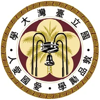
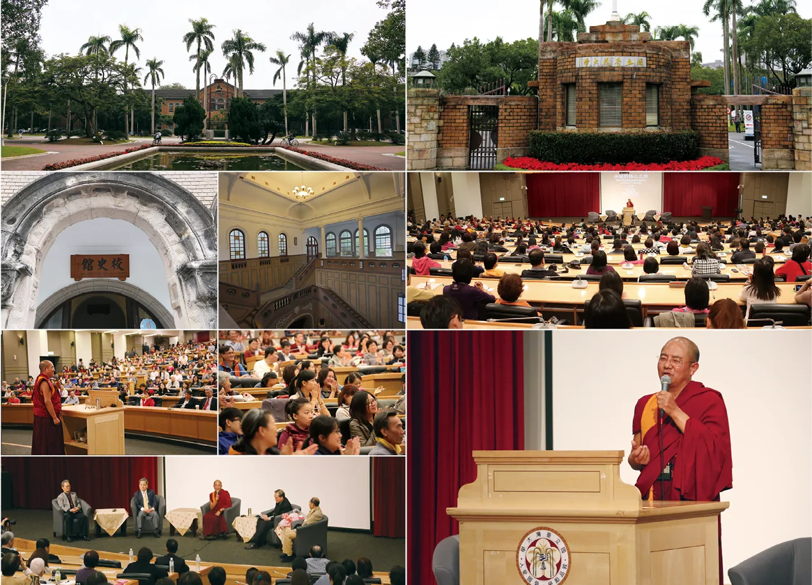
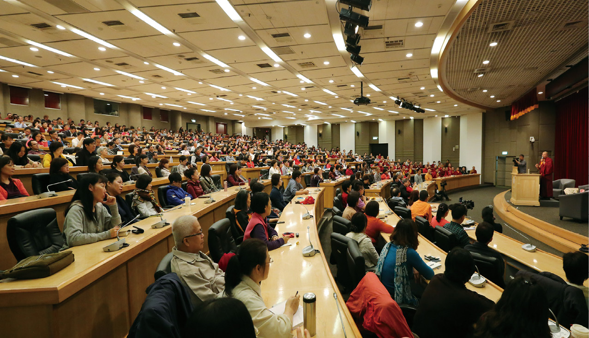
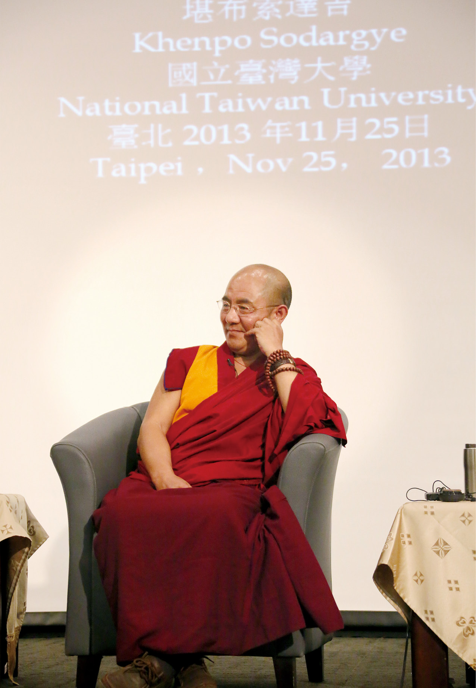

“这些人和我们是一样的，

只不过暂时运气不好。

我们有能力就帮他们一点。”

第72场

台湾大学

National Taiwan University

中国·台北

2013 / 11 / 25

## 神秘的修心之路

## The Secret Path of Mind Training

主持人：

各位下午好！今天我们很有福气地恭请到索达吉堪布仁波切为我们做一场演讲。堪布十八年前来过台湾，十八年后再来宝岛，台大是他此次佛法与文化之旅的第一站。

堪布演讲的题目是“神秘的修心之路”。

很明显，堪布本人践行的就是一条修心之路。堪布从小具有仁爱心、慈悲心，没有杀过生，没有伤害过生命；堪布简朴，一条腰带用了几十年；堪布精进，出家后每天只睡三四个小时，日日夜夜闻思修行；堪布证悟高深，不可思议的境界已经彰显在他的事业中：著作等身，传法不辍，不仅为修行人传讲五部大论和甚深密法，引导实修，还走进世界各地的大学，用现代人听得懂的语言与他们交流佛法；同时还做慈善，创建智悲小学，开设慈慧基金……

我们要知道，堪布的视野和见地是跨宗教的，他不仅关怀生命，关怀弱势群体，也关注环保、和平、自然……总之，堪布的一切都非常殊胜，非常圆满。

刚才我提醒堪布，问答环节要不要把问题写下来，先选一选，堪布说：“不用吧，直接问就可以，什么问题都可以。”这是最让我羡慕的地方——自在，堪布做什么都很自在。

有请堪布仁波切——

如主持人所说，十八年前，我曾跟随我的上师法王如意宝来过台湾，逗留了一周。时间虽短，但对我而言那是一段美好的日子，不仅当时流连忘返，后来也时常忆起、说起。故地重游，又走了走，心里都是对上师的怀念。

我知道，和那时候比，今日的台湾与世界各地一样，随着外部世界越来越繁杂，人心也越来越浮躁了。不过，好在有佛法，一直以来，深厚的信仰气氛以其特别的力量加持着这块土地，人们相信，即使在今天，修行佛法仍是消弭焦虑和痛苦、回归宁静的最好方法。因为你们有这个基础，所以我在这里想跟大家谈一谈大乘佛教的修行方法。

这个方法并不神秘，归纳起来就六个字：施、戒、忍、勤、定、慧。对，就是六度：布施度、持戒度、安忍度、精进度、禅定度、智慧度。“度”也叫波罗蜜多，是度越轮回、到达彼岸的意思，一共有六种，所以叫六度。

大乘修行要求我们，首先必须发起利益一切众生、求证无上正觉的心，这叫愿菩提心；发了愿菩提心以后，就要修行六度，这叫行菩提心。有愿有行，才是大乘的修行。

在座的有些发了菩提心，有些没有，还有些既不信佛教，也不信任何其他宗教，这都没关系，等我讲完六度以后你们就会知道，对想要实践利他、实现生命价值的人而言，六度可以涵盖你的所有行持。而且，不论你生活在东方或西方，也不论你属于哪个民族、哪个国家，如果能把六度贯穿到生活和工作中，你的人生便有了非凡意义，并丰富起来。

## 布施度：慷慨给予

布施有财布施、无畏布施、法布施三种。

法布施就是传法，把佛教典籍中所讲的道理，以及自己的理解和体会传给大家。宽泛一点看，所有传递知识的行为，老师们在校园里教书育人，学者们走进社会普及科学常识和为人之道，都是法布施。我一向认为，这样的布施——对各层面真理的传递，是知识拥有者生存于世的重要意义。

无畏布施的意思是施以无畏，也就是保护生命，将人或动物从伤害及杀戮中解放出来，让其脱离怖畏，比如放生。现在有人反对放生，其实放生有没有意义，只要从所放生命的角度想想就知道了。在它正要被杀，瞪着恐惧的双眼哀号、挣扎、流泪却求告无门之际，你把它放了，让它重拾尊严，重回自己的天地自由生活，这是何等的善举？

动物的生命也是生命啊，和人的生命一样宝贵。

所以，偶尔听到有人反对放生时，我就不知道说什么好，只是希望——如果有可能的话，希望他们好好考察一下，护生人士基于平等理念爱护生命的慈悲态度。

下面说说财布施。财布施是指送财物给需要者的行为，例如济困、扶贫、赈灾，也就是一般所谓的做慈善。

很多人一听到做慈善，觉得那是有钱人的事，“你看他们那么有钱，他们不捐谁捐啊？”说得也是，生活在今天，人们从网络上可以直接看到富人的生活：豪宅、豪车、花天酒地。也可以直接看到穷人的生活，即使是遥远的非洲，也知道那里正有几百万人连生存都难以为继。前两天我去了柬埔寨，顺便到难民所、孤儿院看了看——太可怜了！

有钱人是应该做点什么，为这个世界。要知道，布施既是财物的施与受，更是温情的流动，从这种流动中，人们不仅可以看到世间的光明面、生活的希望，当他们拿你做榜样时，还可以从你的善良和慷慨中学习做人。

不过话说回来，布施并不只是有钱人的事，而是每个人都要学习的修行。这个修行的重点，是锻炼你的舍心，让你远离吝啬，并渐渐形成泛爱世人的胸怀和能力。

罗斯·佩罗（Ross Perot, 1930-2019）小的时候，与家人一起住在美国和墨西哥交界的一个地方，每天都有流浪者跑到他家里讨吃的，家人从不拒绝。后来家人见来得越来越多，就问：“你们怎么知道直接到我们家里来呢？”来人回答：“我们互相留记号，你们家慷慨，我们就在门口打上记号，所以大家都来了。”

这时候，小佩罗对妈妈说：“要不把那个记号擦掉吧，不然的话，我们家很快就成了流浪者基地了。”

“不行啊，孩子，”妈妈说，“这些人和我们是一样的，只不过暂时运气不好，我们有能力就帮他们一点。”

妈妈的话影响了佩罗一生。佩罗后来成为亿万富翁，两度以第三党候选人身份参加美国总统竞选，并且获得了不错的支持率。他总结自己的成功时说到，从母亲那里继承的慷慨，是他日后获得财富和声望的原因。

他说得对。不过，可能更关键的是，一次次布施过程中，满足他人需要时的欢喜与受施者的感激交织起来，养成了他乐善好施的习惯，这个习惯加深了他的爱和慈悲，进而形成了平等开阔的生命格局。这是成大事的格局。而这个格局，他在母亲的教导以及家风式的施舍中自然形成了。

“我们有能力就帮他们一点”，在我看来，母亲朴实的话语中别有一番修行式的督促。佛教很多修行窍诀中说，趁我们得到了难得的人身，还有自由的时候，一定要修行。而把这放在布施度中就是，趁我们有钱、有能力的时候，尽量做布施。请记住，我们很可能不总是有能力的，因为无常就在身边，今天多少亿、明天身无分文的情况很多。

所以，趁我们有能力的时候，力所能及地做点布施，或者放放生，多好！也不用多，一个月一次两次就可以。

## 持戒度：以利他为最高原则

一说戒，很多人觉得麻烦，“条条框框，约束。”其实哪里没有戒呢？国家有国家的法律，企业有企业的规章，开飞机轮船要走航道，行车徒步要看红绿灯，这都是戒。戒是约束，也是防护，不管你是做老师、公务员还是经商，原则总要守的，守好原则才能免入歧途，并有所成就。

而所谓持戒，就是守护原则。

大乘佛教的修行有三类必须守护的戒律：禁止恶行戒，摄集善法戒，饶益有情戒。所谓禁止恶行，就是“诸恶莫作”，例如断除杀生、偷盗、邪淫、妄语、害心、贪欲等一切罪业；摄集善法是“众善奉行”，念经、诵咒、打坐，一切该行的善都要行；最后是饶益有情——你要利他。

大乘修行以利他为最高原则。

本来校方给我的题目是“有一种饰品叫利他”，后来换成了现在这个，其实那个也不错。人人喜欢装饰身体，以展示自己的美和独特，比如戴耳环，一个、两个、三个、四个，印度那边还有戴鼻环的传统。穿衣戴帽也能显示很多东西。还有头发，往前梳、往后梳、往上梳，红色的、黄色的、褐色的……只要自己喜欢，怎么样都好。不过，如果你想要寻找一种饰品，以庄严心灵，我建议你选择“利他”。

利他是最美的饰品。而禁恶行、摄善法、饶益有情这些大乘戒律的设置，就是为了让我们顺利生起利他心，进而守护此心并让它变得越来越清净，直至圆满。

在利他心不断增上的过程中，如果我们确实有清净的利他动机，也确实有智慧和善巧方便，为了利益他人，做些在小乘戒律中严格禁止的行为，比如说妄语、说绮语，是可以的。为谋求他人利益，甘愿自己在轻微戒律上受损，是一种承当，不是罪业。相反，如果伤害众生，就破戒了。

再进一步，随着整体修行的成熟，利他心与空性见并行增上，直至证悟。从那之后，守戒便成了自然的事情。在三轮体空的观照中，了知护戒者、戒以及由戒所护的众生全然是空性的，了无一念执著，不刻意守护却又丝毫不犯。

总之，戒是约束，也是防护，不仅是修行，任何形式的生命成长都需要与之相应的戒律。守好戒律，会给我们的身心以及周遭环境带来和谐，相反，离开了戒律，离开了道德约束，心就成了流浪汉，生命也就失去了力度。

有位研究法律的台湾学者告诉我，他很欣慰，对今天的台湾社会，戒律日益展现出不可思议的匡扶功能和救护效果，凡是听到戒律的人都心存敬畏。他认为，持戒不仅有利于个人的身心进步，对社会秩序也是一种贡献；他甚至断言，如果人人守护一分戒律，便可阻止我们的家庭和社会陷入难堪乃至无法挽回的失控境地。“我终于知道，”他说，“一个人没有约束，就没有道德；没有道德，就没有自由和尊严。”

他的话让我坚信，持戒是世间最庄严的美德。

## 安忍度：坚强忍耐

安忍就是坚强地承受和忍耐，也分三种。

第一是苦忍。修行中籍由痛苦的敲打，我们的心会变得堪能有力，这样后面就好修了。吃不得苦怎么修行？不说修行，活着都困难。现在很多大学生一点点苦都受不了，还动不动自杀，这样怎么行呢？磨练一下也好。

刚才我问他们：“台湾大学生自杀的多吗？”回答说：“没有，至少台大这几年没听说。”这就好，可能我们的挫折教育做得比较到位。这一块对年轻人很重要。

第二是害忍。害就是伤害，侮辱、谩骂、攻击，所有伤害都要忍。就我从新闻里看到的场面判断，台湾的政要必须多修安忍，不忍不行。可能也是一路修上来的，大家看他修得不错，就选了。但上来以后，还要继续修。

“难行莫胜忍”——最难的修行就是安忍。

但有时候不得不忍。文革期间，有位女士被剃了个阴阳头，接受批斗。虽然已经学佛多年，但还是气不过，羞辱、愤怒、痛苦，想骂人，想一死了之。这时候，有位禅门大德让人给她递了张纸条，上面写着：“此时正当修行时。”看完纸条，她的心豁然了，挺了过来。

想想看，在那一刻，还有什么比安忍更有面对和挽救的力量？没有吧。其实我们需要忍耐的时刻很多：生活不顺了，要忍；事业陷入危机了，要忍；生病了，治疗过程中要忍；不论怨敌还是亲人骂你、伤害你，都要忍……不然怎么办？愤怒、争吵、报复——但这些做法有用吗？除了加重仇恨、延长痛苦之外，解决过什么问题吗？所以，不如修安忍，用短暂的克制化解掉往昔的业和重重怨结，回归宁静。

请记住那位大德的话——“此时正当修行时。”

还有一个叫法忍，就是对空性、如来藏、密法境界等甚深义理的承认和接受。这种忍挑战的是智慧。要接受真理，不论是科学的、宗教的，小乘的、大乘的，都需要智慧。

藏传佛教推崇辩论，认为辩论是探寻真理并形成究竟见地的捷径，所以，如果有谁对佛教的哪个观点不承认，可以到藏地寺院找人辩论。台湾这边也有堪布、格西，萨迦、格鲁、噶举、宁玛、觉囊的都有，找他们也可以。

辩论是个好事，可以遣除疑惑、认识真理。如果你以辩论的方式说出理由，你对，我们接受，否则，毫无理由地指责、讥讽、谩骂，就不是学者、智者的态度了。

佛陀是这么教导我们的：以真理为皈依处，而不是你的我的之类的臆造说法。当藏传佛教用讲、辩、著将这一传统完整继承下来以后，不论听闻还是讲解，都以真理为准。很明显，如今这种公正客观的态度，已经得到了广泛认同，你们从科学家与藏地智者之间的对话中可以看到。

我并不担心藏传佛教的教理被推翻，但我确实担心，人们因为毫无根据、人云亦云的说法而排斥真理，失去大利。我希望人人接受这些美好的教义，并从中获益。

## 精进度：乐于行善

精进就是勤奋努力。学习世间和出世间一切学问，做任何事情的时候，都需要精进，老是懈怠、懒散、自我轻凌——“像我这样的人怎么能行呢”，是很难成事的。

精进有三种：披甲、正行、不退。

所谓披甲精进，从出世间修行上讲，当我们看到佛菩萨以及历代大德经由精进修行实现了伟大证悟，便在心中立誓，我也要获得如他们一般的成就；从世俗功业上讲，当我们看到有人为社会为世界做出了巨大贡献，便发愿学习他们的坚韧、笃定和非凡智慧，取得与他们一样的成功。这样立誓，就是披甲精进，在内心里披上无畏铠甲。

正行精进是指实地去做。想得好、说得好，始终“明日复明日”，什么都不做，谈起来颇有气势，做起来既无章法又无力度，是没有意义的。在世间，不论你做什么，都要先想好目标，安排好计划，然后脚踏实地、有头有尾地去做。我非常钦佩这边有些大德的行事作风，他们从发愿开始，十多年如一日地写书、办中心、传播佛法，这就是正行精进。

不退精进，在没有获得圆满之前始终不满足，一直努力。比如求知，活到老学到老，对知识永远充满渴求；比如做事，一件事没有做成之前，一直做一直做；再比如修行，开始之后毕生精进，乃至一世接一世绝不退转，直至成佛。

做什么都要有这么股劲儿。昨天那位导游六十岁了，但不管讲什么，历史、人文、经济，滔滔不绝，幽默风趣；那天我在新加坡也遇着一位老人，七十岁了还在工作，很有活力。人就是这样，年龄不是问题，主要是心力，动不动“我老了，我不行了”，那可能真的不行了。我们看古往今来的那些大德，一百岁了还在利益众生。这就是不退精进。

精进的本义不只是勤奋，而是乐于行善。

世人从早到晚忙碌，有压力有快乐，为自己为家人，这种积极性值得肯定，不这样努力打拼就无法生存，也体现不出生命的意义。不过，如果能把这种积极性，也用到服务社会和广大人群以及修行佛法上，就更好了。

## 禅定度：静心的喜悦

禅定分世间禅定和出世间禅定两种。

现代人喜爱禅修，并希望籍由禅修，在这个躁动的世界中找到内心的祥和与宁静。有人专程到尼泊尔、藏地等世界各地的道场禅修，有人就近在企业或大学的禅修中心里静坐，但据我了解，他们修的多数都是世间禅定。

世间禅定的作用是静心，方法是一缘专注，让心专注于某个对境，持续安住。这里面的层次很多，但归结起来，一般会落在明、乐、无念三种觉受上。安住明的境界时，人的感觉是明明亮亮，有如证悟一般；生起乐的觉受时，整个身心融在一种周遍的喜悦中；处在无念的境界中，则没有任何心念，可以住很久。在这三种觉受之上，还有一种空的觉受，空可以破掉明乐无念的耽执，但也还没有脱离耽执。

能够脱离耽执的是出世间禅定，也就是缘真如禅定。安住在这样的禅定中，便远离了四边八戏的所有执著，真正通达了一切万法的真如本性。出世间禅定的目标是解脱。

我经常鼓励大家修禅定。因为我看到，现在每个人的生活中都充满了压力，无一不是负重前行。躲又躲不掉，怎么办？修修禅定。修了禅定，你的心就放松了，也能专注，应付什么都是绰绰有余，说不定还会有意外收获。

以前有个卖豆腐的，天天给寺院送豆腐，每次经过禅堂时都看见里面有很多出家人坐着不动，心里很纳闷。有一次他忍不住了，问方丈：“你们天天这么坐着，搞什么呀？”

方丈说：“这是打坐，来，你也坐一会儿吧。”

卖豆腐的觉得有趣，于是学着出家人的样子，双腿盘好，双手结定印，坐好，一动不动。约莫过了半个小时，他突然站起身来，冲出了禅堂，大声地喊着：“太妙了！太妙了！想不到打坐还真是有好处呢。”

方丈笑着问他：“你有什么心得，说说看。”

他说：“平时我脑子乱，糊里糊涂，但刚才坐着坐着心里就亮堂了，脑子也好使了。我一下子想起来，三十年前邻居王小二欠我两毛五豆腐钱，到现在还没还呢！”

这是一则趣谈，但并不荒诞。就我个人的经验来看，心静下来以后，确实能想起好多事情；而且，有些平时解决不了的问题，坐着坐着，方法就出来了。我听说有个人跟家里吵架以后，跑去打禅七，结果禅七打完，气儿也消了。

很值得尝试啊！我建议大家每天早晚打打坐，每次十五、二十分钟就够了。养成习惯后，你会发现，自己的心开始呈现轻松、喜悦的状态，那些通常让你感觉烦乱的事情，已经不容易干扰你了，即使遇到非常严重的问题，心态也能很快调整过来。这就是禅修对生活的价值吧。

## 智慧度：洞察真理

智慧是一种力，辨别、拣择和决断的力。以上五度的修行，都是为了生起、增上和圆满智慧度。而我们到大学求知，也不是单纯地为了积累知识，更是为了萃取智慧。

如果分两种，智慧也有世间和出世间之分。

世间智慧很重要，因为我们就生活在世间里。有了世间智慧，经商可以发财，研究学问可以得到学问，求功名可以得到功名。然而，考虑到此生短暂，生死长远，我们还应该学习一些指向解脱的出世间智慧。不相信来世就没有办法了，否则，一个既有智慧又相信来世的人，最终却把所有智慧用在今生的生存上，甚至为此造下恶业，没有为来世和解脱准备一点点资粮，那还能不能算得上智者，是很难说的。

出世间智慧中，最重要的是无我空性：“我”不存在，我所拥有的一切不存在，乃至一切万法的自性不存在。为什么呢？因为“我”是假象，是我们缘着五蕴产生的虚假认同；“法”也是假象，如果你一步步分析“法”的构成，就会发现，不论是心外心内的任何一个法，都没有实质性存在。

这种终极智慧的作用，就是洞察真理。

一直以来，科学把最重要的智慧都用在探索真理上了。科学在各个领域里的成就，以及人们对它的相信和依赖，让它成为揭示万法真相的唯一期待。然而，当科学尤其是量子力学、心智科学等前沿科学的研究者们，一次次给出令人振奋的突破性成果时，翻开古老的佛经却发现，很多道理佛陀在二千五百年前已经讲过了，特别是这个无我空性。

科学家们也在研究空性。不过，和他们的方法不同，佛学家们为了引导后学者认识这一真理，早已留下了严谨而简洁的推导逻辑——中观理论。中观理论是求证实相的利器，它超越了宗教。这不是我们自说自话，你们研究研究中观，再对照量子理论及其所得出的结论，就知道了。

如果把智慧分成三种，就是闻思修。在善知识面前听闻佛法和修行的道理，可以生起闻慧；对所听闻的法义进行思考、辨析和探讨，可以生起思慧；对深入思辨后形成的见解不断修习，便可生起真正的智慧，也就是修慧。

要说明这三种智慧，藏地有一个很好的比喻——牦牛吃草：首先是牦牛吃到草，这是闻慧；吃到草以后开始咀嚼，直至嚼烂，这是思慧；嚼烂后吞到肚子里，这是修慧。

我们可以用自己吃饭的情形作对照。比如观修无常，什么是无常？一切法刹那刹那迁变流转，就是无常。当你听到这个观点，以及推出这一观点的理论和根据时，相当于获取食物，并把它放进嘴里，这时候有了闻慧；当你用思考和辩论方式，分析根据与结论之间的逻辑关系，剔除所有妨害这一观点的理由和疑惑，最终建立起“一切法绝对是无常”的定解时，相当于咀嚼和品味食物，有了思慧；串习这一定解，相当于把食物咽下去，进入消化阶段，于是有了修慧。

其实学任何知识都一样，闻和思有了，才能修，让它成为自己的东西，不学不思考，就谈不上实践。

闻思修要结合起来。有闻思修的人，不管是自己修行，还是利益别人，都会有种力量。相反，闻思修不到位，影响自己倒在其次，如果去传法，会感受到明显的局限性，严重的，给人开示的道都有缺陷。而当人们走进来，跟着学习以后，不但形不成真正的修行，说不定还会误入歧途。

台湾有些佛教徒坦言，自己以前比较形象化，信佛，但没有智慧，佛到底是什么，不知道；轮回为什么成立，不知道，敬佛是敬佛，总归有点盲目，是迷信。但现在不同了，闻思以后有了智慧摄持，信起来修起来都很踏实，是智信。不管是大学的老师同学，还是社会各界的信佛人士，都感觉自己的信心明显提升了，也很有一种修行的乐趣。

这就是由思辨生起了智慧。而有了智慧以后，便不会人云亦云，别人赞叹也跟着赞叹，别人诽谤也跟着诽谤，不会这样。这才是学佛，有智慧，自有主张。

## 心变了，世界也会变

以上讲了六度，既神秘，又不神秘。修行六度就是修行一切善法，就是修心。我们是高智商的人类，和动物比有很多优势，如果我们把智慧拿来修心，心会改变。

据说澳大利亚有一种苍蝇，因为那边人少，卫生搞得又好，苍蝇们找不到粪便和垃圾吃，转而去吸食花的汁液，于是身体慢慢改变了，没有病菌，呈金黄色，甚至连以前那种令人讨厌的“嗡嗡”声都没了——有点可爱了。

你们看，小虫在清洁环境的逼迫下，都可以获得净化，而我们是人，有智慧，懂因果明是非，为什么不能在清净智慧的引领下，走上自我净化的修心之路呢？

心是改变一切的主导和原动力。一块铁，你可以把它做成盒子，也可以做成针；一块地，你可以用它修花园，也可以建粪坑。同样的，我们这颗心可以行善，也可以造恶。如果你去造恶，自然感受苦果，严重的，即生进监狱，来世入地狱，痛苦无量。如果你去行善，即生快乐相随，健康成功，一切圆满，来世往生极乐世界，享受解脱大乐。

这就是我的心境观：心变了，世界也会变。

现场互动

问：我曾经跟上面提过，希望他们重视台湾的贫富差距问题，对这种贫富差距现象，您怎么看？

堪布：贫富差距是正常现象，人和人的业不同嘛。比如一家里有三个兄弟，父母给每人留一份同样的财产，几年以后，因为福报不同，兄弟之间也会呈现贫富差距。这是没办法的。不过，如果能在这样的社会中对贫穷的人给予帮助，于社会可以尽一份责任，而于自己，则可以完成一份修行。

问：请问佛教是宗教还是教育？

堪布：佛教既是宗教，也是教育。

人类受教育的主要目的，是为了提升智慧，以便满足物质和精神需求。而要提升智慧，单单依靠科学式的教育能不能完成呢？不能。你们都看到了，在西方，科学那么发达，还是离不开信仰的支撑，所以，完整的教育里需要有宗教，当然也包括佛教。我认为，佛教是相当完美的教育，因为佛教的思想中既充满理性思辨，其逻辑无悖于科学，又饱含人文关怀，其慈悲观深化延伸了儒家的仁爱理念。

刚才路上我问他们：“台湾最近在关心什么？”

“食品安全，”他们说，“比大陆吵得还厉害。”

这就是道德教育问题，也是信仰问题。如果人人讲仁爱讲慈悲，谁会做那种事呢？不会的，有符合道德的经营和治理就不会。现在大家都明白了，今日社会最需要的是传统教育，而佛教的因果和慈悲理念，与这样的教育一致。

所以，佛教是教育；当然，在某些层面又超越了教育。

问：您翻译时，对待古典跟现代有什么原则？

堪布：古典跟现代有点不好平衡。对那些古老作品，如果完全按照古典的方式去译，很难契合现代人的思维习惯；但如果太迎合现代人的想法，又会对它原来的意思多少有些违背。所以，我的原则是：意义上，尽量做到精确把握；而文字上，则随顺现代人的心态、价值取向和阅读要求。

通俗一些，人们就容易接受。

问：您从您老师那里得到最受用的教言是什么？

堪布：我和“国际藏传佛教研究会”的很多法师，当年都一起依止过我们的老师法王如意宝，我们从老师那里得到了很多教言，这些教言改变了我们的一生。

人和人看着差不多，但的确不一样。藏族有种说法：人与人不同，否则，为什么一个做了君主，一个成了奴仆？树与树不同，否则，为什么一个做了梁，一个成了柱？

我的老师就是一个很不一样的人。他有不可思议的威德，他的有些话，你听着很普通，好像谁都会说，但它有力量，有加持。他一生讲过的许多教言让我受益无穷，但我每天都会再再忆念的，是他常说的四个字：观心，利他。

“观心，利他”，这就是我最受用的教言。

观心，是内观自己的心，看看它到底是个什么面目，要认识心的本质；利他，是利益一切众生。

人活着，往外面看可以，但有时候也得往里面看，了解了解自己；为自己活可以，但有时候也得为旁边乃至更大范围的人群活一活，为他们做点事，否则，活了一辈子，走的时候想想，明明是个有能力的人，但到头来自己没活明白不说，对他人也没什么帮助，是不是很遗憾呢？

问：目前台湾岛内经济低迷，人心浮动，请问在这种时候，我们该用什么样的心态面对？

堪布：经济时起时落是正常的，不仅台湾，全世界都一样，也不仅是经济，生活的方方面面都是如此。尤其是心情，时好时坏，起伏不定。所以，我深信万法无常的道理。

无常是避不开的，既然避不开，不如修一修，从心里对无常有个深刻的了解。修了无常以后，你的心就开阔了，心开阔了，什么样的生活都能过。有钱有权的时候，快乐淡定；无钱无权的时候，悠闲从容。怎么样都可以。

昨天我遇到一位智者，他说：“我来岛上六十年了，六十年里什么都见识过，经历过，但怎么样呢？不过如此。”用无常的智慧看世间就是这样，再怎么样的波动，再怎么样的什么什么，也都是一样的——过眼云烟而已，不过如此。

问：我看到很多非佛教徒、没有宗教信仰的人在面对死亡时非常绝望，请问这时候应该怎样帮助他们？

堪布：试着讲讲来世，讲讲极乐世界的功德，看他能不能接受，能接受，那就和他一起念念佛，帮他走出绝望的心境。等他死了，为他助念，做点佛事超度一下。

不接受的话，只能用别的办法了。特别是去世以后，如果他的家人不接受佛教的做法，那也只好从旁边为他念些阿弥陀佛名号和观音心咒。我有时候在医院或什么地方见到有人去世，就在心里默默念几句观音心咒，不敢让他的家人或旁边的人听到，怕人家反感。只能这样了，先种个善根。

说到这里，我倒想劝劝在座的诸位，想学佛法的话，最好趁早，不要等到七八十岁，那时候可能来不及了。客观地说，佛法还是挺难的，人老了记也记不住，想也想不清楚，连个简单的知识都学不好，更何况佛法？

我见过很多走到人生边缘才开始学佛的人，他们的心情都差不多——既难过又懊悔，“唉，年轻时净执著这样那样的事了，如今死亡就在眼前，佛法这么好却学不懂，修不了……”

我不是在劝你们信，而是学，学了以后，信不信由你。

问：我一直在听您的课程，看您的书，那里面您总是提醒我们要发菩提心，利益众生，但在我们利益众生的过程中，把佛法的好处告诉他们，他们好像不感兴趣，只想要些世间的利益，但给世间利益的时候，又好像助长了他们的贪嗔痴，请问，到底怎样才是真正的利益众生？

堪布：利益众生有暂时和究竟两种。给点吃的穿的以及其他的生活资具，让他活下去，活好一点，这是暂时的方式，佛陀在过去世的修行中，也常常做这样的布施。究竟的利益众生是讲法，用佛法将他们从轮回苦海中救度出来。

当然，讲法要看时机，做布施也要掌握好分寸。什么分寸呢？不要因为吝啬，而不肯施，障碍了自己的修行；也不要因为一时兴起，就随便给，助长了对方的贪婪。

简单讲就是，既要修自己，又要护他人。

问：请问汉传佛教与藏传佛教有什么异同？

堪布：从究竟的意义上看，两大派系的佛教是一致的。比如，在修行方面，汉传佛教的教导是，首先发菩提心，中间积资粮，最后得佛果，藏传佛教也一样。在教主方面，藏传佛教承认释迦牟尼佛是整个佛法的教主，曾经转过三次法轮，宣说了八万四千法门，利益了无量众生，汉传佛教也这么承认。

至于不同，主要体现在细微的地方，比如，汉传佛教的禅宗、净土、华严，各自都有自己所尊崇的经典或教义，以及修行方式，而藏传佛教的萨迦、宁玛、格鲁也一样。

总之，两大派系在根本问题上一致，不同的只是支分。这就好像两所大学，建制一样，每个大学都下设了好多学院，每个学院又设有不同的系，每个系有自己的主任和老师；教育方向也差不多。主要的东西都一样，所不同的只是某些理念、方法和课程的设置而已。

既然差不多，各展所长是最好的，不需要互相排斥。有个学净土的老菩萨跟我说，他以前特别讨厌藏传佛教，见了穿喇嘛装的就受不了。有一次在火车上，他看到一个蓄着短发穿着红衣服的女士，以为是喇嘛，就骂……

他一边讲一边笑；笑完，就哭起来了。

问：我是堪布的fans，台湾的大学生。我想请问，在这有限的一生中，如何才能积累起广大的福报？

堪布：一般人所谓的福报，“我福报大”“我没有福报”，指的就是钱，但实际上还有很多，健康平安、智慧敏锐、明辨是非、羞恶乐善、心胸开阔、心态平和等等，都是。

福报是修来的。前世善法修得少，今生再怎么努力，也很难如愿，很难得到想要的东西；前世修得多，今世里不论是生活还是工作，常常心想事成。很奇妙。但福报会用尽，所以要不断地修，为今生，为来世，就像充电一样。

要想迅速积累起广大的福报——世间的福报也好，修行的福报也好，最好的方法就是发菩提心，修六度。

问：能否请您就依止上师问题开示一个要诀？

堪布：依止前多观察，依止后观清净心。

先好好观察。现在有人是先依止，然后观察，最后诽谤，这样不好，会给后续的修行带来不好的缘起。要先观察，善巧而有智慧的观察，可以让我们找到真正的善知识。

观察完，开始依止了，就要学会观清净心。心不清净的人，对谁都能挑出一堆毛病，即便是上师：他白天怎么怎么，晚上怎么怎么，做事怎么怎么，说话怎么怎么……但这不是在修行啊。修行人看谁都是清净的，更何况上师？

真正的上师具有无量的功德、无穷的加持，就像我的上师法王如意宝，一直以来，我始终觉得他就是佛。

我常常提醒修行人，一定要记着你是来修行的，修行和其他的世间行为不同。你要恭敬上师的所有教授，把上师的微笑甚至玩笑，都要当作具有深意的修行指导。当你有了这种清净心以后，就可以修学上师的意趣和行为了。

问：我是韩国大韩佛教曹溪宗佛教协会的职员，佛陀最重要的教法三法印中说“诸法无我”，“我”不能永远存在，既然如此，我们该如何理解藏传佛教的转世者呢？

堪布：无我跟转世是不矛盾的。

三法印说诸行无常、诸法无我、涅槃寂静，其中的“诸法无我”，不是说证悟时“我”消失了，而是说，在究竟的实相层面，本来就是“无我”的。证悟者和未证悟者的区别是，证悟者认识“无我”，未证悟者不认识。

“无我”有“人无我”和“法无我”两种。

对人而言，叫“人无我”。不管是活佛的“我”、平凡人的“我”，韩国人的“我”、藏族人的“我”，都不存在。

对法而言，叫“法无我”。这个“我”指的是自性、本体，在实相中，台湾大学的自性不存在，演讲大厅的自性不存在。你们看这个麦克风，不管它的材质是什么，只要用智慧分析就会看到，它实际上是由分子、原子乃至更细微的粒子组成的，而分析到最后就是空，了无一物。

任何法都是如此，也包括人，所以叫“诸法无我”。

既然“我”不存在，活佛是怎么转世的呢？

这就要讲到实相和显现的问题了。“无我”是从实相或说本体上讲的，在究竟的真理层面，一切法无我。而在显现的世俗生活层面，“我”是存在的，活佛存在，你和我也存在，台湾大学存在，韩国佛教协会也存在。既然“我”在世俗中存在，众生的生死连续就存在，活佛的转世也存在。

理解这个问题的关键是，分清显现和实相。

所谓显现和实相，就是我们通常所说的现象和本质。本质是空的，但现象存在，否则我们怎么会在这里探讨佛法？

问：晋美彭措仁波切已经圆寂很久了，为什么还没见到他的转世，请问法王圆寂时有没有遗言，说何时再来？

堪布：再过一个多月，就是法王如意宝圆寂十周年的日子。作为弟子，上师离开后，我感觉自己就像失去父母的孤儿，心里时不时会有一种独留世上的凄凉和悲伤。

我也希望上师乘愿再来，但上师在临圆寂前两个月的一个法会上说：“如果我走的话，就去极乐世界，那时候，你们不必寻找我的转世，不要49天还没过就认定我的转世活佛。”不过上师也没说永远不来。所以，等机缘成熟了，我想上师还是会来的，只是不知道这个机缘何时成熟。

我依止上师如意宝近二十年，做了十八年翻译，为了表达内心的怀念，今年我把上师讲过的一些深刻却也容易被现代人接受的教言，编辑成书出版了，叫做《不离》。

我觉得这个名字很贴切——“不离”，只要你祈祷上师，上师就在面前，从未离开。正如《妙法莲华经》所说，佛陀会示现涅槃，但佛陀从未离开世间，佛法也不会真正隐没。

其实上师的教言就是上师。

问：如果我们邀请您去韩国讲法，您会去吗？

堪布：因缘成熟的话，我会去的，但是因缘能不能成熟，什么时候成熟，就不知道了。感谢你的邀请。

问：现在有人认为，不必修五十万加行，因为佛陀时代并没有这种传统，还有些上师因应不同的文化跟环境，用其他方法代替五十万加行。请问您对此怎么看？

堪布：任何法脉都是以佛陀的教法作为依据，由祖师大德结合了相应的修法和口诀，开创并传承下来的。藏地各教派都有修加行的传统，尤其是宁玛巴华智仁波切——你们称巴楚仁波切这一支，所有传承弟子都非常重视加行，有的修了三遍，有的修了十遍，还有的修了二十五遍。

我们重视加行，一个原因是，这是我们的传统，是由历代的本传上师们传承下来的。还有一个原因是，“五十万”这个数量本身就是一种考验，如果修不到，说明你在信心和毅力上还有欠缺；修到了，意味着你已经积累了相当的资粮，这对未来的修行是一种强有力的保证。

再说，你们也知道，其实汉传佛教中也有这种佛经里没讲但与教法相合的独特修法，而且关键是，自这些修法被开创以来，后代修行者运用它也确实获得了成就。

所以，五十万加行本身没有问题。

说到不愿意修，因为工作忙也好，喜欢简单也好，有的上师为了随顺这种心态，便用其他方法代替，这个我理解。但我还是遵循传统的，今年在佛学院传《大幻化网》，我就要求他们说，没有修完加行的一律不准听。

我的经验告诉我，修完加行的人，心态都比较稳定，气质也不一样，听密法容易受益。而没有修完的话，出家人也好，在家人也好，很多见解对他来说不过是空中楼阁，即使听了，也够不着，相应不了；虽然他们自己说，已经得到什么什么灌顶，获得什么什么境界，但没有加行的保证，过段时间退得也快，说不定还会影响到信心和誓言。

所以，不管怎么说，我还是建议修加行。
