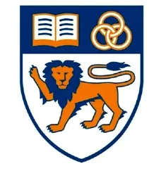
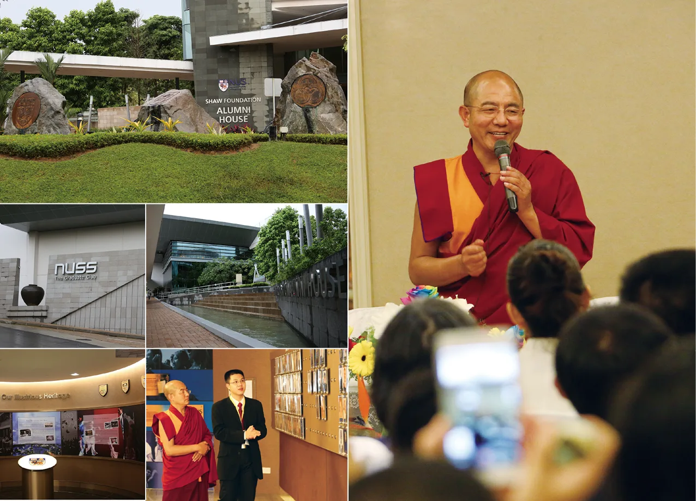
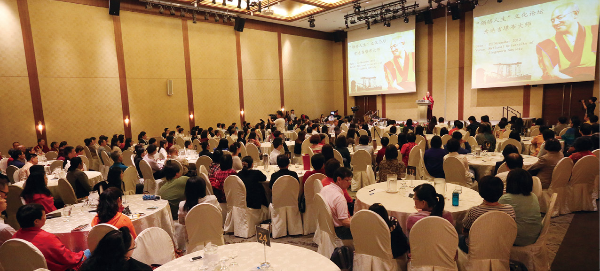

一切美好的事物，

最终都是无常的。

无常一旦来临，

就不会让人快乐。

第71场

新加坡国立大学

National University of Singapore

新加坡

2013 / 11 / 23

## 领悟人生

## Insight for Living

我第一次来新加坡是在1995年，当时陪同我的老师——法王晋美彭措一起来的。老师对我非常好，我如今的一切都来自于他老人家，但老师现在却已经离开了世间。昨天刚到新加坡时，我心里有一种说不出的感受。其实我们人生中的很多宝贵知识，都来自老师，一旦老师离开世间，我们就很难再有机会报答师恩。

当年与老师一起来新加坡时，我还年轻。在那一个月里，我们跟这里的知识分子、佛教徒有过非常精彩的交流。但现在，即使我再想念他，有些感受也很难用语言表达出来。

我第二次来新加坡大概是1999年，离现在也有14年了。总的来讲，我在这些年中的感悟是，无论走到哪里，无论跟什么人接触，都是一种经历，也是一种学习的机会。今天和大家一起分享交流，也是一个难得的机会。我可能讲不出很深的道理，但特别希望有人能从我的分享中受益。

每一个人，从来到这个世界直到离开，都会有一些非常精彩、有意义的经历，认识并把握这些经历是非常关键的。自从我真正学习、了解佛法后，人生有了非常大的变化。虽然我没有大彻大悟，但确实认清了很多世间的真相。我特别希望年轻人能在寻找人生目标的过程中，也了解一下佛教所揭示的道理。

## 人生真正的领悟是“苦集灭道”

人生有不同层次的领悟。世间当中有一些“认识、放下、解脱、自在”的方法，而出世间当中则有更甚深的方法。比如，佛教中讲，真正的领悟是要懂得“苦、集、灭、道”。这也叫做“四圣谛”，是圣者的境界，我们凡夫很难通达其中的甚深意义。两千五百多年前，释迦牟尼佛在印度三转法轮，传授了八万四千法门，但归根结底，都可以归纳为“四圣谛”。

释迦牟尼佛在印度鹿野苑第一次传授这个法门时讲：“此是苦，逼迫性；此是集，招感性；此是灭，可证性；此是道，可修性。”这里讲的是人生真相：我们现在的痛苦，都是以因缘而来，但这种因缘可以被了解，也可以通过修行被灭除。

“此是苦，汝应知；此是集，汝应断；此是灭，汝应证；此是道，汝应修”，意思就是：你应该认识到，现在所承受的痛苦，其来源就是执著和烦恼，而认识到这一点后，你应该通过修行、学道来断除它，最后获得证悟。

“此是苦，我已知；此是集，我已断；此是灭，我已证；此是道，我已修。”从释迦牟尼佛，到无数的菩萨、阿罗汉、成就者，他们以亲身体会来告诉我们：苦，我已经认识了，并且找到了苦的根源，我通过修行断除了苦，最后现前了灭谛，现前了成就。

以上就是佛教所讲的真相。

## 苦才是人生

如果想要更进一步了解这个真相，首先要认识到我们现在正在承受痛苦。

很多人认为，我们现在的生活并不苦，过得很快乐。但实际上，随着科学越来越发达，社会竞争越来越大，我们生活的压力也随之增加。我第一次来新加坡时，这里的人虽然也有烦恼、压力，但并不像现在这么忙，物价也没有这么高。表面上看来，新加坡人非常有成就，不但在海上填出很大一块陆地，而且高楼大厦也越建越高，但人们的困惑、痛苦、焦虑好像也越来越多了，这是为什么呢？这就是因为“轮回皆苦”。

如果你觉得人生应该是幸福的，那在挫折面前，你可能就会觉得自己格外不幸，难以面对现实。但人生的底色其实是痛苦，虽然我们可以获得一些快乐，但它很快就会消失。

有人会说：“我现在很快乐，生活甜蜜，怎么会是‘轮回皆苦’呢？”其实，当你真正用智慧观察时就会发现——在六道轮回中，地狱有寒热的痛苦，饿鬼有饥饿的痛苦，旁生有被役使和互相啖食的痛苦，阿修罗有战争的痛苦，天人有放逸和死堕的痛苦，而我们人类则有“三大根本苦”和“八种支分苦”。

## 生命无法承受之“三大根本苦”

人有三大根本苦，包括苦苦、变苦和行苦。

什么是苦苦呢？比如，家里父母去世、生意不好，又或者自己的身体不好等等，不幸在生活中接踵而来，这就是苦苦。

什么是变苦呢？本来过着天堂般的生活，但灾难痛苦突然发生，比如像日本和菲律宾的海啸。我问过一些人：“新加坡最近有没有什么海啸、战争？”他们说：“虽然目前没有海啸，但以后很难讲，因为新加坡就在海边；新加坡目前也没有战争，和邻国之间比较和睦，但以后也很难讲，因为这里的食物主要依赖进口，人才也很大程度上依赖移民。”除此之外，世间生活当中，家庭是否和睦也很难预料，即便当前感情和睦，但也许突然间发生很多变化。这就叫做变苦。

所谓的行苦，是我们生活中觉察不到的一种痛苦，但它实际上是苦因。比如说，新加坡母亲河周边的高楼很壮观，这些高楼凝聚了人们的力量、智慧、勇敢，当然也包含了发达的科学技术。但每一座高楼的背后，也凝聚了很多人的心血和痛苦，这就叫做行苦。此外，行苦中也包括“生老病死”的痛苦。

为什么我总是说“苦才是人生”呢？很多人认为，人生很幸福，幸福才是人生，但实际上，官员、富翁、学生、老师、乞丐，社会上形形色色的人，内心都有痛苦。当我们用智慧观察时，就会明白，原来人生的确是痛苦的。

## 八种支分苦之“生”

佛教中提到的八种支分苦，首先包括我们常讲的生、老、病、死。人刚出生时应该是很痛苦的。为什么呢？如果我们是快快乐乐地来到这个世界，那为什么出生时都在哇哇大哭呢？几乎没有人是笑着出生的，这就是一种苦的象征。

## 八种支分苦之“老”

很多人都担心衰老，于是使用各种化妆品、保养品，试图让自己永葆青春。但衰老的过程是没有办法停止的，青春是留不住的，脸上的皱纹会越来越多，头发也会越来越白。正如人们常说“人无千日好，花无百日红”“好花不常开，好景不长在”。

新加坡人好像没有过分担心衰老。我在宾馆里碰到一位七十多岁的人，他还在工作。我问：“你准备再工作多少年？”他说：“我身体还不错，准备再干一段时间。”我说：“你好厉害，在我们那里，六十岁的人已经觉得自己很老了。”如此看来，人的心力很关键。我有一些同学，才五十多岁，但已经想着要退休了。其实这并不好。

## 八种支分苦之“病”

人生中还有生病的痛苦。在新加坡，很多人都有医疗保险，政府也提供医疗服务，很人性化，但依然有人因看不起病而惧怕生病，任何国家都存在这个问题。当你生病时，你会觉得财富、地位都不重要，身心健康才是人生中最大的幸福。其实我们现在就拥有健康，应该开心才对，否则，当病重或临终时才意识到这一点的话，那就太晚了。

## 八种支分苦之“死”

佛教告诉我们，人会有衰老的痛苦，而死亡来临时，痛苦更加明显。很多人都怕死，尤其是没有信仰的人，连提都不敢提。其实大家不应该怕死，而应该在死前就做好准备，因为有些人是突然离世的，有些是年轻时去世，还有些是老年时去世，有各种情况。

以上就是生老病死的痛苦。

## 八种支分苦之“爱别离”

八种支分苦中还有爱别离苦，就是指你特别喜欢的人，经常不在你的身边，比如父母、家人、朋友总是离开你。

## 八种支分苦之“怨憎会”

怨憎会苦与爱别离苦相反，是指你不愿与之相处的人，常常在自己身边。

现在人与人之间的关系非常糟糕，我特别希望同学们在高校里学好如何处理人际关系。无论是谁，感情、就业或者生活的压力都是阶段性的，但人际关系不好，比如与家人、朋友的关系不好，却是终生的事情。

很多高校里也出现过一些悲剧。比如清华大学的朱令被人投毒，变成了植物人；还有云南大学的马加爵，杀害了四个同学。很多时候，同学之间因为一件小事就可能把关系闹僵。

新加坡人特别重视小孩子的德育，这是很人性化的教育，非常好。在工作中，德行和人际关系可能比知识更重要。如果没有一个很好的德行，那跟任何人都没办法相处。我听说有的人很难和其他人相处，容易精神崩溃。其实，如果我们早有准备，就不会这样。这个世界上有很多好人，也有很多坏人。遇到坏人的时候，我们千万不能精神崩溃，或选择自杀。去年新加坡有很多年轻人自杀，这是非常不明智的做法。自杀率上升是一个世界趋势，全世界每年有近一百万人选择自杀，这是非常可怕的事情。

有些国家在经济越来越发达的同时，道德、善良、慈悲、智慧、信心等宝贵的品质却可能在随之下滑。我们要对此有所准备，因为我们心灵的危机随时都会出现。表面上看，很多人过得特别开心，但每个人的背后都有伤心事。我们应该把这些事当作过眼云烟，不要憋在心里。要知道，人生中有很多事情，即使不愿接受，也还是要面对。

## 八种支分苦之“求不得”

很多大学生都面临着很大的压力，比如来自就业、感情、学业、家庭的压力。我昨天问一位老师：“新加坡大学生的就业压力怎么样？”他说：“工作是找得到，但不一定非常满意。”每个人都想要一个更满意的工作，但要求也不能太高。很多人特别懒惰，不但要求高薪，而且什么事情都不想做，周六、周日还要好好休息。除此之外，平时也有好多要求。但每个人都需要一定的付出，才能获得相应的回报。就算是出家人，虽然没有家庭或者工作的压力，但也不能整天只管睡觉，这毕竟不是人生的目标。我们不应该怕有事情做，而应该怕没事情做。在很多经典里，蚂蚁和蜜蜂都是勤劳、勇敢的“代言人”，它们一般休息得很少，但一生中却可以做很多事情。

此外，找工作也不能只盯着薪水高低，而应该考虑这份工作是否对自己的身心、对社会、国家，乃至整个人类有益。这才是最重要的。从表面上看，有些工作的薪水不高，但它可能在价值观上更重要。很多人在找工作时只考虑薪水，其实这就是爱因斯坦所说的“猪栏理想[^1]”。要知道，金钱不一定能解决我们所有的问题。有很多富翁，因为金钱坐牢、自杀，这在世界各地都时有发生。

## 八种支分苦之“五蕴炽盛”

最后一种苦叫五蕴炽盛苦，也就是说，在五蕴[^2]的束缚下，我们生活中的一切都会成为痛苦的因缘、根本。

当然，可能有人认为生活很美好，非常享受，没有什么痛苦。但圣天论师在《中观四百论》中指出：“无常定有损，有损则非乐，故说凡无常，一切皆是苦。”所有事物都是无常的——世上没有不散的宴席：家人、感情所带来的快乐是无常的；新加坡像天堂一样，是个非常美丽的国家，但这里所有的人百年之后都不在了，会换成另一批人；财产的主人也是不断变换的，不要认为买下一栋房子，它就永远是自己的，其实人能活多少年呢？很多富翁现在名下有上亿资产，但这些资产的主人却不断更换……一切美好的事物到最后都是无常，一旦无常到来，就不会令人快乐。所以佛教中讲，凡是无常的法，一定会带来痛苦。

## 佛教是人类共同的精神财富

有些人觉得，生活是这么快乐美满，佛教却把它比喻成火宅[^3]，说生活充满痛苦，一点积极性都没有。实际上，佛教只是将生活的本质剖析得很透彻。希望大家对佛教的理解，不要仅停留在形象上。有些国家佛教徒比较多，不管是在高校里，还是在社会上，每次开法会，都有成千上万的人参加。这是很好的事情，因为佛教的确可以洗涤我们的心灵。但很多人对法会的理解仅仅停留在仪式上，或者把佛教当作一种发财、保平安、保健康的工具；除此以外，并没有深入了解佛教更甚深、广大的内涵。

表面上看来，大家都是世俗人，而世俗人的眼光往往比较短浅，因此很多人学佛、皈依的目的就是为了保佑自己和家人平安，这是很短浅的目标。但如果是为了懂得宏观世界、微观世界，乃至我们心灵世界的种种微妙知识的话，那佛教也确实能够提供答案。

我并不是在这里自吹自擂。大家可以读一读《大藏经》，再了解一下科学家和知识分子是怎么评价它的。古人通过学习《大藏经》，又是如何在东方文明中开创出那么多精妙思想的。《大藏经》是人类社会中宝贵的精神财富，非常值得探讨和研究，可很多人还没有系统、正规地学习，只停留在比较功利的层面。我曾遇到一位大学教授，刚刚皈依了三宝。我问他：“你皈依的目的是什么？”他说：“我经常开车外出，担心路上出现意外，皈依三宝就是希望可以保佑一路平安。”如果连大学教授都只是为了保佑开车平安而皈依的话，这就很值得我们仔细思考。诸如此类的事还有很多。

## 苦谛——人生的本质是痛苦

其实，不仅佛教讲人生有诸多痛苦，一些世间学者也有类似的观点。有一本书叫做《幸福的历史》[^4]（Happiness: A History），作者是美国的一位大学教授。他用了六年时间，调查了世界各地对幸福的定义。而他最后的结论是：所谓的幸福，只不过是一种美好的向往而已，没有真正的实义。

虽然很多人想要过上某种幸福的生活，但获得了这种生活后，心中又会产生更多的渴望，因为对幸福的追求是一种欲望，永无止境。可能你原本觉得，拥有一个美满的家庭就是幸福，但当你拥有了家庭后，又想去获得更多的财富。由于欲望没有断除的原因，新的欲望会接踵而来。比如，当你有了一套房子，你可能又想要一套更大的；当你有了一百万时，又想去挣两百万、三百万，还得是美金。欲望越来越大，到临终时也不会满足，更不会得到真正的幸福。这就像追逐彩虹一样，追了很久，抬头一看，却发现彩虹依然在远处。

那幸福究竟存不存在呢？暂时的幸福应该是存在的，但并不会长久。就像叔本华（Arthur Schopenhauer, 1788-1860）说的：人生的本质是痛苦的，但痛苦可以通过艺术创作、哲学沉思等暂时遣除。但这样的幸福，只是一种暂时的忘我，一段时间后，因缘聚合，我执和痛苦又会回来。

当你用佛教的智慧来对我执进行剖析时会发现，原来一切事物的本体是空性的，一直寻觅幸福的“我”并不存在，而我们却将原本不存在的东西执著为实有。当你明白了这一点后，你所获得的是一种永恒的解脱。

## 集谛——烦恼是痛苦的根源

那痛苦的根源是什么呢？实际上就是烦恼，也就是四法印中的集谛。贪、嗔、痴、傲慢等烦恼，都是由各种欲望产生的。我们要认识并逐渐断除这些欲望，否则，它的假象会为我们带来许多痛苦。虽然这些痛苦在实相上是假立的，但当我们正在经历时，却意识不到这一点。

南传佛教当中有一个公案。以前有一位国王，特别疼爱他的皇后。不幸的是，皇后突然离世，因此，国王十分伤心，无法面对这个现实。他留恋皇后的美丽，连尸体都不让处理，一直沉浸在痛苦之中。后来，他来到一位尊者面前，询问皇后转生何处。尊者把国王带到一个花园里的粪坑前说：“这里有一条小虫，就是皇后的转世。”这位尊者通过自己的神通力，使得这只小虫讲话，而这只小虫也认出国王是自己前世的丈夫。尊者问它：“你现在还爱不爱国王？”小虫说：“虽然我前世的丈夫是一位国王，但我对他没有任何执著，我现在更喜爱粪坑中的丈夫。”听到这番话，国王顿时明白了，原来他对皇后的执著只是一种假立，于是当下息灭了所有的贪欲。

虽然这是一个比较超越的公案，但我们世间当中也有类似的情况。现在各个国家的离婚率越来越高，美国的离婚率好像有50%，中国大约也有30%。即使没有经历转生投胎，但当其中一方喜欢上其他人时，可能就已经对以前的伴侣没有丝毫留恋了。

人与人之间的互相贪爱，其实就是一种执著，当我们真正去观察它的时候，就会恍然大悟。就像孩童对自己的玩具特别执著，但成人后就会觉得儿时的行为十分可笑一样。所以，贪心、嗔心、痴心、傲慢等等都可以断除，也就是断除集谛。

## 道谛——行持善法可断除烦恼

那这种贪欲要如何断除呢？要通过修行，通过行持善法来断除。其实，我们现在经常讲的“正能量”，就是无论在任何场合当中，都要尽心尽力地去行持善法。现在这个时代很奇怪，我们有很多机缘去造各种各样的恶业。表面上看，别人不知道我们造的恶业，但实际上，这会为自己的身心带来各种痛苦。如果我们一心一意地行持善法，快乐就会自然而然地出现。在佛教当中，六波罗蜜多、出离心、菩提心等都是非常殊胜的善法。有时候，与强行获取相比，行持一些善法反而会让我们的事业自然增上。

日本的稻盛和夫（Kazuo Inamori, 1932-2022）是一位非常出名的企业家，也是一位虔诚的佛教徒。他是如何从小开始修学佛法的呢？他的一位叔叔曾患上肺结核。在那个年代，肺结核也被叫做痨病，由于医疗技术不够发达，肺结核就像现在的艾滋病和癌症一样无法治愈。本来肺结核会传染，但他的父亲和哥哥却尽心尽力地照顾叔叔，而他自己则特别怕被传染，每天东躲西藏。结果，一直照顾叔叔的父亲和哥哥并没有被传染，稻盛和夫却被感染了。患病之后，大家都觉得他没有康复的希望，而他自己也只能等待死亡。后来，他的邻居给了他一本佛法书籍。稻盛和夫在这本书里了解到，我们的心就像是磁铁一样，有一种“吸引力”。我们执著和非理的心态会“吸引”灾难和痛苦，而善的心态则会“吸引”快乐。稻盛和夫觉得，自己之所以患上肺结核，就是因为以自私的心态躲避叔叔。想到这一点后，他便勇敢地面对疾病，开始逐渐放下自我，努力去帮助别人。经过两年的时间，他的心态逐渐转变，肺结核也痊愈了。稻盛和夫就是在这样的机缘下，依靠一本书开始学佛。有时候，依靠一位好老师，或是一本好书，或一次短短的交流，就可能改变我们的人生。这种情况在历史上有很多。

有时候，看起来非常不幸的现实，反而可能是一个很好的机遇。比如，金庸在与池田大作（Daisaku Ikeda, 1928-2023）的一次对话当中提到他学佛的经历。1976年，金庸19岁的大儿子在哥伦比亚大学自杀了。当时，这个消息对他来说无疑是晴天霹雳，整个人都崩溃了，他甚至也有过自杀的念头。但通过这个因缘，再加上以前读过一些汉传佛教的书籍，他开始学习佛法，整个人生都完全改变了。

当然，在与池田大作的对话当中，金庸谈及大乘佛教的一些教义，我对他的个别观点持不同意见。但总的来讲，他的确读了很多汉传、南传的经典，对《阿含经》等很多南传经典发自内心地佩服。

大家方便的时候，也可以读一读池田大作的书。他是当代非常了不起的人物。池田大作跟汤恩比博士（Arnold J. Toynbee, 1889-1975）也曾有过非常著名的对话[^5]，其中有很多值得当代年轻人学习的内容。很多年轻人，把所有的时间都花费在吃喝玩乐上面，既不学习，也不努力工作，这不是一种很好的价值观。

## 在大乘佛教的精神中寻找包容

每个人都会经历各种各样的“梦”，你经历的是恶梦还是善梦，完全取决于自己。恶梦也可以变得有价值。历史上有很多成功人士，在人生遇到坎坷、磨难时，不但不会自暴自弃，反而会更加坚定自己的信念。在佛教的修行过程当中，我们也提倡这种理念。

首先，我们要有一种自我解脱的心，也叫出离心，就是希望自己从三界轮回当中获得解脱的心。然后，在出离心的基础上，还要有菩提心，也就是不但希望自己能够获得解脱，而且还要将自己所有的力量、资源都用来帮助一切众生。菩提心就是一种帮助众生解脱，且特别包容的心态。

新加坡国立大学是一所非常包容的、多文化、多民族并且相当开放的国际化大学。在这里，我们的心态也要像大乘菩提心一样包容，不能因为小事而斤斤计较。有些大学教授，虽然名气很大，但心胸却很狭隘；有些大学生总强调自己是名牌大学毕业的，却总是对小事耿耿于怀。

我觉得我们思想上的开放和包容还不够，尤其是很少见到年轻人到大乘佛教的天地里遨游。为什么现在很多人都喜欢去藏地旅行呢？我想，不仅仅是因为在喜马拉雅山脉中有辽阔的蓝天，更重要的是，可以在那里学习到一种非常包容的知识。当你真正学到这些知识后，生活中遇到的事情，应该都不会再成为你的阻碍或违缘了，你完全可以用微笑去面对。

虽然我自己对大乘佛教的教义学得不是很好，但也不是很差，别人特别计较的事情，对我来讲并没有什么。但有些时候，我也觉得自己有执著，特别不好意思去给别人讲课。但不管怎么样，我有我的缺点，你们有你们的优点、功德、智慧，我们可以互相督促、互相学习。我想，大乘佛教的菩提心确实值得大家学习。

## 佛教思想经得住推敲，值得被追求

世间的科学、人文道德和其他宗教思想，都可以在大乘佛教中找到与之可比较之处。正因为这样，西方科学家和佛教人士有过很多次成功对话。很多知识分子对佛教思想也非常关注，因为它经得起科学的验证，也经得起人类进步思想的观察和推敲。这一点是很重要的。如果佛教的思想像肥皂泡一样经不起观察和推敲，那它无疑是失败的，我们佛教徒自己也无法接受，更不敢与知识分子接触。但实际上并不是这样。我们往往会很自信地与大学生、老师交流。

其实佛教并不像个别人所说的那样，只是一些老年人或者一些有信心的人烧香拜佛。如果佛教只是这样的话，那它就只是一种迷信而已。但佛教是一种智信，它既是世间的一种正能量，也是世间人应该追求的一种精神目标，在任何一所高等学校当中都值得被希求。如果我们不去希求这种精神目标，而只追求物质生活，那我们的身心不一定会很健康。因为身体和心态，只能在一定程度上通过物质来维护，而更有必要的是用自心去进行调整，这才是最好的调整方法，这也是所谓的道谛。

## 灭谛——永恒的快乐

当我们的境界提升到一定层次的时候，会有一种永恒的快乐。但世间人，因为没有修行，不一定能够感受到这种快乐。曾有人问一位禅师：“如果美女、妖魔以及世间一切对境，同时出现在您眼前，您如何对待？”禅师说：“让青色归于青色，黄色归于黄色，让听只是听，看只是看。”世间中的事情，实际上都有其本质，而这个本质并不会束缚任何人。

密宗中也有类似的观点。藏地的一些大德说过，显现不会束缚你，但你对它的执著，却会束缚你。在我们达到这个境界前，不一定能明白其中的道理，但达到后，就会恍然大悟。比如，池塘中的青蛙可以跳到陆地上，享受蓝天和草地，回到池塘后，可以向蝌蚪讲述陆地上的情景。但蝌蚪从来没有到达过陆地，因此无法明白陆地上的情景究竟如何。可一旦蝌蚪长大，真正来到陆地上，立刻就明白了。所以，当我们还是凡夫时，并不能理解圣者的境界，但当我们真正达到这个境界后就会恍然大悟，原来这就是从烦恼当中真正解脱，这就是圣者的境界。

我们要像一个病人，先要知道自己生病了，然后请医生诊断，找出病因，最后通过治疗而康复。知道自己生病就是苦谛，找出病因叫集谛，吃药是道谛，而通过治疗，最后康复就叫做灭谛。

在生命的旅程中，我们会对人生有不同层次的领悟。希望通过这些领悟，我们都获得自在、快乐，最后到达究竟状态——无有快乐，无有不快乐，无有自在，无有不自在，一切都是在自性中的大解脱、大成就。

现场互动

问：您以前主要是翻译一些藏传的经论，后来是什么样的机缘，让您开始写《残酷才是青春》《苦才是人生》这样比较通俗易懂的作品呢？

堪布：从1999年到2009年这十年间，我一直在翻译经论，数量比较多。在经论翻译中，语言不能太通俗化。因为这些论典的作者都是古代的成就者，如果翻译得太通俗，那他们原话的含义会被打折扣，但如果按照大德们的教言来翻译的话，现代人又难以理解。所以，虽然我以前翻译得比较多，但基本上没有出版社想要出版，很多人也读不懂。后来我想，现代人对语言简单且实用的小故事比较感兴趣，如果用社会现象作话题写几本书，可能会对现代人有帮助，于是就写了刚才你提到的几本书。

问：您发出了“启动爱心”的倡议，号召大家在救护动物的同时，也不要漠视身边的一些弱势群体。请问，您走访了这么多国家，遇见了这么多人、事、物，其中有什么比较特别的经历吗？

堪布：我一直都强调放生、救护动物，因为很多人只把动物看作食物，很少考虑它们被残杀时的痛苦。可能只有当其他生命以人类为食的时候，我们才会发觉生命的宝贵。

后来，我觉得其实不仅是动物在承受痛苦，实际上，我们人类中也有许多值得关注的情况。尤其是一些比较有钱、有地位的人，他们生活得很快乐，也许他们的财富一辈子也用不完，但却忽视了身边很多吃不起饭、穿不起衣、读不起书的人。我昨天问：“新加坡有没有人读不起大学？”他们说：“只要考上就没有问题。”我想这里的确跟其他地方有很大差别。我在其他地方见到过很多读不起大学的学生，其中有一个让我难以忘记。

大概在五年前，我见到一个孩子，他的家庭条件非常艰苦，没有办法供他读大学。他无奈地在我面前讲述他的家庭状况。后来，我便资助他去读书。他现在已经工作了，但我始终忘不掉当时那一幕。当一个人特别需要帮助时，眼神中会有一种非常难以言表的神情。但这除了个别人以外，其他人不一定有机会见到。

每一个人都走在通往自我成功的道路上，很少去关心身边人的痛苦。我去过很多大城市，并没有太多感受，但前两天在柬埔寨，我特意去了一些难民区和孤儿院，心里特别有触动，没想到世界上还有生活在那种处境中的人。我特别希望大家以后能去关心身边的动物，同时也关心身边还在承受痛苦的人们。

问：很多大学生都要面对工作、家庭等人生目标。同时，就像您所讲的，人生有种种苦，既然是痛苦，就应该要放下。那我们大学生是应该先实现这些人生目标，再放下，还是说我们应该先放下所有的一切，再去实现人生目标呢？

堪布：实际上，我们既要认识到痛苦，同时也要努力工作，建立家庭。我们之所以要放下，是因为过分的贪欲是一种烦恼，是不合理的心态。但正常的人生追求是有必要的，它既是社会的动力，也是家庭生活必不可少的力量。因此，大学生努力工作，建立家庭是非常有必要的，而且人活在这个世界上，也应该要有一个正当的途径生存。

并不是因为人生痛苦，就一定要放弃所有追求。我们要放弃的是过多的欲望，过分的虚荣心，比如奢侈品，还有各种各样的名利。而让我们维持正常生活的追求，则应该被建立起来，但一定要有分寸。

社会中有一种“羊群效应”。如果一个人买了件名牌衣服，其他的人就会跟风效仿，花多少钱也无所谓。人们好像觉得，只要有钱，什么事情都可以解决，甚至去追求一些超出自己承受能力的奢侈生活。但每个人的能力都有限，有些人的经济状况很不错，而有些人再怎么努力也改善不了。我们应该根据自己的能力和条件去追求、实现人生目标。

问：听了您的讲座之后，我觉得人生真的非常苦。但是我想问一下，佛教对苦的诠释，会不会为人生蒙上了一些悲观主义色彩？

堪布：如果佛教是通过各种手段来掩盖真相，将原本乐观的事情变成悲观的话，那它就是在违背真理。但如果佛教只是把人生中真正存在的痛苦直接揭露出来，这并不能叫做“蒙上悲观主义色彩”。

刚开始了解佛教时，有些人可能会觉得：生活本应是很美好的，但佛教却让人的心情变得沉重，生活变得悲观，一点希望都没有。实际上，佛教并不是这样。佛教中有一部《善生经》，讲了人生可以享受的很多种快乐。但不可否认的是，一天之中，我们保持乐观的时间很少，而悲观情绪很多，比如时常抱怨社会，或者想起伤心事等等。

如果你不承认佛教“人生皆苦”的观点，也可以，但你可以观察一下自己的内心，看看从早到晚，自己保持乐观的时间长，还是悲观的时间长——哪怕我们只观察三天。

中国很多大学统计到，大学生使用积极、向善、乐观的口头禅很少，而烦恼、伤心、麻烦、讨厌等抱怨的口头禅则比较多。生活中，我们应该多多使用开心、感恩、快乐、舒适一类的词才对。比如，我们可以说，“天气温暖很好”“下雨令人开心”“天气炎热，打开空调很舒适”等等。但现实中，很多人反而会说“天气太热，太痛苦了”“天气太冷，太痛苦了”“开空调对身体不好”等等。可能你们也会抱怨新加坡政府，比如，外来人多的话，会抱怨人太多了；外来人少的话，又抱怨经济提不上去。

即使你不承认佛教中“苦”的观点，也一定要用公正的智慧去观察，最起码看一看，自己每天所用的词里面，正面的多还是负面的多；自己的心态中，是正面情绪多还是负面情绪多。如果真是负面的多，那佛教只是揭露了一个事实而已。

问：佛教有很多的大道理、大智慧，但是作为学生，我们平时没什么机会接触到这些道理。一般只有当我们不开心、寻求安慰时，才会想起去追求这种正能量。请问您有没有什么建议，能够让我们在平时就了解这些道理？

堪布：我也经常思考这个问题。现在的年轻人，当他有机会去寻求智慧时，基本上是漠不关心的态度，对别人所谈及的一些道理嗤之以鼻，认为这是宗教的、迷信的，认为人还没老的时候，不需要学佛。但在泰国、柬埔寨那边，人们认为学佛和了解佛教的智慧是一件很高尚的事情，大家也很尊重学校里面信仰、学习佛法的人。那里的日常生活中有很多佛教元素，比如，杂志、电视节目中经常有佛教和出家人的影像等等。在这样的环境下，即使你没有直接去学习佛法，心中也会对佛教产生敬仰。

但是在很多其他地方，学校并不提倡佛教思想，尤其是在当今这个经济浪潮冲击人心的时代，不要说大学生，甚至连一些僧团里，也有很多整天玩手机，不太喜欢研究佛经的出家人。

其实，当我们在人生比较顺利，还有时间、有精力去寻求智慧的时候，尤其是年轻的时候，一定要懂得艺术和哲学以外的、更高层次的宗教修行。有些学生对宗教讲座不感兴趣，觉得耽误时间，会影响考试成绩。但有些老师却认为，短短的宗教讲座，会帮助学生们调整心态，其价值远远超过一次考试。

我们的价值观，跟社会环境以及教育体系有一定关系。我想，当经济越来越发达的时候，人们还是会去追求心灵方面的精神财富。

问：我经营一家宠物食品公司。我本身是素食主义者，发心吃长素已经八年多了，但宠物食品都是一些荤的东西。您觉得我作为素食主义者，从事这样的职业是否有冲突呢？

堪布：在某种意义上，也许会有一些冲突。我认为，素食对人体健康有非常大的利益。人类有很多固有的习气和毛病，比如，认为自己不吃肉就活不了。但实际上，现代医学、营养学，还有很多相关领域的专家都认为，吸收过多的肉食对寿命有特别大的损害。自古以来，素食的老人、禅师的身体非常健康，很长寿，这跟素食有一定的关系。不管你所经营的是什么项目、企业，应该用自己的智慧来观察分析，然后选择最好的路。

问：我们常说，计划赶不上变化，但又说，没有目标的人生，就像一只失航的小船。那我们在生活中，应该要有目标，还是应该随遇而安呢？

堪布：我觉得一定要有目标。也许我们制定的计划很快就会变，无常随时可能发生，但人生如果没有目标，盲目前进，那对自己、对他人都是不利的。我做任何一件事情之前，都要反反复复地思维，一定会先选择正确的目标，经过努力之后，即使最终目标没有实现，也问心无愧。

选择目标的时候，既要看到正面结果，也要看到负面结果。现在很多人总是把目标设想得很美好，只考虑正面的结果。比如，有些企业在建立目标时，利润考虑得更多，而亏损则考虑得比较少。但我们做任何一件事情，一定要同时考虑到正面和负面的可能性。比如一些不可预估的违缘、障碍发生时，应该如何应对等等。这一点很重要。人生中的任何一件事，都要这样考虑。

现在很多年轻人只想美好、乐观的事，而悲观的一面很少考虑。这可能是因为生活中经验、知识都有一定的欠缺。当然，一个人的生活阅历会随着时间越来越丰富，但同时，人生却很短暂。有些同学可能觉得，人生很漫长，但现在距我第一次来新加坡已经14年了，一眨眼就过去了。

所以，你们要充满希望地建立人生目标，但也要对变化、对负面结果做好应对准备，这都是不可缺少的。

问：您讲到，人际关系对我们每个人都非常重要。那我们该如何运用佛法处理好生活、学习当中的人际关系？

堪布：我的老师——法王晋美彭措，当年在新加坡大众佛学会传讲过“文殊大圆满”，还有其他的相关开示。在开示中，他着重讲过处理人际关系的三个要点：

第一点，对上者要尊重。也就是说，对自己的上司、领导一定要恭敬，不能不把他们放在眼里。

第二点，对同等者要和睦相处。在与同等人交往的过程中，你很可能有竞争心、嫉妒心、傲慢心等等，但你要与对方和平相处，要会说话，会调节与对方的关系。

第三点，对下等者要慈悲爱护。不管是智慧还是能力，某方面不如自己的人，对他们都要慈悲爱护。

我觉得这是非常精辟的教言。我也接触过一些人，有些对上者很好，天天都在对方面前讨好卖乖，即使对方不需要任何承侍，依然把自己所有的力量都倾注过去，然而，他却跟同等者、下等者关系特别不好，这样是不行的。

还有些人，同上者的关系搞不拢，不把他们放在眼里，却与同等者相处得十分融洽，但这样的话，上司很容易对他制造各种违缘，甚至一句话就让他离职，这种事情很容易发生。我觉得很多人之所以下岗，就是因为不会跟上司处理好关系。对待上司，不要虚伪地去讨好，但还是要尊重。同样的道理，作为一名学生，在学校要尊重老师，在家里要尊重长辈。

还有些人，只能处理好与上者、同等者的关系，却不能好好对待下等者。我看到有些稍微有点成功的人，根本不把保姆、司机，或者一些比较弱势的群体放在眼里，好像完全不把他们当作生命一样，这是十分不合理的。

佛教里讲，上等者曾在前世向别人恭敬顶礼，如今果报现前，拥有一定的身份和地位；下等者在前世虽有权势，却经常欺骗、歧视或者威胁别人，于是今生承受卑下的果报。所以，要学做人的话，就应该仔细思维法王开示的这三点。无论你是学生、年轻人，还是老年人，无论你身处社会的哪一个阶层，都要对上者尊重，与同等者和睦相处，对下等者慈悲爱护。如果可以这样处理人际关系，至少你会有一个好的口碑，即使跟别人关系不好，自己也问心无愧。

问：佛教是您的第一选择吗？如果是，您选择佛教之前，有没有比较一下其他宗教，比如说基督教？

堪布：从我出生开始，我周围的环境，包括父母的声音，全都处于佛教的世界当中。所以，我一睁开眼睛就成了佛教徒，这也许是一种前世的因缘。

我特别尊重其他宗教，包括基督教、伊斯兰教、道教、儒教等。其他宗教对人类社会起到的作用，无法用语言描述。在漫长的岁月当中，它们一直在洗涤、调整人类的精神世界。宗教给人类带来的这种真实利益，值得大家去了解。

如果我们有一颗开放的心，就会发现，其他宗教中有些真善美的行为，很令人感动。比如天主教的特蕾莎修女，她不怕传染，每天帮助麻风病人的事迹非常感人。我作为一个大乘佛教徒，整天口口声声地说菩提心，但让我到麻风病人中去无条件地帮助他们，恐怕还没有这种境界。特蕾莎修女的行为，是天主教引导的结果，还是她个人的精神力量呢？我也在思考当中。总之，在其他的宗教中，确实有非常值得我们学习的地方。

问：我的工作压力非常大，每天都要处理很多事情。这些事情都要求在最短的时间内处理完，所以我常会处于一种非常焦虑的状态。这种情况持续的时间比较长，所以我觉得自己越来越没有耐心，对自己、对同事经常有不耐烦的感觉，有时候还会有挫败感，也会产生一种戾气。我该如何改变这种状态？

堪布：现代人的生活节奏越来越快，确实会有一些压力。我之前问过：“香港和新加坡，哪里的生活节奏更快，哪里的压力更大？”有人回答说：“应该是香港的节奏更快，新加坡人的压力更大。”其实，压力并不可怕，它也可以转化为动力。

作为年轻人，如果身体健康，乐观开朗，那应该可以轻松面对工作中的诸多问题。无论做什么事情，都要把它当作一种享受，而不是痛苦。实际上，命运、天分与自己所从事的工作有密切关系，要好好地利用这个机会。比如说，我是一位巴士司机，每天一边开车，一边还可以欣赏路边的花，此外，听游客们的对话，也是一种学习的机会。

我曾看到一本资料中写到，现代人的特点就是在有限的时间当中，完成多项任务。这样看来，你刚好拥有这一特点。以前人们做事情的时候，需要面对面地交流，但现在，你用一台电脑，或者拿手机给对方发一个邮件就可以了，各种各样的事情可以同时完成，而且可以跟全世界不同的思想、文化交流。在这种情况下，生活、工作的节奏很容易快起来。我们脚步加快，跟紧这个节奏，既是对心灵的磨练，也是对身体的锻炼。

我昨天去佛牙寺，从六七层楼下来的时候，没有乘电梯。这样运动一下，应该会对膝关节有好处，因为人是需要活动的。

蚂蚁和蜜蜂每天都劳作，比我们的节奏还快，但它们每天都很有动力。因此，大家不要把工作当成一件痛苦的事。其实，痛苦都是我们的心造出来的。在这个时代，我们肯定要工作，我自己也是在各个地方跑来跑去，但是我把这看作是一种锻炼。

问：每天能够呼吸、走路、吃饭、睡觉就是活着了吗？我有时候会为自己定一些目标，可是当目标达成时，我又觉得生活失去了意义，于是再定一个目标。请问，我这些目标应该定得高一点，还是低一点？

堪布：如果目标定得太低，人生就好像没有前进的动力。新加坡的国歌叫《前进吧！新加坡》，既然要前进，目标就要定得高一些。当然，这样也可能会引发一些痛苦。

其实，这个问题应该分情况来考虑。首先，对于重要的目标，比如人生的定位等，我们要定得高一些。当你对未来生活设定目标时，还要先分析一下，看看这件事是否有意义。比如，身为一名老师，就要做一名好老师，把这个目标定得高一些，然后朝着这个方向前进。当然，目标也不能太高，否则很容易迷失自己，最后很有可能损己害他。其次，社会上有很多人对个人欲望、竞争心所驱动的事情制定较高目标，但这其实对社会、对个人的意义都不是很大。

因此，在制定目标时，我们需要用智慧来观察，否则，虽然自以为目标是对的，但实际上，它对社会、对个人不一定有意义。

其实，利他心对每一个人都很重要。即使目标没有实现，但只要心存利他，那还是会有一些正面作用的。只可惜，现在很多人都只为自己的利益而活。我经常说，人活着的目的有三种：上等人为社会、他人而活；中等人为家庭、亲友而活；下等人只为自己而活。所以，在制定人生目标时，标准因人而异。

问：我一两个月后即将毕业，正面临着人生比较重要的一个选择：是工作还是读书。请问，我该遵循什么样的原则来做出选择呢？

堪布：在藏族人的传统中，帮别人做选择时会“换位思考”，也就是说，我要站在你的角度来思考，给出意见。

你正处于人生的十字路口，不知道如何选择。如果我是你的话，首先会看自身的条件、因缘。如果各方面的条件具足，我会选择继续读书。我觉得在这个世界上，最有意义的事情就是学习，而学习也是实现自我价值的最好方法。但如果存在一些特殊情况，不得不马上工作的话，则另当别论。

虽然我对其他的事情也比较重视，但我觉得人生中最重要的事情就是学习。无论是学生，还是已经工作的人，都要坚持学习。如果有条件的话，就坚持一直读书，读到一定阶段后，找工作也相对比较容易。

所以，如果我是你，在因缘具足的情况下，会继续读书，继续提升自己的智慧和能力。在这个世界上，读书是最有意义、最快乐的事情。

问：我年龄不大，对青春充满了希望和憧憬，但您却有一本书叫《残酷才是青春》。我不太明白，为什么青春是残酷的？

堪布：你现在虽然不明白，但是再过几年，等你长大一些，对生活有更多体会时，再思考一下，看青春到底是充满希望的，还是残酷的。

你现在沿着对青春充满希望和憧憬的路，还可以继续走下去。但你要提前有些心理准备，以后可能就会逐渐明白为什么叫“残酷才是青春”。

问：我是南洋理工大学的在校博士生，研究的方向是废水处理。仓央嘉措写过一句非常有名的诗：“世间安得双全法，不负如来不负卿。”这虽然是表达感情的，但也体现了世间法和出世间法不能同时成办。您在演讲中提到，我们皈依的目的，不应该仅是为了保护我们不出车祸，而是为了解脱，乃至于成就无上佛果。因此，我的问题是：我们要怎样平衡世间法和出世间法？如果我设定了世间目标，那是不是会妨碍我追求出世间的解脱呢？

堪布：仓央嘉措的这一句诗，应该不只是字面的意思。他用很多美丽动听的词藻，看似描述了人们特别执著的世间情感，实际上涉及了佛法、社会等很多内容。

追求自己的人生目标，是一种世间法，但即使追求出世间的目标，我们也要保证在世间做一个好人、善良的人，行持善法，不做恶事。其实，佛教的教义可以归纳为“诸恶莫作，众善奉行”，这是对每个人的基本要求。

新加坡国立大学对学生也有一定的人格要求，佛教中也有类似的情况。在我们刚开始学习的时候，世间法和出世间法之间并不会有矛盾，一旦你的境界脱离了世间法，到了更高层次的时候，在那种境界面前，该放弃的世间法还是要放弃。

每一位新加坡的男性都要去当兵。军营中的纪律，跟世间其他行为准则是不同的。同样的道理，佛教修行人的一些行为，跟其他世间人的行为也有不同。虽然行为上有相违的地方，但同时也有不相违的地方，这些都是可以融合的。

问：我在《联合早报》工作，是一个媒体人。藏传佛教里面有宁玛、萨迦等好几个宗派，您为什么会选择宁玛派？您能否简单向大家解释一下，宁玛、萨迦、格鲁、噶举、觉囊派的主要不同点？

堪布：其实我也没有特意去选择宁玛派。我出生后，周围的环境，包括我父母都是宁玛派的。因为身边环境和因缘的关系，促使我师从宁玛派。

藏传佛教的教派比较多，总的来讲有八大派[^6]，其中宁玛派是旧派，格鲁派是新派，萨迦派是依靠地名而命名的，噶举派是按佛法的意义命名，此外还有觉囊派等宗派。

各个宗派所修的法有所不同，其中宁玛派所修持的主要以大圆满法为主，萨迦派以道果法为主，觉囊派是实现如来藏以时轮金刚为主，噶举派以大手印为主。此外，每一个教派的创始人，以及创始人的历史、当时的生活环境也有不同。比如，宁玛派是最早在藏地传播的佛教教派，是莲花生大士从印度传入藏地的。所以，从时间上划分，宁玛派也叫做旧派。虽然各个宗派有很多方面的不同，但实际上，藏传佛教的教义，都以发菩提心开始，中间积累资粮，最后实现佛果。

就像汉传佛教当中也有净土宗、华严宗、禅宗、唐密等不同的教派一样，藏传佛教，包括南传佛教也都有不同的教派，但实际上，这些不同教派的教义和最终目的不但没有矛盾，而且都是融会贯通的。

问：您提到“诸恶莫作，众善奉行”，那碰到要做抉择的时候，该如何分辨善恶？

堪布：我们需要学习才能分辨善恶。善，可以从身、口、意三个方面来总结。身体方面包括不杀生、不邪淫、不偷盗；语言方面包括不说妄语、粗语、离间语、绮语；心理方面包括不生贪欲心、嗔恨心、邪见，这统一叫做十善。与十善相反的即是十不善。所以，从身口意方面讲，佛教将我们的行为归纳为十善和十不善。

两千多年前，佛陀就已经将我们的语言、行为做了这么好的一个归纳。虽然现在各个国家都要求讲文明、讲道德，但世间当中依然有很多危机。这些危机就是依靠十不善而导致的。当我们逐个分析的时候就会发现，原来佛教中所讲到的十善，就是对我们言行举止规范的一种总结。如果想要更细致、更广泛地了解的话，相关佛经中有详细的叙述[^7]。

在其他宗教当中，也有对善和恶的描述。当然，个别的地方与佛教有少许不同，但大致意思都是，尽量维护“正能量”，排除“负能量”。人们经常用正能量、负能量来指代善、恶。我认为，所谓的正能量，也就是指身口意当中，对自身、他人的善行。

问：我是研究所的一名研究员。我觉得，由于先天智力还有后天教育不同等原因，人会有不同的层次。在不同层次上，人的心念有善恶差别，而且人们想的问题也不一样。我想请问堪布，从您自身的经验来看，一个人怎么才能真正提高自己的层次，最有效且最快速的方法是什么？

堪布：佛教当中有一部经典叫《阿含经》，其中讲到，众生的智慧、财富、寿命、相貌都有不同。这背后的原因是什么呢？因为众生都是业的继承者、承受者。

智慧、财富、寿命、相貌的不同，与前世的业有一定关系。比如，同一个学校里面毕业的学生，最后所走的路是不同的；同一对父母的孩子，最后的生活状况也不相同；甚至一对双胞胎，他们人生中的苦乐也不同。所以，我坚信佛所讲的，众生都是业的继承者、承受者。

以我的经验来讲，如果一个人尽量减少自私自利的心，提升乐于助人的心，那他所追求的目标、行为都会全面提升。如果每天只考虑自己，甚至有损人利己的心态，即使表面上看来某些方面有所提升，但实际上，道德、伦理、良心等方面的层次是在下降的。所以，要想提升自己的话，首先最好是有一颗无条件帮助别人的心。

如果你暂时还做不到，那可以先尽量地帮助别人。有了这样的基础，你的所作所为也会慢慢提高。相反，如果你的心态完全是自私自利的，那可能会给自己的家庭、同事带来许许多多的痛苦。

一个人如果能够拥有开放、包容的心态，同时尽心尽力地去利他，那别人的抱怨、损害都会成为修行当中的一种顺缘，让自己更加坚强、勇敢。这也是生活当中，提升自己、促进成功的最好方法。

[^1]: 爱因斯坦在《我的世界观》里说：“我从来不把安逸和享乐看作生活目的本身——我把这种伦理基础叫做猪栏理想。”
[^2]: 五蕴，汉传佛教又称五阴，或五聚，表示积聚的意思，也即众多的色、受、想、行、识堆积在一起，覆盖了真如法性。——索达吉堪布《心经讲解》。
[^3]: 《法华经》云：“三界无安，犹如火宅。”
[^4]: 《幸福的历史》，作者达林·麦马翁（Darrin M. McMahon, 1963-），1997年于耶鲁大学获得博士学位，曾在哥伦比亚大学、耶鲁大学和纽约大学担任客座教授，现任佛罗里达州立大学史学教授。
[^5]: 《展望二十一世纪：汤恩比与池田大作对话录》（The Toynbee-Ikeda dialogue）。
[^6]: 藏传佛教八大教派分别是，宁玛、格鲁、噶当、萨迦、噶举、觉囊（也称觉竹）、希解、邬金念竹。
[^7]: 如《佛为娑伽罗龙王所说大乘经》等。
