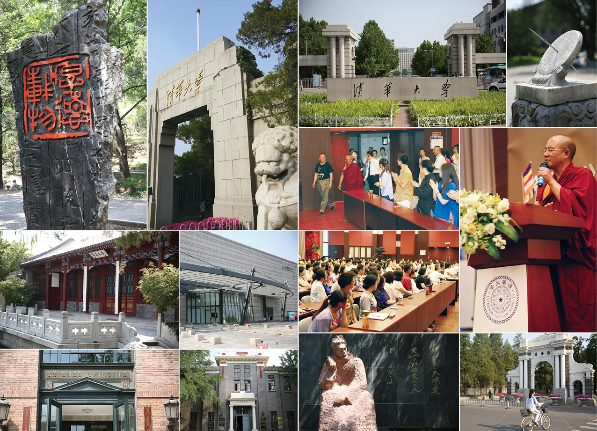
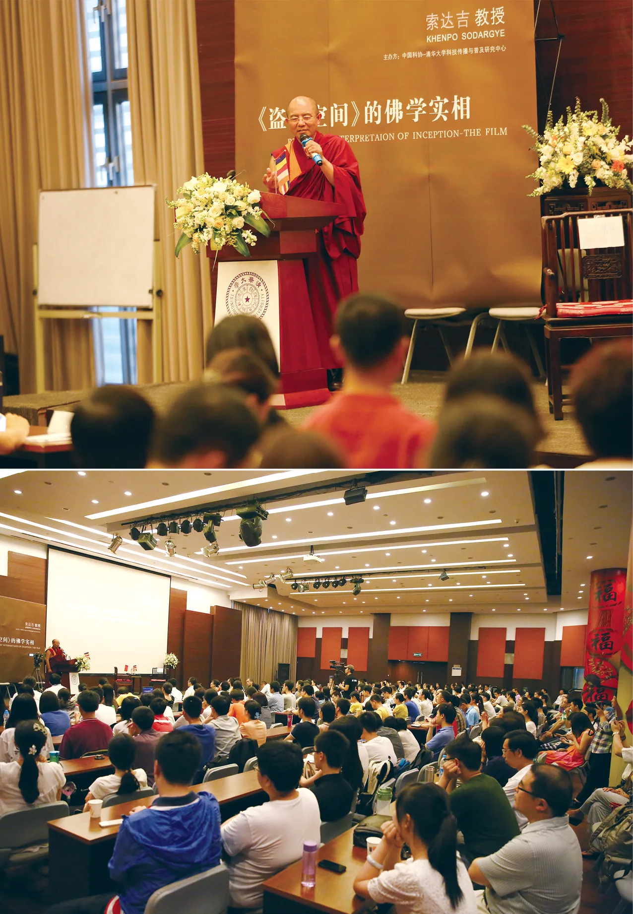
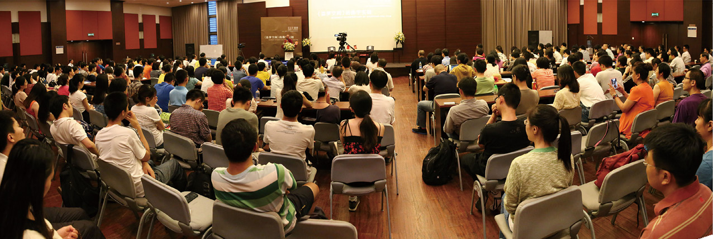
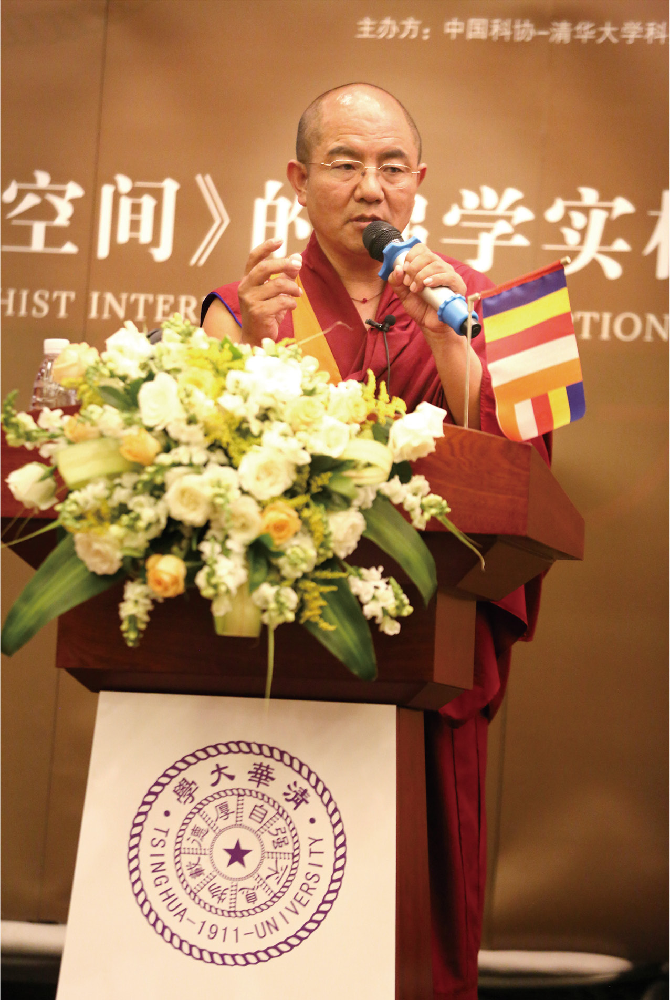
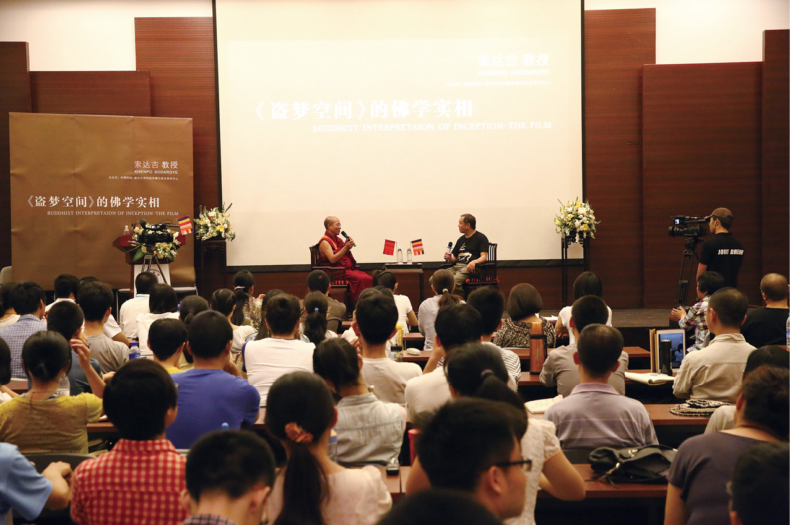
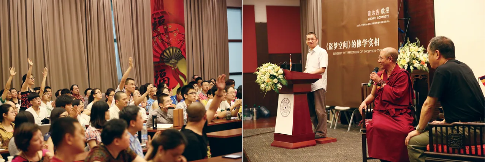

刚开始说诸法“如”梦，

但到了更高层次，

应该说诸法“是”梦。

第81场

清华大学

Tsinghua University

中国·北京

2014 / 6 / 14

## 《盗梦空间》的佛学实相

## Inception: A Buddhist Interpretation

主持人：

今天我们有两位嘉宾。第一位是索达吉堪布，他来自四川色达喇荣五明佛学院，自1987年以来一直负责佛学院汉族四众弟子的佛法教育，以学修并重的管理方式，培养造就了一大批优秀僧才。为了弘扬佛法，堪布二十多年日不缺讲、夜不乏译，尤其是在翻译藏文佛教经论方面贡献卓著。近年来，堪布也在很多大学与众多的知识分子探讨世界真谛，同时在佛教与科技界、文化界的交流方面贡献也很大。

第二位嘉宾是刘兵教授，他来自清华大学科学技术与社会研究所，是中国科协－清华大学科技传播与普及研究中心主任，清华的同学们可能对他很熟悉。他同时在很多大学，如上海交大等，担任客座教授。刘兵教授是国内科学史、科学哲学传播领域中最具影响力的学者之一。在学界流传着这样一句调侃，“哪里有科学，哪里就有刘兵”，这足以说明他在科学文化界的影响。

索达吉堪布与刘兵教授在中午有过一次非常坦率、亲切的交流，他们彼此都非常欣赏。堪布向教授介绍了藏传佛教中的辩经是怎样的一种攻防，所以我们可以期待他们之间能有一场非常有意思，同时可以激发我们思考的激烈攻防对话。

今天跟大家交流的内容是“《盗梦空间》的佛学实相”。《盗梦空间》（Inception）这部电影在前几年非常火，而我作为一个出家人，详细讲解一部电影可能不太现实，但大家都说《黑客帝国》（The Matrix）和《盗梦空间》这两部电影中的一些内容与佛教中“人生如梦如幻”的道理非常相似，所以我也看了一下，并打算用佛教的一些观点与《盗梦空间》中梦境的观点做一些比较。

## 人生如梦如幻

佛教中讲，我们所处的这个世界跟梦没有什么差别，比如《金刚经》中讲“一切有为法，如梦幻泡影”，《华严经》中也说“一切诸法悉皆如梦”，这与电影所表达的现实与梦境的关系非常类似，而且有人在看了电影之后，也开始怀疑自己是否真的身处现实世界。

在座各位可能坚信梦境与现实之间有非常大的差别，但如果我们以理性和智慧来观察，恐怕并没有办法判断我们今天究竟是在梦中还是在现实中交流。大家可能觉得这不可思议：现实就是现实，梦境就是梦境，梦境是虚幻的，不可能和现实一样真实。但实际上，佛教不仅有教理，还有逻辑上的剖析去探讨现实与梦境的关系。

比如，虽然你现在觉得现实与梦境有一定差别，但你有没有理由证明你现在不是在梦中呢？能不能至少举出一个充足的理由？也许你会说：“我们现在身体所接触到的物质，耳朵所听到的声音，眼睛所看到的事物，每一样都是实实在在的，这怎么会是梦呢？”但事实上，当我们观察梦境的时候就会发现，梦境中的整个场景，包括自己也都是存在的。

可能有人还会说：“我们在现实与梦境中对时间的感知有一定的差别。”但事实上，昨天甚至更久以前的一切经历，跟昨晚的梦境没什么差别，因为昨晚的梦在此刻也只是一个回忆的对境而已；同样的道理，未来将要发生的事，也和明晚的梦没有什么差别，因为它还没有发生，所以你没有任何理由认为未来是实有的。那我们当下的现实生活又是怎样的呢？当下的生活和梦境也没有什么差别，因为我们在梦境中也会经历所谓的“当下”。

有人还会说：“我们在现实生活中所处的时间非常长，而在梦境中所处的时间非常短。”这也不一定，因为在每天的二十四个小时里，我们至少有七八个小时都是在梦中；同时，白天的时间也是虚幻不实的，当我们用智慧观察时就会发现，我们找不到它的本体。因此，不管从与事物的接触还是从对时间的感知来看，现实与梦境的确很难区分，这就是佛教中“人生如梦如幻”的道理。

《盗梦空间》中有个主要的情节：主角进入到其他人的梦（潜意识）中，植入一个想法，从而改变做梦者的思想和行为。电影中所描述的梦是一层一层的，一个梦中还有另一个梦，不断地层叠，而直到最后，主角也可能只是一直生活在梦里。一层又一层的梦境，让主角有条件实施所谓的“盗梦”，也就是控制别人的思想。那电影中的“盗梦”又是如何实施的呢？就是通过层层的梦境，进入到一个人意识的最深层，并改变它。

佛教的一些历史公案中也有类似的故事。比如汉地的《大藏经》中记载，佛陀有一位大弟子叫嘎达亚那，他也有过“盗梦”的案例。嘎达亚那有一位弟子叫眉希罗，曾是一位大国王，但他对世间产生了厌离心，于是出家跟随嘎达亚那尊者精进修行。有一次，他在森林中遇到了阿槃地国王的王妃和宫女们，便为她们宣讲佛法。阿槃地国王发现自己的王妃和宫女们在眉希罗面前听法、接受教育，便认为是眉希罗在诱惑他的王妃，十分愤怒，于是命人殴打眉希罗。眉希罗觉得自己毕竟也曾是一位国王，如今却无缘无故被人殴打，心里很气愤，便在心中发了恶愿，准备还俗向国王报仇。嘎达亚那尊者劝他不要还俗，作为一个出家人不应该因为别人殴打自己就要去报复，但眉希罗完全听不进去。最后，嘎达亚那尊者留眉希罗住最后一晚，允许他第二天还俗。当天晚上，嘎达亚那尊者以一种“盗梦”的方式进入了眉希罗的潜意识当中，令他做了一个梦。眉希罗梦到自己已经还俗，但他的军队却被阿槃地国王的军队打败，正当阿槃地国王要杀他的时候，他见到了本师释迦牟尼佛。佛陀对他说：“你的师父不让你还俗，你却非要还俗，现在谁也帮不了你。”听到这里，眉希罗非常痛苦，开始呼喊师父的名字，也就在这个时候，他从梦中醒过来了。这个公案说明，有些尊者和佛菩萨可以通过所谓的“加持力”，进入别人的梦境，然后改变做梦者的心态和生活，这非常有意思。

## 让人无处躲藏的“思想植入”

我们在现实生活中有很多执著，而我们所执著的对象到底是不是真实存在的呢？针对这个问题而言，从佛教的角度探讨一些影视作品以及开展佛教与学术界的交流就显得非常有必要，因为世间当中的一些思想和观念，或者某些大家认为有意义的东西，在另一个角度看来只是一种错觉。比如说，现在大多数人的生活都受到影视剧的影响，甚至有人说电影已经成了人们的一种“宗教信仰”，因为电影中的思想，已经深深植入到了人们的心里，而人们也纷纷效仿电影中的种种行为，却忘记了那只是电影而已。

科学的发展让信息传递得更广，很多人都能轻而易举地获取到自己所需要的信息。但同时，科学的发展也带来了负面作用，让一些人沉溺在虚幻的世界当中。我曾经在另一所高校分析过《黑客帝国》，我觉得《黑客帝国》跟《盗梦空间》有一些不同。在《黑客帝国》里，人们生活在一个虚拟的世界里，而真实的世界则是高度机械化和数字化的。这部电影的科学背景是量子力学，通过抉择，可以发现世界并非实有，而是建立在虚拟的网络之中。而《盗梦空间》的科学背景是心理学，讨论了人们内心的作用。按照佛教的观点来讲，内心的作用非常重要，因为生活中的很多问题都源自我们的心。唐朝的六祖惠能大师曾见到两位僧人在辩论，其中一个说幡动，另一个说风动，而惠能大师说既不是幡动也不是风动，而是心动。虽然这个公案看似简单，但实际上，生活中的一切思想和观念都是“心”的作用。

人的心有两种，一种是“公共的心”，一种是“自己的心”。什么是“公共的心”呢？佛教中有个词叫“共业”，它可以是大家共同形成的一种思想或观念。比如，现在有很多年轻人喜欢使用网络、电视上的流行词语。又比如，本来一件不怎么重要的事情，但大家都把它当作很重要的事情来对待。这些就是共业所形成的。所以，当我们面对现在的一些思想和观念，分析它们最深层的含义时，也要一并观察我们所生存的时代究竟是什么样的。在当今这个信息“爆炸”的时代，绝大多数人都处于各种信息当中，每天都要看手机，好像没了手机，连一个小时都待不住，甚至晚上睡觉前还必须要看一下手机，而早上眼睛还没完全睁开的时候，就已经把手机打开了。在这个时代里，我们甚至不需要“盗梦”，手机就已经控制了我们的心。

手机中真的有那么多宝贵的内容，让我们连一个小时都没办法离开吗？我听说在马来西亚有一个禅修中心，那里要求人们在禅修的一个礼拜中关闭手机，但很多人都觉得这是非常大的挑战。我还听说，有一家餐厅规定，只要吃饭时不碰手机，就可以享受五折优惠。身处于信息“爆炸”的时代，我们的生活、通讯都很方便，何时何地都可以与他人取得联系，但同时我们的内心却比较浮躁，甚至连自己都不知道它究竟处于什么状态。

## 生活是如梦如幻的

《盗梦空间》英文名的字面翻译是“思想植入”，其实在现实生活中，“思想植入”的方法有很多，只不过我们很难察觉到。比如说，影视作品中所传达的思想已经成了很多年轻人生活中不可缺少的一部分。这些思想被直接“植入”到我们的生活当中，从而改变我们。所以，我们不仅需要观察梦境，还需要观察现实生活。当用佛教的方法来观察的时候，我们不但可以发现梦境与现实十分接近，甚至最后可以将梦境与现实都抉择为空性。

佛教中有一部重要的中观论著叫《入中论》，其中讲道：“乃至未觉三皆有，如已觉后三非有，痴睡尽后亦如是。”这句话的意思是说，当我们尚未从梦中醒来时，梦中人的心、梦中的对境、梦中人的眼根等都是存在的，而醒来之后，这三者就都不存在了。同样的道理，当我们还是凡夫的时候，我们的心、所有的对境以及我们的眼根等也都是存在的，但当我们真正了达一切万法真相的时候，这三者就不存在了。

再打个比方，从佛教的观点来讲，一瓶水在人类和动物看来，它是一种可以解渴的饮料，但地狱众生看到的却是燃烧的铁水，饿鬼众生看到的是恶臭的脓血，天人看到的是甘露，佛看到的是一种现空无二的法界。我们也可以用其他的比喻来说明这个问题，比如这里有一杯饮料，对有些人来讲，它是很好的饮料，但对另一些人来说它可能有毒。又比如，当我们评价一个人的时候，可能有些人认为他是好人，有些人却认为他是坏人，还可能有人认为他既不是好人也不是坏人。这说明外境并没有固定的实有存在，如果有实有存在的话，那所有人的判断都应该是一致的，但事实上并非如此。

汉地的永嘉大师说过：“梦里明明有六趣，觉后空空无大千。”这句话的意思是，在梦中，六道轮回都是清清楚楚地存在，而当我们真正觉悟后，却发现原来这些都不存在。当然，刚开始的时候，我们不一定清楚这些道理，但如果用智慧来观察就会发现，原来佛教并不是讲一些毫无根据的故事。佛教的观察方法告诉我们，现实当中的任何一个东西都是“如梦如幻”的，梦境与现实在某种程度上没有差别，而正因为这样，所以可以有“思想植入”，这些“被植入的思想”会改变我们的人生。

## 佛教的“思想植入”

其实佛教中的“思想植入”指的是对心的一种调整。《盗梦空间》的不足点之一是主角必须依靠外在的科学仪器（助缘）才能进入到下一层梦境。而在佛教中，不论是所谓的“盗梦”还是修行，每一个人都可以只依靠自己便能进入到思想的最深层。

我们现在的分别念都非常粗大，如果能减少分别念，达到无分别念的状态，就像眼耳鼻舌身这些根识一样，然后再进一步将无分别念也去除掉，就会进入到我们最细微的第八识——阿赖耶识当中。阿赖耶就像大海底层一样，储存着很多前世、今世所留下的习气种子，这些种子会在将来成熟。而当我们睡觉时，虽然没有了白天粗大的分别念，但阿赖耶上的种子却开始活动，于是产生一些意识的迷乱现象，这就是梦。所以，佛教认为：梦，是前世漫长的生活所遗留下的一部分种子以及现世中我们日常所串习的心态造成的。有些人今生虽然没有做什么恶事，但却经常做噩梦，这其实就与他前世留在阿赖耶上面的种子有一定的关系。

## 神奇的梦瑜伽

社会上有一些关于梦的培训班，可以帮助人们把噩梦转变成美梦，而且还可以慢慢改变原来不好的习气。我听说，有一个人曾经常在梦中感到恐惧，但当她对梦有所认识之后，那种恐惧感就慢慢消失了，这样的案例很多。

当然，这些案例更多的是借助科学手段实现的，而佛教中的窍诀却不需要任何外界帮助。早在8世纪，藏传佛教的莲花生大士便给出了很多梦瑜伽的窍诀，感兴趣的人应该去了解一下。梦瑜伽并不是传说，实际上通过这种方式的修行，人们的的确确可以改变自己的人生。

我在这里介绍一些基本的修法：刚开始的时候，你在日常生活中要经常告诉自己现在是在做梦，同时也要将日常生活与梦境对比，慢慢你会发现二者之间真的没有什么差别。白天坚持练习的话，你就可以在梦中也逐渐认识到自己在做梦，这叫做认识梦。当你知道自己在做梦的时候，你就可以想“其实梦中没有真实的躯体，梦境可以随着心意变化”，然后你可以尝试在梦中实现各种变化，比如变成飞禽、诸佛菩萨等等。当你熟练到一定程度后，就可以在梦中做很多事情，比如一变多、多变一，甚至可以瞬间走遍东南西北。

历史上，有些人可以在梦境中成办很多事情，比如藏地历史上有名的学者、第四世噶玛巴若佩多杰，他的书房里有很多书，但由于白天没时间看，他便在夜里依靠梦瑜伽翻阅，前一晚打算读的书，可以在第二天清晨全部通达。我也很想有这样的能力，自己白天特别忙，晚上经常一觉到天亮，但第二天醒来之后，却一本书也没有在梦中看到。但这种梦瑜伽的的确确存在，而且十分的殊胜稀有。我们佛学院有位非常有智慧的学者叫丹增嘉措，他写过一本书叫《探索梦的奥秘》，你们方便的时候也可以看一看。他在书中引用了一些科学的观点，同时结合了佛教中不共的思想对梦进行解释。

## 梦参老和尚的奇遇

梦参老和尚在汉地很出名，他早年做军人的时候曾有一段与梦有关的经历。

当年他要从北京去南京读黄埔军校，但在出发前的那个晚上，他梦见自己掉进海里，然后被一位老太太救到了岸边。老太太指给他一个方向，说那条路上的宫殿将会是他的终生归宿。他醒来后和住处的一位老者谈了这个梦境，老者说他提到的这座宫殿和北京附近的兜率寺很像，并建议他去看一看。于是他便骑着马，带着士兵去了兜率寺，而那里也的的确确和他梦中的景象一模一样。经过再三的请求，他最后在兜率寺出家，法名“觉醒”，但后来他自己又取了“梦参”这个名字。在此之后，他还有好几段与梦境有关的经历。

出家前，梦参老和尚根本不知道什么是佛、法、僧，甚至连三宝的名字都没听过，但却因为一个梦境改变了一生。他也曾到藏地学习藏传佛教。我去年看到凤凰卫视对他的一个采访，他当时应该已经99岁了，但思路依然非常清晰。我觉得有些人因为心净，所以他们的世界也很清净，他们的智力、身体等方面也都不容易衰退。现在很多人怕脸上的皱纹，怕头上的白发，但如果能够调整好自己的心，那会对自己的身体很有帮助，比任何保健药都有效。如果心清净，世界也是很清净的，但如果心丑恶，那世界中也不会有快乐和美好。因此，我们可以观察一下，自己的心处于什么状态中。

## 心是一切显现的根源

当我们用智慧观察时会发现，心在万法当中非常重要。整个世界，包括所有众生都是依靠心的力量而形成的。月称论师在《入中论》中说，“有情世间器世间，种种差别由心立，经说众生从业生，心已断者业非有”，意思是我们这个世界以及众生等等，虽然显现上是各种各样的，但实际上都是由心产生的。佛陀曾经说，心不存在，业也不会存在。因此，当我们把“心”断掉，业也就随之断掉了。

比如，世间当中的很多价值观，是因为我们的共业而产生的。又比如，社会上很多人都会感受到焦虑、悲伤、痛苦，这在一定程度上也是我们共同的因缘造成的，这些共同因缘的根本都与我们的心有一定的关系。因此，你的痛苦、快乐、幸福，都跟心有一定的关系。当你认识到这一点，眼前的很多问题都可以迎刃而解，同时也会对佛教中“诸法如梦幻”的道理有进一步的了解，发现生活原来并不是实有的。

最后，我想问大家一个问题：我们今天的交流，是在梦中还是在现实中呢？如果你认为是在现实中，可不可以给出一个充足的理由？

其实，我们越剖析就越会觉得现实不成立。如果以佛教的中观思想来观察，我们找不到任何一个实有的东西。这一点，从量子物理的角度也可以得出类似的结论。因此，我们应该有必要进行“思想植入”：人生如梦如幻。这样可以帮助我们更好地认识这个世界。

现在很多人内心很乱，这是源于对这个世界没有正确的认识。获得人身是很不容易的，我们若能借此对整个宏观世界、微观世界有个合理认知，对自他都会很有意义。

对话

刘兵教授：

索达吉堪布刚刚从佛教的角度针对《盗梦空间》做了一场非常精彩的演讲。堪布将佛教对于梦、梦与现实的关系、人生以及意识、价值观、生活方式等方面作了很全面的阐述。今天这个话题涉及佛教、科学以及哲学领域对“梦与现实”的认识。科学界曾经有一些学说、理论，对梦有过专题探讨，比如像精神分析学或者弗洛伊德（Sigmund Freud, 1856-1939）在《释梦》（The Interpretation of Dreams）中的理论等。但当今的主流科学对这些理论有很多批评，而且主流科学本身对人脑、认知以及认知的各种模型、模式，包括梦的研究还是相当不充分的，从这个意义上讲，我认为佛教确实对梦有很多的关注、论述，而且有比较系统、稳定的理论。

我觉着这部电影中有一个预设：梦不是真实的，而是由我们的意识或各种手段，促使意识所产生的幻觉。所以，《盗梦空间》里有一个很关键的情节，就是主人公进入到梦境的时候要带一个陀螺，通过陀螺的旋转来判断自己究竟身处现实还是梦境，这也就说明，梦是不同于现实的。堪布刚才讲到“如梦”，这个“如”字似乎也预设了梦与现实是不同的。我想请问堪布，您觉得佛教对“梦与现实”的观点与科学有什么不同？

索达吉堪布：

表面上看来，《盗梦空间》只是一部电影，但是它背后有一种哲学思考。这种创意很好，因为当电影将哲学或佛教思想与科学结合起来的时候，大家比较容易理解，容易有一个沟通的切入点。

这部电影中的角色在进入到深层次的梦中后，自己也会难以区分梦境与现实，比如主角的妻子就是因为相信自己一直生活在梦中，因此才会为了回到现实而自杀。听说导演在这部电影里也加入了一些自己梦境中的素材，甚至他自己也有一些控制梦境的能力[^1]。

佛教常说“诸法如梦”。用“如”字的话，它就不是梦，只是像梦一样，跟梦非常相似。按照佛教的观点，在刚开始给我们启迪时，可以说诸法“如”梦；但到了更高层次，说诸法“是”梦。这里有“是梦”与“如梦”的差别。

像我以前去云南，云南有“四季如春”“四季是春”两种说法。同样，佛法中也有不同的层次——诸法“如梦”、诸法“是梦”。

当然，在佛教的最高层次上，甚至梦也不存在，一切全是空性，是一种与光明无二无别的境界。但还没有达到这个境界之前，我们要想打破实有执著，用梦来比喻是非常适合的。

藏传佛教有一位龙钦巴尊者，他撰写的《大圆满虚幻休息妙车疏》里专门讲了与梦相关的道理，其中引用了很多的经典来说明一切万法都是梦，现实跟梦无二无别。

刘兵教授：

其实这部电影在结束时还留了一个悬念，就是那个陀螺还在一直转，这就引发我们思考：男主角最终是回到了现实中，还是依然在梦里？

在好莱坞电影里，《盗梦空间》和《黑客帝国》可以说是同一种系列，他们在商业片里比较特殊的一点就是逻辑非常严谨，而且还力图在环环相扣的逻辑里体现出一个既世俗又科学的思考方式。因为当今的科学对于梦、脑以及思维的研究并不是特别充分，甚至对于我们究竟能研究到哪种地步也有很多争议，所以才会有像心灵哲学等一些认知哲学上的探讨。

也恰恰是因为这样，所以我们总能够在叙述严密的框架里发现漏洞或者预设。比如说，电影里的人物借助机器来构建梦，但是却回避了具体的机制。又比如，电影里也没有解释造梦师究竟是如何把梦境搬到人们的意识里的。这也反映了一个现实：当前的科学研究的是物质世界，是对物质的理解，这是科学的一个局限。堪布刚才谈到，佛教所说的“如梦”，是在初级层次上把现实和梦分开，那我们是不是也可以这样来理解科学：当前科学在人的意识、思维方面的研究也处于一个初级层次，一旦超越了这个初级层次，我觉得就已经进入到哲学的讨论范畴了。

其实我们都有一些形而上学的前提预设，比如这个世界的本初、原初是什么等等。当然，佛教有佛教的一些预设，其他哲学传统也有自己的预设，中国古典哲学里也有“庄生梦蝶”等关于“如梦”“是梦是醒”的讨论。当我们认真思考这个问题时，可能也会怀疑自己对梦和现实的简单区分是否可靠。历史上，很多哲学家也对这种可知和不可知有过很多的讨论。这种思考是很学术的，也很有启发性，但我们毕竟还是要回到现实里，就像《盗梦空间》里的主人公一样，努力地确定自己究竟身在何处。

人们有这种意识去弄清楚自己在什么地方，这件事本身也很有意味。如果不知道自己身在何处，就会觉得心里不平衡、不安定。像《盗梦空间》里的故事那样，主人公和他妻子在潜意识的边缘一层一层地把世界建得很美好，夫妻两个人还有孩子，看起来很幸福，但他还是会觉得那个世界不真实，也就是这个原因导致他太太自杀，以及后来的故事。人们总是有这样一种试图找到自己位置的信念和动力，堪布是如何看待这种信念和动力呢？

索达吉堪布：

好莱坞的电影中有几部非常具有逻辑思维，但跟哲学和佛教中的逻辑分析相比，恐怕还是有一些差别。

可能有些佛教徒觉得，电影都是虚构的故事，没有什么值得关注的，但其实如果将电影与现实生活进行比较，很多人都会有所感悟。

《盗梦空间》里并没有像佛教那样，提出如何把控自己的内心等概念，它只是给了一些提示，比如主人公不断确认自己是在梦中还是在现实中，但恐怕他到最后也没有办法完全确定。如果对佛教的一些道理有所了解，比如梦瑜伽的道理，那我们修行的时候就能直接找到心的本体，因为佛教的方法完全契合一切事物的实相。比如，我们在梦中要观察自己的心，一旦认识了心的本来面目，那就不可能分不清梦境与现实。这从很多开悟者的经历中都可以看出来。与电影不同，佛教的道理并不是银幕上的故事情节，而是可以在日常生活中观察得到。

我认为，我们从出生到死亡之间需要不断地面对、处理问题，佛教思想是处理这些问题的很好的手段和方法。虽然科学中有很多理性的手段帮助我们观察、分析物质层面的问题，而处理心理问题的手段则可以在佛教中找到。当我们掌握了这两种手段之后，人生中的很多问题都可以迎刃而解。因此，我们不能只接受电影中的价值观，那对我们生活的帮助很有限，毕竟它只是一个虚构的故事。

刘兵教授：

我完全同意堪布所讲。这部电影毕竟只是一个商业片，虽然主题比较严肃而且具有启发性，但毕竟还是一个虚构的故事。

刚刚堪布提到了“实相”，我觉得这已经从佛学进入到哲学的形而上学的假定前提了。在科学史上，包括前科学阶段，科学家们也曾讨论如“心物二分”这样的东西，而且今天的一部分科学家，也有形而上学的前提假定，比如认为一切都是有物质基础的。虽然科学家之间也有不同的看法，但我认为这里可能有一个问题：如果说主流科学对于梦这一类事情的研究还远不够深入，一方面是因为发展阶段的限制，另一方面会不会是因为这一类的事情，本来就不适合用科学手段去研究？会不会正因为人们用研究物质的科学手段来研究梦、意识这一类哲学化的东西，于是就导致了一些矛盾？堪布刚才回答这个事情的时候，直接回到了哲学、人生，而在一部分人看来，这些恰恰不在科学的研究范围里。

对于梦这个话题，佛教、科学都有自己的解释，而传统、历史、哲学又有另一些解释，可能其他宗教也有自己的理解，这就构成了不同的理论体系。您站在佛教的立场上，怎么评价这些不同于佛教的对梦的解释呢？

索达吉堪布：

我以前看过尼采（Friedrich Nietzsche, 1844-1900）、荣格的一些书。尼采从宗教的角度对梦有一定的解释；而荣格是一个神秘主义者，他在自传和一些著作中也提到了自己在梦中的一些境界和发现[^2]，他曾经叮嘱子女：“我谈论梦境理论的书，五十年后才可以出版，现在的人们不一定能接受。”荣格的这些思想，跟藏传佛教中阴法门——《西藏度亡经》（The Tibetan Book of the Dead）有很大的联系，而且他自己也曾说，他最好的朋友就是《西藏度亡经》。

刘兵教授：

就像您说的，科学和佛学在历史上有某种意义上的融合，比如荣格的那个系统就被分到精神分析的传统里面。

索达吉堪布：

对。我觉得佛教的一些道理，比如梦的道理，不一定被所有科学家或其他宗教认可，毕竟每个人对事物都有不同的看法和分析方法。但我作为一个佛教徒，无论是科学还是其他宗教的学说，只要对梦有准确的判断和解释，我都接受。

在佛教的《大藏经》以及汉、藏佛教高僧大德的文章中，都记载了一些梦中云游世界各地甚至清净刹土的经历，而且他们在梦中云游的时间跨度非常漫长，这跟《盗梦空间》的情节相呼应。在电影中，主角在梦里生活了五六十年，但在现实中却只是短短的时间。

我觉得，在学习知识的过程当中，当我们面对自己并不了解的领域时，比如宗教领域，不能马上就把它断言为迷信，武断地认为宗教不合理。这就像看一部电影，如果不了解其背后的深层含义，是不会真正理解这部电影的，更没有资格去评判电影的好坏。所以，我们应该保持一种开放的心态去接纳未知领域，这是一种治学的态度。

刘兵教授：

堪布讲得对，我们应该包容不同的观点。讲到“梦”这件事，我们就不可避免地要回到哲学领域，虽然我们也可以尝试只依赖科学去研究这个问题，但这很有可能会给我们带来失落。与科学不同的是，佛教研究这个问题的方式更偏向于哲学的思考和假定。

这部电影的中文名翻译为“盗梦空间”，这个“盗”字原意是“偷窃”，甚至就像您刚才讲的，这个字也可以引申为“植入”。也就是说，它不仅仅是“偷窃”，甚至是强买强卖、强加于人。这其实也可能发生在现实生活里。我就听说有人在研究一种广告手段，它可以在手机等网络影片的正常片头里，以人眼难以察觉的速度闪过一些广告画面，在不知不觉中把一些信息灌输到人们的潜意识里去。这个事儿跟《盗梦空间》里的故事有异曲同工的意味。

堪布刚刚举了佛教的例子，说一位大师为了教育弟子，进入到弟子的梦境中，并在弟子的潜意识里放了一些想法。这其实都是同一种思路，也就是试图利用梦这件事，利用一些具体的手段，包括科学的手段、佛教修行的手段等等，去影响别人的想法。

但科学有“双刃剑”效应，也就是说，一个技术手段可能被用来做善事，但也有可能被用来做恶事。《盗梦空间》的编剧还是挺聪明的，他试图把“盗梦”这件事在电影中合理化。在佛教看来，利用“盗梦”这种手段去植入思想，会不会有类似的“双刃剑”效应？

索达吉堪布：

除了科学，电影也会有“双刃剑”的作用。人们从电影中学到一些负面的知识，比如偷盗、说妄语等等。现在的编剧们特别聪明，尽可能地将一些行为合理化，但其真实的社会作用却没办法预料。

而佛教的核心精神是“诸恶莫作，众善奉行，自净其意，是诸佛教”，佛教根本的价值观是“断恶行善，调伏自心”。在这种教育下，佛教不会鼓励人们去造恶。但会不会有人假借佛教的名义这么做呢？这就很难讲了。实际上，佛教的修行包括了闻、思、修三个方面，真正的修行要符合事物的自然规律，从而了达万法真相。佛陀就是通达了宇宙、人生、万物真相的人，也就是觉悟者，在这种境界当中所行持的行为，是不存在“双刃剑”效应的。

刘兵教授：

其实科学的“双刃剑”效应之所以成立，恰恰就是因为对科学成果的应用符合所谓的自然规律，而且能够造成实际的效果。当然，人们是不是应该使用这项成果，甚至该不该研究、发现这个成果，还存在伦理争议。

好莱坞有一部电影《侏罗纪公园》（Jurassic Park），里面就涉及了这种争议。原作者迈克尔·克莱顿（Michael Crichton, 1942-2008）在小说里用了一个比喻：科学技术变成了一种商品，有钱就可以买来使用，但买主未必会在使用时有所节制。《侏罗纪公园》中所描述的那个灾难，就是技术滥用所导致的，因为资本家有钱就可以买来最新的科学技术，并且可以不受控制地滥用。您刚才讲到，修行受到自然规律的制约，那么在佛教的修行里，是否能够保证只让“不滥用技能”的人获得高层次的境界呢？

索达吉堪布：

佛教的基本教义众所周知，比如十善业[^3]，这是两千多年前人们的基本行为准则，甚至在任何一个时代中，十善业都可以作为人们的行为准则。从这个基本的行为规范就可以看出来，只有可以约束自己行为的人，才会获得修行中的境界。当然，孔孟思想或者其他宗教中，也有契合于现实生活的思想。

与之相反的是，科学在短短几百年中的成果，任何人都可以使用。这样看来，我们很难断定科学究竟为人类带来利益还是危害。站在佛教的立场上，我认为佛教不存在这样的弊病，当然，因为极个别人的行为所造成的危害并不能说明佛教有弊端。我觉得既然佛教的观点已经存在了两千多年，而且到如今依然被人们所认可，这说明它的确是有意义的。

刘兵教授：

虽然今天的主题是“科学与佛学访谈”，而且我也确信索达吉堪布可以代表佛教，但是我并不能代表科学，因为科学只是我的一个研究对象，而且我是从人文的立场去研究科学。我同意刚刚堪布所讲的，我也认为可以从佛教的立场，对目前科学成果在应用过程中所产生的问题，给出一些建议和想法。我想大家应该都有这样一个结论。

我还有一个问题：从科学、信念上来说，我相信我们今天的访谈是真实发生的，但从哲学上来讲，我又对此有所怀疑。请问堪布，从佛学的角度来看，我们今天的这场座谈是梦吗？

索达吉堪布：

刘教授说自己不能代表科学，我对此存有怀疑，因为刚才主持人蒋教授说：“哪里有科学，哪里就有刘兵。”如果这样的人还不能代表科学的话，谁还能代表科学呢？从没有人说过“索达吉在哪里，佛学就在哪里”，所以，我是不是能反过来说，我不能代表佛学，但刘教授一定能代表科学呢？（众笑）

对于刘教授提出的问题，我想说的是，很多年轻人觉得一定要在生活中获得成功、有所成就，但实际上，我们努力一辈子，到头来不过是一场梦。我曾遇到过一个老人，他临终前说：“我这一辈子做过很多坏事，这一生就是一场噩梦，今天这个噩梦终于要结束了。”结果他真的在当天去世了。从临终时人们对自己一生的回忆来看，人生跟梦没有差别，既然如此，那么我可以很大胆地说，今天的座谈是一场梦。

今天可以和刘兵教授以及这么多的清华师生在一起交流，我心里特别高兴，因为我很喜欢开放的探讨和交流，这样可能会帮助年轻人认识人生。清华的师生们可能会经常参加讲座，受到很多的“思想植入”。因此，大家的思想一定要坚定，否则很容易被各种信息所改变，那会是比较可怕的事情。

我也想问刘教授一个问题：你作为一名科学研究者，能不能从科学的角度来说明，我们现在的的确确不在梦中，而是在现实生活之中？如果是在现实生活中，那么它和梦有多大的差别？

刘兵教授：

我真的没有办法代表科学，因为科学家是将自然当作研究对象，而我是将科学以及科学家作为研究对象，我做的是科学史、科学传播，这是一个二阶的东西。但是我可以说说我理解中的科学是如何看待这个问题的。

按照我的理解，人们有这么一个倾向：总是希望找到自己实在的位置，这一点也反映在《盗梦空间》这部电影里。比如电影中的人物都会带上一个器物，来帮助自己确定是否身处现实之中。如果不在现实之中，那即使生活在很幸福的场景里，不惜自杀也要让自己醒过来，以至于回到现实中之后，还会有这种极端的心理。我觉得这是人们的一种常规心理状态，所以我刚才也问您是怎么看待这种动机的。

我觉得这个动机并不属于科学的研究范畴。一般认为，科学的研究对象是有一些预设的，比如这个世界是由实在的物质组成，所以我们才能去研究它、应用它。当然，从哲学角度来看，这个预设又是可以被讨论，甚至可以被怀疑的。从科学的某一个层面上来说，我们可以持这样一个预设，但如果我们对这个预设进行更深入的哲学思考的话，那这个预设本身可能是有问题的，但我也不知道真相究竟如何，甚至也经常对此产生怀疑。我认为科学可以逐渐地认识一些意识认知的规律，并从中有所收获，但这是有限的。而堪布所问的这个最终极的问题，不是一个科学能够回答的问题，而是一个哲学问题。

现场互动

问：我来自清华大学水利系。现在很多社会上的企业家、学者、人生导师、佛学大德都在提“活在当下”这样一种概念，您认为什么是活在当下？当代青年应该如何活在当下？

堪布：对很多年轻人来讲，“活在当下”是一个比较普遍的道理。它有两种理解方式：第一种是用消极的心态去看待“活在当下”，认为散乱也好，懈怠也好，只要把人生度过就可以，我觉得这是不合理的。另一种理解方式是“珍惜当下”，我们的人身来之不易，因此不管在生活中遇到什么样的困难，都应该坚强地去面对，这种态度非常重要。因此，无论是企业家、人生导师、世间名人，还是比较底层的人，都应该对未来充满信心。

实际上，人生就是遇到问题、面对问题、处理问题、放下问题的一个过程。有些人内心脆弱，别人跟他说话时，一个用词不当就让他痛苦半天，又或者一点小小的挫折就会让他一蹶不振。这样的心态在年轻人中比较常见。所以，我觉得“活在当下”应该是用坚强的精神和勇猛的心态来面对一切问题。

每个人的人生经历都会不同，比如清华大学的同学们，再过二十年，有些人可能非常成功，有些则不一定。但每一个人所走的路，都和自己的福报因缘有一定关系，我们应该用欢喜心去接受它。

问：什么是末法时代？

堪布：所谓的末法时代，指的是佛法接近隐没的那个阶段。它有两种理解方式：一种是指佛陀涅槃两千五百年以后，这是广义上的末法，这个时代跟佛陀的果法时代相比较起来，佛法逐渐接近隐没。此外还有一种真实的末法时代，那就是佛法住世的最后五百年，这段时期内，只有佛法的形象还存在于世。佛教住世一共有五千年时间，最后五百年就是真正的末法时代。

问：佛陀曾说，末法时代，邪师说法如恒河沙。现在社会当中，可能很多人都有兴趣去接触、了解佛法。在这个过程当中会有善或不善的地方，包括现在有些僧人的行为不如法。我们应该怎么去分析这些事呢？

堪布：“末法时代，邪师说法如恒河沙”出自《楞严经》。实际上这是指，在末法浊世，没有善知识资格的人比较多。当然，也不一定真的有恒河沙那么多，否则，恐怕几乎所有人都是邪师了，这其实是佛陀的一个比喻。

面对这种情况，我们要用自己的觉知和智慧来观察，到底真正的上师应该具备什么资格。实际上，现在也有很多善知识、好上师，不能以一句话将所有上师都判为邪师，关键是自己要有智慧去分辨。

问：我来自清华大学社科学院。如果现实与梦无别，那么我们存在于现实的意义是什么？

堪布：还没有醒来之前，一个人在梦中也有存在的意义，也有他的价值观、生活等等。

问：如果这一切都是梦，醒了，一切便消失了，这样的话，佛家的因果、轮回又该从何说起呢？

堪布：虽然人生如梦，但梦中也有善恶、苦乐。比如说，一个人在梦中杀了人，那么他也会在梦中受到惩罚。

佛教对善恶业果的成熟是这样解释的：如果一个人的执著非常强烈，那么他的善业、恶业所成熟的果报会比较迅速、强烈。但是，如果没有那么强烈的执著，善业、恶业就不会有这么大的后果，这也是为什么梦中杀人，并不会对醒来后的自己造成特别大影响的原因。因为实执不同，成熟的果报也会不同。

梦中行为会受到梦中因果律的支配，而当我们没有从梦中醒来时，还是要遵循这一规律。

问：我来自北京大学。我们应该怎样面对如梦如幻的人生，珍惜难得的人身？

堪布：今天我们是从理论上，用佛教最究竟的观点来剖析“人生如梦”这个道理。其实不仅是佛教讲“人生如梦”，中国古代也有庄周梦蝶、黄粱美梦、南柯一梦等哲理故事，这些不仅仅是故事，更是对人生的一种描述。因为人们不懂得“人生如梦”，因此对很多事情特别执著，在生活中有非常多的苦恼。

现在社会上离婚率、自杀率都越来越高，这些现象的背后有着很复杂的原因，但如果我们懂得“人生如梦”的道理，就会发现原来没有什么执著的必要。

但反过来说，既然人生是一场梦，那是不是就不用努力，干脆生活在消极的状态里呢？并不是这样。虽然人生如梦，但我们还是要坚持做完这个梦，并且要把这个梦做成一个善梦，而不是恶梦，这是每个人的责任。如果你在这个梦中没有孝顺父母，没有积极地工作，没有承担起自己的责任，那人生就变成了一个恶梦。所以，我希望大家都能努力做一个善梦，梦想成真。

问：如果人是活在梦中，那这个世界的山河大地、日月星辰是不是梦呢？如果说娑婆世界是梦，那极乐世界是不是梦呢？

堪布：可以这么说，山河大地也好，六趣众生也好，一切都是梦。《圆觉经》中讲“生死涅槃，犹如昨梦”，其中“生死”指的是轮回，“涅槃”指的是净土，这些都是梦。以唯识宗的观点来讲，六道轮回属于不清净的依他起[^4]，而极乐世界属于清净的依他起，这两个都是心的虚妄假象。

如果六道轮回是梦，那极乐世界也是梦。一切就如同《金刚经》当中所讲的那样，“凡所有相，皆是虚妄”，只要有相，就是虚妄，只不过有清净和不清净的差别。

问：是什么原因让当代人在遇到问题时不再诉诸佛学？

堪布：对于汉地来讲，可能跟这里的主流文化和价值观有一定的关系。而就藏地而言，人们在遇到问题的时候，不论是好的问题还是不好的问题，一般都会依靠佛教中的一些思想去处理，佛教已经融入了藏民的生活。当然，由于环境和教育的影响，现在也有一部分藏人不再依靠佛教来解决问题了。

问：我是中国科学院大学的老师，专业是传播学。您为什么相信佛法的教义是人和世界的终极所在？

堪布：我一出生就身处佛教的世界，没有其他选择。在我们藏地，我的父母、邻居以及周围的人都是佛教徒，我就是以这样的缘起而信仰佛教的。学习佛法这么多年以来，我也研究过各种学说和思想，但还是觉得当初的选择没有错。不论我用怀疑的态度去观察佛法，还是以信心的角度去观察佛法，都找不到它的缺点。因此，我觉得成为佛教徒，不仅是我的“宿命”，也是一种合理的选择。

问：我是来自清华大学微纳电子所的研究生。我认为，梦中的意识跟五俱意识不同，那么梦中所造的业与现实中所造的业有什么不同吗？

堪布：我们在现实中造一个业，需要满足四个条件：意乐圆满、加行圆满、行为圆满、究竟圆满。一般来讲，梦中造业不能满足这些条件，因为梦中的心识处于一种迷乱的状态。

在佛教里，一谈到造业就要提到《根本律》。藏文的《根本律》中讲到“梦如同无有”。按照戒律来讲，如果在梦中犯了戒，不构成犯根本戒，只是一种轻罪。

由于只有佛陀才能照见一切业因果关系，因此，这并不是我们凡夫人能说清楚的，甚至连菩萨也没办法。所以，根据经论来判断业比较合理。

问：有一部经叫《阿难七梦经》，讲了很多关于梦的预兆作用的例子。您对梦的预兆是怎么看的？

堪布：《阿难七梦经》是一部很重要的经典，里面的一些公案非常有意思。佛教中的确有一些方法，可以通过梦中观察，而对未来有一些预示。

藏传佛教中有一位麦彭仁波切，他的很多论典都涉及梦的预示。比如说，如果梦到有人试图杀自己，这说明你可能有一些四大不调或非人的危害，如果不及时念缘起咒等咒语的话，很可能会生病，这种感受可能很多人都有过。

这一类内容在佛经里讲得非常清楚，大家感兴趣的话可以看一看，也能对自己的梦有一种新的认识和探索。

问：我是来自地质大学的老师。在《盗梦空间》里，一个人在梦里死了之后就会脱离这个梦，然后返回到上一层。那么，我们这一生结束后，会不会也是一个梦的结束？六道轮回是不是就是一层一层的梦？

堪布：《盗梦空间》中描述了一层一层的梦，而男主角的妻子就是希望通过自杀来回到她所认为的真实世界中去。但这只是电影中虚构的情节，不能成为我们认识人生的依据。

我们所处的六道轮回，并不是这样一层套一层的梦。永嘉禅师讲：“梦里明明有六趣，觉后空空无大千。”指的是我们今生当中做人的“梦”，来世可能是做旁生、地狱的“梦”，又或者这辈子做了富贵的“梦”，下一辈子变成贫穷的“梦”，一旦我们断除了做梦的习气，这些轮回幻象就全都没有了。《入中论》中说：“乃至未觉三皆有，如已觉后三非有，痴睡尽后亦如是。”意思就是指当我们的愚痴灭尽了以后，梦里的根、境、识三者都是不存在的。因此，对我们来讲，六道轮回是一场梦，是一场漫长的梦，而且我们很可能还会不断地做梦。

问：有个朋友在读了《地藏经》《佛说疗痔病经》之后，不时地做一些宿世的梦，知道他和周围的亲友有什么样宿世的因缘。请问佛教怎么解释这个现象？

堪布：通过读《地藏经》或者其他经论，有可能成熟自己以前的习气和种子，从而了知自己宿世的一些因缘。还有一个可能，有些人并不是真的知道宿世因缘，但依靠一些“善巧方便”，对别人讲自己知道。对我来讲，这些情况不好分析。

问：我是清华科技所的研究生。我认为《盗梦空间》当中所讲的多重梦是不可能发生的。因为像玄奘法师在《成唯识论》中所讲的那样，人的意识由四个结构构成，包括见分、相分、自证分、证自证分。其中自证分指的是，当我做梦的时候，会存有一个对做梦的觉知，但是在梦中，这种自证分是不存在的。您是怎么看的呢？

堪布：你提到了唯识宗的“四分说”，其中自证分指的是清楚地知道自己在做什么，也就是说，你能清楚地了知自己以前做什么或者现在做什么。

因为每个人只有一个心识，因此，在同一个时点上，一个人不能用自己的心来了知自己的心，否则会有很多过失。从这个角度来看，你说的是有道理的。但如果是对不同时间点上所发生的一连串事件来讲，这也是有可能的，因为这是心的一种相续，它是一本体、异反体[^5]。比如，你可以了知自己小时候所发生的事，也可以了知长大后所发生的事。

问：我们今天究竟是不是在梦中交流？

堪布：从我们的观念、习惯上来讲，我们不是在做梦，而是在现实中交流。但从逻辑或者理论上来讲，“是不是梦”这一点，确确实实需要大家再三思考，因为我们执著为实有的东西并非都很可靠。

我希望今天的交流能为大家带来一些启发。当然，每个人的判断标准和所得的结论不一定相同，我们今天也不需要得到一个统一的答案。大家无论是从佛学、科学、哲学还是日常生活经验的角度来交流，如果能保持一种开放和包容的心态，或许会得到一些利益。

[^1]: 导演克里斯托弗·诺兰在接受媒体采访时曾表示，《盗梦空间》的灵感来源于自己影响梦境的能力。
[^2]: 如荣格的遗著《红书》（Liber Novus）。荣格生前拒绝出版这本书，直到其去世近五十年，才得以出版。
[^3]: 十善业包括：不杀生、不偷盗、不邪淫、不恶口、不两舌、不妄语、不绮语、不贪、不嗔、不痴。
[^4]: 根据《入中论日光疏》中的解释，依他起与缘起意思相同。依他起又分为清净的依他起、不清净的依他起，即显现清净的涅槃法、不清净的六道轮回。
[^5]: 一本体、异反体：本体指的是实体，反体指的是基于这个实体之上的特性、属性。
