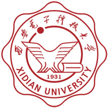
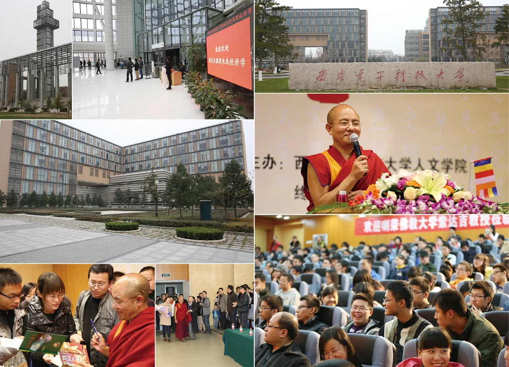
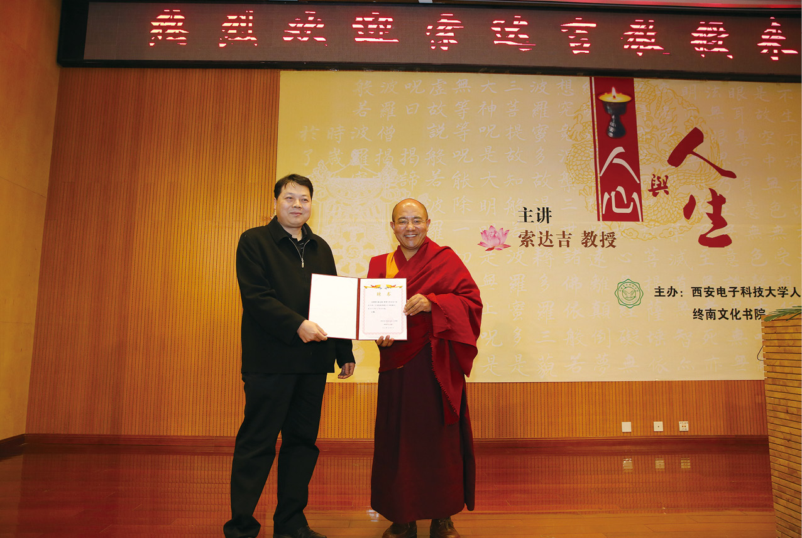
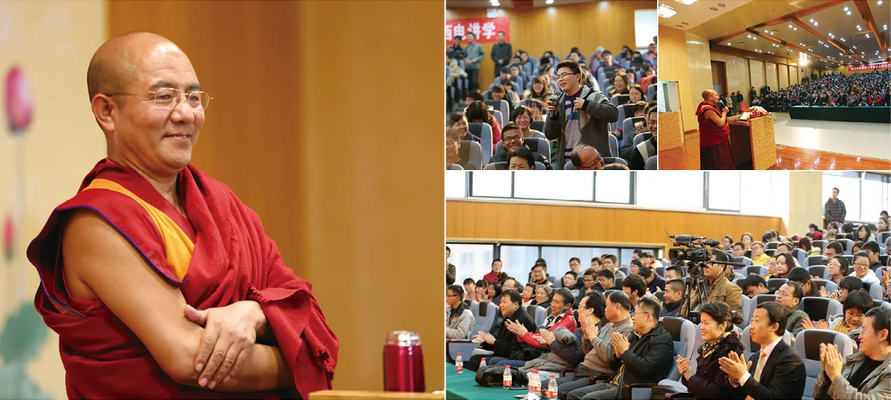
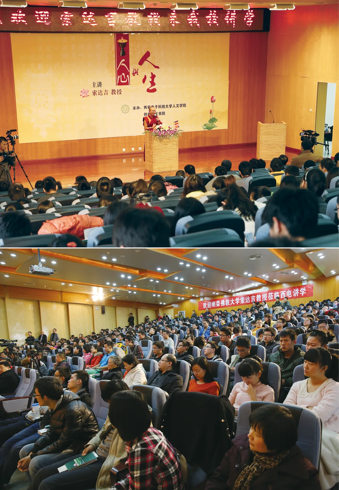

对我们危害最大的，

其实是自己的心。

第78场

西安电子科技大学

Xidian University

中国·西安

2013 / 12 / 8

## 人生与人心

## Lead Your Life with an Awakened Heart

主持人：

在今天这样一个非常吉祥的日子，我们很荣幸地邀请到了尊敬的索达吉堪布。堪布任教于当今世界最大的佛学院——四川喇荣五明佛学院，在佛学尤其藏传佛教的研究和弘扬方面做出了令世界瞩目的成就。

鉴于堪布对于佛教文化的精深研究，对我们终南文化申遗的大力支持，对哲学和宗教学科的大力支持，以及对文化育人、道德传承、首争创新、净化人心方面做出的特殊贡献，今天我们要举行一个聘任仪式——聘请堪布担任西安电子科技大学人文学院和终南文化书院的顾问。此举必将对我们的老师同学进一步学习博大精深的佛教文化和人生哲学起到很好的推动作用。

有请我校的代表——人事处处长周燕来博士为索达吉堪布颁发顾问聘书。大家欢迎！

传承中华民族优秀传统文化的宗旨，力图培育有道德、有修为、有修养并能够担负起国家重任之人，这是终南文化书院的宗旨，也是我们西安电子科技大学的目标。毛泽东主席曾经给我校题词“全心全意为人民服务”和“艰苦朴素”，这与索达吉堪布一直弘扬的佛教文化不谋而合，因为佛教也倡导利益众生，致力于净化世道人心。

今天索达吉堪布将就“人生与人心”的话题，给我们作精彩的分享。下面让我们以热烈的掌声有请——

对于今天的交流话题，在座的老师和同学都很感兴趣，我也是这样，前段时间学校这边跟我提出这个讲座主题时，我欣然接受了。实际上，不论何种身份的人都需要观察“人生与人心”的道理。

梁漱溟先生是北大的一位教授，对中国历史和传统文化，尤其是宗教有着深入的研究。早年他花了一定时间钻研佛教，中间也学习了不少儒教文化，晚年修习佛法而有所感悟，他在一篇《人心与人生》的文章中谈到：人最后应当达到怎样的境界呢？就是明心见性的境界。

在座的各位也许觉得明心见性不重要，学业、爱情、生活才是重要的。但实际上如果不能把握好自己的心，即便拥有很多，你的人生也不一定快乐。

其实今天的讲座内容很简单，就是探讨人生与人心是否有关系。

## 一、心的作用不容忽视

### 危害最大的与利益最大的

世上对我们危害最大的是什么？也许有人认为是自己的敌人、原子弹等等，但这也不一定。对我们危害最大的其实是自己的心——如果不能调整好心，痛苦就会挥之不去，甚至一生都可能因此而葬送。

前段时间，我在一所学校里听到很多有关学生自杀的消息。这些学生基本都是无法面对一些细小的琐事，而踏上了不归路。比如有一个学生的自杀原因很简单——毕业论文没过关。刚开始他写了一篇文章，导师说不行，让他重新写。他回去后冥思苦想，又写了一篇，但是又没有通过。就因为这件事，他从25楼跳下。可能其他学校也发生过类似的悲剧。

反过来说，世上对我们利益最大的是什么呢？很多人觉得是自己的亲人、朋友以及老师等等。但实际上，对我们利益最大的也是自己的心——如果能够把握好心，甚至证悟了心的本体，那么即使是当乞丐，快乐也会形影不离。

### 金钱等于快乐吗？

大多数人认为一切快乐源于金钱，但事实并非如此。快乐跟金钱有一定的关系，但关系不大。

比如经济高度发达的美国，伴随着经济的增长，国民的幸福指数却在不断跌落。早在上世纪七八十年代，在美国，国民的幸福指数是40%多；二十多年后美国经济增长了三倍，但是这一指数却下降到30%以下。

如果金钱与快乐成正比——金钱越多快乐就越多，那么美国人应该越来越幸福才对，但是事实却刚好相反。

在这个时代，很多科学家殚精竭虑地开发各种技术以创造更多的财富，但财富真的给人带来了快乐吗？抑或是给人制造了伤害，给自然留下了创伤？这些问题值得大家思考。

在座的很多年轻人，可能会认为美好的生活即将拉开帷幕——自己到了社会上会非常快乐，家庭幸福、事业成功……但实际上，不论你身在何处——学校中抑或社会上，如果不具备观察自心、调整自心的能力，快乐都会变得遥不可及。

我接触过很多企业家，他们越有钱越痛苦，越有地位越烦恼，而且越追求越迷茫，最后自己都不清楚活着的意义所在了。

### 精神文化需要珍惜

科技知识当然是学校教育的重要内容，但更为重要的是精神文化的传承。

大家都知道，古董是很昂贵的，属于一种物质财富；与此相同，儒教、道教、佛教中的很多思想，也是价值不菲的，是一种精神珍宝。

历史上，中国的很多文物被贩卖到了国外，后来又被人从外国人手里买回来。如果我们不重视本国的精神文化，历史可能会重演——这些文化被国外人吸取了，最后需要从他们那儿学回来。

所以，对于传统文化的继承和弘扬，希望在高校里也能引起足够的重视。

当整个世界都沿着科技之路飞速行进时，掌握科学技术对于每个年轻人而言是不可或缺的；而继承祖辈遗留下来的精神文化，更是年轻人责无旁贷的。

所以，非常高兴这里创建了终南文化书院，借助这个平台可以更好地推动传统文化的研究和弘扬。

## 二、从“业”的角度观察心与人生

### 业对命运的影响

佛教中有个专业名词“业”，是指身口意的一切造作。

业对人生的作用举足轻重。《楞伽经》中说“不思议熏，不思议变”，每个人身口意上不可思议的熏染（业），都能在将来产生不可思议的变化。所以，一个人所做的点点滴滴的善恶之事，都影响着他今生与来世的命运。

有人对此也许抱有怀疑，但不论你相信与否，事实就是这样。

不过，在座的诸位有所不同。唐朝时佛教在陕西兴极一时，可能因为有这种文化底蕴，这里的很多大学老师和同学不会把佛教的道理看作天方夜谭，而会认为这些深奥的规律真实存在，只不过因为忙于工作、学业而无暇深入探索。

近代高僧印光大师曾在与友人的书信中提及一首《心命歌》，并且对这首诗赞赏有加。《心命歌》中说：“心好命也好，富贵直到老；心好命不好，天地终有保；命好心不好，中途夭折了；心命俱不好，贫贱受烦恼。”也就是说，如果一个人的心和命都好，那么终身都会很富贵、快乐；如果一个人心好命不好，那么可能来到世间时或人生的前半段并不快乐，但是因为心好，命运就会慢慢转变；如果命好心不好，可能人生的最初很快乐，但是因为心不好，命运就会渐渐衰败；如果心和命都不好，那么人生的一开始就是挫折纷飞，最后也是以悲剧收场。

人的命运之中，有些虽然无法改变，就像乘坐飞机翱翔空中，中途即使出现什么事，也无法马上降落或改变航线；但有些却是可以改变的，就像乘坐公交车走在路上，中途也可以停下或变更方向。而改变命运的关键，就在于心。

### 不同的业，异样的人生

根据作用的不同，可以将业分为两类：引业、满业。

引业：“引”是引入之义，牵引我们来到这个世界的业，即是“引业”。满业：生于此世界后，让我们感受苦乐、贫富等的业，即是“满业”。

引业和满业对于人的一生有着重大的影响。

比如：有些人生于富贵之家，引业是善，但是却常常生病、内心痛苦，生活也不顺，那么满业是恶；有些人也降生于金门绣户，而且身体健康、心情愉悦，生活也遂意，那么引业、满业都是善；有些人虽然出身贫寒，引业是恶，但是通过不懈的努力，最后也取得了斐然的成就，那么满业是善；有些人降生时的环境非常糟糕，加之人品低劣、智慧狭小，之后的人生也充满了坎坷，那么引业、满业都是恶。

根据成熟的时间，可以把业分为三类：有些业即生中就能成熟果报，这是顺现法受业；有些业下一世才显现果报，这是顺次生受业；还有一种业即生造下，多生累世之后才成熟，这是顺后生受业。

业跟人生息息相关，值得大家深入地观察、思考。

另外，如果所造的业是缘殊胜的对境——福田，那么很有可能即生就出现果报。

福田有三种：敬田、悲田、恩田。

敬田，是需要恭敬的对境，如诸佛菩萨、上师；悲田，是所谓的弱势群体，比如病人、旅途劳顿的人；恩田，是对自己有恩德的对境，如父母、老师。如果缘这三类对境行持善法，比如供养、承侍、帮助等，那么很快就会现前善报。

## 三、善心对人生的影响

### 善心改变命运

以前巴西的街头有很多可怜的孩子，他们缺衣少食。其中有三个擦皮鞋的孩子，一天有个大老板走到街上，看到了他们三个。

当时擦一次鞋两毛钱，这个老板说：“这次你们谁给我擦鞋，我给两元钱，因为我看到你们很可怜。那么你们之中哪一个最困难？就让他来擦。”

有一个孩子说：“叔叔，你可不可以让我擦？因为我从早上到现在一口饭都没有吃，如果这样下去，我会饿死。”

还有一个孩子说：“我的父母全是乞丐，家里一点钱都没有，如果我今天得不到钱，晚上回去就会挨骂、挨打，而且我也一天没有吃东西了，你可不可以让我擦？”

最后一个孩子说：“叔叔，如果你让我擦，我会把这两元钱分给他们两个。因为一方面他们是我最好的朋友，另一方面我中午吃过一点花生米，还不会饿死。如果你让我擦，我保证把钱分给他们。”听了这番话，老板和另外两个孩子都非常惊讶。

后来老板决定让最后这个孩子给自己擦鞋。这个孩子擦得很认真，让老板很满意，最后得到了两元钱，他当下履行承诺，把钱分给了另两个孩子。

两天后老板亲自找到这个孩子，雇他到自己家里打工，尽管工资比较低，但是比擦鞋的收入高。这个孩子得到这份工作后，就拼命地做，而且他想：“我能得到这份工作，源于当时的一念善心，所以从今往后我要竭尽全力帮助身边的人。”

他一边打工一边读书，长大后建立了自己的工厂，而且不断帮助周围的人，之后创立了劳工党；在2002年的总统大选中胜出，并于次年1月1日，正式宣誓就职，这就是卢拉（Luiz Inácio Lula da Silva, 1945-）。在就职仪式上，卢拉说：“如果在我任职期间，巴西全体国民都能享用一日三餐，我将不负此生。”因为当时的巴西特别贫穷，所以才这样说。2006年他又继续连任，2010年才卸任。巴西也因当时卢拉为主的几位领导人的努力，成为世界十大经济体之一。

擦鞋的孩子成长为一国总统，究其根源就在于一颗善心。

前段时间在台湾时，有一个记者问我：“你如今去很多名校演讲，改变你命运的最大因素是什么？”我当时想了想，说：“可能是我对弟弟的一颗善心吧。”

为什么这么讲呢？最初我是不愿意读书的，因为我出身于牧民家庭，周围的人都不太赞叹读书，而且我自己很想去寺院做一个出家人。

后来弟弟去上学时，我收拾了家里的好衣服，都给他送到学校去。七天后我去看望他时，发现他哭了七天七夜，说不想待在学校里，一直哀求。当时我想：自己打算出家的心只是为自己，他这么可怜，我还是代替他上学吧。这样我就有了读书的机会，逐渐逐渐也认识了一些字。

所以我现在能有一些文化，都是源于当时的一颗善心——想代替弟弟受苦的心，这确实让我得到了不少的回报。

### “善有善报”的科学依据

行善是会得善报的，只不过有时难以察觉，这一点在科学上也得到证实。

美国凯斯西储大学生命伦理学教授史蒂芬‧波斯特（Stephen G. Post, 1951-）和小说家吉尔‧奈马克（Jill Neimark），曾专门就付出与回报的关系做过调研。他们在美国四十多所大学中，选取了一百多件事进行测试。这些事有小有大——小至对他人的一个微笑、一句赞美、一个小的施舍，大至庞大的慈善项目。之后他们根据调查结果编写了一本书，这也是我今天要在这里推荐的。

一般情况下我不太喜欢推荐书，因为可能会涉及商业因素，但今天之所以例外，只是觉得这本书很值得大学生阅读，除此并无任何私人目的。

这本书就是《好人会有好报吗？》（Why Good Things Happen to Good People），南方出版社以前印刷过。书中首先罗列了大量实验数据，之后总结道：多年的深入研究证明，人在付出时，善报就以不同的形式反馈了回来，只不过大多数时候人们并未觉察而已。

对于“善有善报”，两位科学家并非以信仰的方式，而是完全通过科研途径加以证实，这也是我对这本书感兴趣的原因所在。

### 心善是关键

有些人口口声声说：“我只要做个好人就可以了，何必学佛呢？”这种说法是有问题的，因为做好人是很难的——表面上你的言行可能很善妙，但是内心不一定真的贤善，一旦反观，也许就会发现自己心中遍满嫉妒、傲慢、贪心、嗔恨等各种肮脏心态。同样，去观察其他人，有的人外表庄严，是所谓的帅哥、美女，但是一旦你接触他，可能就会发现他的心非常恶劣。

不过很多人最初都是比较善良的，只不过现在的教育没有将这种善推进。

前几年复旦大学发生投毒案，涉案的那个学生刚开始心地很善良，实验课上都不敢解剖老鼠。但后来他却在嗔心的驱使下拼命做解剖实验，最后不但在动物身上泄愤，杀起人来也无所顾忌。

可见如果不能掌控好心，即使读的是中国的最高学府或者美国、加拿大的最高学府，也没有丝毫意义。其实，美国大学里的自杀或杀人事件也非常之多。

我们喇荣佛教大学有成千上万的人，但自杀或杀人的刑事案件，建院三十多年以来我都没有发现过。这也是人心良善所致。如果心地善良，那么即便别人对自己说一句恶语，也不会反抗，更不会为了报复而不惜生命。

所以，很多年轻人要学会调整心态——如果心态调得好，内心自然会很安乐，即使身陷污浊的环境，也怡然自得；如果心态没有调好，即便身处黄金的天堂，也会被烦恼驱使而做出不明智的事毁坏自他。

因此，人生和人心的关系非同一般，希望大家有所认识。

当今社会，贪污腐败之事屡见不鲜，这也是人心越来越贪婪所致。贪污分子们其实并非缺衣少食，也不是没有住处，而是在贪欲心的驱使下，不断地想要逐取和占有，导致走上犯罪之路。

因此人需要有一颗善心。善心是怎样的心呢？就是内心不要太自私，自我的必要发展是允许的，但是不能一切只为自己。

现在人与人之间谈朋友、做生意等，都是在特别强烈的自私心驱使下进行的，结果必定会以失败收场。而如果双方都怀有一颗利他心，那么即便不能获得很大的成功，也不会招致很大的失败。

这几年我一直在宣传“智悲文化”。什么是“智悲文化”呢？就是说，人不仅要拥有智慧，还要具备悲心。如同鸟儿缺少了一只翅膀，就无法飞翔；人缺少了智，或者缺少了悲，都无法获得人生的成功。

无论古人还是现代人，是否需要学习技术知识呢？肯定需要，这不可或缺，但是更需要的是学习做人的道理。

现在有些学生，既不学知识，也不学做人，整天在等文凭……前段时间我去一所学校时，听说那里的学生平时上课时都在睡觉，到了考试时就只能作弊，而且作弊手段也在不断翻新，甚至有的学生一旦被发现，还求老师：“你能不能让我把这段文字抄下来，这关系到我的命运。”这种临时抱佛脚的状况，实在让人感到悲哀。

### 学生和老师当各司其职

刚才我看到这儿的图书馆里，特别多的学生在精进地学习，这在其他很多学校是难得一见的。听说你们科技大学旁边还有善导大师、鸠摩罗什大师等的道场，可能佛光展现，你们的智慧也在展现——很多人都热爱学习。

作为学生，衣着漂亮与否并不重要，热爱学习才至为关键。

每天换新衣、变发型的学生，不一定学习好，当然极少数也许有，但我不太赞叹。而有的学生利用大学生涯的三四年或五六年，已经读完了几百、几千本书，同时也非常娴熟地掌握了所学专业，这是最有意义的。

再过一二十年，中国社会就会步入严重老龄化的时期，学生肩上的负担会很沉重，加之竞争又如此激烈，如果不具备完善的人格，缺乏智慧和技术就根本无力承担。

而有些老师没有认识到这一点，心思不在培养学生上，而是一直在盘算着如何获取钱财、地位，如此一来最终的受害者是谁呢？就是学生。

如果一个公务员贪污受贿，那么可能他的家庭会受一些影响，他的同事等个别人会被牵连入狱；而如果一个老师没有好好教书，那么一批批学生都会毁于一旦——前途被葬送。

比如这个老师如果带两个班，至少一百人，这些人四年就浑浑噩噩地度过了，然后这个老师再接两个班……八年中大概两三百的学生都虚耗了大学光阴——没有学到知识，没有学会做人，到了社会上连立足之地都难以找到。

当然，今天在座的人中也有很多非常优秀的老师。如果老师的能力、智慧、悲心都很不错，而且重视教书育人，那么就能培养出很多精英。

其实，老师是非常光荣的职业——能够把自己拥有的知识传递给别人。我也自认为是一个老师，不过我讲的课有出世间法，也有世间法。总之，知识的传播是最有意义的。

大学并不是外在的建筑，因为学生毕业时带不走，而每个学生能带走的是什么呢？就是学到的知识、智慧和悲心，这些也是到了社会上真正有用武之地的东西。

### 命运掌握在自己手中

以前有位禅师，禅定功夫很深。

有个人去参访这位禅师：“我心里特别痛苦，是不是我的命不好？怎样改变呢？”

禅师打开他的手说：“你的命运可以改变。”并且给他指了指：“这是你的生命线，这是你的事业线……”

这个人说：“这些我也知道，那如何改变呢？”

禅师说：“把手握起来，现在你的命运和事业在哪里？”

他说：“在我的手里。”

禅师说：“回答得很好，命运掌握在自己手里。”

所以，命运的钥匙自己掌管，这把钥匙就是自己的心。

## 小结

如果心中遍布恶念，今生来世都不一定快乐；如果心中充满良善，今生来世都会很幸福。这是亘古不变的因果规律。这种规律在其他一些古老宗教中也有讲述，比如儒教中就有“积善之家，必有余庆；积不善之家，必有余殃”的说法。

因此，人生快乐与否，关键看自心是善是恶。

现场互动

问：马克思主义与宗教是否有冲突？

堪布：关于马克思的宗教观，我跟个别的政治家、科学家交流时，他们也说，马克思的传记中记载，他小时候参加过洗礼，年轻时的婚礼在教堂举行，这说明他曾经加入基督教。

后来马克思有没有退出宗教呢？历史上未见明确记载。去年北大有一位教授也在文章中说“马克思最后在宗教中是否退失了？这没有清楚的记载”。

我跟一些德国教授交流时，有一次他们说：“你们很多人没有信仰。”我说：“这是因为学习了你们德国人马克思的思想所致。”他们说：“马克思不可能说宗教不好。”

很多人认为马克思把宗教比作“鸦片”是要传达“毒害人”之义，但实际上在当时的德国、英国等国家，鸦片是一种非常昂贵的安慰剂，所以“鸦片”是正面的比喻。可见这个比喻是褒义还是贬义，东西方的理解不同。

因此，特别希望人们能对“宗教是鸦片”这句话，有正确的认识，不要由于曲解而对宗教引生偏见。

而所谓的“马克思主义”，是前苏联的一些人对马克思的文集加以编辑而形成的，然后列宁（Vladimir Lenin, 1870-1924）等人推行这种学说，目的是为了推翻东正教等宗教，从而开展十月革命。这场革命之后，很多宗教又得以恢复，比如戈尔巴乔夫就是一位宗教徒，他的传记中记载，他坦言自己信仰宗教。

世界越来越开放的现今，宗教和政治也需要相互学习、增进了解。我想二者以后会越来越融洽，因为任何一个政治体系如果有了宗教的辅佐——具备宗教的戒律和敬畏心，只会有百利而无一害。

问：大约一个月前，我经历了人生中第一次的亲人离世。这段时间以来，独自一人时就会陷入一种苦恼的状态。请问该如何面对死亡？

堪布：其实如果一个人真的体验了生命的衰老、身体的病痛，遭遇了亲人的离世，就会开始思索人生中很多深层次的问题。

每个人都会老、会病、会死，不但我们自己会步入这条路，我们的亲人朋友无一例外也都会如此。此时如何才能勇敢地面对呢？依据佛教的观点，就是要提前透彻地去了解，有一定的心理准备。有关这方面的知识，在有些书中是有叙述的，比如《西藏生死书》里就讲了关于生死的内容。

对于这些人生中不得不面对的事情，年轻人需要关注和思考。否则如果一直消极地等待，疾病真的降临时，就会手足无措；衰老真的出现时，就会陷入痛苦。现在有的人为了除皱而拼命整容，但是这也回天无力。

问：您对高校的课程设置，有什么建议吗？

堪布：我觉得高校中，各类专业知识的传授自然必不可少，与此同时，如果能增加一些人文教育则更好，尤其是儒教的一些思想，比如《论语》《弟子规》《千字文》，或者佛教中如何做人、取舍善恶的教言。

在座的诸位在专业知识方面是非常精通的，但是你们中的有些人把佛教看作迷信，用排斥的态度对待，这是不合理的。我们面对任何自己暂时无法理解的神秘之事，都应当保持探索、开放的态度。早在十年前，我就写过一本书叫《佛教科学论》，里面记录了很多知识分子的学佛历程。

其实佛教有非常重要的作用。

昨天我在机场遇到一个人，他说：“我遇到困难时就祈祷诸佛菩萨，因此而得受了很大的加持，获得了力量。”

确实他说得很有道理。大家在未来的人生中肯定会遇到一些难以解决的问题，这时如果你能真诚地祈祷，就会感受到不可思议的力量，这是一种奥秘。我本人也经常祈祷，遇到任何一件事都不例外。

祈祷时，可以祈祷观世音菩萨、度母，或者其他佛菩萨，尤其祈祷观世音菩萨和度母最为灵验。

今天早上我去了你们西安的广仁寺，寺院里有一尊度母像，是当年松赞干布为了迎请汉地一尊释迦牟尼佛像，而让嘎尔东赞大臣拿到唐太宗那里来交换的。这尊度母像一直保存得比较好，即使“文化大革命”期间也没有遭到损坏。她的底座，是之前释迦牟尼佛像的。

那尊释迦牟尼佛像到了藏地，现今安放在拉萨大昭寺。对藏族人来说，如果自己临死前没有见过这尊佛像，就觉得失去了活在世上的意义，有这样虔诚的信仰。可是这尊度母像在西安沉睡了一千三百多年，却鲜少有人知道她的灵验。

确实在有信仰的地方，人们对佛菩萨像的重视，跟没有信仰地方的人有着天壤之别。唐代时，西安的佛教也非常兴盛，但是如今已经时过境迁。

我这样说了，你们也不一定马上对祈祷生起信心，但是也不要不屑一顾，认为“祈祷没什么”。一旦你的人生中出现非常可怕的事情时，不妨尝试着祈祷一下。

问：日常生活中，如何修行戒定慧？

堪布：佛教中讲“由戒生定，由定生慧”——没有道德的约束，不可能生起禅定；没有禅定的修炼，不可能开发智慧。

以学生为例，如果不能遵守学校的规章，常常搞破坏，或者喝酒、出入不清净场所，这样内心就会很浮躁，无法安定；心定不下来，就不可能出现智慧。

反之，一个学生能遵守学校的制度，这就是持戒；有了持戒的基础，内心就容易静下来；一旦心静了，智慧就会显发，一切都会成功。

《黄帝内经》中也说：如果内心寂静，智慧自然会得以开启；如果行为远离约束，内心浮躁，智慧便无法展现。

修行戒定慧是佛教非常倡导的，可以说也是每个人不可或缺的人生功课。

问：有的新闻中报道：一个老人摔倒了，好心人去扶，反而被讹了一笔钱。那么遇到困难之人时，我们到底帮还是不帮？

堪布：遇到困难之人，比如摔倒的老人，要不要去帮呢？主要看你自己的想法。如果你觉得事不关己，不如自己走路，那不帮也可以；但如果你稍微有点爱心，还是应该伸手相助。

虽然这方面出现过一些负面新闻，但是我们的注意力不应一直聚焦于此。一方面这些新闻可能是个别记者为了吸引公众眼球，故意而为；另一方面，确实有不少此方面的正面报道。

有一个故事是这样的，一名下岗工人骑着三轮车走在路上，见到一个老人摔倒在地，他就把老人扶起，放在三轮车上送到了医院。当时需要先交三百块钱押金才给医治，这个人就给家里打电话，让家人送来钱帮着交了。

过了一段时间，大光集团的总裁突然找到这个人，给了他三百块钱，还聘请他到公司上班，每个月的工资是三千块钱。

原来，那位摔倒的老人是这个总裁的母亲。

总裁接受媒体采访时说：“我之所以聘请他到我的公司上班，一方面因为他救了我的母亲，非常感恩；另一方面我觉得他很善良，做事情应该很可靠。”

因此，不能因为个别负面的新闻报道就以偏概全。

比如有些乞丐的确是骗子，但如果因此就说“所有乞丐都是骗子，不要给钱”，这就有失偏颇，而且这种语言会对他人形成误导，造成不良影响。

帮助别人不一定就会惹祸上身，退一步讲，即使被对方找麻烦，我觉得：只要内心清净，赔些钱也没什么，被冤枉也无所谓，我还是要做善事，因为善良就是我的人生准则。

希望大家在行善方面有一颗坚强、勇敢的心，千万不要行善时就寻找各种借口畏缩后退，造恶时就依靠各种名义肆意而为。

问：有句话说“人善被人欺”，行善的人可能会遭人排挤。您如何看待这个问题？

堪布：社会上是有“人善被人欺”的说法，这是因为当前的环境不是很好——行善的人较少，作恶的人众多，大家都宁愿同流合污，见人行善反而抨击、怀疑。

佛教的《毗奈耶经》里讲“果报成熟时，彼苦亦难脱”，一个人造下的恶业一旦成熟，痛苦就难以逃脱。反过来说，如果造下的是善业，那么即使遭人排斥，你自己也不会有丝毫过错，而且将来也必定会无欺获得安乐。

《二规教言论》中说：“虽此大地满恶人，然自当持高尚行。”即便世上很多人排斥善、造作恶，但是我仍然要秉持高尚的行为，做一个善良的人。

即便你的善行暂时没有得到回报，但只要是有意义的事，就应当坚持不懈地行持。我自己也是如此，如果发现一件事对大家都很有帮助，那么即使有人批评、阻挠，我仍然会矢志不渝地去做。

人如果总是以自我为中心，就会常常担心自己遭到损害。现在很多人之所以不敢行善，就是因为害怕自己吃亏。这种人的心是很弱小的。行善方面还是要勇往直前。

佛教中讲，行善时要有两种心：

第一，勇敢心。如今的很多人遇到行善的机会，就退避三舍，这是缺乏勇敢心。

第二，恒常心。做一件善事不难，难的是长年累月地做善事——去年、今年或者年轻、年老时都一如既往。所以，行善贵在持之以恒。

如果能具备上面两种心，任何违缘、困难都不会障碍你的善行。

问：人一生的遭遇是命中注定的吗？

堪布：佛教虽然讲命运跟业力有一定的关系，但并不是宿命论。

在佛教看来，人的命运中有些虽已注定，比如前世造的业非常严重，即生中就必然要承受果报；但有些还是可以改变的。这就如同我刚才所举的比喻那样——如果乘坐的是飞机，到达目的地前就无法改变了，但如果乘坐的是汽车，中途也可以停车。

至于改变命运的方法，佛教的很多经论里都有宣说，汉地非常有名的一本书《了凡四训》中也有叙述。当然，佛陀可以把方法教给我们，但是命运能否改变还是看自己。就像老师给学生传讲了知识，但是能否学以致用还是看学生自己。

现在很多人认为“佛教能改变命运”，其实并非佛教改变命运，佛教只是给人指示“这是正路，那是邪路”，如何取舍和行持还在于自己。正如佛经所说：“欲知前世因，今生受者是；欲知后世果，今生作者是。”

佛教中还有句话说“菩萨畏因，凡夫畏果”，菩萨特别畏惧因，所以战战兢兢、小心谨慎，不敢造作恶业；而凡夫人特别害怕果——苦果现前才开始惶恐不安，但是怎样畏惧也无济于事，因为已经无法改变了。

佛教的《瑜伽师地论》中说“已作不失，未作不得”，已经造下的业不会失坏，终将成熟果报；未曾造作的业，也不会成熟于自己身上。这句话很重要，一个人的苦乐确实跟他自己的行为息息相关。

希望同学们记住《瑜伽师地论》里的这两句话，这对你的人生会有一些指点和提醒的作用。

问：现在去寺院等佛教场所，进门需要买门票，抱个佛脚也要交钱。而且有人说释永信是少林寺最大的CEO。您怎么看待佛教“经济化”的现象？

堪布：佛教“经济化”在个别道场可能存在，但并不具有普遍性，比如在藏地，除了极个别寺院以外，大多数寺院都不存在收门票的传统，到目前为止都是没有的。

汉地的很多寺院确实会收门票，但这也是有历史原因的。上世纪80年代宗教政策刚刚开放时，很多寺院的生活比较艰苦，政府说可以收一些门票——“以寺养寺”，后来这种政策一直延续下来，并没有收回。

现在很多佛教徒也在呼吁寺院尽量不要收取门票，否则一些经济条件不好的善男信女就丧失了去寺院的因缘。

另外，寺院卖门票的钱其实也并非全归寺院所有，当地的旅游局、城管局以及开发局……都会来分钱。我听说，寺院功德箱的钥匙被好几个部门的人掌管着，到了晚上他们就拿着各自的钥匙来分钱。以前因为汉地四大名山要上市了，济群法师在微博上写：佛教徒其实很无奈，有时罪名是我们来担，但是钱不一定全是我们得到。

我们也很希望佛教场所不要有商业因素介入，否则，佛教的价值可能会在商业的侵蚀下逐渐淡化，甚至销声匿迹。

你的第二个问题，关于释永信大师，因为我并没有见过他，不是很了解，所以妄加评价好或不好，都不合理。

虽然我在网上看过，也听过一些有关他本人的正面或负面的报道，但现在网上的说法有时也跟实际情况判若天渊。有些人利用网络可以把一个人赞叹得恍如天人，也可以把一个人诽谤得体无完肤。所以要根据网上的资料来判断一个人，有时也有一定的困难。

问：前段时间媒体报道，重庆一个12岁女孩在电梯里虐待男童，还有您刚刚提及的投毒案，这些都反映出当今中国的道德滑坡十分严重。请问如何发挥传统文化的力量，提升国人的整体道德水准？

堪布：媒体报道的12岁女孩在电梯里摔打男童，而后扔下楼，是否真的如此，也有不同的说法。但是这类事情的确让人难以接受。而且近几年公众场合中持刀杀人事件屡有发生，这些歹徒都是心中充满着抱怨，丧失了信心和希望，才做出穷凶极恶之事。

所以，恢复传统文化对于社会以及个人都是意义重大的。

但是这件事，我们不能一味等待——等着政府下个文件或者建个孔子学院，一直等批文、等指示。我们不能等，每一个人要认识到传统文化的日趋衰落，心怀责任感，至少亲自做一两件弘扬传统文化的事。

比如在家里对自己的孩子灌输传统文化的理念，这虽然一时无法改变大的气候，但是至少可以改变家里的人；而家庭是社会的细胞，如果每个家庭得以转变，慢慢就会波及整个社会。

所以，每个人内心应当有一份打算：对于传统文化的传承，我一天能做多少事情，一个月能做多少事情，一年能做多少。而不是一直茫然地等着——老师没有说，我不做；领导没有说，我不做；国家没有说，我不做；联合国如果没有下一个文件，我不做。

我刚才也讲，我们有些非常珍贵的文物已经流失国外，难觅踪迹，非常可惜。今天在广仁寺，我问方丈：“据说这里有一尊非常有加持力的一髻天母像，现在怎么没有看到？”他说：“历史上是有，后来可能在‘文化大革命’或是其他什么时候，已经丢失了。”

与此类似，我们的很多精神“文物”也在消失。

我原来讲《弟子规》时，就这部论著也请教了很多汉地的老师，但是他们好像也不甚了了。而作为一个藏族人，去讲解这部非母语的论著，我需要钻研半天才能开始讲。如果本民族的文化依靠另一个民族的人来挽救，这是一种悲哀。当然，我并不是有什么挽救的把握，只是觉得作为一个现代人，对于任何一种珍贵的文化，都应当去学习，去保护。

所以对于弘扬传统文化，每一个人不能等待，应该从现在做起，从自己做起，各自发挥一份力量，众人拾柴火焰高，自然会起到一定的作用。

问：别人给自己制造障碍，怎么办？

堪布：比如一起生长的一些花，相互之间可能会有正面或负面的作用。

一般而言，一朵花遮挡了另一朵花的阳光，这是负面的作用；但如果天气特别炎热，这种遮挡反而避免了另一朵花因遭受暴晒而死亡，这其实是正面的作用。

所以任何一件事，都可以从正反两个角度观察，由此得出的结论也会迥然不同。

同样，在你成长的过程中，如果有人始终给你制造障碍，你也可以在他制造的阴影中寻找到一份“清凉”，关键看自己从哪个角度看。

有一种说法叫“成功从逆境中来”，遭遇坎坷时如果能化危机为坦途，这样的成功其实是最美的，因此往往暗室里的花是最美丽的。

问：我们这里的宿舍现在还没有装空调，这应当是佛所说的求不得苦。那么该如何面对这类苦呢？

堪布：我以前求学时常常有种习惯，就是转压力为动力、化违缘为顺缘，这样来面对“求不得”。

你刚才提到宿舍里没有装空调，但其实有了空调对学习也不一定有利，而如果因为没有空调晚上睡不着，那看的书反而会越来越多。

我在海拔大概四千米的藏地高原待了近三十年，从来没有看到任何学生宿舍里有空调，但是那里的人学习起来却非常精进。

实际上，有时我们所希求的事物不一定是不可缺少的。

另外，大家不要总是把目光放在无足轻重的小事上，而要关注一些有意义的话题。就学生而言，最需要重视的就是学习。

而且学生们在交谈时，应当只谈功德、不谈过失，比如只谈老师的正面、不谈负面。因为负面的东西，如果你有意渲染，就会不断扩大。比如我的一个好朋友，如果我要说他的过失，也可以说出很多。而且即使你觉得是负面的东西，也可以把它转化成正面的。

因此“求不得”之中，有些确实是一种痛苦，但有些也可以转化，而让自己收获智慧。
