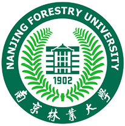
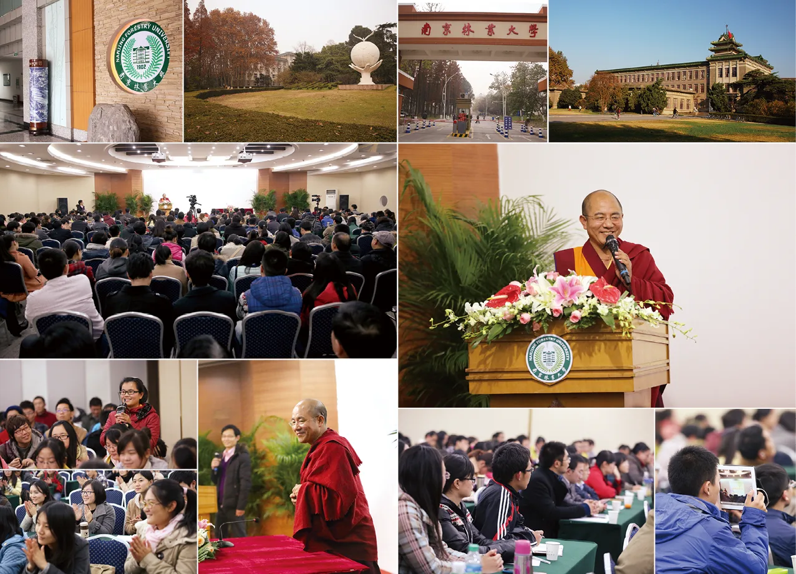
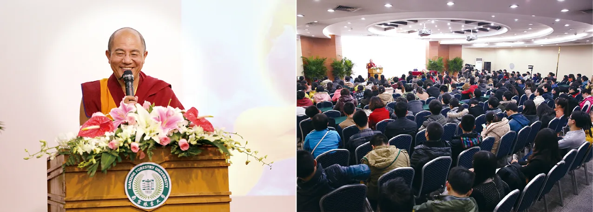

“大地给予人类的是物质的精华，

但它从人类得到的回馈却是物质的垃圾。”

第77场

南京林业大学

Nanjing Forestry University

中国·南京

2013 / 12 / 6

## 佛学之生态思想

## Buddhism and Ecology

主持人：

各位来宾，老师、同学们，晚上好！非常感谢各位参加我们南林大举办的这次国学论坛。大家有目共睹，当前国内生态环境遭到严重的破坏，这种破坏已经威胁到人们的生存和发展，与此同时，传统文化的长期缺失也导致种种严重的社会病。

如何解决这些环境和社会问题，实现永续发展？今天我们无上荣幸地邀请到了四川喇荣五明佛学院的大堪布——索达吉堪布。堪布是国际著名的佛学理论家、活动家、翻译家，学富五车，堪称“当今玄奘”，今天堪布将就这些问题，用佛法的理念为我们作详细的诠解。

下面，让我们用心聆听堪布的精彩演讲——

今天在南林大，与老师、同学们一起探讨“佛学之生态思想”这个话题，我觉得非常有意义。

## 一、生态环境，状况堪忧

### 生态，值得关注

来到南京，我发现这里的雾霾很严重，听说很多学校已无法正常上课，人们出门也要戴着口罩，可见生态污染已经影响到人的日常生活。

也许有人想：“解决生态问题是各国高层领导的事，跟我个人不一定相关。”但如果所有人都想着“跟我无关”，最后这些问题就无人过问了。尤其年轻人是地球未来的主宰者，更需要关注生态问题。

现在中国的污染空气已经漂洋过海，到了日本、韩国以及美国等国家。据说这些国家的空气治理专家，专门来到中国整治空气。

但如果仅是依赖外援，而本国人没有任何环保的意识和行动，毕竟不是解决问题的根本之道。尤其如果一些有钱财、有实力的人纷纷离开自己的国土，逃到别的清净地方，同时大家也不去关心本国的教育，而纷纷把子女送到其他国家学习，最终我们自己国家存在的种种问题就乏人问津了。

所以，每个人应当有一份责任感，关注国内的生态等问题。

### 地球，真的病了

大概2004年，美国有一份地理杂志说：如果全世界人都想达到美国人那样的生活水平，即便有三个地球也不够。

如今的地球荷负着人类施加的巨大压力，已经病了。

世界自然基金会有一份资料，名为《活的地球指数》（Living Planet Index），其中显示：从1970至1995年的短短25年间，地球资源损失了近1/3。其中，淡水资源减少了50%，森林每年的减少面积相当于一个英国的大小。而且残存的淡水、森林等资源也遭受着染污与破坏。

长此以往，后代的人该如何生存？

曾有政府人士说：“现在的人不但继承了前辈的地球资源，而且把子孙后代的资源都借用了。”这种情形确实很可怕。

为此，目前世界上有些国家也在尽量减少资源消耗，保护生态环境。但是国内很多城市却不容乐观，可能仍旧抱持着“只要能为我所用，就要占有和使用”的观念。

### 灾难，并非危言耸听

台湾曾经拍了一部纪录片，叫《正负二度》，也叫做《±2℃——台湾必须面对的真相》，讲述了台湾当前面临的环境危机，呼吁民众重视全球暖化议题。

不过我这次去台湾时，发现那里的环境问题并没有片中所说的那么严重，较之内地的很多城市好很多。

还有，由美国前副总统戈尔（Al Gore, 1948-）担当“主演”的纪录片《不愿面对的真相》（An Inconvenient Truth），讲述了纽约等很多沿海城市可能面临的危险——由气候变暖引发的灾难。这部片子于2007年获得奥斯卡最佳纪录片奖，戈尔也因改善环境所做的努力而获得诺贝尔和平奖。

另外，好莱坞制作的一部科幻片《后天》（The Day After Tomorrow），也是提醒人们关注全球变暖等环境问题，还有《阿凡达》（Avatar）也是有关环保的电影。

同学们有机会时应该看看这类影片，要关心我们的环境，因为这些环境灾难并非危言耸听。

以温室效应为例，如果气温上升平均2摄氏度，就会导致北极的很多冰层融化，如此一来冰层中多少万年沉积下来的细菌会全部释放，由此引发新一轮的气温上升，并可能释放致命性的温室气体，从而加剧全球变暖，导致火灾等灾难。冰层的融化还会引发海平面上升，未来海平面很可能上升6米，那时沿海一带的很多城市，如伦敦、纽约、孟买等，将被淹没而永沉海底。

另有资料显示，1952年英国伦敦出现的空气污染事件，前后导致大约一万两千人死亡。后经多方努力，至1965年有毒烟雾才在伦敦销声匿迹。

你们可能想：“出家人不好好念佛，研究这些做什么？”实际上，环境是在家人的，也是出家人的，环境是全人类的；而且不单是人类的，还是世界上所有动物的。所以，关注和保护环境是每个人的责任。

如果人人都只是关心自己的一方小天地，而对大环境置若罔闻，那么结果将会怎样？可以预见。

### 贪心，是罪魁祸首

导致这些环境灾难的根源何在呢？就是人的贪心。

现在的很多人，心完全被金钱俘虏了，为了钱不择手段，破坏环境也在所不惜。这样的结果就是得到少许金钱的同时，付出惨痛的环境代价。

正如诗人惠特曼（Walt Whitman, 1819-1892）所感慨的：“大地给予人类的是物质的精华，但它从人类得到的回馈却是物质的垃圾。”

## 二、心理环境，亟待净化

### 活着，也是一种勇敢

人活着的目的可以归纳为三种：一种人为了利益很多生命而活着，比如有人想“我要帮助很多人，并且要救护很多其他的生命”；一种人为了亲人朋友而活着；还有一种人，只是自己能够存活下来，无法再利益任何人。

当然，坚强地活着，也是勇气的一种表现。

前段时间我去泰国的一些学校时，询问那儿的教授：“你们这里有没有发生过学生自杀的事？”他们说：“从未有过。”

然而纵观国内的学校，情形就有所不同——有的学生稍遇感情、学业上的不顺，立即万念俱灰，甚至走上不归路。

所以，我特别希望老师们能够多给学生传授如何做人、如何处理压力、如何面对挫折等方面的道理，这比仅仅教会他们专业技术更为重要。

### 学习，是第一要务

在几年的大学生涯中，有些学生很好地掌握了专业知识技能，毕业时满载而归；而有些学生却虚耗光阴，毕业时一无所获。

大学生没有家庭的束缚，又远离了父母的监督，如同脱缰的野马般，如果自己缺乏自觉性，确实会变成“混大学”。比如有的大学生冬天一直睡懒觉，基本不去上课，到了考试时就临时抱佛脚——求老师、求同学、求电脑，想各种办法作弊，这样一旦步入社会，等待自己的唯有失败和痛苦而已。

而且个别学校里的学生，整天在金钱上竞争——比谁家里有钱，比谁有名车接送，比谁的衣服是名牌，这种行为实在没有意义。

美国、加拿大很多学校里的情形就截然不同，像哈佛大学、哥伦比亚大学、华盛顿大学里的学生，相互之间不会有这种攀比。

我曾经问哈佛大学的一个学生：“你到这里多少年了？”他说：“七年。”我问：“你买了多少衣服？”他说：“从家里来时带了几件，到了这里再没有添新的。我们没时间耗费在这上面，也不会跟其他人在穿着上比较。”然而他们对于学习非常看重，很多人都是不分昼夜地学习，即便吃饭时也在看书，这种情景在食堂里随处可见。

我们这里的很多大学生对于学习兴趣索然，一旦听别人讲怎么赚钱，眼睛就睁得大大的，“哇，我所有的一切都在金钱中滚动，该多么幸福”。其实这不一定是件幸福的事。

古希腊有一个故事，虽然是神话，却值得深思。

故事说有一个人特别贪财，贪到什么程度呢？他想：“如果我接触到的任何东西都变成金子多好。”于是他到酒神面前乞求点金术，结果如愿以偿。

回来后，他一吃饭，食物都变成了金子，难以下咽了。他碰到自己的女儿，女儿立刻变成了一尊金的雕塑。

他只好到酒神那里请求收回点金术，酒神同意了他的要求。最后这个人也明白了：即使处在黄金的世界中也不一定快乐。

现实生活中，我经常看到一些腰缠万贯的人，开着高档的轿车，住着高级的别墅，但是从他们口中传出的常常是叹息之声以及伤心的话语，很少有笑声。

所以，大家应该在价值观上好好思量，不要只是关注着金钱，也不要只是为了以后拥有很多钱财而学习。

我当初去佛学院，不是想着以后要赚很多钱，而是一种希求知识的心，虽然当时生活条件恶劣，但是因为对知识极为渴求，学习起来就非常努力，常常废寝忘食。

在座的同学，当你们以后步入社会时，回忆起学生时代，可能就会发现那是非常美好而有意义的一段光阴。

总而言之，我觉得学习是人生中最有价值、最为快乐的事。

除了学习专业知识，作为学生，学会处理人际关系也非常重要。否则到了社会上，对上级不知恭敬，对同事不知慈悲，对下级不知爱护，那么必然会给自己带来很多违缘和痛苦。

另外大家还需要学习的，就是目光当存高远，不应当因为贪图蝇头小利而失去了重要的东西。

《庄子·齐物论》中有一个故事叫“朝三暮四”，说的是：有个人养了一群猴子，他每天给猴子七颗果子。一开始是上午给三颗、下午给四颗，猴子们都很不高兴。后来他就换过来——上午给四颗、下午给三颗，结果猴子们都乐坏了。在这个故事里，猴子们因为眼光短浅，结果蒙受欺骗。

所以人应当眼光高远——考虑今生也考虑来世，考虑自己也考虑他人，如果能做到这样，这个人必定会有所作为。

### 知足，是第一安隐之法

佛教中有很多理念可以让人获得安乐，比如知足少欲。

在座有些学生是学经济学的，知足少欲可能跟经济学的有些理论有所冲突，因为经济学中有“以有限的资源满足人类无限的欲望”之说，但实际上这只能是一种传说。

为什么呢？因为依靠有限的资源，不说填满所有人的欲望，即使只满足一个人，也是难乎其难，因为欲望会不断地膨胀。比如一个人原本觉得在县城中有栋房子就很满足，但一旦搬到了县城，又想在市区有栋房子；等有了市区的房子，又想最好在市中心也有房子；等在市中心买了房子，又觉得最好在郊区有幢别墅；而且在国内有别墅还不够，最好是在加拿大、英国等地各有一幢。

在西方，有的人拥有十几幢别墅，但里面没有人居住，结果这些房子被冠以“魔宫”之名——因为无人居住，可能只有魔鬼来住吧。

其实人存活于世间所需的资源不用很多，因此没必要过分地贪求。

另一方面，我们所拥有的资源能不能分给其他人一些？

现在世界上有8.4亿人每天处于饥饿之中，基本的饮食都无法保证，这个数量占人类总数的12%，而且世界上有430万儿童没有任何依靠。

前段时间我去了泰国和柬埔寨的一些难民区，看到那里的人无衣无食，非常可怜，当时就觉得：唉！在这个地球上，有些人很富有，过着纸醉金迷的生活；有些人又太贫穷，常常食不果腹。

现在很多人觉得“我没有这个，没有那个”，总是处于不满足之中。但如果你去看看那些难民，就会醒悟，自己其实拥有得很多；单从财富方面衡量，你其实是很富有、很幸福的，只是自己没有意识到而已。所以，拥有一颗知足少欲的心很重要，这样就会少一分抱怨，多一分快乐。

对于知足少欲的重要性，佛经中也多有宣说。

比如佛陀临近涅槃时讲述的《遗教经》里说：“多欲之人，多求利故，苦恼亦多。”贪欲重的人因为所求很多，所以苦恼也多。

又如《天请问经》中说：“少欲最安乐，知足大富贵。”欲望少的人最为安乐，内心满足者是真实的富贵。

现在很多人都没有明白“富人”的真正内涵。

上个世纪70年代，一个人有了一万元，就被称为万元富翁；四十多年后的今天，可能拥有一亿元，才称得上富有；再过二十年，也许要坐拥一百亿的资产，才算得上富人。

实际上，不论拥有多少钱财，如果缺少对欲望的控制，内心就会时时处于匮乏之中，感受的始终是贫穷，算不上富人。

那么佛教是否不赞成任何的追求呢？也不是，合理的求取是佛教所允许的。在佛教《阿含经》、《毗奈耶经》以及《善生经》等经典里，对人们生活方面的要求有非常明确的叙述。

所以，提倡知足少欲并非让人不要生存了。一个人获取基本的生活资料无可厚非，但如果过多地占有甚至肆意挥霍，就是佛教所否定的。

有些人认为：到寺院里烧烧香、磕磕头、拜拜佛，这就是佛教。这其实是对佛教的误解。如同体操运动不是大学的根本，烧香拜佛也不是佛教的要务；如同老师传授的知识才是大学的核心，佛教的思想才是佛教的内涵所在，诸如知足、慈悲以及空性的理念。

### 节约，当从自身做起

有关勤俭节约，佛陀早在两千五百多年前就已经宣说了，而佛教徒是这方面的示范者。汉传佛教中的印光大师就非常注重惜福，他每天早上喝完稀饭后，担心碗上留下米粒就用舌头舔，舔完用水涮一遍，再把水喝下去，三十年来一直如此。

然而现在的有些人拥有成百上千件衣服，而且穿不了多久就扔了。这种人其实是有些学者所说的“罪人”——占有太多资源的人。

去年有个统计说：中国餐饮业每年浪费的粮食价值两千亿人民币，可以供应两亿人在一年中吃饱饭。

之所以出现这种浪费现象，究其根源是错误的观念在作祟——很多人认为朋友聚会时点菜太少就有失颜面。

而在西方，情况刚好相反，如果一个人点的菜剩余很多，其他人会觉得“这个人没有水平，太没有面子”。

所以要抵制浪费，树立正确的观念是根本，与此同时每个人应当从自身做起，否则也不会有真实的效果。比如今天在座的三百人，如果每人在一顿饭中做到节俭，那三百人能节约多少粮食？可以说相当多，如果用这些去救助三百个贫困孩子，会给他们带来多少利益和温暖啊！

我以前看过这样一个故事：

有位教授要在一所学校演讲，当距离开始还有十分钟时，学生们纷纷进场。通往会场的路上刚好有一片香蕉皮，每个路过的学生都一边跨过一边指责主办方没有环境意识。

过一会儿教授到了，也开始对着香蕉皮大声地呵责：“你为什么不去垃圾桶里睡觉？”

此时有个学生有点不高兴，对教授说：“教授，你不论怎样指责，香蕉皮也不会自己到垃圾桶里去。”

教授说：“对！但不仅仅是我，你们每个人也只是在指责。”于是他把前面大家责骂的视频在课堂上回放——每个人都只是口上制止，没有人付诸行动。

这个故事告诉我们行动的重要性。

在座的很多人以后也许会变成非常有财富、有权势的人，那时如果只是想着自己占有资源、享用财富，至多愿意分享给亲友，除此之外不会想到其他任何可怜的人，而且也从不为来世着想，这样不是很好。

现在外面的雾霾很严重，开车都非常艰难，但更可怕的雾霾是人内心的自私，因为这种“心灵雾霾”会蔓延——传染到你的子孙后代，以及与你相关的一切人的心中。而要清除它，最好的方法就是培养慈悲以及和平的理念。

### 信佛，会让你损失什么吗？

如果你觉得佛教很遥远，不妨思考一下慈悲的理念。

有一个故事讲，一次有个学者在大会上宣称佛不存在。

当时听众中有个妇人站出来说：“我是一个农村妇女，自从学佛后，我的内心有了很大的改变——我有了慈悲心、平等心。因为信仰，我的内心充满祥和与安慰。请问：假如我死时发现佛说的一切根本不存在，我这一辈子信仰佛，会损失什么吗？”

学者想了好一会儿，低声回答：“我想你一点儿损失也没有。”

农村妇人又说：“我还有一个问题：当你死时，如果你发现佛所讲的千真万确，六道轮回和超出六道的佛土都是存在的，请问你损失了什么？”

学者想了许久，竟无言以对。

当然，是否学佛是每个人的自由，但是佛教的很多思想在当今社会中是否有价值？如果人人都只顾自己，人类会变成怎样的一个群体？人类的生存环境又会变成怎样？这方面希望大家深思。

## 小结

对于我们赖以生存的生态环境，大家需要投以关注的目光，并且要从自身做起，践行保护环境的理念；而对于每个人的内心环境，则需要自己不断注入慈悲、知足等理念，以使其越来越清净。

现场互动

问：我是做药物研究的，这种研究是为了治病救人，但是往往要杀死很多动物。通过杀死动物来救人，到底是对是错？

堪布：现在的很多科学实验确实比较残忍。不仅在中国，西方很多实验室里也是这样的情形。

对于这类实验，如果以佛教的词来评判，就是“造罪”。当然，科研者不会这样认为，也许觉得依靠实验已经获得了种种成果。

不过你有一种敬畏生命的心，这是比较好的，1952年获得诺贝尔奖的施韦泽就曾提出“敬畏生命”的伦理学思想。

其实，人类和动物从生命的角度而言，应该是平等的——人类怕死，动物也怕死；人类有痛苦的感受，动物也是如此。既然这样，我们如果做出了违背这种“平等性”的事情，就需要承担负面的后果。

就你而言，要更换专业恐怕有一定的困难，但是一定要作些忏悔，佛教中有一个咒语“嗡班匝儿萨埵吽”，能够减轻罪业，可以常常念诵。

问：有种说法是“医生只能治病不能治命”，那么如果一个病人的死亡已经命中注定，医生的救治是否还有意义？

堪布：佛教中讲病人的生命能否延续有三种情形：有一类病人注定会死的，那怎样医治也无济于事，即便是药师佛亲临也爱莫能助；有一类病人必定会康复的；还有一类病人，如果予以救治就不会死，否则就会死掉。这也是因缘不同结果不同。

面对病人，医生应该怎样做呢？

一方面，治病是医生义不容辞的职责；另一方面，如果面对的是第三种人，医生的良好治疗会起到延续生命的作用。所以作为医生，对病人尽力救治是应该的。

佛教认为老师和医生是最容易利他的两种职业。释迦牟尼佛传记中也记载，佛在世间利益众生时，就是选择从事老师或医生的职业。

问：世界思想领域中存在着的不同流派，如何才能和睦相处？这些流派能否走向大同？

堪布：在人类历史上，不同宗教流派之间发生过一些冲突，甚至流血事件。不过如今随着“各教派互不相违”理念的倡导，教派之间冲突的状况也已得以改变。

未来这些不同教派是否会完全融为一体呢？我觉得不太可能，因为每个流派都有自己的思想，有些思想可以融合，有些却难以统一。

虽然存在着种种差异，但是教派之间也会有共同之处，此时可以将分歧暂置一边，从共同处入手来构建和睦的关系，这也是21世纪人类合作的一种模式。

也就是说，各个教派一方面守持自宗的观点，另一方面增进了解、互相学习、彼此尊重，以此就可以实现和平共处。

问：修行与工作如何平衡？

堪布：修行与工作是可以融合的——在修行中工作，在工作中修行。舍弃工作而专门修行，对很多人是不现实的，所以要学会将二者结合起来，这样就能一举两得。

我接触的人里，有些工作特别努力，但是将修行完全抛之脑后，结果时间长了自己也生厌烦心；有些修行十分精进，工作都置之不顾了，结果最后需要面对很多问题，付出的代价更加惨重。

所以，培养一边工作一边修行的能力，对于很多有信仰的人以及将来愿意修行的人，都是很重要的。

具体而言，如何将修行与工作很好地融合呢？

有些人认为修行跟工作形同水火、完全对立，其实并非如此。某些修行可能跟工作相违，比如打坐，但修行不完全是打坐，看经、念咒都是修行。跟别人交谈也可以学到很多知识，也是一种修行。

在藏文中，“修行”被称为“竹巴”或者“贡”，意思是“串习”，将佛教的理念在生活中不断串习，就叫做修行。南传佛教中，修行是在正知正念上安立的——正知是时刻观察自己的身口意，正念是念念不忘善法，具足正知正念就是修行。

所以，很多人所理解的修行是有偏差的——认为修行就是把自己关在屋子里，闭目打坐，跟谁都不接触。其实不是这样，真正的修行人可以将修行贯彻于任何时间、任何场合之中。

我有时觉得：作为出家人，自己整天在城市里跑不太好。但有时又想：我坐飞机时可以念功课，坐车时可以持咒，还是在修行。

所以，如果自己能利用好时间，那么除了个别情况之外，大多数时候都可以修行。甚至跟家人吵架时也可以修行——家人不断地批评我时，我就修安忍、修安忍，等他批评完，我的修行已经成功了。

问：现代社会的信仰教育是缺失的，请问这会带来什么后果？

堪布：广义而言，每个人都有信仰——有些人信仰宗教，有些人信仰钱财，有些人信仰权力。当然，通常我们所谓的“信仰”，就是信仰宗教。

确实现在的年轻人是缺乏信仰教育的一代，这是比较可怕的。为什么呢？因为宗教中倡导人要有敬畏心——敬畏天地、敬畏因果，这种心非常重要，人一旦没有敬畏心，行为就会无拘无束，最后做出很多可怕的事情。

当今社会中，为什么贪污腐败屡禁不止？为什么各类犯罪事件层出不穷？这和人们因信仰缺失而缺乏敬畏心有一定的关系。

我希望在座的有些年轻人不要一提起宗教就生厌烦心，“宗教跟我没关系，我只关心就业……”其实宗教里的很多道理对你非常有帮助。所以，即便你现在不信仰宗教，也不要轻率地予以否定，因为我们年轻时所排斥的事物，随着年龄的增长，常常会有不同的理解，会心生后悔的。

问：很多人从小就被教育要“树立远大的理想”，佛教对于理想如何看待？

堪布：我以前读书时，老师也常让我们讲自己的理想，当时一个同学说他以后要开飞机。二十多年后，有一次我在山路上看到他骑着牦牛过来，因为以前的关系很好，我就跟他开玩笑：“记得你以前的理想是开飞机，这牦牛是怎么回事呢？”他笑着说：“这是地行飞机。”

然后他又反过来笑我：“你以前的理想是当老师，现在怎么出家了？”我说：“出家也是在当老师，我的教课一直没有停过。”（众笑）

现在很多人的理想，是在这一生取得一种成功——财富充裕、事业有成等等。而按照佛教的观点，远大的理想不应仅着眼于此生，而应当放眼来世、来世的来世，乃至生生世世；并且不应当只围绕着自己的利益，而要多想想如何帮助他人，这样的理想才有意义。

问：我是南京大学的学生，老师曾经这样跟我们讲：科学中无法解决的问题要上升到哲学中寻找答案，哲学中无法解决的问题要上升到宗教中寻找答案。为什么科学都解决不了的问题，在宗教中可以找到答案？

堪布：这个问题非常有意思。

实际上，对人类社会做出卓越贡献的人，往往是信仰宗教的。这不是传说，我曾经了解过，你也可以去了解一下。

比如牛顿（Isaac Newton, 1642-1727）就是有宗教信仰的，这在他的传记中有清楚的记载。爱因斯坦（Albert Einstein, 1879-1955）也对宗教有一定的了解，而且他是神秘主义者。诺贝尔奖获得者罗素（Bertrand Russell, 1872-1970），则纯粹是一个宗教徒。还有荣格，他对佛学也有很深的研究。

这些科学家或哲学家，在宗教中找到了许多富有价值的奥秘。这些奥秘也成为他们很多卓越成果的源泉。

德国的哥廷根大学涌现了45位诺贝尔奖获得者，而这所大学所在的哥廷根城只有十二万人。我曾经跟这所大学的教授有过交流，他们说这里的科学家几乎全部都信仰宗教。

科学是近几百年才诞生的，主要研究外在世界。而宗教已有两千多年的历史，着重对人心进行探索。所以，大家可以想想，为什么科学解决不了的问题在宗教中能找到答案。

我并不是因为自己是佛教徒就赞叹佛教，自赞毁他的做法在佛教戒律里也是不允许的。站在一个公正的立场上进行观察，确实可以发现：如今科学家无法解决的诸多难题，甚至是他们眼中的“奥秘”，佛陀早在两千五百多年前就已经给出了圆满的答案。

鲁迅先生在看了佛教的《瑜伽师地论》《贤愚经》后，感叹不已。他对朋友许寿裳说：“释迦牟尼真是伟大的圣哲，我平常对人生有许多难以解决的问题，而他居然大部分早已明白启示了。真是伟大的圣哲！”

曾有一种说法是，人的追求是有层次的：一般人追求金钱；层次高些的追求艺术和哲学；再高的追求宗教。

确实是这样，一般大多数人只为了钱财而忙碌；有些境界的人对钱财看得比较淡，而热衷于追求艺术、哲学，虽然这些不一定赚钱，但他就是喜欢，这也让他获得比追求金钱更多的快乐；层次再高的人会追求宗教，它的确会让人受益匪浅。

现在很多人认为科学与宗教是对立的，学校教育中也常常宣扬宗教是迷信、是麻醉药。实际上，这些观念是不合理的。

前段时间我在一所马克思学院也讲过：马克思（Karl Marx, 1818-1883）把宗教比喻成“鸦片”，实际上这是一个正面的比喻。因为在当时的英国，鸦片能给人带来精神安慰，消除痛苦。但在中国，由于鸦片战争的缘故，这个比喻就有了负面的意思，由此导致人们对马克思的话有了误解——认为宗教是个坏东西。

问：有句话说“酒肉穿肠过，佛祖心中留”，那么如果一个人信佛，却既喝酒又吃肉，他是不是真的信佛？他的品格值得信赖吗？

堪布：如果这个人有济公和尚的境界——“帽儿破，鞋儿破”，那么“酒肉穿肠过，佛祖心中留”应该没问题，因为像济公和尚那样的成就者，已经没有了我执，对于吃穿都远离了取舍。

但是我看很多后学者往往和济公和尚相反——帽子没破、鞋子没破，我执更没有破，只是嘴上喊个漂亮的口号。这些人根本不是真正信佛，只不过为了便于喝酒吃肉而找一个说词，佛祖也并没有留在他的心里，只是留在了他的嘴上。

其实，济公和尚这句话的后面还有两句——“世人若学我，如同进魔道”。一个人如果没有成就者的境界，却去做成就者的行为，只会误入歧途，也难逃因果的“惩罚”。

问：修行过程中，先度己还是先度人？

堪布：佛教中讲菩萨的发心有三种：

一种是牧童般的发心，牧童把牛赶在前面，自己走在后面，这种发心就是发愿先度化众生，之后自己再成佛；

一种是船夫般的发心，船夫把他人和自己一起渡过河，这种发心是希望自己和众生一同成佛；

一种是国王般的发心，国王自己先登上王位，之后再度臣民，这种发心是自己先成佛，然后再度众生。

在佛教看来，“先度众生，再度自己”的发心是力量最大的，像文殊菩萨、地藏王菩萨都是这种发心。尽管众生无有边际，难以度尽，但是依靠这种强大的发心，这些菩萨却可以迅速成佛。

对于一般人来说，发愿“先度自己，再度众生”是最现实的。当然，个别人心力比较强，发愿“等众生成就后自己再成佛”，这也是有的。

问：富人可以用丰厚的财物供养高僧大德，以此亲近善知识学习佛法，这是否说明富人的学佛条件优于普通人？

堪布：对善知识的供养中，财供养不是最重要的。

佛教的《华严经》中讲，供养善知识时，上等是法供养，中等是承侍供养，下等是财供养。

法供养，是自己如理如法地修学佛法；承侍供养，诸如帮助善知识做一些弘法利生等事情；财供养，是供养善知识一些钱财物品。

一个人实在没有能力做上等、中等的供养时，再作财供养，供养几百万、几十万都可以，但这是供养中最下等的。供养钱最多的人，也许获得的功德是最微小的，甚至可能没有功德。

佛教中讲，虽然没有钱财但是有真诚的信心，这种人依止上师的条件是最优越的；相反，虽然腰缠万贯但是缺乏信心和正见，也不能守持清净的戒律，这种人即便供养上师很多钱，也不一定有功德，并且对自己的修行也不一定有很大的作用。

有人认为：“我非常贫穷，要让上师欢喜很困难。”实际上，真正的上师不会喜欢钱财，而会看重法。这些上师即使接受钱财，也是用于弘法利生。所以作为弟子，做财供养并非主要，如法修学才是关键。如果对于上师所宣讲的法认真地思维、修行，把这个功德汇报给上师，比供养多少钱都好，真正会让上师高兴的。

问：世间的很多事都需要用到钱，为什么佛教还提倡知足少欲？

堪布：知足少欲是需要的，放纵贪欲对自己不一定有利。

每个人的因缘不同：有些人因为没有前世的福报，虽然颇具才华和能力，而且非常勤奋，但也得不到多少财富；有些人因为有前世的福报，无须怎样努力，钱财就滚滚而来。但是不管怎样，富有的人不要再过分地膨胀欲望；不太富足的人，在拥有一定财产时也要有满足感。把握好分寸才会过得比较开心。

问：灵魂真的存在吗？

堪布：真的存在。这一点在佛经中多有宣说，我在有些书里也讲过。

可能有些年轻人对此不一定相信，但我希望你们不要轻易地加以否定，可以保留着这个怀疑，继续研究，因为毕竟目前你所接受的教育、所学到的知识都是很有限的。

泰国的朱拉隆功大学是皇家学校里最出名的，最近我去泰国时遇到这所大学里的一位教授，听他讲述了一段亲身经历：

有一次他生了重病，灵魂就出来了。这时他看到自己躺在病床上，医生们正在抢救。他心里想：“为什么要抢救我呢？我现在很舒服、很快乐。”他在天花板以及医院的里里外外穿来穿去，然后再回来看时，医生们还在竭尽全力地救治他。

后来他看到上面有一条很光明的路，另外一边有一些黑洞。他考虑着是去上面还是去看一下黑洞，后来还是打算回到自己的身体里。这个念头一生起，他一下子就迷惑了。不一会儿他就活了过来。

这段经历历时大约五分钟。他说：“因为我有这种亲身体验，所以任何人说灵魂不存在，我都不会相信的。”

在我们这里，很多人不相信有来世。比如有人会这样问“如果存在来世……”，很多电影里也是“如果有来世，我会怎样怎样”，都会加上“如果”这个词。而在泰国，每个人都觉得来世真实不虚地存在，他们会说“如果来世不存在，怎样怎样”，把“如果”加在另一面，而且非常害怕，“如果来世不存在，那我怎么办？”

还有一位老师告诉我，他的朋友有个儿子，这个孩子得了白血病，后来去世了。一个月之后，孩子的父亲买彩票得了两百万泰铢，他说是这个孩子晚上托梦跟他讲：“‘111’的那个号会中奖，赶快去买。”第二天他按照儿子说的去做，果然中了两百万。

心识的存在是非常奇妙的，对此希望大家进一步研究，了解。

问：我是一个十二岁孩子的妈妈，请问如何能让孩子身体好、学习好，性格等方面也好？

堪布：这些要全部圆满实现是很困难的。但是在他小的时候，对他进行人格教育至为关键。而这方面的教育，父母负有第一责任。如今很多父母把对孩子的教育全部交给老师，这是没有尽到为人父母的职责。

现在的有些年轻人，已经在学校学了十几年，应当对很多人生道理了如指掌，但事实并非如此，他们可能连基本的做人原则都一无所知。之所以出现这种现象，归根结底是父母没有教过。

在中国古代，父母都会尽职尽责地教育自己的孩子。确实为人父母者应当付出时间和精力教导孩子，告诉他：什么事情可以做，什么事情不能做，什么语言可以说，什么语言不能说……这种家庭教育非常重要。

俗话也说“妈妈是孩子的第一位老师”，妈妈教给孩子的知识，会成为孩子一生中最重要的思想。除了缘分特殊的人在人生摸索中形成另外一种思想，其他人基本都是如此。

那么，如何对孩子进行人格教育呢？就是要培养孩子的善心，因为善良是做人的根本。

另外，要让孩子多背诵，尤其四到十六岁的孩子记忆力非常好，虽然他不一定能很好地理解，但是可以让他先把一些重要的道理背下来。

问：您怎么看待素食？

堪布：素食是非常好的一种饮食方式。不仅仅是从信仰的角度，即便完全从营养学，或者说身体健康的角度，素食都是明智的选择。有一部纪录片叫《面对肉类的真相》（Meat the Truth），里面还讲了素食带来的巨大环保利益。

问：我看到一篇报道说您做过一次手术，当时您因为慈悲众生而坚持不用麻醉药，完全靠佛力加持而完成了手术。请问是这样吗？

堪布：说我做手术没有打麻醉，这是一种虚传。现在网上对人的好或不好的报道都有一定的水分。我经常被有些人当作“试验品”——根本不会飞，被说成是飞过来的；根本没有他心通，被说成有。

我是得过强直性脊椎炎，做过一些小针刀手术，这不算什么大的手术，也并非没有麻醉。事实上因为我经常祈祷，大概七八年中一直坚持诵咒，才使得这个病慢慢好了。

所以，你所提及的情形，可能是有些人的误会。
