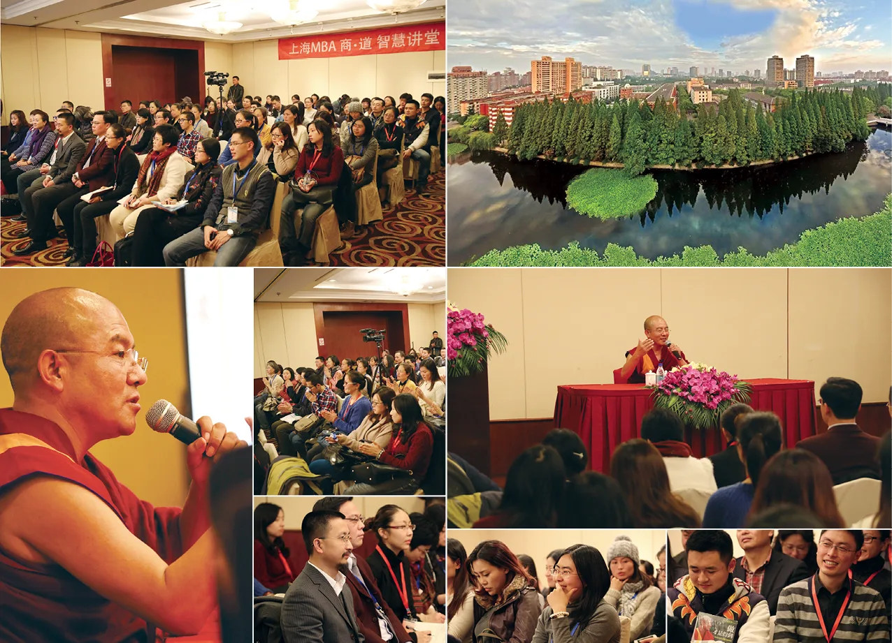
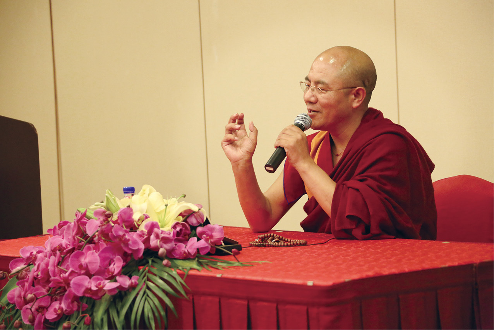
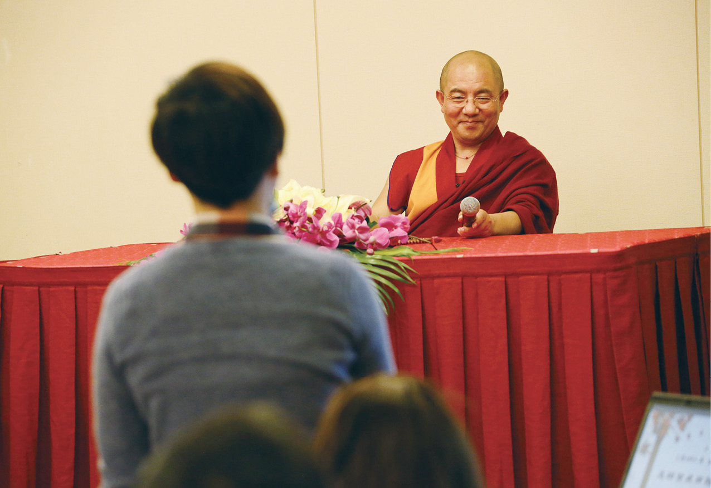

真正给人带来快乐的，

并非外财富，

而是内财富。

第79场

华东师范大学

East China Normal University

中国·上海

2014 / 3 / 14

## 怎样变成有福报的人

## How to be Wealthy with Merit

主持人：

我们此次活动名为“上海MBA商道智慧讲堂”，旨在借助与诸多智者、先行者以及成功人士的交流，向诸位传递更多商业以及人生方面的智慧能量。

在座的MBA从业人士，在各自的企业中、岗位上不断地发挥着光和热，但是当人生走到一定阶段时，不论工作、家庭还是生活中，都或多或少会出现一些烦恼和困惑。今天我们非常荣幸地邀请到索达吉堪布，给我们带来精彩的演讲。在接下来的讲座中，希望各位从堪布的话语中，获取更多对提升人生有所帮助的智慧，以此在自己的事业、家庭、人生中，找到一些方向性的指示。

下面就让我们聆听堪布的精彩演讲——

刚才主持人说，今天讲座的目的是要给大家带来一些“启示”，不过这并非易事，因为任何一种智慧，都不是短暂时间中能够获得的，尤其一些甚深的智慧，需要经过长期的奋斗和深挖，才能积淀于心。

## 一、精神财富的匮乏

### 快乐在心

在座各位，看起来都是成功人士，虽然我对你们每个人的具体情况不甚了解，但从你们的形象、身份等来观察，你们可能在很多方面远远超过一些人。对此，你们或许认同，或许否认。但实际上，不管你是什么身份的人，都应该有一颗知足心。

古人云：“富在知足，贵在人敬。”真正的“富贵”是什么？一方面是自己对工作、生活等有一种满足，另一方面是拥有他人的尊敬。

在座的有些人面对工作与生活时，感觉有压力，甚至产生种种焦虑与恐惧，其实要知道这对凡夫人来说在所难免，世上很多人常常都是与担忧为伴的——担心失去最爱的人，担心容颜逐渐衰老，担心生命走到尽头……

实际上大家应该欢喜和自信。为什么？我们都清楚，新闻中常常报道世界上每天有多少多少人死去，而我们既没有罹患癌症，也没有遭遇横祸，能吃、能穿、能说话，这就是一种幸运。

如果今天我们真的站在生命的终点，就会发现：以前自己非常执著的很多事，其实并没有那么重要，只要能活着就是成功，就是幸福，只要能活着即便当乞丐也心满意足。这样一观察就能明白，自己之前的很多抱怨和不满，都是没有调整好心态所致。其实人快乐与否，关键在心，不在外在。

### 精神与物质的失衡

我们国家历经三十多年的改革开放，物质文明突飞猛进，个别西方国家两三百年中取得的物质文明进步，我们在短暂时间中就获得了。然而我们的精神文明却远远滞后了，非但没有提升，反而在很多方面严重下滑，比如人的道德。

当一个社会的精神跟物质不相匹配时，就会出现病态，甚而无法正常运转。所以，发展经济固然无可厚非，但提升人的内在，诸如智慧以及慈悲，也是不容忽视的。否则，人的欲望越来越膨胀，嗔心越来越沉重，心态越来越浮躁，那么即便富可敌国，也难逃痛苦。

观察如今大城市的人就可以看到这一点，他们的物质生活与一些落后国家和地区相比，如同处在天堂一般，然而很多人的内心却笼罩着痛苦的阴霾，甚至有些人痛不欲生而选择了自杀。

## 二、最重要的财富是福报

### 外财富，内财富

如今的人们常常将财富跟金钱画等号，其实这不尽合理。财富有外内两种：外财富，指一个人拥有的钱财、轿车等外在物质，也是一般人所谓的福报；内财富，指一个人内在的涵养、造诣，诸如智慧、信心等素质。

绝大多数人总觉得有钱人就是有福人，没钱的人即便具有智慧等内在功德，也难以得到他人的敬重，他自己也缺乏自信。但实际上真正给人带来快乐的并非外财富，而是内财富——不可否认，外财富确实给生活带来种种便利，但如果仅仅拥有外财富，而缺乏心灵调节的能力，那么当内心起现苦恼时，必定是束手无策，只能深陷其中。比如有的人为了几百块钱起早摸黑地劳作，一旦没有得到就伤心难过。有的人为了几千块钱而奔波，还有人为了几万块钱，甚至几千万、几亿或几十亿而奋斗，没有达成所愿时同样会痛苦忧伤。因几百块而痛苦与因几十亿而痛苦，就痛苦的滋味而言，没有什么差别。

一切内外财富中最重要的是哪一种呢？有人认为是智慧，有人认为是精进，有人认为是技术，有人觉得相貌最为关键，还有人主张具有福报才是当务之急……种种观点不一而足。

佛陀在《佛说国王五人经》中讲过一个故事，往昔有位国王，他有五个王子，个个具有特长：一个王子的智慧最高超，一个王子的工巧最精湛，一个王子的相貌最庄严，一个王子精进最超胜，一个王子的福报最为深厚。他们都自认是最优秀的，因此常常争论不休。后来，福报第一的王子成为释迦牟尼佛，智慧第一的成为舍利子，工巧第一的成为阿那律，相貌第一的成为阿难……由此看来，福报确实最为重要。

福报并非仅仅凭借今生的勤奋就能完全获得，比如有的人一生辛苦拼搏，但却始终贫困潦倒、生活不顺，这就说明除了即生的努力，福报还有背后隐蔽的因缘。

### 是自己没福报吃热饭

很多人在工作中、家庭里常常抱怨，“这个人不对，那个人有错”，认为都是别人错了，而自己无可挑剔。这其实不合理。

我以前看过这样一个故事：

有一位法师曾经到一座寺院参学，那里的院长要求僧人每天念完经后才可以吃饭，虽然饭九点多就煮好了，却要等到十一点多才能吃，那时饭已经凉了，吃了凉饭导致很多人上吐下泻。

后来这位法师拜访广钦老和尚时，抱怨道：“我们那个院长总是让我们吃冷饭冷菜。”

结果广钦老和尚大喝：“住口。不要讲别人用冷饭给你吃，要说你没有福报吃热饭。”

表面上广钦老和尚说的好像不对，明明是别人让饭放冷了，但如果从另一个角度看，老和尚的话的确有道理。

生活中有些人看所有人都是坏人，这其实是自己戴了“这是坏人”的有色眼镜，导致眼睛已经不清净了；同时，也不能认为自己十全十美，什么烦恼、毛病都没有，如果真是这样当然好，但这样的人在现实中也难觅一二。

## 三、福报背后的因缘

福报既然如此重要，如何才能获得呢？世上的事物都由因缘造就，福报也不例外，那么首先了解一下因缘的道理。

### 作用力与反作用力

很多现代家庭中，夫妻矛盾频发，而不论热战还是冷战，都是导致世界不和平的根本因素，因为即便外面的世界很平静，但如果家庭中战火纷飞，那么人心的感觉依然是：这个世界不和平、不安全。

家庭中的争吵，究其根源就是双方缺乏包容——各自都在心里想：“我是对的，所以必须不留情面地回击他（她）。”结果给对方造成伤害的同时，自己也需要承受痛苦，这其实就反映出佛教所讲的因果律。

这种因果律有些类似于物理学中的牛顿第三定律——作用力与反作用力。比如我用拳头捶打墙壁，虽然墙壁没有要回我一拳的意识，但依靠自然规律，我的手还是像被还了一拳，很疼痛。同样，如果我们善待别人、帮助别人，那么得到的回报必定是快乐与幸福；反之，如果嫉恨别人、伤害别人，那么得到的也会是痛苦与惆怅，这是一种反作用力，一种自然的因果律。

如今科学界所讲的“吸引力法则”，本质上也是佛教的因果律。

什么是吸引力法则？举例而言，如果我很吝啬，不愿把钱财布施给任何人，这叫“穷人心态”，以这种心态就会吸引来贫穷；如果我非常慷慨、宽容，经常布施别人财物，给予别人帮助，这叫“富人心态”，以这种心态会吸引来财富。

作用力与反作用力、吸引力法则，这些“科学因果论”可能更加侧重于观察今世中的因果关联，而佛教的因果论，则会探究更加长远的因缘果报。

### 四个道理

佛教中讲到四种理：作用理、观待理、证成理与法尔理。这四理也可以很好地诠释因果律。

作用理是从因分析：一旦积聚了因就必定会产生果。观待理则是从果分析：任何果法都由因而生，与因密切关联。比如人与人发生争吵时，虽然都指责对方不对，但其实双方都有错，所以双方都要承受由此带来的痛苦。

作用理和观待理，依靠证成理可以证明——明显的部分用现量成立，隐藏的部分用比量成立。

如果问：为什么行善得善报、作恶得恶报呢？这就是一种法尔理，如同种下毒种子长出毒果、种下妙种子结出妙果一样。

### 看不见的因缘

生活中，很多人常会陷入困惑：“我没有种这个因，为什么会遭受这个果？”实际上，你今生也许没有种，但是前世种了。这方面的道理很深奥，如果没有深入微细层面观察，一直凭借肤浅的分别心来分析，可能就会满腹疑团。

我特别希望年轻人认真学习因果律，因为这样，你们生活中的很多困惑就能迎刃而解。

比如两个人同时创业，启动资金都有100万，一番打拼后的结果是：一个人一夜成名，一个人却一败涂地。造成这种巨大差异的原因何在？从表面上如何观察，都看不出其中的端倪，这时就要分析深层的因缘，才能找出原因所在。

就好比三块地，农民花费同样的工夫去耕作，阳光、水分、空气等因缘也相同，但是一块地的庄稼生长茂盛，另一块地庄稼长势一般，还有一块地根本没有长出庄稼，为什么会出现这种差异？那就不得不观察一下种子，如果地里根本没有播下种子，那么即使肉眼可见的因缘都具足，也永远不可能出现果法。与此类似，每件事的因缘，除了肉眼可见的之外，还有看不见的深层因素。

现在很多人在面对人和事时，只是围绕看得见、听得到、想得出的浅层面进行观察，这是很局限的。因为人眼只能看清一定范围内的事物，再远就望尘莫及；人耳只是能听到一定距离内的声音，再远就无能为力；人心中想到的东西，也是非常有限的。

所以，每当我置身于城市鳞次栉比的楼群之中，都愈发感觉人类的渺小，正因为这样，人类不能盲信自己的感官。实际上人类不了知的真理，且不说有关整个宇宙的，即便是自身方面的，也比比皆是——比如对于前后世的存在，很多人就丝毫不了知，有的人甚至矢口否认；再比如对于善有善报、恶有恶报的规律，很多人也是一窍不通的，甚至轻率地排斥。

有人常说：“你们佛教认为善有善报。”其实不能认为“善有善报”是佛教独树一帜的观点，如果佛教秉持一种唯有自己承认、却跟科学以及自然规律背道而驰的观点，那佛教就是邪教，不成正教了。但这是绝不可能的。佛教所抉择的观点，不仅有理论的依据，也经得起实践的考验，如果去实修实证，更会有直观的体悟。

## 四、福报的源泉是心

福报的因缘是什么？福报的因缘不在别处，就在心中——人心中种种贤善的品德，人一旦拥有这些品德，不仅今生快乐，来世也会幸福。

### 心灵训练

在座诸位所学的知识大多关乎外在物质，很少涉及内在精神，因为精神领域的知识，可能除了宗教学院讲授，在一般的高等院校中很少传讲。然而，物质和精神之中，精神却更为重要。

一个人的精神世界，如果是匮乏的，那么即便他拥有非常丰裕的物质生活，也无法幸福，甚至会深陷痛苦，乃至走上自我毁灭之路，有这个可能性；相反，如果这个人精神非常富足，那么即便物质上不很充裕，依然可以怡然自乐、处事不惊。在西方一些金融风暴中，有的企业家资金都损失殆尽了，但因为内心非常坚强，能够重整旗鼓，最后也有很多再创辉煌的。

在我自己修行、生活的经历中，我发现心灵的训练对于当前的企业家、知识分子来说，至关重要。

如果一个人有良好的心态，或者具备一定的佛教修行境界，那么即便面对常人难以承受的可怕之事，心中也会有所依托，知道如何解决，跟一般人的巨大差异就会显现出来。比如家庭出现变故时，如果善于调整心态，就会想：一切都是无常的，家人的心态也不例外。既然如此，我为什么不坦然接受呢？

我们可以发现，有时一些突发性灾难出现时，大家就非常恐慌，感叹世事无常，但实际上大多数人在百年之内都会以不同的方式离开世间。既然如此，有没有为离开作些准备呢？

佛教中会提前对死亡做一些训练。训练得好的人死亡时，应对之策可以运用自如；训练得不太好的人，虽然不能熟练使用这些方法，但因为毕竟接受过训练，就像接受过培训的军人到了战场上一样，还是会多一分把握。

不仅是死亡，对于人生中可能出现的种种困境与挫折，都需要有所准备。虽然很多人梦想着一切美好、顺心，每天心里这样想、口里这样说，但实际上人生的路是曲折的，不可能从小到老一直顺顺利利，所以要有两手准备。

我看到现在很多创业的人，都只在好的方面规划，坏的方面从不考虑，比如一直盘算着“我这样能赚多少钱，赚来的钱再怎么投资……”，但实际上对于不好的方面也同样要有所打算，“万一没有成功该怎么办？”就像学驾驶的人，面对平坦宽敞的路如何开，要训练；面对狭窄坎坷的路如何开，也需要训练。

其实每个人都是人生路上的驾驶员，而这条路并不都是坦途大道，有时冷不丁会冒出一个急转弯，如果你提前心中有所防备，那么到时就能轻松应对。

总之，提升心灵的素质至关重要，而这其中的要点，我归纳为两个——增长智慧、培养慈悲。

### 增长智慧

人需要智慧，如果不具备智慧，人生的路上可能会举步维艰，面对任何事都懵懵懂懂、迷迷糊糊，最后陷入生活的泥水坑。而这种智慧，不仅仅是对世间专业知识及各类知识的通晓，还包括对出世间真理的洞达。

要获得智慧，需要长期的学习与积累。当然人与人也有很大差异，有些人与生俱来就心智敏锐，而有些人一生下来就呆头呆脑，记性不好、做事粗心，一旦上了年纪，记忆更加下降，加之科技日新月异，似乎都难以跟上时代。

如今的社会表面看来通信、交通等都非常发达，但这到底是提升还是退化？比如很多人整天沉溺于手机中，然而手机上纷至沓来的信息中，可能80%对你的人生没有多大作用。同样，人们耳边应接不暇的声音，比如各种流行歌曲，对人生也没有益处。在这种时代，我觉得很重要的是具备智慧取舍的能力——知道自己想要的是什么，知道什么对自己真正有用。现在很多人心中想要的特别多，但真的需要吗？好像从没思考过。

有些人买一栋房或买一辆车时，其实并不是出于需要，而是因为虚荣，“其他人都有，我为什么没有？我没有，就比不上他们了”，但是买房、买车的压力，你也不得不承受了。

所以，很多时候压力不是社会给的，不是别人给的，而是自找的——自己的欲望过度膨胀招来的。实际上我们不需要跟别人竞赛，每个人有自己的人生，能做到多少就做多少。

### 培养慈悲

现代人还需要培养的是爱心，有了爱心，自然会散发出温暖。

当然，有些爱是一种自私、占有、控制的心态，这很危险，因为当这种爱越来越增长时，被爱的人也就被控制得越来越紧，最后彻底失去自由。对方没有了自由就会痛苦，这种痛苦积聚到一定程度，必然会爆发，最终导致自他俱伤。原来的爱就演变成了恨。

如果真正是无私、无条件地爱别人，就一定会给对方留下空间，而且会把对方带到接近真理的地方，这样才能真正给他（她）带来幸福，自己也会获得安乐。

我希望在座的很多成功人士能够常常行持善法，做一些正能量的事。人生在世，不应只是为自己而活，而应当散发光和爱温暖周围的人。如果每个人都能这样，整个社会就会很祥和。当然，这也不是强迫你们去行善，如果能明白一些因果道理，就会自然发起行善的愿望。

## 结语

如果运用智慧观察，就会发现世界对每个人都是公平的，一个人造下怎样的业，就要承受怎样的果报，丝毫不会错乱。因此我们在取舍因果、行善断恶方面要小心翼翼，如果能做到这样，今生和来世都会充满光明。

佛陀曾在《根本说一切有部毗奈耶药事》中讲：“乐修福业人，今世来世乐。”愿意修福德、造善业的人，即生快乐，来世也会幸福。这个道理，对佛法知之甚少的人不一定理解，但真正去靠近真理时，就会逐渐明白其中的深义。

现场互动

问：我和几位师兄开了一个素菜馆，想借此让更多年轻人接触佛法，请问如何把它经营好？比如运转初期的资金短缺如何解决？

堪布：开素菜馆是非常好的事。

我昨天也去了一个素菜馆，那里有三类套餐：一人380元、一人580元、一人1000多元，属于素菜馆里比较高档、特殊的一类，他们也开展一些素食讲座，讲解素食的利益，不是从宗教层面，而是从卫生及营养学角度讲。

上海这边的枣子树素食也经营了很多年，我很多年前来这里时也询问过他们的运转状况，回答说：“资金上没有问题。”不过，经营素菜馆的初期一般会比较艰难，所以也有些坚持不下去的就关门了。

你所询问的资金问题，我现在也说不出比较好的解决方案，但还是希望你们一定要坚持下去，因为这是一件有意义的事。

现在也有些餐馆专门提供免费素食，为什么这样做呢？因为从佛法的角度看，一个人如果吃一顿素食，就等于避免了在这顿饭中杀生，这对他是一种饶益。如果承认前后世和业因果，就知道这个利益非常非常巨大。所以，我特别随喜你们。

问：我的孩子很爱听《心经》《金刚经》之类的歌曲，也蛮喜欢佛教的一些仪式，有时还会问一些生死方面的问题。请问：能不能让他这样的儿童皈依？

堪布：如果他在这方面表现出乐趣，皈依也很好。

佛教里的皈依，其本质就是发愿做一个好人。我出家30年以来，确实也发现好人的所有特征在一个真正的佛教徒身上都具足，比如善良、包容等等，所以皈依不论对孩童、成年人还是老年人，都是件好事。

问：作为父母，如何引导年幼的孩子修行？如果让他吃素，能否保证营养均衡？

堪布：现在是一个重视传统文化的时代，父母要引导孩子修行，可以从《弟子规》入手。孩子如果学了《弟子规》，他的人生会因此而改变。

其实对于孩子的教育，父母负有重大的责任，不应该把孩子送到学校就置之不管了。现在很多学校虽然在知识技能的传授上很不错，但在道德教育上却严重不足，这种教育培养出的人，最后会变成“技术机器人”——熟悉知识技能，却不懂为人处世，这样的人要想在世间很好地生活也有困难。

至于是否让孩子吃素，可能要根据学校、家庭等各方面的因素仔细考量之后做抉择。

问：我读过《不离》，深深地被法王晋美彭措的大悲心所感动。我的问题是：怎样才能证悟？

堪布：《不离》这本书，是我在法王圆寂10周年时，为纪念法王而编辑的。

我虽然在法王身边待了很多年，而且法王每次出国或到汉地弘法，我都跟随着，但确实感觉很惭愧，当时并没有把法王的很多殊胜教言记录下来，跟我一起的其他法师也没有作记录，我们现在都觉得很遗憾。

《不离》是从法王现存的国内外开示中，选出一些比较重要的教言汇集而成。这些教言一针见血地指出了现代人的内心烦恼以及末法时代的诸多弊病。书中法王金刚语的微妙加持，是一种无形的力量，对人的内心能起到立竿见影的净化、调节作用。

关于你的问题，证悟的方法多种多样——法门不同证悟方法不同，证悟层次不同方法也有所差异，比如声闻、菩萨、佛的证悟就对应不同的方法。所以如果笼统地问如何证悟，恐怕也很难一以概之地回答，就像询问“怎样经商才能获得成功”，那方法可能非常多。

问：按照法王晋美彭措的教言，念诵100万阿弥陀佛圣号就可以成佛，是这样吗？

堪布：法王讲过如果念满100万弥陀圣号（指藏文圣号，如果是汉文则是600万），就可以往生极乐世界。但往生极乐世界并不完全等同于成佛，因为也有凡夫带业往生的情形。不过不管怎样，到了极乐世界即便还没成佛，离成佛也不远了。

问：念佛时总有杂念怎么办？

堪布：这是正常现象。因为我们从未观过自己的心，现在通过一种寂静的方式来观察时，就会发觉心中杂念纷飞。

觉察到心中的杂念时，可以慢慢观念头的本体，到一定时候所有念头都会变成智慧。禅宗中也常讲“烦恼即菩提”“众生即佛”，所以站在实相的角度，有念头并非不好，如果能认识它的本性，每个念头都是智慧。

问：我正在读研究生，这要花费一定的金钱，还需要付出很多时间写论文。但是我觉得世间的学业对于解脱没有意义，请问我是否应该把学费节约下来用于公益，把写论文的时间节省下来学习佛法？

堪布：如果是我，一方面对学习佛法会很重视，另一方面也会珍惜学习世间知识的机会，在自己的佛教见解、修行不退转的前提下，会不断地去学习这些世间知识。对于学任何一种智慧，我都很有意乐。

我经常也跟我资助的一些学生以及认识的研究生、博士生讲：要尽量把学业完成。前段时间我刚刚资助的一个学生，西北民族大学的一个在读研究生，想要出家，我说：“本来出家很有功德，但你的学业最好不要半途而废，可以读完研究生再出家，因为你现在学的知识也很难得。”

所以在保证佛教的见解、修行不退的前提下，付出一些金钱、时间来学习世间知识，对人生也非常有意义。当然每个人的情况不同，如果有了特殊情况，也可以酌情来选择。

问：有个男生追求我，但是我不想接受，他于是说：“你不是学大乘佛教吗？大乘佛教说要爱一切众生，那你应该爱我。”请问我该怎么办？拒绝又怕伤他的心，因为他也是众生之一。

堪布：大乘佛教是讲要爱一切众生，但这种爱不是世间的贪爱。

《中观宝鬘论》中说：“贪嗔痴及彼，所生业不善，无有贪嗔痴，及彼生业善。”贪嗔痴以及它们驱使下所作的都是恶，无贪无嗔无痴以及由它们所生的都是善。所以，不论你或者对方，如果内在是贪染心，虽然口上说是大乘菩提心，但实际上由此引发的身口意都不是善。

而对方要求你爱他，可能并非担心作为佛教徒的你失坏菩提心。所以这种人的要求，大乘佛教徒可能不必要去满足，也无法满足。

总之，对大乘佛教的教义要准确地观察和理解。

问：有没有行之有效的方法或咒语可以快速获得财富？

堪布：财富，实际上有时越追求越得不到。所谓“舍得”，有舍才能得，没有舍就得不到，因此获得财富的方法就是具备舍心，这是一种因果规律。

比尔•盖茨捐出了90%的财富，巴菲特布施了92%的财富，李嘉诚舍弃了70%的财富，他们这样做了以后，更多的财富源源不断地涌向他们。

虽然我们不一定能像他们那样做出如此巨额的布施，但是只要有一颗舍心，自然会感得富足的回报。

当然在这方面，祈祷佛菩萨，比如念诵度母心咒、观音心咒、财神心咒等等，也能起到一定的作用，但这些只是助缘。如果之前没有播下舍心的种子，那么再如何施加助缘，也长不出财富的苗芽。

如今的时代中，很多人想短时间中获取大量财富，但也需要懂得其中的因缘关系，否则不一定能如愿以偿。

问：您在《离幸福很近》一书中说，信心是最好的财富。请问如何培养缘佛法的信心？

堪布：信心有两种：感性的信心、理性的信心。

一、感性的信心。很多人遇到一些特殊的因缘——上师、佛经等等，自然而然就出现一种信心，这是感性的信心，并不稳固。

二、理性的信心。有些人通过对佛法的多年学习，生起了牢不可摧的定解，由此而生的信心属于理性的信心。具有这种信心的人，虽然外在不会像有的人表现得那么激动，但修行的路会走得更加长久。

所以，我们要培养理性的信心，而培养的方法就是长期、深入地学习佛法的道理，这样之后你才会深刻体会到佛陀智慧的不可思议，那时表面上你不一定有什么特殊的表情，但实际上内心已经被佛法彻底折服。

我常给学院里的学僧们传讲比较深奥的佛教理论，比如中观、因明。刚开始很多人说听得云里雾里，我就说：“让你们中有些具有傲慢心的知识分子先糊涂了，这样反而可能慢慢能引发信心。”

所以，长期系统地学习佛法至为重要，唯有这样才能培养真实的信心。

问：佛教里讲“众生是随业流转的”，请问众生完全无法自主吗？

堪布：佛教中也讲“业本身是众生造作的”，所以佛教的真正观点并非众生完全被业掌控，而是说业在众生的生活中起到一定的作用。佛教不认同个别宗教主张的宿命论——命运由前世的业完全框定，而认为业和命运都是可以改变的。

当然，改变业和命运的方法也比较复杂。就像世间的有些法律，虽然可以改变，但也并非想改就改，而是需要一定的因缘。

问：作为佛弟子，处理世间事情时，使用世间常人的规则可以吗？

堪布：世间常人的规则中，有些合理，有些不尽合理。合理的规则可以去运用。

关于这个道理，打个比方来说。

曾经有一个人跟我说：“我原先认为所有佛教徒都非常纯洁，结果接触后才发现佛教徒也是鱼龙混杂的。”其实这是理所当然的，任何一个群体都会有良莠不齐的情形。比如，如果认为“北京大学的所有人都非常好”，那么真正去观察时，可能会失望的。

佛教徒中有些非常优秀，有些特别不好，可能比常人还差，即便是出家人中也有不同的层次。因为现在佛教徒中有些人比较系统、认真地学习过佛教的理论，比如藏地很多寺院中的修行人；而有些人，包括出家人、在家人，并没有正规地学习过佛法，由此导致行为不一定很如法。但对于佛教的教义，我可以百分之百保证它是纯正无垢的，谁也无法染污它。

与这个例子类似，世间的规则也有种种不同情形。你问的问题比较模糊，我回答时也以这种方式回答。

问：佛教认为存在六道，对此能否运用科学手段加以证实？

堪布：六道是指天道、阿修罗道、人道、旁生道、饿鬼道、地狱道。

我们处于人道，我们身边的动物，诸如鱼类、飞禽等，属于旁生道。人道以及旁生道中的大部分众生是人类肉眼可见的。

天道，如果用现代科学的眼光看，可能是一部分外星人。目前人类依靠科技只能到达月球，再远就望尘莫及，所以要看到天人也比较困难。而且天人的身体是一种非常细微的色法，并非肉眼可见的范畴，所以《俱舍论》里讲：天人能看到人，而人看不到天人。

阿修罗道，处在接近天道的世界里，如果众生的嫉妒心、竞争心很强，就会转生到这一道。此道的众生也不是我们能见到的。

饿鬼道，就是通常所谓的鬼，肉眼也无法见到。听说美国有100多处鬼屋——有些堡垒、古建筑里，常常有鬼出没，没人敢居住，因此而得名。白宫也曾传出很多闹鬼的故事。有些人认为鬼只是传说，但实际上鬼真实存在，这一点在佛经中有清楚的叙述。

地狱道，更是超越了人类可见的层次。当然也有特例，比如个别高僧在特殊境界中游历地狱时，见到地狱的景象以及地狱众生受苦的情形。

六道的存在，主要是依靠教证成立的。所谓教证，就是佛的语言。对于宇宙中人眼能见或不能见的很多生命形态，佛陀在经中都作过介绍。

关于这个道理，我以前写《佛教科学论》时也分析过：现代科学跟佛教的观点还是存在一定差距，不论对胜义空性的抉择，还是对六道轮回的观察，科学都很少涉足，而只是对于眼前很近范围内的物质现象作一些研究。

所以，想要借助科学手段来验证六道的存在，有一定难度。

问：最近我们准备启动一个培养家庭和睦关系的项目。对于活动的形式，您能否给一些建议？

堪布：这种活动很重要。

每个人的业力不同、烦恼不同，加之很多人喜新厌旧，所以到了一定时候，很多家庭就爆发出各种矛盾和冲突。

以夫妻为例，佛经中讲夫妻的因缘有几种情形：

一、还债型。前世时一方欠了另一方的债，即生中欠债者就会不断无条件地付出，进行偿还。

二、还怨型。前世时互相杀害过，即生中也要通过互相伤害的方式来还怨。

三、圆满善愿型。前世时一起发过善愿，即生中就生活在一起而了愿。

作为出家人，我对家庭生活没有切身感受，但是从在家人的表情上，从一些传闻中，也可以了解到家庭不和给人带来的巨大痛苦。家庭作为社会的细胞，一旦出了问题，就会引发社会的不安定，因此我在演讲时，也经常讲有关家庭和睦的内容。

对于你们这次活动，因为我不了解具体的细节，所以关于组织的形式，也不好贸然提出建议，但实际上通过多种方式对参与者进行心理引导是非常重要的——每个人都希求快乐，但是人不能很自私地只顾自己，而要在力所能及的范围内帮助他人，尤其是离自己最近的家人，为了他们付出一些，即便是种一朵花，也很有意义。

问：佛教宣扬无我的理念，请问什么是“无我”？

堪布：佛教讲的“无我”，有两种层次。

一、小乘佛教的“无我”。

对四法印中的“诸法无我”，小乘佛教解释成“人无我”。小乘的不同流派里，除了犊子部认为有个不可思议的“我”，其他基本都认为“人我”不存在——“人我”是每个人与生俱来就认为存在的“我”。

在座每个人都觉得“我”存在，那为何佛教说“我”不存在？佛教的这种理论是无稽之谈吗？不是的，相反这种理论经得起任何观察和考验。

我们可以观察：“我”到底是什么？

是身体吗？很多人认为“我”是自己的身体，如果身体是“我”，因为身体有很多部分，“我”应当也有很多了。是心识吗？也不是，因为真正观察时，心识也无迹可寻。

其实如果真正在自己的五蕴中寻找，根本找不到“我”。所谓的“我”，只不过是一个虚幻的泡沫，是众生在虚妄分别驱使下形成的错觉。这就是“人无我”的道理。

二、大乘佛教的“无我”。

大乘佛教认为不仅“人我”不存在，其他事物也不存在，这叫“法无我”。法无我的教义在大乘佛教中抉择得非常完整。

因此，大小乘在抉择“无我”方面存在广狭的差异。

“无我”的道理，不能随便向普通人宣讲。佛教《中观四百论》中讲：对愚笨的人，不能宣讲无我空性，否则他会难以理解——“如果我都没有，那谁解脱？如果我都没有，那谁堕地狱？”之后可能会对佛法生起邪见，造下罪业而堕入恶趣。如果是对有智慧的人，则可以宣讲“无我”的道理。

其实对于“无我”，大家不用惧怕，因为真相就是：一切法都是空性的（也即无我）。

当然，佛教所讲的无我，并非否认一切现象的存在，而是说抉择实相时，“我”不存在，但世俗中堕地狱、上天堂的“我”也可以假立。

我特别希望年轻人能学习佛教里抉择无我空性的论典，比如《中观根本慧论》，学习这些道理不必借助宗教仪轨，只需要用心思考——如果能深入思维，任何人都不得不承认一切法是空性的。

问：心理学也解决人的内心问题，跟佛教是否存在交集？

堪布：心理学确实也是对精神进行观察与分析的学科，所以在某些问题上与佛教的观点比较一致。

心理学有很多支分，佛教也有不同的流派，其中佛教唯识宗的一些心理剖析方法与现在西方科学特别强调的心智科学有相通之处——心智科学是对深层次的精神进行研究，比如人睡眠时的状况、日常生活中的情绪敏感度等，这跟唯识宗所讲的阿赖耶识有一定关联。

我以前在华中师范大学等学校所作的讲座中，曾专门将佛教与心智科学结合起来作分析，跟中科大前校长朱清时院士也有过佛教与心智科学的对话。你如果想深入了解二者的关系和差异，也可以去看看这些资料。

问：如果生命是在六道中一世世轮回，可能就会常常重复做同样的事，那么生命存在的意义是什么？

堪布：确实生命是在六道中不断轮转的。有关这方面，慈诚罗珠堪布的《前世今生论》里讲得非常详细，我2002年在厦门翻译过这本书。

慈诚罗珠堪布在其他论著中讲，他在接近20年的时间里，把佛教五部大论的研究放下来而去钻研科学。所以，一方面他对于佛法非常精通，另一方面又能结合科学理念来阐述，就使得这本书锦上添花。如果能够好好研读这本书，有关轮回的很多疑惑会涣然冰释。

既然人一世世不断轮回，那生命的意义何在呢？我觉得生命的意义体现在两方面：一是力所能及地饶益他人；二是恒时保持快乐的心态。

对于很多现代人来讲，非常需要培养快乐的心态，不能总觉得“压力好大，人生好苦”，其实人生中的每个经历都是不可多得的礼物。

昨天在北京，同行的人说：“堵车好痛苦。”我说：“堵车时，可以看看旁边的高楼大厦，可以多吸收一些雾霾，也是一种享受。”

如果我们心里始终觉得好苦、好伤心、好累、好烦，口中尽是这些负能量的话语，那么生活也许就真的如我们所想、所说的那样了。为什么现在城市里的雾霾那么严重？可能就是因为人们口中吐出的都是“雾霾的语言”，这些负能量在空中慢慢凝结，就形成了雾霾，然后人们又不得不吸入体内。

所以，我们要尽量言说积极的语言，保持愉悦的心境，因为心态快乐是生命意义的一部分。

问：我最近有一个去寺院工作的机会，因为这份工作跟我之前的职业差别很大，在无法抉择的情况下，我就去打卦了。打卦的结果是这份工作不适合我。不过我本人觉得在寺院工作很有意义，请问我该怎么做？

堪布：有时我本来想做的一件事，自己打卦或者请别人打卦观察时，结果是不能做。这时我就会做一些善事，比如念经等等，因为本来打卦的结果不好，所以用善法弥补一下，之后还是按原计划行动，我经常这么做。

问：现在网络上有很多佛法的教言，从早到晚不断看都不一定看得完，该如何选择呢？

堪布：现在是互联网非常发达的时代，不单是佛教方面的微博、微信多，世间各类知识、种种新闻也铺天盖地。

昨天腾讯组织了一个讲座，我看到在探讨佛教的角落里，只有大概四五个人，而交流体育、经济的地方，人头攒动。当时，我就感叹对佛法感兴趣的人太少了。

对于网上的佛法教言，你觉得哪些对自己调伏烦恼、增长智慧与悲心有帮助，就去阅读、学习，谁也没规定必须全部看。当然如果有时间，全部看也可以。

问：对于初学佛法者，依止上师很重要，但如果像古人那样首先观察上师七八年，恐怕没有那么多时间。请问有什么具体可行的观察上师的方法吗？

堪布：观察上师非常重要。

虽然花费两三年、四五年去观察一位上师，有一定困难，但至少要对他的基本情况比较清楚。很多人为了解生意合作伙伴，都会不辞劳苦地从中国飞到美国，从美国飞到新加坡……那更何况关系到自己法身慧命的上师呢？更加应该引起重视。

而且如今的信息非常发达，要了解一位上师也不会很难。如果你花半年时间去观察他，或者亲自到他那里了解，或者询问相关的人，这还是很有必要的。

在决定依止这位上师前，还需要弄清楚：“我需要的是什么？我需要的东西，这个上师有没有？”如果你需要的仅仅是一身红色或灰色衣服的一个形象，那没有意义；如果你需要的是趋向解脱的真理，那他到底有没有？

现在很多人在依止上师的过程中出了问题，究其原因：一方面可能是个别上师的行为不如法，但大部分原因还是弟子过于盲目、不加观察——刚开始草草依止，之后又强加过失。其实有些上师并没有过错，但却被信徒编造谣言进行诽谤，就像有些明星本来很好，但遭人嫉妒而被用各种语言谩骂一样。

总之，依止上师前，善加观察很有必要。

问：我的父母正在遭受着病痛的折磨，我劝他们念佛，但他们以没有看到效果而不愿念，我该怎样帮他们？

堪布：一方面，念佛对你的父母当然有好处；另一方面，也不能认为一念佛就可以马上让他们减轻痛苦，因为痛苦的因已经造下，现在果报现前，想依靠念佛立刻消除也有一定困难，当然也不排除有奇迹出现。就像医生开的药，有些对病人的病能起到立竿见影的效果，有些则未必有明显作用。同样，念佛、念咒能否奏效，也有不同情形。

你的父母如果能接受你的建议，当然很好；如果他们实在不愿接受，可能你越劝说，他们越会烦恼。这种情况下，你可以悄悄替他们念，这也是很好的因缘。

我觉得在父母晚年时，尽量不要让他们生烦恼，即使劝他们学佛，也尽量让他们在快乐的心态中趋入，而不要强迫。

问：我初学佛法，现在感觉跟爱人在一起很耽误时间，所以常常不愿跟他沟通，而喜欢自己看书。甚至现在我提出要跟他分手，他就觉得：“你们学佛的人怎么都这样？最后都走这样一条路？”请问我该怎么做？

堪布：处理好跟家人的关系，是佛教徒非常需要注意的一件事。

不过，有些家庭矛盾并非因为一方信仰佛教而导致，现在不论西方还是东方，夫妻感情都很容易出现裂痕，只不过有时一方的信仰刚好成了凸显矛盾的因缘。

我经常讲，作为佛教徒对家人要尽量随顺，家人虽然可能对你的修行有些干扰，但作为大乘行人，如果跟家人都无法和睦相处，那要度化其他众生也只是一句空谈。

当然，每个人的情况不同，有些人如果过分顺从家人，可能永远没有解脱之时，这方面也值得注意。但不管怎样，还是要学会运用方便和智慧，这样才能圆融解决很多事。

主持人：

时间过得真快，差不多9点了。上师也很辛苦，两个小时基本一直在讲，声音已经有些嘶哑。让我们全体起立，再一次感谢上师给我们带来的精彩演讲和答疑！
