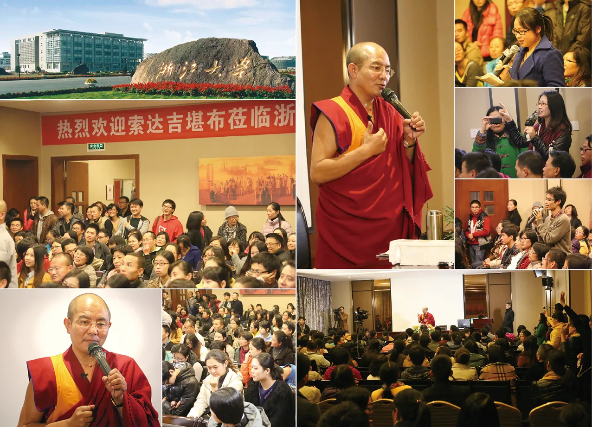
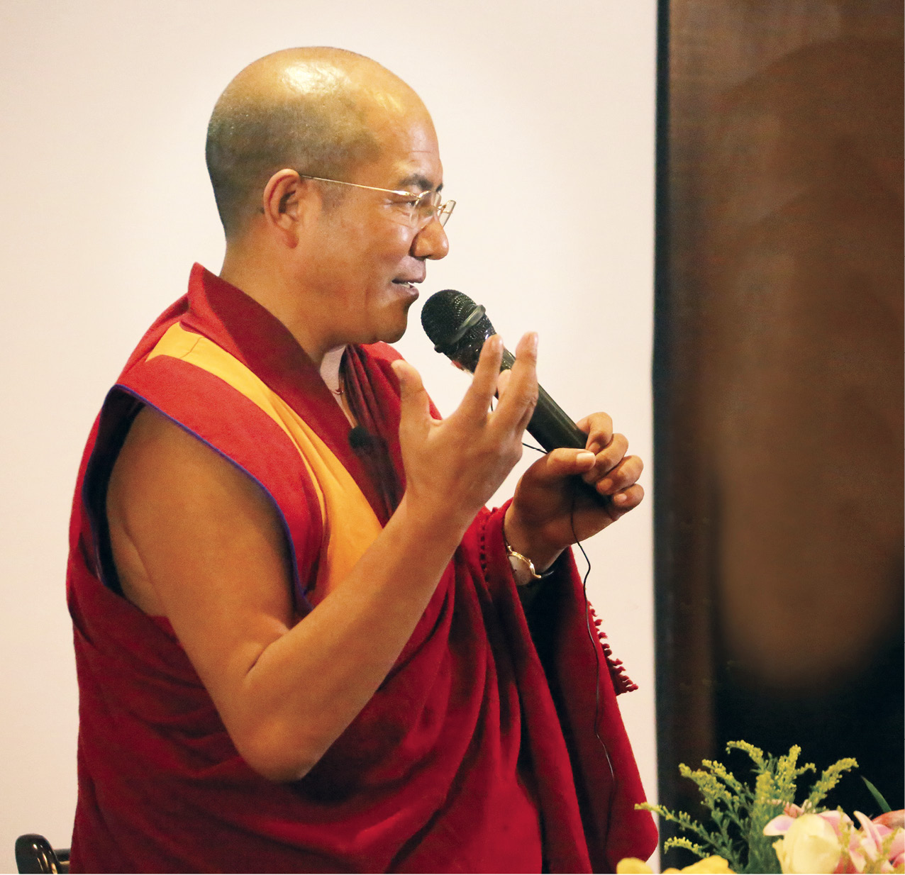
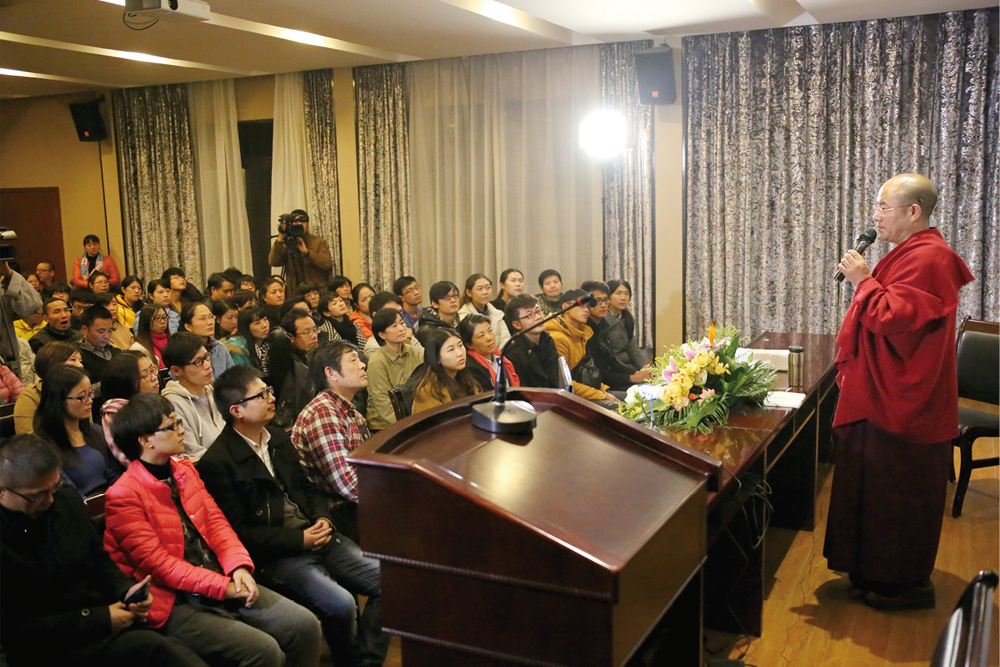
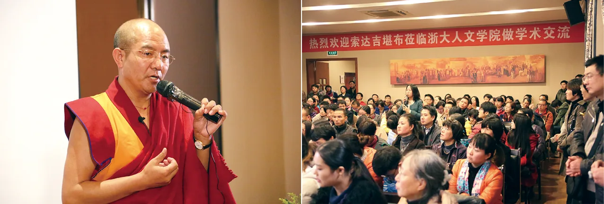

要了解心灵，

东方或许比西方更有优势。

第76场

浙江大学

Zhejiang University

中国·杭州

2013 / 12 / 4

## 认知科学与佛学

## Cognitive Science and Buddhism

主持人：

今天，我们很荣幸邀请到索达吉堪布来浙江大学人文学院，做一个关于认知科学与佛学关系的主题讲座。本次讲座是一个专题性的学术讲座。最初我们邀请堪布只是一个非常简单的意愿，但是没有想到，消息传出后，有那么多人想听讲座。我们也确实备了一些预案，希望这个专题讲座能够使大家都受益。

“认知科学与佛学”这个专题，可能有很多人了解，也可能有些人不是特别熟悉。因为我自己研究这方面很多年了，所以给大家做一个介绍。

大家都知道，科学跟佛教展开对话已经有相当长的时间了。比如，早期在宇宙学方面的对话；以及上个世纪随着量子力学的兴起，佛教跟量子物理学的对话；特别是认知科学兴起之后的对话。

“认知科学”在西方并没有很长的学科史，于上个世纪五六十年代兴起，但是发展非常快。它与佛教有个特殊的亲缘——都是从不同角度来探讨人心。认知科学与佛教的对话，在欧美国家已有二三十年的历史。当代顶尖的科学家跟佛教的僧人之间，开展了极富成效的对话。在国内，这样的研究也在起步。所以今天非常荣幸地亲自与堪布这样的高僧大德，一同就这个问题展开对话。我想，不仅对我本人的研究，对诸位，也会有极大的利益。

伟大的科学家爱因斯坦曾经就科学和宗教的关系，发表过非常深挚的讲话，他认为佛教和科学是相辅相成的，佛教非常符合科学的精神。

由于佛教本身内在的特质，以及现在认知科学发展的状况，因缘会合，在我们这个时代，出现了佛教与科学相结合的良好契机。

在这个领域中，最重要的一个议题，就是关于意识的研究。意识研究在西方，从科学的角度来说，真正的历史并不长，应该有一百多年。特别是上个世纪五六十年代，随着脑科学的兴起，这个学科开始快速发展起来。

意识占据着人类心理生活的核心地位。一直以来，意识的本性，是人类思想所面临的最为艰深的议题。不论是在宗教、哲学还是科学等方面，大家会发现，当代重要的一些顶尖科学家，比如，发现DNA双螺旋结构的克里克，还有埃德尔曼、斯佩里、里贝特，很多是诺贝尔获奖者，他们当然都是从实证科学的角度出发，但是他们所揭示的东西，跟佛法所提到的道理，具有极强的印证性。这也使得这两大思想体系能够走到一起，进行亲密的交流，并且有很多议题可以展开讨论。

意识研究在20世纪90年代，进入了发展的第二个黄金时期，像认知心理学、哲学、神经科学、人工智能、超个人心理学等研究，各种对话都展开得如火如荼。

尽管在过去几十年间，人类对意识本性的理解，取得了极为深远的进步，然而意识现象的独特性，仍然为人类理智和科学提出了前所未有的难题。比如说，心和身的关系问题。这些难题，犹如19世纪末飘在物理学上空的“乌云”一样，飘在当代意识科学研究的上空。当然在科学领域里面，这种危机也是一种契机。

英国的历史学家汤因比曾经说过一句话，他说：“佛教西渐是20世纪非常伟大的一个事件。”还有我翻译过一本西方认知科学家瓦雷拉的书，他在这本书里面这样说过：“亚洲哲学，尤其是佛教哲学向西方传播，乃是西方文化史上的第二次‘文艺复兴’。其对西方文化的重要性，堪比欧洲文艺复兴时期希腊思想的再发现。”这是对佛教思想的极高评价。

尤其是第二次世界大战之后，佛教开始在西方广泛传播，遍及欧美社会的各个阶层。正是这样一个社会基础、文化交流基础，为当代意识科学、认知科学和佛教的对话，奠定了丰厚的土壤。以至于当代许多哲学家、心理学家、认知神经科学家，为弄明白意识的本性和心智的本性，而转向了东方文化这样一个具有深厚资源的心学传统。他们开始自觉地在东方的传统中，寻找理智的资源和灵感。他们希望这种对话能为当今意识领域开拓新的思路。

东方传统作为另外一套跟西方科学思想体系不同的观念体系，尤其是佛教传统，与西方的哲学、心理学以及当代心智科学之间，存在着一种基本的对话议题。如果大家熟悉的话，可以看到，当代许多科学家讨论的问题，包括到底心是什么，以及人的心是怎么被转化的；再比如探讨心脑的关系、心理健康、人格的改变与转化、高峰体验、宗教体验、神秘体验、意识的水平和人类的成长极限等等。其中最富有成效的对话，发生在西方的现象学传统里面，比如说超个人心理学、神经科学，与东方传统的禅宗、密宗、唯识学、南传佛教等的对话。这涉及极为广泛的领域。当然我的认识也比较肤浅，但我认为佛教是真正研究“心”的。

当代也有很多科学家，他们本身也在修习佛法。举两个例子：一个是美国的神经学家奥斯汀，他写过好几大本关于禅与脑的著作，他是在这个层面上，探讨禅宗与当代西方的神经科学、心理学之间的一些议题；还有一个认知科学家叫瓦雷拉，他是基础性工作做得最广泛的人之一，他把大量佛教的思想引入到当代认知科学里进行研究，比如，关于自我的研究、关于意识的研究等等，而且还将其引入到当代西方的哲学思想领域里面。

最后我还想说一点，对话双方都是开放的。科学家要更谦逊地去了解佛教深邃思想体系中的宝贵资源；同时佛教界的人士，也要敞开心胸了解当代科学的发展。

前面关于今天专题的主要背景作一点介绍。下面热烈欢迎索达吉堪布来做今天的讲座！

很高兴今天有机会跟大家交流。几年前我来过浙大，那天不巧赶上你们考试，来听演讲的比较少，会场都坐不满。今天人太多了，现场又坐不下，有一部分人被分到其他会场，正在通过大屏幕收看。如果方便的话，希望演讲之后你们等一等，我也去跟大家见见面。

今天在座的，主要是认知科学的研究者。认知科学和佛教的关系，李院长根据自己十多年的研究，给大家作了简明扼要的介绍。我作为一个佛教徒，对科学也很感兴趣，尤其对心灵科学方面，很有意乐去学习、交流。

在所有的科学领域中，认知科学是专门研究“心”的学问。刚才李院长也说了，上世纪五六十年代，美国麻省理工学院等几所大学，对认知科学有了初步研究。到今天，它在西方已成为非常受重视的一门学科。而在东方，近年也有一些科学家把它当作重点研究对象，同时翻译了许多非常有价值的著作。

认知科学是研究心灵的科学。要了解心灵，东方或许比西方更有优势。西方科学只有几百年的历史，对心灵的探索几乎是空白；而我们东方文化，在几千年当中，对心识各方面的研究以及禅修实验，都有非常细致的描述。

## 第一学科

今天在场的，有三个学校的教授、博士生和研究生。大家对这方面很感兴趣，我也认为，它比其他专业可能更有意义。

如今我们正处于物质爆发时期，多数人把情感、钱财当作生活目标，当然，很多国家也都经历了这个过程。但到了一定时候，人不但需要钱财的满足，还需要艺术和哲学层面的充实，更需要在心灵、灵魂和宗教层面进行探索。这是人类的需求规律。

2001年，刚迈入21世纪时，美国国家科学基金会和美国商务部一起资助了七十多位科学家，研究本世纪最主要的带头科学有哪些，最后他们确认了四种：纳米科学、生物科学、信息科学以及认知科学。认知科学作为21世纪带头科学，我认为，人类如果深入研究，得到的利益应该最大。

至今十多年过去了，现在许多西方高校都非常关注东方文化，尤其关注藏传、南传和汉传佛教，对其禅修和理论展开研究，并迎请了许多佛教大德，请他们作测试，同时开展各种对话。这些科学家自己也定期、不定期地参与体验，如今取得了一定的成果。

而我们汉地的各个大学，除了几位学者以外，很少有人对此感兴趣。我去过很多学校，发现学生最感兴趣的就是贸易、会计等容易找工作的专业，最关心怎么样才能很快赚钱，而对心灵的探讨，大多无人关心。

其实，什么对我们最有利？就是在心上面的认识和修证。无论你信仰宗教，抑或不信而纯粹研究学术，了解这些对人生都很重要。因此，我们一定要重视认知科学。

## 科学与宗教

对如今的佛教徒来说，虽然修行最重要，解脱才是目的，但在这个时代，形形色色的科技令人眼花缭乱，如果对科学一窍不通，做任何事都会举步维艰，甚至内心的有些疑惑也难以遣除，所以同样需要了解科学知识。

尤其是出家人，生活在僻静的山林和寺院，所得到的教育有限，因此很有必要通过对话和咨询，请科学家答疑，消除自己的一些疑问。

有人认为，出家人研究科学、交际世人是一种散乱，我不这么看。如果一心一意在山里闭关，其人生目标仅此而已，那可以不需要这些；但如果真想对世人有所饶益，就要对宏观和微观世界有所了解，就要跟科学人士沟通交流。

同样，作为科学工作者，包括还没进入社会的年轻人，也有必要研究宗教。因为学校里教的知识，不可能解决人生的一切问题，如果对宗教有所认识，那在人生中遇到任何挫折，都能掌握一种更有效的解决方法。因此，在某种意义上，科学和宗教不但不矛盾，而且互补，相辅相成。

20世纪最重要的物理学家之一、量子力学创始者普朗克（Max Planck, 1858-1947）就曾说：“宗教和科学之间不可能找出一个矛盾来，而在最重大的问题上，却可以看出意见完全一致。宗教和科学这二者并不互相排斥，相反，是互相补充的，好像是为相辅相成准备了条件。”这句话很重要。有些科学人士认为，宗教是陈旧的迷信，跟不上科学，这种想法是错的；有些宗教徒对科学嗤之以鼻，这种态度也不合理。当双方从不同角度来认识这个世界时，通过交流，会获得极大的收获。

所以，以后如果因缘具足，科学与宗教展开对话很有必要。宗教人士和科学人士，以及凡是对此有兴趣的人，都可以抛出不解，互相辨析，如此双方一定能得到非常棒的启发。

## 从物质到心灵

认知科学所研究的，跟佛教有相同之处，也有不同之处，彼此间可以取长补短。

以前西方科学家与僧侣作过多次对话，网上也能看到部分资料。而汉地的宗教人士和科学家也有过这方面的探讨，但由于处在摸索阶段，双方一遇到跟自己见解不同的观点，就容易习惯性地否定对方。其实这没有必要。我们应该找到哪方面宗教阐述得更细致，哪方面需要科学来解决，这样互通有无，对人类的未来很有帮助。

据我了解，西方对认知科学的研究，主要着眼于脑科学。短短几十年，随着脑神经学的发展，人类有了非常大的改变，这也是社会的一种发展。

就科学来说，有些对人类很有利益，有些则恰恰相反，危害性非常大。所以，荣格（Carl Jung, 1875-1961）说过：“人类选择西方文明这条路不一定正确，也许佛教这条路更合适。”为什么呢？因为工业革命以后，西方文明改变了人类的价值观，全球人类所选择的，是以科学发现为主导的物质中心学说，它令无数人疲于追求外在的物质，从而忽略了内在的心灵宁静——不仅普通人如此，高等学校、高级研究机构也不例外。所以荣格认为，人类固然需要物质的发展，但更需要心灵的探索，而这种探索应该从宗教中寻找答案。不管是儒教、佛教、基督教，至今都有两千多年的历史了，它能一直生存到今天，说明有非常旺盛的生命力和活力。这里面蕴涵的道理，值得大家深思。

## 谁更重要

研究认知科学的有些人，常将目标锁定在人脑上，或利用与脑科学相关的经验，把人脑功能再复制到电脑上。这些研究虽不像有些佛教徒认为的一无是处——密续中对大脑也有深入的研究，一千多年前藏医学就有了开颅手术——但我认为，应该认清大脑起的是主要作用，还是次要作用？认知科学的主要研究对象，应该是人脑还是人心？

现在很多人认为，人脑能操控一切，一旦大脑区域受到损害，心识的功能就不正常了，会变成老年痴呆、失忆、植物人等。因此，科学家普遍认为，人脑最重要，人心是人脑的产物。

但如果是这样，有些现象便无法解释了。比如，世界上有很多高智商、生活正常的人，却没有脑，此类案例在美英德法等国家都发现过。所谓的因果，应该符合“无则不生”的规律。那心和脑之间若是因果关系，无脑人的心是从哪里产生的？毕竟科学发现脑细胞只存在于大脑中，其他部位都没有，其他细胞也没有这个功能。既然如此，“无脑也能产生心识”的现象就很难解释。

所以，我们研究的对象，一方面是人脑，但更重要的是“心”。如果心作为对象，就不需要回避很多问题。有些人可能会问，如果心为主，大脑如何直接对它起作用呢？

大约在七世纪，与玄奘大师同时代的印度哲学家法称论师说过，心的因实际是心，身体只是它的缘。这就像麦子的因是麦种，阳光、水分、肥料是它的缘。身体对心识的知觉、感觉、情绪等有一种助缘的作用，一旦心脏、脑等比较要害的地方受到损害，心智就可能完全不清晰了，就像没有一点水分的种子会枯干一样。

我最近看到浙大的有些同学也在讲“安危同依”的道理。按照《瑜伽师地论》的观点，身体与心两个都非常重要，而且互相依赖，有种安危同依的关系，这是对的；但它们之间一定要分清主要和次要，这个非常关键。

心的根本因就是心，身体或者脑细胞只是心的一种缘。佛教讲四种缘：因缘、等无间缘、所缘缘和增上缘。心一刹那一刹那地由前面的心产生，叫做因缘，这是主要的因；它的外缘，以眼识来讲：外面的色法叫做所缘缘；眼根，包括脑细胞中产生眼见知觉这部分，叫做增上缘，如果眼根受损，眼识也随之受损；眼识前一刹那灭，后一刹那生，叫做等无间缘。

## 心的秘密

其实，佛陀在两千五百多年前，对我们现在所研究的心灵早已觉悟，已经说得很清楚。我并非因为是佛教徒而故意赞叹，仅是公正地叙述。我对东西方文化都很感兴趣，早年也看了许多著名的心理学著作，但一直觉得有些地方心理学没有搞清楚，直到学佛以后，才在佛法里找到了满意的解答。

佛教讲，我们的心识有六种：眼识、耳识、鼻识、舌识、身识、意识。心理学家称之为视觉、听觉、嗅觉、味觉、触觉和意识。意识，在科学和佛教里没有什么不同。这六识不能少，否则很多事情说不清楚。

唯识宗和大乘中观瑜伽派，则承认八识：在此六识基础上，再加末那识和阿赖耶识，共八识。不过，阿赖耶和阿赖耶识并不相同：阿赖耶是心没有任何分别念的部分；而明明清清的部分则叫阿赖耶识——无分别的同时又是明明清清的。意识和染污意识（末那识）有什么不同呢？眼识、耳识等五根识取对境后第一个刹那叫做意识，跟随前五根识都有相应的意识；而根识取对境的第二刹那，执著我和我所的意识，则称为末那识，也叫做我执。

按照密法或者其他论典的一些修法来讲：心识不动摇的部分叫阿赖耶，也经常被称作藏识，因为阿赖耶就像仓库一样，藏有各种各样的善恶种子习气，包括色声香味等，我们在世间的很多习气都藏在里面。当明了觉知显现境而不分别时，则是阿赖耶识。眼识中也有阿赖耶识的成分，比如，眼睛看到色法的时候，看色法取对境的部分叫做眼识，而看色法的明清部分叫做阿赖耶识。

关于这一点，佛教有一个比喻：在六面不同颜色的镜子中间有一只猴子，它往不同方向看，都会看到自己的某一个侧面。同样，意识在眼耳鼻舌身里面，可以接收来自四面八方的显现，当它接收的时候，任何一个识，在意识的层面上都没有变化，都是明知明觉的一种心识。

阿赖耶识相当于大海的底层，比较深，而其他六识比较浅，就像海面的波浪一样，人们能直接发现。海面波浪依靠什么而产生呢？按照《楞严经》讲，是依靠风的吹动。当它波动特别厉害的时候，会跟脑细胞以及身体其他部位起不同的反应，但是大海的底层部分从来没有动摇过。我们的很多习气藏在底层部分，一旦因缘成熟就会浮出水面。

对于这些心识的道理，认知科学如果能结合起来进行研究，便可进入更深的层次，因为毕竟心识才是主体。否则，心识只是由人脑产生的话，那按照神经学的观点，人从年轻时开始，每天都会有十万个脑细胞死亡，直到全部死掉，我们的记忆也必然以此而灭尽，再加上人死的时候身体已经处理完了，记忆更应不复存世。但世界上又有很多能回忆前世的人，这两者之间没办法对接。

回忆前世的现象的确存在，很难否认。比如，史蒂文森博士（Ian Stevenson, 1918-2007）、塔克尔博士（Jim Tucker, 1960-）等列举的诸多案例，其中很多人根据前世的记忆，甚至可以说出无人知道的秘密。虽然科学界对这些现象也有一些辩论，但至今没有找到任何可以推翻它的可靠依据。

还有濒死现象，医学界也作了很多研究。他们发现很多受试者，虽然临终时心识离开了身体，但依然能毫无错误地看到并指出隐藏在天花板上的东西。如果这些现象全都用迷信、神秘或者奇怪来说明，可能不太合理；反过来，如果我们能在心识上研究，再结合脑科学的理论，也许会有突破性的进展和发现。

简而言之，在认知智慧的方向上，我认为既要研究心，也要研究脑；更重要的是，要从东方文化，尤其是佛教知识中，了解心的重要性。

## 心有力量

为什么现在许多世间人向往并追求佛教的行为和仪式？因为它在生活中的确有实际效益。这一点，科学家也不得不承认。有些年轻人认为佛教这些行为过于着相，但并非如此。表面上它是一种相，实际是心的作用。心的力量强大时，周围的环境，包括疾病等，都可以改变。

佛教常说“加持”，其实就是给予别人一种力量和快乐，这是一种不同的能量。斯坦福大学做过关于寂静心的实验。他们将一种鼻管插在受试者的鼻子上，让这个人心平气和，生起善念，同时将他呼出的气插在雪地里；再让他产生恶念、嗔心等不良心态，同样导出呼气排在雪地里。后来发现，用沾过恶气的雪水注射到老鼠身上，老鼠当场死亡；用沾过善气的雪水注射时，老鼠不但不死，反而显得很快乐。

有人喜欢请高僧大德作加持，这也是有道理的。加持的来源，一方面是因为诸佛菩萨本身有一种力量；另一方面，高僧大德的心非常善良，以其长期修善的力量，给别人治病或赐予平安，的确可以实现。若想完全否认这种力量，恐怕有一定困难。这种不共的能量，实际是心的巨大力量。佛教常说，当心真正静下来时，周围的世界也会变得吉祥美好，这并不完全是一种信仰，从物质的角度观察也可以证实。

还有佛教里的“咒语”，有些同学可能会想，他们为什么那么喜欢念咒？其实，念“嗡玛呢巴美吽”和说坏话，会不会起同样的作用？不一样。佛经中讲，“嗡玛呢巴美吽”和“嗡啊吽”等咒语，有它不共的力量，而普通的文字语言，并没有这种力量。你们可能也知道，台大的前任校长做过一些有关神佛的实验，通过科学测试，确确实实证明了“嗡玛呢巴美吽”、莲花生大士心咒“嗡啊吽班匝儿格热巴玛色德吽”、“阿弥陀佛”，甚至“佛”字都有一种特殊的力量。

密苏里大学有一个研究机构，专门对咒语和念咒语的人进行过测试，发现念咒语人的脑电波和脑磁场，发生了很大变化。

在藏地，几乎每个人都在念观音心咒“嗡玛呢巴美吽”，知识分子在念，修行人在念，农牧民也在念。他们生活水平不高，但非常开心，全世界都认为他们是微笑的民族。其中的秘密是什么？西方人很感兴趣，很愿意研究他们的修行方式。

一千三百多年前，松赞干布国王专门讲过观音心咒的功德。现代科学测试也表明，“嗡玛呢巴美吽”有种特殊的能量，而且不能反过来念“吽美巴呢……”，因为“嗡玛呢巴美吽”对应了身体从头到脚的顺序，在不同位置有不同的功效。我和科学界人士交流时也觉得，“嗡玛呢巴美吽”很有作用。我自己也有这种经验：当身体不好或者有些情绪的时候，我就坐下来念一百遍或一千遍“嗡玛呢巴美吽”，念完以后，身心都轻松了。

这可以从两方面理解：一方面人在心态非常宁静的时候去念诵，它有一定的作用；另一方面，按照密续来讲，密咒不是普通的语言，而是圣者加持的，它有不共的能力。就像中药一样，表面上看中药都是草，但是医生配制以后再给你服用，就能治你的病。也许有人觉得这很稀有：为什么医生这样做能治我的病，而我自己随便割一些草吃，却不起作用呢？这就是所谓外行看内行，容易闹笑话。

对于心灵的强大力量，我们有必要有所了解。藏传佛教中有很多身体虹化、往生极乐世界、出现舍利等现象，可能不懂佛教的人会觉得这是一种迷信和传说，不可能发生。如果你真这样想，最好去实地研究，这些现象到底是在什么情况下发生的？学校对这方面的知识涉及得比较少，而且大家都特别推崇外在的物质科学技术。在这样的口号和思想暗示下，我们忽略了心的奥秘，很多需要在心上实现的问题，无法得到解决。因此特别希望大家在研究中，不要忽略心识。如果忽略心识，确实是南辕北辙，不一定能找到最究竟的答案。

古印度伟大的寂天论师说过：“若不知此心，奥秘法中尊，求乐或避苦，无义终漂泊。”意思是说，在这个世界上认识自己的心最重要，如果没有认识自己的心，无论怎样追求快乐、回避痛苦，都没有意义，只能一直漂泊。

刚才李院长介绍的《禅与脑》，我以前也看过。它前面讲了一些禅修的方法，中间讲脑科学，最后讲了一些开悟的道理，确实非常好。当然它跟我们原有的一些知识不一定相同，但我认为这样的知识很重要。还有，李院长所翻译的那本书《具身心智：认知科学和人类经验》也非常有价值，作者瓦雷拉是一位认知科学家，也是一位生物学家，同时还是创巴仁波切的传承弟子和一位禅修者。

总之，还是希望大家多去探讨，这样佛教界跟科学界之间可以拉近距离。虽然我们之间还有很多冲突，很多相互不理解的地方，但可以慢慢摸索，可以共同学习、探讨。在任何时代中，完全能经得起科学观察的，就是佛教的心理学，这一部分如果错过是极其可惜的。

## 悟

我今天就佛教心理学与认知科学谈了一些心得。当然，以后如果各方面机缘成熟，我们可以在不同场合中开展一些辩论和学术探讨，更重要的，还可以进行心灵的体悟。

佛教的有些内容并不是用语言来说的。以前六祖大师说过：“迷人口说，智者心行。”意思是说，愚者仅是在口头上讲，而智者是用心来体悟。因为我们心灵的很多东西，包括禅修开悟，完全是一种心的体悟。这要依靠前世的习气、今生的修行，以及对自心本来面目的了解。当我们以一种宁静的心态，去打坐，去感悟，终会知道，不管说再多的语言，原来我们的心就是如此。这时就会恍然大悟：东方文化当中，包括禅宗、密宗等所提到的这些道理，现在的科学家不一定能发现。科学家是依靠各种仪器和科学推测来了解事物的；而佛教修行者虽然也需要理论，但在理论的背后，更主要的是自己去感悟。自己去感悟时，最后会完全明白心的本体。一旦明白了心的本来面目，生活中的各种压力、痛苦和情绪，都会减轻，甚至荡然无存，这也是一种修行的体验。

我们不能忽略理论的研究，否则有些问题没办法解决，我们更不能忽略修行的体悟。有些年轻人现在可能没有时间修行，其实不一定非要抽一个专门的时间。如果你随时随地经常观自己的心，也可以像禅宗大德一样，在不同的生活中，有不同的感悟。那时，人生的意义，人类的究竟目标，以及世间万事万物的真相，不需要别人来指示，你通过自身的感悟也可以完全明白。

主持人：

非常荣幸聆听到堪布精彩纷呈的演讲。如我们之前提到的，尽管这两大思想体系的交流历史已很长，但毕竟有着不同的概念范畴，因此这种交流确实需要非常开放的心灵，要先能够容纳对方提出的观点，才能揭示出现象背后的道理。上午三个小时很快就过去了，我觉得交流得非常愉快。

今天这个讲座的邀请机构是意识科学东方传统研究中心，这是两年前浙江大学和杭州佛学院共同建立的机构。在这个时代，科学当然是整个现代文明的基础，我们所享受的一切，都建立在此基础之上，而佛教在中国已经有非常悠久的历史，是中国文化的根基和非常重要的部分。科学发展到这个阶段，它有一种需求，需要与佛教展开对话，这是来自科学家内部的强烈需求。同样我想，很多精深的佛理，也需要我们从另一个角度来印证，可能一致，也可能不一致，但是这两大体系展开对话，是非常有益的。

今天，堪布以他广博的佛教学识，结合当代科学的一些重要研究，谈了非常多的看法。我想诸位可能有很多问题需要跟堪布交流。下面，有问题可以直接提问。

现场互动

问：佛教经常强调心如止水，但是年轻人又要有自己的梦想，要有激情，两者是否矛盾？

堪布：没有矛盾。有些人认为，佛教的看破人生，是对生活没有兴趣，完全反对世间生活。其实完全不是这样。如果对佛教的经论比较熟悉，就知道，佛教对正常的生活，包括一些物质资源的享用，是完全开许的，对任何一种正常的生活，佛教都没有遮止。

有些老一辈的人经常劝别人：“你不应该学佛，不然学佛以后，对生活就没有兴趣了，对家庭和工作都有影响，家里也会非常担心。”这实际是一种误解。任何一个比较先进的国家，从历史上看，他们的生活都是在一种宗教的背景下展开的，现在也不例外。宗教与生活不仅不互相排斥，而且是融为一体的。

佛教只是遮止过分的贪欲。假如对生活失去激情，并不能归咎于修行佛法，真正原因应该是来自沉迷。不仅是佛教，即使是艺术、音乐和哲学，也有很多人沉迷其中。过度沉迷则会导致对生活激情的消失。正常的希求和正常的修行，不会与我们的生活追求相矛盾，而过分的行为，佛教也没有提倡。

问：信仰大乘佛教，能不能用小乘的方法来配合？如果能，应如何掌控？

堪布：大乘与小乘没有很大不同。最主要的是从发心来讲，大乘一切都是为了利益他众，以利他为主，这是大乘最不共的地方。当然在证悟法无我方面，二者也有不同，但这是在甚深见解的层面来讲的。因此你刚才提到的小乘的正念法门，以及其他修法，也可以在大乘中使用。

汉传佛教和藏传佛教都是大乘佛教，但是出家人受的戒律，以及在家人受的居士戒都是小乘的戒律；还有很多观修方法也是小乘的。

其实我也在想，大学生在读书期间，至少对佛教有一些了解比较好，尤其是有老师指导的情况下。由于其他课程的压力比较大，你们彻底去修行或研究佛教，不一定现实，但至少也要有所了解。佛教如此深妙，很多科学家都极为赞叹，恐怕我们没有理由来驳斥或者不接受。如果能接受，可以根据自己的层次，对理论进行研究或者修行。在生活中，这也许比你的专业还要管用。为什么呢？你的专业到社会上往往用不上，但是修行的方法和面对困惑的知识，一生都可以用。

我认识的很多大学师生都觉得，修行对自己的人生确实有非常大的帮助。因为现实生活中，会遇到各种各样想不到的情况，包括感情上的问题、生活上的挫折等，如果心理不坚强，很容易选择一些不好的路。所以我特别希望，大学生能正面地来了解心智科学。

今天这里的很多大学生有一种开放的思想，这与浙大的老师有很大关系。若老师非常保守，并且反对对人类有用的很多传统文化，那他培养出来的学生则会变成另一种样子。我们现在是一种观摩式的教育，老师什么样，学生也会变成什么样。你们很多人以后会当老师，对学生的人生担负着责任，因此很希望你们能传递一种正面的知识。

问：六祖惠能大师说过“何期自性，本自具足”，古希腊先哲苏格拉底也说过“认识你自己”，但每个人最难认识的是自己；佛教也一直提倡“明心见性”。我们要如何认识自己？如何实现明心见性？

堪布：“何期自性，本自清净……何期自性，本自具足”，关于自性，六祖大师讲过很多这样的词句。不过，要想真正认识自己心的本性，可能需要长期的修行。途径有两种：一种是依靠善知识，依上师的指点来体悟；还有一种，是依靠前辈的书籍来修行。这两种途径都可以明心见性。

对大多数人来说，现在很难有机会完全像古人一样，长期依止一位上师，一直跟随他修行。但现在科技发达，通过光盘或是网络，会得到很多法师的引导，听闻很多专业人士的讲座，这种传法跟以前真正依止善知识并未有何不同。在古代，弟子只能亲自到上师那里去求法，除此别无他法，但现在情况完全不同了。

我们今天的课程，也是在不同教室里直播的。如果再开放一些，全世界都可以看，所传的内容是一样的。像我的话，并没有什么其他功能，只是把我所了解的通过语言来传递，然后你开始消化理解。因此在其他教室和在这里，并没有什么不同。同理，依靠光盘或网络来听课也是一样的。

禅宗的明心见性和密宗的认识觉性都是一个意思，想要认识，就必须修行。我总觉得，现在大家要修行的话，还是要靠自己的体悟，要经常去观修。想要学会这些，如今应该有很多途径。

问：海涛法师还有您都非常提倡烟供、施食。但是其他寺院有些师父反对，说请来一些生命，请不回去。我做了以后，身体有些不舒服。这个问题该怎么处理？

堪布：实际上海涛法师用的烟供施食仪轨，是上世纪藏地一位非常著名的智者所造。他被认为是喜马拉雅山最有成就的发明家，并且在医学、诗学等很多领域，都做出了非常了不起的贡献。我到一个城市后，也经常按这个仪轨自己做火施，做了以后，并没有像你一样的感觉；而且它确实非常好，非常管用。

我想，有些同学或者其他寺院的师父如果反对，可能只是不了解而已。如果他们去了解其中的意义，应该不会这么说的。现在的人都是很现实的，只要对自己身心有利的法，都是可以做的。

如果你身心感到有点不舒服，可能是自己的心理作用，不做也可以。海涛法师不管到哪里都会做火施，我是非常赞叹的，而且在有因缘的情况下，我也会做。

也许科学家不一定承认，但世间的确有很多鬼神、非人。他们会对人类的身心进行伤害，或者引起各种自然灾难。因此，我们用善的理念来修这些仪轨，对风调雨顺、身心健康都有着非常大的利益。

所以我还是希望，对于一些不同的行为和知识，最好先去了解。了解以后，如果你真正找到它的不良之处，可以遮止。但如果它有巨大的优点，你却没有找到，然后就随意驳斥，这不是智者的选择。

非常有影响力的大德不会轻易去做一些事，由此判断，火施的利益非常大。按我个人来看，有些人反对也许是因为道听途说，或者没有经过详细观察。实际上这种烟供非常有利。

问：世间万事万物的来源是什么？

堪布：是心！

《华严经》讲：“心如工画师，能画诸世间。”心就像画家一样，能画出世间万法。《万善同归集》也说：“心能作佛，心作众生，心作天堂，心作地狱。”

我们的心依靠前世的因缘，即生当中通过根识，会产生不同的意念。比如，我和一个人都在看这朵花，如果我是个爱花的人，就会生欢喜心；而他根本不爱花的话，可能会觉得很丑。

以前印度有一个人，天天卖鱼。一次天黑后，他没办法回家，住在一个卖花的家里。一闻到花的香味，他就觉得特别刺鼻，怎么也睡不着。后来他把卖剩的鱼枕在头下，才睡着。

在生活中，我们觉得这个人很好看，另一个人觉得很不好看，这其中就有一种习气和意识的作用。佛教不是宿命论，并不认为一切都是命中注定的。但佛教认为，任何事情的发生的确有一种特别复杂的因缘；心识作出何种判断，也是由于之前的不同因缘，也就是不同的业力，这就是佛教所讲的业感。

佛教讲，万法唯心造。如果这朵花本体上有个“美”的东西，那么所有人都会认为它是美的；但是因为它没有美或丑的本性，所以每个人的看法会不同。具体产生什么样的看法，依赖于每一个人的种子和习气。如果大多数人都觉得好，那是他们的共业。

世间有很多这样的东西，我觉得好，他觉得不好。同一杯水，同一件事，不同人的看法都不同——这就是我们心识的判断。因此，万法并不是独立的、不变的，而是虚幻的，是大家共同意识所感召的。

问：《金刚经》里有一段：“须菩提，彼非众生非不众生，何以故？须菩提，众生众生者，如来说非众生，是名众生。”这是不是讲，一切法，一旦被讲出来，它不可说的那部分就消失了？《心经》说“五蕴皆空”，在这种真空的状态中，我们如何存活下去？

堪布：“是众生、非众生”这种词句，表面上看来有点矛盾，但实际上，现在很需要这样的道理。它讲的是现相与实相。现相上我们都是众生，但实际去观察，无论是我们的心识还是身体，没有一个独立、真实存在的东西，因此不得不承认，这就是我们的本性。

有人曾问我：“佛陀说没有眼耳鼻舌身，怎么没有呢？眼睛、鼻子、耳朵……我明明都有啊。”其实，我们现在存在的眼耳鼻舌身等，佛教是不会否认的。实相当中，这些的确没有。

《金刚经》的这句话，同时涉及了现相和实相。表面上看，《金刚经》一会儿讲有相，一会儿讲没有相，一会儿讲有众生，一会儿讲没有众生，但当我们真正去读的时候，才知道说的是什么。实际上，尽管虚幻的现相是存在的，但现相背后真正我的本体，无论是科学家还是佛学家观察，都是找不到的。

如果观察我们的身体，最后会发现是空性的。笛卡尔也说，这个世界很令人震惊。当科学家通过量子力学去观察的时候，找不到世界，更找不到你和我。他们很震撼，“为什么会这样？”其实，任何一个人，真正去观察万事万物真相的话，都会很惊讶。

佛陀早就告诉过我们，包括自己的心识，如果一一观察，除了了不可得的证悟以外，什么都找不到。现代科学也有相似的剖析能力——按科学理论进行观察的时候，最后我们的身体也是找不到的。不要说所执著的粗大身体，连最细微的部分，最后也是找不到的。此时，你就会发现所谓的奥秘。

因此大家不用害怕，在现相当中，这个世界是存在的，地狱、天堂、快乐、痛苦，都是存在的。但在实相当中，这些确实没有。物理学家这样讲，佛学家也这样讲。

问：佛教的超脱、达到空的境界，是否和康德所说的“理性的、不带有任何个人情感的、第三者的客观观察状态”相似？

堪布：对空的了解和探索，可以称为康德所说的理性智慧。但是他的一些思想，跟佛教所剖析的空性境界有差别。我以前也看过他的一些书，他所研究的目标，跟佛教的空性不同。

佛教中，用理性的智慧去抉择空性，到最后所谓的空也找不到。如果认为空是一切万法的实相，那空就成了实有，但这种实有，在实相中是没有的。我觉得，康德的理性智慧在思想领域，有他的一些成果，但与佛教不太相同。

二者之间相同的地方是，在观察的过程中，都不站在自方的感性基础上，一定要以客观真理为准。佛教的因明学以及其他任何观察，都不包含保护自宗或者体现自我的感情。在这方面，两者非常接近。

问：有一部分科学家关注到了心智，佛教中是否有人也关注到了脑？

堪布：科学界对心智有所关注，同样，佛教界也有人关心脑科学。

我们佛学院有一位丹增嘉措活佛，他诗学上的造诣，在当代藏族人中非常出名。他的著作到现在大概有六七本书，其中，有明心见性的道歌，有体悟的语录。还有一本，将佛教的经论与科学进行了专门的对比，我很想请他将此书翻译成汉语。因为目前来讲，佛教对脑科学的剖析，资料很少见，网上以及其他地方不一定能找到，而在密宗的续部中则有很多。活佛翻阅了大量密续和其他佛教资料，把各种经论中的知识与现代脑神经学进行对比，最后的结论都写进了书里。这本书如果能翻译出来，对国内的相关研究应该有一定意义。

国外这方面的研究比较多，很多大德在不同场合，对佛教的身心观进行阐述，也有很多这方面的著作和对话。

问：我是居士，上师说我应该过午不食。但是现在晚上经常有应酬，不能坚持，但吃饭又违背了上师的要求，很惭愧。应如何解决？

堪布：佛教中的过午不食，是两千五百多年前的健康学。现代医学发现，早上不吃对身体不好，因为人在晚上要睡眠七八个小时，多的要睡十来个小时，因此，早上起来应该赶快先喝水，再吃饭，这个非常重要。

现在很多年轻人，早上不吃，晚上吃，从营养学角度讲是一种颠倒，不太符合身体规律。我们的身体就像车一样，要正常地运行。佛陀也讲，早上吃饭有利于身体健康。

对你来说，如果晚上吃的话，过失也不是很大，不用特别害怕。我不知道你上师是什么想法，我只是站在佛教的角度来讲的，你的上师应该不会批评吧。

确实，现在很多人应该过午不食。因为按医学来讲，如果晚上吃得多，酣睡时过多的食物没办法消化，会使垃圾积累过多，身体也变得肥胖。现在很多爱漂亮的美女，基本上都是过午不食的（众笑）。所以，大家应该对佛陀的健康学有一些了解。

你持守过午不食，如果稍微有点违犯，也不是犯了佛教大戒，自己忏悔应该可以。

问：我对佛法深信不疑，因此每天都施食。法力不可思，慈悲无障碍，这是真的，不容置疑。施食后的甘露水和牛奶，有时会倒在下水道里。我师父有时告诉我不行，有时候告诉我可以。我有点迷茫，想请教一下堪布。

堪布：你作施食的水，倒在哪里，可以根据情况来行持，有时候可以有灵活性。如果非要倒在下水道里，可以念观音心咒，或念“嗡啊吽”，以一种布施的行为来做就好，没有很大过失。

问：对认知科学和心性的悟性，是先天就有的？还是后天的成分多一点？或者说先天和后天的分类本身就是自心的一种局限？

堪布：体悟心性，可能有两种情况。一种是先天性的：有些修行人对心性体悟得特别快，稍微点一下就可以，这是他的先天素质。佛教讲，这种人是利根者，跟前世修行有关系，今生中稍微有一点因缘，就会瓜熟蒂落。

还有一种情况，虽然他先天的资质并不是很好，但后天很勤奋，勤学、勤修，这样的人也可能很快开悟。有人刚进入这个领域时，对佛教的信心可以说一片空白，但是他不断地努力，通过逐渐积累和沉淀，最后远远超越了那些基础好的人。

每个人的情况都不同，需要具体分析。有些人两方面因缘都具足，比如有些大德，还有我遇到的一些科学家，他们生来对佛法、对心性这方面，就没有很多成见和邪见，因为没有障碍，所以很容易直接进入真理的天堂。但有些人不是这样，本来基础比较差，后来的分别念又比较多，顽固偏执，最后的结果不是很好。

问：有人说宗教是迷信和哲学的混合，听了这节课，我觉得应该再加一个科学的成分。但是我本人对宗教有一种本能的抵触。中国人可能更多的是无神论者，或者无宗教信仰者。是不是这样的环境让我有一种抵触呢？您是怎样看待这个问题的，该怎样解决？

堪布：在这样的环境中接受宗教，很多老师学生需要一个过程。我也希望，很多人的思想能够逐渐开放。

如今大家在物质生活上，虽然有竞争和压力，但是饮食不愁，生存都没问题，不用担心会不会饿死、冻死。大家想的也许都是“我一定要超过别人，房子要好，存款要多，工资要高”，都在朝着比较高的目标前进。此时人们很容易有一种失落感、空虚感。尤其是有钱、有地位的人，很多都找不到快乐。因此，他们开始返璞归真，到宗教中去寻找心灵的快乐。

在这种背景下，我想，很多人会找到心智科学最究竟的意义。

我看过一个统计：全世界没有信仰的人，大概占总人口的10%，其中62%在中国。这个数字是否准确，我无法了解，但不管怎样，中国大多数人是在无信仰的环境中成长的。

不过近些年，人们对信仰的认识已经有所变化，无论东方还是西方，大家普遍认为，人如果没有任何信仰，生活就没有底线，道德更没有底线。现在发生的很多社会问题和家庭问题，都是因为人的道德素养不够，所以很难以解决。

年轻大学生要头脑清晰，看准这个社会。我刚才也讲了，也许你们的专业很重要，但比专业更重要的，是对人性的了解。如果你在真正具有资格的老师面前，得到一些不同的知识，走上社会后，也许会成为你最有用的妙药。

问：我是一个5岁小孩的妈妈，因我引导孩子吃素，与父母产生了矛盾。请问如何引导小孩子吃素？

堪布：《楞严经》等经典里面讲，吃肉直接危害其他众生的生命，应当遮止。所以，汉传佛教的出家人和很多居士基本都坚持吃素。

不过，现在世界上吃素的人，更多的是没有信仰的。前些天我去台湾，发现到处都是素食馆，连加油站旁边的小食堂都有素食馆。二十年前我去过那里，当时吃素的远远没有现在这么多。这说明现在社会对素食的认识，已经发生了变化。

有人认为，吃素是一种佛教思想，其实没有信仰的人也在提倡素食。我们人类从贪欲来讲，的确喜欢吃肉，从小就养成了这种习惯。但从健康层面来讲，吃肉会导致动物身上的很多疾病传到我们身上来。为什么现在得癌症的人越来越多？医学家认为这跟肉食有一定关系。

所以，我们有必要从两个方面来了解素食的优点。

家里父母的理念，你可能改变不了。但孩子比较小，而且你自己也吃素，他的问题应该很好解决。孩童时期，慢慢树立一个正确的价值观非常重要，如果他从小对肉食非常欢喜，那么长大后也会喜欢吃。如果父母有一种教育，让他从小就发现肉食很血腥、很臭，他以后也不一定喜欢吃肉。

从健康上讲，吃素并没有什么问题。常有人问我：“吃素的话，营养不良怎么办？”我开玩笑说：“人们喜欢吃的牛羊，都是吃素的，是素食主义者。它们的健康都没问题，人类也一样。”

问：梁漱溟先生对诸法无常的解释是：世间一切事物生灭流转不住，刹那间就非复一事。在这永恒的变化当中，有没有不变的东西？

堪布：有。按照佛教的观点，在获得解脱之前，恒常不变的就是心。

所以我刚才讲，如果认知科学的研究只局限于脑科学，那人只有短暂几十年寿命，死了以后“我”都没了，很可悲，你生前再怎么样，也终究会消失。但实际上不是这样，在佛教看来，我们的心没那么容易灭掉，可以说它是不灭、恒常的存在。

《楞严经》中佛陀问波斯匿王：“你的身体会不会衰老？”王说：“一定会。”佛陀说：“你3岁时见到恒河，62岁又见到恒河，期间身体虽不断衰老，但‘见精’不会衰老。”也就是说，这颗能见的心不会变。

在座的人也是这样，今世是人，下辈子可能变成牛马，变成地狱众生、天堂众生，根据每个人的业力不同，身体会不断变化。但这个过程中，共同不变的是什么呢？就是你们不同的心。正由于你们的心不同，所以每个人的长相不同，思维模式也不同。即使是双胞胎，爱好和思维也都不相同。

问：是什么东西构成了“我”这个意识呢？

堪布：有两种解释。在名言、缘起显现中，我们的心无始以来都是把五蕴的假合执著为“我”。在胜义、最究竟的意义上，这种假合也是不存在的。

问：我研究的课题是“压力下的发挥失常”，我们的结论是：在面对压力时，要关注事，把事情完成好就可以，不要关注自己的心。这样虽然可行，却把人变得物化。请问，依佛教观点，应该如何应对压力？还有，我在实际指导别人的时候，有时讲的话没有说服力，我想请堪布提一些建议，怎么样给予现实众生有效的帮助？

堪布：在现今市场经济的压力下，怎么样调心，怎么样帮助别人解决问题，我的想法有几点。

第一，不管是帮助别人，还是自己面对生活，心宁静很重要。因为在心宁静的状态下，处理问题、解决问题、做任何事情都非常明智。那些非常成功的企业家和学者，在各自的工作领域都有一种冥思，也就是心念的集中。当所有心念集中起来的时候，它有非常强大的力量。因此，我们需要心的宁静和专注。

第二，当我们遇到问题，或者在研究、考察时，需要放松，否则，如果对事情特别执著，会让自己产生非常大的压力。比如，对一件事情，你白天晚上一直想：能不能实现？能不能成功？能不能有创意？……越想越可能适得其反，会让情绪爆发、心情变坏等等。

有些人对感情很执著，有些人对钱财很执著，有些人对地位很执著，有些人对竞争很执著……不幸的是，我们的压力和痛苦，往往就来自于这些执著。所以，我们应该稍微放松一点，保持这样一种心态：“我在生活中一定要努力，不能懈怠懒惰、消极放弃，但也不能对这件事情太执著，不然会给我带来负面作用。”

有些人对相貌特别执著，好像稍微有一点难看就非常痛苦；有些人对某个人特别执著，认为“我就是为了这个人而活的”，倘若这个人出现一些状况，自己便活不下去了。这就是压力的最大根源。所以我觉得，第二个要点是放松，这是解决压力、调整自身的最好方法。

第三，理论知识和实践要相结合，这很重要。你们有很多实验室的研究或各种学术报告，但当涉及日常生活问题时，往往跟实践不能对接，书本知识落不到实处。包括我自己，今天讲的认知科学，是这几年才感兴趣的，不一定那么精通；而佛学专业，唯识和中观等，自己讲了很多年，非常熟悉。但有时候我可能会口是心非，讲得很好，却不一定能做到。所以我觉得，最关键的是要实践，所讲的不一定全部都做到，但至少有一部分应该去做。

问：您是一个自我意识很强的人吗？日常生活中，您是一个什么样的人？

堪布：前段时间在北京，凤凰网对我做过一个采访，内容跟你的问题比较接近。采访结果，现在都发布到了网上。具体我忘了自己是怎么说的。总的来讲，我是比较简单的，吃饭也好、穿着也好，要求不是很高，怎么样都可以。我对自己虽然有执著，但是比较简单。

问：我对生活没有什么特别执著的事情。这导致两个结果：第一是因为没有执著，所以没有什么值得烦恼的事情；第二是因为没有执著，因此没有什么可以期待的，也就没有什么快乐的事情。有时想给生活一点乐趣，但理性地一想，也不值得快乐，也不值得烦恼。这样的想法对吗？

堪布：这种想法是大自在！（众笑）

当然，世间很多人对这种心态，有猜疑或反对等不同声音。但实际上，你如果真懂得人生中一切现相和它的实相时，自己就没有过多的追求，也没有过多的执著，永远这样下去的话，应该是很快乐的。

不过，你可能也会面对很多世间问题，因为以这种心态生活时，家庭、朋友、同事对你会有各种看法和言论。这时，不知道你有没有烦恼和痛苦？有没有面对这些事情的能力？

像你这种境界，如果是其他身份，比如修行人，可能还是比较自在的。因为很多修行人没有什么大的追求和欲望，也没有大的痛苦，只是觉得这样就好。但作为世间人，可能需要有一些世间的成功、追求，也需要有一些世间的执著，如果没有的话，在社会的大浪潮下如何去应对，这也是个问题。

其实，从人类生存的意义来讲，我们不应该有太大的欲望和执著。如果欲望越来越大，这个坑永远都填不满。所以，还是要有一个比较合理的界限，保持一种平衡度，不能极端，这很重要。在家人有在家人的生活方式，出家人有出家人的生活方式，佛教徒有佛教徒的，非佛教徒有非佛教徒的——大家对生活的把握，要有一个平衡点。

总之，生活得比较自在、开心，没有很多烦恼，经常都是微笑、放松地面对生活，是一种福报。有些人无论身患重病还是遇到逆境，都能坦然地面对，这也是一种修行境界。
