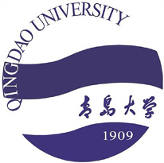
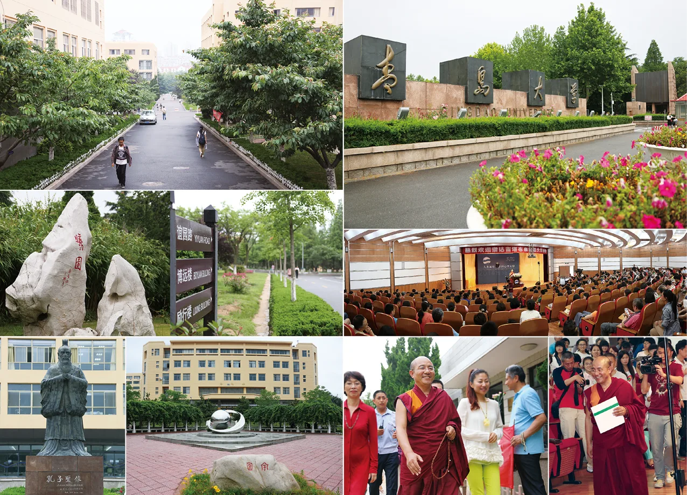
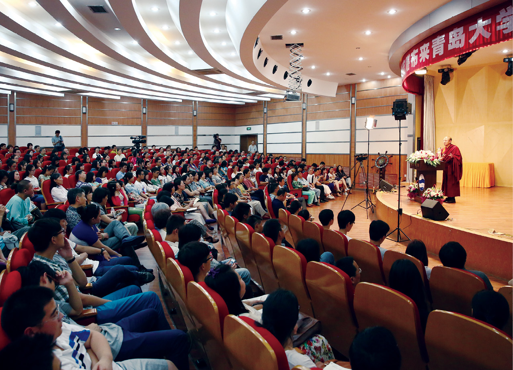
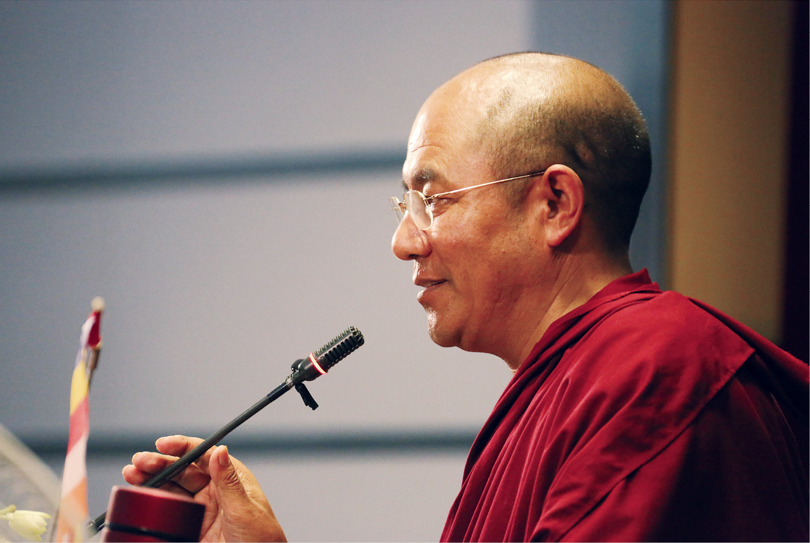
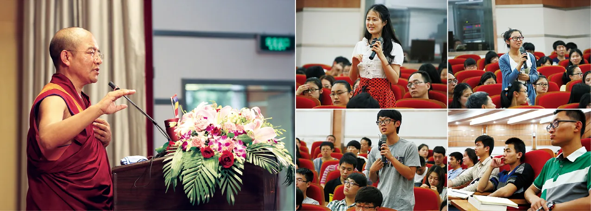

正因为无常，

任何事都可能发生。

第84场

青岛大学

Qingdao University

中国·青岛

2014 / 6 / 21

## 人类面对灾难的心理安慰

## Ease at Time of Catastrophe

主持人：

尊贵的索达吉堪布，您好！各位嘉宾、各位朋友，大家下午好。

在这样一个吉祥的日子，欢迎各位来参加这次聚会。今天，我们很荣幸地邀请到喇荣五明佛学院的索达吉堪布，为我们讲解人类如何面对灾难以及其他各种困境。在尊贵的堪布演讲之前，先有请心理学院院长致欢迎辞。

心理学院院长：

今天，我们很荣幸地邀请到索达吉堪布为我们作演讲。在这里，请允许我代表青岛大学师范学院、心理学院的师生以及在座的各位朋友，对堪布的到来表达诚挚的欢迎，同时也向参与邀请堪布的红会领导以及各界朋友表示感谢，向筹备本次讲座的各位志愿者表示感谢。

西方心理学主流学派在理论和实践中都融合了东方文化，尤其是佛学的许多概念。国内也有越来越多的心理学专家受西方心理学与佛学结合的影响，开始正视佛学的智慧。而对于佛学来说，也需要融入现代社会的潮流。因此佛学与心理学的结合，为佛学在当今社会服务大众营造了良好的机缘；心理学与佛学的结合，也为心理学的深入研究打开了崭新之路。

索达吉堪布在佛学领域具有丰富的教学和修行经验，是国内最早把心理学引荐到佛教教学中的佛教界老师之一。今天堪布的演讲主题是“人类面对灾难的心理安慰”，我相信堪布一定会给我们带来全面、深刻、触动心灵的指导。

下面以热烈的掌声欢迎索达吉堪布为我们授课——

非常感谢院长让我们有这样一个交流机会。之前听院长谈及青岛大学有些师生参与汶川地震灾后心理疏导与安慰的事迹，确实非常感人。我本人，一方面对于到学校里作交流很感兴趣，另一方面，对于做帮助他人的慈善之事很有意乐，再者，对于心理学也颇有兴趣。所以，今天在座的各位多多少少跟我有共同爱好，那么我就以随意的方式，跟大家谈一谈“人类面对灾难的心理安慰”。

## 一、灾难并不遥远

对于今天的话题，在座的或许思考过，或许没有，不过如今的世界确实多灾多难：自然灾害一年比一年频繁，人们身心上的灾难也层出不穷。

### “转型期”的危机

作为大学生，一方面生活得非常单纯、快乐，另一方面也即将面临种种挑战，如果没有接受过良好的心理教育，也许就难以应对。

为什么这么讲呢？因为大学生一旦步入社会，走上工作岗位，就需要面对形形色色的人，处理各种各样的关系——如果成为医生，就需要处理与医院领导、患者的关系，还需要熟练掌握医学技能；如果成为教师，就需要处理与校领导、学生以及家长的关系，还需要承担授课任务……与此同时，很多大学毕业生也开始成家生子，为人父母，肩上的担子更重了，同时又要寻找人生定位、工作定位，如果读书时没有做好心理准备，到时可能就会手足无措。我看到很多年轻人面对这种境况，好像熬不过去、马上要崩溃了，这样确实人生中已经出现了“灾难”。

因此，我觉得大学以及中学很有必要对学生进行生活预演教育——模拟未来的生活，让学生扮演一个角色，比如一家之主，看看如何应对。

在美国和德国的中学、小学以及幼儿园里，都有心理健康课，教导学生如何面对人生的很多问题，诸如人生的挫折乃至未来的死亡。可是我们这里的大多数学校，只是单纯地传授专业知识，很少教导除此之外的道理，比如如何孝顺长辈，如何培养爱心，如何做到坚强与忍耐，这就使得很多年轻人步入社会后，情况不容乐观。

就在座的各位而言，如果能够经常去一些灾难突发地亲自参与救援，对受灾者进行心理疏导与安慰，是非常有意义的——既是对自己的锻炼，也是对他人的饶益。

### 被“掏空”的地球

这个世界可能会越来越频繁地发生地震、海啸、台风等各种灾难，导致这种状况的根源不在别处，就在人类自己。

大家可能清楚，20世纪人类对自然的破坏非常严重，以至于有些学者将之称为“第三次世界大战”，因为很多人完全不顾及子孙后代的利益，拼命地开发自然资源，使得地球基本被“掏空”了。也就是说，人类历史中大约百分之十几的人，已经消耗了全世界百分之九十多的资源。

所以相关学者认为：第一次和第二次世界大战虽然将德国、日本为主的很多国家的建筑摧毁了，但是战争结束后，这些还可以重建得以恢复，而现在人类对大自然疯狂开发所导致的破坏，短时间中却无法修复，而且因为人类的贪婪根深蒂固，没有消减的迹象，将来很可能造成更加无可挽回的持续破坏。科学家霍金（Stephen Hawking, 1942-2018）也说：人类已经成为历史上最可怕而不可挽救的群类。

对自然资源的无度开发，导致的直接结果就是生态失衡，而生态一旦失衡，各种灾难就会接踵而至。

## 二、化解灾难，从心入手

当灾难降临在他人身上时，我们需要去帮助吗？当然需要！但要完全化解种种灾难带来的危害，并非一个学校的人或者少数善心人士的力量所能完成的，而需要仰赖全民意识的提升——大家都发出慈善之心。

与此同时，这种善心也需要智慧的摄持。现在很多人对于灾区的援助，只是物质或医疗上的资助，实际上遇灾者所遭受的内心创伤更严重，更需要的是心灵救助，需要心灵导师借助各种方法引导他们摆脱心理阴影。

所以，作为心理学专业的高才生，你们可以通过所学的知识帮助遇灾者调整心态，这非常有意义。而作为我，从小研习佛法，也想通过佛教的疏导方法帮助他们，这确实也会对他们有巨大的利益。

其实化解心灵创伤，转变认知是重要的方法——一旦认知上有所调整，许多心灵危机都能得以化解，对于任何困境都能坦然面对。而在调整认知，或者说摆正心态方面，信仰的作用是不容忽视的。

尤其对于佛教的正信，我经常这样想：这种信仰是流淌在血液中的一种精神，是存在于心灵中的一种动力，是铭刻于骨髓的一种坚守。它的威力不可思议——依靠它，脆弱的人能变得坚强，痛苦的人能绽放笑容，精神濒临崩溃的人能在心底出现光亮，变得积极向上。因此，大家有必要了解一下佛教，佛教里调心的方法不胜枚举。

当然，如果你从未学习和修持过佛教的调心法，想要临时抱佛脚也有一定困难。所以希望在座的各位平时看看佛学的书籍。尤其作为大学生，没有工作的压力，没有生活的重担，拥有一个不可多得的读书时光，如果能利用它掌握一些本领，以此应对人生中不可避免的难题，是非常好的。

## 三、面对灾难，你的心够强大吗？

### 一切如电光

如今每天都有各种灾难见诸报端，但是很多人总觉得灾难只会“光顾”别人，不会发生在自己身上。刚才有些人就说：“我一直认为自己不会遇上什么危险的事。”但这不过是嘴上说说而已，你找不出任何可靠的理由。

实际上按照佛教的观点：生命是无常的，世界也是无常的，无常就是一种自然规律，正因为无常，任何事都可能发生。

佛教的《坐禅三昧经》中讲：“世界若大小，法无有常者，一切不久留，暂现如电光。”我很喜欢这句话，世界上大大小小的法，没有一个能超越无常，不论是海誓山盟的许诺，还是坚不可摧的建筑，抑或牢不可破的法令，无一例外都会如同闪电般，最终消失无迹，我们的身体、家庭，更是会随着岁月的流逝而烟消云散。

无常一旦降临，诸如亲人患病离去、家庭遇到危机、灾难不期而至，没有接受过无常教育的人，内心就会陷入痛苦与困惑：“为什么我会遇到这些不幸？”而接受过这方面教育的人，就比较容易坦然、安和地面对。

因此，对于无常的道理，大家很有必要了解和思维。若能这样，一旦生活中出现变故，就不会那么地执著，也不会那么地痛苦。

遗憾的是，很多人不明白这个道理，比如有些年轻人遇到感情上的些许变化，就陷入痛苦之中，甚至想要自杀。其实这非常不理智，生命如此珍贵，怎么能因为一点小事就轻易舍弃呢？

我认识一个大学生，他说：“如果我的家里出现灾难，比如父母或哥哥死了，我可能根本无法面对，只有精神崩溃了。”

很多年轻人看起来很成熟、坚强，但实际上并非如此，内心可能非常脆弱。有的年轻人甚至会因为别人的一句话、一个表情，马上就大发嗔心，或者伤心落泪。为什么会这样呢？这跟学校中缺乏心理教育有很大关系。

人的心可大可小，可坚强、可软弱，你通过什么样的教育对它进行培训，它就会沿着这个方向发展，这是心的不共能力。比如禅修者可以七天七夜心如止水，而一般人不要说七天七夜，即使七秒钟里，心都无法安宁，如同猴子般东蹿西跳。再比如如果整天沉溺于泡沫影视剧，内心就会变得颓废无力；而如果不断接受励志教育，内心就会强大而积极。

虽然人人都有一颗心，但心与心的差距却判若天渊，有的心充满智慧和力量，而有的心却愚昧而脆弱。

### 面对死亡，内心自在

不论生活中发生什么，我们都应坦然、洒脱地面对，甚至死亡降临也淡定处之——这就是佛教中最重要、最精彩的理念，所以佛教徒遭遇困境时，比较容易做到轻松面对。

世间很多人对死亡充满畏惧，甚至连“死”字都不敢提。原因是什么呢？就是他们从小在“人死如灯灭”的教育中成长，始终认为：“我原来是一个活生生的人，一旦死了就变成一抔泥土，多么可怕！”但如果明白了死亡的真相，知道如何面对死亡，就不会那么恐惧，反而非常坦然了。佛教历史上有很多成就者，在死亡面前就十分逍遥、洒脱。

宋朝有一位宗渊禅师，他从小出家，主要修学《普门品》，后来四处参访，成了一名云游僧。83岁接近圆寂时，他告诉大家：“我有件特殊的事要做，你们给我制作一个鹿顶座，明天供斋时用。”

第二天，他的弟子和道友都到了，禅师作偈一首：“举世应无百岁人，百年终作冢中尘，余今八十有三也，自作哀歌送此身。”意思是，世上能活到一百岁的非常稀少，即使有这样的人，最终也会化为冢中尘土，而我今年已经83岁了，作这首诗为自己送别，免得劳烦世人为我送终。

话音刚落，他就安详地示现圆寂了。

大家想一想，世上很多位高权重的人，很多学富五车的人，他们活着时备受瞩目，也自认为了不起，但是面对死亡能否这样自在超脱？再看看我们身边的很多普通人，他们死亡时，不论在医院里还是家里，都是在巨大的痛苦、恐惧和忧愁中离去的。

死亡，是每个人都必须经历的，以怎样的方式度过才好？我想大家有必要去佛法中了解一下。

青岛人常常赞叹青岛的很多功德——这里的资源如何丰富，这里的人如何纯真、诚恳……这些我也非常认可，然而青岛还有一个值得赞叹之处，就是曾经出现过不少卓越的佛教修行人。

比如明哲老法师，是你们青岛湛山寺的，曾任山东省佛协名誉会长——很多年轻人不一定知道他。以前我去有些大学时，发现校园旁边的寺院里有很多精彩故事以及很有境界的高僧，但不少学生却漠不关心。

差不多在二十年前，明哲老法师曾去我们那里学习密宗，那时他已经七十多岁了。法王如意宝给他取名益西炯内，并且给他传授了一些密法。后来他回到青岛，展开了广大的弘法事业。

2012年9月16日，明哲老法师预知时至，当天早上绕佛、拜佛之后，坐在莲花垫上安详而逝。

由此可见，信仰的力量确实非同寻常。

当然，我并不是要求大家信仰宗教，即便你不信仰，也要知道信仰有神奇的作用——人一旦有了信仰，内心的力量会截然不同。我刚才见到很多慈善家，他们也认为：有信仰的人做心理安慰时，力度完全不同，可以做到无条件地付出。

所以对于佛教信仰，各位有必要重新审视。有没有信仰是你的自由，但是信仰给世界带来了怎样的利益，这方面大家可以观察。比如佛教倡导“诸恶莫作，众善奉行”，如果照此去做，会是怎样的人？必定是受整个社会欢迎的人。

实际上佛教的很多理念，在如今的社会非常需要。

现在人心普遍冷漠，人与人关系疏远，即便家人之间也比较冷淡，所以人们需要培养慈悲与爱。而无条件的慈悲，正是佛教教义的核心。

这种慈悲心，在心理学中，叫换位思考——我站在你的位置上，你站在我的位置上，通过角色互换来体谅对方；在儒教中，叫“己所不欲，勿施于人”——自己不愿意承受的，不强加于别人；自己希望得到的，无私地给予别人。

因此，我觉得学校如果能够向学生灌输大乘佛教的教义，是非常好的，这是心灵最需要的营养。当然，要完全做到无私利他，有一定困难，但是可以把它作为教育的方向。

### 世界的最后时刻

淡定的心态，是现代人需要培养的素质——有了这种心态，生活会变得有趣。至于如何培养这种心态，我认为佛教的方法最为有效，比如禅修以及某些心灵观修法。

曾经有一份漫画杂志为提升发行量，推出一项“征画活动”，邀请全世界擅长绘画的人就《世界的最后时刻》创作一幅作品，最佳者将获得十万美元奖金。

消息一传出，世界各地的很多画家踊跃参与。最后举办方收到了大量画作，有的这样画着：到了世界的最后一刻，一家人抱在一起痛哭着；有的画上，是有人将所有存款拿到大街上，气急败坏地焚烧；还有的作品画着宇宙飞船，很多人准备乘着它逃往其他星球……种种景象不一而足，但是这些作品都没有得奖。

获奖作品是一位家庭主妇用铅笔在一张包装纸上画的漫画：她在厨房洗完碗筷后，正伸手关紧水管开关，丈夫坐在餐桌旁边的地板上，旁边有两个小男孩，正在玩积木……

评委们对这幅看似平常的作品这样评价：我们震惊于这一家的平静，他们理解了世界存在的意义和人的最高追求。

即使是世界的最后一刻，这家人依然可以如此平静、淡定，不被即将到来的危险所吓倒，活在当下，确实非常难得。

结合这个故事，大家不妨反观：如果今天就要离开人间，自己是怎样的心态？会做些什么？

### 祈祷的力量

一般而言，世间有两种人：一种比较坚强，一种非常脆弱。这两种人都需要心灵的修炼。这方面，我建议多阅读相关的书籍，比如藏传佛教的《大圆满前行》，里面讲述了人身难得、寿命无常，以及遇到危机时如何皈依等，不论什么人都需要了知这些道理。

说到皈依，有些人也许觉得离自己很遥远。其实不一定。每年高考来临，很多人都会到寺院里拜佛祈求，这反映出他们内心深处也有信仰，只不过程度并不深。否则，如果丝毫不信，为什么在紧要关头求佛保佑呢？

对于求佛保佑的行为，佛教是否反对呢？并不反对。相反，佛教完全承认它的力量。只不过佛教不是很提倡这种行为，诸如求佛保佑发财、升官或身体健康等。佛教提倡的是什么呢？就是发愿利益一切众生，并付诸行动。当然，尚未达到这种境界前，希求个人愿望也很有必要，比如遇到灾难时，可以念“南无救苦救难观世音菩萨”祈求救护，或者祈祷阿弥陀佛、释迦牟尼佛等。

依靠祈祷，很多人生命中的险境确实得以化解，这并不是传说。

不过，如果有人实在不承认这些，那也没办法，就像有的妙药功效显著，但如果非要矢口否认，谁也无法阻止。不过站在客观的角度观察，就不得不相信：内心真诚祈祷必定会得到加持。

我本人研究因明、哲学等很多年，对其他各类知识也探索过，在这个过程中，对于迷信、妄说神通之类的，我并不认同，但是我非常相信的是什么呢？就是祈祷的力量，通过祈祷可以成办所愿。因此在座的各位，假如有一天你处于非常恐惧、危险的境地，不妨尝试去祈祷。

之前我也说过，对于二十一度母，汉地很多人知之甚少，而在藏地则家喻户晓，藏族人常常祈祷她们，而这种祈祷的作用远远超过了急救车，因为急救车有时服务不到位，等了半天才姗姗来迟，但度母的加持却是迅疾的。

关于祈祷，大家可以多去了解，这也属于传统文化——传统文化的精神层面，这一层面不一定能通过物质的方法证实，但是可以借助内心的感受来验证。

我们既要承认科学技术的作用，也不能否认传统文化的力量。如果把传统文化全部抛弃，而一味崇奉科技，是错误的极端；如果只学习传统文化，而对现代技术拒之千里，也是歧途。

所以，有智慧的人，一方面会关心科技的进步，另一方面更会关心什么呢？就是古圣先贤留下的传家宝——各种具有价值的传统文化。传统文化和现代科技结合，内在精神与外在物质结合，研究性与实修性结合，才是应取的中道。

不过很多人往往不是这样，比如有些学校里的老师完全从理论角度研究佛教，除此之外没有任何实修体验；而一些寺院和佛教中心的人，又一味重视修行，不学习佛教理论。这两种情形，都会导致理论和实践脱节，很难通达真理。

### 保持觉知力

如今的社会上，人们的欲望越来越膨胀，从某个角度而言，这与物质的增长不无关系——物质的飞速发展促使人的欲望不断增长，欲望的增长又导致物质不断更新。如果人们对欲望有所克制，那么外在世界的变化也会放慢脚步。

以人居环境为例，大多是欲望的“作品”，而其中有些完全是不必要的，比如很多城市里空空荡荡、无人居住的楼房。这种贪婪驱动下的建设，实际上浪费了很多资源——物质资源、精神资源，还有人们的宝贵时间。

另一方面，有些人拥有很多套房子，但是其中有的房子，可能自己一辈子都没住过。

我听说有个人买了一栋很大的别墅，但是一直没机会住，后来好不容易住进去，已经是处于病危之际了。周围人说：“如果那个别墅没有让他住一次，他会非常遗憾。”于是大家把他从医院送过去，但是到了那里，他已经断气了。事实上，很多人穷其一生辛苦积累的钱财和资产，大多与此类似。

因此，人生在世，应该常常保持观察力和觉知力——清楚自己在做什么、别人在做什么。

总而言之，心灵教育具有重大的意义——人一旦接受了这种教育，就会具有真实的智慧，而依靠这种智慧可以感召美好的外在世界。

现场互动

问：在科学时代，为什么还有人陷入迷信？

堪布：迷信是对一个事物盲目、迷惘的信心。

在这个时代，存在迷信的现象不足为怪。按照佛教的观点，迷信源于无明，即不具备智慧。那么缺乏智慧之人，不必说在一般世间人中，即便科学工作者中也不乏其人，比如并不明白科学的真实内涵，却一味崇信科学，就已经处于迷信的状态。

西方的一些名人，像尼采（Friedrich Nietzsche, 1844-1900）和弗洛伊德（Sigmund Freud, 1856-1939），都承认自己早年迷信过。他们所谓的“迷信”并不是说信仰宗教就成了迷信，而是指自己在人生观上曾有过迷茫的信心。当然，也有人对宗教的信任是盲目的，这也是一种迷信，不过个别人的这种状态并不代表这个宗教的教义成了迷信。

儒教、道教和佛教，是中国的三大主流宗教。大家如果去认真了解，就会知道它们并非迷信，只不过后人有时对其教义未能真正理解，或者理解有所偏差，由此产生的一些民间行为确实属于迷信。

归根结底，迷信与否跟人的智慧密切相关——当一个人的智慧尚未达到一定高度时，很多行为都会带有迷信的成分。所以，即便在科学时代，迷信的现象也在所难免，而且不仅普通人群中有，高层次的人群中也存在。

问：在如今的社会，某些邪教为什么还能蒙蔽人？

堪布：邪与正，在不同场合有不同定义，在有些场合被认定为邪教，换个场合也许并非如此。

我认为“邪教”是指冒用宗教等名义蛊惑人心而对人类的身体和心灵造成损害的组织。如果对人的生命、生活不但无害反而有利，乃至对全人类都有巨大利益，这样的组织就不属于邪教。

虽然对于邪教，每个人的认知有所不同，但是有的认知不一定符合事实，比如因为不信仰某个宗教，就把它判为邪教。

因此，有时可能先要把相关概念界定清楚，再做评判。

问：您曾说每个人都应具有正信，尤其年轻人。那么在佛教里，除了前生后世，还有什么是年轻人特别需要信仰的呢？

堪布：我觉得除了对前后世的信心，年轻人还需要树立善恶因果的信念。这两种正信，不仅对年轻人，对所有人都非常重要。

首先，要知道前后世是真实存在的。

在座很多人因为成长环境的影响，可能对前后世心存怀疑，甚至觉得难以置信，而认为人跟一块石头、一截木头没有差别，一旦死掉就灰飞烟灭。实际上这种观念是错误的。

我以前翻译过一部论典《前世今生论》，现在出版时叫《生命的真相》，书中对于前后世的真实不虚，一方面从科学角度进行论证，另一方面运用佛教逻辑加以阐述，也可以说从哲学角度进行了证明。如果能阅读这本书，有关前后世的很多疑惑都会得以遣除。

如果后世不存在，那么大家每天寻欢作乐，甚至无恶不作，这样度过一生也没有大碍，但如果后世真的存在，而我们又没有为之做丝毫准备，那么后果也可想而知——必定陷入非常悲惨的境地。

其次，要明白善恶因果的规律。

在藏地，佛法非常兴盛，人人都有因果正见，特别害怕因为造恶而受到报应，不论现世报还是后世报，对此都心怀畏惧。可是大城市的很多人却截然不同，丝毫没有因果观念，所作所为不考虑后世，只要今生快乐就行。这其实很可怕。

为什么如今的社会中，各种恶性犯罪屡见不鲜？就是很多人没有因果正信所致。如果一个人深信因果，自然会在心里想“一旦造下恶业，将来一定难逃苦果，那时就太可怜了”，由此会对自己的行为有所约束；而如果不信因果，就会为所欲为，最终发展到违法犯罪的地步。

唐代时，中国大约百分之九十的人相信前生后世、善恶因果，然而随着历史的变迁，这些见解在很多人的心中变得模糊了，甚至有些年轻人以断定的口吻说：“我才不信那一套呢！”当然，你如果真的有大智慧可以证实自己的观点倒是可以，但是你的智慧也很有限，连自己的高考都难以把握，那要否定释迦牟尼佛的观点，可能非常困难。因此我也是给有些人敲个警钟吧，还是要审视一下自己的见解。

实际上，一个人有了因果正信，就有了道德的底线和行为的约束，是非常好的。而如果没有因果观念，那么一旦具有能力时，也许就会做出对他人、对社会有害之事。

问：我最近看到一个新闻说，某大学的一个女生遭到强暴，学校于是给与她保研的资格，作为一种救助。但是我觉得，对于她个人，遭遇这样的灾难，如何度过心理难关才最重要，是这样吗？

堪布：我前些天去美国哈佛大学，那里有一位已经授课二十几年的女教授，她也是学藏传佛教的，我特意去听了她的课。当时她正在讲藏传佛教中康卓·益西措嘉的故事，其中有这么一段内容：益西措嘉曾遭人非礼，甚至强暴，但是这并没有让她的人生受到创伤，她后来更加精进地修行，价值观也作了调整和改变，最终成就了辉煌的人生。

讲完这段内容，那位女教授询问在场的学生：“如果这种遭遇发生在这个时代，受害者会怎么对待？”很多男生和女生纷纷发表了看法，也叙述了有些学校里发生的相关的事。

我想从传统观念或伦理道德而言，个别女生的这种遭遇，对她个人而言，是一种灾难，所以对她进行心理帮助和疏导，确实比较重要。

问：学校教育是不是应该鼓励学生大胆尝试、不怕犯错？

堪布：这个我很认可，现在很多小学里也要求学生积极发言、勇敢参与，在演讲等活动中培养各种能力。

人生其实是一个不断应对问题的过程，所以很有必要运用种种方法，将心中的潜能开发出来。其实如果善于借助方便来锻炼心灵，每个人都可以迸发出一些前所未有的智慧与能力。

问：迷信在这个时代也是存在的，您能不能再举例说明一下？

堪布：在这个时代，迷信的现象并不少见，大家如果留心观察就会发现这一点。比如曾经有个领导要给群众介绍农产品转基因的知识，其实他自己都不明白什么是转基因，也不明白什么是科学，但是却在群众中大肆宣扬：“你们一定要相信科学，不要迷信啊。”像这样自己尚且一无所知，却还口口声声让别人相信，就是迷信的行为。

如今虽然科学技术迅猛发展，但是如果一味盲信外在的科技，而把内在的心灵抛之不顾，把珍贵的传统文化弃若敝履，那么这种观念指导下的一切行为，很可能会落入迷信中。

问：我是青岛大学心理学院的一名老师。人们在遭遇人祸——他人的伤害时，心中往往难以抑制怨恨之心，请问该如何对待人祸？

堪布：人祸有很多种情形，不仅是来自怨敌的伤害，包括家庭成员之间的热战、冷战，以及亲戚朋友之间的怨恨不满，都属于人祸。这种灾难给人造成的心灵创伤，可能很长时间都难以愈合。

不过我总觉得，按照大乘佛教的精神，别人之所以伤害你，实际上都有背后的因缘——你前世损害过他。世间中也常说“我前世欠了你”，这句话其实有很深的哲学内涵。

所以，面对人祸，如果还可以改变，就努力去改变，如果已经无法挽回，那么最好是调整自己的心态，尽量不怨恨对方。实际上如果能调整心态，就等于改变了这件事本身，可以起到这种效果。

《弟子规》中也讲：“恩欲报，怨欲忘。”别人对自己有恩惠，应时时想着“滴水之恩，涌泉相报”，尽量报答对方的恩德；别人对自己有伤害，应当尽快忘记，不要心怀怨恨。

不过有些人好像总是对别人的伤害怀恨在心，久久难以释怀，甚至伺机报复。这种心态应该改正。

当然，起初改起来也许有困难，但如果能慢慢思维其错误之处——不相合于高尚的人格、不符合因果的轨则，那么到了一定时候，内心就会得以转化。

问：有时我会突然冒出很强烈的孤独感，该如何消除这种感觉？

堪布：如今的世界虽然信息非常发达，人们可以通过电话、微信、QQ等多种方式很方便地联络他人，但实际上家人、朋友之间的交流少之又少，各自都在忙自己的事，由此就导致很多人常常感觉孤独。

昨天在飞机上，坐在我旁边的两个人告诉我他们俩关系很好很好，但说完这句话后，他们就各自抱着手机发微信，从始至终再没有任何交流。我当时就想：现在人与人的确越来越疏离了，难怪会有人患上孤独症。

其实孤独感来自心灵，因此即便通讯录里的名单很长很长，也无法抵挡内心的这种感觉。

不过从另一个角度看，感到孤独也是正常现象。佛教的《无量寿经》中讲：“人在世间爱欲之中，独生独死，独去独来。”人来到这个世界，是独自一个人来的，最后离开时，也是独自一个人而去，不必说眷属、财富，连身体都无法带走。所以从这个层面而言，每个人都是孤独的。

虽然是这样，我们还是可以通过不断填充心灵来消除孤独的感觉。如何填充呢？拥有信仰是一种很好的方法，因为一旦有了信仰，心灵就有了依托，孤独感也会自然消失。

我认识的很多人，他们以前没有信仰时，觉得生活索然无味、未来虚无缥缈，任何一件小事都可能让他们倍感孤独；后来有了信仰，在面对很多问题时知道权衡前因后果，精神上有了依靠。

而且有信仰的人，不论年轻人还是老年人，不但不感到孤独，甚至很喜欢独处——愿意一个人安静地念经、看书、参禅。比如有些学佛的老年人就不希望子女来打扰，会跟子女说：“我要修行，你们不要来看我。”

所以，要去除孤独感，信仰有不容忽视的力量。

问：我是青岛大学心理学院2012级的学生。我身边有许多人遇到心理问题时，不会去寻求心理学的帮助，而是选择相信一些神秘的方式，请问如何让他们接受心理学？

堪布：在如今的社会环境中，有些人去寻找解决心灵困惑的其他方式，这其实无可厚非，因为仅仅依靠大学里某些专业课程知识，要满足一切的心灵需求，是非常困难的。

那么在这种形势下，作为心理学专业的学生，除了学习专业课程，还需要了解一下艺术、宗教等知识，只不过在学习这些知识时，不能过于极端，比如学业都没完成，却把精力全部花在这上面，就不太合理。

我个人认为，大学生一方面应该认真学习专业知识，如果有可能就继续攻读硕士、博士学位，同时对于其他领域的知识，也要保持一颗求知心；另一方面，如果有机会可以去一些西方国家、东南亚国家看看，了解一下那里比较开放、轻松的教育模式、思维方式，更重要的，还可以去非洲、印度，以及藏地等地方，在那里的有些地区，人们的生活比较困乏，教育条件也很落后。

现在有些大学生觉得自己读完了大学，就十分傲慢，“我是某某大学毕业的”。其实在大学里，所学的知识非常有限，没有接触的知识多之又多，所以大学生一方面应该探求更高的知识，另一方面也可以去贫穷落后的地方走一走、看一看，这样会自然明白许多人生哲理。

总之，大家要知道，仅依靠单一的专业知识，难以应对所有的问题。

在如今的中国，精通专业知识的大学生比比皆是，但是他们走上工作岗位时，真正运用这些知识的机会少之又少。这一点跟西方很多地方完全不同。在西方个别国家，高校毕业生一旦投入工作，一辈子都在使用所学的专业知识；但是在我们这里，读师范的可能去搞建筑，读建筑的可能做了老师……各种混乱的情况都会出现。

所以在座的同学，不但要掌握好专业知识，还要希求更多、更高的学问，比如宗教里有关心灵调解的道理，就很有必要去了解。

如今为什么很多人都喜欢学《金刚经》，喜欢念《心经》？像《心经》，只有二百多个字，但是自古以来无数人对它钟情有加，它里面究竟蕴含了什么奥秘？这些值得大家思考。

很多大学生可能因为思想不够成熟，加上自己的老师观念较为保守——仅仅提倡学习专业知识，由此导致学生的思维也难以开通。现在极个别老师，虽然专业知识很丰富，但是对其他知识知之甚少，甚至内心排斥。这是不太合理的。因为对于任何一种知识，如果你去仔细学习，发现它是错误的，那么有权否定它，摈弃它；但是如果你对它一无所知，最好既不赞叹也不诽谤，因为你并不懂它，只有你懂的时候才有资格评价。

总而言之，希望在座的同学在掌握专业知识的同时，拓展自己的知识面，不断探索各种对自他有益的真理。

问：我是机电工程学院的一名学生。关于因果，我有一个困惑，如果我做了一件不好的事，一段时间后又遭遇了一件不幸的事，这两者属于恶因恶果吗？

堪布：因果非常甚深微细，像我这样的人，不要说对你的因果，连我自己一生中各种行为的因果确实也并不清楚。

但是我可以用佛教的道理来推断：你所遭遇的不幸，可能是你今生做的不好的事带来的，也可能是你前世或再前世种下的不好的因成熟了。不管怎样，行善或造恶就如同播下种子一样，将来会成熟相应的果报。

在世间，农民在田里播下庄稼的种子，这些种子有的春天发芽，有的冬天萌发，有的很多年后才破土而出；同样，我们的一切言语、行为以及心念，都会在心田里播下种子，果报成熟的时间可能在今生、来世或者更久远的未来，这取决于每个人心中的因缘。但是不论何时成熟，都一定遵循善有善报、恶有恶报的规律。

所以，究竟你前面的什么行为导致了后面的苦果，对我而言也是个问号，但是我相信这个苦果一定是由不善因导致的，而且这个因不一定是今世的，有可能是前世造下的。有些人对因果的理解仅仅局限于今世，这不太合理，应该贯穿到前世与后世来观察。

明白因果的道理，对每个人都非常重要，以此遇到问题时会减少很多迷茫，而且因果作为一种规律，任何人都无法逃脱，所以很有必要了解。

不过，因果的道理说出来容易，“善有善报、恶有恶报”，但要真的相信它，不但相信还付诸行动——对于善事，尽量去行持；对于恶事，不论别人督促与否，都尽量远离，行为中有一种决定性，就非常难能可贵了。所以，在这方面，每个人都要不断努力。

问：我是心理学院2013级的学生。您说佛教有很多调心方法，那么运用这些方法能达到什么效果？想学习这些方法，可以阅读哪些书籍？

堪布：佛教里确实有很多调心方法，比如禅修，现代人的内心往往浮躁、散乱，这样做事难以成功，如果禅修，就可以让心保持淡定、寂静，再比如守持正知正念、修持胜观，都是很好的调心法。

运用这些方法不断调整内心，最后会达到“堪能”的状态——心非常自在，想专注某个对境，就能自然专注；如果不愿专注，则可以起心动念。如果达到这种境界，做任何事都会非常高效。

有关这些调心法的书籍，是非常多的，比如《入菩萨行论》《大乘阿毗达磨论》《瑜伽师地论》，以及藏传佛教中的《智者入门论》等等。《入菩萨行论》第八品讲述了很多寂止方面的知识，《大乘阿毗达磨论》讲到人的51种心所如何区分……这些书籍都值得阅读。不过这些书籍有的有汉文版本，有的尚未译成汉文。还有一部论典叫《学集论》，有汉文版本，也非常殊胜。

如果研读这些论著，就会知道佛教对人心的观察有多么细致入微，比如心分为哪些类型、每种类型的体相与作用，以及善心、恶心跟哪些心相应……都有详细分析。

我以前对心理学很感兴趣，诸如形而上学、弗洛伊德学说，还有荣格心理学，对这些都有所了解，后来我把心理学与佛教作了对比，发现二者有不少共通之处，因此非常希望以后高等院校与佛学院之间能有更多的交流与沟通。

在西方很多地方，大学教授与宗教人士每年都共同举办一些活动，进行心理科学方面的对话。前两天在清华大学，我与一位教授也作过一些交流：他站在科学角度，我站在佛学角度，就一些热门话题进行探讨。

在这种跨学科的对话中，佛教徒提供佛学知识，科学工作者提供科学依据，互相切磋、互为补充，是非常有意义的。

问：您说到能将佛法引入高校是很好的。如果是这样，该如何设置教学方式？

堪布：高等院校课程中，如果能引入佛教的内容，必定可以利益很多年轻人。对于其他宗教以及心理学，我也有所了解，那么比较而言佛教有一个突出特点，就是运用众多逻辑推理与因明辩论的方式来抉择心灵的奥秘，而这一点知识分子会比较容易接受。

至于教学方式，一方面可以循序渐进逐步推进，像学习专业知识一样；另一方面，可以着重推广一些传统文化的基础课程，诸如《弟子规》《千字文》等，虽然这些著作的内容比较简单，但是大学教育将之作为基础来重视，也非常好，还有佛教的《善生经》《佛说善恶因果经》，以及道家的《道德经》，也非常值得学习。

《善生经》《道德经》等教典乍听起来，似乎很玄妙、很神秘，有些学生也许觉得：“学这些有什么意义呢？”实际上这些书籍所讲解的道理非常甚深，诸如天人合一、因缘果报等等，这对高校课程是巨大的弥补。

年轻人不应满足于仅仅懂一点技术知识，因为人生是纷繁复杂的，仅仅用这些来应对，必定会捉襟见肘，应该同时有深厚的人文底蕴。当然，如果仅仅通晓人文知识，而对现代科技一窍不通，那也如同缺少了一只翅膀，无法飞向21世纪的高空。所以，人文与科技两方面的知识都掌握于心，才比较圆满。

问：您说在美国、德国等地的学校里已经开设了心灵健康课，而在中国暂时还没有这种条件，作为大学生，有办法改变这一状况吗？

堪布：其实国内很多大学也有这类课程，比如清华、北大、复旦以及浙大等学校都设有禅修课、心理认知课。从各方面的情况来看，未来会有更多大学设立这类课程。

其实，真正的宗教信仰，在美国等地有些学校的课程里也不允许出现，但是心灵教育课是可以有的。

我想不同学校可以有不同的特色，不过这不是很主要的，最关键的是大学生自己要有开放的心态，不能太保守，如果只能接受自己的专业，对其他知识一概否定或者认定为迷信，这就不合理。比如佛教，如果真的是迷信，为什么能够历经两千五百多年的漫长岁月，一直流传至今？而且在如今依然让那么多人崇奉、信赖，为之折服？

所以作为大学生，在完成专业学习之外，还应当多去涉猎各类知识，诸如人类学、宗教学，尤其儒家、道家与佛家的内容。大学期间读万卷书，大学毕业后行万里路，能这样是比较完美的。

其实不仅大学生需要广闻博学，我们佛教徒也不例外。我所在的佛学院虽然开设了专业佛法课，像因明、中观、戒律等，但有些法师不但学习这些课程，对于其他有助于人生以及弘法的知识，也会孜孜不倦地求取。

总之，人生中会遇到很多问题，而解决的方法也有种种不同，仅仅懂得书本知识是不足够的，还需明白一些富有奥秘的道理，所以应当以开放、包容的心态不断学习。

问：我是青岛大学心理学院的学生。汶川地震后，国家对汶川进行大力重建，使得那里焕然一新。这种变化可以消除受灾者的痛苦吗？

堪布：物质上的改善，会对灾难幸存者的痛苦有所缓解。但是大家都知道，失去亲人的痛苦通常很难用财物、房屋等弥补，这些物质与亲人的生命根本无法相提并论。因此，灾区的人们虽然有了新家园，但如果缺乏精神的依托，失去亲人的伤痛可能会永远留在内心深处。

一般一个地方发生灾难，四面八方的人都会给与物质援助，但我认为精神上的帮助才是根本之策。因为一个人只有心结解开了，心伤愈合了，想通了某件事，才可能获得新生，否则即便房子焕然一新，人心也不一定感觉幸福，就像世间有很多人不愁吃、不愁穿，但是却患上抑郁症、自闭症等等。

至于如何进行心理援助，我觉得主要是让遭遇灾难的人们明白世事无常的道理。无常是一种自然规律，随着时间的流逝，每个人都不可避免要面对各种无常，人生就是在上演一出出无常的戏。如果认清了这一点，无常降临时，就会多一分勇气与淡定。

其实遭遇灾难的人，很容易体会到“以前人在时，没有房子；现在房子有了，人却不在了”，此时就可以引导他们认识万法无常的真相，帮助他们勇敢地面对无常。

问：现在的社会比较提倡正能量的言行，心理学领域也流行积极心理学，但是佛教主张修行苦行、克制欲望，这是否与主流思想有所冲突呢？

堪布：佛教并没有要求人人都去苦行。

当今社会物质发展日新月异，这在佛教看来，也非常值得赞叹。但是在佛教的某些教义中，为了克制人们过度膨胀的欲望，仍会教导人修持苦行。这就好比教育孩子的过程中，有些父母不让孩子买名牌衣服、高档手机等奢侈品，而要求孩子刻苦学习，因为这个年龄如果不努力学习，长大后就不会有出息；同样地，在佛教《毗奈耶经》等个别小乘经典中，为了克制人们的重大贪欲，而提倡知足少欲、勤俭节约，乃至行持头陀行，这也是引导弟子修行的一种方便。

但是到了佛教的中层教法——大乘佛教中，更加倡导的就是利益众生，此时作为心怀利他的大乘菩萨，如果没有对财物的贪心，那么即使坐拥金山银山也是允许的。

所以，佛教有不同层次，就像心理学有种种分支一样，不能把佛教的教义狭隘化。

现在很多人对佛教的理解有所偏差，比如，认为和尚一定要待在深山老林里与世隔绝，不能出现在城市里。虽然个别出家人选择在山里闭关修行，但是很多佛经里也劝导出家人到城市里为众生说法施教。

还有些人对佛教经典望文生义，由此提出种种疑问：“佛教不是说‘色即是空、空即是色’吗？佛教不是看破一切吗？你为什么吃饭呢？你还没有看破吗？”“佛教不是讲空性吗？你为什么还要修行啊？”像这些，都是没有正确理解佛经所致。

总之，佛教的教义广博而深奥，并非一两句话就能代表全部，也并非依文解义就能够通达其中义理。

问：虽然知道有些行为不好，比如杀生，但是有时因为环境的原因，又不得不去做，请问该怎么办？

堪布：很多人毕竟还生活在世俗中，在这种情形下，有时可能是主动的，有时也许是被迫的，造下了一些恶业。这虽然难以避免，但还是尽量不要杀害众生，因为杀生的果报非常严重。

现在很多人认为，只要不杀人就可以，杀动物天经地义。尤其沿海城市的很多人，每天吃海鲜就像吃青菜一样，觉得稀松平常。这在佛教看来，是非常可怕的，不仅剥夺了其他众生的宝贵生命，也为自己埋下未来苦果的伏笔。如果你相信因果就知道，今天你吃这个众生，将来很可能变成这类众生被吃掉。

因此，我们要尽量爱护其他动物的生命，像爱护人的生命一样。如果实在迫不得已，也千万不能点杀，这非常重要。

很多人学佛之后回首过去，发现自己前半生像屠夫一样，杀害了不可计数的众生，双手沾满鲜血，现在想要忏悔这个罪业都非常困难。所以，最初就尽量远离杀生是很重要的。

主持人：

因为时间关系，我们的提问就到此为止了。今天下午佛学与心理学的对话中，在佛学中，我们看到了心理学的影子，在心理学中，我们也看到了佛学的影子。

比如上师提到生命无常，面对任何灾难或生活的磨难，要提高承受与接纳能力，而在心理学里也说要活在此时此地，要珍惜生命。上师讲我们要做智慧的人，将传统与现代相结合，将物质与精神相结合，心理学也倡导要做一个整合的人。诸如此类，佛学与心理学还有很多共通之处。

我相信佛学与心理学在这场对话中的和谐共鸣，给在座每位朋友都带来了人生的智慧，特别是对心理学工作者如何提升心理服务质量，提供了巨大的启发。让我们再次以热烈的掌声对上师表示感谢！
