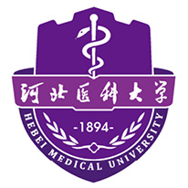
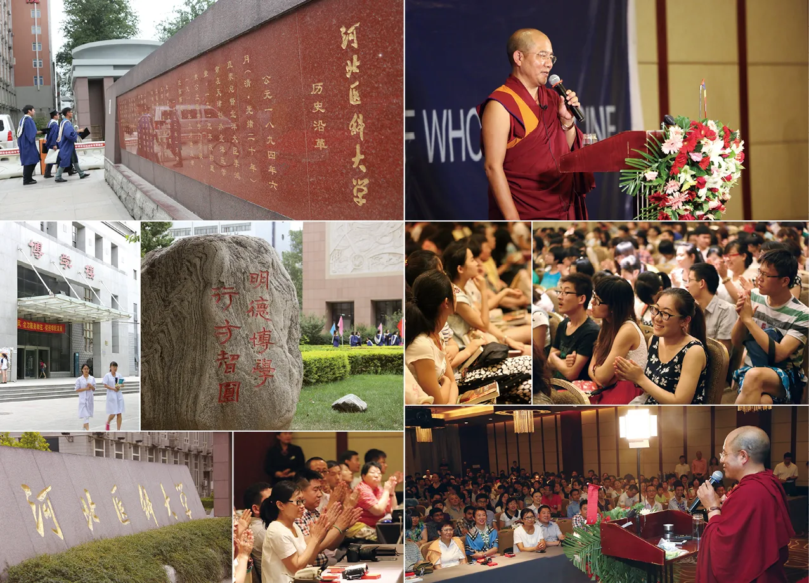
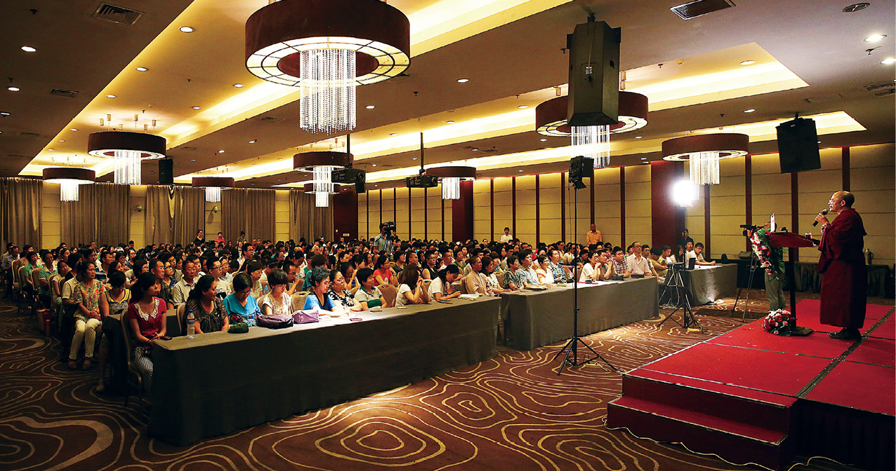
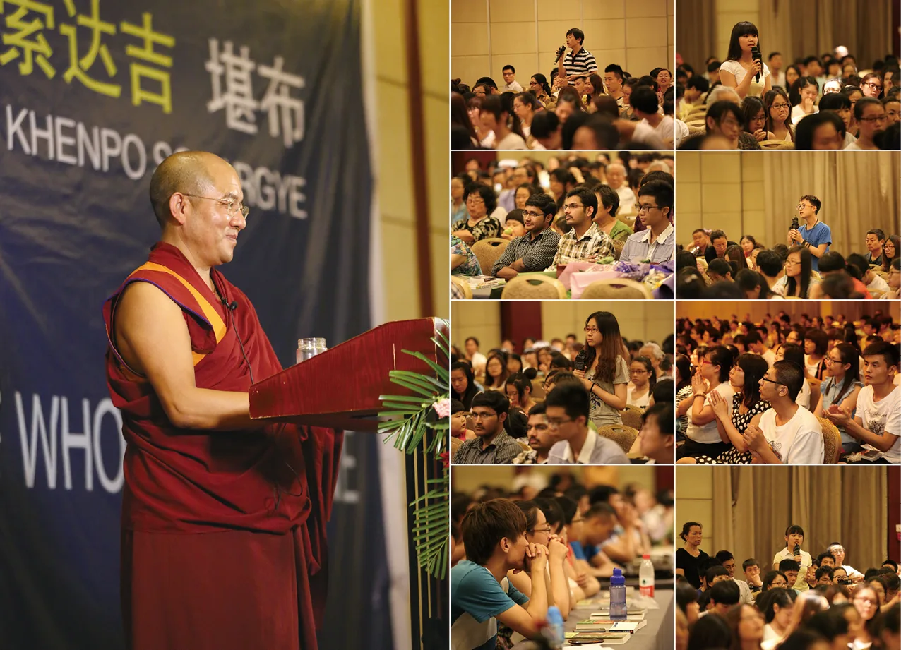
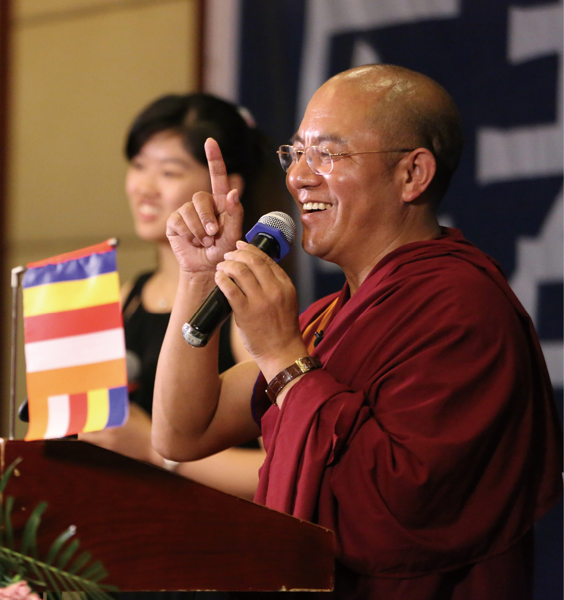
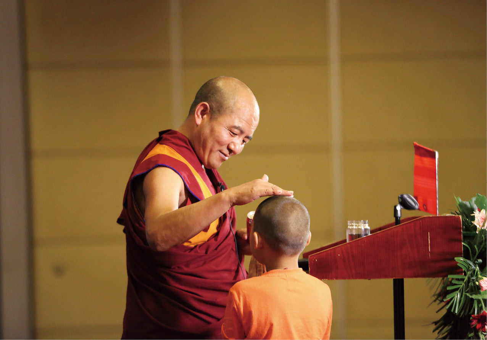

“人们不讲道理、思想谬误、自我中心，

不管怎样，

还是爱他们；

如果你做善事，

人们说你自私自利、别有用心，

不管怎样，

还是要做善事。”

第85场

河北医科大学

Hebei Medical University

中国·石家庄

2014 / 6 / 27

## 医者之心

## Healing Hands, Healing Heart

主持人：

各位嘉宾、同仁，各位同学，大家晚上好！今天是一个吉祥而殊胜的日子，因为我们非常荣幸地邀请到索达吉堪布为我们作一场别样的演讲。

在座的各位，有些是我的同事，战斗在临床一线；有些是我的同行，活跃在医药行业；还有些是我的学弟、学妹，虽然现在还是学生，但是将来一定会成为悬壶济世的栋梁。我想问大家，在繁忙而紧张的工作中，是否有一些挥之不去的困惑？在繁重的学术研究中，是否感到艰辛与苦闷？在日常生活中，是否迷茫与动摇过？是否常常站在理想与现实之间无所适从？我们常常问自己：如何才能坚守那份济世的初心？如何才能真正地离幸福很近？今天晚上，就让我们一起来聆听智者的指点、圣者的答案。

下面请允许我用一句藏语欢迎堪布：扎西德勒！有请堪布——

今天与大家一起探讨“医者之心”。站在佛学的角度看，“医者之心”是一颗慈悲心；站在儒家的角度看，“医者之心”是一颗仁爱心。不论怎样，这样的心是每一位医务工作者不可缺少的。

在座的能考上医学院校，进入医疗行业，是非常幸运的，但是也需要承受种种压力，尤其步入工作岗位后，还可能面临医患冲突等棘手难题，那时如何面对？对此应提前有所思考。

## 一、给与医者理解与信任

### 体谅与责任

现在有些媒体为了吸引公众眼球，对少数医务人员的不良行为进行夸大宣传，导致很多人对医务人员乃至这个行业丧失信心。不过我觉得这个行业里，其实有很多令人钦佩的白衣菩萨，默默传递着慈悲与仁爱。

所以，面对一些负面报道，我们应当擦亮眼睛，运用智慧进行辨别；与此同时，也要尽量借助各种途径传播正能量，否则，任由怀疑的心态蔓延滋长，最终不论对病人还是医务人员都只会造成伤害。

我其实非常能体会医务工作者的辛苦——医科大学的本科需要学五年，而刚刚毕业在医学界还做不了什么，即使再继续深造而取得硕士、博士学位，也难以保证一定找到满意的工作，即便找到，也需要从普通医生做起，再慢慢升为副主任医师、主任医师，这期间需要不断积累各种临床经验，是一个漫长的过程；而且医务工作者每天听到的往往是病人的哭泣声、家属的抱怨声，以及各种医疗器械的碰撞声……在这种压抑的环境中，如果没有一颗坚定的心，很难坚持下去。

因此，在座的同学，你们在走上工作岗位之前，一定要做好心理准备。

虽然医务工作者非常辛苦，但是社会上却有一种不和谐的现象：医生发自内心地想帮助病人，但是病人和家属却一直用挑剔的心态监督着，而且认为“既然我交了钱，医生必须治好我的病”。其实这种想法是不合理的，即使病没有治好，医生可能也尽了最大努力，花费了大量心血，身心都承受了巨大压力，完全是问心无愧的。

前段时间有个报道说，医生给一名病人施行脑部手术，历时32小时，术后几名医生累得直接躺在地上。后来据其中一位医生称，病人心脏曾停跳超过一刻钟，但是经抢救已经脱离生命危险。

总之，作为病人或旁观者，不应当心存成见，不能带着有色眼镜看医务工作者——他们是专门骗人的，看病收红包，开药拿分红……一旦有了这种心态，即使对方的内心很清净，行为也很如法，但是在你面前浮现的形象也不一定良善。

所以，大家应该给予医务工作者多一些体谅和信任。

另一方面，作为医务工作者，也需要具备贤善的道德修养和良好的心理素质，因为你的工作太特殊了，每天都在跟人的生命打交道，因此不能把这份工作仅仅当成养家糊口的工具，而应当怀着一颗柔和、慈悲的心去面对这些生命——如果用佛教的语言说，医务工作者属于寂静本尊，应该呈现柔和、慈悲相。相反，如果做不到这样，甚至背道而驰，那么即便学识再渊博、医术再高明，在救治病人的过程中，也不一定派得上用场。

我自己也经常生病，在上海、北京、成都等多地住过院。住院期间，我虽然也发现个别医生的行为不太好，但是大多数医生都非常敬业、心怀慈悲，所以每次回想起来，都非常感激：如果没有医生的救治，我可能早已不在人间了。

总而言之，一方面人们应该用公正的态度看待医务工作者，体会他们的辛苦；另一方面，作为医务工作者，应该以一颗慈悲的心对待病人。

### 无奈的境地

大家都清楚，人死之后，尸体送到哪里呢？就是殡仪馆，但是在此之前，亡者大多是在医院走完生命历程的。世界上每天有数以万计的人死亡，那么必然有很多人是在医生的手上离去的。

这本身属于正常现象——医生并非万能的神，能力有限，即便他的医术无比高明，人的生命也终有尽头，所以很多人在治疗中或治疗后死去，也无可厚非。但是因为病人家属往往抱有强烈的期待，“我的亲人一定要活下来”，由此就难以接受亲人的死亡，虽然并非医生的原因导致其死亡，但有些家属还是把责任推到医生身上，以各种方式责备医生，有甚者还会诬陷医生。

这样也会导致一种现象：很多医生救助病人时常常胆战心惊、如履薄冰，言行都小心翼翼，随时预备纠纷与官司。虽然本来不需要这样，医患之间可以开诚布公地沟通，但是一些不良现象导致医生也陷入无奈的境地，无奈中又不得不谨慎。

### 医学的空白

如今的时代中，人的疾病各色各样，病因也五花八门——食品添加剂、环境污染、工作压力、情绪压抑、传染病源、生活习惯不当……

甚至人们的生活被归为两种，而这两种都会引发相应的疾病：一种是长年坐办公室的，叫“座椅生活”，这种生活容易导致脊椎等出现毛病，还会引发一些心理疾病；一种是常常出门在外的，天天在路上，又堵车、又旅行，叫“车轮生活”，这样的生活也容易诱发一些疾病。

对于这些错综复杂的病因、病状，现代医学只能检测和治疗其中的一部分，对于另外的部分则爱莫能助。

这一点在医学界也是被证实的。西方医学研究发现：人类疾病的诱因并非仅仅源于身体，而大多来自心理层面，而这部分心理病因依靠医学仪器难以检测出来。

佛教、藏医与中医中也讲：人的疾病，除了身体四大不调之外，还有心灵上的病患。这类心灵疾病，佛教称之为贪嗔痴，它们源于无明与业力。所以，人的有些疾病是前世业力所致——前世造了恶业，今世就患病了。而现代医学对于这类疾病，不论在检测还是治疗方面，都是一个空白。

因为这个原因，在座的同学将来走上工作岗位时，也许会面对许多无奈——很想挽救病人，但是却无能为力，因为一旦他注定要死亡，那么不论他的身份如何，是腰缠万贯的豪富还是年轻有为的才俊，都无法在此世间多停留一秒。

这也是佛教所讲的寿命无常。医务工作者如果能明白这个道理，就会多一份释然，而医科大的学子们也非常有必要了知这个道理，这样在面对生活中突如其来的状况时，可以保持一颗淡定的心。

总而言之，一方面，这个世界并没有坏到不可救药，还是有很多人除了吃饭睡觉，其他时间都用于救助病人，或者帮助困难者；另一方面，每个人都应该明白：生命是有尽头的，即使医学再发达，也无法让人长生不死；再者，现代医学并未达到完美的地步，对疾病的检测、诊断以及治疗都非常有限，所以即便医生付出了十分的心力，对于有些疾病也是无力回天。所以，我觉得不论什么人，都应该对医务工作者多一些理解与体谅。

## 二、医者心，如是心

### 病人如亲人

大家都清楚，如今病人数量不断增长，而医生的人数却非常有限，如果一个医生每天要诊治大量病人，效果就不一定理想。

我想在座有的人将来肯定会成为医学界的栋梁，或者医院里的领导，虽然要改变整个医疗体制暂时有一定困难，但是至少可以在自己的权限范围内做些调整，比如规定医生诊治一个病人的时间至少多久等等。

前两年我在北京看病，有一次在没有告诉任何人的情况下，自己去医院买药。那天我很早就到医院排队，大概等了三四个小时终于轮到了。但是那个医生给我看病开药的时间非常短促，当时我心中真的有种说不出的滋味。

大家也知道，有些病人可能家境殷实、具有势力，而有些病人的生活却很贫困，可能是卖了房子与地，乃至所有家产，才凑出一些钱去治病，他们在医院的门口苦苦等待，因为希望能活下去。这时医生如果只是草草敷衍，或者以轻蔑的态度对待，那确实让人寒心。

其实医务工作者如果能把病人想成自己的亲人，就是最好的，假使你的母亲病了找你治疗，你如何对待，那么就以同样的态度对待所有病人。

我曾听一名医生说他有一次把亲人领到别的医院去看病，在这个过程中就发觉医生应该把病人当作亲人，这是面对病人的最好心态。

### 苍生大医

作为医务工作者，一视同仁的平等心也是非常需要的，就像佛教的法师传法时要对所有人同等对待一样。

在座的应该都知道唐代药王孙思邈，他不仅精通医术，对儒、道、佛等学说也谙熟于心。他撰写的《大医精诚》中倡导“苍生大医”的理念：“凡大医治病，必当安神定志，无欲无求，先发大慈恻隐之心，誓愿普救含灵之苦，若有疾厄来求救者，不得问其贵贱贫富，长幼妍蚩，怨亲善友，华夷愚智，普同一等，皆如至亲之想……勿避险恶，昼夜寒暑，饥渴疲劳，一心赴救，无作功夫形迹之心，如此可为苍生大医。”

按照这种标准，医务工作者在工作中可以这样行持：

每天上班前先把私心全部摈除，在心中想“我要真心帮助所有病人”，之后的工作过程中保持一颗平等心——对于病人，不论高贵抑或低贱，富有抑或贫穷，年轻抑或年老，漂亮抑或丑陋，是怨敌还是善友，聪慧还是愚笨，来自国内还是国外……抛开所有这些表象，一律把他们当作亲人，一心想要解除他们的痛苦，由此不顾一切寒热饥渴，全力以赴地投入救治中。

如果能做到这样，就是名副其实的“苍生大医”。关于这方面，希望大家有时间时再查阅资料了解一下。

我年轻时有段时间也对从医有一种纯洁、清净的渴望心，“我将来要做一名白衣天使，帮助很多很多的可怜人”。我想在座很多人之所以选择学医，最初都是怀着一颗纯善的心。不过你们的初心，会不断遭受各种冲击——大学时的学业压力，工作时的各种诱惑，乃至污浊环境的侵蚀……各种恶浪不断袭来，能否坚守初心、一如既往？确实很难，就如同要在染缸中保持白莲的洁净一般。所以，有些人慢慢地就随波逐流了。

在社会大环境的巨轮不断运转时，很多人都成了其中一颗小小螺丝钉，如果不随巨轮而转，就可能被拔掉；如果随之而转，又会有悖良心和誓言。

实际上，尽管环境不容乐观，但是就如特蕾莎修女所说：“人们不讲道理、思想谬误、自我中心，不管怎样，还是爱他们；如果你做善事，人们说你自私自利、别有用心，不管怎样，还是要做善事。”

所以即便整个大地充满恶人，我们自己仍然要保持一颗洁白、清净的心。因为与不良现象同流合污，虽然暂时看来不错，但实际上周围的人都是有智慧的，到了一定时候，内心邪恶的人必定会走投无路，而心地清净的人才会得到认可。

### 甘背骂名的神医

前几天我看到一个报道说，各类职业中很想改行的有三种：一是警察，一是医生，还有就是老师。为什么？因为他们得不到应有的认可，而与此同时工作又十分辛苦，薪水也不高。

不过我觉得从医是非常神圣而具有意义的。当然，如果只是自私的发心，把这个职业当作升官发财的手段，就不值得赞叹了，自己也难免产生苦恼，会冒出改行的念头，甚至做出不清净的行为。比如现在个别的私家医院，并没有良好的医术，但是利欲熏心而鼓吹自己医术如何高明。这种行为非常可怕，是把人命当儿戏。

作为医生一定要想到：人的生命最为宝贵，与之相比，其他一切都不足为重。像古代的一些医生，都是把病人的生命放在第一位。

清朝初年，江苏常州有位魏神医。有一次他去一个危重病人家出诊，等他离开后，那家人发现病人枕头下的十两银子不翼而飞了。

病人的儿子怀疑是魏神医偷了，便捧了一炷香，跪倒在魏神医的门前。魏神医很是诧异，问他这是干什么。病人的儿子道出了疑情。没想到魏神医听了之后，马上爽快地承认了，并说：“我因为有急事要用银子，就悄悄拿了你家的十两银子，本想下次给你父亲诊脉时再放回原处的。”说完，就把十两银子归还给病人的儿子。

如此一来，街上围观的人个个听得目瞪口呆，一时间对魏神医的非议之声传遍大街小巷。然而魏神医却毫不在意。

大约半个月之后，那个病人痊愈了，在清理病床时，发现了丢失的十两银子。此时病人父子才知道冤枉了魏神医。

羞愧难当的父子俩又跪倒在魏神医面前，那个父亲痛哭流涕地说：“我们家的银子并未丢失，是我的儿子诬陷了先生。今天一则来送银子，二则特来向您请罪。”而病人的儿子则十分不解地问道：“先生，我那天听信谗言诬陷了您，您明明没有拿银子，为何甘愿蒙受骂名呢？”

魏神医说：“你父亲的病情正在紧要关头，如果找不到银子，一定伤心绝望，邪火上攻，病情会急剧加重，很可能命丧黄泉。所以，我宁肯背上骂名，也要救他一命。”

魏神医这种慈悲济世、无私利人的高风亮节，让人感动。

现在的很多医生，不一定能做到像魏医生那样忘我利他，但是一定要想到：自己的职业关乎人命，而人命比什么都宝贵。

不过如今也有极个别医生确实让人失望，病人明明已经死了还不断给他输血。听说现在正规的医院都有“三查七对”制度，但是往往还是会有不好的事情发生。

作为医生，之所以要认真负责，还有一个重要原因——医生就是病人的依怙。

以前我生病时，每天查房医生进来时，我都会首先寻找我的主治医师，一直用渴望的目光寻觅着，如果看到了他，那么他之后的一举一动都会清晰地映入我的眼帘，这时我的目光就变得很敏锐。我想很多病人可能也跟我差不多。

有时我发现医生对我的病情似乎不太关心，只是走马观花地敷衍时，也会禁不住忿忿不平：“我在这里已经住了七天，花了不少钱，你居然连我得什么病都不清楚……”当然，我也遇到有些医生非常尽职尽责，在我入院的第一天，就仔细查看资料、询问病情，这让我心中如巨石落地般，放心多了，“也许他能治好我的病”。我的病并不严重，心态都是这样，那其他很多病人也不例外吧。

因此，医生在救治病人时，一定要细心认真。

### 佛陀患病的前世因缘

现在很多年轻医生，刚参加工作时非常认真，但时间一久就变得疏忽了。此时一定要提起警觉，常常检视自己——如果是无意中犯错，那情有可原，因为凡夫人都有毛病和习气；如果是明知故犯，那么站在世间角度，就会有难以逃脱的责任，而站在佛教角度，也会有可怕的果报在未来等待。

对于因果，大家不可不重视，因为一旦违背了它，即生或来世一定要感受痛苦，甚至获得佛果时也需要承受报应。

佛经中记载，佛陀有一次显现上骨节疼痛。这其实是难以置信的，就如同一国之君还要遭受法律制裁一样，所以当时佛陀座下的众多眷属都大惑不解，于是佛陀讲述了其中缘由。

这要追溯到很久以前，佛陀那一世是一名医生，善于识别各类草药，专治奇难杂症。有一天一个长者的儿子生了重病，苦不堪言，于是把这个医生请过来，对他说：“请为我把病治好，我将给您很多金银财宝。”医生尽心地为他治疗，不久就治愈了他的病，但是长者子却没有履行承诺，并没有给予报酬。

不久，长者子又生病了，再次请来这个医生，依然承诺重金相报，但是等医生治好了病，他又没有兑现诺言。

不巧的是，长者子后来又患病在床，再次请求医生，依旧许下诺言。医生仍然治好了他的病，但是他病愈后还是没有给医生丝毫报酬。

再后来，长者子又一次生病时，他对医生说：“今天您好好地帮我治病，我一定给予丰厚的酬报，并且把前面亏欠的一并奉还。”但是医生想到自己屡次三番蒙受欺骗，不仅不再信任，而且心生怨恨，于是给他开了非药——对他身体有害的药。长者子服药后病情加剧，不久就一命呜呼。

那个医生就是佛陀的前世，因为这个恶业，他辗转堕落于地狱、饿鬼、旁生道中，感受了难以忍受的痛苦，甚至成佛了还要承受骨节之痛。

这个故事里，佛陀用亲身经历为我们示现了因果不虚的道理。所以面对因果，大家确实要谨小慎微，如理取舍。

### 治身与治心

在座的老师和同学对于因果规律，有些非常相信，有些不一定能马上接受。不过大家如果仔细观察，就会发现：生活中确实有不少病，即使最先进的仪器也查不出病因，即使最好的药物也无能为力。为什么会这样？这就不得不提及“业力病”——这种病不是今生中饮食不当、受凉劳累等所致，而主要源于前世的业力。所以，治疗这种病的方法不是调养身体，而是疗愈内心，诸如禅修、忏悔等是对症之“药”。

遗憾的是，很多医生对于这个道理一无所知，只是医治身体，而忽视了内心。其实真正英明的医生，既会治身，更会治心，因为从某个角度而言，心是诸多疾病的始作俑者。

我有时遇到一些病人，也会给他们讲一些调心方法，以此帮助他们缓解心中的压力以及情绪，这对身体康复有很大帮助。

古希腊的柏拉图曾说：“医生所犯的最大错误在于，他们只治疗身体，不医治精神。但精神和肉体是一体的，不可分开处置。”

所以，要成为一名成功的医生，在医治病人身体的同时，也要学会观察他们的内心。不同的病人有不同的烦恼与执著，如果能有针对性地进行安慰与开导，会对他们大有益处，因为病人常把医生看作最大的依靠。

如今有种怪现状：病人需要依靠医生，但又不太信任医生。不过离开了医生，病人也无计可施——不懂医术，也不能一直忍着，那怎么办？还是要求助医生。

所以，每一名医生都应以真诚心对待病人。只要有一颗真诚心，即使不被其他人认可也无妨，自己于心无愧就足够。

我有时想：如今是网络时代、信息时代、微时代，人的一言一行都可能被放大很多倍，之后曝光在全世界人面前。在这种情形下，希求所有人都对你颔首赞许、对你的职业交口称赞，是非常困难的。所以，关键是自己有一颗利他心，保持清净的行为，如此一来，即使外面流言纷飞，你的内心依然可以坦然、清净、快乐。

### 真正的成功

尚未踏上医学岗位时，很多年轻人往往一腔热血、万丈豪情，认为前程一片晴空，不过事实也许并非如此，可能会飘来乌云，可能会笼罩雾霾。但是不管怎样，既然选择了这条路，就应义无反顾地走下去。

只要有一颗利他心，其他都变得不那么重要，压抑等情绪也会自然消散。相反，如果抱着一颗自私心，凡事以自我为中心，只是想依靠这个职业跟别人攀比、竞争，那确实心中的苦恼会连绵不断，因为只要看到其他人获得了金钱、地位，而自己似乎没什么发展，就难免失去平衡。

不过，如今的主流价值观出了偏差，很多人判断一个人成功与否，不看他是否帮助了他人，是否利益了社会，而唯一看他的钱财和地位——有钱就是成功人士，有地位就是事业有成。这种标准未免有些肤浅。如果成功的标准是这样，人跟动物又有什么区别？因为在动物眼中，它吃的草、喝的水也是最有价值的，是生活的全部。

在我看来，利他心才是成功的标准，一个人能以无私的心帮助他人就是真正的成功。

我听说有一名年近花甲的医生，在短短五六年中成功做了上千例手术。我们设身处地想一下，自己生病时的痛苦是多么难忍，如果能让我们从病苦中解脱，这个价值是金钱能衡量的吗？

美国文学家爱默生（Ralph W. Emerson, 1803-1882）曾说：“人生最美丽的补偿之一，就是人们真诚地帮助别人之后，同时也帮助了自己。”我对这句话很感兴趣，医务工作者天天帮助别人，暂时似乎没有什么回报，没有摘取显赫的地位，没有收获滚滚的钱财，但是只要真诚地奉献、默默地付出，真正的价值就在实现，有意义的人生就在铺展。

反过来说，有些人腰缠万贯、名声显赫，青春貌美又才华横溢，暂时在别人看来非常风光，但如果只是谋求一己私利，昧着良心害了很多人，那么得来的钱都是肮脏的，最终也必定会引火自焚，生生世世都落于悲惨的境地。这样的因果规律是真实不虚的。

我特别希望医学工作者树立“善有善报、恶有恶报”的信念，要相信有一种肉眼看不见的法则存在着、运作着，正因为如此，我们的每一个行为都影响着自己的未来命运。如果有了这种正信，在面对种种人生抉择时，就不会再困惑。

### 禅修，让心宁静

有一位在医学界很有名望的老教授，他有个常年如一日的习惯：每次上班都提前一会儿到，把办公室的门关上，在里面禅修十分钟左右。这种做法可以抛开情绪，让内心宁静下来，之后再投入工作就可以做得很好。所以，我建议医务人员学一学这种方法。

现在有些医务人员把个人情绪一股脑撒在病人身上，给病人造成了很大痛苦。我就曾经得到个别护士的这种“待遇”，那个护士在感情上受了打击，非常苦闷，给我打针时就很粗猛，“来，过来！”然后“啪”地扎下去。我当时特别痛，但也没办法。这件事我在一本书里也写过。

当然，作为人，有情绪在所难免，但医务人员是在跟生命打交道，而且病人也付出了金钱，有时一天的治疗费都非常昂贵，所以还是应当控制情绪。而如果能借助禅修化解烦恼，保持平和，就能更好地投入治病救人的工作。现在西方很多大学也强调禅修调心的方法。

其实禅修对很多人非常有必要，因为心一旦宁静下来，不论做什么事都会很高效，容易成功。

## 结语

总之，愿大家以一颗慈悲心帮助所有陷入身心痛苦的人。尤其在座的诸位，希望你们依靠自己的职业救护很多很多人。有些同学虽然现在只是小小的树苗，但终有一天会长成参天大树，让有缘的人得到你的荫蔽和保护。

现场互动

问：如何把《金刚经》的道理用在治病救人中？

堪布：《金刚经》宣说的是空性法门，治病救人是世俗的行为，空性与世俗本质上并不矛盾，但表面却看似相违——空性中没有什么可救度的，世俗中却要救护众生。

如果非要把《金刚经》的教义用于医务工作，其实也有甚深的行持方法，这里介绍一种较为易行的方式：《金刚经》是大乘佛教的经典，而大乘佛教的核心思想是无条件地帮助所有众生，而不是只饶益对自己好、对自己有用的人，所以作为医生，不论对待任何病人，亲人抑或怨敌，都能一视同仁地给予帮助，这就是在践行《金刚经》的理念。

现在有个别医生，病人如果跟自己关系好，就多花时间，认真诊治；如果跟自己关系不太好，就随便敷衍，草草了事。这样的做法，不要说大乘佛教，即便用儒家的思想来衡量，也是不合适的。

因此，如果能对所有病人，乃至一切需要帮助的人，无私平等地伸出援助之手，就是在实践大乘佛教的思想。

问：我是药学院的一名学生。我听课时总不自觉溜号，请问有没有方法让心专注？

堪布：人的专注力是需要培养的。

一方面，作为老师，传讲任何一门课之前，都要对学生提出专注听讲的要求。这是一种很好的督促。

我所在的佛学院里，对于听法有严格的规范，所以在一节课的一两个小时内，大家都会全神贯注地听闻、记录，很多人连坐姿都不会改变。我的一个老师，已经八十多岁了，他有时上午持续讲四小时的课，而且对听者要求严格，甚至不允许中途上厕所，即使是这样，大家的听课状态也很不错。

美国学校里的有些老师对待学生也非常严格，要求他们上课时必须专注在课堂内容上，不允许东张西望，更不能东倒西歪或者打瞌睡、打哈欠等等。

所以，老师的约束对于学生集中精力能起到一定作用。

不过，现在有些老师的授课流于表面、平淡无奇，这种情况下要听者始终专心致志，也有一定困难。这可能跟这个时代也有关系，现在的时代被称为“不思时代”——大家普遍不愿深入思考，很多人就喜欢看看微博。可是140个字能说明多少道理？所以，听课不专注，可能是时代给人造成的不良影响，也可能跟老师的个人风格有关。

另一方面，作为学生，需要树立正确的学习态度，无论听任何课或讲座，都应当认真对待，尽量从头到尾做笔记，积极地思维。

我本人不论听任何课，佛教或非佛教的，都会想：“既然已经参加，就好好地听，认真记笔记。即使这个课跟我的专业不一定相关，但讲者是把自己思考过的内容拿来跟大家交流，肯定有一些价值。”

因此，要保证上课精力集中，一方面，老师的督促有一定作用；另一方面，学生自己要树立认真的学习态度。

问：有一名医生因过失导致病人死亡，不过他的初心是好的，请问他需要承受严重的报应吗？

堪布：在这个问题上，佛教的观点跟世间法律有些类似。

世间法律规定，在并非故意的情况下因过失致人死亡，可以从轻处罚。同样，佛教把罪业分为四种：作已积集、作已未积、积而未作、未作未积。其中的“作已未积”罪，是指虽然造作了恶业，但过失不是很严重，罪业不会增长，比如无意中伤害了别人。你说的那名医生的行为就属于“作已未积”罪，虽然有一些过失，但并不会有特别严重的报应。

不过，即便是这样，他本人也要尽量忏悔，让这个罪业清净。

问：我们年轻人的压力和痛苦其实蛮多的，在看到周围的同学陷入痛苦时，是马上用佛法开导他？还是不能操之过急，以免他接受不了？

堪布：我虽然不是你们的同龄人，但也处在这个时代，我好像觉得压力不大、痛苦也不多，还是比较快乐的。

实际上，痛苦与否关键在于内心，如果我们没有过多的虚荣心、攀比心、奢求心，很多痛苦都会自然消失。

在如今的时代，大多数人不愁吃、不愁穿，不要总是口口声声地说“好苦啊，压力好大”。我前段时间去青岛的一个监狱，看到那里的犯人，当时就在心里感慨：“我还是很幸运的，有自由的空间，可以晒晒太阳、喝喝茶，想休息就可以睡一会儿。”所以，不要总是用悲观的语言暗示自己。

至于是否一开始就用佛法安慰痛苦之人，作为医学院的学生最擅长做实验，在这种事情上，你也不妨做个试验。如果试验成功，就继续给他讲佛法，如果不成功，那就暂时换用其他方法。

问：我是学法医的，将来参加工作肯定会看到很多死亡的景象，如何以正确的心态面对？

堪布：其实不仅是你，医学类专业的学生走上岗位时，都要面对很多生命的逝去，尤其在中国，癌症患者位居世界第一，而有些报道中说癌症的死亡率比20年前增长了29.4%，差不多四个死亡的人中就有一个死于癌症。

作为医生，看到病人死去时，要避免两个极端心态：一个是内心麻木，有些人的心如同石头一般，面对任何事都无动于衷，甚至身边的至亲离开也毫不痛心，这是很不应该的；另一个是过于悲伤，面对病人的死亡，医生也不能特别伤心欲绝。我曾经看到一个报道：一个病人死了，旁边的医生非常悲痛，无法抑制地哭着。如果这样，医生也容易患上心脏病等疾病。

另一方面，他人的离去，是在向我们宣说无常的道理。如果能明白这个道理，面对痛苦时，内心就不会那么脆弱。

我经常想：现在很多自杀的大学生、老师、医生等各种身份的人，如果明白佛教所讲的“聚际必散，积际必尽，生际必死，高际必堕”，绝对不会走上这条绝路，因为即便陷入人生的低谷，也会想：“噢，一切都是无常的，我遭遇变故也是正常现象。”如此一来，自然会有力量面对。

所以，我希望大家能多了解一些佛教道理，这对你的人生很有帮助。

尤其是个别学生和老师，不能把佛教当作迷信而报以轻视的目光。事实上可以毫不夸张地说，佛教是人类崇高智慧的结晶，揭示了宇宙人生的奥秘，对于每个人都有巨大的利益——一旦明白其中的很多道理，内心会变得强大。一个人如果内心强大，那么任何困境现前，都可以应对自如；相反，如果内心脆弱，那么即使拥有钱财、地位等外在事物，仍然会不可避免地陷入痛苦。而作为医务工作者，尤其要有一颗强大的心，所以，大家很有必要从佛法中汲取力量。

问：作为医学院的学生，难免会用动物做实验。对此我常常很矛盾：一方面处死动物时，自己也很伤心；另一方面如果不参加实验，可能拿不到毕业证；再者，又觉得如果没有这些动物的牺牲，医学技术也许就难以快速发展，由此也就无法拯救更多人。那么动物实验到底合不合理呢？

堪布：用动物做实验是非常残忍的，因为动物的生命与人的生命没有高低之别，是完全平等的——人爱惜自己的生命，动物也贪生怕死；人有疼痛的感受，动物也不例外。

其实这类实验在人类身上也出现过，像日本731部队所做的人体实验，他们这样做时也声称是为了医学的发展，再比如西方历史上曾用黑人做实验。这些实验因为发生在人类身上，大家都觉得非常可怕，实际认真观察起来，用动物做实验也与此一样残忍。

但遗憾的是，一些学校或科研机构似乎无法避免动物实验，因为如果不做这些实验，相关的学习与科研就无法开展，甚至很多学生可能拿不到毕业证。在这种情况下，只有对被害的动物心怀愧疚，多作一些忏悔。

另外，也并非所有医学研究都使用动物做实验，动物实验大多出现在西医中，而中医和藏医并不会伤害动物——中医认为伤害动物是不好的行为，唐代的孙思邈曾说：“杀生求生，去生更远。”意思是，想通过杀生求得延年益寿，只会适得其反；藏医的观点也与此类似。

所以，如果可能的话，不做动物实验是最好的；如果实在无法避免，就只能尽力忏悔，并且念观音心咒回向给被害的动物。

问：在我遇到困难时，有人帮了我，我很想回报他，但又没有能力。遇到这种情形，该怎么办？

堪布：生活中，我们每个人肯定得受过很多人的帮助，比如生病时，有些医生对我们很关心，给予了帮助与救治。虽然我们有时无法立即回报他们，但要有“滴水之恩，涌泉相报”的观念，不能忘记这份恩德，这是智者的选择。只要记住这份恩情，在漫长的人生中，有一天也许就有机会报答他们。

问：我是临床学院的一名学生。我最近看到一个报道说，有个人是依靠社会救济长大的，他长大后就发愿要报答社会，把工资基本都捐给了社会，捐给了贫苦孩子。但是他从没有给自己的女朋友买过东西，除了一对发卡。而这对发卡还是由于他看到路边卖发卡的老太太很可怜，才买了送给女朋友的。这给他的女朋友造成了困扰，导致两人之间产生矛盾。

像这样对别人有利却对亲人有害的做法，是善还是恶呢？

堪布：人与人的感情问题是比较微妙的，一方的话语只是一面之词，所以没有听到双方的说法之前，很难判断事情的真相。

而且每个人的价值观有所不同，我们拿自己的标准来衡量别人的行为，结论也可能会有失偏颇。如果有机会采访一下那个男孩，也许他会说出比较特殊的价值观念。

再者，世人常说：可怜之人必有可恨之处，可恨之人必有可悲之苦。所以完全把某个人定性在可恨或可怜、善或恶上，也不尽合理。

旁观者有时对问题的评判不一定全面，因此可能还要静下来思考，进一步地深入调查。

问：如何才能让内心强大？

堪布：想要内心变得强大，主要可以从几方面入手：

一是培养利他心。

很多人之所以内心脆弱，究其根源就是太自私了。其实人的痛苦都是由呵护自我而生，这一点看看每个人流过的眼泪就明白——这些眼泪有多少是为自己、有多少是为别人？显而易见，很多眼泪都是为自己而流的。

因此，我们如果能常常为别人着想，乐意帮助别人，内心就会变得强大，因为有利他心的人，即使自己生活得非常简单，也会快乐。

二是保持内心宁静。

人的内心不要被贪嗔等情绪所左右，而要常常保持宁静。如何做到这一点呢？可以早上起床后禅修一会儿，让心静下来，晚上睡前也这样做，并且经常反观自己的心。这样内心就会逐渐获得一种力量，而且这种力量不容易被外缘或困境所摧毁。

也就是说，首先要培养一颗利他心，同时要保持宁静的心态，这是让内心强大的很好方法。

另外，还应当保持求知心。

一个人如果有很强的求知欲，那么不论生活中出现什么困难，都不会对他造成大的冲击，因为他会觉得：不管怎样，有生之年我要不断学习，这是人生中最有意义的事。一旦有了这种观念，其他都变得不那么重要。

所以，如果具有利他、宁静、求知这三种素质，内心就会摆脱脆弱，逐渐强大起来。而拥有一颗强大之心的价值，是金钱无法衡量的。

问：佛经中说大悲咒可以治愈一切病，是这样吗？

堪布：一些佛经中虽然有这种说法，但对于其中的“一切”，要善加理解。

比如开会时，我们说“所有人都到了”，那是不是全世界的人都到了？不是的，只是当时该到的人已经到了。同样，佛经上说大悲咒可以治愈一切疾病，也是把某个范围内的病称为“一切”。

佛经里的“一切”“所有”等词语，有时是指全部，有时则不一定。因为佛经的语言，有时是直接的字面意思，有时则有间接的内涵，有时还有更深的密意，所以不能一概从字面上理解。这个道理，你们学医的人应该很容易明白，因为很多医学术语在不同场合，也有不同的含义。

当然，如果对大悲咒有很强的信心，或者自己有很好的禅定力，那么念诵大悲咒的力量也是不可思议的。

问：如今中西医有时相互排斥，您如何看待这个问题？

堪布：这样并不好，双方应以互相包容、互相学习的心态相处。

其实，中医与西医各有优点——中医的优点，诸如天人合一的思想、对气脉明点的细致观察，以及对有些慢性病的调治；西医的优点，比如要切除一些病灶时，依靠中医很难办到，但依靠西医的手术就可以轻松解决。

不过在查找病因上，中医较之西医可能更具有方便。西医一般是借助电子仪器来检测，比如通过验血来检查病原，如果依靠这种方式查不出病因，就无从入手治疗；而中医可以使用很多缘起的方法来观察病因。

所以我想，对付一些急性病以及有些特殊的病，西医的疗效会比较迅速；但是中医有着悠久的历史，对病因的研究比较深入，又有丰富的草药学，可能在根治病源上更有优势。

作为医生，最好既掌握西医又通晓中医，同时以自己的专业为主，另一者为辅。

我认识的有些医生，所学专业虽然是西医，但对于中医也非常熟悉，如果有些疾病依靠西医治不好，就改用中医的方法，而如果中医不太奏效时，又会结合西医的方法。我觉得这样很完美，否则，人类的疾病千奇百怪，可能是内、外、密各种病因交织而成，仅仅依靠单一的疗法，效果不一定好。

问：我是一名护士，在看护患者的过程中，患者家属常常期望很高，提出过分的要求。虽然我已经竭力帮助他们，但依然无法令他们满意。面对这种情况，该怎么办？

堪布：不论医生还是护士，要做好医务工作，首先需要一颗善良的心，这是最重要的，其次还要有良好的人格，以及对专业知识的精通。除此三者之外，还需要什么呢？就是善巧方便，医务工作者要接触很多人，所以要处理好各种关系。

首先，面对一起共事的人，不论领导还是同事，凡是自己工作圈里的人，都要跟他们和睦相处，否则即使你的医术很好，在工作中恐怕也只会处处碰壁。

第二，对待病人要有平等心。作为医务工作者，要对所有病人一视同仁，不能因为有些病人有钱有权或者跟自己关系好就刮目相看，有些病人贫穷卑微或者对自己没什么利益就不屑一顾。

再者，应该运用智慧观察病人家属。有的病人家属非常挑剔，甚至提出无理要求，这时不论医生还是护士，言谈举止中要具有智慧，这样才可能妥善处理他们的问题，如果有些实在无法解决，只要自己问心无愧也没有大碍。

你所说的情形，不仅医务人员会遇到，从事其他行业也会遇到不可理喻的人，他们出于各种目的而提出过分的要求。面对这种情况，就需要善巧应对。听说现在有些医生跟病人以及病人家属谈话时都会录音，以备日后出现争端，虽然这跟信任危机的大环境不无关系，但是也没办法。

不过，即使遇到极少数人的非理刁难，你也不要对这个职业失去信心，不要对所有病人及其家属失去信任，毕竟他们中百分之七八十都是很好的，会理解你的工作。而且站在另一个角度看，个别人的吹毛求疵对你也是一种提醒和督促。

我就经常这样想：最好有人给我的工作提意见，这样我就会提高警惕，工作质量得以提升；如果人人都赞叹我、讨好我，那可能只会助长我的傲慢，导致我放松警觉，做事粗心大意。

所以，生活中的磨难，恰恰为我们铺平了未来的道路。

问：工作中看到一些不良现象，该如何对待？

堪布：现在不论哪个行业中，都有让人看不惯、不满意的现象。对此，我觉得要分两种情况。

一种情况，所谓“不良现象”其实是自己眼睛不清净所致。我们的眼睛往往观察别人的过失非常敏锐，“这个不对，那个有错”，如果是这样，就要知道是自己的过错，不应当责备别人。

另一种情况，的确是你所见到的现象不太合理。这时看你是否方便说出来，如果不方便，那只有自己默默忏悔，因为既然你还要在这里工作，那么为了自己的生存，为了集体的利益，可能不得不选择沉默，同时内心惭愧忏悔。

问：您提及自己看病时发现有些医生对您的病情不重视，敷衍了事，此时您也会忿忿不平吗？您是如何处理这件事的？

堪布：面对这种事情，我虽然有些不满，但也并没有怨声载道，或者跟医生发生争吵，而是旁敲侧击地对医生说：“我已经住院很多天了，你对这个检查资料应该熟悉吧？”虽然语气委婉，但是也明确地让医生知道他确实有些失职。当然，像这种医生是极少的。

我特别希望今天在座的医生、护士以及将来会从事医务工作的同学们，对病人怀有一颗慈悲心。虽然在座的人数量有限，能力也有限，但是涓涓细流可以汇成大海，大家的慈悲心逐渐凝聚就会形成一股强大的力量，这个力量是这个社会所需要的。

其实在座的都很有善根，也颇具善心，只不过这种善根与善心很容易被外境染污、侵蚀，所以要懂得用各种方法进行保护。

总之，如果能够尽心尽力地奉献医疗事业，致力于治病救人，这样的人生是非常有意义的。

问：如今的社会中，人的道德越来越沦丧，诸如第三者插足的现象屡见不鲜，以至于很多在校学生对待男女之事也比较草率。您如何看待这种现象？

堪布：生而为人，需要具备道德的底线、做人的准则，因为不论你的身份如何，是学生、老师还是医生，如果没有清净的心地和贤善的行为，那么求学或是工作都难以成功。

我们的社会受西方一些思想的冲击，人心不像以前那样传统与洁净，但不管怎样，每个人对自己要有一种道德约束，这样才能营造美好的人生。

作为学生，尤其要把精力投注在学习上。大学时光非常宝贵，在此期间，谈恋爱不重要，赚大钱不重要，穿名牌不重要，坐豪车也不重要……如果你读大学时看重这些，说明你心中不该成熟的已经成熟了，而该成熟的知识还看不到踪影。这样的结果就是毕业时除了一份没有分量的文凭外一无所得，那美好生活的梦想也就变得遥不可及。

总之，不论外在环境怎样，每个学生都应对自己负责。而对自己负责的表现之一，就是保持清净的生活。

问：我正在学习《入行论》，能否请您就利他心做一些开示？

堪布：利他心，对于学佛或不学佛的人，都非常值得了解。

听说有的老师也在这方面从正反两面教导学生：“有些心念是积极的，比如决心、正知心，乃至利他心；有些心态则是负面的，比如贪心、嗔心、嫉妒心。”这是一种非常好的教育，对于学生的未来帮助很大，因为这不是仅仅传授学生一些知识技能，更是给学生的人生路点燃了一盏明灯。

我常常想：在此世间，只要有利他心，不论什么身份的人，都会非常成功；而如果没有利他心，不论你是学生、老师或者出家人，都不会有真正的成就。

利他心不仅对个人非常重要，对整个社会也不可缺少。如果人人都有利他心，整个社会就会很温暖，充满光明；相反，如果人人都很自私，这个社会就会越来越冰冷，失去希望。

因此，通过学习《入行论》等大乘论典提升利他心，非常有意义。

希望大家都能重视培养利他心，虽然现在你不一定懂得它的价值，但迟早会发现它有多么珍贵。

问：我是一名医疗工作者，刚刚工作一年，从学生到社会的转变让我很不适应。有一些东西我想坚持，但总会听到很多声音告诉我“不必这样做，因为在这个社会不适应”，久而久之，再遇到一些事情时，我都不知如何是好了，希望您给予指点。

堪布：确实，大学毕业后的前两三年，对于很多人非常艰难，因为是人生的转型期。

学生时代时，生活环境很单纯、很清净，现在突然置身于错综复杂、甚至有些污浊的环境中；学生时代时，自己孑然一身，现在可能有了家庭，肩上的担子一下重了；学生时代时，只要求学就可以，现在要学以致用，在实践中运用学到的知识。这种种变化，让很多人措手不及，迷茫与困惑也不期而至。

有些学生临近毕业时，兴高采烈地欢呼：“我要毕业了，太开心了！”但是我很想告诫他们：一定要做好心理准备，否则可能会“水土不服”。

当然，到了社会上，经过三五年的磨砺，转型期的阴霾会慢慢消散，很多人的人生方向基本确定了。不过八年、十年后，也许另一个转型期又会到来，此时刚毕业时的很多兴趣淡化了，新的希求萌生出来。

如何顺利度过人生的转型期呢？有几个要点是需要把握的：

第一，保持纯洁的善心。第二，拥有坚定的决心。

有时我们感觉自己的人生似乎已经山穷水尽、走投无路，但实际上也并非如此，人生的路是四通八达的，可能不经意间就会柳暗花明。因此，很多大学生步入社会后，当初的美好愿望也许没能实现，甚至周围的人暗暗提示你放弃初衷，但只要你发心是善的，就一直坚持下去，总有一天这份善良会散发光芒。

第三，人格要沉稳，时时运用智慧去观察，而不要随波逐流。

在漫长的人生路上，保持稳重的心态很重要。遇到快乐之事，不要过于骄慢或欢喜；遇到逆境或迷惑，也不要过于灰心失望，始终以一种积极、平稳的心态向前迈步，那么人生的路会很好地走下去。

第四，所作所为始终为他人着想。

当然，毫不利己、专门利人，一般人很难做到，但还是要为他人有所考虑，这样很多事会比较容易成办。

人生就是一个不断面对问题、处理问题、解决问题的过程，没有人能够不经历坎坷而顺利走过一生，不论在过去、现在还是未来。而所谓的痛苦与迷茫，往往只是自己没有想开而已，一旦想开了，问题就荡然无存了。

实际上，只要有一颗善良的心，什么都过得去，随缘就好。

主持人：

谢谢堪布！今晚通过堪布的演讲以及答疑，相信大家当初从医的那份决心更加坚定了，对人生有了更大的感悟，让我们再次用热烈的掌声感谢堪布！
