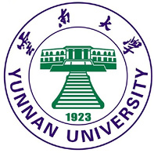
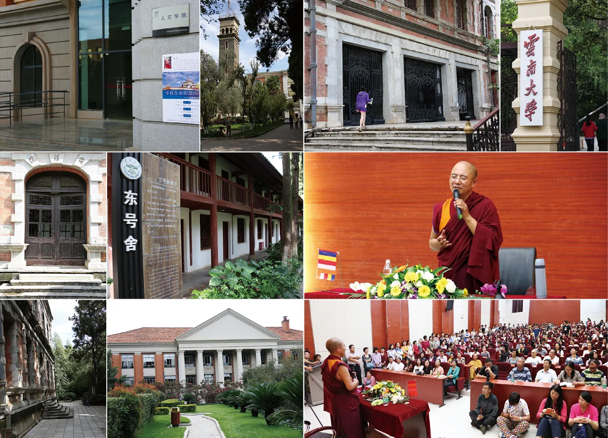
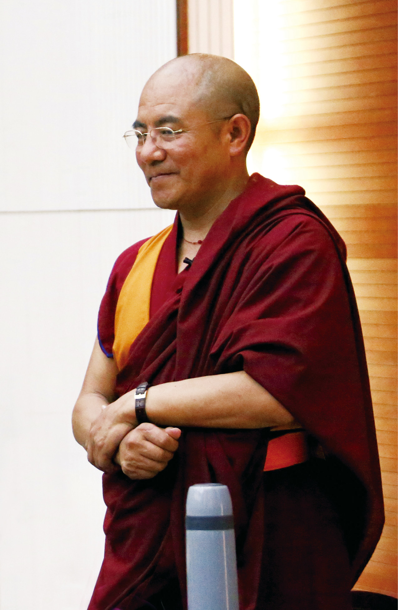
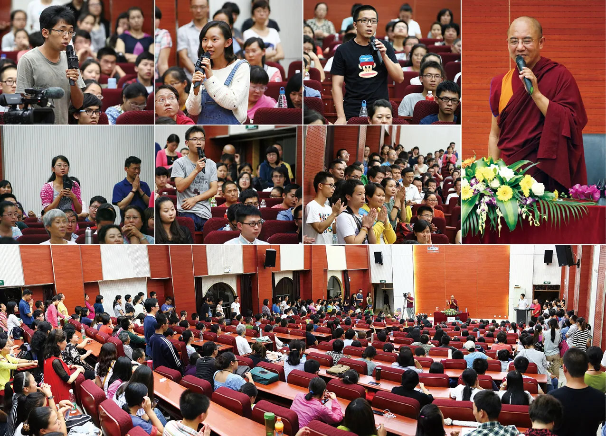
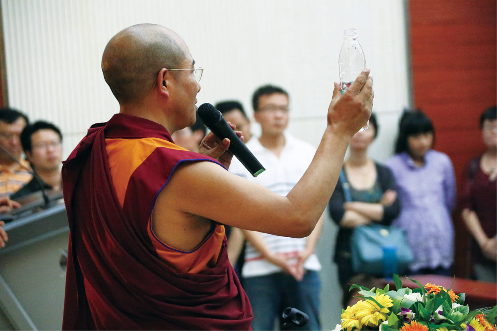

如果随时有无常观，

那么拥有时不会很傲慢，

失去时不会很悲伤。

第86场

云南大学

Yunnan University

中国·昆明

2014 / 7 / 3

## 寻找生命的意义

## The Search for Meaning in Life

主持人：

在今天这个特殊的日子，我们非常荣幸地邀请到索达吉堪布来为大家开启一场智慧之旅。

对于索达吉堪布，大家通过网络、书籍以及各种传媒应当已经有所了解。堪布是一位著作等身，在国内外享有极高声誉的佛学大师。除了学问上的惊人成就，堪布的内在修为也令人钦佩，从2007年开始堪布陆续发起了为数众多的慈善活动。

下面就有请堪布为我们作主题演讲——

今天在这里跟老师和同学们结上殊胜的因缘，内心很欢喜。就我而言，也谈不上作演讲，只是跟大家一起交流、探讨今天的主题“寻找生命的意义”。

## 一、生命定位的差异

人们对生命会有不同的定位：有些人觉得一生庸庸碌碌度过就可以，有些人认为生命应该绽放光芒。后者之中，有的人认为生命的意义在于获得财富，有了钱一切都好办；有的人认为生命的意义在于跟所爱的人在一起，携手至老；还有的人可能认为舍俗出家，前往寂静处修行佛法，或者虽然出了家，像我这样到处“漂泊”，做个云游僧，很有意义。

佛陀两千五百多年前说：众生的根机、意乐各不相同。确实如此，人与人彼此互不相同，所以在生活中需要给他人留出一定的空间。有的年轻人对周围人说：“你应该这样做，否则就是对我不尊重。”其实别人怎样做，是他的选择和自由。

前段时间我在北京时，听说有个大学生打算毕业后去农村，种种地、看看书，不愿过城里的日子。他的一些朋友激烈反对：“不留在城市里，你的生活跟农民就没有差别了。”以此也导致他们之间出现严重的矛盾。

其实不论家人或者朋友间的争论，究其原因主要是观点不同。我们要知道，人与人的想法不可能一模一样，有些人觉得这样合理，有些人觉得那样妥当，只有相互包容才能融洽相处。

对于生命的意义，在座的可能都思考过、寻觅过，也许你们中的很多人认为只要事业有成、财富如山，人生就会熠熠生辉。但其实这是不一定的，反而可能当你处于简单、快乐、放松的状态时，生命之花会悄然绽放。

## 二、错误的观念让生命黯淡

### 书本大学，社会大学

很多大学生希望一毕业就飞黄腾达，但其实你只是从“书本大学”毕业了，而“社会大学”却不一定。

从“书本大学”毕业是怎样的？就是把小学到大学的所有课程，全部学习圆满了。然而社会也是一所大学，如何跟同事交往，如何与朋友相处，乃至如何照顾老人、爱护孩子等等，是这所大学的课程。但对于这些，很多大学生茫然不知。不仅如此，对于更深的人生道理，他们也是陌生的，比如有些学生认为“只要有钱，什么都能解决”，或者认为“只要努力，任何事都能办成”。其实从佛教的因果律来看，任何目标的实现，都有背后的深层因缘，并非金钱能完全成办，也并非勤奋能样样达成。

佛经里说：“欲知前世因，今生受者是；欲知后世果，今生作者是。”想了知自己的前世因缘，就看今生的状况，比如你现在是大学生，有才华、有智慧，这是前世种了相应的因；想知道自己的后世境况，就看今生的状态，如果你具备良好的品行，那未来必定一片光明。

正因为如此，古人常常倡导“三立”——立德、立功、立言。

第一，立德，要培养完善的人格。如果没有人格的底线，人与动物就没有差别了，会杀盗淫妄无恶不作。当今社会诸多恶性事件屡禁不止，其实就是很多人道德沦丧所致。

第二，立功，一生中至少做一件有意义的事。有些人当老师，有些人做医生，有些人办企业……不一定轰轰烈烈，但顺应自己的因缘，在平凡的岗位上默默付出，就是立功。

第三，立言，留下一些著作，即便不能写书，写一篇文章也很好。现在很多人天天写微博，在这方面立说，这也非常好。

刚才在食堂，我看到里面的每个人都是边吃饭边看手机，这跟国外很多学校的情形截然不同，他们是边吃饭边看书。不过也可能你们的手机上存了很多书，是不是这样？如果是，也很好；如果不是，而只是在看一些乱七八糟的内容，那意义不大。

世界上很多教育学家认为：从目前的状况推断，哈佛大学永远会是世界第一。为什么？一方面这所大学里的老师非常敬业，将全副精力投注在教学上，这也是哈佛大学某些管理机制所限制的；另一方面，哈佛大学的学生都特别勤奋，学习起来废寝忘食，晚上所有书房的灯都亮着，而且他们从来不会在穿戴等方面攀比计较。

我们这里的不少大学，表面看似很好，但实际上有钱的学生天天出去玩乐或者做没有意义的事，并没有把珍贵的时间用于学习；没钱的学生经常忙于打工，也没有把所有时间用于读书。当这些学生离开“书本大学”，进入“社会大学”时，学业不精通、人格不完善，要应对工作和人生，有一定困难。

### 生命的意义不是金钱

很多学生想要一毕业就坐拥名车豪宅的愿望，其实是价值观出了问题——不去思考如何为社会作贡献，如何在岗位上做有益之事，而只是算计着自己如何发财。

但是这种金钱至上的心态，在这个时代却非常泛滥。我去各地时，在候机大厅里常常看到一些柜台在卖书和光盘，不过一般很少有哲学、宗教方面的，大多在讲成功学——“马云怎么说”“这个企业家怎么说，那个大老板怎么说”。很多人对此也是饶有兴致，“他既然赚到了钱，我也要这样做”。不过我想：虽然你可以依葫芦画瓢，却不一定能同样成功，因为人的命运不同。

一辆车只有四个轮子，不可能所有零件都变成轮子；同样，每个人都成为大老板也不现实。而且如果你总是看不上现前的工作，这山望着那山高，现在这份工作的薪酬、待遇就无法让你满足；当不满情绪滋生时，你就不会认真对待手上的事情，如此就会形成恶性循环。

所以，我听到很多企业家说：“我们不愿招收刚毕业的大学生，因为他们眼高手低——每天玩手机、玩电脑，不好好做事，反而跟公司要很高的薪酬。不如中年人踏实，他们有了一定的社会阅历，知道挣钱不容易，反而肯努力做事。”

如今很多人常常以是否赚到了很多钱，来衡量一个人的成功与价值。其实这种观念并不合理，正确的标尺应该是人格。

在藏地，人们评价一个人，不会看重他的财富，而会看重他的品质。找男女朋友时，藏族人经常关心的是“这个人的心地是否善良”“他（她）对因果的取舍如何”“他（她）有没有慈悲心”……是以人格为主，之后才是财富以及家庭背景等。

### 生命不只一世

再说很多人的人生观，可能也有一定的问题，比如认为人生只有短暂的这一世——一个人来到世上，慢慢长大，开始上学读书，毕业后找工作，结婚生子，然后退休，最后离开人间，彻底归于虚无，如同灯灭。

实际上，人并非只有一世。我们的生命从前世流转而来，即生中的很多苦乐，都跟前世有着千丝万缕的联系。如果懂了这一点，人生中很多难以解释的问题，就可以找到答案。你会知道：我和我的一个同学一起读大学，同样努力工作，但是我后来那么顺利，如同生活在天堂里，而我的那个同学却非常不幸，就像沉陷于地狱中，之所以出现这种巨大差异，根源在于前世。

今世的死亡只是通往后世的一扇门，所以要常常想到：当我的生命结束时，如何面对？

有报告称，目前中国每年死亡的人中，大约四分之一死于癌症。假设某一天我们突然收到癌症病危通知单，或者得病的是家人，该怎么办？如果对死亡一无所知，没有做过丝毫准备，到时恐怕只有捶胸顿足、后悔莫及。

昨天有几个人来见我，特别伤心地说他们的一个亲戚得了绝症。我当时以自己的一些经验对他们做了一些开导和安慰。同时我也想到不仅仅是这些人，每个人面对死亡时都会非常痛心，然而在平平安安时，又有几个人想到过死亡？

释迦牟尼佛走出四个城门时看到老、病、死、修道的景象，于是毅然放弃皇宫的生活，去寻找解脱之道。而我们很多人从不过问死亡，这样走下去的结果可想而知。

### 佛教为何历久弥新？

现在有些人固执地认为：“人死如灯灭，哪还有后世？”从某个角度而言，这么想也情有可原，因为自“文革”以来，我们的传统文化——不论儒家、道家还是佛教，都受到一定的破坏，导致后来很多人没有机会了知很多深奥的道理，甚至对宗教颇有成见。

对于很多年轻人，我并非要求你们非要信仰与学习佛教不可，而是觉得你们有必要思考一下：为什么佛教的思想历经两千五百多年的历史风雨，没有消失反而愈加散发出生命力，在现代生活中展示巨大的效用？

我常这样劝导人：“你如果非常痛苦，就看看佛教的书吧。”佛教其实不仅是宗教，更是教育——智慧的教育，可以为我们的生活点燃光亮、遣除迷暗。比如你如果真正明白佛教中“一切皆是无常”“一切无非因缘和合”等道理，那么即使处在人生的低谷，也完全可以做到泰然处之。

佛教的教义，在如今的东西方医学、心理学等领域，都得到了很多验证。而在生活中，很多人也体会到它的真实作用。我想这个文明是稀有的。

大家都知道，儒家思想的创始人是孔子，道家思想的创始人是老子，佛教的创始人是释迦牟尼佛。他们其实是同一时代的。

老子降生于公元前571年。据传，他诞生时眉毛、胡须都是白的，耳朵硕大，看起来像个很有智慧的老人，因此得名“老聃”——“聃”在古文中是耳朵长而硕大的意思。老子实际上是一个神秘人物，写了《道德经》之后，就不知去向。

大概在老子降生后的几年，公元前565年，释迦牟尼佛降生于世间。如果按照现在世界公认的佛历，佛陀的出生时间也是公元前565年。佛陀15岁时，孔子降生，也就是公元前551年。

所以孔子和老子相差20岁，佛陀与他们之间分别有大约15岁和5岁的差距，但是属于同一个时代。那时可以说是人类东方文明崛起的时代。

有些史书上记载，当时孔子的弟子问：“世上有没有圣人？”

孔子说：“有。”

“是不是师父您？”

“不是。”

“是不是三皇五帝？”

“也不是。”

“那这位圣人是谁？”

孔子说：“这位圣人在西方。”汉地的西方，就是释迦牟尼佛所在之处。

当然，对于三位圣贤处于同时代的观点，极个别人不承认，也说了一些相似的理由。但是我们有很多的依据可以进行论证，比如用现代历算推算，佛陀跟孔子就处于同一个时代；用人的代数逆推，孔子的77代往前回溯，也刚好是佛陀的时代。

大家可以想一想：公元前500多年前诞生的佛教思想，一直流传至今，没有变得陈旧，也没有被后来的科学、人文等思想推翻，其原因何在？

### 拥有的总会失去

很多人对佛教的思想比较陌生，而对世间的事情非常熟悉。但我们要知道：人生几十年所追求到的财富、名声、地位，很快都会消失，人的青春也会像夏天的花，不久就凋谢了，一切都不常驻。

如果我们随时有无常观，有危机感，那么拥有时不会很傲慢，失去时也不会很悲伤。

现在个别人失去心爱的事物时，内心就无法承受，甚至因此走上绝路。中国现在官方统计每年的自杀人数接近30万，如果加上没有统计到的，可能更多。这些悲剧，究其根源都是心态没有调整好。

其实如果去观察，人心可大、可小——对一件事，心可以特别执著，也可以非常随缘。当然，仅仅嘴上说“不执著”是不行的，还是要学会调心的方法。方法也很简单、很方便：你早上起来时慢慢呼吸，呼吸过程中把心放松下来。放松一会儿再这样思维：“人活在世上到底为了什么？”这种思考很有必要，然后你可以想象今天是生命的最后一天，自己该如何面对，这样来观修。有些人从未想过人生有一天会完结，所以一直拼命地挣钱、拼命地追求，最后面对死亡时，两手空空，什么都没准备。

也许有人觉得：“佛教是不是悲观主义？”其实佛教不但不悲观，反而非常积极，只不过不是在无益之事上积极。佛教六波罗蜜多中有一个精进波罗蜜多，教诫我们在学习真理、利益众生方面，要非常勤勉努力，甚至佛教倡导忘我而利他，认为这样的人生才真正具有意义。

## 三、生命的意义在于付出

生命的意义，不在于取得了怎样的个人成功，而在于为世界付出了什么。

爱因斯坦（Albert Einstein, 1879-1955）曾说：“对我而言，生命的真正意义在于设身处地为人着想，忧他人之忧，乐他人之乐。”我很喜欢这句话，确实一个人不论做任何事，如果能够换位思考——自己不愿承受的不施加给别人，自己愿意接受的奉献给别人，这样的生命才拥有价值。

但是如今很多人的心中充满自私，一切所做都是为了自己获得金钱、地位，帮助别人的意乐非常微弱。国外的有些人，一旦有了钱，就会常常做慈善；而我们这里的很多人，有了钱就只顾自己享受，从未想过他人。这是很遗憾的。

### 萨布瑞亚

德国有个叫萨布瑞亚（Sabriye Tenberken, 1970-）的女孩子，两岁时罹患眼疾，12岁失明。但她没有放弃，依然不断努力，最后考取波恩大学。读大学期间，她发现藏语没有盲文，于是靠着电脑听音分析器的帮助，借鉴布莱叶盲文，编写了一套藏语盲文程序。

后来她来到拉萨，建立了一所盲童学校，这是拉萨第一所盲校。

一个双目失明者可以在异地建立学校帮助盲人，很多人虽然双目健全，每天想的却只有自己，总是为这个事苦恼、为那个事焦虑，常常愁眉苦脸；而萨布瑞亚呢？总是绽放着笑容，也给那些盲童带去了欢乐和希望。

### 在心灵上筑建快乐

对于人生的价值，没钱人可能认为是拥有万贯家财；没地位的人可能认为是居于万人之上。其实这些都不正确，等他们真正有了钱、得到地位时，就会发现并非自己之前所想象的那样。

2013年的中国首富、万达集团董事长王健林，他的儿子读小学、中学、大学，都在国外，26岁回到国内。当时很多人觉得王健林会把万达集团的所有管理权、财务权交给儿子，但是王健林接受采访时说：儿子刚刚回来，不一定很成熟，我暂时不会把集团交给他，先给五个亿，让他锻炼锻炼。

前段时间，王健林的儿子在微博上说自己买了一个200块钱的电脑桌，已经过了很久，京东的快递还没送到。网友们对这件事也非常关注，当天的评论就有两三万条。

当时我就想：他们的人生观是怎样的？是以金钱作为衡量标准还是其他的？

其实把人生的快乐筑建于心灵上，才是真正稳固的。否则，欲望永远无法填满——拥有10万元的轿车时，想要20万的；有了20万的车，想要30万的；30万不行，又要100万的；100万不行，200万……这样一直不断贪求，无有止境。

### 当今教育的缺憾

如今的新闻中，常常可以听到贪污腐败、欲望无度的很多报道，导致这些现象的一个重要原因，就是当前的教育存在缺陷。

以家庭教育而言，父母不应只是教导孩子追求财富和事业的成功，而更应注重培养他们的心灵美德，比如知足的心态、坚强的品格。中国历史上，其实也曾经有过这种家庭教育。

现在的日本和韩国，一般家中有了孩子后，大概好多年之内，孩子的母亲都不用上班，只需要专心教育孩子——把做人的各种道德准则传授给孩子，而父亲则承担起赚钱养家的责任，父母有不同的分工。如果是这样，孩子因为从小接受了良好的家庭教育，长大成人步入社会时，会知道哪些该做、哪些不该做，而且内心不会那么贪婪、自私。

然而遗憾的是，我们这边很多人都没有接受过这种教育，比如在座的大学生，大多是90后，基本是独生子，在家里都是被父母惯着、护着，什么事都是你说了算，各种做人的道理并没有学到，而学校里，也缺乏慈悲教育、人文教育、道德教育。这种情形下，人的综合素质很难提升。

### 留在中国大山深处的德国人

有一个叫卢安克（Eckart Löwe, 1968-）的德国人，来到中国广西山区，留在那里做了一名老师，柴静曾经对他作过采访。刚开始卢安克的父母对他的选择非常不理解，很不同意，但后来他们也发现他的所作所为是有意义的。

卢安克的心态是怎样的呢？就是把那些山村孩子当作自己的孩子，把学校当作自己的家。他说：“帮助别人是我最大的幸福。”其实这就是大乘佛教的思想。

在座的老师和学生有没有这样想过：不论能力如何，都尽力去帮助别人？这样一观察，就会发现自己的利他心其实非常微弱，而自利心可能极其强大。然而人世间有一种规律：一个人越是帮助别人，他的名声、地位等反而越会增上；一个人越是维护自己，甚至为了私利而损害别人，他的名誉、财富等都会不断衰败。

众所周知的特蕾莎修女（Mother Teresa, 1910-1997），是一个非常平凡的女人，但是她取得的成就却是非凡的。1997年，当她走完人生的87年历程，离开世间时，印度政府以对待国家总理死亡的方式对她进行国葬。当时有二十多个国家的四百多位领导参加了葬礼，这其中有六位总统（三位是女王）。

是什么力量使得她如此受到爱戴？不是钱财，不是权力，而是一颗利他心——对于麻风病人，对于乞丐，对于凡是特别可怜的人，她都满怀爱心地去帮助，她看似柔弱的身躯里跳动着一颗伟大的利他心。

这种利他精神，在座的诸位，你们从小接受的家庭教育、学校教育，以及后来的社会教育里能否找到？如果找不到，那么这种教育就算不上很高尚。

### 佛教的四个“正”

佛教界有位了不起的大德弘一大师，他曾说：

“佛法是真能破除世间一切谬见，而与以正见；佛法是真能破除世间一切迷信，而与以正信；佛法是真能破除世间一切恶行，而与以正行；佛法是真能破除世间一切幻觉，而与以正觉。”

弘一大师讲述了佛法的四个特点：正见、正信、正行、正觉。

#### 1）正见

佛教能破除世间的一切谬见。世间有很多不正确的观念，比如“常净我乐”——本来不是常有的东西，人们始终认为它常有；本来人体充满36种不净物，可是大家都认为身体很干净……对于诸如此类的谬见，佛教能够一一破除。

#### 2）正信

佛教能破除一切迷信。如今世界上有相当一部分人对于人是否有后世一无所知，其实要弄清楚这一点，很有必要学习佛教。佛陀早在两千多年前，就对生命的延续有着非常明确的讲述，而这一观点完全经得起科学的推敲。

《楞严经》中记载，佛陀时代时，有一个叫波斯匿王的国王，不太相信人有前后世。

当时佛问他：“你为什么不相信前后世？”

他说：“我觉得身体毁坏后，心也会随之消失。”

佛问：“你是如何知道的？”

他说：“我年轻时，身体非常健康、强壮，现在我62岁了，身体病弱无力，所以身体明显是无常的，那我死亡时这个身体会坏灭的。”

佛问：“你想想你能见的心——见精，自从你能见到恒河至今，是否有过变化？”

波斯匿王说：“我刚开始见到恒河时只有3岁，到现在的62岁，我见恒河的这个见精，是不生不灭的，确实没有变化。”

表面看来，这段话说明见精在即生中是不老不灭的，但实际上也能间接证明前后世不虚存在。人死时，只是舍弃此世的身体，而见精依然不坏。

见精，就是佛教里讲的如来藏，是一直常存的。如来藏上如果熏染了很多业，就会起现世间万象，但是就如大海即便表面波澜壮阔，海底却始终非常平静一样，如来藏也不随万象而迁变，始终常恒不变。所以，我们这辈子做人，下辈子变成其他类众生，身体会在六道中不断转变，但如来藏不会毁灭与变化。

梁武帝时代有位志公禅师，他说：“富贵百年难保守，六道轮回易循环。”意思是，今生的荣华富贵难以保住一百年，而命终时自己就要随业在六道中不断流转。可是对于这些道理，很多人并不知道。

志公禅师还说：“劝君早觉修行路，一失人身万劫难。”这两句话很重要，意思是，各位一定要早点觉悟到修行之路，因为一旦失去人身，万劫中也难以复得了。

我觉得在座很多年轻人不必说深入地研究佛教，即便稍微了解一点，都会受益匪浅。你们很多人很有善根，但因为各方面的因缘，至今一直沉迷于世俗中。你不需要出家，也不需要非到寺院里，只要在感觉痛苦时，想一想：佛教讲人生有八苦——生老病死、爱别离、求不得、怨憎会、五取蕴苦，我现在感受的是哪种苦？佛法里有没有方法解决？这样想时，也许佛法就能给你带来一点启迪，这也非常好。

佛教的思想不是迷信，如果你对此不认同，可以阅读佛教的千经万论，观察一下其中所讲的道理跟我们的生活有没有相通之处。

#### 3）正行

佛教可以破除一切恶行。如今社会上出现的种种杀盗淫妄恶行，早在两千五百多年前佛陀在戒律中就作了遮止，人们如果能够以戒律作为准则，行为就会变得贤善。

#### 4）正觉

佛教所实现的果法是什么？就是破除一切幻觉。一般人认为世间很多事物是真实的，但是用佛教的智慧一观察，就会发现它们如同水月、梦境一般危脆、虚幻。包括很多人喜欢谈论的神通，在佛教看来也是一种幻觉，不值得提倡。

### 爱、财富与成功

我以前看过这样一个故事：

有个女孩走出家门时，发现有三个人逗留在门口，当时天气不太好，她于是邀请他们到家里坐坐。

这时他们中的一个说：“他们俩，一个的名字是财富，一个的名字是成功，我的名字是爱，我们不能同时去你家，你只能选一个。”女孩听了，就回去跟父母商量。

父亲说：“应该让财富进来，这样我们就有用不完的钱。”她听了立即反对：“应该让成功进来！”正在争执之际，母亲说：“有了爱，苦也是甜的，干脆让爱进来。”父女俩都觉得有道理，于是女孩走到门口，邀请爱进到家里。

结果过了一会儿，她们家的气氛变得非常愉悦，大家都欢笑着，此时其他两个人——财富和成功也进来了。

女孩不解地问：“为什么你们俩也进来了？”他们回答：“有爱的地方，财富和成功都会随之而来。”

这虽然是个寓言，但很值得我们思考。人要让爱进到心中，这样很多圆满都会不求自得。不过，爱有自私的爱和无私的爱，只有无私的爱才能给我们带来安乐。

## 结语

如果想让生命具有意义，就用一颗利他心，用一份爱心，来拥抱这个世界，这时你的生命会散发出光芒。

现场互动

问：如果有前世，为什么我一点都回忆不起来？

堪布：过去发生的事，我们不一定都能记得起来，比如一两岁时的经历，现在心中一片迷糊，再比如一周前的早饭，现在也不一定记得吃了什么。虽然记不起来，但是这些肯定存在过，所以回忆不起前世并不代表它不存在。

另一方面，世上能够忆起前世甚至记忆犹新的人，也不在少数。这些人中有些是宗教徒，有些则不是。

我们学院的慈诚罗珠堪布写过一本书《前世今生论》，最近出版时名字是《生命的真相》，书中列举了大量的现代案例，并运用科学推理以及佛教教理，证实了前后世的真实不虚。

所以，不能以回忆不起而否认前世的存在，因为我们的觉知能力毕竟有限。

问：在您眼中，除了传授佛法的教义，您的上师曾经给予您的最大帮助是什么？

堪布：除了传授佛法以外，上师法王如意宝给予我的最大帮助就是：在我刚到学院生活特别困难时给了我50块钱。对此我一直难以忘怀。

问：从1980年至今，您所在的佛学院发生了哪些大的变化？

堪布：我1985年刚到学院时，学院的人数大概是三百人，短短的27年中这个数字增长了很多，宗教部门统计的数字是九千三百多人；我刚到学院时，学院没有电、没有公路，现在通了电，建了公路，生活越来越便利；我刚到学院时，很多道友学习佛法非常刻苦、精进，常常通宵达旦地看书，但是现在的一些道友好像并没有那么努力。

问：您决定到世间弘法的初衷是什么？

堪布：一个出家人出现在校园里，可能让有些人觉得稀奇，也可能引发另一些人对出家生活的种种揣测。

实际上，我之所以来到这里，是因为很想把自己的人生经历以及所学的佛法分享给世间的人们。

我给汉族道友传讲佛法二十多年，很了解汉地城市里人们的烦恼与痛苦。其实这其中的很多苦恼，借助佛教的方法可以轻易化解，当然也有些无法解决的，比如死亡的痛苦，但是能解决的这部分，不用吃药、不必吃苦，依靠佛法轻轻松松就能去除，何乐而不为呢？

站在另一个角度而言，当今世界，人人都可以随着自己的喜好而行。我曾看到一个报道，有个西方人酷爱摄影，他每天的事情就是拿着相机给动物拍照。我也有自己的爱好：不论哪里让我去作演讲或交流，哪怕听众只有三五个，我也愿意去。

问：佛学院的教育跟大学教育是否相同？您对大学教育有什么期望？

堪布：就教育模式而言，我所在的佛学院跟大学非常相似。不仅是我在的佛学院，藏传佛教的寺院、佛学院所实行的，基本都是高等学校的教学模式，而且不是现在才这样，7世纪以来就一直如此了。

如今的藏传佛教中为什么精通教理的人层出不穷？一个非常重要的原因就是教学模式完备，比如授课方式跟高等院校大体类似，对学员的考核方式多样而严格，有讲考、笔考和造论等。

当然，我们佛学院的所学内容跟高等院校有所不同，主要学习佛教的理论与修法，以及将其用于世间的方法。而很多高等院校，则主要传授各种世间专业理论与技术，不过要在实际生活中真正运用这些知识技能，也不一定非常方便。

如今的大学教育中普遍缺乏的是道德和信仰教育，这样的结果是：很多大学生对知识技能掌握得很娴熟，但在道德修养方面令人担忧，一旦步入社会，可能会引发诸多问题。

所以我对很多大学的期望是：增加道德和信仰教育。

大家可以思考一下：为什么全世界七十多亿人中，只有十几亿没有信仰？

有些人认为：“有信仰的人是思想有问题，没有信仰才正常。”其实这种想法很不合理，而且特别危险与可怕，因为人没有信仰，就没有归属感，没有归属感就可能在一定范围中做恶事，乃至发展到无恶不作的地步。

所以，对于信仰，很多人从小被老师和父母灌输的有些理念不一定正确，其实信仰给人带来的利益不容小觑，如果能在大学中增加信仰教育，无疑将弥补大学教育的一大缺憾。

问：佛教如何看待时间和空间？

堪布：按小乘《俱舍论》的观点，时间和空间真实存在；但是按照大乘唯识宗的观点，万法都是唯心所造——时间、空间，乃至整个世界都是心的幻变。

爱因斯坦也说：时间和空间，只不过是人类的幻觉。

我前段时间在清华大学，跟一些老师、同学一起探讨过《盗梦空间》中所渗透的佛教思想：梦中可以做更深的梦，最后自己也分不清哪个是现实、哪个是梦，其实一切都是虚无缥缈的。

所以，我们眼前的世界是虚幻的。不过没有证悟这一点之前，它依旧会“真实”存在着。

问：很多人认为佛教是在束缚人，因此不敢迈进佛门，对此您怎么看？

堪布：认为学佛后会有很多限制，由此顾虑重重，这没有必要。佛陀在经中讲每个人的根机不同，所以能学多少就学多少，能悟多少就算多少。

其实对于佛教，不论年轻人、中年人还是老年人，都不必有任何恐惧，因为这种教义非常正确。

如今的时代，虽然不像几十年前那样处处弥漫着诋毁宗教的言论——一会儿说它是麻醉药，一会儿说它是封建迷信，但实际上人们心中仍然存在对佛教的诸多误解。

误解的起因有两方面：

第一，传统文化遭受严重的破坏，使得如今不论儒家、道家还是佛教，都成了奄奄一息的病人般。

第二，现在极个别的在家人、出家人，名义上是佛教徒，但对于佛教一窍不通，却创立了一些平台传播所谓的佛法，这给很多人造成困惑。比如有的年轻人本来很想了解与学习佛法，可到了有些寺院，却并非自己所想象的，大失所望。

另外，很多人对寺院卖门票也很反感。其实佛教本来是开放的，佛陀也没说我的寺院要卖门票，而有些和尚也不想卖门票。只不过有时人在江湖身不由己，和尚也在江湖，也怕掉进湖里。

总之，我非常希望年轻人能了解佛教真正的见解和行为。

问：现在的有些寺庙会教唆信众烧高香，借机敛财，您怎么看待这个现象？

堪布：个别寺院里卖高香、烧头香的现象，以及个别人利用佛教平台敛财等行为，只是某些人的不如法行为，不能代表佛教，就像个别伪劣产品，不能代表商场的所有产品一样。

所以在分析问题时，应该桥归桥、路归路，这个问题到底是佛教的还是极个别佛教徒的，要分辨清楚。分辨清楚以后，就不会因个别人的劣迹而对佛教丧失信心。

当然，如果你以前在某人面前听过佛法，后来发现他的有些行为确实不如法，你已经失去了信心，这时你不必跟随他学习，这是佛教所允许的。

这个世上的事情真真假假、错综复杂，所以大家面对任何事，都要依靠智慧作观察，否则盲目地反对或认同，都不合理。

实际上，真正的佛教是什么？就是诸恶莫作、众善奉行的思想。这个思想是纯正无垢的，任何人学习和奉行都会受益匪浅。所以，不论现在的社会如何，你们在家人应该遵循佛教的观念与规范去做，这样对你的人生百分之百会有帮助。我学了这么多年佛法，深深感到佛法对大家大有利益，所以才辛苦地为你们传播。

问：如果帮助别人，又希求回报，比如希望对方对自己态度友善些等等，这能叫利他心吗？

堪布：利他心有不同的层次。

一种是希求回报的利他心。比如帮助别人时会想：“我今天帮了他，他以后要回报我，或者至少要对我心存感恩。”这样虽然帮了别人，但是对回报有所希求，在佛教中，也把它叫利他心。

一种是无条件的利他心。比如大乘的菩提心，不求任何回报，完全是无私的，即使无数次帮助别人，而对方没有任何报答，也无怨无悔，这是利他心中最高尚的。

菩提心可以说是人类思想中的瑰宝。为什么呢？一般人帮助他人都希望对方有所回报，一旦对方没有知恩、报恩，就非常生气：“我以前帮过他不止一两次，他怎么一点不感恩？以后不帮他了！”甚至可能找对方算账。但真正的大乘菩萨不仅不求报恩，乃至为他人付出生命，也没有任何怨言，确实非常可贵。

问：如果以利他心作为评价人的标准，会不会出现道德绑架的现象？

比如我有一万块钱，想捐出三千块，可能其他人觉得你应该更多地奉献爱心，会要求我捐更多。但是我即使不捐钱，也不会有违道德，而如果以利他作为标准，是不是就会出现一定要捐九千块或一万块这种超道德的要求？

堪布：应该不会造成这种情况。

你的利他心达到什么程度，就随自己的心力来帮助别人，捐三千、六千，或九千，都没问题，你如果非常无私，全部捐也可以。这根据自己的心态来确定，自己的所有善举由自己控制。

问：阿赖耶识和意识是什么关系？

堪布：这是带有专业性的一个问题。

阿赖耶识是大乘唯识宗教义中的核心概念。唯识宗认为万法都是心造的，这个心就是阿赖耶识。由阿赖耶识中的种子起现清净依他起和不清净依他起。清净依他起是佛的刹土以及佛的相好庄严等等；不清净依他起是一切不清净的轮回器情。

所以，按照唯识宗的观点，世界就是一个梦，是阿赖耶识的幻变。阿赖耶识上的业种不同，外面所现的世界就不同。

有一部非常著名的论典《中观庄严论释》，里面用镜中影像的比喻说明这个道理：镜子里所呈现的一切，都是现而无自性的影像；同样，这个世界是心幻化的影像，当心泯灭时，世界也会消失。

那阿赖耶识和意识是什么关系呢？二者并非别别分开，意识是阿赖耶识的一种妙用，如同波浪与大海的关系。

问：在漫长的人生路上，您认为人应该在哪些方面独立，才能达到一种完满的状态？

堪布：实际上，人永远是独立的。

你来到这个世界是独自而来，最后离开也是独自而去，而且心中的所有痛苦与快乐都只能自己承受，虽然在生活中有亲朋好友的陪伴，但他们也无法真实体验或代替你的感受。

现在很多人认为自己要依靠一个伴儿，其实整个漫长的轮回都是一种孤独的生活，如果没有调整自心的能力，事事依赖别人，是很困难的。然而现在很多人的依赖性太强了，小时依赖父母，年长时依赖朋友，年老时依赖儿女，其实这样不是很合理。

佛陀在一部经中说：自己是自己的怙主。也就是说，自己是自己的依靠处，无论处于何种环境中，最好能够独立。尤其现在很多年轻人是独生子，更应该培养独立生活的能力。

问：念诵金刚萨埵心咒忏悔的具体方法是什么？

堪布：忏悔罪业，需要借助金刚萨埵心咒“嗡班匝儿萨埵吽”，这很重要。

其实每个人在生活中都曾造过很多恶业，有被人发现了的，也有不为人知的，这些自己心中都有数，最好念这个咒语来忏悔。

金刚萨埵往昔曾经发愿：如果有人闻我名号、作意于我，一切罪障都可无余清净。此愿若不成就，我誓不成佛。

如今金刚萨埵已经成佛，说明他所发的愿也真实成就，依靠金刚萨埵来忏悔，决定可以清净罪业。所以，我们在忏悔时，最好是缘金刚萨埵来观修。至于具体如何修，可以参阅相关资料，比如法王如意宝的《金刚萨埵修法如意宝珠》，这本书尤其讲到忏悔要具足四种条件：

第一，所依对治力：观修一个本尊作为所依，比如观想金刚萨埵；

第二，厌患对治力：对自己以前所造的罪业心生后悔；

第三，返回对治力：发誓从今以后再也不造罪业；

第四，现行对治力：念诵金刚萨埵心咒来对治罪业。

如果具备了这四种力，以前所造的罪业都能忏悔清净。

今年我们学院开金刚萨埵法会，从四面八方涌来一万多人参加，因为很多人觉得以前所造的罪业很重，应该努力忏悔，否则没忏悔干净就死去了，那就太可怕了。前段时间，我去一个监狱演讲，也劝诫关押在那里的人念金刚萨埵心咒忏悔，在监狱刚好可以“闭关”。

只要造了罪业，不论何种身份的人都要忏悔。即便是非常有智慧和能力的人，也没什么可傲慢的，因为有可能造的恶业、犯的错误更严重，更需要忏悔。

问：我是昆明动物研究所的一名在读博士生，在我们研究所，常会使用动物做解剖实验。在接触佛法的半年时间里，我深切感受到杀生的严重过患。请问对于周围信奉唯物主义的同事，怎样让他们认识到杀生的可怕，让他们对动物产生慈悲心？

堪布：解剖生命的行为确实很残忍。历史上，日本的731部队用人体做实验，在获得了一些科研成就的同时，牺牲了许多人的宝贵生命。如果这种实验的对象换成动物，虽然它们不能开口说话，但是痛苦的感受没有任何差别。

不过现在很多人的观念是：动物天生就是供人类受用的。他们看到动物就开始吞口水，“这个动物的肉好吃”“那个动物的皮毛好穿”。人类这些带着血腥的观念非常可怕。

你想要制止同事继续杀生，这种发心是很好的。不过有时虽然我们很希望做一些具有无限功德的事，但不一定都能做得到，因为每个地方有它特殊的环境。所以，如果实在无能为力，就在心里默默地发一些善愿，我在遇到类似情况时就是这么做的。

问：死亡是人人都无法避免的，您怎么看待死亡、面对死亡？

堪布：关于我看待死亡的观点以及对死亡的准备，要讲的可能很多，今天在这里无法一一说尽。可以说，我是专门研究死亡学的，学的是死亡专业。

佛教虽然对人的今世也会有一定的观察和探索，但更关注的是来世。佛教里说：“万般带不去，唯有业随身。”当一个人死亡时，生前所拥有的任何财产、名声或地位都无法带走，甚至身体也要留在此世；而唯一能带走的，就是自己造下的善业与恶业。

也许在座的个别同学觉得很神奇：“人死时怎么还能带走东西？”这是你没有接受过这方面的教育才会诧异，这也情有可原。

事实上，生死学是一个很深奥的理论体系，不可能一两句就说得明白，也不可能以一句“我不相信”就予以否定。不相信是一个充分的依据吗？不相信的就不存在吗？你不相信的东西，自己不接受是可以的，但如果把自己的这种思想灌输给家人、朋友，那还是有必要首先考证一下它的合理性。

所以，我特别希望很多人能看一下《西藏度亡经》（The Tibetan Book of The Dead），这本书中的观点是西方科学家最认可的，比如心理学家荣格（Carl Jung, 1875-1961）说他一生中最好的朋友就是《西藏度亡经》。还有《西藏生死书》，这是目前西方非常畅销的一本书，也是很好的。你们读了之后就会知道，在藏传佛教的莲花生大士教法中，对于死亡有着怎样深入细致的剖析。

我想在座有些年轻人，对于生命学、死亡学，可能还需要去研究和了解。每个人都会死亡，如何面对死亡可能比如何面对生存更值得重视，死亡降临时怎么办？大家有没有思考过？

在藏地，很多人面对死亡时，没有丝毫畏惧，为什么能做到这样？因为他们活着时已经对死亡作了充分的准备。苹果公司的创始人乔布斯把每一天都当作生命的最后一天，他在生命的最后时刻也出现了很多奇迹，他不畏惧死亡，我们是否畏惧？为什么畏惧？就是提前没有准备。

问：《般若波罗蜜多心经》里有这样一段内容：“色不异空，空不异色，色即是空，空即是色。”请问如何理解“空”？

堪布：对于这段话，很多人虽然会读，但不一定明白其中的深奥道理。其实这是在说：任何一法不离空，空也不离任何一法，任何法和空无二无别。

有人会疑惑：“色怎么会变成空，空又怎么会变成色？”

这其实很容易理解。比如对于面前的这个瓶子，现代物理学家会说它看似存在，但如果详细观察，它就变成分子、原子、原子核、质子、中子、夸克，最后变成无形无相的能量，而能量实际上也是空的。

物理学家玻尔曾说：这个世界的一切都是空的，如果你不明白空，你就无法明白量子力学。

“色即是空，空即是色”是说：瓶子即是空、空即是瓶子，你就是空、空就是你。因为所谓的你，除了身体、心识以外没有其他了，但如果真正观察时，身体和心识也是空的。

大家可以观察所谓的“我”，是身体还是心识？

身体只是一个虚假的概念，实际寻找时无外乎一堆骨肉。再慢慢剖析这堆骨肉，仅仅是肌肉、骨骼、筋络、血，身体在哪里？不得不承认它是空的。而这个空并非空空荡荡的一无所有，而是空的当下有身体的显现。

我经常想，如果对现在的大学生讲一些缘起性空的道理，很多人会开悟的。因为这种道理非常深细，任何人想要破斥都无机可乘。两千五百多年以来世界上涌现了无数的智慧巨匠，但是他们之中没有人能找出缘起性空理论的瑕疵。

实际上，你对任何法进行观察，都不得不承认它是空的。虽然空，因缘会聚时又有显现，这种显现在佛教里叫世俗谛。世俗谛的显现和胜义谛的空性，二者结合就是缘起性空。

宗喀巴大师有篇文章叫《缘起赞》，我以前翻译过，法尊法师也翻译过。在这篇文章中，宗喀巴大师这样赞叹佛陀：唯一您能宣说缘起法，世界上的其他智者都没有说出宇宙万物的这个真相，因此您是世上最伟大的人！

这方面的道理如果你们还是迷惑不解，可以学一些中观论典，比如《中观根本慧论》。如果学了，你肯定会感叹作者龙猛菩萨的智慧。龙猛菩萨是佛的弟子，他的智慧已经如此超胜，更不必说佛陀了！

所以，我们不应毫无理由地轻视某些教义，而应以严谨的态度去观察和研究。

一般我到一个学校时，有时也是用不清净的眼光审视着，这里的学生怎么样，老师怎么样，经常对他们的言行举止“挑毛病”。不过刚才吃晚饭时，我发现这里哲学系的很多老师确实很有智慧，对于佛教的思想，他们有些人有很深的研究，有些人虽然没有研究，但也抱有很公正的态度。

对于佛教，在座有些同学也许不一定相信与接受，但是你应当站在公平的立场进行评价，这样才算有智慧的人。

最后，我希望大家真正通达“色不异空，空不异色”的道理。

主持人：

感谢堪布给大家所作的诙谐而机智的解惑。同时也感谢各位同学和来宾的精彩提问。因为时间的原因，我们不得不把这美好的时光留在记忆里。但是我相信，堪布今天为大家提供的人生智慧，会给我们的人生带来新的启迪。
