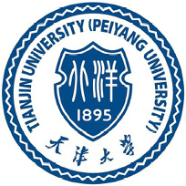
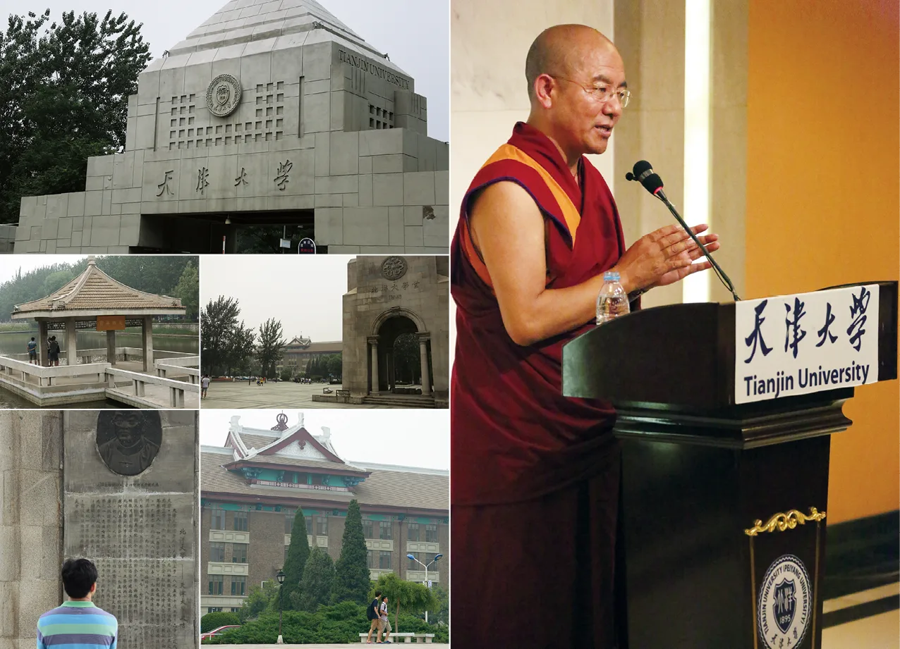
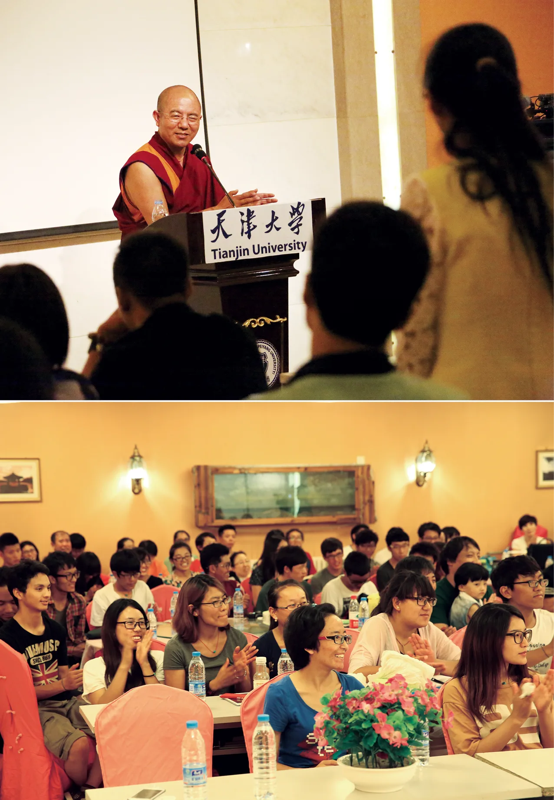
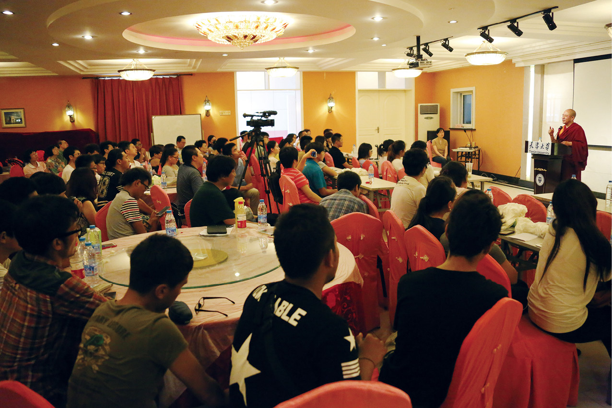

任何事情都有三面：

你的一面，

我的一面，

还有事情的客观真相。

第82场

天津大学

Tianjin University

中国·天津

2014 / 6 / 16

## 微时代　微道德

## Morality in the Age of New Media

## 我们是微时代的“微生物”

大家都应该知道“微时代”这个概念，而我们手里的智能手机说明，我们都是这个微时代中的“微生物”。之所以这么说，是因为我们现在没有自己的时间、空间、智慧，我们的思想被各种各样的信息所控制着。而恰恰是处在这样的时代当中，我们更要清楚地知道，如何面对自己的人生旅途。

人们称现在这个时代为“微时代”，我们的身边充斥着微电影、微信、微博、微访谈以及微小说等等。有人说，所谓的“微”指的是微妙、微小的意思；也有人说，“微”指的是任何人都可以制造并且传播信息。从这一点来看，我们的生活与古人截然不同。古人可以抽出时间安心看书，可以从书中获取完整的内容；而现代人看书的同时还会收到很多信息，然后忙于刷屏回复，所获取的信息也处于碎片化的状态，并不是很完整。我自己也是这样。作为一个出家人，我以前每天都可以花很多时间念经、看书，但现在如果我不去刻意安排时间的话，念经的功课、翻译的工作都无法完成，而且不仅是我自己，身边的人也处于同样的状态，恐怕各位也有类似的感受。

现在人们特别喜欢以最快速、最直接、最轻松的方式获得信息。比如人们喜欢制作微电影，那微电影有什么特点呢？它将一个故事情节，压缩在很短的时间里，甚至只有几分钟之内，而制作一部微电影可能只需要几千块钱，制作周期也可能只是几周。大家想一想，一部传统的电影需要多少时长、投资和制作周期？人们也经常使用微博，仅用140个字来说明一件事情，甚至写微小说，而《红楼梦》《三国演义》每一本都需要很长时间才能读完。除了微电影与微博以外，还有微访谈，也就是在一个小时当中，答复几十到上百个问题。

我也接触过这些新鲜事物，发现了它们的一些长处和弊端。比如说，现在有很多的平台并没有很好地过滤信息，每个人都可以随时随地发表自己的想法，这样的话，我们很难了解到事情的真相，从而产生很多误解。例如，微博上经常有人“爆料”其他人的负面信息，有时候这些人是被冤枉的，但消息发出去就没办法更改了。现在的人们特别喜欢刺激性的消息，有时甚至特意去编造这样的消息，而这些消息可以在短时间内被转发成千上万次，最后，假的也变成“真的”了。一般来讲，任何事情都会有三面：你的一面，我的一面，还有事情的客观真相。其中“你的一面”带有你的主观判断，“我的一面”则带有我的主观判断，而真相往往很难被发掘出来。但因为现在的个人微媒体已经成了公共平台，传播自己的主观判断，因此，每个人都可以报道、发布新闻，而新闻被发布出去之后，全世界都可以获取到。

## 发每一条信息都值得再三思索

现在的信息传播非常迅速，国外的消息可以在几秒钟之内就传到国内。因此，如果你发出来的信息是劝人向善、具有正能量的，那么这条信息就非常有意义。这一点和古代的信息传播非常不同，也是当前新鲜事物所带来的优点。但因为很多人心里经常对社会、对人与人之间的关系抱有不满，认为这个世界很黑暗，而且这样的人往往比较能说会道，于是很容易让人们对社会失望。

既然现在每个人都可以成为“新闻工作者”，而且大家都有发布新闻的权利，那我们都可以从自身做起，逐渐改变这些不好的现象。首先，在当前令人眼花缭乱的环境里，我们要有一些世间和出世间的智慧和觉察力，能辨别是非善恶。一旦发现了对个人和社会不好的舆论，我们应该制止。我听说有一个人，每天发的微博、博客、微信中，大多数内容都是与吃吃喝喝有关。当然，这一类的内容很多人都喜欢，但这个人经常发哪里的狗肉好吃，哪里的海鲜好吃等等。我觉得发一条这样的微博，可能导致很多人都去那里吃海鲜等。其实这些动物也是有感受的，但因为一条微博，每天都会有很多生命被杀害。因此，我想劝大家在发布任何信息时都应该再三观察：这条信息发出去，是否对自他的今生来世有利？

每一个人都应该对自己说过的话和做过的事情负责，因为我们的每一个行为都会在今生和来世产生果报。不论你是否相信因果，它都是自然规律。《六度集经》里有一个公案：有一个国家的太子出生后十三年内都没有讲过话，人们以为他是哑巴，觉得有一位哑巴王子对王室的种姓不利，于是计划将他活埋。就在这个时候，王子终于开口了，他说其实自己并不是哑巴，只是不敢说话而已。原来，这位王子可以回忆起前世的情景。他回忆起自己在前世一直行持善法，但有一天听从了仆人的建议，杀害了很多动物去款待客人，仅因为一句话，他在六万年当中堕入地狱，感受痛苦。现在大家都在使用各种微平台，这种趋势谁也改变不了，而且我们也没必要回到古代的生活方式。但我们每个人都有必要观察一下自己的语言，因为言语不当而造成的后果真的非常可怕。

我们应该如何利用微平台呢？我认为可以传播一些对自他都有利的知识，而佛教就恰恰可以提供断恶行善以及心态调整等方面的知识。昨天我遇到几位天津的老师，他们也认为有必要提倡一些正能量的教育。对于很多大学生来说，本来考取大学是非常光荣的事情，但是很多学生却纠结、焦虑、自杀，甚至有些大学生约定一同自杀。如果我们能在生活当中有一些正能量的教育，我想很多宝贵的生命就不会这样逝去了。

生命是非常宝贵的，我们不但要尊重自己的生命，也要尊重他人的生命。但我觉得现在的主流文化好像并没有教人们懂得生命的价值。比如说，年轻人经常听的流行歌，很多歌词往往都是描述令人绝望的感情，而年轻人每天就像念经一样不停地唱这些歌，一旦自己在爱情中遇到挫折，就自然而然用歌里的内容去对号入座。如果歌曲中有一些佛教的道理，比如无常、随缘等等，那么他们在面对困难的时候，很多问题也会迎刃而解。

我听说有个人在读书的时候特别受同学们羡慕，因为他的家境比较好，每天上学都有奔驰接送，后来他成家立业后，生活过得也不错。但突然有一天，他的父亲落马，以前的亲朋好友全部都离开了他，甚至连妻子也带着孩子移居国外，最后他选择了自杀。因为他在读书期间特别顺利，没有体会过所谓的痛苦、压力，一旦遭遇到这些困境，心理就没办法调整。如果他在读书时接触过无常的道理，那在面对困境时可能就不会这么脆弱。

## 佛教是心灵教育

在我的经验中，佛教并不完全是宗教教育，它更是一种非常好的心灵教育。如果我们可以利用微平台来传播佛教的精神、传播善行，就会形成一种“微道德”。

佛教的《贤愚经》是教人辨别智者和愚者的一部经典，经中提道：“莫想诸罪微，无害而轻视，火星虽微小，能焚如山草。”这句偈颂的意思是，我们不能因为某些罪业非常微小就去造恶，也尽量不要去做对自他不利的事情，这和“己所不欲，勿施于人”的意思很相似。你可能觉得偷一个小东西，或者说一些粗话不算什么大事，但如果不加以控制，这些恶行就会像一个小小的火星，慢慢会焚烧掉像山那样大的草堆。因此，我们在日常生活中，应该尽量做到“勿以恶小而为之，勿以善小而不为”，也就是说，不要因为恶行微小而选择行恶，也不要因为善根微小而选择不去行善。

《贤愚经》中还提道：“莫想诸善微，无益而轻视，水滴若积聚，渐次满大器。”意思是说，不要因为善根微小而忽视它，比如，一些悦耳的话语，一个微笑，帮助一个老人，甚至每天发一条正能量的微博。就如同水滴也会慢慢填满巨大的容器一样，我们也可以从一些微小的善行开始，让自己逐渐成为一个非常优秀的人。

在这个微时代里，我始终觉得每一个人都是一名老师，可以向自己身边的人传递一些正能量，哪怕只是发一条小小的微博，慢慢也会汇成涓涓细流，最后汇集成一片善的海洋。例如，广西玉林有一个狗肉节，每年都会杀害无数只狗，但后来个别人发微博，引起了很多的讨论，现在这个节日就基本取消了。大多数人都觉得，与杀人比较起来，杀动物并不算什么，这说明我们对生命的宝贵还没有足够的认识。

此外，“免费午餐”行动，最初也是开始于一条短短的微博，以后逐渐发展成了一个特别大的慈善行动，帮助了很多西部地区的孩子。

这个时代还有一个特点，那就是人们很容易通过一些独特的行为、迎合大众的语言而出名，但这样的行为并不会为自他带来利益。因此，如果大家有意乐的话，可以看一看佛教当中的善的理念。

## 智慧和慈悲是佛教的核心

我研究佛法三十年了，公正地讲，佛法对人生很有帮助。有些人觉得佛教也有一些负面影响，其实这种误解一直都在。佛教的一些负面新闻只是个别现象，它不是佛教本身的问题，而是跟佛教徒以及我们所生活的环境有关。

首先，现在有很多佛教徒，本身并不懂得佛教的教义，只注重佛教的形象，使得佛教逐渐形象化。我们经常听说有人在过年的时候花费好几万，甚至几十万去寺院里烧头香、撞头钟，这些商业行为给人们留下了非常不好的印象，好像一提到寺院或者佛教就是指烧香、拜佛。我在飞机场遇到过一些小朋友，他们看到我之后就会说“阿弥陀佛”。连他们都觉得出家人只会念阿弥陀佛，或者只会烧香拜佛而已。其实佛教不是这样的，它的内容很深奥。

除此之外，由于各种各样的原因，很多佛教道场都变成了卖门票的旅游景点。人们到了寺庙里，不但得不到心灵的净化，而且还要付钱才能进入，这让人觉得佛教道场就是旅游景点。所以，佛教的道场不应该卖门票。其实卖门票始于上个世纪七八十年代，当时为了恢复寺院，个别道场才开始卖门票。而现在藏地的一些重要佛教道场，是没有卖门票的，谁都可以去。

现在还有些佛教徒把佛教娱乐化，比如一些佛教团体经常组织唱歌、跳舞，甚至藏地有些寺院还会邀请明星出席开光仪式等。虽然现在还没有在汉地听说类似的事情，但也许以后会有的。因此，我觉得佛教的形象化、商业化以及娱乐化逐渐将佛教带入边缘，让人们对佛教产生种种误解。

其实佛教的核心精神是智慧和慈悲。佛教多年的闻思就相当于大学的授课，尤其藏传佛教自古以来的教育模式，和当今西方一些教育模式很相似。我想如果大家了解佛教教育的话，会对佛教有更多的正面了解。

## 佛教理念可以让我们生活得更好

每个人的因缘都不同，大家不一定要信仰佛教，但在面对生活时，内心需要一些指引和依靠。比如，现在很多年轻人把朋友交往也当作一种交易：如果我对你有五分好，那你对我得有七分好，如果做不到，至少也要对我有五分好，否则我就亏本了。其实，按照佛经中所说，我们每个人都是独立的个体，在轮回中是“独生独死，独去独来”，我们独自一人来到这个世界，死时也是依靠自己的业力而离开人间。没有另一个人的性格、业力会与我们的相同，但现在很多年轻人，经常要求别人与自己的爱好、思维一样，喜欢将自己的模式强加于人，因此很多人的感情关系、同事关系经常有摩擦和矛盾。如果懂得佛教的一些道理，比如每个人习气和业力是不同的，那很多矛盾就可以避免。

此外，家人之间也完全没必要吵架。吵架往往都是因为一些很简单的小事，跟国与国之间的事情相比，不值一提。而且家人之间吵架，往往都是觉得对方说话不中自己的意。我们出家人在因明辩论的过程中，对语言的要求十分严格，不能让对方有丝毫的可乘之机，但家人之间说话又不是因明辩论，不可能十全十美，因此，不应该像辩论一样揪着对方的语言漏洞不放。

虽然我们身处一个“微”时代，但很多人都有一些“大”痛苦。其实，人生虽然会有一些情况难以面对，比如身体上的疾病、经济上的困难，但一般而言，大多数人的生活还是不错。因此，大家应该时常带有微笑，这是一种心底智慧的光芒。如果整天愁眉苦脸，那么所有的事情都会变得索然无味，包括吃饭、睡觉，甚至连做梦都是噩梦；但如果能调整好心态，心很清净，脸上就会出现微笑，不但给别人心里带来温暖，自己也会心情舒畅，甚至做梦都是美梦。因此，我们应该处处调整自己，否则，人生就会不断地面对痛苦和问题。

有些大学生非常期待毕业，认为毕业后可以成家立业。其实，毕业后的生活压力远远大过现在的压力。当你工作时，可能又非常期待退休，退休后又往往有一种失落……这样的人生，一直处于追逐和困惑中。其实人活一辈子，最重要的是要有一种利他的心态。佛教所讲的利他，不仅仅能帮助别人，更能为自身带来广大的利益。

最后，希望大家在这个微妙的时代，能行持微妙的善法，为自己的生活带来微妙的因缘。

现场互动

问：佛教中说要“放下自己”，但我发现这真的很难。我该怎么做呢？

堪布：佛教中区分了究竟真理（胜义谛）和暂时真理（世俗谛）。在究竟真理中，“我”不存在，“我所”也不存在，这不只是说说而已，当我们通过微妙的智慧来观察，会发现的确如此。但从暂时真相上来讲，“我”还是存在的，佛教中也说“我是希求解脱者”“我要从三界轮回中获得解脱”等等，对世间人而言，“我要奋斗、创新、开拓”等等。

佛教的教义，并非能用一句话就概括全部，在具体运用佛教思想的时候，我们应该从究竟、暂时等不同的层面来分析。某些情况下，我们要放下“我”，而某些情况下，暂时还不需要放下。比如，在创业期间，“我”肯定需要努力奋斗，但若完全不顾别人，甚至为了“我”的利益而去损害别人，这种心态是不合理的，应该放下。这也是佛教中讲的利他心。

问：我是天津大学的一名本科生。在弘扬佛法、利益众生方面，有一种观点认为，低调可以避免违缘，但另一种观点认为，违缘在所难免，刻意低调反而会成为最大的违缘。我们该如何抉择？

堪布：我们弘扬佛法或者传播正能量的时候，在有些情况下需要低调，因为太高调的话，会出现各种各样的障碍。比如说，在学校、单位或者一些特定环境当中，高调的行为会为自身带来不便。但有些时候，我们因为害怕、担忧、畏缩而一直不敢承担，这样的话，可以成办的事情也无法完成。

所以，在不同的场合，要有不同的善巧方便。佛教徒在弘扬佛法的时候，要用智慧来观察因缘是否成熟，自己是否可以高调地把佛法理念传递给其他人。如果太高调，不但对事情无益，还会给自己和周围的人带来各种麻烦，那就应该低调。

对我自己而言，会比较随缘。当然，随缘中也要带有一些激情，并不是什么都不作为。

现在有两种心态比较常见。有一些人非常感性，短时间内特别有激情，但过不了多久，激情就像水泡一样消失了。还有一些人做事没有激情、懒懒散散。我觉得这两种心态都有点极端。

不论是弘扬佛法还是日常做事，我们都需要智慧，这样一来，即使遇到一些违缘，也会有应对的方法。有一句话叫“高处着眼，低处着手”，我们要有远大的理想，但在做事情的时候，需要一步一步地做。有些人一开始做事情的时候，没有仔细考虑，一旦出现困难又没有办法面对。所以，我们最需要的是智慧。

问：您刚才进场的时候笑了两次，特别和蔼，您每一次演讲都是笑着进场吗？

堪布：我应该没有哭着进过场（众笑）。我也不记得今天有没有笑，如果笑了的话，应该是无意的，并不是特意的。

问：我在网上看到，山东有一个本科生毕业以后出家了。您对此有什么看法呢？

堪布：这个新闻我也看到了，说是80后的美女出家，在海拔4200米的地方修行。这种现象在我们佛学院有很多。在藏地，这都是很正常的现象，在汉地可能有点稀有。

一般来讲，出家并不是找个寺庙就可以了，而是需要很多因缘。从世间角度讲，80后、90后的孩子大多是独生子女，也相应有更多的社会责任、家庭责任。因此，我没有建议很多人出家，但也并不是不建议出家，出家因缘到了的话，谁也阻止不了。我出家时就遭到了很多人制止，他们通过各种方式来劝，但我依然选择了这条路。

历史上有很多学识渊博的人，甚至是帝王将相出家的事例。因此，看到这个新闻，我也没有什么特别的感觉。

问：您说我们应该在网络上传播一些对众生有利的内容，但现在网络上也有很多公益活动无法查证真伪。对于这些信息，我们应该怎么处理呢？

堪布：虽然微博上经常发布一些慈善的信息，但当我们转发的时候，应该是有原则的，并不是一看到“慈善”，或者一看到“佛教信息”就去转发。我们应该去了解它的背景。

比如说，对于发布信息的组织，首先要了解它是不是真的慈善机构。现在有很多组织打着慈善的名义，却发布虚假的信息。所以，我们一定要有个清晰的头脑，通过智慧再三观察，如果自己可以为转发这条信息负责，那就转发。

问：我是一名商科的大二学生。在日常生活中，很多同学都会讨论将来毕业之后要找什么样的工作，要怎么挣钱。对我而言，从小父母就告诉我，这些东西都是无常的，不值得追求，但我心里还是很矛盾。请问我该怎么调整自己的心态？

堪布：很多大学生都希望在毕业后有车、有房、有钱、有工作。这是一个很普遍的问题，也是大学生们应该关心的问题。但我想说的是，刚毕业的时候，同学们都想得比较大：想一夜之间就成功、升官、发财，但这些想法不一定切合实际。

就算是世间的成功人士，读完大学以后，也要继续努力一段时间，更何况现在的就业形势非常严峻，即使你找到合适的工作，也是要一步一步地来。新东方的创始人俞敏洪大学毕业以后，在北京附近住着每月五十元的房子，当时的工资好像也只有一百多元而已。但他一直在努力，包括给房东的孩子教英语。而现在很多大学生，刚毕业就要求高工资，一般的工资满足不了他们，其中很大一部分的原因就是攀比。本来你每个月两千块就足够生活，但听说别的同学每个月五千块，甚至一万块，这时候心理就不平衡了。

我觉得，作为大学生，刚毕业时应该要认真做事，欲望不能太大，否则做事浮躁的话，将来的发展不一定会像自己想象的那样顺利。当然，不论刚开始的路是曲折还是笔直，毕业生们都应该勇敢地走下去，这个过程中，你们也会积累很多的“资粮”。

问：现在同学之间的感情越来越远，大家都在忙自己的事情，心里不愉快的时候也没有可以倾诉的对象。我们该如何让自己在这个社会上过得更愉快、幸福？

堪布：你的问题很有启发性。现在人们只要一坐下来就开始看微信、微博，即使是感情最要好的朋友，接触五分钟之后也开始各看各的手机，很少有共同语言。家人之间也是如此。

这个时代，有些人虽然住在一起，但彼此感情却被微时代的产物拉得越来越远。更严重的是，人们很少完整地学习有意义的知识，包括传统文化、佛教文化、自然科学等。这一点也存在于佛教徒团体中。

我曾经说过，19世纪、20世纪的佛教徒都很了不起，肚子里装了很多佛教知识，但这个时代的佛教徒，即使是堪布、上师，恐怕也只用一部分大脑装佛教知识，另一部分装的是世间知识。同样，以前高校老师们经常看书，脑海里装了非常多的知识，但现在很多老师每天要花很多时间刷屏，这对脑海里的知识会有一定的影响。

我们很有必要进行整体性学习，也有必要时不时地关闭手机。不过，对现在很多人来说，仅仅关机一小时，也会特别不自在，如果关机半天，就好像丢了什么东西似的。我在佛学院这么多年，为了做事，每天上午不得不开手机，但下午一般都关机。所以，我们应该给自己留一点时间，不然会变成科技的奴隶。

在这个微时代，每天都会产生五花八门的信息，但对我们有用的并不多。本来自己可以把时间用在学习科学知识、佛教知识上，现在却被这些信息占满了，甚至感觉不到时间的流逝。我看新闻上说，很多人熬夜看世界杯，甚至还有人因此引发脑溢血而死亡，这是很可怜的。

问：我是天津大学的一名本科生，从小就接触佛法。我想请教的是，如果我努力复习备考，结果却不理想，心里会特别失落。虽然我也知道要随缘，但还是达不到那种境界，我该如何对待这种失落感呢？

堪布：在我们的一生中，经常会达不到自己的目标，这可能是因为我们的要求比较高。我希望大学生们能做一些心理准备：无论是考试还是工作，并非所有的事都可以如愿以偿。如果某些事没有达到自己的预期，你们应该调整心态，毕竟这是常有的事。

我也经常遇到这种情况。比如，当我在外面讲课或者做事情时，经常发现结果并没有一开始设想的那么好，但我还是会乐观地面对，因为任何一件事的成办需要很多因缘，而我自身的努力，只不过是众因缘中的一个。这也是佛教“诸法因缘生，诸法因缘灭”的道理。

此外，当有些事情没有成功的时候，我们不要责怪别人，因为自己也有一些责任。还有一些人在面对挫折时，对自己完全失去信心，这也不可取，事情慢慢做的话，应该是可以完成的。

问：作为一名本科生，我的欲望特别多，包括购物、旅行等等。我有时候也会努力地去克制自己的欲望，但有时候真的无法控制，对于这种情况该怎么办呢？

堪布：其实，我们凡夫众生都有欲望。《妙法莲华经·观世音菩萨普门品》中说，一个人如果有贪欲、嗔恨、愚痴，只要一心一意祈祷观世音菩萨，观世音菩萨的加持就可以直接融入他的心，减少这些烦恼。[^1]

问：现在的生活非常浮躁，因为手机、电脑这些东西每时每刻都让我们分心，根本静不下心去做真正想做的事情。如何让自己的内心恢复平静和安定？

堪布：当前的确很多人比较浮躁。对学佛感兴趣的人，可以通过念一些佛教的偈颂或者咒语让内心安定下来。当我内心比较烦躁的时候，就会关闭所有房门，然后念一些咒语。这个时候，烦躁自然而然就被遣除了。

此外，还有一种调心方法：我们平时不要对事情太执著。正因为我们有很多执著，所以生活自然不平静，只要心减少执著、清净下来，浮躁也就慢慢没有了。这个时候自己就会有觉知，在有觉知力的情况下做事情，是很容易成功的。

问：我是天津大学的应届毕业生，我想祈请您为在座的有缘众授皈依。

堪布：在学校当中，我们主要以交流为主。当然，我也可以讲一下皈依的理论。实际上，佛法僧三宝应该是我们心灵的依处，如果内心对三宝有不退转的信心，就可以皈依。当自己有机会的时候，可以在佛像面前，也可以在出家人面前，下定决心，一心一意地皈依三宝，从此之后，便是三宝弟子。

问：我是一名应届毕业生。我们走进社会之后，应该用同样的方式对待不同的人，还是应该用不同的方式对待不同的人呢？

堪布：社会上有各种各样的人，有时候需要用不同的方式对待不同的人，有时候又需要用同样的方式对待不同的人。

面对同一个问题，即使最初的动机没有变，但不同的处理方法也会导致不同的结果。所以，我们在判断、解决问题的时候，应该用智慧去细致观察内在的因缘、架构、成分以及利弊等等，这样的话，就可以了解应该用什么方式去应对。

与人交往也是同样的道理。比如，我们要给一个人讲解传统文化，当这个人没有任何兴趣的时候，你可以先观察他的心态、爱好、家庭、背景等，再根据具体情况采取不同的方法，从而让他的传统文化理念得以提升。所以，我们做事应该用智慧去观察，然后具体问题具体分析。

问：我是天津大学大三的学生。我平时的念头非常多，比如说刚才在健身房跟一位同学聊天，我当时就想，他这么胖还在健身，祝愿他快速变瘦等等。这些念头一直在头脑中出现，我无法控制。我曾经读过《西藏生死书》，书里说，任由念头来去，不要去抓它。但是我发现，不去抓它的时候，它就会反复地来，如果我试图去控制它，反而自己又被念头所控制。我该怎么处理这种情况呢？

堪布：你在提问的同时，我的念头也很活跃：一会儿想专注地听你讲话，一会儿又想你刚才对同学的态度是不是不合适，一会儿又想你问的是不是《西藏生死书》（The Tibetan Book of Living and Dying）里的问题，一会儿又想你是不是对佛教知识有疑惑等等。其实，人心变化就是非常复杂的。

佛教中讲，每个人的心底有一个阿赖耶识，它像是个仓库，把我们白天、晚上的分别念，包括今生、前世的分别念，都以种子的形式储藏在那里。因缘具足时，这些种子就会被引发出来。所以，这也是佛教为什么经常讲禅修的原因，禅修到了最后，刚才你的这些苦恼、疑惑等全部会息灭，内心处于光明、空性、平静、轻松的状态中。

在当前浮躁的社会中，我们很有必要让自己的心平静下来。藏传佛教有一位全知龙钦巴尊者，他写过一本《大圆满心性休息》，里面的禅修窍诀就可以让心平静、放松。过一段时间，我准备在佛学院讲这门课。

《西藏生死书》也讲了一些禅修以及六中阴等方面的内容。为什么这本书在东西方如此受欢迎？原因就是书中介绍了8世纪莲花生大士对死亡和诞生的解释。到目前为止，科学在物质方面取得了非常大的突破，但在精神领域，并没有特别深入。而佛教，尤其是藏传佛教莲花生大士的法门，对此有很大的补充。因此，在20世纪和21世纪，藏传佛教的理论在心理学领域非常受欢迎。

除此之外，藏传佛教的理论也非常实用，它能直接让内心变得轻松、平静，为生活带来很多意想不到的好处，这些都是物质做不到的。即使你有车、有房、有钱，也无法摆脱恐慌、担忧和焦虑。因此，我们很需要一种真正的精神食粮，有了它，可以把身心“养”得非常好。

[^1]: 如云：“若有众生，多于淫欲，常念恭敬观世音菩萨，便得离欲。若多嗔恚，常念恭敬观世音菩萨，便得离嗔。若多愚痴，常念恭敬观世音菩萨，便得离痴。”
