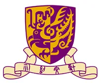
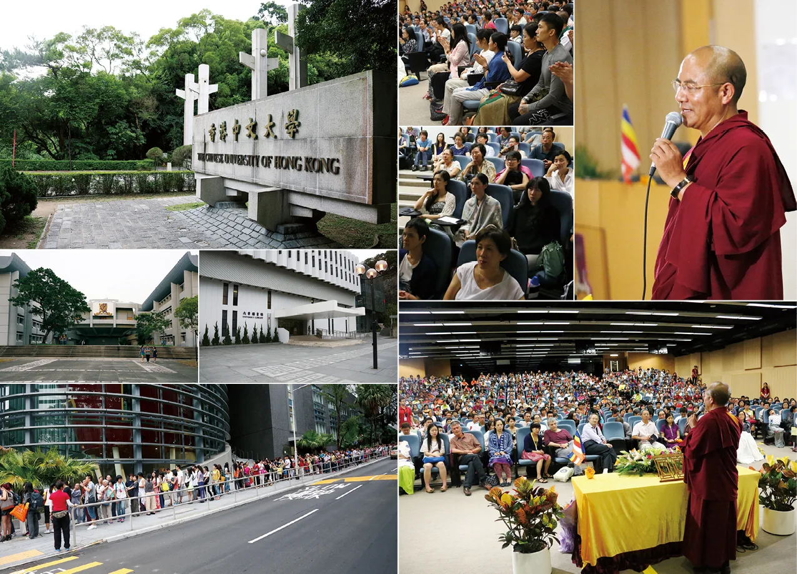
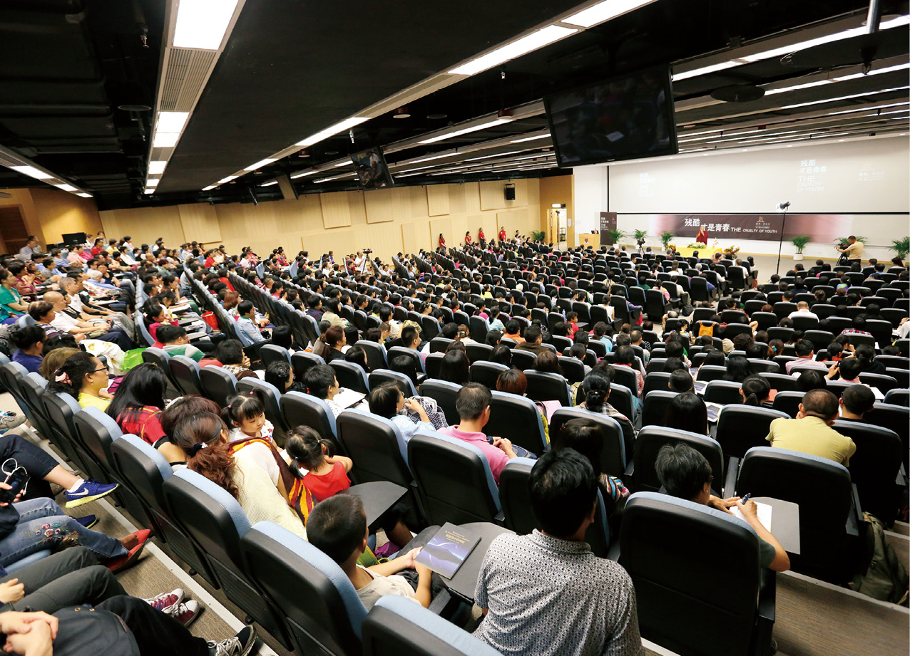
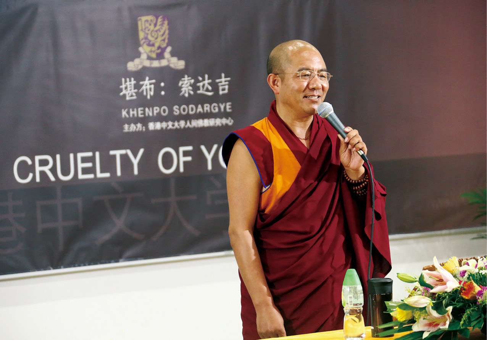

如同美丽的花园中

常常藏匿着毒蛇，

幸福的背后

也往往埋伏着悲剧。

第87场

香港中文大学

The Chinese University of Hong Kong

中国·香港

2014 / 8 / 6

## 残酷才是青春

## The Cruel Truth about Youth

主持人：

在座的各位朋友，以及正在收看网络直播的各界朋友，大家晚上好。非常感谢大家远道而来参与此次聚会，也非常感谢嘉宾们一直以来对我们研讨会的支持，谢谢大家！

下面有请香港中文大学人间佛教研究中心主任学愚教授上台致辞。

学愚教授：

尊敬的索达吉堪布，各位法师、居士，各位来宾，大家来自五湖四海，今天缘聚香港中文大学，这种机会非常非常难得。

佛教讲缘起，香港中文大学与索达吉堪布结缘在五年前，当时我们邀请堪布到中文大学参加学术研讨会。从那时起，堪布每次来香港弘法，我们都会邀请他到中文大学作演讲，而每次的讲座都吸引四面八方的听众，非常轰动，比如这次就有很多从东北、北京专程赶来聆听讲座的朋友。

本来今天要介绍一下堪布的，但是我想，在座不认识堪布的可能极少，所以下面还是把更多的时间留给堪布，希望堪布给我们多一些智慧的开示，我想这也是大家的共同心愿。

请大家以热烈的掌声有请堪布——

我最初与香港中文大学的老师、同学结上善缘，确实如学愚教授所说。以那时的缘起，后来我在香港其他很多学校也作过演讲，世界青年佛学研讨会也在香港举办过多次。所以，就我个人而言，确实与这里有很好的缘分。

## 一、青春真的残酷吗？

### 美好的背后

今天在座的，有一部分是佛学爱好者，有一部分是世界青年佛学研讨会的老师和学生，另外则主要是中文大学的学子，今天我们一起探讨的话题是“残酷才是青春”。

听到这个题目，很多年轻人可能会疑惑不解：“青春是美好的，为什么把它说成残酷的呢？”

对于人生的这段青春时光，确实不少人认为它是美好的、快乐的，尤其西方一些浪漫主义者常常使用各种曼妙的言辞赞美与讴歌它，现在的影视剧等很多传媒也乐于宣扬人们青春时的各种愉悦体验，比如年轻人在花园里享受惬意的时光，在家庭中品尝甜蜜的生活……

对于这些美好的情景，我们也并不否认，但是如果用佛教的智慧去观察就会发现：这些幸福的体验只是生活的片段，而并非一贯的常态，而且其背后往往隐藏着痛苦的阴影，这一分却常常被忽略了。

如同美丽的花园中常常藏匿着毒蛇，幸福的背后也往往埋伏着悲剧。悲剧没有出现时，人们没有看到它，也就不加防范；而当悲剧獠牙毕露时，很多人才惊慌失措，只有选择逃避，有些甚至陷入绝望。因此对于青春，应该一分为二地看，否则，如果一个孩子一直在“青春美好无瑕”的教育中成长，不知道青春的真相，那么一旦步入青春遭遇一点儿风吹雨打时，就会痛苦不堪、无力面对。

### 被错解的青春

藏传佛教中流传着这样一个故事：有个人从来没有敲过鼓，于是愚笨地认为：鼓的声音那么大，肯定非常重。有一次他见到一只鼓，就倾尽全力提起来，因为用劲过猛，鼓反而掉落在地上，发出了轰隆的巨响。他听了，不禁笑道：“原来你不过是声音很大，实际上并不重。”他一直以为鼓是实心的，不知道鼓其实是空的。

现在很多年轻或不再年轻的人，一直认为青春是完美的，无有瑕疵，这也许是一种错解，如同那个人最初对鼓的看法一样，并没有认识到真相，因为生活中确实有不少人的青春与美好无关。

我曾经问一个人：“你的青春是什么样的？”他说：“我的青春是血淋淋的，充满伤感，不堪回首。”我又问一个人：“你的青春是什么样的？”回答说：“当时觉得很美好，现在回想起来非常幼稚与愚蠢。”

所以，“残酷才是青春”可以说是给很多大学生提个醒，因为你们在心理上不一定很成熟，很多认知不一定准确。

### 十字路口的迷茫

18岁之前，很多人的生活比较单纯、清净，而18岁之后的一段时期内，却可能充满迷茫，缺乏自信，没有确定性。

我询问过很多大学生，发现确实是这样，他们的内心满是困惑与不安：“我所学的专业将来能不能用得上？”“我能找到满意的工作吗？”“我将来能有一个幸福的家庭吗？如果有，我能担得起责任吗？”

不仅是大学生，已经步入社会的年轻人，也会陷入迷茫的境地。就在前两天的研讨会上，有个人说自己已经大学毕业，而且成了家、有了孩子，现在一方面要养家糊口，另一方面又要应对上上下下的各种关系，沉重的压力落在肩头，真不知该如何是好。这的确说出了很多年轻人的心声，年轻人以前生活得很单纯，现在突然成了家长、部门负责人，崭新的角色使得许多人顿时不知所措。

在座的成年人和老年人已经走过了青春阶段，知道青春到底是怎样的，但很多年轻人面对青春时，确实如同站在十字路口一般，很容易迷茫。

再加上，现在的时代也非常特殊——这是一个信息爆炸又难辨是非的时代，全球各种资讯可以瞬间出现在一部小小的手机上，这一方面有其便利之处，但另一方面，面对各种眼花缭乱的产品、信息，如果缺乏冷静的思考、智慧的辨别，就会陷入迷雾之中。

今天现场有很多老师，我特别希望你们在教导学生时，除了传授专业知识，还要教会他们应对人生的本领——如何面对生活，如何担负家庭，如何回馈社会，尤其如何修养自身的道德，比如坚强的品格、贤善的心地。这种教育非常重要，能够帮助年轻人更好地走过青春。

### 我的青春是灰色的

曾经有记者问我：“如果用一种颜色形容你的青春，你用什么颜色？”

我想了一下，回答他：“灰色吧。”

我觉得青春如果是灰色的，就有填成各种颜色的可能，比如红色——我衣服这样的颜色，或者白色——成为一名医生，再或者是黄色——藏传佛教里通常活佛穿黄色，不过我没有想装活佛啊。（众笑）

对当时那个回答，我还是比较满意，因为读书期间我对未来确实有过很多遐想：有一次看到医生时，非常羡慕这种职业，觉得应该多学一些医学知识；又有一次看见一个领导穿着光鲜、皮鞋油亮，又想将来当领导；还有我在山上放牦牛时，也时常感叹天地那么辽阔、大自然如此美好，还是当牧民好，每天都可以在蓝天白云下无忧无虑地生活。

我当时的状态确实比较迷茫——想当医生，想当领导，想当牧民，还想出家……不过后来我走上了出家的路。之所以选了这条路，跟前世的因缘以及当时一些老师的指点有一定关系，如果完全让我自己抉择，可能只会无所适从。现在回过头看，这条路对我是比较合适的。

结合我自身的经历，我觉得很多大学生可能也处于类似的境地中。我询问过一些大学生：“你将来打算从事什么职业？”回答往往是：“我也不知道，虽然我的专业是这个，但不知道将来能不能派得上用场。”这话确实也道出了实情，所以很多学生从踏进大学校门时，就开始忧心就业的去向了。

### 虚耗的青春

现在世界上的大学生数量非常多，这是历史上从未有过的。但是这些学生中，有些具备真才实学，有些则只是徒有文凭，内在的智慧并不成熟。

香港的大学应该普遍很好，学生在四五年里会学到真正的本领。不过我去过的一些二三等高校，情形很不容乐观，里面的很多学生一直在浑浑噩噩中消磨时光——男生每天沉迷于上网、抽烟、喝酒，女生则忙于打扮或者也沉溺于网络。这样的学生将来如何能成为栋梁之材呢？恐怕自己的生活都难以保障。

所以，现在社会上出现了一个特殊群体——“啃老族”，指有些年轻人虽然已经走出校园，但是却赋闲在家，衣食住行的花销全部向父母索要，自己无力解决或者即便有能力也由于懒惰而不愿负担。因此，从某种意义而言，青春确实是残酷的。

如今的社会又非常功利，物质享受被大肆提倡，内心的道德无人问津，导致很多人唯利是图，把个人德行远远抛在身后。所以大家可以好好思考一下：身处这个时代，年轻人是快乐还是痛苦？

## 二、应对青春，你准备好了吗？

### 中国孩子，美国孩子

我看过这样一个故事，威斯康星一所中学里的两个孩子相约去爬山，一个是中国孩子，一个是美国孩子。

他们去游玩的这座山，因为风化常常会发生岩石坍塌。很不幸地，这两个孩子下山返回的途中遇到了坍塌，他们被困在了岩石中，美国孩子被碎石砸伤，腿骨折了，稍微动弹一下就痛彻心扉。

天慢慢黑了下来，寒冷和饥饿如同恶魔一般步步逼近。那个美国孩子开始尝试着爬出石堆，他伤腿上的血染红了整个岩石……

没有人知道这个孩子是怎么咬紧牙关爬回小镇的。他向别人冷静地讲述了遇险的地点，说那里还有一个中国孩子。当人们赶到那里找到那个中国孩子时，他因为寒冷和恐惧已经奄奄一息，如果再迟些被发现就会丧命。

故事里的美国孩子有很强的独立保护能力，而中国孩子却没有，一直在等待别人的救援。当然，这也不一定说明所有美国孩子都有这个能力，而所有中国孩子都不具备，但至少这个故事可以反映出一些现象。

大家也知道，美国孩子从小就被教导要学会独立，比如吃饭实行AA制，而且父母会告诉他们必须AA制的理由，那就是不论人生中发生什么事，没有人替你买单，就算你的至亲，也不会。而中国的很多孩子，从小就养成靠父母、靠亲友的习气，生病时也是等待别人来照顾，即使有力气也不愿意爬起来，在这种状态中很多能力就逐渐丧失了。

所以，我在这里特别想提醒为人父母者：应该重视对孩子的教育，不应当把孩子扔给保姆或老人就万事大吉了，因为由保姆或老人抚养长大的孩子，其各方面能力不一定得到很好的开发。

刚才提及的已为人父的那个人，他说打算以很好的方式培养孩子，我当时对此也很关心，不过他没有再详述。我想可能他和妻子会有一个人专门负责教育孩子。我也听说有些国家和民族里，父母特别重视对孩子的教育，认为自己在这方面负有重大责任。这种观念是合理的，有利于孩子的成长。

在教育孩子时，培养其独立生活能力是很重要的。一个人如果不具备这种能力，不必说对社会作贡献，即便自己的生活，可能也难以为继。

### 先对自己负责

佛经记载，古印度有一位国王叫波斯匿王，他有一次问王后茉莉夫人：“这个世界上，你最爱的人是谁？”国王满心以为茉莉夫人会说是他。

没想到茉莉夫人却回答：“我最爱的是我自己。”

国王听了有些失望，说：“你现在能享受荣华富贵，可都是我的荫庇。”

茉莉夫人说：“才不是呢！我听佛陀说这是我自己的福报。”

国王很不服气，于是设计了一些方法想要证明茉莉夫人的一切都是拜自己所赐。不过出人意料的是，结果完全证实了茉莉夫人的话，最终国王也不得不承认：确实是她自己的福报荫庇了自己。

这个故事可以说明：一个人如果拥有良善的身口意，就是最值得自己爱的人。为什么呢？因为如果行为如法，语言得体，内心也善良、诚实，就可以积累丰厚的福报，以此定能为自己营造未来的安乐。

在前段时间的辩论中，有些人说我们应该对国家负责，为国家作出贡献；有些人说我们应该对民族负责，成为对民族有用的人；有些人说我们应该对家庭负责，在家里尽到责任。但我想，每个人至少先对自己负责，如果连基本的道德品行都不具备，那么要在世间立足都十分困难，又何谈为家庭、为国家乃至为全世界作出贡献呢？

人跟动物完全不同，动物只知道寻觅饮食，除此之外就没有更高的追求了，而人不能这样，应当追求更有意义的东西。不过，现在很多人可以说跟动物有点相似，除了吃喝玩乐，再没有更高的行为，这是一种悲哀。

我常常这样想：如今的科技非常发达，原子弹等危险武器足以瞬间毁灭整个地球，但这些如果没有落入穷凶极恶者的手中，暂时还不至于把世界推入深渊，所以不是最可怕的。然而人类道德的普遍滑坡，许许多多人沉溺于金钱、地位、爱情、享受等短暂而无义的东西中，除此之外从不希求更有价值的事物，诸如心灵的提升、道德的完善，这种状况才真的令人担忧！虽然并非所有人都堕落到如此地步，但整体的趋势就是这样，可能再过十年、二十年，人类的道德会更加沦丧，状况会更加可怕。

美国黑人民权运动领袖马丁·路德·金（Martin Luther King Jr., 1929-1968）曾说：“不是所有的人都会出名，但每个人都可以变得伟大，因为伟大是通过为他人服务而界定的。为别人提供服务……并不一定要认识柏拉图和亚里士多德，并不一定要会爱因斯坦的相对论，并不一定要了解力学第二定律。你所需要的是一颗优雅的心灵和充满爱的灵魂。”

马丁·路德·金的话确实很有道理。大家可以观察一下自己是否伟大？我认为人人都有伟大的潜质，因为人的慈悲是与生俱来的，只不过一般人的悲心比较狭隘，只是关心亲人朋友，所以还需要扩展与升华。

很多人认为大乘佛教非常伟大。确实是这样，不过大乘佛教的伟大不在于它的建筑多么辉煌，不在于它的佛像多么庄严，也不在于它的历史多么悠久，如果从这些角度观察，它不一定算得上伟大；大乘佛教之所以伟大，就在于它无私利他的精神——无条件地给予别人、帮助别人、奉献别人。

你们不一定都学过大乘佛教，也不一定都有这样的心量，但要知道这种精神非常宝贵，值得去追求。

### 学会过简单的生活

我接触过一些人，他们特别喜欢穿名牌衣服、吃山珍海味、用高档产品。其实不需要这样，现代人应该学会过简单的生活。

当然，如果你经济条件非常富裕，吃穿用度样样高档是你的自由，但如果能够过朴实的生活，也很好的，一件衣服穿上一二十年，吃饭尽量节约，出行安步当车。

简单的生活有很多益处，对自己而言，可以培养知足少欲心，而且珍惜了福报；对整个世界而言，也有助于解决环境、粮食等方面的危机。

很多人可能去过非洲、柬埔寨、越南等地方，那里有多少孩子没有衣服穿？有多少人没有饭吃？我们如果肆无忌惮地浪费资源，不说从宗教角度，即便从做人角度，恐怕也于心有愧。

爱因斯坦曾说：“简单淳朴的生活，无论在身体上，还是精神上，对每个人都是有益的。”对于这一点，我们自己也可以体会得到——如果对生活的要求不是很高，内心就不会背负很大的压力，很容易悠游自在。

佛经中记载，曾经释迦族有一个国王出家了，很多人听了都非常诧异：他贵为国王，居然出家了！（前段时间有些大学生出家，大家都很惊讶，其实这也没什么。）他们于是到佛陀那里询问缘由。

佛陀告诉他们：这个国王以前住在富丽堂皇的宫殿里，身边有很多保镖，但是睡觉时依然惶惶不安；如今他住在简陋的茅棚里，连门都没有，却睡得非常安详。他现在的生活虽然简单，却很快乐。

大多数在家人不可能过出家人那样特别简单的生活，但也应该尽量简化生活。

其实，现代人的很多痛苦，都是因为无法安于简单，或者说贪欲膨胀所致。包括人类的许多战争，表面看来是由嗔恨引发，但究其根源还是贪心作祟——国与国之间为什么爆发冲突？就是为了一块地盘、一处矿产等。人与人之间为什么发生矛盾，比如有些兄弟姐妹、亲戚朋友之间关系难以调和？也是源于一些利益纠纷。所以，如果能够知足少欲，这些冲突都会减少。

### 生活在感恩里

还有一点非常重要，就是要学会感恩。

每个人可以想一想：无论是吃一口饭、喝一口水，单凭自己的力量能不能成办？

实际上，一口饭、一口水的背后都凝聚了无数人的汗水和辛劳，甚至很多动物因此牺牲了宝贵的生命。

比如今天我们在这里交流，这个建筑肯定凝结了很多人的心血，当时有多少工人在这里辛苦地劳作；这个麦克风也蕴含了很多人的劳动，制作过程中有很多人付出了汗水。而我们没有贡献一分钱，没有付出一分劳动，现在如果认为使用它们理所当然，那么也不合理，因为并没有付出。

但现在很多学生好像不具备感恩心，似乎自己一生下来就是大学生，父母没有养育他，老师没有教导他……其实不是这样的，你走到今天，父母对你付出了多少？老师对你付出了多少？朋友对你付出了多少？乃至这个社会以及整个地球对你付出了多少？对此都应该深思。

如果你能够有一颗感恩的心，就会找到自己；如果找到了自己，也许从另一个角度，就能找得到青春的美好。

对于年轻人而言，青春也许并非如你们想象，但如果能怀着一颗坚强、善良、感恩的心，就可以平稳地走过青春，甚至收获成长与喜悦。

现场互动

问：我是香港中文大学法学院的硕士。佛教认为存在地狱道、天道等六道，请问这一点如何证实？

堪布：要证明世上的事物存在，有几种方式：

一、现量。对于比较明显的事物，我们的眼识等五根识，在无错乱的情况下可以直接感知，比如眼见色法、耳听声音、舌尝味道，以此就可以确定色法等存在。这种证明方法非常简单直接。

二、比量。对于比较隐蔽的事物，可以依靠逻辑推理来证实。

比量跟现代逻辑学中的三段论是一回事：三段论是依靠大前提、小前提引出结论，或者通过已知的理由推测未知的法，而比量也是运用能立根据推出所立的结论。

打个比方，假如我没有去过美国，那么通过询问去过的人，依靠对方的可靠语言来推知美国的存在，这就是运用了比量。

很多人觉得“凡是我看不见的，肯定不存在”。如果明白比量的道理，就知道这种观点不合理，有些事物虽然没有亲眼见到，但是运用比量可以证实，那么也可以确定它们真的存在。

三、教量。对于非常隐蔽的事物，比如光、原子、夸克等等，可以依靠专业人士的语言来证实。

大家都清楚，世间专业领域的问题，非专业人员一般知之甚少，而专业人员则会了如指掌；同样的，六道轮回极为隐蔽，超越了一般人的认知范畴，但是佛陀却悉知悉见，所以可以依靠佛陀的语言来证实其存在。

印度的月称论师也曾说“六道轮回并非一般人所能了知”，一般人能接触到人道、畜生道，但对其他道则茫然无知。不过，也有人做噩梦时见到鬼或者机缘巧合遇到鬼，那时就知道鬼是存在的。另外，现代科学对于天人也探测到一部分，比如外星人，不过对于他们的了解非常有限。

然而，如果借助佛的智慧，就可以轻松地了知饿鬼、天人乃至地狱众生的存在。

当然，在运用佛语作为依据时，首先要相信其准确性，而有关佛语的真实无误，在佛教论著中进行了严密论证；有了信心之后，我们发现佛在很多经典中都说存在六道，那么就可以断定六道的真实性。

除了六道轮回，因果规律也是非常隐秘的，需要依靠佛语来证实。

有一位美国教授，研究龙猛菩萨观点多年，昨天他用了一个浅显易懂的比喻描述因果法则的隐蔽性：一只苹果被箭射穿了，当时大家只看到这个结果，对于背后的因缘一无所知。同样的，一家中的两兄弟，一个聪明、一个愚笨，人们只是看到这个结果，却难以窥测其中的原因，因为这可能关乎前世，而这种横亘三世的因果关联在佛经中有着深细的分析。

一个人要明白量子力学的一些原理，要花上很多年；同样，六道轮回与业因果的道理看似简单，但是要生起真实信心，也要下一番功夫——至少十到二十年中不断地学习相关教理，最后才能真正明白。

问：这个时代中灾难不断，比如马航空难，以及最近的地震。面对这些，我们可以做些什么？

堪布：作为一个善良的人，看到他人遭遇灾难，应当力所能及地伸出援助之手。如果是佛教徒，可以通过诵经、念咒等方式为遇难者和幸存者祈福。我前段时间也呼吁一些佛弟子，至少念一部经回向给最近灾难中的受害者。

其实不论你信仰哪个宗教，抑或没有信仰，既然生活在这个世界，都应当关注我们的共同家园，尤其大学生更应如此。现在个别大学生对什么事都漠不关心，天天沉溺于玩手机，这不是很好。

另一方面，灾难的出现其实是无常规律的一种昭示。

见到他人的离去，人们往往很少思考自己何时死亡，这是无常观没有修好。其实无常不仅会光顾别人，我们每个人都可能突然遭遇生命的危机。即便没有遇到重大灾难，看似岁月静好，在座的人也会一个接一个地告别世间，再过五十年，这里的大多数人都会不在人世。所以，都应当树立无常的观念，这很重要。

问：在台湾有这样一群人，他们愿意在死后将身体捐赠给医学院，供解剖使用，让学生在自己的身体上探索生命的奥秘，而学生们称这样的“老师”为无语良师。

我因为学佛才知道人死后的八小时内，身体不能被触碰，但是又被这群特殊的大愿“老师”所感动。请问他们将身体奉献给医学，会影响往生吗？

堪布：遗体捐献不仅在台湾有，在世界其他地方也有。

按照佛教的观点，确实如你所说，临终者最好是在安详的状态中离开，并且他身边的人不要哭泣，不要做不如法之事，而应该念诵清净的咒语、经文，让临终者在经咒声中逝去，这样他会更容易获得解脱。

不过，有些人不一定承认人死后还有灵魂，更不相信灵魂可以去往清净刹土，所以他们愿意在去世后将身体奉献给医学界，这也没什么不可以。但如果是佛教徒，可能会有自己的想法和安排。当然，佛教徒中也有不考虑来世，将身口意全部奉献的情形。

问：我的爸爸患鼻咽癌快四年了，我的妈妈得了忧郁症，我的老公是精神分裂症，还有我的奶奶也卧病在床，我身边有太多的病人，我不知道自己为什么会有这种遭遇。今年我进入佛门参加静修，但是却得不到家人的理解。这些都困扰着我……

堪布：在广阔无垠的轮回中，众生的业确实千差万别。说到业，大家一定要小心谨慎，因为它会深深影响着你的人生。

如果要深入了解业，需要明白“因”与“缘”的概念：“因”是成就果法的根本因素，比如前世的一些业；“缘”是成就果法的辅助因素。打个比方，苗芽依靠种子、水、土等聚合而生，其中种子是因，水、土等是缘——虽然水、土等对苗芽也起了很大作用，但最根本的因素还是种子。

世间的任何果都是因缘和合而生，因与缘缺一不可，这一点谁也无法否认。如果只有因而没有缘，不必说产生果法，乃至“因缘”这个词也没有了存在的必要。

不过现在很多人不明白这个道理，遇到问题只看缘不看因，由此导致很多事无法解释。比如许多人希求财富，但是并非人人都如愿以偿，即使付出同样的努力，依然是有人金钵满盆，有人两手空空。对于这种现象，如果只看缘——今生的努力，而不看因——前世的福报，可能永远找不到其中的缘由。

世间的命理学家也会研究命运，但是仅限于观察今生，而不会结合前世进行分析。实际上佛陀说过：“欲知前世因，今生受者是，欲知来世果，今生作者是。”意思是，想要知道自己前世造了什么业，就看今生所感受的果报，想要知道自己来世的情形，就看今生做了什么。这句话看似平常，但是蕴含的义理却非常深奥。

你的家中有很多病人，这一点我依据教理推断：应该是前世的因所致——你们一家人前世造了不好的业，比如一起吃动物肉，由此就导致今生一起感受痛苦。

这种业，在现代人身上也愈演愈烈，比如每年春节前后，各大饭店都是人头攒动，一家一家围坐在一起，大快朵颐地嚼着动物肉。每每看到这种情景，我都非常伤心和感叹：他们现在开开心心地造恶业，来世却要哭哭啼啼地承受苦果，实在可怜！

所以，造成你家庭不幸的原因，可能不是别的，而是一家人往昔曾一起造过恶业。因此你遭遇这种痛苦时，更应深入思维因果，生起坚定的信心。

不过，你的这种遭遇，很多人也有类似的经历。虽然面对不幸并非易事，但还是要内心坚强，因为任何痛苦都有尽头，而且都能转化。另一方面，在佛教团体中，如果有人遭受灾难，其他人都会伸手相助，这在其他群体中不一定有。所以很多人会关心和帮助你的，你更应该坚强。

如果是我家中发生类似的事，我不会特别悲痛，也不会难以承受，而是会想：这是大家前世一起造业的结果，唯有好好忏悔才能化解，而且要坚强地活下去，勇敢地把该做的事做好。

换个角度看，人间的痛苦比之地狱、饿鬼的痛苦根本不算什么，是微乎其微的。

所以，希望你坚强、勇敢地面对困境，一切都会过去。

问：如今世间有不少素食主义者，请问素食有哪些好处？

堪布：素食能带来很多利益。

首先，素食对培养善心很有帮助。

一个人如果酷爱吃肉，会变得性情暴躁，而如果选择吃素，性格则会慢慢变得温和。这一点在动物界也看得出来，食肉动物，诸如狼、虎之类，都有锋利的爪牙，且生性残忍；而食草动物，诸如野兔、牛等等，则比较温顺。

站在更长远的角度看，即生中特别爱吃肉的人，将来如果转生为人，会特别霸道、恶劣；如果转生为动物，也不会是温和的食草动物，而会成为猛兽之类。所以，吃素对自己的生生世世都有意义。

其次，素食对健康大有裨益。

我认识一个人，他之前吃肉，后来转而吃素。我问他感觉如何，他说：“吃素后身体非常轻松，高血压、心脏病等都缓解了。”

其实吃素对健康的作用，在现代医学中也得到证实，所以如今很多没有信仰的人，并非出于对众生的悲心，而是为了身体健康，从而加入吃素的行列。

再者，素食也受到爱美人士的青睐。

吃肉容易让身体发胖，而吃素则能变得苗条。有个人说自己之前吃肉时感觉好像吃一斤就会胖一斤，吃素后身材变得正常了。

总而言之，素食确实是一种很好的饮食选择。

问：我很想劝身边更多人吃素，请问怎样才能很好地完成这件事？

堪布：劝人吃素的发心是很好的，不过实际去做时也要具有善巧。

佛经中讲过一个“母亲救子”的比喻：一个小孩子生病了，但是医生开的药很苦，难以下咽，如果直接喂给他，他肯定不愿吃。后来母亲怎么做的呢？她把药涂在自己乳房上，然后给孩子喂奶，这样药和着奶水就被孩子一起喝下去了，最后孩子的病也得以痊愈。

这个故事告诉我们：度化众生时，运用善巧方便很重要。

不过现在有些佛教徒却背道而驰，他们特别狂热，即便看到路人，也会急不可待地说：“快皈依吧。”这样不但无法达到目的，还会适得其反，引起对方的厌烦。

同样的，你想要劝别人吃素，也要考虑对方的情形。有些人的食肉习气根深蒂固，一时难以扭转。我就听说有个人每天一定要吃活青蛙，自己一边剥一边吃，而且对此习以为常，如果突然要求他吃素，也很困难。所以面对类似的情形，不能操之过急，可以慢慢观察因缘再去劝导。

总之，劝人行善也要具足善巧，而善巧源于内心的智慧。要获得智慧，唯一的途径就是坚持不懈地学习。

不过现在很多佛教徒不爱学习，不知道香港的佛教徒怎么样？五年前我来这里时有些不太满意，当时我说：“十五年前我来过这里，这次再来时发现个别人没有任何进步。”后来听说有人很不服气：“您怎么这么说呢？我还是有进步啊，十五年前您来时，我还没有修加行，现在我基本修完了。”修了十多年，还只是“基本”修完。（众笑）

实际上我们要知道，佛学不是简单的书本知识，并非看几页书就能明白，而是要深入学习才能有所领悟。

去年我去美国、德国的一些学校时发现，那里很多教授学习佛法的精神，令我这个出家多年的人都十分钦佩——他们付出了非常多的时间、精力、财力、物力，甚至把家中的重要之事暂时搁置，而到其他地方参学，在参学过程中还通晓了当地的语言。凭借着精进、严谨与科学的态度，他们对于因明、中观等甚深道理都非常通晓。

与这些人形成鲜明的对比，个别佛教徒的学佛却沦于形象——开法会时就背着包、拿着转经轮赶过去，平时既不看书，也不修行，虽然已经皈依一二十年了，但对于三宝的含义，还是懵懵懂懂。

这种“形式化学佛”的现象需要断绝，否则佛教会被毁坏——不是唯物论者，不是其他宗教徒，而是一些盲目无知的佛教徒会葬送佛教的前途，因为这些人不具备高尚的人格，不了知佛教的道理，由此会使其他人认为佛教是一种迷信。

“文革”期间，“迷信”是一个非常泛滥的词。而如果人们不爱学习，那么迷信在这个时代依然存在。

前段时间有些教授说：迷信从拉丁美洲一直蔓延到日本，后来在中国大地不断滋生。

有些人认为佛教是迷信，其实佛教的教义完全经得起智慧的观察，而且现在官方也不会把“迷信”一词安在佛教头上。但是个别佛教徒的行为不如法，确实会给佛教造成不良影响，比如天天都是求保佑、求加持、求灌顶，而且特别喜欢做个仪式然后吃吃喝喝——当然，仪式也并非一无是处，儒家也说仪式有其历史与存在价值——但仪式不是最主要的，最主要的是明白仪式所传达的内涵，否则确实容易成为“迷信”。

总之，特别希望佛教徒能长期深入地学习教理，这是我给佛教徒的一个建议。

问：学佛之后，我的一些朋友觉得我神神道道的，比如饭前还要供养。我的哥哥因为对佛教不了解，同时出于对我的爱护，也常常阻止我学佛。我该如何面对这些？

堪布：我刚才也讲了，作为佛教徒，吃饭、走路等行为都应相合于场合，这方面要具备方便与智慧。

至于你的哥哥，可能也是很好的人，但是目前并不信佛，那你也不用强迫他学佛，因为每个人的因缘不同。同时，对于他的观点和行为，你不必特别反对，有必要时可以适当随顺，但是根本的见解上不能跟他同流合污。

问：乔布斯年轻时就去印度学禅，而且一生食素，为什么却在五十多岁就离开人世？

堪布：乔布斯的早逝，跟他学佛没有什么关系。

他刚刚离去时，有关他的传记大概有三个版本，其中两个我都看过。从传记中可以了解到他把每天当作生命的最后一天，所以他的离开也并非不情愿，因为他对待生命的态度就非常随缘。

另外，乔布斯生前的理想是给人类的生活创造便利，这一点他确实做到了，生命的价值已经实现，这就足够了。其实人不一定非要活得很久。从另一个角度而言，一个人即便寿命很长，如果整天造恶业、害众生，这种长寿也没有什么意义。

问：我来自澳大利亚，感觉年轻人的困惑好像不分东西方，这些困惑反映出他们缺乏处理生活中必然问题的智慧，也说明他们所接受的教育没能教给他们这种智慧。那么您觉得在如今的学校教育中添加什么课程，可以解决这一问题？

堪布：确实如你所说，东西方的年轻人有着类似的价值观、类似的追求，也有着类似的困惑，比如梦想与现实的落差。这种状况应该引起社会的关注，尤其教育界人士的关心。

对于当前的学校教育，北京大学一位教授曾这样评价：“我们的一些大学，包括北京大学，正在培养一些‘精致的利己主义者’。”这句话语惊四座。

后来大家眼中的一个“青年精英”出事，有些记者对他作了采访，之后感慨道：虽然他颇具才华、擅长社交，是年轻人中的佼佼者，但是我们不了解他的价值观，可能他无法平衡欲望与现实，就滑向了堕落的深渊。

年轻人身上出现的很多问题，归根结底跟如今的教育有着直接关系——俗话说“教书育人”，教书是书本知识的传授，育人是道德品行的培育，但是目前很多学校只有“教书”，没有“育人”。

如果让我提一些建议，我觉得学校中应该增加传统文化为主的道德教育，比如《弟子规》以及大乘慈悲理念，依靠这些文化精髓，可以帮助学生树立正确的人生观、价值观，对整个社会乃至全世界也会带来不可估量的利益。现在藏地个别的中专、大专院校也在讲授《入菩萨行论》《佛子行》等论著。

因此，我非常希望《弟子规》等先贤教言以及大乘佛教的珍贵理念，能在学校教育中得以推广。不过要实现这一目标，也并非依靠我这样一个佛教徒的呼声就能实现的，更重要的还是广大民众提出合理的建议和诉求，这样逐渐会有一定作用。

问：现在密宗、禅宗、净土宗在中国内地以及其他有华人的地方，都比较盛行，那么哪个宗派更契合自己，对此如何观察？

堪布：密宗、禅宗和净土宗确实在如今的汉地很受欢迎，将来一段时间中也许会更加兴盛。

我想就总的趋势而言，信仰佛教的人会越来越多，身份上也会有前所未有的变化——以前大多是老年人或遭遇挫折的人，现在则表现出年轻化、高层次化的态势，比如相当一部分佛教徒是高校教师、政界要员以及商界精英，他们信仰佛教并非出于盲目，而是通过智慧观察发现佛教的道理真实不虚，依靠一种笃定的信解而趣入佛门的。

我在《残酷才是青春》的前言中也讲，不少人认为佛教是老年人的宗教，但实际上佛教对年轻人也非常有用。不过我希望年轻人最好是没有遇到挫折时，就早一些接触佛法，这样会从中受益良多，否则，如果已经苦不堪言才遇到佛法，那时自己也会深感惋惜。

关于你的问题，其实禅净密三宗可以圆融修持。近代科学家黄念祖居士就是这方面的典型例子，他既修密，也参禅，同时也学净土宗。我看过他的传记，觉得他的观点非常圆融，特别适合如今包容并蓄的时代。

20年前我来香港时，这里修净土宗的人比较多，学密宗的也有一部分，两派的追随者经常发生冲突，不过现在基本没有这种现象了。

我希望你不论选择净土宗、密宗还是禅宗，都应当知道：这三者都是释迦牟尼佛传下的清净教法，因为佛陀所传八万四千法门的核心是四谛，而密宗以及显宗的净土宗、禅宗，乃至天台宗、华严宗等，对于四谛的解释，在大的原则上没有什么差别。

所以，面对不同宗派，我们不应忽视其根本的共同点，而在细微差异上争辩不休。不论修学哪个宗派，都没必要舍弃或诽谤其他宗派。

现在有个别人对密宗颇有微词，其实观察一下就发现，他们根本不了解密宗，只是断章取义、毫无根据地诋毁。这非常可笑，如果觉得密宗某个道理不合理，可以开诚布公地说出来，大家探讨与辩论，问题自然迎刃而解，而没必要在背后指指点点。其实这些诽谤者中，有些是别有用心，有些是空虚无聊，有些是愚痴无知，有些甚至是精神状况出了问题。实际上真正以智慧衡量就知道，密宗的教义是纯净无垢的。

佛教各宗派的团结和合，对个人的修行与解脱有很大帮助。

不仅是佛教内部的派别，不同宗教也需要团结起来。我刚刚开完各宗教间对话的会议，现在不论佛教、天主教、基督教还是伊斯兰教，以及儒教和道教等各宗各派，都共同致力于维护这个世界，在这方面发挥作用。

而作为非宗教信仰者，也有必要了解一下宗教。有些专家说：“现在的大学教育只包含人类知识的五分之一，其中古希腊哲学只有部分内容出现在大学课程中，而印度哲学、佛教哲学以及古罗马哲学等等，则是缺失的。”因此大学生不要认为自己对世间包罗万象的知识已经了如指掌，觉得“我是大学生，学问很大”。其实并不是这样。

我昨天遇到一个名人，为人非常谦逊，他说：“其实我也是普通人，只不过以偶尔的因缘拥有了一些名声，实际上内心还是有很多烦恼。”

所以，很多大学生也应当学会低调、谦虚，如果能做到这样，那么寻找真理的路会更加顺利，最终也会如愿以偿。
