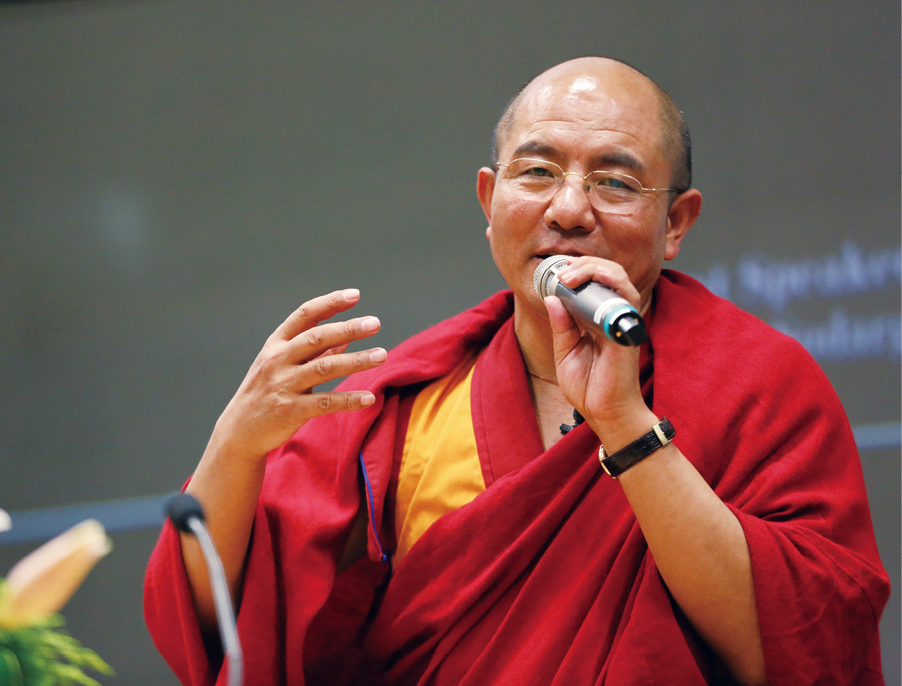
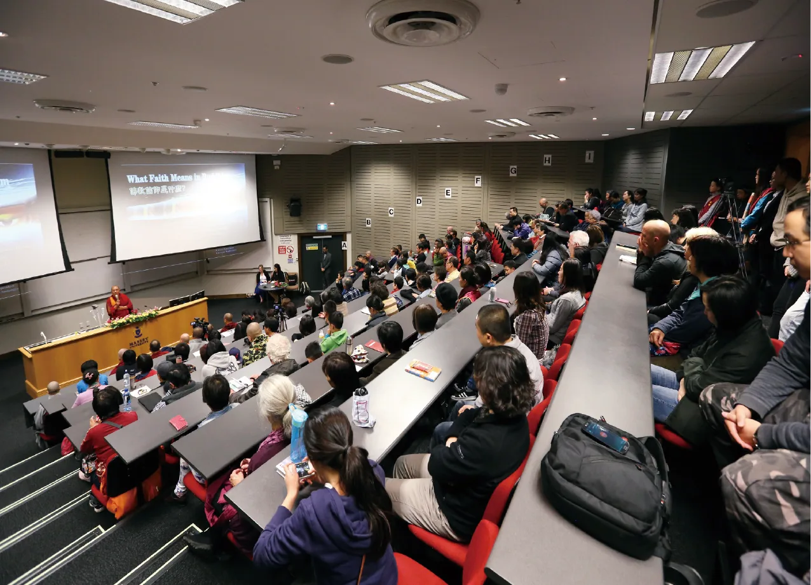
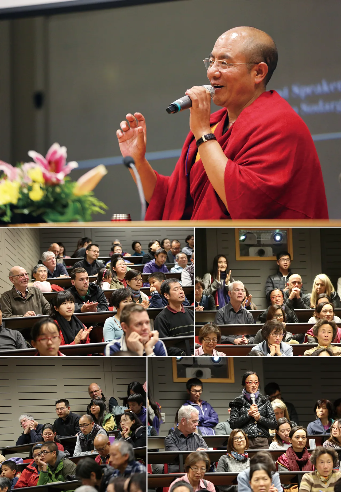
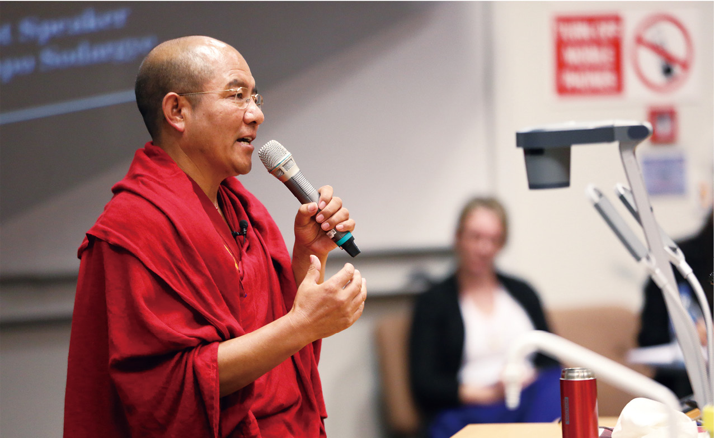
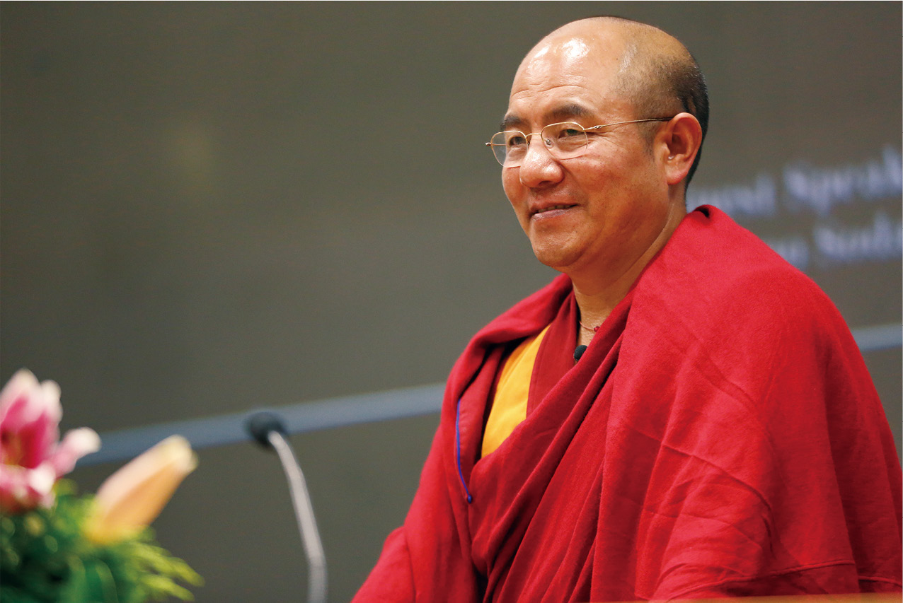

最初迷迷糊糊进入一个宗教，

中间糊里糊涂待在里面，

最终懵懵懂懂地不知去处，

这样只是浪费人生。

第88场

新西兰梅西大学

Massey University

新西兰·北帕默斯顿

2014 / 10 / 3

## 信仰在佛教中的意义

## The Meaning of Faith in Buddhism

主持人：

老师们、同学们，佛教团体的朋友们，以及来自校外的各位朋友，欢迎大家参加索达吉堪布仁波切的讲座。

我是Heather Buttle，梅西大学心理系的高级讲师，能主持今晚的活动，我感到非常愉快。

先讲一下活动流程：首先是堪布的演讲，时间一个半小时左右；接着是半小时的答疑环节。

今天堪布带给我们的演讲是“信仰在佛教中的意义”。选择这个主题是因为：对于不熟悉佛教的听众，希望它能激发你们学术研究与灵性方面的兴趣；对于熟悉佛教的听众，也希望能对您的信仰起到促进作用。世界上有很多宗教是有神论，认为神灵主宰人的生活，例如基督教相信有一位神灵全然掌握我们的未来，通过祈祷他能获得垂爱和宽恕。佛教并不相信第一因，然而佛教仍然具有信仰。因此我想，“信仰在佛教中的意义”非常值得探讨。

下面的时间交给堪布，希望我们能从他的演讲中有所领悟。有请堪布——

今天在这里跟大家交流，我感到非常高兴。我这次的行程比较匆忙，先是从海拔四千米的地方到达成都，然后从成都辗转来到新西兰。听说这里海拔几十米，我等于从高原到了海边，所以今天有点晕晕的，不知道会讲得怎么样。

不过不管怎样，跟大家欢聚一堂是很好的因缘。利用这个机会，我们一起探讨“信仰在佛教中的意义”。

说到“信仰”，其实距离每个人都不遥远。为什么呢？因为信仰就是对某个人或事物的完全信赖与接受，而这在每个人心中都存在。

## 一、信仰的五种形式

信仰有以下几种类型：

（一）学说式信仰，对世间某种思想、学说或主义饶有兴致，全身心地接受。

（二）偶像式信仰，对某个人非常崇拜、景仰，比如把某个明星或宗教人士当作偶像。

（三）感情式信仰，与某个人的感情非常深厚，不论对方做了什么，都觉得非常善妙、值得信赖。人们所谓的爱情、亲情就是这种形式的信仰。

（四）权威式信仰，对于权力、名誉或政治等特别感兴趣。

（五）智慧式信仰，对超越的内证境界非常向往，比如很多宗教追求至高的心灵状态。这是最重要的一种信仰。

大家如果观察，就会看到：进入21世纪，人们更加热衷于追求外在的事物，比如拜金者追逐钱财，追星族追逐某个明星……而向内寻找幸福的人越来越罕见，智慧式信仰越来越少了。

一种信仰能否带来快乐，一个关键因素就是信仰的对境——如果找对了信仰的对境，会给自己带来幸福，也会让周围人得益；如果认错了信仰的对境，那么对自他以及周围的世界都会带来危害，如同把毒物当成了妙药。

就对人的信仰而言，如果对方十恶不赦，你却把他奉若神明，那么就可能因为相信对方的话而误入歧途；就对宗教的信仰而言，如果它的教义并不合理，你却认为非常贤善，或者它本来很好，你却当成不好，都会让自己遭受损失。

所以，寻找信仰需要一双慧眼。

## 二、信仰在佛教中的意义

### 功德的根本

一旦找到值得信仰的对境，就要培养内在的信心。下面我介绍一下，信仰或者说信心，在佛教中的意义。

佛教认为，信心是一切功德之本。《华严经》（这部经有英文译本）中说：“信为道元功德母，长养一切诸善法，断除疑网出爱流。”信心是佛道之源，能出生一切功德，如同母亲一般；信心能长养一切善法，如同阳光雨露滋润万物一般；信心能令人断除疑网、远离贪爱。因为这三个原因，信心具有重要的意义。

关于这一点，佛教中有一位大智者寂天论师，他在《入菩萨行论》中说：“佛说一切善，根本为信解。”意思是，佛陀一再宣说，一切善法的根本就是信解，也即信心。因此，如果没有信心，修持任何佛法都无法成功，不会产生丝毫功德。

佛教《十法经》中也说：“无信心之人，不生诸善法，如种被火焚，青芽岂能生？”意思是，没有信心的人，不可能生起任何白法功德，如同种子已经被火烧坏，怎能生出青芽呢？

实际上，不仅学习佛法需要信心，在世间生活也是如此，如果离开信心——对自己的信心或对他人的信任，任何事都无法成办。比如在家庭中，如果你对家人失去信赖，总是疑神疑鬼，那么隔阂就会随之出现，幸福也会渐渐远去。

所以，通过各种方法培养信心非常重要。

### 信心的层次

佛教中，把信心分为三个层次。

最初的信心叫清净信，是初学者的信心。比如一个孩童进入花园中，觉得每朵花都非常美丽，内心很是欢喜，但是他也讲不出什么道理。同样的，一个人对宗教或其他事物，并没有什么了解，但是最初生起一种好感，这就是清净信。

现在很多宗教徒的信心就是这种情形——虽然对某个宗教非常信赖，可是如果问他为什么信仰上帝或佛陀等时，就无言以对了。

清净信是一种偏重感情的信心，并不稳固，容易变化。

第二阶段的信心叫欲乐信，对于信仰的对境有一些了解——知道它的功德，也明白离开它的过患，从而引发信心。好比对佛教中的皈依与发心，明白了皈依与发心的功德，以及不皈依、不发心的过失，之后才去皈依和发心。

欲乐信的生起，主要源于理论学习与研究，所以较之于清净信更为稳固。

第三阶段的信心是不退转信，通过长期的学习、观察与探索，对于所信仰的对境遣除了一切怀疑，生起全然的信任。比如有些人经过深入的闻思修行，最终证悟了心的本面，并非理论推知，也不是听人介绍，而是一种亲身体验，那时就会深信不疑。

不退转信是佛教最强调的信心，因为它具足理性、充满智慧，稳固而不会退失。

讲到这里，我想起一个例子，可以说明信心逐渐变深的过程。

三十多年前我读初中时，一次地理课上，老师说：“大海里有一个以畜牧业为主、如同天堂般的富裕国度，叫新西兰。”因为当时我一直待在家乡的小小山沟里，从没出过远门，即便藏地的青海湖与朗措湖也没见过，所以在我的观念中，老师说的是不可能的，“大海里怎么会有一片国土？而且那里还有成群的牛羊？”当时我不到20岁。

后来随着年龄的增长、阅历的丰富，我从理论上相信有这样一个国家，但是内心深处还是抱有疑惑，因为在地图上，处于那片大海中的国家是一个非常狭小的地方。

昨天我真正踏上了新西兰这片土地，亲自领略了它的风光，往昔的疑惑彻底一扫无遗。

与此类似，很多人眼中的宗教“神话”，诸如高深莫测的证悟境界、清净刹土的美妙生活，虽然看似虚无缥缈，但是也许有一天在他们的世界中也会呈现，此时他们就会深深明白这些并非神话，也会知道前辈大德的话真实不虚。

因此，我常常觉得，不论佛教还是其他宗教都蕴含着深奥的道理，如果没有长期学习与研究，千万不要轻易否认或诽谤诋毁，否则，这种过失有生之年都无法弥补。

### 信心，应以智慧为伴

佛教中有一个原则叫“依法不依人”，即学习佛法时要依靠正法，而不能依靠人的名声、地位等，因为你崇拜的某个人如果没有真实的智慧与证悟，那么你的信任就会蒙蔽你——即使对方错了，你也察觉不到，还是相信他，由此就会落入险境。

前段时间有一个明星，因为吸毒被抓，关进了看守所。后来在很短的时间里，他所穿的拘留衫“同款版”就火遍淘宝，价格从28元到9999元不等，而他的很多粉丝居然纷纷购买，一天中就卖出很多很多件。

这种怪异之事让人不禁感叹：人确实要去除盲目，具足智慧。

作为佛教，尤其反对迷茫与盲目的信仰，倡导智慧与理性的信心。佛陀接近涅槃时宣说了一部重要经典——《涅槃经》，经中说：“有信无解，增长无明；有解无信，增长邪见。”意思是，只有信心而没有智慧，就会增长无明，所作所为不一定符合道德；只有智慧而没有信心，就会增长邪见，比如有些人，没有好好运用智慧，常常言人过失。

所以，信心和智慧都需要具备。

刚才主持人说，很多宗教认为有个造物主主宰人类，而佛教与此不同。确实是这样的。

在这个问题上，爱因斯坦（Albert Einstein, 1879-1955）在《科学的宗教精神》一文中表达过与佛教类似的观点：“你很难在造诣较深的科学家中间找到一个没有自己的宗教感情的人。但是这种宗教感情同普通人的不一样。在后者看来，上帝是这样一种神，人们希望得到他的保护，而害怕受到他的惩罚……可是科学家却一心一意相信普遍的因果关系。在他们看来，未来同过去一样，它的每一细节都是必然的和确定的。”

其实佛教不是完全的有神论，也并非完全的无神论，而是有自己的独特观点——佛陀是发现真理者，不是创造真理者，也不是万物的创造者。

而且对待世人的审视，佛教的态度跟其他宗教也截然不同——其他有些宗教会说自己的教义是凡夫无法触及的境界，不能观察；而佛教则说，即使对释迦牟尼佛的教言也可以进行观察，观察之后，觉得合理可以接受，觉得不合理可以舍弃。

关于这一点，佛陀曾在经典中亲口说：“比丘或智者，当善观我语，如炼截磨金，信受非唯敬。”意思是，出家的比丘以及在家的智者，你们应该像通过砍割、煅烧、冶炼等方法提炼黄金一般，细致入微地观察我的教言，觉得合理才去接受，而不要因为恭敬我就信受，否则就成了迷信。这是佛陀对追随者的中肯教诫。

大家要明白，佛教中的信仰有三个层次，越往上越是建立在智慧上。《华严经》中也讲：“于佛法中，智为上首。”在佛法中，智慧是最重要的。

前面说信心重要，这里又说智慧是上首，是否矛盾呢？并不矛盾，一个人最初趣入佛门时，需要信心作为门径，而深入学习过程中，则要有智慧的陪伴。龙猛菩萨在《大智度论》中也说“佛法大海，信为能入，智为能度”，佛法如同大海一般，具有深广的功德，只有进入信心的船只，挥动智慧的双桨，才能顺利度越。

### 如何生起信心？

那么如何生起信心呢？方法就是长期听闻、思维与串习。如果没有系统的学习，就无法明白佛教教义，也就不可能出现真实的信心。

所以，大家千万不能最初迷迷糊糊进入一个宗教，中间糊里糊涂待在里面，最终也是懵懵懂懂地不知去处，这样只是浪费人生。

藏传佛教尤为重视辩论，原因也是以此可以迅速培养信心、激发智慧——通过辩论，心中的疑惑可以断除；通过辩论，错谬的见解可以消除；通过辩论，纯洁无垢的信心可以生起；通过辩论，通达真相的智慧可以开显。

我经常跟佛教徒讲：如果你皈依了佛教，那一定要系统地学习教理，否则就成了形象佛教徒，不是很好。那么其他宗教徒也是一样，信仰哪个宗教是你的自由，但一定要对所信仰的宗教有清楚的了解。

### 证悟的钥匙

前面说，信心是趣入佛法的门径，而如果是理性的信心，则具有更大的作用——一旦拥有这种信心，而且达到极其强烈的程度，在其力量的驱使下，某个时候心体的光明就会显露出来，从而大彻大悟。

弥勒菩萨在《宝性论》中说：“自然之胜义，当以信心悟。”也就是说，每个人本具的自然本智，唯一依靠信心可以证悟。

这个弥勒菩萨，很多人认为是大腹便便、笑口常开的那尊菩萨。其实不是这样的。汉地流传的大肚菩萨，是五代时后梁一位高僧的传记慢慢演变出的一个艺术形象。

这种历史被改编的现象并不少见。比如唐代玄奘大师远赴印度取经的历史，被人编写成跟一只调皮的猴子、一只愚笨的猪还有一个和尚等一起西行的故事——《西游记》。真实的历史被篡改成神话故事，也不是很合理。

当然，刚才所说的这位大肚菩萨，也可能是弥勒菩萨的一个化身，毕竟佛菩萨的分身无量无边，这种情形也不排除。

从弥勒菩萨的教诫中，我们可以知道信心对证悟的意义。其实证悟的境界值得每个人追求，因为一旦了悟心性的空性、光明与永恒，世间的各种焦虑、伤心等痛苦都会荡然无存。因此，希望每个人都能认识心性。

古今中外证悟心性的人，实际上是不可胜数的——在印度就有非常多，比如帝洛巴、那若巴、布玛莫扎、嘉纳思扎等等；在藏地也不胜枚举，像龙钦巴、萨迦班智达、宗喀巴大师、米拉日巴、多罗那他等等；在汉地也是同样的情形，比如智者大师、六祖惠能大师、慧远大师等等。

如果我们看了这些高僧大德的传记，就会知道世界上还有另一种快乐——究竟的解脱安乐。

不知道新西兰有没有证悟者。不管怎样，今天大家共同探讨这些道理，也是趋向证悟的一个因缘。

据说梅西大学凭借独特的地理优势，成为世界最东面第一个接受阳光洗礼的大学，因此有“拥抱阳光的大学”之美称。那么也愿我今天的点滴分享，伴随这里的灿烂阳光，给世上芸芸众生带去温暖和快乐。

现场互动

问：佛教里讲到闻慧、思慧、修慧，如何提升修慧？

堪布：佛教确实说，智慧有三个阶段——闻慧、思慧与修慧。闻慧是依靠听闻佛法而得来的智慧；思慧是对所听闻的教言反复思维、探究而得来的智慧；而对思慧中获得的定解不断串习，就会出现修慧。

至于如何提升修慧，佛教不同教派、不同传承中有不同法门，可以根据自己的情况选择一个法门。

不过，藏传佛教很多教派非常强调的是：首先修五十万加行，之后得受灌顶，再之后修持生起次第和圆满次第。这样的次第很重要。

问：我也在学佛，但是看到周围人对有些事处理不当时，还是禁不住发脾气，请问如何克服这个缺点？

堪布：作为佛教徒，如果一方面努力学习佛教教理，同时也学习一些做人的道理，那么生活中的很多问题都能平和面对，尤其如果能培养大乘菩提心，依靠这种心念的力量，会很容易跟周围人和睦相处，不可能发脾气的。

今天听众中也有很多人学习大乘佛法后，心态得到调整，人际关系得以改善。

当然，要实现这一点，最重要的是次第性地学习佛法。如果只是一种盲目的信仰，缺乏系统的闻思修，即使常常念经、磕头、烧香、拜佛，也不一定有显著的调心作用。

问：我听说要证悟心性就要学很多中观理论，又听说证悟心性只要对上师有信心就行，比如一些大成就者的侍者也没学什么佛理，但是依靠多年对上师的忠诚承侍，有一天突然就开悟了。请问到底如何能证悟？

堪布：每个人的根基不同，证悟的方法也不同。

显宗认为“慧根”很重要，而密宗特别强调“信根”。所以，显宗会通过长期地学习中观、唯识等经教，慢慢地增长智慧，之后开悟；而密宗的很多成就者是通过对上师的诚挚信心而证悟的，比如米拉日巴尊者。当然，这个信心是极其强烈的信心，并且需要上师通过灌顶、窍诀一步一步地成熟弟子相续。所以，依靠一句话就获得开悟，对于一般人非常困难，但是对相续即将成熟的人，也是瓜熟蒂落之事。

总之，对于个别信根成熟的人，依靠信心确实能开悟，历史上也不乏其例；但是对于一般人，次第修学的途径更为稳妥，学习中观等理论也很有必要。

问：我已经皈依八九年了，之前一直在庙里帮着做法事，但是现在发现自己对佛教的道理知之甚少，如何寻找一位上师引导自己学习？

堪布：作为佛教徒，千万不能浑浑噩噩度过一生，因为人身非常难得，佛法也难值难遇。而想要学习佛法，确实需要上师的指引。

你如果实在找不到离自己比较近的上师，那么随着科技的发展，佛教的传播方式在不断更新，不论藏传、汉传还是南传佛教，现在都有很多网络公开课，如果能参加也很不错。至于所学的内容，我建议选择《大圆满前行》《菩提道次第论》，以及其他传承中的一些殊胜经论。

总之，一定要认认真真地学习，之后才知道如何修行。

问：我是梅西大学的毕业生，今天特意回母校听您的讲座。我的问题是，显宗和密宗有什么区别？学习佛法应从显宗入门还是从密宗入门？

堪布：关于显密的差别，密宗续部《黑日嘎噶波续》里说：“法相因乘者，知众为佛因，密宗果乘中，心性修为佛。”也就是说，显宗把众生看作成佛的因；而密宗把众生看作佛，当然这也要分实相与现相。

学习佛法，不论从显宗还是从密宗趣入，都是可以的。

藏传佛教，既有显宗也有密宗，不存在单单修密宗或单单修显宗的教派，全部是显密双运的。而汉传佛教，主要是显宗的法门。

当然，选择哪个教派，还是要你自己来观察和决定。

问：我一直跟随五明佛学院的学习班修《大圆满前行》，这其中的每个观修，时间都比较久，将近一个小时。请问是否一定要修《大圆满前行》，还有没有更简易的入门法？另外，我每天早上练瑜伽，这跟佛法观修有没有冲突？

堪布：要到达山顶，会有不同的道路；同样，除了“前行”，应该也有其他殊胜的入门方便，因为不同教派有不同法门。不过我们佛学院一直对《大圆满前行》非常重视，这个法本也被译成多种语言，在世界各地弘扬。所以，在我们这个教派中，除了《前行》就没有更简易的入门法了，其实《前行》并不难。

至于瑜伽，我有段时间曾专门研究过，它的内部派别非常多，不知你修的是哪种。其实佛教中也有瑜伽，藏传佛教有“约嘎”一词，也即瑜伽。不过，佛教瑜伽跟世间瑜伽有相同处，也有不同点。

如果觉得练瑜伽跟佛法观修有冲突，你重视哪个就着重修持，另一个暂时放下来。总之，处理事情要有主次之分，所以看你自己。

不过，我想二者本质上不会有冲突——瑜伽是调节身心的一种方法，很多人愿意学习，而佛教非常包容，不会要求人们只接受佛法而对其他一概排斥。只要对自他无害的知识，都可以学习和了解。

问：佛陀宣说了八万四千法门，如何选择适合自己的法门？您能不能给予指点？

堪布：八万四千法门确实浩如烟海，在美国有些大型书库中，仅仅藏传佛教的经论也多到难以计数，所以依靠自力来选择确实比较困难。但是藏传佛教里有一个窍诀，就是上师的指点。

从前，阿底峡尊者来西藏时，库、鄂、仲三人曾请教尊者：“一个修行人要获得解脱或遍知果位，经论教典与上师的窍诀，哪个重要呢？”

尊者不假思索地说：“当然是上师的窍诀。”

三人又问：“这是为什么呢？”

尊者答道：“即使对读诵、传讲三藏无所不知，对诸法的法相无所不晓，但如果实地修行时不具备上师的实修口诀，就会造成正法和行人互相脱离的结局。”

上师的窍诀确实很关键，因为上师走过这条路，完全了知哪些法门重要。因此藏传佛教认为，依靠一位经验丰富的上师帮自己抉择法门，非常有必要。

当然，我不是什么上师，不过我学习与研究佛法很长时间了，凭着经验经常给人推荐《入菩萨行论》《大圆满前行》等著作，因为它们确实非常殊胜。如果你能够系统学习这些论典，就能大概知道八万四千法门的关要。

问：每个人都会经历生老病死，生的时候很高兴，死亡时却特别恐惧。请问佛教如何看待死亡？

堪布：你刚才说的可能有点不对。生的时候并不高兴，没有任何一个孩子是笑着来到这个世界的，都是哇哇大哭中降生，影视剧中表演孩子出生，也是首先听到一声啼哭。所以，说众生生的时候很高兴，我是不承认的。

那么你的问题“佛教如何看待死亡”，虽然人人都惧怕死亡，但是佛教知道，死亡不是终点，而是通向另一段旅程的开端，如果认真把握，就会有精彩的生活在前方等待。因此只要诚心学佛、努力行善，面对死亡就能心无畏惧，因为下一世可以往生极乐世界或人天善趣。

面对死亡，佛教理念确实有殊胜的意义。

问：现在很多人都是无肉不欢，而大乘佛教提倡素食，那么素食有什么作用呢？

堪布：大乘佛教确实提倡吃素，没有任何大乘经典说可以食用众生肉。

其实素食观不仅是一种佛教观点，也是和谐社会的体现，不论对环境的净化抑或人体的健康，都有很好的作用。

大家都知道，温室效应引发全球变暖、海平面上升等诸多问题，而佛陀两千五百多年前提出的素食理念，对于缓解这些环境危机不失为一剂良方。

站在健康学角度看，素食也是很好的饮食选择，对于人的健康和长寿特别有利。所以基于这些原因，如今素食不仅仅是佛教在提倡。
