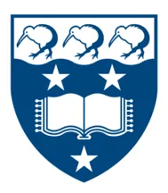
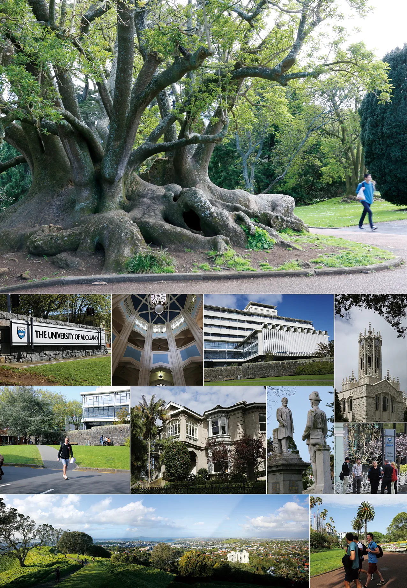
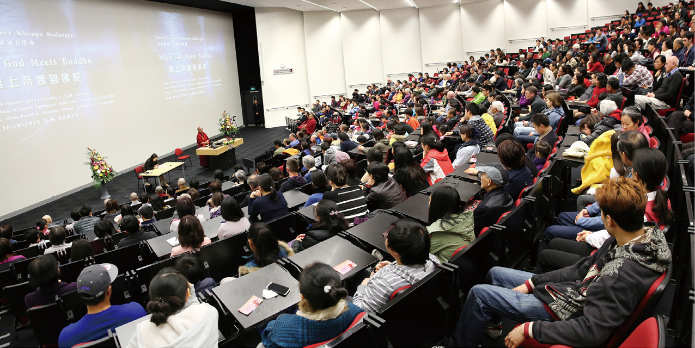
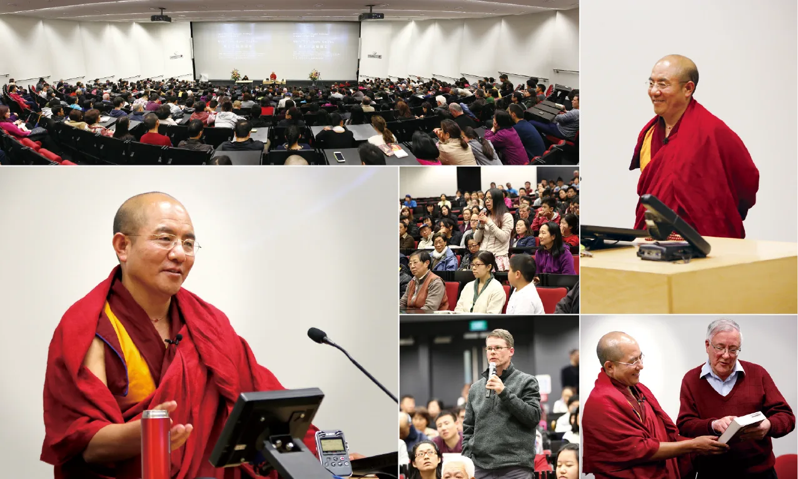
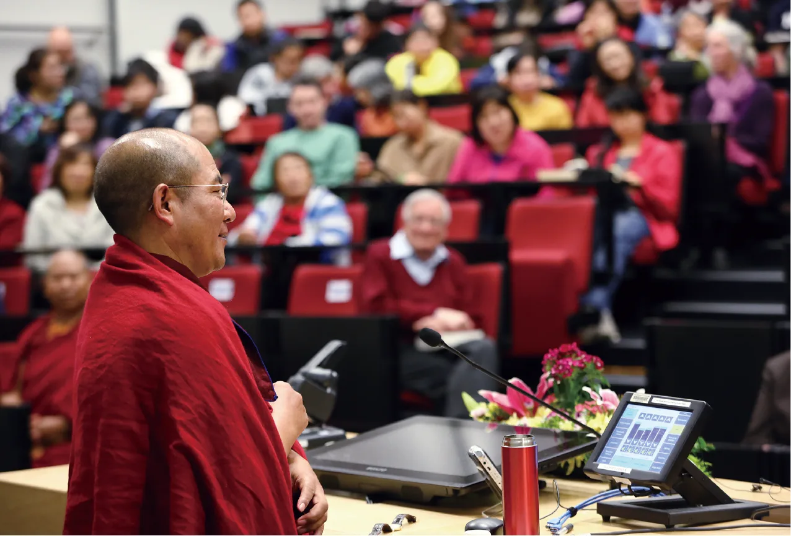

所有宗教徒共存于一个地球上，

应该把相同点最大化，

把不同点最小化。

第89场

新西兰奥克兰大学

University of Auckland

新西兰·奥克兰

2014 / 10 / 4

## 当上帝遇到佛陀

## When God Meets Buddha

主持人：

下午好，欢迎各位参加索达吉仁波切的讲座。我是Elaine Wainwright教授，奥克兰大学艺术系神学研究方向的主任，今天非常高兴与荣幸能够邀请索达吉仁波切来到我们学校。

仁波切将为我们做题为“当上帝遇到佛陀”的演讲，我想这一内容肯定会开拓我们的眼界。我们大多数人都认定佛教是无神论，而其他许多宗教是有神论，那么就让我们拭目以待，仁波切将带领我们进入“当上帝遇到佛陀”的世界。

有请仁波切——

首先很感谢奥克兰大学邀请我来做讲座，因为有了这样的邀请，我有机会来到新西兰这个美丽的国度。这也是我第一次来新西兰。

今天在座的老师、同学，还有各宗教的兄弟姐妹，以及一些没有信仰的朋友，我很乐意跟大家交流。虽然我是佛教徒，但是对于有或没有信仰的任何人，都会平等地尊重，希望跟你们找到共同语言。

## 一、千年智慧老人

我本人对很多宗教都颇有兴趣，为什么呢？因为人类需要一种共同的追求和理想，而宗教在这方面的作用是不共的。世上的很多宗教虽然教义有所不同，但都是让人类走向美好、让文化走向光明的教育。

宗教跟其他学说、文化或思想相比，有一个显著差异——学说等诞生后，很可能不到几十或几百年就销声匿迹了，而宗教一般都有很长久的生命力。比如印度教由吠陀教发展而来，而吠陀教诞生于公元前2000年左右，距今4000多年；犹太教与古罗马教也诞生于公元前2000年左右；佛教诞生于公元前500年左右；道教、儒教以及印度耆那教，也出现于同一时期，都有2500多年的历史；基督教源于公元1世纪，距今2000多年；还有伊斯兰教，大概公元7世纪出现，主要起源于阿拉伯半岛，也有1500年左右的漫长历史。

另外，对于古希腊哲学，比如柏拉图的哲学思想，有人认为它属于一种宗教形式的哲学，它大概出现于公元前400年，距今2400年左右。

虽然关于这些宗教的出现年代，学者们的说法也有差异，但不可否认的是，它们的确存在了很久。所有宗教诞生以来，所走过的路都不平坦，坎坎坷坷、风风雨雨，但是它们都没有倒下去，直至今天依然存在于很多人的心里。这就说明它们的社会价值、生活价值是真实的。

我经常想，这些宗教就如同活了几千岁的智慧老人，一直在关照着人世间。

佛教、基督教等宗教，实际上对人们很有益处，可以帮助人树立正确的价值观。如果世界上没有这些宗教，就会失去道德的约束，那么人类即使在前进，也不知会行至何方。

我个人近几年一直希望尽绵薄之力推动各宗教的和睦相处、稳定发展，希望每个宗教都发挥其真善美的作用。

前几年我跟几位大学老师一起成立了“世界青年佛学研讨会”，这个研讨会每年举办一届，致力于推动各宗教的和谐共处与发展。今年参会人员有来自200多所大学的知识分子以及20多个国家的宗教人士，比如来自美国、加拿大、印度、德国等国的宗教人士，他们的宗教信仰囊括了印度教、基督教、伊斯兰教、佛教、道教以及儒教等等。研讨会上，大家会就一些重要议题，诸如社会责任、心灵教育、环境保护等，以放松、包容的心态进行交流与沟通，并且根据自宗的教义提出解决的建议。

我觉得这样以开放的心态关注一些全球问题，寻找解决方案，是每个宗教徒应有的责任。所以，这样的交流研讨会效果非常好。

你们如果有兴趣，也可以登录“世界青年佛学研讨会”的网站详细了解。之前新西兰的高校师生参与得比较少，希望以后能看到你们的身影。当然，我并不是打广告，因为每年报名参加的人都特别多，比如今年报名2000多人，最后只收了600人，所以并不需要做广告。

## 二、当上帝遇到佛陀，会如何？

今天我们探讨的主题是“当上帝遇到佛陀”。

也许很多人看到这个题目会很好奇：“这个出家人到底会怎么讲？”实际上，我会站在比较公正的立场谈一下自己的认识。

当上帝遇到佛陀，会擦出什么火花呢？

我觉得会是和谐、美妙的火花，因为基督教与佛教有很多共同点。

当然不可否认，基督教与佛教也存在着差异，但是差异不代表会产生矛盾，也不代表要相互排斥。其实不仅基督教与佛教存在差异，即使基督教内部的天主教、新教、东正教，在教义、律条以及仪式上也会有所不同，但是它们并没有因此而互相对立。再观察佛教，也有几大流派——南传佛教、藏传佛教、汉传佛教，它们之间也有诸多不同，比如南传佛教只供奉一尊佛——释迦牟尼佛，而汉传佛教供奉的佛菩萨就多很多，到了藏传佛教，所供奉的佛菩萨更加不胜枚举，但是这几大流派并没有相互威胁、无法共存，或者攻击其他两者不是佛教，而是完全可以和谐相处。

既然所有宗教徒共存于一个地球上，就应该把相同点最大化，而把不同点最小化，如果能这样，会给整个世界带来利益。

基督教与佛教有哪些共同点呢？主要有八个方面。

### 1．祈祷与忏悔

基督教中常常祷告，认为通过这种方式能实现愿望；与此相同，佛教中常常祈祷佛与菩萨，认为祈祷具有巨大的力量，可以成办所愿。

对于往昔的罪业，基督教教导人们在牧师前或教堂中忏悔，而佛教也强调通过在佛菩萨或上师面前忏悔来净除罪业。

### ２．安忍他害

在修炼安忍方面，两者也有相同之处。

基督教《圣经•新约全书》中有一句名言：“有人打你的右脸，你把左脸也转过来让他打。”佛教也有类似的教义，比如“沙门四法”中讲：别人打我时，我不还手；别人骂我时，我不还骂；别人恨我时，我不恨他；别人寻机挑衅，我不报复。

### ３．平等心

基督教中说：“上帝使太阳上升，照耀恶人，也照耀善人；上帝降下雨水，给予义人，也给予不义之人。”这反映出上帝对众生的慈悲是平等的。

佛教中说：“一切皆平等，檀香与斧同。”有人用檀香供养佛，另一个人用斧头砍杀佛，佛陀不会对前者生贪，也不会对后者生嗔，而是平等地悲悯他们，即使大海离开波浪，佛陀对众生的慈悲救护也永远不会离开。

所以，不论上帝还是佛陀，对待所有人——善人抑或恶人，都是一视同仁的。

### ４．简单的生活

基督教提倡节约、反对浪费；佛教教导人们知足少欲、生活简单。

大家都知道，到了21世纪，人类的贪婪与欲望极度膨胀——很多人拥有一辆车还不满足，想要两辆，等有了两辆车，又想要三辆；住着70平方米的房子并不知足，想要100平方米的，等住进100平方米的房子，又开始梦想着200平方米的房子……就这样不断追逐，无有止息之时。

其实如果每个人都肆意地攫取资源，那么地球根本无法满足所有人的欲望。

我昨天问这边的一个人：“为什么路上有这么多车？”他告诉我：“在新西兰，车的数量超过人。”我当时就想：一个人能开几辆车呢？拥有这么多有什么用？

如今确实成了物质主义的世界，几乎人人都在拼命追求物质，希望依靠物质来填补心灵、获得快乐。不过，这种愿望可能会落空的。

现在很多人喜欢苹果手机，不知道新西兰这边怎样，在中国，新出的苹果6特别受欢迎。这次我过来时，很多朋友说：“如果你去美国，一定要给我带很多苹果6，听说那边的‘苹果’很便宜。”我说：“我到美国不是去做生意。”

创始人乔布斯已经离开了，但苹果的更新换代更快了，不知道还会有多少新产品，苹果7、苹果8……每一次更新，很多人都争相购买，不断地换了又换。这其实都是欲望在后面推动。

印度圣雄甘地曾说：“地球能满足人类的需要，但满足不了人类的贪婪。”如果人人都放纵贪欲，最终可能会把世界推向可怕的深渊。

正因为如此，基督教与佛教一致认为：人不能太贫穷，也不必很奢侈，过一个中等的生活就很好。

### ５．布施的理念

基督教倡导人们做布施，比如修建医院、创立学校、帮助贫民等。

佛教也提倡广行布施，而且认为布施有三种——法布施，为别人传授知识和智慧；财布施，给与别人财物；无畏布施，解救众生脱离生命的危难。

### ６．慈悲心

基督教劝导人们无私地奉献，而佛教赞叹大慈大悲心。

我曾经把特蕾莎修女（Mother Teresa, 1910-1997）获得诺贝尔奖时的演讲译成藏文，对于她演讲中提及的两个故事，至今记忆犹新。

有一个故事说，一次她跟修女们在街上见到四个无家可归的人，其中一个人的病情非常糟糕，她跟其他修女说：“你们去照顾那三个人，我来看护这个病人。”

她把这个病人带回去，扶到床上，然后握着她的手，抚慰她，因为此时药物对她已经无济于事了。那个病人竟然露出安详的微笑，她紧紧拉着特蕾莎修女的手，说了一声“谢谢你”，就闭上眼睛死去了。

这个病人临终时的语言和态度，让特蕾莎修女很受触动，她说：“我忍不住反思，如果换作是我，我也许只会说，我很饿、很冷，我快死了。而她没有抱怨和不平，只是微笑，对我说谢谢，她教会了我很多。”

一般人往往对乞丐心生厌恶，但在特蕾莎修女眼中，乞丐也是可爱的。这一点很多人难以想象。

佛教中讲：是不是菩萨，不看他的穿着，不看他的外表，而看他是否有一颗无私的利他心。如果对于任何苦难众生，都能无条件地施予救护，这就是菩萨。

还有一个故事说，特蕾莎修女和其他修女外出时，从街边的阴沟里救出一个人，他的半身已经被蛆虫吃完了。她们把他接到救济所，细心地照料。最后这个人还是离开了。死之前，他说：“我像个牲畜一样在街上活了一辈子，但你们却让我死的时候像一个天使。”这个话，值得很多人思考。

不少人遇到乞丐，即使小小钱财也不愿施舍，但特蕾莎修女却愿意对乞丐付出全部的爱。

另外，在佛教里，慈悲心不仅局限于对人的关怀。

佛教中有一位无著菩萨，在鸡足山修行十二年，下山时看到一只母狗，它下半身已经糜烂，爬满了蛆虫，但是仍然大发嗔心，提起上半身向着路人狂吠。无著菩萨不禁对它生起了深深的悲愍，于是割下自己的肉布施它。

这个故事说明，佛教不仅对人类，对于包括动物在内的一切生命都以平等心施予救护，因为凡是有情都有着同样的苦乐感受。

### ７．去往清净世界

基督教和佛教都认为，行善之人死后会去往清净世界。

很多学者和大德认为，基督教中的天堂与佛教中的极乐世界，是同一个地方。中国近代有一位活了120岁的高僧——虚云老和尚，他曾经在与孙中山以及蒋介石的谈话中说：佛教与基督教本是同源，基督教的天堂实际上就是佛教的极乐世界。

（《空虚的云》一书中讲到，虚云老和尚说：“《水徒行述年纪》载有耶稣早年赴印度参学佛教之经过，以及后来经波斯、土耳其而返以色列传道。此一记录，据云当初原载于《圣经·新约全书》，后被罗马教廷删除。此一考证，似非厚诬。若此说成立，则更可证耶稣可能受佛教之影响，得到《阿弥陀经》，归国另创新教。”）

### ８．同一个救世主

基督教认为有一个救世主来解救人类，他叫弥赛亚，这在《圣经》中有记载。其实弥赛亚跟佛教中的弥勒佛是同一个人。

这种观点不是我提出的，而是一些学者研究的结论。北京大学前副校长季羡林是一位国宝级大师，曾在德国哥廷根大学留过学，他与弟子钱文忠经过多年研究，最终得出结论：基督教里的弥赛亚与佛教未来的弥勒佛，实际上是一个人。这也是打开我们思路的一种观点。

上面的分析供大家参考，我并没有想特别地建立什么。

## 三、宗教大家庭

如果你信仰了某个宗教，不论基督教、佛教还是其他宗教，最好不要改变初衷。有些人最初是基督教徒，后来变成佛教徒，再后来什么都不信，这样一辈子中换来换去不太好。

在不改变信仰的基础上，不同宗教徒可以共同探讨、相互学习，但是没有必要让基督教徒皈依佛教、佛教徒皈依基督教。

我昨天问新西兰的佛友：“你们和当地的基督教徒相处得怎么样？”他们说：“关系很好，我们一起喝咖啡、品茶、旅游。”我觉得应该这样。

世界上一直会有各种宗教徒共存，所以大家应该和平相处。不必说整个世界的人，即使一家人也可能有不同信仰。我认识中国甘肃的一户人家，家中的父亲信基督教，母亲信伊斯兰教，女儿信佛教，儿子是共产党员，没有信仰。不过他们说彼此之间很和睦。

因此，不同的宗教，不需要让一方归入另一方，而是可以在共同的利益与价值观上促进和谐，比如面对有益于全人类的事，大家一起祈祷，一会儿念《圣经》，一会儿念佛经，一会儿念其他宗教的经文。基督教徒可以学习佛经，佛教徒也可以学习《圣经》，对于世上的很多知识我们都应该能容纳。作为宗教徒，有开阔的胸怀非常重要。

我1993年去美国时，了解到托马斯·默顿（Thomas Merton, 1915-1968）的一些事迹。他是宗教和谐的著名推动者，生于法国，父亲是新西兰人，母亲是美国人。他曾就读于剑桥大学和哥伦比亚大学，后来加入基督教，成为一名著名的神父。他认为基督教与佛教没有任何矛盾之处，愿意在有生之年推动二者和谐相处，而且说自己不但是神父，将来还要变成很好的佛教修行人。他曾经与日本的铃木大拙（Suzuki Teitaro Daisetz, 1870-1966）、越南的一行禅师（Thich Nhat Hanh, 1926-）探讨人生及信仰，并且与秋阳·创巴仁波切（Chögyam Trungpa Rinpoche, 1940-1987）有过一次默契的畅谈，而且他们约定次年再会，并合著一本书——比较以及融会基督教与佛教的灵修。不过非常遗憾的是，同年（1968年）12月托马斯·默顿意外去世。

我想大家也应该发愿将来学习其他宗教，并力所能及地弘扬各宗教的真善美理念。

人类的历史证明：以任何一种形式贬低或污蔑他人，甚至想消灭他人而凸显自己，都是一种妄想，无法如愿以偿。因此，各个宗教在有合作空间的地方携手共进，非常有必要。而这样的合作空间，其实很多。

有一位藏传佛教大德，在喜马拉雅山认识了一个基督教修行人，这个修行人在那里闭关五年，佛教大德问他修什么法，他说五年中都在修爱心。其实他所说的爱心，在佛教中称为菩提心，虽然用词不同，含义却很接近，都是一种无私奉献的心。

地球上开着五彩缤纷的花朵，才使得这个家园非常绚丽；今天大家身着各种色彩的衣服，使这个会场分外美丽；同样的，各个宗教展现自己的价值与魅力，也会让这个大家庭更加美好。

我听说奥克兰大学秉持开放、包容的教育理念，由此吸引了来自80多个国家与地区的学生。其实，宗教的学习和研究也需要这种理念，只有这样，大家才会快乐地共存于地球上，而且每个宗教都有自己的人力、物力以及精神资源，将这些整合起来，必定会对全人类做出有意义之事。

最后我在这里特别感谢Buttle教授、Lin教授、Manying Ip教授，以及Wainwright教授和Mullins教授，还有常灵法师，特别感谢你们。谢谢大家！

现场互动

主持人：

下午好，我是Mark R Mullins，日语学院语言文学专业的教授，接下来是问答环节，将由我主持。我邀请了哲学系的同事Joghn Biship教授首先做一个简短的总结，并从他开始提问。如果时间充裕，我们会把话筒传下去，其他朋友可以接着提问。

Joghn Biship教授：

非常感谢堪布给我们带来的演讲，您告诉我们宗教是人类的宝藏，保护这个宝藏非常重要，特别是当我们有幸信仰宗教，能够学习其珍宝般的教义，则是更加难得的，同时您也呼吁宗教之间要相互交流与学习。

我是一名基督教徒，如果能学习一点佛法，也许我会成为更好的基督教徒。我也想尝试一下，因为我手上就有一本您的书《旅途脚印——爱上生命中偶然的遇见》，中英双语对照版本。这本书是以日记形式书写的，现在我想为大家朗诵其中的一段：

“人在生病之时最容易意念死亡……

且记一首南宋宏智正觉之语以自勉：

‘法喜为食，慈悲为舍，

信佛是归，视身如借。

住正念以唯勤，趣外尘而无暇。’

将法喜作为食物，将慈悲作为房舍，将信佛作为归宿，将身体视为借物，精勤地住持正念，无有闲暇趋逐尘世。勿涉足名利，勿贪恋外境，时刻视生命如风中之烛。”

当我看到“慈悲为舍”这句话时，感觉这与基督教的教义非常相似。《约翰一书》第四章第16节中说：“神就是爱，住在爱里面的，就是住在神里面，神也住在他们里面。”当您讲“当上帝遇到佛陀”时，列举了基督教与佛教之间的很多联系和相同点，并没讲述太多有关上帝的内容。不过我想，您并不需要讲述太多，因为您对上帝的看法，在您讲述托马斯·默顿的故事时已经表达出来了。上帝是我们所安住的爱意，只要我们实践这样的爱，也许上帝便与我们同在。

所以我的问题是：基督教中讲的“神就是爱”，可以成为基督教与佛教的桥梁吗？

堪布：可以的。佛教非常著名的论典《释量论》中说：佛的境界是大悲之极。也可以说，佛就是一种爱，爱或者慈悲达到顶点就是佛。

因此，不论佛还是上帝，都是爱达到究竟的状态。不过，这种境界不是一般的语言所能描绘的，也不是平常的思维所能揣测的。

问：曾经有一个基督教教父问我：“佛教说有六道轮回，上帝应该放到哪个层次？”如果是您，怎么回答这个问题？

堪布：如果是佛教讲到的圣者或凡夫，可以用佛教的观点去衡量，而作为基督教里的上帝，应该用基督教的教义去解释。这就好比到了新西兰就遵循新西兰的法规，美国的规矩不一定适用。

总之，各个宗教提及的人或事物，最好用自宗的教义诠解，这样比较合理。

问：大多数宗教有着2000-4000年的历史，而现代科学只有400年的历史，但是现代科学的发展非常迅速，由此导致很多人相信科学而不相信宗教，您如何看待这一问题？

堪布：虽然现代科学诞生以来，发展突飞猛进，但是它主要研究外在物质，而宗教是探索内在心灵的一门学问，这种学问不论在人类的哪个历史阶段，都有存在的必要。

人的心灵通过宗教方法的修炼，可以达到一种至高的境界，而科学对此则无法企及。所以，宗教的教义不需要改革或更新。不过，弘扬宗教的方法可以与时俱进，比如借助一些科学手段。

另一方面，即使科学再发达，宗教的很多内容依然是人们生活中的基本准则，比如佛教中讲的不能杀人、偷盗、邪淫、妄语，是现代人也需要遵守的。

所以在科学昌明的今天，宗教依然具有无可替代的价值。

问：每当我们打开电视或Internet，就会看到世界各地每时每刻都在发生各种自然灾害或人为事故，这让人感觉生命如此脆弱。请问该如何面对这种现象？

堪布：人的生命确实非常脆弱，不论乘车、坐飞机还是走在路上，都有可能突然遭遇危难，前一分钟还在人间，后一分钟就命丧黄泉。

所以，佛教经常教导人观修死亡无常——要常常想到每时每刻都可能是生命的最后一刻，活着时该做的事应该尽量做，而一旦死亡降临，也有一定的心理准备。

应对无常方面，如果进行一些系统学习，会更好。

问：人真的有前生后世吗？

堪布：人确实存在前生后世。关于这个问题，如果要详细分析，可能需要很长时间。我以前在南京大学和西北大学的演讲，以及其他一些课程中，也引用过很多佛教教理与科学依据进行阐述。我还翻译过藏传佛教一本很著名的书《前世今生论》，其中运用教典、理证以及真实可信的案例证实了前后世的存在。

所以，如果你有这方面的疑问，可能需要花时间深入研究一下。

问：今天的这个演讲题目很吸引我，但是我的想象力不够，所以想请堪布帮着想象：如果上帝真的遇到佛陀，会发生什么？

堪布：如果上帝真的遇到佛陀，我想他们不会有任何的利益冲突，不会生起任何的嫉妒心、嗔恚心，会是一次非常美好的际遇，充满慈悲与智慧，远胜一般人之间的相处。

我以前在中山大学曾讲过耶稣的一些经历，实际上他曾去喜马拉雅山求学，接受过佛教的思想。所以，当基督教的思想与佛教的思想融为一体时，也即真正的“上帝遇到佛陀”，此时会怎样呢？我觉得世界上会减少很多哭泣与哀号。

因此，我非常希望宗教大家庭中的所有兄弟姐妹能够有一种凝聚力，非常融洽、和睦地共处，这样也会使得这个世界更加温暖。

问：耶稣是替罪人赎罪，佛陀是宽恕罪人。对一个没有信仰的有罪之人，哪个更有吸引力呢？我们应该去相信谁？

堪布：其实不论基督教的思想，还是佛教的思想，都是宽恕与救赎所有罪人，而且面对伤害自己的人，都以智慧与爱心对待。这一点，不论从佛陀旷劫的菩萨行——为了利益众生，布施头目、脑髓也在所不惜，还是耶稣自我的牺牲——在十字架上示现圆寂，都完全可以体现。所以，佛教与基督教都倡导一种无私、无条件的爱，而这种爱能够吸引芸芸众生。

在这个世界上，唯有无私的爱能带来快乐，而最可怕的就是自私地占有，或者有目的地去霸占别人的权利和财富。

如果观察一下就可以发现，世间的很多爱，本质上是为了自我的利益；而出世间的爱，也即很多宗教所提倡的爱，则是一种无条件的奉献，完全为他人服务。这种究竟的爱，不论在佛陀、耶稣还是其跟随者的身上显现时，都会令人感动。

主持人：

不得不告诉大家，问答部分结束了。我想如果再继续的话，还可以持续几小时，因为还有人在举手，不过我们不得不结束了。

非常感谢堪布的演讲，感谢堪布耐心地回答了这么多问题。很高兴看到普贤净苑的发心人员以及其他参加此次演讲的听众，有这么多人来聆听这个演讲。真希望我学的日语能让我听懂中文，这样就能更好地参与今天的活动了。不管怎样，非常感谢大家的到来，请与我一同再次感谢堪布！
