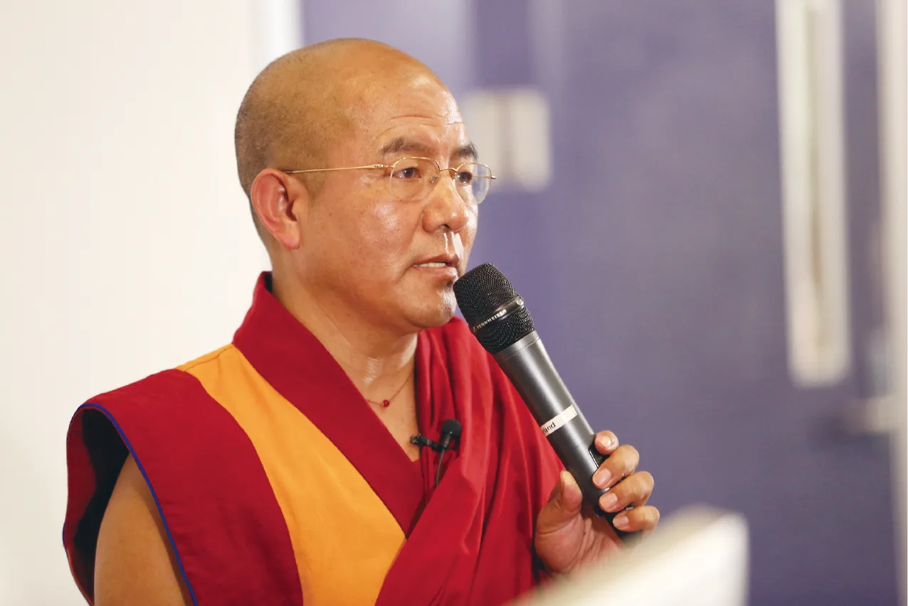
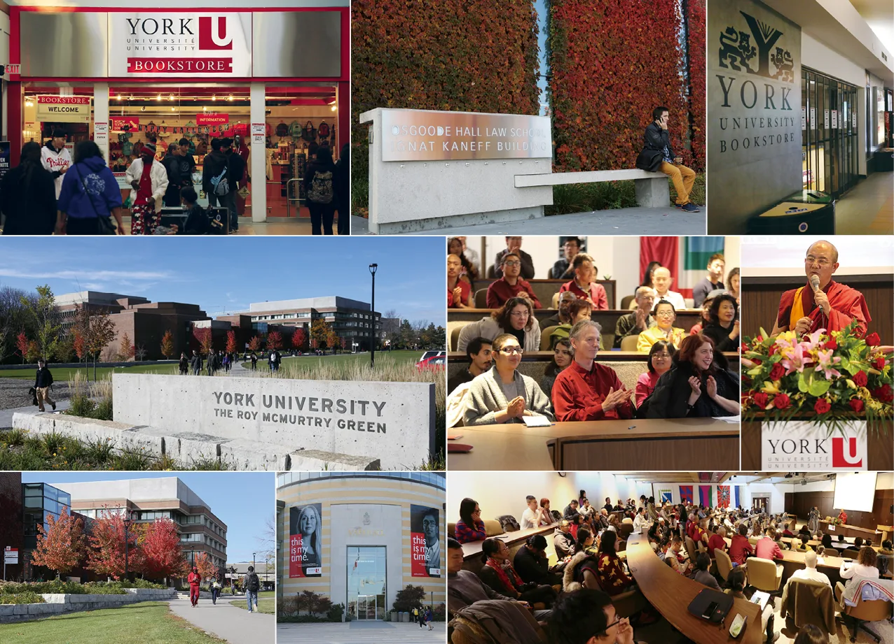
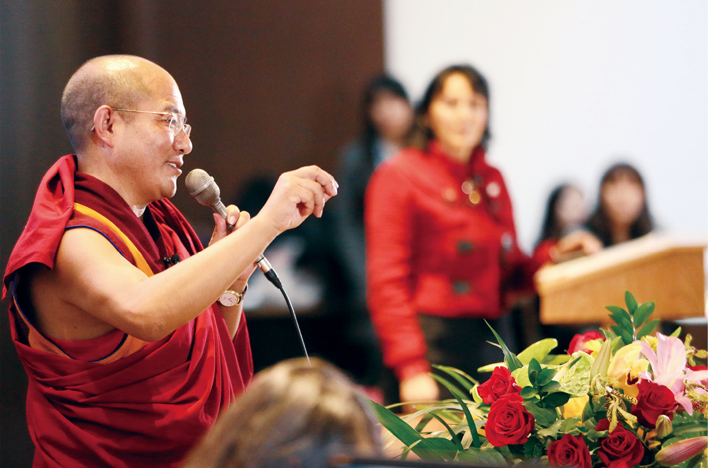
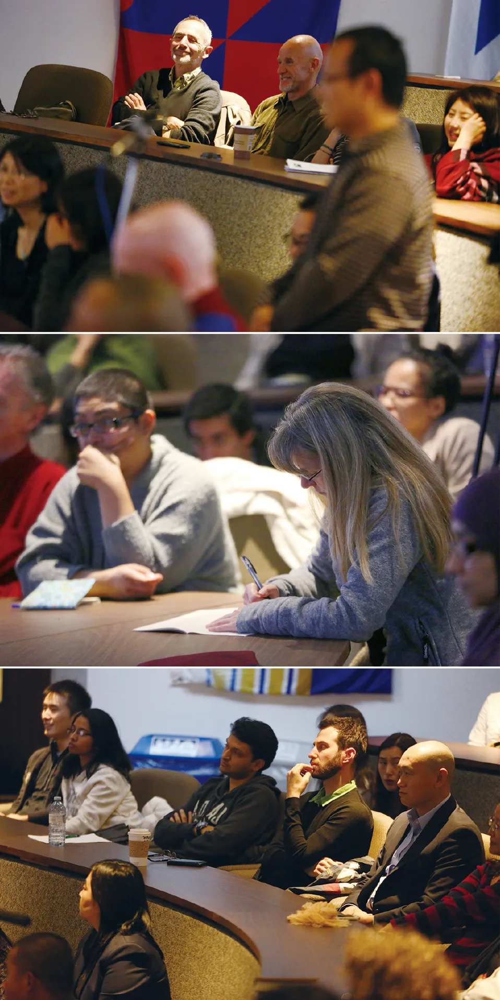
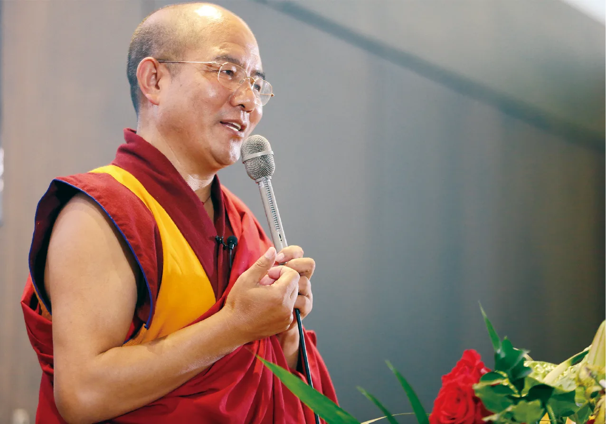
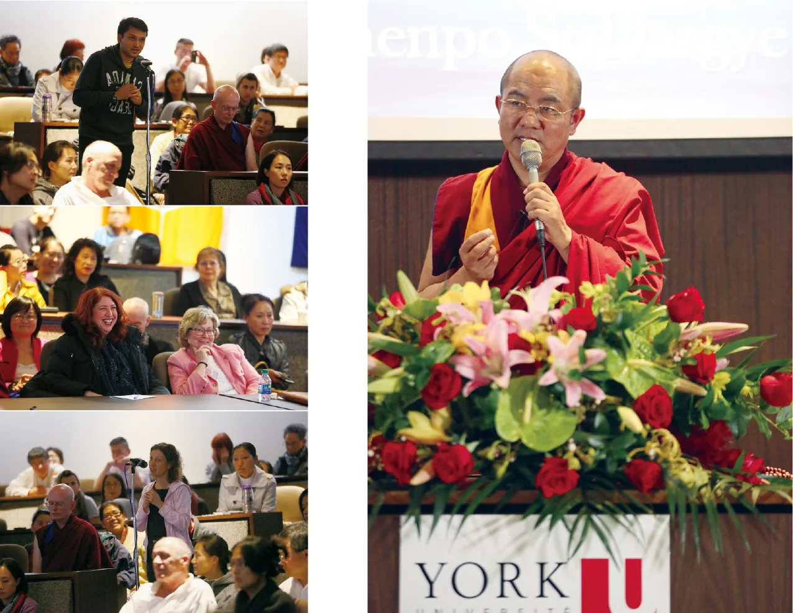
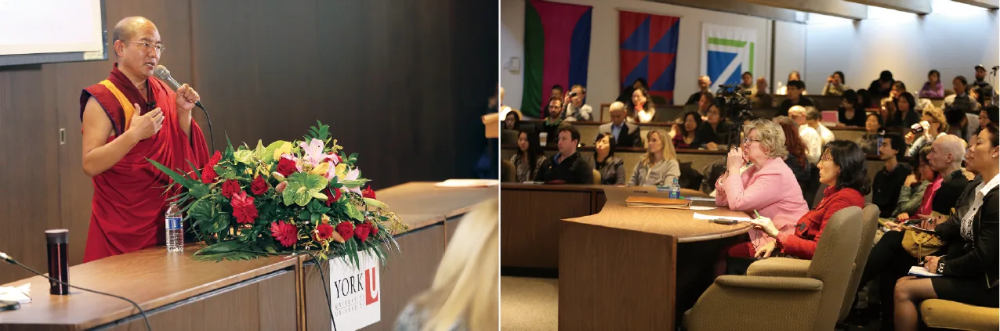
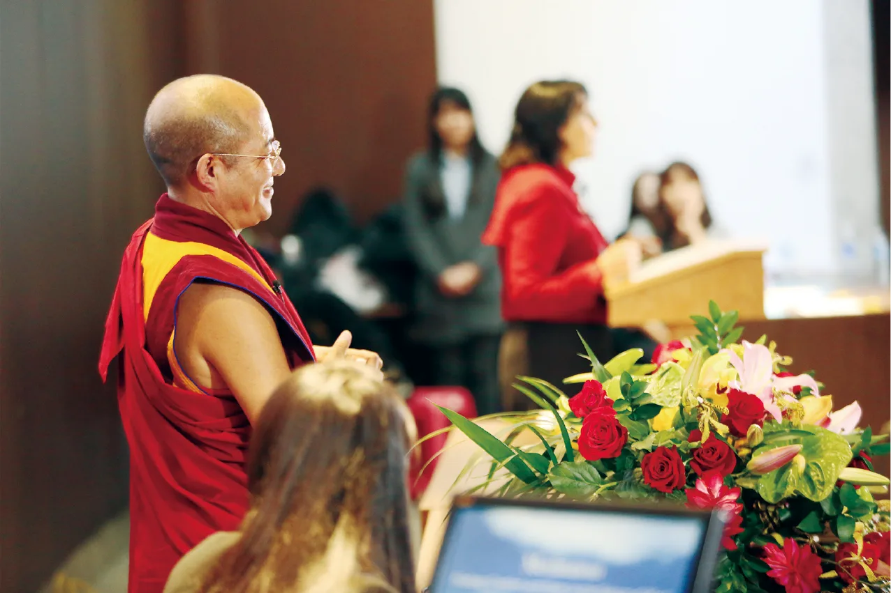

古希腊阿波罗神庙的门楣上，

镌刻着一句箴言：

“认识你自己。”

第93场

加拿大约克大学

York University

加拿大·多伦多

2014 / 10 / 24

## 禅定·心性休息

## Meditation: Finding Comfort and Ease in the Nature of Mind

主持人：

感谢堪布来到约克大学！下面先请我们的代理院长金·伊恩·弥卡舒（Kim Ian Michasiw）教授致欢迎辞。

金·伊恩·弥卡舒教授：

因为文学院院长马丁·辛格现在在香港，所以由我代表文学院对堪布的首次访问表示欢迎。

院长对于没能在现场，肯定会深感惋惜，因为他是个汉学家，对于东方文化特别感兴趣。很遗憾，我本人对此知之甚少，也许我是在座中对灵性传统了解最少的人，而且也非常不擅长致欢迎辞。但有一点想说的是，今年早些时候我被问到约克大学的佛学研究，当时我习惯性地认为我们学院这么大，肯定涵盖了所有的研究领域，所以后来当我知道约克的佛学研究有些欠缺时，非常诧异，甚至有些失望。可能接下来还会有人发言谈到我们现有的佛学研究。

这周前几天，当我知道要代替马丁发言时，我就一直看着今天的演讲题目，看着这些非常普通的词——发现、舒适、安宁、本性、心，有种不一样的感觉。尽管我知道这些词，但把它们放在一起时，让我感到它们像一门外语。不过我想，今天的演讲嘉宾肯定不会被这些词所代表的甚深含义所困扰。所以，一会儿我们就会把讲台让给更让我们期待的演讲嘉宾。

托马泽维斯基教授：

非常感谢弥卡舒博士。我是托马泽维斯基教授，研究文化领域。

能邀请到如此高水准的佛教大师——索达吉堪布来约克大学演讲，我们由衷地高兴。设想一下，有这样一位学者，完全精通康德、海德格尔，以及法国存在主义哲学——这能帮助我们想象堪布的渊博知识、深广智慧、超众辩才以及推理能力，而且堪布本人非常谦逊、风趣幽默。

接下来我们就会领略到堪布的非凡魅力。我想今天天空湛蓝、阳光灿烂，也代表我们对堪布的欢迎，代表我们内心的喜悦。

今天堪布将给予我们禅修方面的教授。这一话题也是约克师生经常谈论的，尤其在考试来临时。

最近我们正在逐步引导学生培养正念——不断串习自己是利益他人的学者，也是禅修者。为了让大家对这方面有更好的了解，现在请我的同事黛博拉·奥尔，谈谈约克大学禅修教育的现状及未来发展。有请黛博拉。

黛博拉·奥尔：

索达吉堪布的到来让我们倍感荣幸。我认为对于在座每一位，这都是一次珍贵的机会，对约克大学也有深远的意义，因为堪布所代表的文化是我们正关注的领域。

佛教在北美，直到上世纪初才开始广泛传播。那时铃木大拙和其他很多大师，来到西方弘扬佛法，激发了许多人的兴趣。前不久到访多伦多的一行禅师，使得佛教在大众中得到更广泛和热情的认可。可以说佛教正受到越来越多西方人的接受与喜爱。

尤其是禅修，备受知识分子以及更广泛人群的欢迎，因为它可以让人保持宁静、放松，提高专注力。

约克大学很多系设有禅修课程，比如宗教研究系、心理学系，还有我所在的人文系及其他院系。对于这些课程，约克的学生都可以听受，学习如何禅修，如何避免外境干扰，如何提高自我觉照。

有机会在人文系教授禅修，我感到非常幸运。几年前我开设了一门本科课程，不仅学习禅修和瑜伽，同时通过学习理论以深入了解禅修。下半年我有一门研究生课程《正念禅修的入门》，也会学习禅修理论。我认为理论非常重要，原因是：禅修可以帮助我们加强内观、提升觉照；禅修对教育也有很大帮助，可以促进学生成长，使他们更成熟、慈悲、有觉照力——而这一切都扎根于理论学习。所以，堪布今天的演讲一定会给我们带来启发、鼓舞以及不一般的力量。

让我们一起有请堪布——

今天跟大家交流的主题是“禅定·心性休息”。

在如今的时代，相当多的人认为除了追求物质，还需要对内心投以关注，而这跟禅定有一定的关系，所以今天我们共同探讨这方面的内容。

## 一、禅定的意义

什么是禅定呢？禅定在藏文中叫“桑丹”，意思是心专注于某个事物，而发现自己的情绪。人的情绪有正面的、负面的，只有心处于宁静状态才能发现它们。

禅定对于现代人有重要的意义。

有这样一种说法：19世纪肺病威胁整个人类，20世纪战争和癌症是人类的大敌，到了21世纪，焦虑、忧郁、恐惧等心理疾病席卷这个世界。对于这种说法，大家应该有所体会，上个世纪确实爆发了许多战争，本世纪中，人们内心不断涌现贪婪、嗔恨等烦恼，由此引发很多心理疾病，比如抑郁症、孤独症、恐惧症等等。如今不论在大学、中学等教育群体，还是其他各类社会群体中，患有心灵疾病的人，都在日益增多。

一个人一旦出现心灵问题，就会始终被痛苦笼罩，甚至失去生存的勇气而选择自杀。虽然自杀很不明智，但是人如果无法控制情绪，就可能走上这条路。

今年8月，美国著名喜剧演员罗宾·威廉姆斯（Robin Williams, 1951-2014）自杀身亡，这一消息令人震惊。据调查，罗宾·威廉姆斯生前患有抑郁症，长期饱受焦虑、失眠的折磨。随后美国精神健康研究所主任托马斯·尹塞尔对《今日美国报》说：“必须认识到，抑郁症是一种威胁生命的疾病。”托马斯还提到：几十年来，美国自杀率居高不下，每年平均自杀人数达3.9万人，远远超过他杀或者交通事故死亡的人数。

自杀率的不断攀升，成为很多国家面临的棘手难题。这方面也值得大家思考。

虽然现代人不像古人那样物质生活匮乏，除了非洲等个别地方，其他地方的人基本都有充足的衣食受用，但是如果缺少调节内心的能力，那么即使物质生活很优越，仍然可能陷入极大的不安与痛苦中。

在这种情形下，越来越多的人，不论大学老师还是商界人士等各阶层的人，都开始关注心灵，觉得有必要学习心灵的知识，有必要借助禅修等方法让心灵强大。

对于禅修，西方人应该不陌生，因为这边的高校和社会团体常常开展禅修活动，这对调节情绪、净化内心，以及消除烦恼，诸如贪婪、嗔恨、愚痴、傲慢等，确实具有巨大的作用。

## 二、如何修持禅定

### 禅修的方法

禅修时，要掌握一定的技巧。

首先身体以毗卢七法安住，或者很安静地坐下来。之后，心专注于某个事物，比如一朵花、一只瓶子，如果有信仰，可以专注于佛像或十字架。这样修持时，不要闭眼睛，如果平时戴眼镜，此时最好摘下来。不过，如果外面的景象让自心无法安住，那么闭上眼睛也可以。另外，呼吸要舒缓，这样内心的浮躁会慢慢平息。

在这种状态中持续安住，越久越好。如果一开始实在无法坚持很久，那么短短的三五分钟也可以。

这是一种比较简单的初级禅修方法，目前也很流行。

### 禅修的歧途

禅修过程中，要避免几个歧途。

第一，禅修时，感觉内心处于光明中——没有任何黑暗、明明清清、了了分明的状态，但是并未认识心性。这种“明”的觉受并非最究竟的境界。

第二，感觉远离了所有痛苦，很快乐、很舒服，以至于不愿起定，想要一直保持下去。这是“乐”的觉受，虽然暂时可以修，但是也不究竟。

第三，贪、嗔、痴、慢、嫉等粗大分别念全部消失了，也没有明或乐的感受。这是“无念”的状态，也不是最究竟的禅定。

“明”“乐”“无念”三种状态，虽然没有粗大的分别念与痛苦，但只是世间凡夫的禅定。

如果境界进一步提升，这三种觉受也消失了，而处于“空性”的状态，就达到中等禅定的境界。

## 三、最高的禅定

### 认识你自己

虽然“明”“乐”“无念”“空性”四种禅境，有一定的作用——可以压制生活中的各种妄念，但是要把这种境界长期坚持下去，就需要更高的修法，也即“胜观”。仅仅不起分别念而安住，在佛教中叫寂止，要把寂止延伸到日常的行住坐卧中，而不是仅仅局限于入定时，就需要胜观的摄持。

如何修持胜观呢？可以这样去观察：当我们的心安住时，各种烦乱就自然消失了，但是这种状态常常无法保持，原因在哪里呢？就在心上——心安住时为何不再烦乱？安住的心到底是怎样的？如果能这样观照，一旦认识了心，就认识了真正的自己。

古希腊阿波罗神庙的门楣上，镌刻着一句箴言：“认识你自己。”很多人觉得这太简单了——“我是医生”“我是律师”“我是老师”“我是飞行员”……认为这样就算是明白这句话了。其实并非如此。

大家各自想一想：“到底我是谁？我认识自己了吗？”实际上，最高的禅定就是认识自己。

世间人都认为自我存在，当然佛教并不否认名言中假立的“我”，但是佛教认为运用智慧观察时，“我”是无迹可寻的。

很多人也许心生不解：“我明明存在呀，我的身体就是我。”但是身体无外乎头颅、四肢、内脏……这其中哪个是“我”呢？都不是。

还有人说：“身心的聚合是我。”如果分开观察身与心时，都找不到“我”，那聚合起来又怎么会有“我”呢？比如五个人中的每一个都没有钱，他们聚在一起，会出现钱吗？也不会的。

还有人认为：“心就是我。”对此可以详细分析：心主要有五根识和意识，它们住于身体的哪个部位？是怎样的颜色、形状和体性？这样一观察，就发现根本找不到它们。

这种方法非常有用。当你非常生气时，胸中好像有颗要爆炸的嗔恨心，但真正观察时，这颗心到底在何处呢？身体的里里外外、上上下下都找不到。这一点即使小学生也能知道，确实找不到。

如果心不是有的法，那是否是无的法呢？也不可能。因为有、无互相观待，如同东、西一般——如果有的心不存在，无的心就更加无法立足。所以，心也不能是一无所有的单空。

心不是有，也不是无，能否是有无兼具呢？也不可能。世界上不可能有一个法既有也无，因为有与无是互绝相违的，不可能并存一处。

心不是有、无抑或有无兼具，那更不可能是有、无之外的法。

这样观察下来，有些人也许会问：“心到底是什么呢？”实际上心无法用语言表达，无法用思维分析，它的本体不可思议。如果证悟了这种无可言思的境界，就成就了最高的禅定，进入圣者的行列。

寂止只是让心宁静，如果进一步认识了心的本体并安住其中，就叫做止观双运。一旦拥有这种境界，禅定永远不会退失，各种外缘也无法扰乱内心。相反，如果没有达到这种境界，而只是内心平静安住，那么你在房间闭目入定时，自我感觉良好，但是走出房间遭受损害时，烦恼就会死灰复燃，因为寂止只是压伏烦恼，无法断除种子。总之，单一的寂止与止观双运有很大差别。

### 心态是关键

现在有些人内心非常敏感，微小的事都可能令他们陷入痛苦。尤其抑郁症患者，别人的一句话、一个表情、一个动作，都会在他心里引起轩然大波：“他为什么这样呢？肯定是针对我的……”这就是无法掌控内心的表现，如果常常处于这种状态，身体也会受到危害。

而一旦证悟了心性，或者具有很好的禅定，那么面对不顺心之事，或者不公平的待遇，都能轻松化解，转为快乐的因素。

这正是佛教所讲的，如果认识了心，它就化为智慧；如果没有认识，甚至误解它，它就现为烦恼。

世间很多事物都是如此，我们对它们的认知与态度，决定了它们是利还是弊。

美国斯坦福大学心理学教授凯利·麦格尼格尔，历时八年追踪3万名美国成年人，研究压力对人的影响，最后发现：相信压力有害的人，压力确实会让他们常常失眠、内分泌失调，乃至罹患心脏病、癌症；不认为压力有害的人，即使承受很大的压力，身体也不会受到影响，甚至比压力较小者更为健康。

这告诉我们一个道理：真正有害的不是压力，而是我们看待压力的态度——认为压力有害。

就我自己而言，在佛学院的教学与管理中，不论面临多么繁重的事务，都尽量不把它们当成痛苦，而是看作一种享受——这些事很有意义，丰富了我的生活。而且面对跟我个人有关的，不论正面抑或负面的言论，我都把它们当作调剂心灵的妙药。这种方法确实很有作用，能令违缘转为顺境，而且真的如我所想那样——带来乐趣和饶益。

以前藏地有些禅定境界很高的人，因为某些原因被关进监狱，但是他们把监狱看作天堂，确实也可以自得其乐。相反，很多人住在豪华的别墅中，却如同身处地狱，内心痛苦不堪。由此可见，外境虽然对人有一定影响，但快乐与否，根本还在内心。

## 四、认识内心的层次

认识内心有两个层次：

### １．中等的层次

这种层次，只要经常禅修就可以达到。

一旦拥有这种境界，自然会对生活充满信心，做事饶有兴致，而且与人交往时不会畏惧。

### ２．较高的层次

也即认识了心的本性。这需要长期的努力才能达到。

有些人也许看过顶果钦哲仁波切的传记，他曾在偏僻的险峻森林进行长达十三年的闭关。后来他对人类做出了怎样的贡献，大家有目共睹。还有我的老师法王晋美彭措，整个“文革”期间几乎每天都在森林、山洞或帐篷中，不间断地实修。我1985年见到法王，之后一直依止他，也发现法王每天上午都在一个小木头房子里禅修。因此，想要证悟心性，依靠短时间的修行并不足够，而是需要经年累月的努力。

顶果钦哲仁波切和法王如意宝这两位伟大导师，在引导人类心灵方面做出了不可磨灭的贡献。我们不一定能像他们那样，但如果能了悟心性，或者有长久安住的能力，那么生活中的很多痛苦会烟消云散，与家人、同事等都可以和谐相处。

总之，心的力量一旦开发出来，不仅能解决个人问题，而且心中的智慧与悲心投射出去，对周围的人也会带来饶益，乃至对整个世界都会有不可估量的作用。

## 五、心灵教育至关重要

我觉得不论在古代、现今还是未来，教育都是举足轻重之事。

由于教育的差异，有些人得到成长，有些人不断堕落。比如同龄的两个孩子，一个接受了优良的教育，可能获得诺贝尔和平奖，另一个受到恶友的教唆，可能参加恐怖组织，杀人无数。

所以，良好的教育可以造就人，也可以改变世界。

在座的很多老师都非常优秀，不论研究社会学、心理学还是其他专业，你们的科研成果都颇具价值，而且备受好评，不过我认为，作为老师，教育学生也是不容推卸的职责，而在引导学生时，心灵教育不可缺少。为什么呢？因为大学如同一个人才加工厂，如果培育出的是只懂技术知识的人，那么到了社会上，面对纷繁复杂的问题，就会难以应对，所以传授心灵学问也非常有必要。

在如今的西方，科学技术非常发达，但是要寻觅心灵的奥秘，也许在古老的东方文化中，会发现很多具有价值的珍宝。

最后特别感谢院长以及其他师生们的支持，以此机缘我们才可以在这里交流佛法。谢谢大家！

现场互动

主持人：

感谢堪布亲切而透彻的演讲，让我们对于“心性”这个十分难以理解的主题，有了新的认识。

下面是答疑时间，提问者请站到中间的过道，那里有麦克风供您使用，请排好队，耐心等候。

问：能否说灵魂是“我”？

堪布：“灵魂”就是心识。

在没有细致观察时，暂时可以说心识是“我”，这颗心识今生是人，下一世变成动物，再下一世又成为人，不断流转；但如果用佛教的空性智慧分析时，心识也不存在，所以不可能是“我”。

也就是说，暂时的显现中，身体和心识存在；进行观察时，身体不存在而心识存在；再深入观察时，二者都不存在。

一旦认识到心识了不可得——并非理论的了知，而是真实的证悟，就会获得圣者的果位，成为菩萨或者佛，再也不会流转。

问：禅修能否帮我们抉择人生方向？比如从事什么职业、树立什么目标……

堪布：这要看你的禅修境界——如果境界很高，可能不仅人生的大问题，甚至前方是否堵车之类的小事，也能看得一清二楚；如果境界不很高，那么要通过禅修来规划人生，有一定困难。

如果是后一种情形，可以运用智慧选择人生路，之后不断祈祷来促成愿望实现。如果有信仰，可以祈祷佛菩萨，或者做一些善事，这些对实现心愿都有帮助。

总之，达到很高禅定境界的人，对于生活中的简单问题完全能轻松解决，自然能观照更长远、更隐蔽的事，乃至抉择人生大事。但这对禅定境界不高的人，是不太可能的。

问：如何跟关系不好的人相处？

堪布：关键是保持一颗慈悲、包容的心，这样不论别人如何伤害自己，都不会生起怨恨，能够与之和睦相处。诺贝尔和平奖获得者马拉拉也说：我甚至不怨恨想要杀害我的人，这是我从耶稣和佛陀等先知身上学到的慈悲。

反过来说，如果没有慈悲与包容心，那么即使别人对自己很好，自己也可能经常对对方心怀嗔恨。

问：我禅修时会观想一个太阳，以此让思绪不被打扰，这样可以吗？

堪布：这样虽然能暂时压制烦恼，但并不究竟，就像吃止痛片临时止痛一样。要从根本上解决问题，还是要认识心的本性。

问：我目前的禅修，只能断断续续地专注，该如何提升呢？

堪布：禅修时，入定时间越长越好，但是如果出现散乱、昏沉，就会无法继续。所以要提升禅定，先应寻找一处寂静的环境，之后坚持不懈地修持。当然，刚开始每一座短一点也可以，随后慢慢不断加长。总之，长期下功夫是唯一的办法。

问：佛教中讲贪嗔痴是痛苦之源，但是像乔布斯对事业也有贪心，那么贪心到底是社会发展的动力还是阻碍呢？

堪布：佛教确实说贪心等是痛苦之源，不过佛教也说正当的希求是需要的，比如对事业的正常追求，这并不是很严重的贪心。

贪心是一种过度的染著、吸引的心态；而嗔心则是一种过度的排斥、厌恶的心态。本来不好的东西，你认为非常好，从而贪执；本来不用弃舍的东西，你拼命抗拒，从而嗔恨。这些心态都不符合对境的真相，会给生活带来负面影响，因此佛教会进行遮止。不过，佛教并不否定人们对生活的适当追求。

问：心的本性是一种明清的觉知吗？

堪布：心的本性是明空无二的——一方面是空性，另一方面还有明明清清、不可思议的一种光明，空性与光明无二无别。这种境界需要依靠窍诀性的实修才能现前，语言是很难真实描述的。

问：有没有可能用寂止的方式修持空性？

堪布：有些人也可以。

问：在生活中遇到不顺心的事时，我常常会发脾气，此时如何用最简单的方法对治？

堪布：面对不顺心的境遇，很多人会禁不住发火，此时最好让心暂时平静一下，像大树一样安住两三分钟，这样烦恼就会有所减弱，不那样猛烈。尤其如果想辱骂别人时，不要马上口出恶言，先冷静三分钟，之后再有所行为，这样本来要犯的恶口也许就不会成功了。

所以，暂时安住是对治烦恼最简单的一种方法。

问：我是多伦多大学的学生，这里的每个学生都面临分数的压力，您觉得有办法解决这种问题吗？

堪布：不仅是你们学校，现在全世界的学校基本都是分数至上，不培养学生的心灵，只培养学生的分数。

实际上，学校教育中，一方面要关注学生的分数，但同时也要注重培养他们的慈悲心等品质。如果能树立这样的教学理念，分数压力的问题就会得到缓解。你是一名学生，那么可以请求老师多传授慈悲心方面的教言，或者给校长写封信提个建议，可能问题会有所解决。

问：如果想达到较高的禅定境界，是不是必须变成佛教徒？

堪布：要达到很高的禅定境界，一定要借助佛教的方法，尤其胜观的智慧。

目前东西方的很多学校和寺院常常举办禅修活动，但大多只是比较简单地调节一下心态，平衡一下心理，这对缓解烦恼有暂时的作用，从这个角度而言有其必要性，不过要想长期保持寂静的心态，就需要让禅修不断深入，而这方面一定要借助佛教的方法。

虽然是这样，也并不要求禅修者非要成为佛教徒不可。即使没有佛教信仰，也完全可以使用佛教的方法。

问：在修心过程中，我经常发现自己积习难改，从而很泄气，这时该怎么办？

堪布：一名学生要完成学业，会经历种种不顺；一位企业家要创办企业，也会遭遇很多坎坷；同样，修行的道路，也并非一帆风顺，可能会有很多磨难。

不仅是我们，即使一些高僧大德，比如顶果钦哲仁波切，也是历经十多年的不懈努力，克服了很多困难，最后才获得成就的。

所以，通向目的地的路上出现曲折，是一种自然规律。

当然，你能认识到自己的不足，这很好，但是不能放弃努力。如果一直坚持走下去，即使有时对自己有些失望，但是只要不断往前走，为了实现目标而创造各方面的顺缘，那么到了一定时候，修行的路自然会顺利，会有所收获的。

所以，不断努力是最关键的。

主持人：

我们会不断努力，应对这个时代给我们的挑战。再次感谢堪布不远万里，从中国来到加拿大跟我们分享他的智慧！
