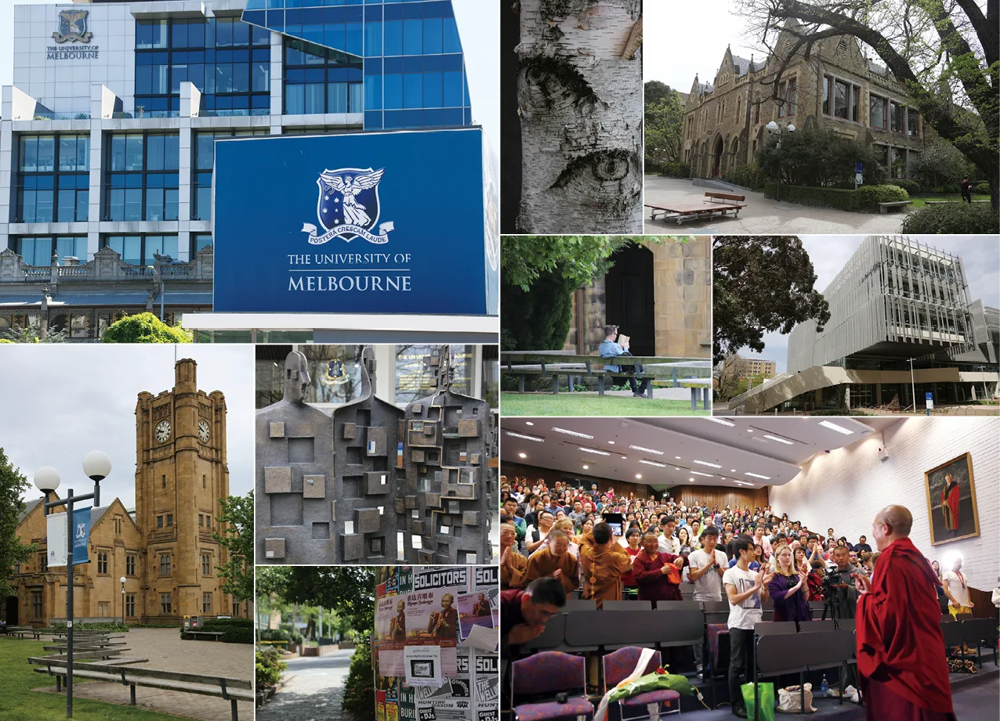
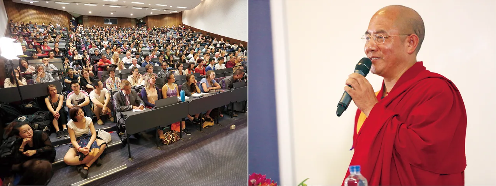
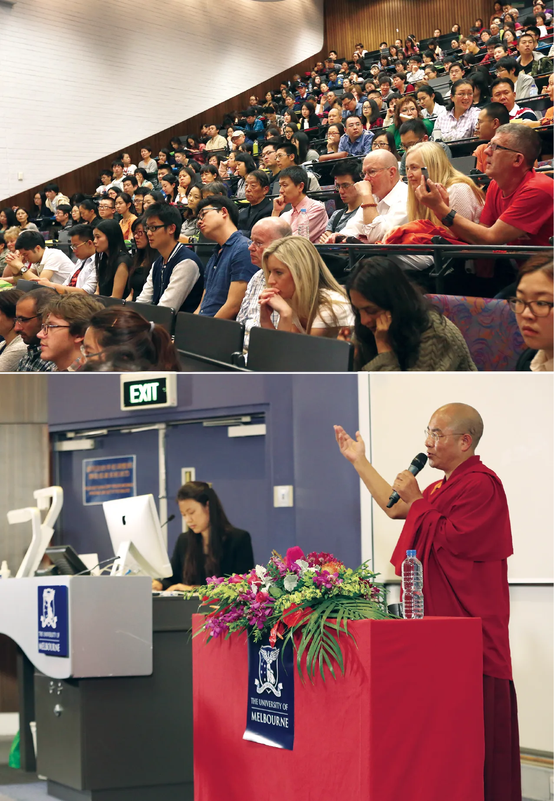
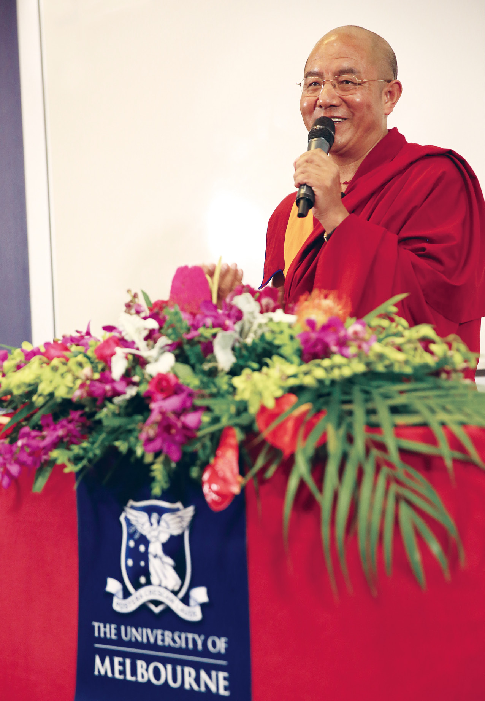

如果能有超高像素的相机，

把藏族人内在的慈悲拍下来，

可能更精彩。

第92场

澳大利亚墨尔本大学

University of Melbourne

澳大利亚·墨尔本

2014 / 10 / 19

## 藏传佛教的慈悲幸福观

## Compassion and Happiness: The View of Tibetan Buddhism

主持人：

女士们、先生们，大家下午好，欢迎来到墨尔本大学参加这么一个特别的讲座，今天我们邀请到的嘉宾是索达吉堪布仁波切。

首先请各位在整个讲座过程中，关闭手机或调成静音，避免不必要的走动，尽量保持安静。

今天的活动分两部分：首先是五十分钟的演讲，堪布将为我们讲解“藏传佛教的慈悲幸福观”；之后是问答环节。在问答环节，如果您有问题，欢迎举手示意，或者把问题写下来交给我们的工作人员。

索达吉堪布仁波切是一位享誉海内外的佛学家、佛学翻译家以及慈善家，是当今世界最大的佛学院的大堪布。堪布曾应邀前往世界很多大学演讲，与世界各地的专家、学者和师生进行各种主题研讨和交流。2013年堪布被媒体评选为“中国年度宗教面孔”，成为中国最具影响力的藏传佛教领袖之一。

下面有请墨尔本大学佛学社主席莉迪亚·布朗女士致欢迎辞，掌声有请。

莉迪亚·布朗女士：

很高兴能代表墨尔本大学欢迎尊敬的索达吉堪布来我校演讲。

堪布是一位著名的藏传佛教上师，长期以来不遗余力地投入佛学的翻译与著作中，出版书籍已超过100本，包括最近的畅销书《苦才是人生》。这些译作和著作，使得世界各地的人可以更方便地了解佛教，很多人的心灵被佛教智慧所触动。这也是堪布的愿望，堪布一直祈愿能教给人们获得宁静与幸福的方法。

近年来，堪布在很多大学巡回演讲，比如哈佛大学、哥伦比亚大学、北京大学。在这些高校，堪布与顶尖学者们对话，就这个时代的重要问题进行探讨，诸如可持续发展、心灵科学、如何过得有意义等等。堪布所传授的理念，紧密结合现代生活，与时俱进，深受听者的欢迎。

同时，堪布提倡通过跨文化交流、跨学科对话，帮助人们增进个人发展、提升幸福感。而在今天，堪布也将为我们讲述慈悲与幸福的奥秘。

所以，我谨代表墨尔本大学和墨尔本大学佛学社，热烈欢迎索达吉堪布！感恩您的到来——

首先非常感谢莉迪亚主席，以及在座的各位。因为因缘聚合，我们有了今天的交流。

我是一名佛教徒，来自靠近喜马拉雅山的藏地色达，那里的海拔约四千米。我昨天特意算了一下，色达与墨尔本相距约9466公里，所以我这样一个高原佛教徒来到这里，就如同茫茫大海中出现了一座孤岛。

不过我想，东方人与西方人，南半球人与北半球人，虽然有文化的差异、习俗的不同，甚至肤色的差别等等，但是大家有一个共同点——追求幸福。比如今天在座的诸位，不论是什么身份，一定都孜孜以求身体与心灵的安乐，或者说物质的快乐与精神的愉悦，那么在这一共同目标的牵引下，我们会有很多共同语言，今天的交流也会很有意义。

今天我们一起探讨的是“藏传佛教的慈悲幸福观”，主要介绍佛教的幸福观。虽然是这样，在座有些人不信仰佛教也无妨，为什么？既然大家的共同愿望是追求幸福，佛教能否帮助我们实现这一愿望呢？是可以的；不信仰佛教的人能否得到这种利益呢？也是可以的。

可以说佛法是一门包罗万象的学科，佛教徒把它当作修行之道来接受，学者把它当作研究对象来接受，艺术爱好者也可以从中汲取所追求的知识。不同身份的人都可以从中受益。

所以，我始终觉得佛法是人类智慧的结晶，是人类文化的精髓，值得很多人把它当作精神妙药。它如同一服好药，有人可以把它当成食品，有人可以把它看作营养品，有人可以把它作疗病之用，虽然用法不同，但是每个人都可以从中得益，而这也是每个人所需要的。

正因为这样，我经常去学校、企业等地方，尤其没有信仰的地方，交流佛教的思想。我并不是非要传播佛教不可，而是觉得佛教的很多理念是人们所需要的，佛教的很多真理是人们应该明白的。

## 一、挽救消失的文化

在如今的时代，一方面科学技术突飞猛进地发展，创造了种种便利，但另一方面，很多珍贵的传统文化却在逐渐消失。

我记得有一位美国名人曾说：如今极其发达的科学技术，日益让世人变得如同近邻一般，但是人与人之间仍然缺少情同手足的道德观念。当时他所处的年代，交通、信息等远远不及现在，但是依然发出那样的感叹。如今高科技确实已经铺天盖地，可以让全世界的人近如咫尺般对话，这是一种超越，但是它的背后却隐藏着忧患——人类历史上很多有价值的文化、思想与理念逐渐地隐没了。

在这种形势下，作为年轻人，既要追求科学知识，同时也不能遗忘传统文化，因为传统文化作为一种精神财富，可能是人类更需要的，也是陪伴人类更长久的。

## 二、慈悲，幸福之源

### 慈悲的福佑

这里的慈悲，跟一般人所说的爱有所不同：爱是一种自私的心态，付出的背后附有条件，给予的同时带有目的；而慈悲则不同，尤其佛教的慈悲，是一种非常高尚的心态，是无条件的奉献与关怀。

如果心中没有慈悲，有的只是自私，虽然追求幸福，却可能会感受无量的痛苦。

这一点，并非仅是佛教的说法。有智慧的人可以思维：如果地球上的人都非常自私，最终的结果会怎样？确实比较可怕。为什么？因为人们会在自私的驱动下拼命攫取资源为己所有，而地球资源是有限的，不可能满足所有人，即使要满足这一代人也非常困难。若是完全不顾他人、只管自己，那么后果可想而知。

如今很多人常常被恐惧、担忧、焦虑等情绪所笼罩，原因是什么？也是自私，因为一心想保护自我，由此就看不惯很多人，尤其跟自己敌对的人。相反，如果能培养慈悲心，愿意帮助别人，那不管接触什么人，都会很快乐。

著名诗人莎士比亚（William Shakespeare, 1564-1616）曾说：“慈悲有双重福佑，它赐福于施与者，也赐福于受施者。”确实如此，这一点大家在生活中也看得到。

这样的慈悲心，如何才能生起呢？

大家都知道，人的体能通过锻炼可以提升；同样，人的慈悲心通过修炼也可以增上。不过身体的能力有限，不会达到无尽，而心的潜力却无穷，甚至可以变成无有止境的爱。

### 他们的笑容，源于慈悲

这次我来到澳大利亚，很多人问我印象如何。我说：“从某个角度而言，这里称得上是人间天堂，虽然GDP不一定很高，但人们内心的满足感，是很多地方无法相比的。”

不过我这样说，你们也不要太高兴，因为你们的内心快乐不一定比得上一个贫穷的藏地人。说实在，我在藏地生活的几十年中，发现很多藏族人虽然物质条件非常贫乏，但是内心却始终充满欢喜，脸上常常挂着笑容。这其中的最主要原因，我认为是慈悲心——在藏地，随着佛教的传入，人们受其熏陶，内心的慈悲得以萌发与生长。

而藏地有慈悲心的人，可以分为两类。

第一类人，文化层次比较低，不懂得高深的理论，但是因为佛教早已融入藏地的生活，所以他们从小自然就有慈悲心，会发自内心地想：我要利益天下的所有众生。

很多藏地人，点灯时会发愿“愿灯光遣除所有众生的心灵黑暗”；转转经轮时，会祈愿“愿慈悲在这个世间不断地转动、传递”。当然，我不敢说所有人都这样发愿，但确实相当一部分人是这样。

大城市的一些人到了藏地，特别喜欢拍藏族人转转经轮的照片，这也很好，不过我想如果能有超高像素的“相机”，把藏族人内在的慈悲拍下来，可能更精彩。

还有，一些人可能看到过，很多藏族人三步一拜去朝礼拉萨等圣地。在这个过程中，他们也会发利益众生的大愿。

第二类人，主要通过学习教理，或修持禅定，来挖掘心中本具的大爱。这种大爱的境界，每个人都应当追求。

总之，不论通过哪种方式而生起了慈悲心，都非常值得赞叹。

### 修慈悲心的窍诀

藏传佛教历史上，有一位著名的格西叫博多瓦，有一天一个妇女来到他面前请教：“应当怎样修慈悲心呢？”博多瓦格西说：“你对你的儿子托雷扎如何关心，就那样去关心所有众生，这就是修慈悲心的方法。”

所以，如果想修慈悲心，可以想想自己最爱的是谁，你对他（她）如何关爱的，就那样去关爱其他众生。

很多人也许觉得这很难做到。确实一开始并不容易，但是心可以修炼，到了一定时候，你的慈悲可以扩展到一切众生身上——无条件地爱护所有人，乃至其他类生命，如同慈悲自己的亲生孩子或知心朋友一样。

现代神经学、心理学研究发现，人的大脑具有可塑性，通过学习和训练，能够在结构和功能上发生变化。

与此类似，人的心灵也可以转化，向着贤善、美好的方向——这并非天方夜谭，不论历史上还是现实中，许多在家或出家人，有信仰或没有信仰的人，通过努力修行，最后的确对自我不太执著，而愿意为他人奉献。这种效果，即使短短时间也可以出现。

如果很多人能够修慈悲心，家庭战争也会减少。不知道你们这边有没有家人吵架的现象？表面看来没有，不过公众场合中一般也看不出来，因为家庭战争都是“内战”。我认识的有些人，因为这种战争，似乎已经与“和平时代”绝缘了。

其实人与人的战争、冲突，大多是自私心所致。如果能培养慈悲心，内心就会变得柔和、无私，不论身处何种环境，都可以找得到幸福。

### 幸福有两种

对于幸福，人们有种种不同认知：有些人认为有吃有穿是幸福；有些人认为找到所爱的人是幸福；还有些人通过抽烟、喝酒甚至吸毒等方法刺激感官，认为这是一种幸福；甚至有些人选择自杀，觉得这条道路能通向幸福。

以前法国有一位著名的物理学家、数学家帕斯卡（Blaise Pascal, 1623-1662），他说：“即使是上吊自杀的人，也是为了摆脱痛苦——因为别无他法。”

所以，世间人做出种种不同选择，其本质都是想获得幸福。

那么人们苦苦追求的幸福，到底是什么？1927年诺贝尔文学奖得主柏格森（Henri Bergson, 1859-1941）认为：“人类所有伟大的思想家给幸福下的定义都是模糊的，他们按自己的思维方式给出不同的定义。”按照他的观点，这些智者并没有给出幸福的确切定义。

然而，佛教对幸福的认知却非常清晰——幸福有两种：暂时的和究竟的。

（一）暂时的幸福，是依靠一些外缘带来的短暂满足感，或者说痛苦的减弱，比如通过刺激感官带来的快感。

这种幸福主要依赖外在事物，所以一旦离开这些事物，幸福就不复存在。

有些人以拥有青春而自豪：“我很年轻，我很漂亮”，但是衰老降临时，就会不堪其苦了；有些人以家财万贯而骄傲，但是资财耗尽时，就会痛苦万分；有些人以身居高位而得意，但是无常出现时，就会陷入忧愁；有的人喝酒时才能快乐，一旦离开酒就不快乐了；有的人依靠某个朋友带来快乐，一旦朋友不在时，就会苦恼了。

现在很多人的幸福，都是这种“暂时”的幸福。

我始终觉得这种幸福非常渺小，如同闪电一般，一会儿就消失了；或者如同手机电量一般，充一下有一些，很快就耗尽了，又要充。这实际上并不幸福。

我接触过的个别有钱人，很喜欢买高楼，认为房子越高越有幸福感，结果自己从最高的那个窗口纵身跳下，发生过这样的悲剧。

总之，试图从外在事物那里获取幸福，是非常辛苦的，也没有真实的意义。

（二）究竟的幸福，是一种更为恒久、稳定的幸福，不论自己身处何种境地——得到抑或失去，兴盛抑或衰落，年轻抑或衰老，富裕抑或贫穷，都始终保持快乐。

这种幸福，无法依靠物质得到，唯有从内心收获。

我的老师法王晋美彭措在他晚年的一部著作中说：“人已经越来越老了，但是幸福却越来越增上，无论死也好、活也好，我恒时处在修行的状态中，无比快乐。”

这样的境界，很多人可能感受不到，包括在座很多成功人士，也许今天心情愉悦，明天就愁容满面。

我个人虽然没有法王那样的境界，但是刚出家时对名声、得失等比较执著，现在已经看得非常淡了，内心也更加宁静、快乐。

我想每个人如果通过修行，能拥有一颗慈悲心，或者一定的空性境界，暂且不说对整个世界做出贡献，即便对自己也有巨大的利益——这种利益也许超越豪车、豪宅的价值。

我不希望地球上的人都陷入自私，如果是那样，即使科技再发达，生活在自私的空气中也不一定快乐；我希望每个人都对其他众生心怀慈悲，如同对待亲密的朋友。也许很多人不能马上接受这种慈悲理念，但是不管怎样，如果能在生活中点点滴滴传递爱，对整个人类社会都非常有意义。

## 结语

最后，跟大家分享一个我特别喜欢的偈颂，是印度著名的寂天论师所造：慈悲心如同妙宝一般，如果在你的心中尚未生起，但愿它能生起；如果已经生起，但愿它日益增上。

我用藏语念一遍：

香且森窍仁波切　菩提心妙宝

玛基巴南洁杰结　未生者当生

基巴年巴美巴扬　已生勿退失

恭内恭德培瓦效　展转益增长

主持人：

在刚才的演讲中，我们知道了慈悲与爱的区别：一个是无条件的，一个是有条件的。而幸福也分两种：一种是暂时的，一种是究竟的。如果要获得究竟的幸福，必须要有发自内心的力量。让我们再次掌声感谢堪布的精彩开示！

现场互动

问：我是墨尔本大学的学生。如果对每个人、每件事物都心怀慈悲，就会牵挂它们，而这些人或事物都会消失，那不是会带来痛苦吗？

堪布：应该不会带来痛苦，任何善念都有意想不到的力量。有慈悲心的人，内在会很快乐，而且会得到周围世界反馈回来的饶益。前两天英国《每日邮报》报道：一项新调查发现，做一次慈善，能让人24天沉浸在快乐中。

问：人的心中有慈悲，也有嗔恨，哪个才是心的本性？

堪布：对于这个问题，古印度学者法称论师曾做过分析：嗔恨等负面心态只是暂时的，大悲才是心的本性，为什么呢？释迦牟尼佛多生累劫修持悲心，最后可以达到大悲无量的境界，唯一以此就能证实。

从另一个角度观察，人的嗔心不会长时存在，发了一阵子火，之后就会恢复常态；而慈悲的本性一旦现前，就永远不会消失，即使再邪恶的人，经过修行也可以变得贤善，乃至成为圣者。所以，慈悲才是人的本性。

问：亲人感受身体的痛苦时，如何帮助他？

堪布：不论什么人感受身体的痛苦，按照佛教的观点，都是前世或今生造了恶业所致。要减轻亲人的病苦，可以依靠医疗等手段，同时家人对他尽心尽力照料，可能只有这种方法。如果你有信仰，那么也可以借助其他一些力量。

问：现代人普遍有很多压力和痛苦，是不是可以通过提升物质水平、发展心灵教育来扭转？

堪布：物质的发展，对人类的生存不可或缺，但是人拥有基本的物质资具后，就应该有一种满足感，过多的贪求只会引发苦恼与压力。

比如一个人有好几辆车，那加油、停车都要面临很多压力。所以，有一辆车就有一辆车的压力，有两辆车就有两辆车的压力……过度追逐物质，压力也会增加。

而较之于发展物质，提升人的心灵素质更为重要，更有助于缓解现代人的痛苦。

问：佛教常说修行人要有平等心，修慈悲心要结合这种心吗？

堪布：需要结合这种心。

世间每个人的生命都是平等的，乃至动物的生命也与人的无有差别，因为它们也有痛苦和快乐的感受。所以，我们要慈悲所有众生，这一点完全合乎道理。

反之，如果有人说人与人的生命之间，或者人与其他动物的生命之间，是不平等的，其中有些可以被践踏，这种说法是站不住脚的，没有任何合理的依据。

问：西方文化里有对自我憎恨的情形，就是不好好地爱自己，那么该如何对自己生起爱？

堪布：其实我们每个人从小到大，从早到晚，不论读书、工作还是做其他事，都是为自己而做的，这都是出于对自己的爱。不爱自己的情形可能很难找到。

问：慈悲自己是否属于大乘慈悲心的范畴？

堪布：对自己的慈悲心，是一种比较狭隘的爱；而大乘佛教的慈悲心，对境是非常广大的——从亲人逐渐逐渐扩大，最后乃至把怨敌也包括进来。所以两者是有差别的。

问：这个世界不断出现各种战争和恐怖袭击，该如何减少这些灾难？

堪布：如今的世界确实不时爆发战争和恐怖事件，不过就总体而言，21世纪算是比较和平的时代，不像20世纪或19世纪，那时几乎所有国家都是通过暴力来维护主权和地位，而现如今人类在和平路上已经迈进了一步。

即便如此，如今还是会时不时发生战争等灾难，那么如何使之越来越少呢？

汤恩比博士曾说：“能够拯救21世纪人类社会的，只有中国的儒家思想和大乘佛法。”所以，如果我们能在不同的群体中传播爱心，很多的恐怖、战争自然而然会消失，即使在极个别地方出现，危害也不会很大。

问：有没有方法让自己避开灾难？

堪布：要避开灾难，心中具有爱是最重要的方法。所以，我认为修慈悲心是最好的护身符，除此之外不需要其他护身之物。

问：现在社会上离婚的人越来越多，作为青年人，应该有怎样的正念才能让婚姻长久？

堪布：其实这个问题，在座的人中，可能我最没有经验（众笑）。不过我还是用理论或者推理的方式解答一下。

如今离婚现象很严重，尤其在中国内地，那天我看到一个报道说，某城市的离婚率高达49.8%。不知道是否属实，不过报纸上是这样说的。

而据我所知，很多人结婚时已经做了离婚的防备——房子算在谁的名下，车算在谁的名下……对婚姻完全是不信任的态度。

前段时间在我们藏地那边，有两个年轻老师举办婚礼，当天双方的亲戚朋友都送来红包。收红包时，男方亲属给的红包，男方在收，女方亲属给的红包，女方在收。我觉得很诧异，就问：“这是什么意思？”他们说：“以后如果离婚，比较方便。”我听了很吃惊，新郎于是解释说：“这很正常，现在城市里都是这样做，免得以后出现经济纠纷。”

所以在婚姻方面，现在确实有一些匪夷所思的现象。

那么年轻人面对婚姻，需要怎样的正念呢？我觉得就是要认识到感情的无常，即使某一天你们的感情不复存在，也不要互相抱怨或伤害，因为感情就是不稳定、会变化的。

可能我们出家人的心态有所不同，法王如意宝1995年去桂林时，有个人在上师面前哭诉：“我马上要离婚了，怎么办呢？”法王很开心地说：“离婚就离婚吧，很好啊。”但那个人好像特别不能接受，觉得法王对她的问题没有回答一样。

不过对于在家人，离婚也许是一件大事。但是即使离了，也不要特别痛苦，因为聚集的总有一天会分离，要明白“聚际必散”的道理。

也许没有回答对，没有答对也不要怪我。（众笑）

问：佛在菩提树下睹明星悟道，这是成佛吗？这是在什么时间？

堪布：佛睹明星悟道，就是成佛了，此时他通达了一切万法的真相。

关于释迦牟尼佛成佛的时间，有不同的说法，有的说接近三千年前，有的说两千五百年前。按照现在南传佛教的观点，是两千五百多年前。

问：面对癌症患者，我们可以做什么？

堪布：不论对癌症患者还是其他病人，或者比较脆弱的众生，大家都应当给予关爱。

你们国家在这方面很有优势，医疗体制比较完善，对病人的关怀非常不错。而就个人来讲，不论遇到病人还是其他身陷困境的人，都应当伸出援助之手。佛经中记载，佛陀作为三界导师，仍然会亲自照料病人。

总之，对于任何需要帮助的人，我们都应当怀着慈悲尽力给予帮助。

问：父母应该如何教育孩子？

堪布：对于孩子，最重要的是慈悲教育。

人的一生会有种种不同经历，但对人影响最大的，一般是16岁之前的生活和教育。所以父母是孩子的第一任老师，如果在孩子小时候，父母以各种方式给他灌输慈悲的理念，那么孩子逐渐会培养出爱心，这对他的一生都有巨大影响。

从根本上而言，父母首先要认识到慈悲心的重要性，如果重视这种善心，或者自身在这方面有所修持，孩子自然会受到感化。

问：善人有时会被欺负，那修慈悲心是否反而招来了损害？

堪布：在生活中，善良的人可能会被认作弱小而遭受欺负，不过这种现象即使存在，也没有想象的那么多。而且一个人即使脾气冲天，也可能会被人欺负。

其实修慈悲心对我们不会有丝毫危害，反而会有暂时和长远的很多利益。我们要运用智慧选定一种合理的心态和行为，即使别人的行为不如法，伤害我们，我们自己也问心无愧。
