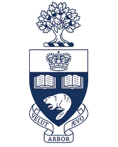
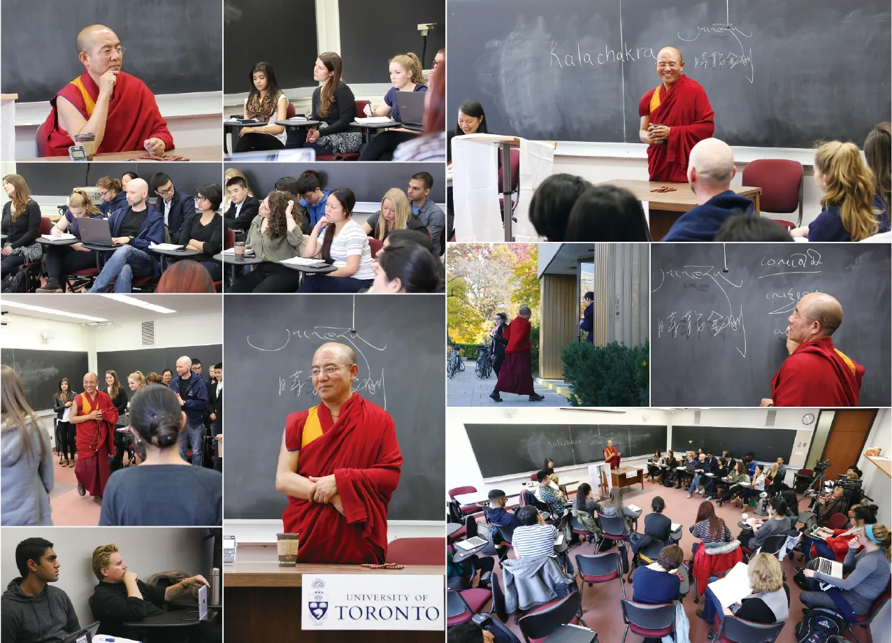
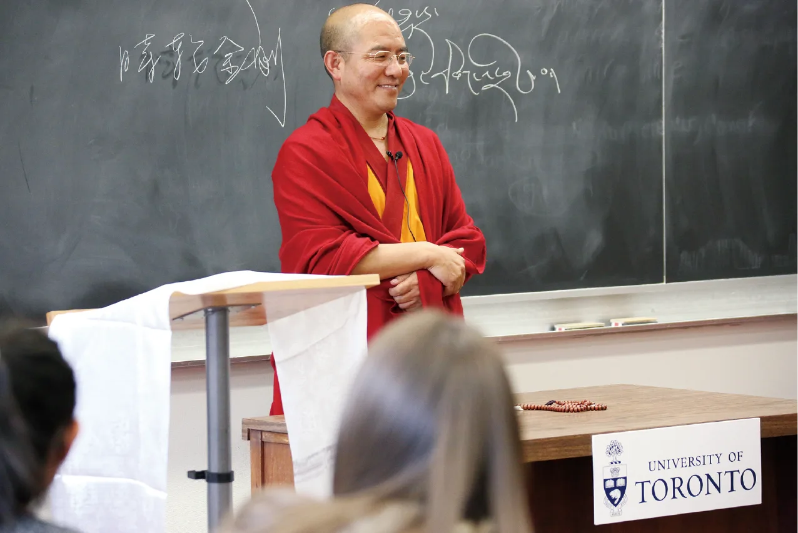
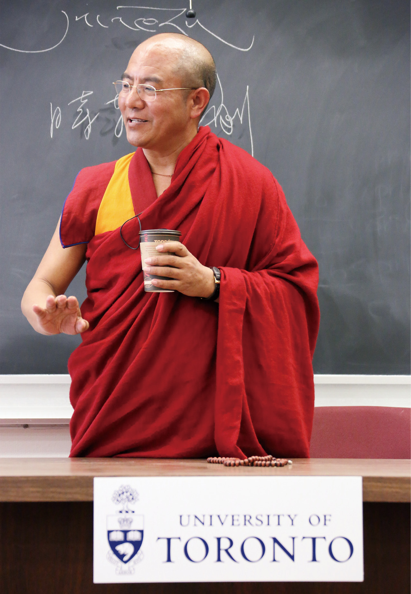
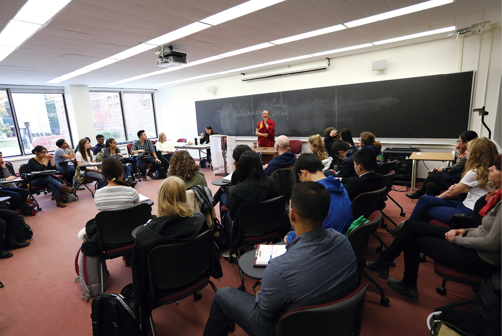

有时要关注外面五彩缤纷的世界，

这对认识内心非常有帮助；

有时要观明空无二的心，

透过它可以认识外面的世界。

第94场

加拿大多伦多大学

University of Toronto

加拿大·多伦多

2014 / 10 / 29

## 藏密宇宙观

## Cosmology in Tibetan Buddhism

主持人：

今天我们非常幸运地邀请到尊贵的索达吉堪布来到多伦多大学，来到我们“佛学入门”的课堂现场。

宗教系作为多大的重要院系，近年来发展迅速，开设了多种宗教课程，佛教研究是其中之一。几年前，佛教研究并不属于宗教系，而是归属哲学系，主要研究早期佛教。近几年，佛教研究作为一门独立学科被纳入宗教系，设立了内容多样的课程，而且许多优秀教授也纷纷加入这一学科，比如弗朗西丝·加勒特教授是藏传佛教专家，重点研究藏医胚胎学；克里斯托夫·埃默里克教授研究梵语和巴利语，同时开设尼瓦尔佛教和印度佛教课程；还有阿曼达·古德曼教授，主要研究汉传佛教……所以，佛教研究拥有优秀的师资和丰富的课程。此外，这一学科还开设了新的语言课，我们有自己的藏族堪布在校内教授藏语，埃默里克教授教授巴利语以及初级、高级梵语。佛教课程在多伦多大学的三个校区都有传授。

由此可见，在多伦多大学乃至北美，佛教研究的热潮都在持续高涨。

下面介绍一下我们的嘉宾——索达吉堪布。堪布是一位备受尊敬的藏传佛教上师，精通教理和修行，在中国乃至全世界有大量的虔诚弟子追随他学习佛法。堪布来自著名的色达五明佛学院，依止法王晋美彭措仁波切为根本上师，经过多年学修后，应法王的要求开始教授佛法，尤其承担教导汉族学生的任务。这些年来，堪布在著书立说上也投入很多精力，完成很多本中文著作。

堪布的名字本身是增长吉祥和福德的含义，显而易见，堪布会给我们带来吉祥。

今天堪布将为我们讲解“藏密宇宙观”，这是一个有趣而多元的主题，在西方很少有人教授。有请堪布——

很高兴能与多伦多大学宗教系交流。从主持人的介绍中我了解到，你们对佛教也有一定的研究。我本人是一名佛教修行人，不过对东西方文化中有关人类道德的知识特别感兴趣，对现代科技也很有兴趣了解。凡是对自他有利的学问，我都有意乐学习。所以，我想我们会找到很多共同语言。

那么今天，我们主要就藏传佛教的世界观做一些探讨。

20世纪五六十年代之前，藏传佛教主要流行于藏地，但后来在北美、欧洲乃至全世界，也开始受到关注，尤其引起很多知识分子的兴趣。这些知识分子学了藏传佛教后，的确感受到它对调节身心、提升智慧、增长慈悲的巨大作用，觉得它是一个很有意义的宗教。

不过今天我不准备在这方面介绍很多，因为听说你们想要了解佛教的世界观，以及这种世界观跟现代宇宙学的异同。

大家都知道，世界有微观、宏观两个层面，今天因为时间关系，我们主要就宏观方面进行探讨。

## 一、大宇宙——无量的世界

在一般人眼中，地球是庞大的，但是如果站在整个宇宙看，它也不过是沧海一粟。昨天我坐在飞机上时，就在想：银河系包含1000亿到4000亿颗恒星和大量的星团、星云等，而地球只是其中一颗小小星球，微乎其微；如果再把它放在整个宇宙中观察，就更加渺小了。因此，宇宙是一个极其广阔的空间。

关于这个宇宙，不论科学还是宗教，目前都没有统一的说法——科学的观点在不断更新，各个宗教也没有一致的见解。

那么佛教如何看待宇宙呢？

佛教认为，以我们所居住的世界为一个单位，一千个这样的世界叫小千世界；一千个小千世界，叫中千世界；一千个中千世界，叫大千世界，即十亿个小世界。大千世界也是无数的，释迦牟尼佛是一个大千世界的教主。

由此可见，早在两千多年前，佛教就有世界无量的观念，这是很先进的。

看到有关宇宙的这些数字，很多人也许非常惊讶：“怎么会那么多！”我听说现在大学里专门研究宇宙学的有些同学，尤其年轻同学，看到如此庞大的数字和无限的世界观时，都觉得太不可思议了。虽然不可思议，但这的确是宇宙的真相。

科学家霍金（Stephen Hawking, 1942-2018）经过长期的研究，也发现这个宇宙的广阔与深邃远远超出想象，于是引用一位文学家的语言说：“宇宙比我想象的不可思议还要不可思议。”这方面，我想科学界如果不断探索，会找到更多与佛教的共通处。

总之，就大宇宙而言，其广袤程度远远超出人类的想象，其中包含无量无边的世界。

## 二、小宇宙

### 成住坏空

对于小宇宙——我们所处的宇宙空间，科学界一直非常关注，对它的起源、演变、毁灭等都进行了探索。有关它的开端，就有种种推测，不过相当多的人比较认同大爆炸学说，认为这个宇宙始于大约120亿到150亿年前的一次大爆炸。

佛教对小宇宙也有研究，认为它有成、住、坏、空四个阶段。小宇宙最初是一大虚空，之后出现了风的微尘，再之后慢慢形成这个宇宙。虽然并非以大爆炸为起源，但也有一个形成过程，而且这个过程非常漫长。宇宙形成后，会安住二十中劫，之后进入毁灭阶段。关于宇宙的毁灭，有些学说认为很多恒星通过自燃而消亡，而佛教也说宇宙被火烧毁。宇宙毁灭后，就变成一片虚无的空间，这一阶段也持续二十中劫。

如果去深入了解，就会知道：宇宙成、住、坏、空的观点，与现代天文学的有些说法比较接近。

同时佛教认为，无数宇宙中，有些在形成，有些在安住，有些在毁灭，年龄各不相同。这一点跟天文学的研究结果也可以对应。

### “地心说”与“日心说”

对于我们生存的小宇宙，从古至今，人们就有各种观点。

早在公元前300多年，亚里士多德指出“地球位于宇宙中心，太阳和月亮绕着地球旋转”，也即“地心说”。后来古希腊天文学家托勒密进一步将这种学说构建成一个解释宇宙运转的系统理论。自那时起，在长达一千多年的时间里，在西方世界以及东方的很多国家中，“地心说”一直占据统治地位，人们都坚信这一说法，它也是天主教教会公认的世界观。

“地心说”跟佛教早期《阿毗达磨》中的个别说法，以及印度教、吠陀教的有些观点，虽然有细微差异，但根本观点是一致的——都认为太阳围着我们这个世界从东到西旋转。

所以，早期佛教中也有类似“地心说”的观点。

到了公元16世纪，波兰天文学家哥白尼（Nicolaus Copernicus, 1473-1543）提出“日心说”，认为“太阳是宇宙的中心，是静止不动的，地球以及其他行星围绕太阳运动”，并著作了《天体运行论》（On the Revolutions of the Heavenly Spheres）。不过“日心说”在半个多世纪中，都很少受到关注，支持者寥寥无几。

后来科学家布鲁诺（Giordano Bruno, 1548-1600）站出来声援哥白尼的观点，并且对这种观点进行了丰富和完善。这一做法对当时的教会统治构成了威胁，布鲁诺因此被烧死在罗马广场。对此，有些历史中说，布鲁诺的死并非因为支持“日心说”，而是跟泛神论等思想有关。不过不论怎样，布鲁诺确实对“日心说”的传播起了一定作用。

事实上，直至1609年，伽利略（Galileo Galilei, 1564-1642）使用天文望远镜发现了一些可以证实“日心说”的天文现象，“日心说”才开始逐渐引起关注。

总之，对于地球围绕太阳旋转这一宇宙现象，科学界经历了曲折而漫长的探索历程。

在佛教历史上，也有类似“日心说”的观点。5世纪时，东方出现一所著名的佛教大学——那烂陀寺，在当时堪比现在的哈佛大学。这所大学里有一位著名的历算学家、天文学家，叫阿亚巴札，他提出这样的观点：“虽然人们感觉太阳围绕地球旋转，但实际上并不是太阳在运动，而是地球在转动，就好比坐船时感觉旁边的事物往后推移一样。”这个观点让人赞叹：5世纪的东方文化，已经对宇宙有如此准确的认知。

## 三、佛经中的超前宇宙观

### 形形色色的世界

刚才提及的科学家布鲁诺还有一项重要贡献，就是提出“无限论”。这种理论认为：宇宙是无限的，并非只有一个地球与一个太阳，而是有无数星球、无数世界。

这跟佛教的观点是一致的。佛教《华严经》为主的很多经典中早已讲到，世界有“恒河沙数”，恒河沙是一个比喻，表达的含义是无量无边。

而且《华严经》的“华藏世界品”，还对各种世界做了栩栩如生的描述，其中说：众生的业力不同，所见的世界也形形色色——有些世界是圆形的，有些是方形的，有些是漩流形的，有些是江河形的，有些在上方，有些在下方……

我对天文学也有一些了解，曾翻阅东西方的许多相关书籍，不过在与佛经的对比中，越发感觉唯有佛经才揭示了世界的真相。

《华严经》这段经文中提及的“业力”，是佛教术语，也是一个重要概念。

什么叫业力呢？对同一个事物，有人觉得美好，有人觉得一般，还有人觉得很污秽；对同一个人，有人觉得漂亮，有人觉得平常，有人觉得很丑陋……是什么导致了这种差异呢？就是业力和习气。

现代科学也发现一种“不确定性原理”，这跟佛教很早就提出的业力概念，比较相似。

我是藏族人，藏族民间流传着一个俗语：“同一个东西，有人看成三角形，有人看成四方形。”我觉得这句话蕴含着很深的道理。

当然，对同一个事物，我们不一定看到不同形状，但由于价值观、审美观等的差异，确实会有不同的感受，尤其不同地域的人，观感甚至会大相径庭。

科学界如果能运用“业力”的道理，对世界进行研究，也许会有很多新发现。

当然，众生对同一事物的感受，差异之中也会有共同点，这跟“共业”有关。比如对于地球，如今全世界的人普遍认为它是一个球体。

在佛教的早期典籍《花鬘续》中也讲：一千一百万的球形世界，依于风和水的力量，在世间中形成。那烂陀寺的阿亚巴札，在其著作中也指出：“地球是由地、水、火、风四大元素组成的圆形球体，在虚空中安住。”由此可见，佛教对宇宙的认知是前瞻性的。

我并非因为身为佛教徒就吹嘘佛教，而是因为佛教说出了真理。实际上我一直觉得：作为人，都应当站在公正的立场寻觅真理——只要是真理就乐于探求，而不是冲着宗教或科学的名称才去信奉或维护。

### 外宇宙和内宇宙

大家如果想深入研究佛教宇宙学，还有一本书值得阅读，就是藏传佛教中的《时轮金刚》。在藏地，上千年来的历法一直依照这本书来推算，如今很多大德也经常传授时轮金刚灌顶，并讲解其中的理论。

《时轮金刚》是释迦牟尼佛临近圆寂前，在印度南方给部分弟子传授的，书中对于外宇宙，比如日食、月食、春夏秋冬的气候等，进行了清晰叙述，其观点跟现代天文学的观测数据有惊人的相似之处，然而《时轮金刚》没有借助任何现代天文仪器。

这里简单举一些例子，比如黄道和白道的交点周期，《时轮金刚》中的数字是6792.99天，天文学数据是6793.460天；地球公转轨道周期，二者的计算结果都是365天；火星、水星和金星的运转轨道周期，二者的数据仅有小数点上的差异。

另外，《时轮金刚》中最早明确指出水星、木星、土星等的组成跟元素有关。

你们如果对这部经典感兴趣，可以到藏地历算学校进一步了解。

《时轮金刚》中，不仅描述了外宇宙的状况，同时也揭示了内宇宙的奥秘，比如讲到人的身体是四大聚合，也具有成、住、坏、空，以及人的心识如何证悟光明、获得解脱等。

按照佛教的观点，研究外在世界固然重要，但认识内在世界更为关键。

藏地的佛教修行人，跟世间学者有一个共同点——对知识非常渴求，会努力寻求真理。不过也有不同点，这些修行人会更加关注自身的修证，认为如果没有真修实证，即便学问做得很好，也不是圆满的人生。

藏传佛教中有一位著名的历史学家，叫布顿大师，他撰著了很多论典，对人类有很大贡献。他晚年对天文学表现出浓厚兴趣，孜孜不倦地钻研，甚至放下了修行。不过后来的很多修行人并不认同他这种行为。

在座的不一定都信仰佛教，在这方面也许有自己的理解，当然，我们找到一个共同点进行交流就很好。

总之，希求稳固而长久的真理非常重要，唯有它才能一直陪伴我们。

## 四、认识了心，就认识了世界

我经常想：人生在世，一方面追求知识、研究学术非常重要，但更为重要的是对自己负责，这样活在世上才有意义。如何对自己负责呢？就是去认识自己的心。

这个世界非常广阔，但是如果浓缩，就变成你周围的小世界，如果再浓缩，就是你自己的心。因此，如果认识了心，你就间接认识了整个世界。

最后，跟大家分享一位印度学者的诗歌：有时要关注外面五彩缤纷的世界，这对认识内心非常有帮助；有时要观明空无二的心，透过它可以认识外面的世界。

现场互动

问：佛教中提到的须弥山、四大洲，是怎样一种世界观呢？

堪布：按照小乘《俱舍论》的观点，世界的中心是须弥山，须弥山周围有七大海洋与七重金山，再往外是咸水海，海中有南赡部洲等四大洲，须弥山上方是欲界空居天，往上是色界十七层天，再上面是无色界四层天。这种世界观存在于早期佛教，在曼茶罗观修中可以看到。

对于这种世界观，我们可以去了解，但是不能认为它是唯一的，也不能认为它是究竟的。佛教的世界观还有很多，比如《时轮金刚》对宇宙的描述，以及《大乘阿毗达磨》的观点。

之所以出现须弥山为中心的世界观，主要原因是：在当时的印度民间，很多人认为世界就是这种模样，佛陀于是随顺他们宣说了这种观点。佛陀曾说：“世间与我诤，我不与世诤。”世间人承认的有些事，佛陀也会随顺他们而认可，比如很多人认为“我”存在，佛陀虽然深知没有“我”，但是为了调化他们，也会暂时说“我”是存在的。

所以，佛陀的有些教言是度化众生的方便说，是一种应机说法。好比在学校里，东方的教科书为了适应东方人的习俗，跟西方的教科书会有所不同。对于佛陀的方便说，我们可以学习，但是不能认作佛陀的究竟观点。

问：佛教讲一个微尘中有很多世界，这怎么理解？

堪布：佛教《华严经》中讲“一尘中有尘数刹”——一个微尘中有微尘数那么多的刹土。一般人对此很难接受，其实这没什么不可能，因为世界是空性的，每个法都没有实质，所以一个尘与无数尘的本体没有丝毫质碍，能够相互含摄。如果世界不是空性的，那么一个微尘中，不要说容下无数世界，即使第二个微尘也无法立足。

因此，一旦明白空性的道理，就会知道确实如佛经所说：一就是多、多就是一，显即是空、空即是显。

问：如何证明现实就是梦？

堪布：汉地古代有一个著名的故事“庄周梦蝶”：庄子梦到自己变成了蝴蝶，突然间醒过来，他不知是庄子梦中变成蝴蝶，还是蝴蝶梦中变成庄子。这个故事寓意很深。

其实，现实世界就是一场梦，为什么呢？

一方面，梦中的一切，到了醒时就荡然无存，而现实中的一切，到了明天也杳无踪迹。所以，昨天之前的事跟昨晚的梦没有差别，明天以后的事跟明晚的梦并无二致。在这方面，藏传佛教里有非常细致的剖析。

我自己有一个习惯：每次遇到不如意的事，就在心里想“它跟昨晚的梦一样，不要太在意”，这种思维确实对调整内心很有帮助。

另一方面，很多佛经中都说：世界以及我们自身都不实有——没有详细观察时，似乎存在；一旦进行观察，跟梦境、幻化、泡影毫无差别。

如果明白了现实与梦无别的道理，生活中就不会有很强烈的执著。

问：我曾读到一篇文章，里面说罗马天主教教皇证实了大爆炸理论。一位如此重要的宗教领袖公开支持这种理论，您对此有什么看法？

堪布：其实对于大爆炸理论，科学家目前仍处在探索阶段。

支持大爆炸理论的证据之一就是宇宙在不断膨胀，但是目前有科学家发现宇宙可能正在收缩。关于大爆炸的发生时间，也众说纷纭，有些说是137亿年前，有些说120亿年前，有些说130多亿年前。因此，大爆炸理论也并非一种定论。

我觉得，科学界在探索宇宙时，借鉴宗教文献是很有必要的。大家都知道，世上的很多宗教都有着久远的历史，有些接近四千年，有些是三千多年，有些是一千多年……这些宗教的古老典籍中很可能找得到宇宙学方面的珍贵资料。即使研究者本人没有信仰，也完全可以借鉴这些资料，因为凡是真理都值得追求，不必要因为“宗教”的外表就拒之千里。

其实人生在世，需要有一种探求真理的精神。能否找到真理是另一回事，但不论是学生、老师还是宗教人士，在这样一个自由、平等的世界中，都应该运用智慧挖掘人类文明中的珍宝，寻觅宇宙人生的真相，这非常有意义。

问：您演讲中提到的那位天文学家，他对太阳系的研究远远早于哥白尼和伽利略，能再讲讲他的相关情况吗？还有您提及的佛教文献，能再说一下名称吗？

堪布：那位天文学家叫阿亚巴札，藏文中有《阿亚巴札覃》这么一部论典。

刚才讲的“恒河沙数世界”，出自《华严经》，还提到它的经典有《时轮金刚》《花鬘续》。这几部现在都有藏文版本。

问：生活在世俗的世界中，该如何对待执著？

堪布：该执著时可以执著，但是不能过分，因为过分的执著会引发痛苦。

大概六百多年前，藏地有一位尊者叫龙钦巴，他说：“执著越大，痛苦越多。”当然，作为世间人，对事业的适当希求、对真善美的追求等等，暂时无法舍弃，也不用舍弃。但是如果对感情、财富等过分贪执，就会带来很多负面作用——自己的心情会越来越糟，身体会越来越差，所做的事情也常常无法成功。

问：我们学习的课本中说“佛陀在定中获得阿罗汉果”，为什么佛陀获得的不是佛果？

堪布：按照声闻乘的有些说法，佛陀获得的是大阿罗汉果，因为他们不承认断除一切障垢的佛果，但认为大阿罗汉果存在，佛陀是大阿罗汉。不过，从大乘的角度看，佛陀并没有经历阿罗汉的阶位，而是经由大乘五道十地直接取证了佛果。
