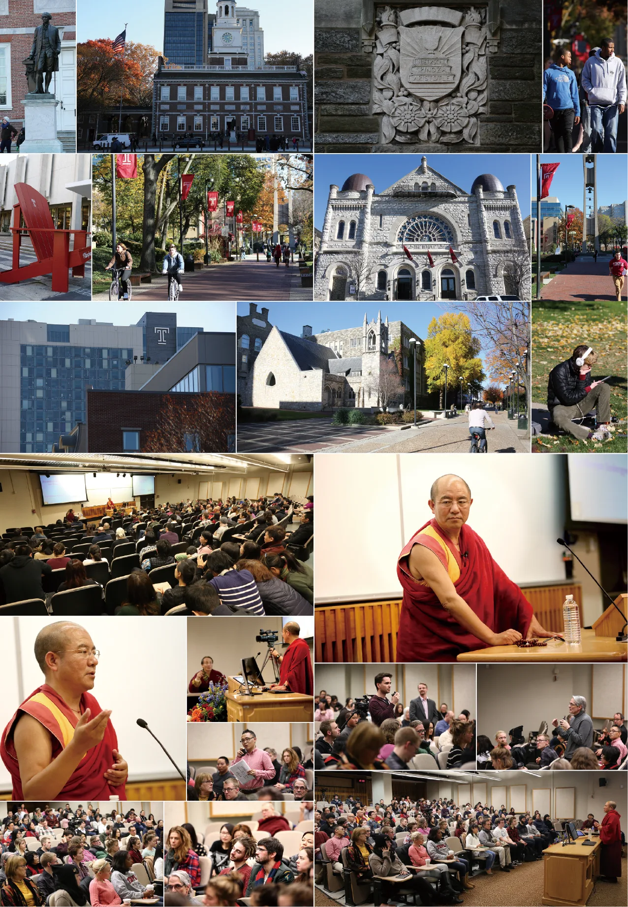
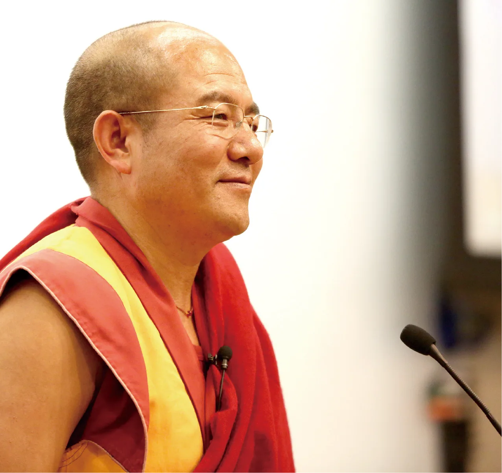

没有所思的事，

也没有能思的人，

安住在无思的境界中，

像一个刚出生的婴儿，

就会对心性有所认识。

第102场

美国天普大学

Temple University

美国·费城

2014 / 11 / 15

## 佛教空性的禅修

## buddhist meditation on emptiness

主持人：

欢迎索达吉堪布来到天普大学演讲。堪布23岁时在喇荣五明佛学院出家，而喇荣是当今全世界最大的佛学院，坐落在青藏高原的牧区，远离尘世的喧嚣，是全然不同于费城的另一个世界。从某种意义上讲，喇荣是佛法的中心，有一万多常住僧众，培养了许多佛法人才。同时，那里还将大量的佛教经典翻译成不同的文字，而堪布本人，也不断地将藏文经论译成中文。所以，我们今天能够聆听堪布的演讲，实在是很幸运。下面，让我们一起欢迎堪布——

很高兴能有机会与天普大学的老师、同学们交流。佛法甚深广大，以我的智慧，想要完全通达佛法，还有一些困难，但我对佛陀以及印度、中国等地诸多大德所宣说的法非常恭敬，也很有意乐学习，所以，今天就借此机会，与大家分享一些心得。

一般来讲，传讲佛法有随顺世间和遵循传统的两种方式。前两天在普林斯顿大学，有位老师告诉我，西方人可能更喜欢传统的讲法方式，比如引用教证、因明推理以及窍诀等，建议我按照藏地寺院和佛学院的方式来讲课。我当时反问：“现在的大学生们可能更关心名利、爱情等话题，他们能适应传统的讲法方式吗？”他说：“也许一开始会有些人不适应，但经过思考后，年轻人会明白佛法利益的。”所以，我今天会用传统的方式，为大家介绍佛教的空性观以及如何观修空性。

## 观察是了解真相的基础

想要证悟“万法皆空”，我们就必须要先学会观察，否则，很多人都会对空性感到恐惧和困惑。有些人认为，佛教认为住所、饮食、衣服等都是“空”的。事实上，在名言现量中并非如此。但在胜义之中，如果我们通过智慧观察就会发现，不仅物质的自性不成立，甚至连心也如同虚空一般没有自性，这在佛教的显宗中有宣说，密宗中更有详细的讲解。

不论大家是否信仰佛教，认识心性都非常重要，因为我们恰恰就是因为没有认识心性，从而在生活中感受着众多的痛苦。

## 教你一个认识心性的窍诀

认识心性的方法有观察修和安住修两种。首先讲一下观察修，比如观察心是否存在——如果存在，心就不会再产生，如果不存在，心便没有产生的可能，诚如龙树菩萨在《中观根本慧论》中云：“有法不应生，无亦不应生。”[^1]

在藏传佛教中，人们还通过观察心的来龙去脉而了悟空性。比如，当你生起贪嗔痴的烦恼时，就可以借此分析心的本体是否存在。有些人觉得心存在，认为当下的分别作意就是心，但事实上，当下这颗心是无法成立的。这是密宗中的一种修行窍诀，因为各位没有得过灌顶、没修过加行，所以我只能简单做一些介绍，不能讲得过于详细：当我们作意时，观察心究竟是从哪里产生的——脑袋里、心脏里还是嘴巴里？当我们停止作意时，观察这颗心是飞到虚空，还是消于体内？经过详细的观察，我们会发现，原来身体的里里外外都找不到心。这样的观察方法称作“破心房”，也就是观察心的来源、住处、去处皆了不可得，诚如《金刚经》中云：“过去心不可得，现在心不可得，未来心不可得。”过去的心已经过去，所以不可得；现在的心也不可得，因为现在只是一个瞬间，连一秒钟也无法停留；未来的心尚未产生，因此也不可得。

未经观察时，我们都认为心是存在的，但通过真正地观察后才发现，原来心无法安立。

## 认识心性就像爬梯子

那心究竟是什么呢？有些人认为，“心不可得”指心不存在，以为这就是佛教所说的空性，事实上，这种“单空”只是空性的一部分。无始以来，我们在轮回中所沾染的无明、实执等习气非常深厚，因此，在刚开始学习时，也有必要暂时依靠单空。

印度非常了不起的智者清辨论师在《中观心要论》中说：“于此若无有，真实世俗梯，欲上胜义楼，智者非应理。”想要登上一座很高的楼房，就不得不借助梯子，不论是电梯、木梯还是铁梯，都可以帮助我们达到这个目的，如同我在1993年参观纽约世贸大楼时，就必须要借助电梯才能上去。同样的道理，要认识远离一切戏论的空性，也可以暂时依靠“单空”这个梯子——一切法都不存在，最后便可以到达楼顶——究竟的空性。这种对究竟空性的次第安立，是智者的所为。

由此看出，清辨论师认为，在认识空性的过程中，可以先安立单空，再安立单空不成立，最后再安立远离一切是非有无、执著的究竟空性境界，这就是心的实相，也是万法的实相，如《中观庄严论》中云：“真实中彼离，一切戏论聚。”

## 只看说明书学不会开车

我在天普大学看到了麦彭仁波切《中观庄严论释》的英文版，这部论典非常有价值，希望大家能学习并逐渐实修所学的道理。

当然，实修必须依靠上师的指导。大家学开车的时候，也不可能只看说明书而不需要教练指导，同样的，学习佛法也需要上师指引，特别是离戏空性的道理，只有依靠上师的窍诀，才能获得证悟。

寂天菩萨造的《入菩萨行论》在国际上享有很高的声誉，我特别希望大家能学习其中的《智慧品》。当年寂天菩萨在大众中讲到《智慧品》中的“若实无实法，悉不住心前，彼时无余相，无缘最寂灭”时，示现神通，身体腾空并消失在虚空当中。这句偈颂指出，当我们的心远离有、无等一切分别时，就是最究竟的空性境界。《中观庄严论》的注释中也讲，在空性的大海中倒入实执垢染，对大海毫无影响，同样的道理，当我们真正无误地证悟空性时，烦恼也不会对我们产生任何影响。对当前来讲，我们之所以还过着苦乐参半的生活，就是因为还有实执，如果我们经常思维空性，那究竟的境界自然会现前，届时，生活中的烦恼都会消于法界。

## 以安住修认识心性

以上是从观察修的角度讲空性，接下来我们从安住修的角度，直接观心。

全知麦彭仁波切讲：“外观百法，不如内观自心。”其实做很多研究，写很多论文，都不如向内观察自心所带来的认识多。印度著名的大成就者萨绕哈巴曾说：“舍离思与所思，住无思如幼婴。”无有所思，也无有思者，如同刚出生的婴儿一样，自心观心，这样就会对心有所认识。

我们现在就可以观察自己的心，看它正处于内收的状态——昏沉，还是处于外散的状态——产生种种分别念？不论是什么状态，只要观察心的自性，心当下就会自解脱。

全知麦彭仁波切约在7岁时造了《定解宝灯论》，里面讲到：“尔时如视前虚空，自心正在动念时，亦为空性之定解。”当我们仰望虚空时，虚空就是空的，同样的道理，心在产生种种分别念的同时，就是空性，其本性从未被遮障过。比如，当我们产生嗔心时，嗔心的自性如同虚空一样，从来没有被遮障。

正如《定解宝灯论》中所说，当我们反观自心时会发现，其实既没有要遣除的烦恼，也没有要成就的智慧，用正确的见解去观察本体，可以现前不可言说的真正智慧。又如《现观庄严论》中云：“此中无所遣，亦无少可立，于正性正观，正见而解脱。”心中所产生的种种分别念，其实既没有可破，也没有可立，自心观察自心，就能认识实相本面。此外，《宝性论》等其他经论中也有类似的教言。

## 认识心性的利益

认识心的本性，对我们有什么价值呢？龙树菩萨的一个公案可以说明这一点。

龙树菩萨是一位比丘，每天需要乞食，于是，有位王妃便供养了尊者一只嵌满珠宝的金钵。虽然比丘不能持金银，但尊者对财富没有耽著，所以平时就用这个钵去乞食。

一个小偷看到了这个钵，心生贪念，跟在尊者身后，伺机盗取。尊者享用完钵中的食物之后，就直接把钵布施给了小偷。小偷不敢相信尊者把这么珍贵的宝物白白给他，尊者却说：“这个钵不算什么，我有更珍贵的宝物。”

听到这里，小偷又起了贪心，便向尊者索要这个更珍贵的宝物。于是，龙树菩萨便为他传了认识心性的窍诀，并要求他在每次行窃时，都要先用这个窍诀观心。

过了一段时间，小偷回到龙树菩萨面前，告诉尊者：“我每次行窃前一观心，立刻便没有了偷东西的意乐，所以我到现在什么都没偷到，该怎么办呢？”尊者告诉他：“那你就放弃这个窍诀吧。”小偷却说：“虽然偷不到东西，但这个窍诀令我的心里生起了前所未有的安乐，我是不会放弃它的！”

后来，这位小偷成了龙树菩萨一位出色的弟子。从这个公案所引申的道理来看，观心、认识心的本性对我们有非常大的利益。

## 心性虽然是空，但不离显现

我们不能把心的本性仅理解为空，它其实还有光明的部分。佛陀在第三转法轮中讲“自性光明”——虽然心之自性不成立，但所见所闻都如是存在，能真实地感觉到。显宗经典《般若经》中云：“心无有心，心之自性为光明。”《三摩地王经》中云：“犹如夜晚之水月，澄清无垢湖中现，然水月空无实质，一切诸法如是知。”水月无有自性，却又无欺而显现，同样的道理，心也是一样，显现的当下是空，空的当下又是显现，这叫做“现空双运”，也是一切万法的实相。

这样的道理，只有依靠上师的窍诀才能了知。印度、中国等地都曾出现过许多证悟万法实相的人，他们被称作证悟者、成就者，其中不仅有出家人，也有在家人，是真正远离了一切痛苦的补特伽罗。

## 这是一份证悟指南

以上是通过显宗的方式来解释大手印，汉传佛教的禅宗当中也有很多类似的窍诀，而我们宁玛派的大圆满中也有显宗的解释方法，这次主要是结合中观的见解给大家解释的，也可以算是窍诀。我原计划用另一种方式讲解，但临时做了一些调整，就像法王如意宝在一首道歌中所唱的那样：“怙主麦彭赐宝语，无意当中说漏嘴。”怙主麦彭仁波切交付于我的如同珍宝一样的妙法，本来没准备讲，但不经意间却说漏了嘴。同样，所有传承上师们所赐予的如同珍宝一样的法，是我这一生所努力学修的要点，今天依靠一些特殊的缘起，与大家分享了。

这样讲解的缘起主要有三方面。第一，天普大学的老师们对麦彭仁波切以及窍诀、论典方面有长期的研究，而且对佛法非常虔诚。第二，这座城市是《独立宣言》最初通过的地方，也是美国建国的关键城市，这其中可能有一些特殊的缘起。第三，我希望能通过本场演讲，帮大家与佛法结上殊胜的法缘。

依靠这种种的缘起，我和大家分享了佛教的空性观。宗喀巴大师在《缘起赞》中赞叹释迦牟尼佛：“奇哉导师奇依处，奇哉胜说奇怙主，巧妙宣讲缘起法，本师尊前我敬礼。”本师释迦牟尼佛宣说了甚深缘起，我们是追随佛陀的学修者。即便你不信仰佛教，希望也可以思维、研究空性的道理。

现场互动

问：我是天普大学三年级的法学博士，来自青海玉树。我觉得出家人和对佛法感兴趣的人更容易通过相应的教法而认识心性，那对于没有任何佛教基础的人而言，我们该如何了解佛法，并最终认识心性呢？

堪布：回答这个问题之前，我要先感谢天普大学的师生学习藏语，并致力于藏传佛教的研究。我在世界各地都会遇到一些藏族人，今天也不例外。对藏族人来说，不论生活在哪个国家，都会坚持闻思修佛法，通过佛法让自己远离痛苦，并在力所能及的范围内帮助别人。

向没有佛教基础的人讲佛法，要采取恰当的方法，并考虑当地的法律法规。佛教追求真理、慈悲，除此之外别无其他，所以，我觉得没有必要一味地把佛法当作宗教来推广，因为这会让人们的内心产生防范和恐惧。

事实上，如果去掉宗教的外壳，佛法就是人类基本的道德教育，尤其是慈悲心、利他心的教育，这值得学者们关注，更值得在学校里推广。藏族同胞们也请继续努力，一方面保护我们的文化和宗教，另一方面要尽力地去利他。

问：贪欲与痛苦是什么关系？它们是一体的吗？

堪布：贪欲，指千方百计想要得到自己所贪对境的一种心态，也就是心对所贪的对境非常耽著。如果不了解贪欲的本体，我们就会不停地感受痛苦，而一旦认清它，我们就会发现，原来贪欲就是智慧，正如经中说的那样“烦恼即菩提”，这时便不会再感受痛苦。

问：如何才能找到自己的佛法老师？

堪布：要想找到一位真正的佛法老师，一开始需要仔细观察，之后要认真依止、依教奉行。

为什么一开始要仔细观察呢？即便是在大学选择导师，同学们也会仔细观察，希望找到一位学问好，同时又关心学生的导师，而不会选择那些只看重自己利益的人。寻找佛法的老师也一样，因为学佛的目标是解脱，因此应该寻找内心有智慧、有功德的人作为佛法的老师。

问：当我情绪不好的时候，我可能会对别人产生嗔恨，从而造恶业。我知道因果真实不虚，但您刚才又讲到“万法皆空”，这是否说明，不真实的情绪创造了真实的因果？

堪布：不真实的法不会产生真实的法，恰恰因为万法是空性的，所以因果在本体上也不成立。虽然以嗔心等烦恼造下的不善业会让我们感受痛苦，但从胜义的角度来讲，嗔心也好，痛苦也罢，一切都不是真实成立的，但在名言当中，如幻的嗔心的确会产生如幻的痛苦。

问：我总会做一些让自己后悔的事，但事后又会再犯同样的错误。我怎样才能摆脱这种情况呢？

堪布：对做错的事情产生后悔心是很好的，但改变一个坏习惯，往往需要很长时间的反省，逐渐才会有变化。听说有些美国电影也会讨论如何改变恶习，不妨看一下。

问：空性是否为认识心的本性提供了可能，还是说空性就是心的本性？

堪布：月称菩萨在《入中论》中阐述了内空、外空、内外空……总计有十六空性、二十空性等内容，宣说了“万法皆空”的道理。我在天普大学的老师办公室里也看到了这部论典的英文版，如果你对空性感兴趣的话，可以学习一下。

问：作为一名老师，有时需要换一种方式与学生沟通，比如，经常鼓励和表扬学生们，否则他们记不住知识点。那您在寺庙里是否也会用一些不同的方式来教授佛法呢？

堪布：我经常在讲课时穿插一些玩笑，不过开玩笑没有多大意义，只会给大家带来一些暂时的愉悦。

其实，传讲佛法的方式很多，但不论是哪一种方式，很难随顺所有的人，正如寂天菩萨所说：“有情种种心，佛亦难尽悦，何况劣如我，故应舍此虑。”众生意乐不同，就连佛陀也没有办法满足所有人，同样的道理，老师在教学的过程中，也很难让所有的学生都满意。能让大部分学生满意就已经很好了。

问：请问“观心”到底怎么观？

堪布：观心就是用自己的心去观察自己的心。虽然一个人不会有两个心识，但是从观察的角度来讲的话，自心可以观察自心。

比如，当我们产生贪嗔痴烦恼时，依靠反观内心的方式，就能认识心性。证悟的成就者可以安住在这样的境界中，但对尚未认识心性的人而言，分别妄念炽盛，很容易放逸。

总而言之，依靠安住修、观察修，不断串习，你逐渐就会知道如何观心。

问：对于没有系统学习过佛法的人而言，能否在一粥一饭、一行一动中禅修？

堪布：我想这是可以的。不论是佛教研究者，还是修行者，首先都需要系统学习，然后再实修，这非常重要。

有些人说，佛教讲空性、智慧，但大多数情况下，他们只是用一些笼统的概念来阐述佛法的见解，这是很片面的认识。所以，大家不管是修行还是学习，都需要多看一些书，不要想着走捷径。当然，如果你不信仰佛教，那就另当别论了。

天普大学有很多老师，已经研究佛法二三十年，对此我特别随喜，只有这样长期坚持研究、学习，才能真正了解佛理。今天我所讲的这些内容，比如一些教证等，都来自于我多年的学习，用的时候就像从保险柜中取出收藏多年的宝贝一样，所以，长期系统的学习非常重要。

问：有一些世间人，想要实现自我价值的同时，也能帮助他人，您是否有计划写书，指导他们实践佛法呢？

堪布：我写的书可能没有加持力，但我翻译过一些具有加持力的佛经以及历代大德们写的论典。此外，我还可以向大家推荐一些有价值的书。

寂天菩萨的《入菩萨行论》、藏地无著菩萨所写的注释《善说海》以及华智仁波切的《大圆满前行》等，都是非常宝贵的书籍。我在耶鲁大学了解到，那里有很多老师和同学，虽然不是佛教徒，但也在学习这几本书，这是非常好的现象。此外，作为学者，大家还应该重视《中观庄严论》和《中观庄严论释》，其中《中观庄严论》是静命论师所造的论典，他对雪域藏地的恩德非常大，而《中观庄严论释》是麦彭仁波切造的注释。以上几部论典都是我一生最重要的修行所依。听说密法方面的《光明藏论》已经有了英文版，如果大家有机会得到灌顶和窍诀的话，也可以学习这部密续。

佛教注重智慧，更注重加持融入于心，希望大家能够学习这几部佛典，让加持融入自心。

[^1]: 此处的观察方法为“破有无生因”，是抉择万法的“果”无自性。果若在因位时存在，就不必再生，因为已有之故；果若在因位时无有，则永远不能生，犹如石女的儿子。
