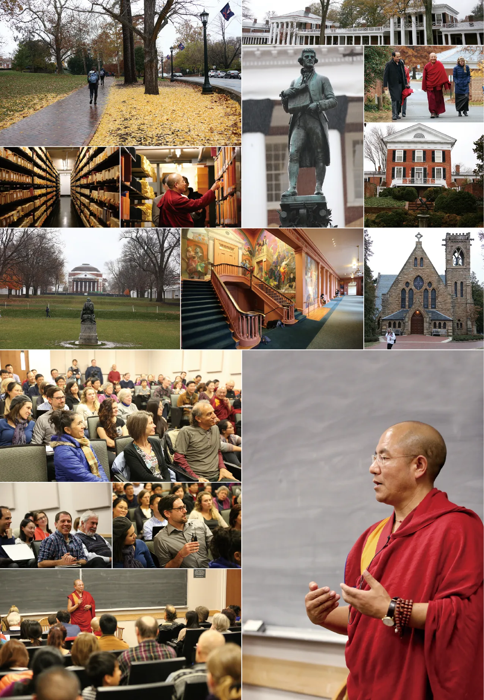
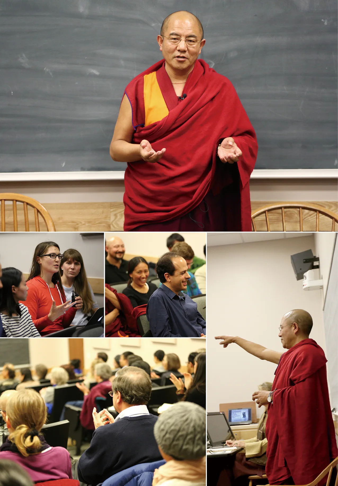

近三十年的传法中，

我主要宣讲出离心、菩提心、无二慧，

这一点对藏族、汉族没有差别。

第103场

美国弗吉尼亚大学

University of Virginia

美国·夏洛茨维尔

2014 / 11 / 17

## 汉地的当代藏传佛教

## contemporary tibetan BUDDHISM in china

主持人：

索达吉堪布来自世界上最大的佛学院——喇荣五明佛学院，那里或许也是藏地历史上最大的佛学院。自1987年至今，堪布一直致力于给汉族人传讲佛法，在这些汉族人中，既有虔诚的佛教徒，也有非佛教徒。经过多年的交流，堪布已然成为汉地最具影响力的藏传佛教上师。在今天这场演讲中，堪布将和我们分享他在过去三十多年里，引导汉族人闻思修佛法的宝贵经验。

我在美国长大，但曾在中国生活了很多年，我感触最深的一点就是，作为世界上两大经济强国，美国和中国在文化潮流上有着诸多差异，但同时也有许多共通之处。当我开始接触对藏传佛教感兴趣的汉族人时，我马上就会想起那些对藏传佛教感兴趣的美国人。目前弗吉尼亚大学和美国其他大学对佛教、印度教、基督教等内容非常感兴趣，并且十分关注如何将这些宗教教义运用于教育、医疗、保健、企业培训等社会生活中，而事实上，中国的情况也很类似。

下面，请大家和我一起欢迎索达吉堪布——

感谢弗吉尼亚大学的老师、同学们一直秉持开放、自由、平等的理念，致力于人类传统文化，尤其藏传佛教以及藏文化的保护与弘扬。昨天刚到弗吉尼亚大学，我就和一些研究西藏文化的老师、同学做了一场交流，紧接着又与其他领域的学者们进行了一场问答，之后在老师们的陪同下参观了学校里的一些建筑，比如以藏文化为主的图书馆等，整个过程都特别让人高兴。

弗吉尼亚大学的教授们希望我能结合自己的经历，简单介绍一下藏传佛教在汉地的发展情况。其实，这个话题在美国其他高校中也应邀讲过几次，但大家依然兴趣不减，可见，很多人都想了解为什么有越来越多的汉族人学习藏传佛教。

## 任何众生都可以享用佛法

从佛法的角度讲，上师的安排都有密意，因此，自从法王如意宝安排我为汉人讲法以来，我一直有信心成办这件事，并在过去的三十年里，一心一意地为汉人讲法。现如今，越来越多的汉族人开始修学、研究藏传佛教，而且大多都是年轻的知识分子。

佛法没有地域、民族、国家的界限，六道轮回中的一切有情，都有平等学修佛法的权利，诚如《华严经》中所说：“天龙夜叉鸠槃荼，乃至人与非人等，所有一切众生语，悉以诸音而说法。”可见，佛陀在传法时，会以天龙、夜叉等各种众生的语言传讲，让所有众生都有机会听闻佛法。在藏传佛教的传统中，很多上师在传法前，也会先念诵这四句偈颂，召请有意乐的众生前来闻法，然后弹指表示自己要用各种语言传法。

弗吉尼亚大学的创始人托马斯·杰斐逊曾说：“人人生而平等，都有生命、自由和追求幸福的权利。”这与佛教中的理念颇为相似，任何众生都可以学修佛法，令自相续得以成熟。

法王如意宝在世时，我为法王做汉语翻译，法王圆寂之后，我一直坚持在学院讲经说法，希望用正法饶益大家，虽然这期间也遇到过一些困难，但我从来没有间断过，因为佛法能够为自他带来安乐、遣除痛苦，这也是佛法的究竟意义。

## 红尘相伴三十年

上个世纪80年代，我们开始向汉族人弘扬藏传佛教，由于汉地自古便有道教和儒教，而这两个宗教也有大约两千五百多年的历史，所以汉族人一开始很难接受藏传佛教，更不用说次第闻思修了。此外，佛教虽然在汉地历史上也曾兴盛过，但由于近代唯物论和无神论的影响，人们失去信仰、内心空虚，因此，弘扬佛法更是难上加难。

起初，很多人都不相信有前后世，一心只为今生打算，甚至坚信“宗教是人民的精神鸦片”。实际上，很多人都误读了马克思的这句话，在他生活的年代里，鸦片在欧洲很多地方都是合法的镇静剂，但在中国，由于鸦片战争等历史原因，所以对这句话产生了误解，以至于很多汉族人不但想象不到佛教的利益，反而认为它是人生的毒品。针对大众的这种认知，我一般很少直接反驳，尽量随顺他们的观点。比如，每当有唯物论者对我说“地狱根本不存在”时，我往往只是提醒他们要用理证和智慧去分析这一问题。

当时，还有很多人认为佛法与科学相违，弘扬佛法会阻碍科学发展。但事实上，很多著名学者也都说过，佛法与科学并不相违，更不会阻碍科学发展。

此外，因为孔子说过“未知生，焉知死”，于是很多儒家学者对死后的事只字不提。在这种情况下，我也会实事求是地把真相讲出来，不会完全随顺他们。因为从出世间法的角度讲，佛教的核心是出离心、菩提心以及无二慧，如果想要弘扬佛法，就必须弘扬这三点，而这三点的基础就是承认前世后世、六道轮回，否则，不可能了知轮回的本性，生起出离心而寻求解脱，更无法通达佛法最究竟的意义。

这一点对修学佛法非常重要。后来经过多年努力，现在汉地很多人，包括大学老师、知识分子，一些见解已有所改善，他们对于佛法的基础，比如暇满难得、寿命无常、因果不虚、轮回过患等道理，可以在正确理解的基础上，如理如法地精进修行。

## 大乘佛教的慈悲特色

在汉地，儒家思想的追随者认为人类是万物之灵，对动物等众生的悲心和保护意识不是很强，但大乘佛教徒慈悲对待一切众生，尤其是汉传佛教徒，在戒杀吃素方面有非常好的传统。比如，早在1500多年前，汉地的梁武帝就规定僧众断肉茹素，因为吃肉直接危害众生的生命，从那以后，汉地出家人就开始吃素，一直到现在。

按照大乘佛法的教义，我们不应该只对人类生悲悯心，而应该对一切众生都生起悲悯，因为每个众生都希望获得安乐、远离痛苦。遗憾的是，正如寂天菩萨所说：“愚人虽求乐，毁乐如灭仇。”众生虽然都希求安乐，但由于愚昧无知，很多人就像消灭敌人一样斩断了安乐之因。

汉地有些知识分子曾跟我说，不应该让动物和人类一样听闻佛法，这不合规矩。但我觉得，弘扬佛法不能以人类为中心，而应为所有众生讲解，至于他们愿不愿学，就随缘了。佛教自古以来都是这样。

## 解脱成佛必须断除我执

拿汉地的佛教徒来讲，虽然无伪的菩提心不一定能完全生起，但还是有很多人在实际行动当中，缘一切有情发菩提心，并力所能及地行持六度。

汉传佛教中有很多的宗派，如禅宗、净土宗等。禅宗中有很多修行人境界相当高，依靠直接观心就可以证悟，甚至有极少数人，不用刻意修行也能明心见性。此外，净土宗中有很多修行人，一心念诵“南无阿弥陀佛”，发愿往生极乐世界。

不可否认，也有些佛教徒只以自我快乐为中心，希望今生幸福美满、财富增长、长寿无病，完全不关心后世的解脱。这样的发心不太合理。身为佛教徒，要想获得解脱和佛果，就一定要根除相续中的我执，否则，即使暂时获得人天安乐，也无法获得究竟的解脱。

## 佛教徒应依止善知识，次第闻思修

要想深入佛法核心，首先应该听闻法义，再深入思维，最后通过修行，让无我的空性智慧真正生起，从而不再流转于三界轮回，获得最究竟的解脱。这也是我一直讲经说法的原因。

在学习佛法的过程中，闻、思、修缺一不可，即便是有一定修行基础的人，也不能完全没有闻思修。我二十年前来美国的时候，认识了一些非常好的修行人，这么多年来，他们一直坚持闻思修，也一直虔诚地信仰佛法。

所以，年轻人需要长期闻思修行，次第地圆满修学诸多论典，如五部大论——戒律、俱舍、因明、中观和现观，以及《密藏续》等各种密法。

藏传佛教虽然早在上世纪60年代就进入西方，80年代才开始在汉地弘扬，但相比之下，汉地的佛教徒更重视系统闻思修。当然，这只是我个人的看法，但我也有一定的根据。比如，喇荣五明佛学院有完整的汉语版藏传五部大论，并且从很早开始就有用汉语传法的法师，目前还有汉族的堪布、堪姆宣讲因明、中观等论典，甚至密乘的续部。

大家若想真正认识佛法，就应该把它当作一种教育，进行深层的学习与修持，否则，只是自学一两本书，是无法完全通达的。《华严经》中说：“佛法无人说，虽慧不能了。”哪怕是具足智慧的人，也很难彻底领悟佛法的甚深要义，普通人在短期内更不用说了。因此，不论学修佛法，还是从事佛教研究，都应该依止善知识，并次第学习。

## 生生世世的利益才真的重要

昨天有老师问我：“你对藏族人、汉族人的传法方式一样吗？”

其实藏族人从小就有佛教信仰，但除了出家人，很多人都是文盲；而汉族人不同，他们虽然佛教信仰不深，但从小就学习很多文化知识，比较有智慧。所以，在近三十年的传法中，我主要宣讲出离心、菩提心、无二慧，这一点在藏族、汉族之间没有差别。有些人要求我做财神灌顶、长寿佛灌顶，但我从来没有做过，这些灌顶也许对今生有利益，但如果从生生世世的角度来考虑，只为今生求一个灌顶就显得不那么重要了。

汉地很多佛教徒都非常重视闻思修，也重视出离心、菩提心和无二慧，我建议西方的佛教研究者、佛教徒们也多关心一下这些内容。东方的年轻人很容易接受好莱坞的电影、歌曲等各种流行文化，还可以与西方人展开交流；同样，藏传佛教的闻思修传统应该也可以在西方推广，这并非不可能的事情。

## 成为智者的窍诀

最后，我对大家有三点希望：

第一，美国人历来重视真理、正义、利他等品质，虽然美国的历史并不长，但是思想却很超前，是民主与自由的代表国家。希望美国人能一如既往地坚持这些品质，将其弘扬于全世界，就像藏族谚语所说的“上等金上再贴金”，也就是好上加好。

第二，希望大家谨慎取舍因果。我们终究会离开这个世界，如果今生能够行善断恶，那就不必担心死亡，后世也不会感受很多痛苦。诚如《教王经》中说：“国王趋入死亡时，受用亲友不随身，士夫无论至何处，业如身影紧随后。”在死亡来临时，即使是国王，眷属、财富也不会跟随，只有善业、恶业才会如影随形。

最后，希望佛教研究者们将研究与修持结合起来。从佛法的角度讲，仅是学习研究还不够，还需要和自己的修持相结合，不仅要观察外在的物质，还需要反观内心，如果没有了知心的本性，即使一生当中对社会有很大的贡献，在死亡面前也会束手无策。

因此，大家不仅要通过研究了解外在的世界，更需要关注自己的内心、认识心的本性，就如同寂天菩萨所说：“若不知此心，奥秘法中尊，求乐或避苦，无义终漂泊。”不认识心性的话，即便是学识渊博的学者，也无法离苦得乐。反而言之，如果时常内观自心，就一定会成为大智者。

祝愿大家吉祥如意！

现场互动

问：您刚才谈到了闻思修，尤其强调深入闻思，但这似乎只有出家人或者寺院常住才能做到，对于我们这些每天都需要工作的在家人，该如何闻思修呢？

堪布：喇荣五明佛学院有系统闻思修五部大论的教学体系，不但适合出家人，也很适合在家人。如今，世界各地也有很多学佛团体，针对在家人设立了闻思修的教学体系，让在家人可以在各自的城市里，利用网络次第闻思《入菩萨行论》《普贤上师言教》《菩提道次第广论》《中观庄严论》《量理宝藏论》等论典。所以，在家居士也可以次第地闻思修行。

问：我们用禅修帮助学生缓解学业压力，但弗吉尼亚大学是一所公立大学，禅修不能涉及宗教内容，如前世今生等。这种禅修能否真正帮助到学生呢？

堪布：不管是在中国、澳大利亚、加拿大还是新加坡，把佛法融入于大学的教育中，都面临着不同程度的困难。

我认为，大学里的老师和同学们，不应该把学修佛法只限定在学校里，毕竟学校的教育目的主要是传授世间文化技能。其实，现在有很多佛教中心，利用网络传授佛法，大家可以利用这些便利，依止具德的善知识，从而在日常生活中也能闻思修，并逐渐领悟佛法。

此外，如果学校里不方便直接传授佛法，也可以换一种方式，比如以出离心、菩提心、无二慧为题，举办论文比赛，就像宗教系的学生们对某部经论、某位大德做专题研究一样，这种方式也很好。

问：如今美国有很多女性佛教修持者和导师，可能比历史上的任何时期都多，但我们对这方面的历史了解得不多。请您谈一谈，女性在您的传承中扮演什么样的角色？

堪布：在喇荣五明佛学院，觉姆的人数要比喇嘛多。而且，我们佛学院的院长——门措空行母，就是一位女性上师，她会在重大的法会上，为包括堪布、堪姆在内的全体僧众灌顶和传法。

汉僧中也有类似的情况：汉族堪姆的人数比汉族堪布多。虽然历史上的情况有些不同，但按照现状看，女性佛教徒的数量比较多，而且在我们各地的学佛中心里，大约70%的负责人都是女性。

问：每个人生来平等，但是却又带着各自不同的业力，那每个人需要经历的痛苦是否相同？对于业力深重的人来说，痛苦是否会有不一样的意义？

堪布：世界上每个人都是平等的，但前世所造的业并不相同，以至于有些人在今生财富圆满、相貌庄严、具足各方面福报，也有些人不论怎样努力，结果往往不尽如人意。虽然很多人都认为，努力一定有回报，但事实上，仅靠今生的勤奋还不够。

以佛教的观点看，今生的痛苦与安乐，依赖于今生的勤奋与前世的业缘，这也是佛教中所说的因缘。佛经云：“欲知前世因，今生受者是，欲知来世果，今生作者是。”业力的作用非常大，这在《俱舍论》中有详细的叙述。

问：藏传佛教中讲的大乘发心，对今生和后世都有利益，而且能自利利他，但它是否与强调舍弃世间、一心修行的出离心相违呢？

堪布：宗喀巴大师说：“心善地道亦贤善，心恶地道亦恶劣，一切依赖于自心，故应精勤修善心。”智悲光尊者也说：“不随善恶相大小，只随善恶意差别。”发心的重要性，由此可见一斑。判断一件事情的善恶，并不根据事情的外相，而是取决于内在的发心。所以，大乘发心非常重要，虽然它无法保证我们立刻获得幸福，但无疑是获得今生来世安乐的主因。

那么，大乘发心会不会与出离心相违呢？在我看来，如果一个人有很好的出离心，以此为基础而生起大乘发心，行为也如理如法的话，二者是不相违的。像历史上的很多高僧大德和圣贤，具有无伪的出离心，同时也具足无私奉献的大乘发心，以此不仅成办了广大的利他事业，也获得了极大的自利成就。藏地就有很多这样的人，有在家人，也有出家人。

当然，如果你想像米拉日巴尊者那样，一心专注修行，的确要舍弃世间。但作为一个普通修行人，如理行持善法，不一定要完全舍弃今生。事实上，有很多具足出离心的上师，都是以大乘发心善巧地引导众生，利益他们的今生来世，这从他们的传记当中也可以了解。

问：听说现在有大批藏区牧民迁到城市居住，让孩子学习汉语，结果藏语开始衰退，甚至出现了藏人不懂藏文的现象。您对此有什么看法？您对若干年后的藏语与藏文化，又有什么样的希望？

堪布：很难说将来藏语和藏文化会变成什么样。现在东西方都在推广英语和汉语，除此之外的很多语言、文字都在流失。无论如何，保存这些正在流失的语言是我们的责任。但同时，懂得其他语言也很好，否则，像我这样不会说英语的人，有时候真的不好意思出国。所以，懂得其他语言非常重要，但更重要的是，不能忘记自己的母语。

我昨天遇到很多会说藏语的西方人，这让我十分惊喜。弗吉尼亚大学以及很多其他美国高校的学者们，藏语和藏文都学得非常好，这值得我们深思。而作为藏族人，只懂简单的藏语和藏文是不够的，还应该熟练到一定的程度。

问：禅修在藏族人的生活中起到很大作用，在西方也非常受欢迎，虽然我个人也很想学习禅修，但对此还不是非常了解。我前几天看到一幅唐卡，上面画了大象等动物，表示禅修中调伏自心的九种方法，希望堪布对这九种方法作一个介绍。

堪布：你所提到的唐卡称为“调象图”，它以大象、驯象师、猴子等比喻，形象地表示了次第调心的九个阶段：内住、续住、安住、近住、调顺、寂静、最极寂静、专注一趣、等持。

这幅图所表达的意思是：在没有经过任何训练时，我们的心就像狂象一样，一刹那也不能安住；而经过一些训练之后，如狂象一般的心可以逐渐安住。在驯服狂象的过程中，狂象逐渐从黑色变成白色，最终，驯象师骑上大象，表示心已被调伏。这时，我们的心可以像须弥山王一般安住，如如不动，任运自如，行住坐卧之中都非常自在，这就是真正的寂止。

修持寂止，可以让身心放松下来。在这个过程中，毗卢七法的坐式非常重要。冈波巴尊者曾问米拉日巴尊者：“为什么我无法入定？”尊者说：“因为你的身体没有如理安住。”

现在有些年轻人认为，禅修时身体不需要什么姿势，躺着也可以。但事实上，佛陀就是以毗卢七法的坐姿而示现成佛的。佛教中还说：“身直则脉直，脉直则心直。”所以，毗卢七法的坐姿非常重要。

问：禅修在国外非常受欢迎，请问堪布是否有弘扬藏传佛教禅修的计划？

堪布：我问过美国的一些大学老师：“你们在禅修课里，是如何教大家坐禅的？”他们说：“就这么坐着，什么都不想。”这是泰国的正念禅修，只需要观察心的生灭变化，让烦躁的内心得到暂时的平静。其实，藏传佛教中还有很多甚深的禅修窍诀，你们在美国可以试一试。
