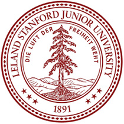
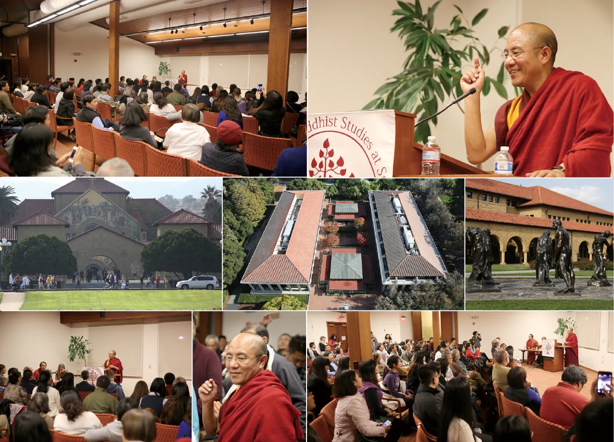

比起信仰，佛教更注重智慧。

一件事若以智慧观察不成立，

哪怕是佛陀说的话，也可以不接受。

第105场

美国斯坦福大学

Stanford University

美国·旧金山

2014 / 11 / 20

## 藏传佛教在汉地的流行

## the popularity of tibetan buddhism in china

主持人：

大家好，我是斯坦福大学何氏佛学研究中心的主任，今天很荣幸地向大家介绍索达吉堪布仁波切。

堪布所在的喇荣五明佛学院，成立于1980年，在短短的时间中，它从成都西北方的一片荒芜之地，发展成了一所大规模的藏传佛教学习中心，常住僧侣多达上万人，甚至比斯坦福大学的本科生还多。

堪布自1985年出家以来，在讲法和写作之余，还参与创建了多所教育、慈善机构，包括小学、佛学院、养老院以及上海慈慧公益基金会等。多年来，堪布奔走于中国各地，常为大学师生演讲，而且，堪布的汉语讲得非常好，相比之下，我作为一名汉传佛教的研究者，深感惭愧。考虑到上述种种原因，我认为堪布是以“藏传佛教在汉地的流行”为话题发言的不二人选。

感谢老师、同学们的邀请，让我有这样的交流机会。

在过去三十多年里，我一直修学藏传佛教，也一直在为汉族人讲经说法，几乎没有间断，因为我个人非常重视讲经说法。与此同时，藏传佛教在汉地也变得非常兴盛，很多年轻人、知识分子开始系统地闻思修行，因此，藏传佛教在汉地兴盛，不仅仅是人数增多，见解也在提高。

当今社会，寻求内心安乐、重视信仰与文化的人越来越少，人们把大量时间、精力投入到经济、物质的发展上，为此日夜奔波，内心烦躁不安。虽然有些人通过修持佛法，在生活中获得了很多安乐，但绝大多数人依然缺乏对佛法的正确认识，他们更热衷于做一些外相的善法，比如建造金碧辉煌的寺院和佛像、磕头、绕山等，并认为这就是佛法的全部。实际上，这只是佛法的一部分而已，而且，还不是最主要的部分。

## 重新认识佛教

什么是佛法呢？早在两千五百多年前，佛陀就说过：“诸恶莫作，诸善奉行，自净其意，是诸佛教。”行持对自他有利的善法，断除对自他不利的恶法，净化内在的嗔恨心、争斗心等，不被恶分别念所主宰，使内心获得安乐，这种文化或者教育就叫佛法。

虽然佛教被列为宗教，但我认为，佛教更像是一种教育，它不但有天文、地理等诸多知识，还提供了让我们越来越贤善的修行方法。而这些宝贵的内容，任何人都可以得到。

当然，如果你想了解它，不论学习汉传佛教、南传佛教还是藏传佛教，都要先通过听闻和讲解来理解法义，然后再实地修持，从而提升自己的修行境界。印度的世亲论师说：“佛之妙法有二种，教法证法之体性，持教法者唯讲经，持证法者唯修行。”佛法包括了教法与证法两方面，所以，学佛既不能偏重理论，也不能偏重修行，而需要把二者结合起来——仅把佛法当成学术研究是不够的，还必须通过实修品尝到其中滋味；反之，如果没有闻思的基础，一开始就直接实修，也不可能修得好。

## 逆境之中勿忘初心

从藏传佛教的历史来看，上世纪六七十年代，很多有智慧的大德离开藏地，前往印度、美国以及欧洲各国。尽管当时条件很艰苦，但他们克服了种种困难，坚持闻思修行，通过佛法来饶益其他的民族和国家，结果违缘变为顺缘——现在世界各地都建立了佛学院、寺院、佛教中心，西方人开始了解藏传佛教，并且有了闻思修佛法的机会。

在同一年代，身处藏地的很多修行人，虽然没有很好的机会闻思修行，但也并未因此而放弃佛法。比如，“文革”期间，法王晋美彭措不但没有机会修学，平时还要从事放牧、耕田等劳动，尽管如此，他依然坚持给周围的人传法，与大家在山洞里、树林里念经、学习经论，晚上也坚持在烛光下学习。宗教政策开放以后，我们佛学院一成立，立刻就具备很多僧才，这完全是因为法王在过去二十年中，已经培养了很多法师，就像事先为佛学院准备好的一样。

去年有一位记者问我：“为什么喇荣有这么多堪布，而且喇荣的法脉在汉地弘扬得这么广呢？”这有多方面的因素，其中最主要的原因就是，法王晋美彭措在没有成立佛学院时，便已经培养了很多堪布和僧才。从这一点也可以看出，不管遇到什么困难，法王都非常坚强、勇敢，而这种品质，也一直被美国人所重视。

所以，在我们的人生当中，不管遇到什么困难，都不应该失去勇气，而要借此不断学习，努力肩负起利他的事业。

## 藏汉佛教师出同源

大约在四五世纪到十二世纪，印度那烂陀寺是一座举世闻名的佛学院，培养了非常多的僧才。汉地的玄奘大师，就曾去那烂陀寺依止戒贤法师，圆满了因明、唯识等诸多经论的学习，之后回汉地广弘佛法。此外，义净法师也曾在那烂陀寺学习长达十二年，并将400多部经论带到汉地弘扬。

藏地也有很多来自那烂陀寺的祖师，比如阿底峡尊者、静命论师、莲花戒论师，包括莲花生大士，都曾在那烂陀寺修学。因此，藏传佛教的很多传承也源于那烂陀寺。

除此之外，龙树菩萨、月称论师、陈那论师、法称论师，都是非常著名的大智者，对这个世界的精神文化作出了很大贡献，他们也是那烂陀寺的传承。就像现在全世界都认可斯坦福大学的水准，当时的人们很认可那烂陀寺的智慧。

## 信仰也需要智慧支撑

一个人在学习佛法时，固然需要信仰的支撑，但比起信仰，佛法更注重认识真理的智慧。藏传佛教强调用智慧观察世界——如果一件事物通过智慧观察后成立，那即使科学暂时无法验证它，我们也不得不接受；如果通过智慧观察后不成立，那即便是佛陀所说的话，也可以选择不接受。

佛陀曾说：“比丘或智者，当善观我语，如炼截磨金，信受非唯敬。”对于佛陀所讲的法，不管是出家人还是在家人，都应该用智慧去观察。经过观察之后，如果发现佛陀所说的法没有道理，那么就不值得恭敬，甚至可以舍弃，但如果有道理，我们就应该依教奉行。这也非常符合现代人所强调的客观精神。

斯坦福大学的师生，应该都是有智慧的人，你们可以用智慧去观察、分析，看看佛法是否有道理，然后作出取舍。

佛教中讲：“钝根名随信行，利根名随法行。”钝根者叫“随信行”，听别人讲几句天神或者上师的功德，马上就生起信心，这种信心比较初级；利根者叫“随法行”，即通过智慧观察佛法是否成立，进而做出理性的判断，由此生起的信心，才是真正的信心。

佛法甚深广大，不能只被当作一种兴趣、信仰，仅停留在了解的阶段。相反，我们应该用智慧反复观察它，进而产生不退转的定解，这才是有智慧的表现。

我非常喜欢《大乘经庄严论》的一个偈颂：“理析妙法智，恒无魔作障，得胜驳他宗，不夺成熟相。”判断一个法是否合理时，需要用智慧再三观察，如此才能产生稳固的定解，免受外界干扰，这是一种成熟的表现。

在座有很多研究佛法的老师和同学，希望大家对佛教也能以客观的态度，运用智慧长期学习佛法，若能如此，最后就会如拨云见日般，获得真正的证悟。到了那时，不管是讲法、辩论或者摄受弟子，都没有任何障碍。

## 给你一记“万灵药”

总之，我认为佛法对人生非常有帮助。从大的来讲，有利于世界和平、社会和谐；从小的来说，有益于家庭、人际关系、生活环境；对个人而言，佛法也有调伏身心的作用。比如，现在有很多心理疾病患者，他们可能长期与外界隔绝，又或者一直处于某种妄想之中无法自拔，对于这些情况，现代医学往往束手无策，佛法却能给出有效的解决之道，为人们带来安乐，提升幸福感。

我在汉地就遇到过很多人，他们在没有学佛之前非常痛苦，而学佛之后，人生中遇到再大的困难，也有勇气面对。

听说有一位美国居士，家人去世了，在这种变故面前，这位居士还承受得住，但他的妻子没有学过佛法，内心极其痛苦，时时刻刻都需要有人看护。这样的情况在藏地、汉地也有很多，原因就是没有了解生老病死的痛苦。

扪心自问，当我们自己遇到各种痛苦时，会用什么样的方式面对呢？能否将痛苦转化为道用呢？

佛法中有很多方法，对身心健康非常有帮助。若能修学如禅定、利他菩提心、空性等法门，人生的很多难题都会迎刃而解。当然，假如你对这些没什么兴趣，也不应该轻视它。我去过很多美国大学，很多学者的佛法水平相当不错，这也说明现在有些人更在意内心的安乐，而不单单是物质上的满足。

作为人类，绝大多数可能比较自私，只希望自己富有、幸福；希望自己有创意，能发明很多东西；希望自己拥有权力，掌控一切……但实际上，这样的人生并不快乐。若能放下对自身的过度耽著，自己拥有财富时，多资助一些穷人；手握权力时，多救护无助、孤单、可怜的弱者；学历很高时，用之来帮助他人，这样的人生才有意义，这也是大乘佛法的核心。

最后，希望大家今后所追求的人生方向，是行持利他，帮助他人。

现场互动

问：我认为藏传佛教是一种高层次的精神追求，似乎在精英阶层或者有一定财富和地位的人群中更加普遍。您又是如何广泛地面向大众弘扬佛法的呢？

堪布：佛经中经常说，佛法就像水，不论贫富贵贱，人人都可以饮用，所以，只要方法得当，人人都可以学习佛法。

我自身来讲，会将《入菩萨行论》等论典作为基础教材，引发出人心良善的一面，开发他们本具的智慧。同时，不管是面对汉族人、藏族人还是西方人，也不管听课的是两三个人还是成千上万人，我都会尽力为大家传讲佛法。

依靠这种方法，当然有些人能听懂，有些人听不懂，诚如佛典中所说：“如天虽降雨，种坏不发芽，诸佛虽出世，无缘不获善。”如果种子已毁坏，即使降下雨水也无济于事；同样，倘若对佛法没有信心，哪怕是佛陀亲自现身宣讲佛法，你也听不进去，就像老师有时候不论怎么教导学生，学生依然不听话一样。

问：我们应该如何面对亲人离世？

堪布：佛陀曾说：“聚际必散，生际必死。”有聚必有散，有生必有死，这充分体现了无常的本性。若能明白无常的道理，平时经常思维、修行，那不管是夫妻之间的聚散，还是亲友之间的别离，我们都可以承受。

问：在每天忙碌的生活当中，在家人应该如何深入学习佛法，提升智慧呢？

堪布：在家人可以先学《入菩萨行论》。在藏地，这部论典无人不晓，汉地的修行人也对这部论典很熟悉，不知道美国这边是不是也如此。

此外，全知麦彭仁波切说：“由此精进与稳重，信心聚一了因明。”要想对佛法生起定解，就要学习因明，如《释量论》。在《入菩萨行论》的基础上，再学习因明，乃至中观、密法等，效果会非常好。

问：汉地的人们是否也有机会系统学习五部大论？

堪布：在喇荣五明佛学院，就有用汉语传讲的五部大论课程（戒律、因明、俱舍、中观、般若），汉族的学僧被分成很多班级，男众班级由汉族堪布负责，女众班级由汉族堪姆负责，有些班级甚至由两三位堪布或堪姆一起负责。

不但是五部大论，包括密续，喇荣也有用汉语传授的堪布和堪姆。

同时，在汉地很多城市中，我们也为在家居士开设了五部大论，甚至密续的课程。

问：美国的佛教徒通常只强调冥想和正念的修持，很少全面关注整个教法体系，在您看来，这种现象是好还是坏？

堪布：这个时代，不管佛教徒还是非佛教徒，都忙得不可开交，但很少有人忙于有意义的事情，大多数人的一生都是在无意义的琐事中度过了。比如，很多人喜欢玩手机，或者沉迷于影视剧，很少有人能完整地看一本书。其实世界上有很多有价值的书，如果一生能阅读上百本，人生会非常有意义，但他们经常以没有时间为借口，在我看来，他们可能忙着睡懒觉、散乱而没时间。

在这样忙碌的生活中，人们的压力、烦恼也会越来越大，而修持寂止可以让内心住于平静、专注一缘，暂时压制住这些烦恼。但如果没有胜观智慧的摄持，很难获得更高的成就，更不可能获得圆满正等觉的究竟果位。

不管怎么说，修寂止能为我们带来暂时的平静，产生一些轻安的觉受，让身体健康，内心安乐，这对于高压状态下的人非常好。人们能寻求心灵的宁静，有精神上的追求，也是非常有价值的。

问：在小乘佛教、日本佛教以及汉传佛教当中，为什么那么多汉族人选择藏传佛教？藏传佛教在哪些方面最吸引汉族人？

堪布：藏地的寺院就像大学一样，有很好的闻思修传统，可以满足很多人学习佛法的需要。此外，藏传佛教有一种现代人所谓的“能量”，用佛教的语言来讲就是“加持”，这种加持是通过修行让自心发生改变，获得前所未有的利益。

去年有个美国人跟我说：“藏地可能是受到了佛法的加持，因为从藏地来的上师们，不管能力大小，都会力所能及地通过讲法、诵咒来利益他人。”当然，现在也有一些假上师，但这是个人的问题，不是佛教本身的问题。在藏地，如果是真正具足法相的上师，唯一的事业就是精进地利益众生。

还有很重要的一点是，藏传佛教中涵盖了显宗、密宗的教义，内容非常全面，因此，不论是南传佛教、日本佛教还是汉传佛教，其精髓都可以在藏传佛教中找到。而且，藏传佛教中还有印度不共的玛哈瑜伽、阿努瑜伽等甚深密法。所以，很多人都喜欢修学藏传佛教，而且不像赶时髦一样只有三分钟热度，因为与真理相符，就容易长久住世。
