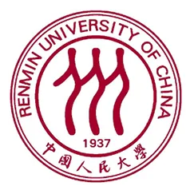
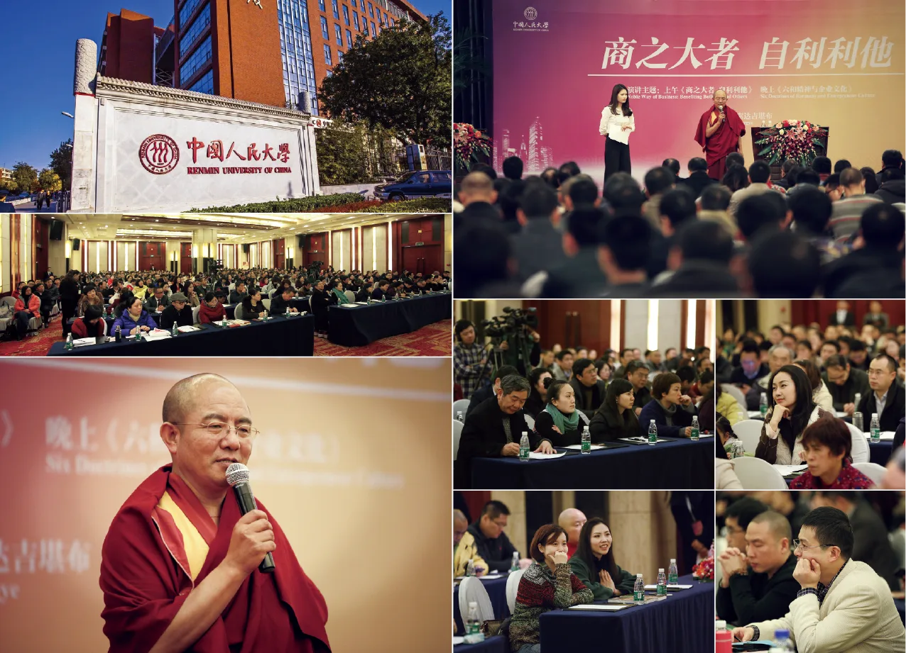
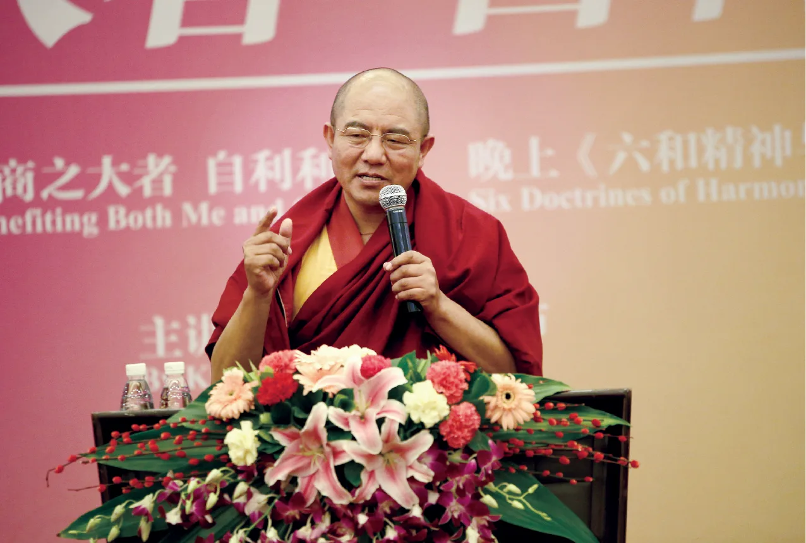
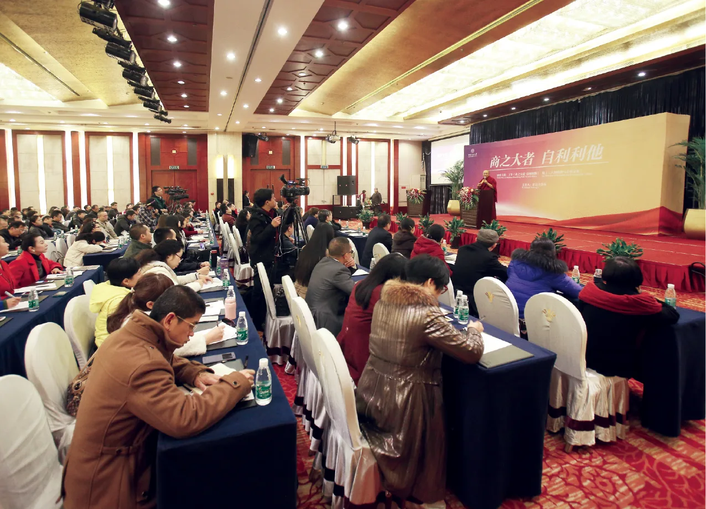

人们往往只看到自己的努力和付出，

却看不到事情背后的很多因缘。

第106场

中国人民大学重庆校友会

Renmin University of China,Chongqing Alumni

中国·重庆

2015 / 3 / 1

## 商之大者 自利利他

## Businessman’s Dharma: Benefiting Self and the Others

主持人：

尊敬的各位来宾，欢迎大家莅临今天的活动。今天是2015年3月1日，全新的一年，全新的三月！首先，我谨代表会务组恭祝各位新春愉快！

这次由中国人民大学重庆校友会主办的“商之大者，自利利他”主题演讲活动，是为了响应习总书记关于弘扬中国传统文化和学习各种思想精华，将我国建设成为富强、民主、文明、和谐的社会主义现代化国家的号召。

在活动开始之前，让我们以最热烈的掌声有请人民大学重庆校友会会长致欢迎辞！

王会长：

各位同仁、各位校友，新年好！非常感谢大家能来参加这次精彩纷呈的演讲活动。看到这么多优秀的社会各界精英列席在座，可以预见，今天的演讲活动将是2015年中国人民大学重庆校友会文化论坛中浓墨重彩的一笔。

众所周知，我国现在正处于大发展、大变革、大调整时期。在这前所未有的改革发展和开放进程中，各种价值观和社会思潮纷繁复杂。我们迫切需要运用优秀的传统文化作为指导，提高文化软实力，实现中华民族的伟大复兴。因此，我们举行了这样的论坛活动。

今天，我们非常荣幸能够邀请到尊敬的索达吉教授，作为此次活动的主讲嘉宾。索达吉教授是当代杰出的佛教学者、作家、翻译家和慈善家，在国内和国际上享有崇高的声誉，倍受知识分子和科学工作者的推崇。

在本次演讲中，教授将以他独特的视角，阐释现代商业及企业行为如何在社会实践中发挥最大的自利利他效益。相信教授的演讲能让大家耳目一新，获得宝贵的经验，更好地为社会、为人民、为国家服务！

能够与这么多的社会精英一起交流，我感到很高兴。其实就我本人而言，并没有刚才介绍的那么了不起。我只是一个平凡的出家人，一个爱学习的小人物。要知道，有时候对于一个人的评价，如果过于夸张，反而会让人感到不真实，甚至最后变成了失望。所以，大家也要有心理准备，我今天的发言不一定能给你们带来有价值的启发，但能在人大重庆校友会见到这么多有才华、有能力的企业家和知识分子，对我而言很有意义。

在座各位跟我平时接触的人有点不同。我经常会去一些学校做演讲，接触的主要是老师和学生。他们大多只是和知识打交道，思想比较单纯，没有特别丰富的社会经验。而在座的都是各行各业的企业家，承担着非常重大的社会责任，同时也影响着很多人的生活、工作，乃至思想。我觉得每个企业都是一所学校，企业家就是校长，他们像父母一样，关心着所有员工的衣食住行。所以，就目前的社会现状而言，大家有必要共同学习一下优秀的传统文化，尤其是传统宗教所提倡的“自利利他”理念。

## 经营利他的精神财富

有些人可能认为，在现在的社会中很难在自利的同时又利他。但我们应该好好想一想，事实上只有秉持自利利他的精神，企业才会有长久生存的希望。为什么这样讲呢？因为从我自身的经验来看，在人类所有的思想中，利他心是最珍贵的。当你在行持利他的过程中，即便暂时得不到别人的认可，遭遇种种的违缘和障碍，但利他心所产生的价值永远也不会消失，它对全人类乃至整个地球都有着不可磨灭的影响。这是一个值得我们思考的问题。

很多人会认为，在当前这个时代里，拥有利他心的人不一定能很成功。因为现在大多数人都是自利为主，追求自我强大、自私自利，在我们身边就有很多这样的人。在座各位都是做生意的，在这方面应该比我更懂。我不是学经济的，更不会做生意，所以对商业方面不是很了解。按理来讲，我并没有资格给大家讲如何经营企业，但从企业的精神文化进行分析时，我在精神财富经营方面有多年的经验，可以给大家分享一些心得体会。

就我个人而言，在过去的三十多年里，一边在佛学院学习，一边坚持做翻译，从来没有停止过，主要是把一些藏文的传统经论翻译成汉文。这样做的目的是什么呢？我觉得人活在这个世界上，物质财富固然重要，但精神财富更重要。如果我们的精神生活越来越匮乏，即使物质生活再富足，也不一定会让人感到快乐。比如，现在有的人住别墅，开豪车，存款无数，但他的家庭不一定和谐，内心也不一定快乐，为什么呢？因为忽视了精神财富的重要性。要知道，当一个人精神空虚的时候，内心也很难感到幸福。

我去过一些特别偏僻的寺院，那里的修行人穿着朴素，吃得格外简单，住的是连一万块钱都不到的简陋铁皮房。可是，他们的内心很快乐，有一种满足感和幸福感，这是许多大城市的人所无法相比的。有些人可能会想：“是不是住在寂静的地方，自然而然就会感到快乐呢？”这也不一定。其实，快乐主要取决于内心，只有树立正确的价值观，内心才能获得真正的安宁。

## 传播优秀的企业理念

在如今传统文化复兴的特殊历史时期，对于很多企业家来讲，不仅对员工物质生活的提高有责任，更重要的是对他们的精神生活产生积极的影响。作为一家企业的管理者，所有员工都会听你的，虽然政府、学校或寺院里的一些知识，他们未必有学习的机会，但企业领导如果有一些好的精神理念，完全可以在员工群体中分享，这其实是一个非常好的方法。

在我认识的企业负责人当中，有些人就把这个方法运用得很好，他们往往会通过一些简单的方式，来传递深刻的思想理念。就像佛教徒经常念的“嗡玛呢巴美吽”，表面上看只是一句非常简短的咒语，实际上却蕴含着非常大的力量。大家去过藏地就会发现，不管是老年人还是年轻人，他们手上都会拿着一个转经轮，嘴里也一直念着“嗡玛呢巴美吽”。对于不信仰佛教的人来说，可能会对此感到十分困惑，觉得这些人看起来怪怪的，一直这样转的话，难道不会把头转晕吗？这种转法和车轮的转法到底有什么不同？

其实，这是因为他们对其中的因缘还不了解，不懂得咒语力量的人，可能会觉得这样做一点意义都没有。但大家应该清楚，这个世界上有很多知识是我们无法一下子就能理解的。比如，物理、化学、佛学中的一些知识，其实我们很多内容都不懂，只有对某个领域进行专门研究，甚至成为一名专家之后，才会明白：“原来在它的背后，有如是的作用和价值。”因此，不管是去汉地、藏地，还是其他国家，我经常会这样说，不相信不要紧，任何事情都有一个过程，虽然这只是一句简单的咒语，但也许能给你的人生带来意想不到的转变。事实上，依靠一种行为，依靠一种信念，确实可以慢慢改变人的命运，也可以改变这个世界。

## 企业家也要有无常观

在积累财富、社会交往等方面，在座各位都很有经验、有智慧，我就不太擅长这些。但在内心世界方面研究过很多年，我总觉得现在的精英人士缺少精神层面的财富，虽然他们拥有很多物质财富，但这有可能会转瞬即逝。尤其是在如今的网络时代，有些人在很快时间内就变成了百万、千万、亿万富翁，但很快又变成了穷光蛋、乞丐，甚至还可能坐牢，存在着太多的不确定性。

为什么很多机遇自然而然地出现，后面又忽然消失了呢？因为佛教里讲一切都是无常的，这就是无常的作用。前段时间，我去了美国的西雅图，那里有很多像微软、波音这样的大公司，也有很多精英人士。在我与一位老总交谈的过程中，他说：“以前我的公司有三百多个员工，美国爆发金融危机时，三百多人一天就解散了。我们已经坚持了十几年，后来因为经济不景气，实在没办法继续经营下去了。”他还说，当时离散的那个场面，让他至今都难以忘怀。

我虽然不是企业家，但非常关心各个企业的未来发展。我希望大家在内心抱有美好愿望的同时，也要做好最坏的打算，因为人生总有些事情发生得让你措手不及。如果我们平时只想着赚大钱，其他什么都不想，一旦遭遇了突发事件，可能会变得非常痛苦。到了那时，你会发现原来对你非常好的一些领导、朋友和亲人，全都一散而光，再也不会来看你。一般来说，人都是很现实的。当你的财富、名声、才华等处于鼎盛时，人人都会追捧你、赞叹你、围绕你、支持你；当你落魄不堪时，即便是最亲密的亲朋好友，也会悄悄地远离你。事实上，每个人都会遇到这种情况。我们在新闻里也可以看到，无论是政府官员还是企业家，当他身处高位或事业兴旺时，有无数的人会赞叹他，而当他落马受审或投资失败时，又会有很多人奚落他，这也是一种规律。

## 做菩萨一样的企业家

作为一名修行人，我虽然没有在家人的这些担忧，但也经常会想：“现在是去寂静处独自修行，还是一边讲课一边做翻译好呢？”事实上，我也有一直放不下的责任，因为我这边有一些听课人员，就相当于你们的员工一样。如果我坚持讲课，他们就会一直听。如果我停课不讲，那些智慧还没有成熟的人很快就会流失掉。对此，大家可能也深有同感。如果你们的企业经营不下去，那对员工的生活也会有一定的影响。

那么，如何才能做到自利利他呢？利他的方法可以分为两种。一种是先自利，然后再去利他；另一种是先利他，然后自然而然就会成办自利。一般来讲，后一种的发心更为广大，佛教中讲这是菩萨的行为。《楞严经》中说：“自未得度，先度人者，菩萨发心；自觉已圆，能觉他者，如来应世。”意思是说，在自己还没有获得解脱的时候，先帮助别人解脱，这是菩萨的行为；而自己已经觉悟了，然后再帮助他人觉悟，这叫做如来应世，是佛的行为。

有些人可能想：“我自己还没有解脱，怎么能帮助别人获得解脱呢？”事实上，这是最好的一种利他心态。虽然我们还在轮回里，没有获得超凡的开悟境界，但仍可以在力所能及的范围内去帮助别人，这就是菩萨的行为。大家可能也有这方面的疑惑，认为自己没有任何境界，还是一个烦恼深重的凡夫，有懈怠、傲慢、嫉妒、贪心、嗔心等各种烦恼，怎么有能力去帮助别人、度化别人呢？其实，如果等到我们把所有的功德全部圆满，所有的烦恼染污习气全部消除，然后再去利益众生，那需要很长的时间。所以，不如从现在开始努力，能做多少就做多少。

因此，我特别希望大家在平时的生活中，每天都能这样发愿：“我今天至少要帮助到一个人！”通过利他来修炼自己的心，这样逐渐就会形成一种无形的因缘，对你的工作、家庭和生活都会起到不可思议的作用。

## 偏见来自认知的局限

对于这样的因果规律，我们暂时只能看到一些表象，很难看到潜藏于现象背后的内在因缘。其实，人生就像是一块布，我们往往只看到表面的很多“经线”，却看不到隐藏的很多“纬线”。同样，我们也只看到自己的努力、他人的帮助等可见的因缘，却看不到相续中像纬线般隐藏的一些业。事实上，任何一件事情，都是众多因缘错综复杂的和合。而我们的眼识、耳识等六根识的判断很有局限性，这就导致了人们有时候会把事情想得太简单了。比如有的人根本想不通，为什么拥有同样的机遇，别人能轻而易举地成功，而他却总是一事无成？主要原因就在于，他没有看到现象背后隐藏的一些因缘。

《三摩地王经》中说：“眼耳鼻非量，舌身意亦非，若诸根为量，圣道复益谁？”意思是：我们依靠眼耳鼻舌身等六根，得到的判断并不一定正确，如果这些都是正量的话，那圣者之道还有什么超胜之处？假如我们眼睛所看到的都是正量，那物理学家和宗教学家观察到的更为微妙甚深的这些正量，难道不如这个？事实上，人们总是觉得眼睛所看到的事物都是真实的。但如果让物理学家来分析，他们会说物质都是由分子、中子、质子等众多微尘组合而成，如果对这个微尘再进行观察，会发现它的本体也不成立。

现在的人们经常会说“眼见为实”，可亲眼所见就是真正实有的吗？或者说，如果眼见真的为实，那我们所有人眼睛看到的都是正确的吗？这也不一定。比如，面对同一个人，有些人认为他是个好人，有些人却认为他是个坏人；或者一个人觉得他长得非常漂亮，但另一个人却觉得他长得特别难看。如果眼见真的为实，那我们人人都有眼睛，这样的话，好与坏应该是决定不变的。但实际上，人类的眼耳鼻舌身等六根都有一定的局限性，我们不能过于相信自己的判断。

很多人特别相信自己，认为自己的所见所闻一定是正确的。也正是因为这样，人们在做出判断时，往往会出现错误。现在许多家庭经常吵架，导火索就是“我听到了什么”“我看到了什么”……实际上，你所听到的、看到的、想到的、感觉到的，未必是准确无误的，这会导致很多错乱现象的发生。《了凡四训》中也有讲到，人们往往只看到自己的努力和付出，看不到事情背后的很多因缘。那么，通过什么方式可以改变这些因缘呢？我们应该多行善事。在所有的行为中，利他是最有功德、最有力量的。

## 成功应遵循因果法则

有些人特别渴望发财、快乐和成功，但所作所为却总是背道而驰。尤其在当今这个时代，有的商人无恶不作，杀、盗、淫、妄等十不善业无一不沾。他们认为这是身不由己，不得不做，但最终的结果可能会很不好。事实上，如果你长期坚持做善事，也许暂时会吃一些亏，但慢慢会出现很多不可思议的善缘。

关于这个问题，我思考过很长一段时间。我们究竟是通过行善得成功，还是通过作恶得成功呢？其实，最好还是选择做善事来获得成功。因为如果你做恶事的话，即使获得了一时的成功，最后带来的果报也是运气变晦气。相反，如果你做善事的话，也许暂时会感觉吃亏，赶不上别人，但这对你来说会是一个很好的开端。

我以前看过一本书，叫《清稗类钞》[^1]，里面载录了很多清朝时期的真实历史故事。其中有一则故事讲到：在嘉庆年间，有一位姓张的老板，他在做生意的过程中，产生了一个不好的念头。以前人们买东西都是用秤来量，不像现在大家会选择网上购物或商场购物。所以，他准备在秤上做一些手脚。于是就买通秤匠，让他给自己做个称一斤能少一两的秤。

张老板的女儿得知此事后，私下找到秤匠说：“我父亲的意思不是这样，他应该是让您多做一两，而不是少做一两。”秤匠有点不相信，但张老板的女儿再三说：“我父亲经商向来讲诚信、重信誉，绝不会做出违背因果的事情，希望您能按我父亲的意思去做。”之后，她掏出一些钱以示酬谢。其实秤匠心里很清楚，张老板的女儿在撒谎，她父亲的意思不是这样，但实在禁不住金钱的诱惑，最后还是答应了。

后来，张老板用这个新秤过秤时，每一斤都会多给一两。这件事一传十、十传百，小店的口碑越来越好，生意也逐渐红火起来，张老板赚了很多钱。有一天，他非常得意地和女儿说：“你知道我赚钱的秘密吗？现在生意之所以这么好，全依靠我的智慧。”可女儿对他说：“真相并不是这样，原本您要求秤匠做秤时少一两，后来被我改成了多一两。”

张老板听后非常愤怒，说：“那我岂不是每次都多给别人一两，这样就吃大亏了！你为什么这样做？”女儿解释道：“虽然表面上我们吃亏，但大家都是有判断能力的人，如果我们让客人吃一次亏，大家就会对我们失去信任，以后再也不来买东西。相反，如果让利给客人，慢慢就会得到认可，大家一定会经常光顾。”听了女儿一番分析，张老板恍然大悟，接受了这个道理。

不过，张老板女儿的做法，现在有些人不一定认可。受社会大环境的影响，很多人只想着尽快赚大钱，为此不惜欺瞒顾客，采用各种不正当的手段打击竞争对手，并且还认为这是现实所迫，不得不这样做。但实际上，世间万法都有一定的规律，一旦违背了它，不要说不能成功，恐怕未来的生存都会成问题。

近几年来，这种现象变得越来越严重了，包括我熟悉的一些藏族人，也是一心想着要短期赚大钱。我经常对他们说，不要总幻想着一夜暴富，要一步一步走得稳些，这是比较安全的赚钱方式。就像佛教中积累资粮一样，也需要一步一步慢慢来，并不是精进一天，马上就能证悟很高的境界。

## 经营依赖踏实的积累

《优婆塞戒经》中说：“利益他者，乃名自利。”也就是说，尽力帮助他人才是真正的自利。今天我们讲的主题也是“自利利他”，那怎样做才叫自利利他呢？其实，只要你诚心诚意地去帮助别人，这就是真正的自利利他。有些人也许很难接受这样的理念，但其实这不仅是佛教的一种观点，很多学者对此也是承认的。比如，英国剧作家萧伯纳就曾说过：“经济学是一门使人生幸福的艺术。”因此，我们每个人都应该思考一下，通过什么方式才能让自他都幸福？

企业家肩负着非常重要的社会责任，也都希望自己的公司发展壮大，但从另一个方面讲，不一定要把企业做得太大。中国人有一个习惯，稍有一点能力时，就想着要把事业做大做强，最大限度地占领市场。其实这种做法并不稳妥，因为一个人的能力、智慧和财富都是有限的。我认识的一个藏族老板，也是一名佛教徒。每次他新开一家宾馆，都要很长时间才能收回本钱，而一旦他拿回本钱，就立刻想要再开一个店。我很小的时候就认识他，总听人说他很有钱，但他好像永远都不开心，生活得很痛苦，因为他总觉得：“我要在这里开一个店，在那里也要开一个店。”其实，做任何事情都需要花时间去经营，否则欲速则不达。

去年在德国时，我也去过一些企业里做演讲。通过和他们的一些交流，我了解到有的家族企业已经代代相传经营了三百多年，而且都是一些小型企业。他们的经营理念和我们不太一样，并不是刚在一个城市起步，就马上去另一个城市开拓新市场，在全国开设连锁店，甚至想要控制国际市场，这样的话，最后可能会把自己累垮。要知道，随着生意越做越大，身心也会越来越疲惫，慢慢可能会变得痛苦不堪、闷闷不乐。

大家都知道，像德国的一些酿酒厂、服装厂和电器企业，很多都有四五百年的历史，有的甚至已经有上千年的历史。那边的房子也是如此，很多都建于四五百年之前。而我们这边的人，心态比较不稳重，工作也是换来换去，今天在这个公司，明天又到那个公司。很多佛教徒也是这样，今天学这个法，明天学那个法，后天又再变一个；今天跟这个上师跑一跑，明天跟那个上师跑一跑；今天去这个寺院学一学，明天去那个寺院学一学……

我以前看过马云的一段采访，他说日本有一家卖糕点的百年老店，给他留下了很深刻的印象。这家店的门口挂了一块牌，写着“庆祝本店152周年店庆”，但它的面积只有二十平米左右，家族几代人都在这里做糕点。而我们却只有少数几家百年老店，比如同仁堂，其他真正超过一百年的店很少，因为我们的欲望实在是太大了。

## 和合精神是经商之道

如果想要做好一家企业，首先要对下面的员工负责。有些老板很不尊重员工，只是在需要的时候才用他，不需要的时候就开除他，这样做很不好。我们藏族有一句俗语：“需要的时候当帽子，不需要的时候当鞋子，甚至扔掉。”其实，做人应该要有良心，身为老板这样做，会显得没有人情味。当然，作为员工，在非常困难的时候，老板培养了你并加以重用，当你稍有能力的时候，为了一点钱就抛弃他，跑去别的公司，甚至最后成为他的竞争对手，用他的资源和人脉来扩展自己的业务，这从良心上也说不过去。

对于一个企业来说，应该重视培养团队精神，很多国外企业在这方面做得很好。我之前遇到过一位美国老板，他说：“虽然我的企业做得不大，但产品质量很有保证，而且我也不愿意做得太大，否则可能对一些老员工不利。这些人跟着我二十多年，我向他们承诺过，只要我还活着，绝不会抛弃他们。他们也向我承诺过，只要他们还活着，也绝不会抛弃我。所以，我们之间除了雇佣关系以外，还有一种良心、信任的道德约束。”

人与人之间需要有一种信任，这一点很重要。如果在平时的工作和生活中，我们只喜欢谈论金钱、美色、名声之类的话题，不重视培养自己的团队精神和健全人格，这样的话，有些人表面上看起来是人，实际上已经变成了另外一种生物，所以说建立长期的信任关系很重要。无论是面对令人眼花缭乱的外境，还是面对金钱、美色和名声的诱惑，最终都能经得起、靠得住，这种人际交往的智慧对双方都非常有利。

实际上，我们能否取得事业上的成功，很大程度上取决于人的和合，也就是传统文化中的道德教育。如果大家都不考虑道德规范，只想着维护自己的利益，很可能会为了一己私欲而罔顾他人感受。除了考虑自身利益以外，如果你还是一个有良知、有道德的人，那你最终会做出明智的选择，走上一条光明的道路。

日本哲学家梅原猛先生（Takeshi Umehara, 1925-2019）曾说：“道德缺乏的根本，在于宗教的缺失。”我以前看过一本书，是他跟稻盛和夫（Kazuo Inamori, 1932-2022）一起写的《拯救人类的哲学》，希望大家有时间可以读一下，相信从中能获得一些启发。另外，我还推荐大家读一下稻盛和夫的《活法》。这本书我也看过，里面的内容并不多，只有短短五章，但其中讲到了作为一个经营者应当承担的责任、因果的取舍以及平衡自利与利他等重要话题。

稻盛和夫在日本被誉为“经营四圣”之一。他有两家企业跻身于世界五百强，但他在65岁时还是选择了出家修行。事实上，他从小就信仰佛教，后来也一直在用佛教的理念培养人才、经营企业。他还曾去过北京大学演讲，当时现场有很多商界精英，大家都感触颇深，纷纷表示要转变经营理念。

一般来讲，我不会推荐别人的书，不然可能会被人说成是打广告，这方面我一直非常注意。但这两本书中提倡的企业经营理念和管理模式，是以因果、道德和人性为核心。人们常说“善有善报，恶有恶报”，事实上也的确如此。如果能够遵循因果规律，多做善事，对我们来说非常有帮助；如果做伤害别人的恶事，暂时你可能会成功，但内心深处并不一定快乐，从良心上讲也是过意不去，慢慢可能会越来越空虚和焦虑。

## 人生不过如大梦一场

我们应该快乐地度过每一天。在座每个人实际上都是一个历史人物，都在书写自己的“传记”。因此，每一天都是人生的重要时刻，如果过得愁眉苦脸、痛苦不堪，那将来回顾自己的人生历程时，大多时候可能是伴随着眼泪和痛苦。事实上，当我们以后回想起现在的生活，会发现一切都是如梦如幻，所以没必要太过于执著一些东西。

我平时喜欢看一些历史人物传记。我发现上世纪七八十年代人们所执著的东西，在现代人的眼里根本不值一提。同样的道理，我们现在特别执著的房子、车子、感情以及工作等，再过二三十年，都将成为一段历史的记忆。不要说再过二三十年，我们今天执著的东西，也许明天就成为了历史，然后在记忆中慢慢地沉淀、消逝。最后，你只能想起那些难以忘怀的记忆，其他就都忘记了。就像一位藏传佛教大德所说的：明天发生的事是明天的梦，昨天发生的事是昨天的梦，今天的我们正在做梦。这句话很有深意，希望大家能好好思考一下。

要知道，不管遇到什么事情，心里快乐、愉悦也好，痛苦、焦虑也罢，都没有必要过于执著，最好不迎合也不排斥。既然事情已经发生了，就应该坦然去面对，俗话说“既来之，则安之”。假如生活给我们带来的都是快乐，每个人当然都会愿意接受，并表示热烈欢迎。但生活不可能一帆风顺，总会出现许多出乎意料之事，痛苦也会纷至沓来，甚至可以说痛苦比快乐更多一些。

## 莫贪欲过甚而无自制

在我遇到的很多人里，包括今天在座的各位，从世间层面来讲，大家都是成功人士，但你们的心里未必有一种满足感，可能每个人都觉得自己还不够成功。比如，一个人有了一千万，会觉得一千万不算多，买几栋房子就没了，应该要赚到两千万；有了两千万的时候，又觉得这也不算什么，别人已经赚了一个亿，自己也要赚一个亿；有了一个亿的时候，又想要赚一百亿……物质欲望日益膨胀，永无止境。我有时就在想，对于贪欲重的人来说，哪怕他拥有地球上的所有资源，可能还是会觉得地球太小了，资源根本不够用，甚至还想要其他星球上的东西。由此可见，人在贪欲过甚的时候，什么都想要，而懂得知足的人，有吃有穿就足够了。

每个人都应该有一种满足感。有些人被关进监狱，失去自由后才意识到，原来拥有自由的人，才是世界上最快乐的；还有些人生病住进医院，收到病危通知时才明白，原来拥有健康才能拥有一切，有一个健康的身体比什么都重要，并且愿意为此付出一切。事实上，我们已经拥有了健康和自由，但只有在失去的时候，才会意识到它的宝贵。而在那之前，每个人都在为满足自己的欲望奔波，就像孩童追逐彩虹一样，永远不知停歇。因此，大家有必要静下心来，反观自心，感受当下的快乐。

我经常会和一些认识的人说，你们现在拥有了健康和自由，衣食无忧，这已经很好了，应该每天开心一点，快乐一点。以前我们小的时候，吃一块糖就觉得特别开心，但现在很多人都没有这种感觉了。他们觉得甜不太好，一定要酸、要辣，味道越刺激越好。这样的生活让我们眼花缭乱，有时候根本分不清什么才是快乐，什么才是痛苦。所以，我建议大家可以通过禅修或者学习传统文化来调整自心，毕竟物质带来的快乐是短暂的，而精神带来的快乐是长久的。

从物质方面来讲，我们生活在人类历史上最便捷、最快速的一个时代。不管是住的房子，还是开的汽车，都远远超越了过去。现在仅用一部手机就可以接收到来自世界各地的最新信息。但从精神方面来讲，这一代人可能比“文革”期间还要落后，因为我们每天都殚精竭虑，忙得不可开交。很多人晚上睡不好，白天更是无精打采、疲惫不堪，经常处于焦虑和浮躁的状态中，原因就在于缺少精神食粮。

如果只有物质生活没有精神生活，这是非常可怕的。所以，我们一定要重视物质与精神的权衡问题。对于那些物质生活比较贫乏，但精神食粮非常充足的人，比如山上的一些修行人，很多世间人都想不明白，“他们为什么过得那么快乐，而我们却总是很痛苦？”从根本上说，快乐取决于内心。如果用心寻找真正的快乐，会发现快乐并不依赖于外在的给予。

当然，我们也需要有基本的物质生活。佛教里经常会讲到中道，既不过于奢侈，也不过于贫穷。吃得饱、穿得暖，在解决最基本生活需求的基础上，要有一种满足感，这是佛教比较提倡的一种生活方式。

另外，如果我们想要自己变得快乐，就应该尽力去帮助别人。其实，帮助别人本身就是一件快乐的事情。所以，大家如果有能力的话，还是应该多做一些慈善，不一定非要是特别大的企业才能做慈善，哪怕只是资助一个学生，或者每年参与一件公益活动，一点一滴地坚持做下去，也是一种利他的行为。这样的利他行为，会为我们带来无法用金钱衡量的快乐。

在此，我给大家提几点建议：

第一，希望大家能多做善事，从利他的善行当中收获快乐。

第二，希望大家能学习传统文化，并养成阅读的好习惯。有时间的话，可以看看我刚提到的两本书，从中汲取一些精神食粮。

最后，希望大家在生活中保持微笑，保持快乐的心态。这样一来，不管遇到任何事，都可以做到坦然面对，身心也会自在舒适，令自他都快乐。

现场互动

问：您刚刚提到，禅对于经商人士有两重意义，第一个是普遍意义，第二个是究竟意义。那么，禅本身是佛教的一个术语，而经商的目的很世俗，只是想要通过赚钱得到一种满足感。请您再开示一下，禅对于经商者的究竟意义是什么？

堪布：“禅”是古印度梵语的音译，意思是安住、安定，也可翻译为三摩地、三昧、等持、等至，有不同的名称。

对任何人来说，禅修都很重要，可以帮助我们快速调整心态。现在大多数人禅修时只是想让心安住下来，但仅仅心安住下来恐怕是不够的。事实上，佛教中有九种调心方法，去年我在其他学校里讲过，以后方便的时候可以给大家提供一下资料。

今天，我想给在座各位介绍一个简单的禅修方法。早上起床的时候，可以通过鼻子呼出三次气。呼气时，心里想着把贪心、嗔心等不好的念头全部从鼻孔处排出去，这就相当于早上起来刷牙、洗脸一样。这样观想之后，大家可以安住一会儿。安住时，最好是用毗卢七法坐式，也就是现在常见的佛像坐式——跏趺坐，双手结定印。

这种坐式可以让身体呈三角形，与古埃及金字塔的形状非常相似。它有一种特殊的缘起，对调整内心有很大帮助，可以让心安住下来。有些人跟我说早上起不来，想一边躺着一边禅修。但这样很容易睡着，而且佛教中讲平躺不容易生起智慧，所以禅修时最好是坐起来。一座的时间，最好是二三十分钟，如果坐不了那么久，也可以只坐五分钟或十分钟，下座之后可以放松一下身心。这是一种比较简单的调心方法，对保持良好的心态很有帮助。

一般来讲，人们早起后都会刷牙、洗脸、梳头。当然，像我们出家人没有头发了，所以也没什么可梳的，我看很多大老板的头发也不多，可能也不需要怎么梳理。总之，我们的身体需要做日常的清洁与梳理，我们的内心也同样需要，如果能及时地调整心态，处理任何事情都会得心应手。所以，无论是企业家，还是其他社会各阶层人士，都应该把禅修作为生活中重要的一环，最好是早上起来修一次，晚上睡前再修一次。

美国苹果公司联合创始人史蒂夫·乔布斯（Steve Jobs, 1955-2011），他的传记中就提到，在每次开会做重大决策之前，他都会习惯性地禅修一会儿。因为他觉得禅修之后不容易发脾气，心也会容易保持专注。所以，有些经常爱跟员工发脾气的老板，可能是因为没有禅修的习惯，如果经常禅修的话，心态会调整得很好，就不会那么暴躁易怒了。可见，对每个人而言，调整心态都非常重要。

问：在这个竞争激烈的社会中，如果想要自己的企业不断做大，就避免不了竞争，想尽办法打败对方。请问，从佛法角度如何看待这个问题？

堪布：在佛教中，有一部教我们取舍细微因果的经典，叫《毗奈耶经》。里面就讲到，佛教并不反对合理的赚钱方式。不仅在家人可以经商赚钱，出家人为了僧众的利益也可以做些生意。在这种情况下，佛教主张做生意时要注重因果，应该尽量在不损害他人利益的基础上进行操作，这是大乘佛教的基本理念。小乘佛教主张的是不损害他人，而大乘佛教不仅是不害他人，还要去帮助他人。但是，在这个特殊的时代当中，我们总是想要打败竞争对手，很难在同一个平台上共存，这样的竞争行为屡见不鲜，甚至很多企业因此变成了“冤家”。

其实，我们应该建立自己的平台和理念。在这个过程当中，如果无心之中伤害了别人，按照佛教的说法，这是没有过失的，因为你并没有主动去伤害别人。如果特意采取一些方法去攻击别人，结果竞争对手被打败了，甚至家破人亡，这种行为就很不合理。你可以发挥自己的能力，但没必要去损害他人。在不害他人的基础上，大家也可以共存得很好。

实际上，有很多关于凭借智慧共存的理念和文化。佛教里经常讲的“善巧方便”，就是对我们来说非常有利的知识，但要把这种知识发挥出来，需要有一种智慧。什么样的智慧呢？在与人交往的过程中，至少不要怀有一种想让别人遭受灭顶之灾的心理，这一点大家应该都能做到。如果遇事只想自己，完全不考虑别人，最终可能自他都会毁灭。因此，内心怀有一种善意很重要。

我们做人做事都应该坚守道德底线，尽量在不害别人的基础上去做事。这样无论对国家还是全人类，都是非常有利的，也是一种非常值得弘扬的理念。

问：在当前的商业环境下，如何弘扬佛教思想，并将其圆融地运用于企业管理当中？

堪布：你提到的这个问题，特别适合用大乘佛教来解释。因为大乘佛教的教义内容非常丰富，但归根结底就是利益所有众生。小乘佛教的基本理念是希求自我获得解脱，而大乘佛教是先发菩提心，也就是让所有众生都获得觉悟，从痛苦中得到解脱，这是菩提心的基本理念。如果将这种信念再进行推广，以布施、持戒、安忍、精进、禅定、智慧，这样的六度万行去实际行持，就是大乘佛教的核心理念。

希望大家以后能在企业里弘扬这种思想，或是将这种思想贯穿于企业管理当中。实际上，大乘佛教的观点与一些优秀企业的经营理念非常契合。我一直认为，那些特别了不起的企业家都是佛菩萨的化现，为什么呢？从大的方面来说，他们做企业不是出于一种自私的心态，而是为了人类的生存以及社会公益等方面着想；从小的方面来说，他们在经营企业和关心员工方面很有智慧，会在制度中体现出人文关怀。而我们虽然自诩为大乘佛教徒，但有些人还是自私自利心比较强。以前太虚大师从东南亚访问回来后，就很感慨地说过，大概意思是南传佛教本来是小乘佛教，但他们的行为已经成为大乘佛教了，而我们中国本来是大乘佛教，但我们的行为已经变成了小乘佛教。

我们平时也可以看到，很多佛教徒进入寺院烧香拜佛，只是为了求佛菩萨保佑自己天天开心。从小到大，基本上都是想着自己一定要快乐，并没有想到别人也要快乐。即使想到了别人，最多也就是亲朋好友，因为在我们的传统观念中，关心和帮助毫不相识的陌生人，好像是一种非常愚痴的行为。比如儒家思想文化，一方面它可以教会我们如何待人接物，但另一方面也是在强化自我，与广大利他心方面略有相违——除了孝顺父母以外，在承担社会责任和帮助陌生人方面，普及程度不够。

一个好的企业文化，应该囊括很多优秀的思想和理念，就像真正的佛教思想需要有大乘教义贯穿一样。但大乘教义的层次比较高，它是一种无私的奉献，对所有人类都给予无私的奉献，这不是一般人可以做到的。大多数人都认为自己以及自己的家庭才是最重要的，所以凡事都是先考虑自己，对自己什么都愿意，对别人什么都不愿意。

我以前遇到过一位企业家，他和我说：“如果我的子女要去国外读书，那我出多少钱都愿意，但其他人再怎么困难，我连拿一千块钱都不愿意。我只愿意为我的亲人付出，除此之外，谁我都不想付出。”大多数人从小受到的教育都是培养自我主义，一定要对自己的家庭和子女负责。但实际上，我们得到的很多资源都来自于社会，所以最后回报社会是非常合理的，这也是一种值得提倡的理念。比如你有一家企业，它能一直发展到今天，肯定不是一个人的努力，也不是一个家庭的努力，而是包括员工、客户在内，很多人对你给予了信任和帮助，你才有了今天，并不全是依靠自身的力量。如果仅仅依靠自身的力量，你未必有能力让企业发展起来。

所以，如果我们有了一定能力的时候，不能忘记那些曾经给予我们帮助的人，更不能忘记回馈社会。如果有了这样一颗心，在付出实际行动时，也不会觉得很困难。

问：人类因为欲望而发展进步，但同时也可能因为欲望而毁灭。比如，现在的雾霾、水污染、空气污染，都是因为我们不断地向大自然索取，才造成了很多令人不安的社会现状。请问怎样做才能平衡人与自然的关系？

堪布：你说得很对，这其实既是一个问题，也是一个结论。虽然社会是依靠人类的欲望才发展到现在的，但如果没有控制好这种欲望，也的确比较危险。现在发展得实在是太快了，让人难以想象以后会是什么样子。

在我小的时候，物质条件非常落后，但在过去的三四十年中，就发生了翻天覆地的变化，各方面条件也变好了。如果是在二十年前，我们想去其他国家还很不方便，但现在随时可以飞往各个国家。

对于这样的发展，我们一方面应该感到欢喜，毕竟在这个地球上生存，也需要衣食住行等各种资源。但另一方面，在新时代信息爆炸的背景下，我们的欲望发展得有点不正常，会为了利益而过度开发自然资源。但像一些西方国家，比如美国，他们就不愿意开发本土的矿产、森林等资源。如果到了美国你会发现，原来那里很多产品都是中国生产的，因为很多国外企业都把工厂建在这边，雇的工人也都在这边。

所以，现在大城市的环境一年比一年糟糕。我那天听新闻里说，生态环境部每年都要花大力气整治环境污染。事实上，中国环保事业是从上世纪70年代开始起步的，以前不太重视这样的环境保护，现在开始努力的话，恐怕也有点来不及了。

我们现在呼吸的空气、饮用的水都不是很干净，平时吃的菜里也可能有地沟油，甚至连小孩子吃的奶粉里都有毒，让人每天都过得提心吊胆。我遇到过很多生活在国外的中国人，他们都说不适应外面的生活，很想回国，但一想到国内的空气污染、水污染，又不敢回来，所以他们心里也很矛盾。

事实上，现在环境这么差的根本原因，就在于人类过度膨胀的欲望，这也会给我们自身带来很多痛苦。最近就有消息称，将来中国的房子可能会非常便宜，因为这几年房子建得太多了，很多长期空着没人住。虽然这种说法不一定正确，但我也的确发现，很多城市都有大量的空置房，这就是欲望过度所导致的。我每次经过时都会想：人们真的需要这么多房子吗？其实并不一定，我们已经拥有了足够多的资源。所以，佛教提倡适度的生活，既不过于贫穷，也不过于富贵。如果没有道德观念作为约束，欲望就会无止境地增长，最后可能会将我们引向深渊。

因此，作为一名企业管理者，给员工按时发工资、年底分红确实很重要，但更重要的是传递正确的思想。他们也许很喜欢金钱和地位，但帮助他们了知幸福感、满足感源自哪里更加重要。因此，希望大家以后在不同的场合，可以启发更多人去思考人生。

事实上，任何一个场合当中，我从来没有要求过大家一定要信仰佛教。但我希望各位能了解一下佛教中讲到的无常观、因果观，这些观念对我们的人生大有裨益，可以令很多问题迎刃而解。但现在大多数人都没有这样的观念，为了追求金钱利益而过度开发资源，最后地球可能会因此毁灭。大家可以想一想，到了那个时候，我们的子孙后代靠什么生活呢？

表面上看，我们这一代人非常成功，随着科学技术的发达，现在什么都能发明出来。但从另一个角度来讲，我们这一代也可能是人类历史上最糟糕的一代，为什么这样说呢？我们借助于现代高科技手段，不管埋藏多深的海洋资源或矿产资源，都可以开采出来，这也造成了很多资源的浪费。因此，为了子孙后代的生存，我们这代人不得不提前考虑这些现实问题。

爱因斯坦（Albert Einstein, 1879-1955）曾经说过：“简单淳朴的生活，无论是在身体上还是在精神上，对每个人都是有益的。”我觉得这句话很有道理。其实，简单的生活也是一种幸福。我们可以穿得简单一点，不需要买太多的衣服；开的车也不用太豪华，安全就可以；房子也不要这里买一个，那里买一个，有一栋楼还想要别墅，甚至想在不同的城市和国家置办房产。这样的话，自己会活得很累，应该尽量让身心得以休息。

现在很多人每天都盯着手机，想随时了解世界的变化，手机已经成为了我们生活的全部。对身边的亲朋好友，反而特别冷漠，基本上一天都不说话。每天用手机刷各种信息，过着一种如梦如幻的生活，不但眼睛很累，心也很疲乏。

所以，大家也要思考一下，我们正在走向什么样的未来？

[^1]: 《清稗类钞》是民国时期徐珂创作的清代掌故遗闻的汇编。从清人、近人的文集、笔记、札记、报章、说部中，广搜博采，仿清人潘永因《宋稗类钞》体例，编辑而成。
