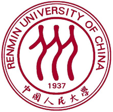
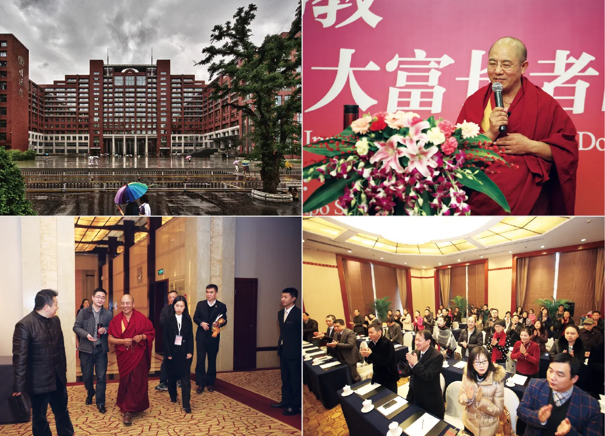
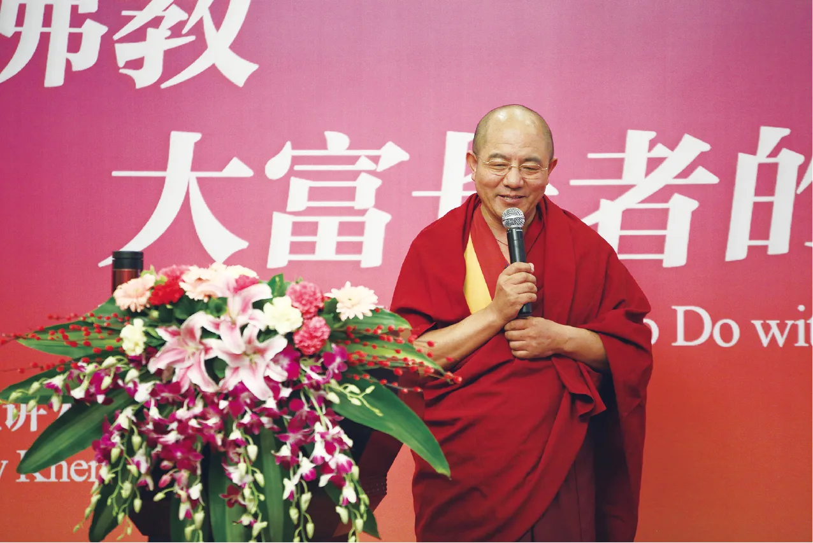

贫穷不一定代表修行好，

有时会让人变得更加执著。

第107场

中国人民大学重庆校友会

Renmin University of China,Chongqing Alumni

中国·重庆

2015 / 3 / 2

## 贫非佛教

——大富长者的启示

## Buddhism: Not About Austerity

主持人：

欢迎各位莅临今天的主题演讲现场。我们非常荣幸地再次邀请到了索达吉堪布，相信堪布会带领大家进行一场美妙的心灵之旅。欢迎堪布——

很高兴能与大家一起交流“贫非佛教·大富长者的启示”这一主题。这个题目是人民大学这边提供的，但我最近一直忙于翻译《大乘经庄严论释》，所以还没来得及特别仔细地思考，希望大家见谅。

## 翻译是我最大的贡献

《大乘经庄严论》是藏传佛教“弥勒五论”之一，有着非常重要的地位。这部论典有一个唐朝时期的汉译本，但与藏文以及其他语言的译本相比，还是有些晦涩难懂。所以，我再三考虑之后，决定花三年时间把藏文版的《大乘经庄严论释》翻译成汉文。对我个人而言，这是一件非常有意义的事情，但翻译出来以后，有没有人能听得懂、看得懂？有没有人会重视？这就不一定了。毕竟处在这个极度追求物质的时代里，很少有人会去古老的典籍中寻找精神归宿和智慧精滴。

在过去的三十年里，我一直很重视佛经论典的翻译工作。虽然这几年去了一些学校和企业做演讲，但这并不是我的特长，我也不是专业的演说家。我16岁才上小学，然后只读了两年就升入初中。初中毕业后读了一所师范学校，但在毕业前的最后一个学期，我选择了出家。所以，我没有小学和师范的毕业证，只有一张初中毕业证。

从世间的学历来讲，我并没有资格跟大家讲一些道理。在去年的“世界青年佛学研讨会”上，我可能是全场唯一一个没有读过专科或本科的参会者，绝大多数的参会者都是本科以上的学历。所以，我当时就说自己是最没有资格发言的那个人。今天也是如此，让我在这么多精英人士面前做分享，恐怕很难让大家觉得有所收获。但在翻译经论方面，我积累了多年的经验，有一些心得体会可以分享给大家。

1987年到1997年之间，我的主要精力用在讲经说法上面，而翻译工作基本上处于摸索阶段；从1997年才真正开始着手翻译。十几年来，翻译了很多藏传佛教经论。如果大家以后想学习藏传佛教，可以参考这些汉译本。总的来说，我对自己的翻译还是有信心的。毕竟我在翻译的时候很专注认真，尽力想一五一十地将前辈大德们的智慧全部翻译出来。在座各位如果有兴趣的话，也可以尝试用现代的语言来解读佛学里比较高深的一些教义。

每当我读藏文经论，比如五部大论以及密宗的法本时，总是希望以后能将它们翻译成汉文。因为藏传佛教一直有着圆满的传承，当然，汉传佛教的传承也很圆满，但若以藏传佛教的理论和窍诀作为补充，肯定会更加完善。所以，我每次动笔翻译时都很激动，因为能让虔诚的汉族道友了解藏地大德们的甚深智慧，这是一件非常有价值的事情。我总觉得自己活在这个世界上，最主要的贡献就是翻译经论。爱因斯坦曾经说过：“一个人的价值，应该看他贡献什么，而不应当看他取得什么。”可见，一个人是否成功，取决于他的付出，而不是他的收获。但是，现在大多数人只关注收获，认为只有收获才能代表成功。其实，付出才是一种难能可贵的品质。

在我的一生当中，不敢说自己有什么成就，但在翻译上确实花了很多时间和精力。我有时候也在想，不一定有人会看这些经论，或者努力看也不一定看得懂。但有时候又觉得，哪怕这些古老的经论对世人有一点点的帮助，那我的努力就不算白费。

## 富人也可以做佛教徒

以上只是我的一些临场感言，下面回到今天的主题“贫非佛教·大富长者的启示”。大多数人可能认为，佛教提倡过一种清贫节俭的生活，而佛教徒不能希求拥有金钱、地位、名声等，因为这些与佛教的教义相违。有些企业家也经常说：“我很想好好地学佛，但又害怕受戒律的约束，还要过俭朴的生活，而我是一个企业家，还是想要赚更多的钱，这种财富观与佛教教义相违背。”实际上，很多人都有这种想法，其实这并不合理。

佛教徒是否要过清贫的生活？从原始佛教的教义讲，修行人应该过一种知足少欲的清净生活。如果你们去过缅甸等东南亚国家，就会发现那里的出家人至今仍保持着托钵乞食的传统，即使是在家佛教徒，也不会积累太多的财产。一般来说，出家人的卧室里只有一张床，每天都要光脚出去托钵化缘，通过这种方式得到食物。此外，他们还严格守持日中一食或过午不食的戒律。即便到了今天，在东南亚国家的一些寺庙里，依然有成百上千的出家人，遵循着当年佛陀在世时制定的生活方式。

那么，世间福报比较大的企业家，是不是跟佛教就结不上缘了？实际上，佛教比较讲究随缘，如果不是特意勤作，而是依靠福报自然获得，佛教徒也可以过安逸富足的生活。《毗奈耶经》是一部详细记载佛陀在世时对弟子宣讲行住坐卧四大威仪的经典。其中讲到，如果对财物没有很大的贪执，出家人也可以穿几万块的衣服，住几百金的房子，这在戒律中是开许的。

佛陀圆寂之后，印度历史上出现了“二胜六庄严”[^1]。其中“二胜”是指戒律学的两大论师功德光、释迦光；“六庄严”是指装饰整个世界的六位尊者，即因明方面的陈那论师、法称论师，中观方面的龙树论师、圣天论师，唯识方面的无著菩萨、世亲菩萨。这八位尊者解说了佛教的所有教义，并进行了大力弘扬。其中功德光尊者撰著的《戒律根本论》[^2]中就说得很清楚，如果没有造恶业，而是通过自己的福报无勤获得，那无论是穿昂贵华丽的衣服，还是住豪华奢侈的房子，戒律中都是开许的。

有些人对佛教的教义一知半解，比如对出家的认识仅仅停留在抛弃家庭、事业的层面。但实际上，对真正的佛教徒而言，如果各方面的因缘自然具足，心里也没有强烈的贪执，即便拥有财富也不会与佛教教义相违。因此，对于某些人而言，既是一名虔诚的佛教徒，又是一位成功的企业家，这两者根本不矛盾。

当然，有些人不想成为佛教徒，想成为其他宗教徒，或是不想与任何宗教有所牵连，这都是可以的。事实上，是不是宗教徒并不重要，最关键的是要做一个好人。如果一点恶事都不做，就是非常了不起的菩萨了。虽然做到这个程度很难，但至少要自觉约束自己的行为。

我们最好有一种信仰，这样心就有了依靠和归宿。如果没有任何信仰，只是一味地追求金钱，在人生最关键、最困难的时候，很可能会找不到任何的依靠处，这也是很现实的一个问题。

## 正确认识出家和佛教

事实上，佛教并没有强调一定要过贫穷的生活。受早年一些影视剧的影响，很多人认为只有生活受到挫折，或是走投无路、身无分文的人才会选择出家。现在很多影视剧中也是这样演的。我以前和一些导演、演员也说过，他们总是把出家人描写成人生的失败者，这让我们每次出门都有点不好意思。另外，还有些人会认为寺院就是避难所。当然，这跟“文革”时期的文化导向也有一定关系。而在日本、韩国以及斯里兰卡等国家，在他们的新闻媒体报道中，更多的是社会精英、商业奇才等成功人士出家的消息。

真正的成功，不仅仅是财富上的积累，更重要的是树立正确的人生观、价值观。所以，我们应该成为一个高尚、伟大的人。

要知道，佛教其实是一种教育，囊括了低层、中层以及高层的内容。从高的境界来讲，且不说在家佛教徒或企业家，就是出家多年的老修行人也很难达到。相对而言，中层的教义比较容易做到。因此，大家不要认为学佛就是选择了一条贫穷之路，一点家产都不能有，或者顾虑佛教的戒律要求太多而不敢学佛。对于出家人而言，比丘戒、沙弥戒的戒条确实比较多。但对于在家人而言，一般只要守持居士五戒就可以了。

实际上，居士五戒很符合现在的社会伦理道德观。无论是对个人还是国家来说，这都是很重要的。佛教中讲的五戒包括：不杀人、不偷盗、不邪淫、不妄语以及不饮酒。其中妄语分为大妄语和小妄语，而佛教中遮止的是大妄语，比如明明没有成就，却声称自己是大成就者，或是装作已经成佛的样子，等等。现在社会上有很多这样的骗子。小妄语是指日常生活中的撒谎行为，比如做生意时说的一些“方便妄语”，五戒中并没有特别遮止。由此可见，五戒也不是很难守持。这种外在的行为约束，也是合情合理的。

## 乐道者不是非要安贫

佛教主张避免极端心态，既不过于奢侈，也不过于贫穷。我们出家人平时经常会念诵一个祈祷文：“不生过富家，不转贫穷家，唯生中等家，恒常得出家。”意思是说：希望自己不要转生到非常富裕的家庭，那样每天都要为了赚钱而奔波，很难有修道的机会；也不希望自己转生到特别贫寒的家庭，否则连基本的温饱都解决不了，更不会有修行的机会；但愿自己能转生到中等家庭，并且能时时刻刻行持正法。从这样的发愿中可以看出来，佛教徒是采取中道的生活态度。当然，如果你自身很有福报，也可以享受生活。比如，今天要讲到的给孤独长者，他就是一个非常有福报的人，是当时印度最有钱的人，相当于现在的世界首富比尔·盖茨，或亚洲首富李嘉诚。

当年，给孤独长者准备迎请佛陀前往舍卫国说法，要选一个地方为佛陀建造精舍。他看中了一处风景优美的花园。但这个花园是舍卫国祇陀太子的地方，所以他不得不去拜见太子，请求太子把花园卖给他——就像我们现在的房地产交易一样。祇陀太子最初不想答应，但给孤独长者一直劝说太子把这个花园卖给他，因为他想给佛陀修个大“别墅”。后来，太子半开玩笑地说：“如果你能用黄金铺满整个花园，我就同意卖给你。”

给孤独长者有一种特殊的能力，可以不借助任何探测器就看到地下的宝藏，所以他的家境特别富有。于是，他真的用黄金铺满了整个花园。祇陀太子对此非常感动，他对给孤独长者说：“我只是答应把地卖给你，但花园里的这些树还是我的财产，地由你来供养，树就由我来供养吧。”之后，二人共同合作为佛陀建造了精舍。所以，这个地方就被命名为“祇树给孤独园”。“祇”是指祇陀太子，“树”是指太子供养的树，“给孤独园”是指给孤独长者买下的花园。

1990年的时候，我曾去过祇树给孤独园。当我站在那里时不禁想到，在两千多年以前，有一位非常富有的长者用黄金买下这个地方，建造精舍供养给佛陀，真的是太有福报了！虽然现在只剩下了一些历史遗迹，但大家到印度时还是值得去朝拜一下。

根据佛经里面的说法，给孤独长者福报特别大。所以，他不仅今生特别富裕，前面的很多世也非常富有。有些老板也拥有大量的财富，这肯定跟前世积累的福报有关系。因此，如果我们想要将来变得富裕，现在就应该多做布施，因为布施是富贵的因缘。

要知道，佛法中特别强调因缘的作用，大家最好不要选择忽视这背后隐藏的甚深道理。如果懂得了业因果的关系，就会明白并非安贫才能乐道。

## 执著才是真正的束缚

现在有些修行人会刻意装穷，这不是一个好现象。我们佛学院原来有一位老和尚，他经常爱穿带有很多补丁的旧衣服。当时，我们的上师还在世，他世间和出世间的智慧都特别圆满，看事情很有远见，特别了不起。有一天，上师在课堂上对这位出家人说：“你特意地穿旧衣服也是一种执著，其实没有必要刻意扮穷。如果你的心里特别执著，即使再怎么扮演贫穷，修行也无法成就；如果你对财富没有多大的执著，能够平淡地看待一切，即使有万贯家财、金山银山，也不会成为解脱的障碍。”

在藏传佛教历史上，也有一个类似的公案。19世纪时，有一位特别著名的上师叫蒋阳钦哲旺波。他得过萨迦、宁玛等所有藏传佛教教派的传承，并且修行境界非常高，是一位公认的极其伟大、了不起的上师。另外，他的著作量也相当惊人。他当时住在甘孜德格，在当地非常有名望，经济条件相当好，住的地方也是金碧辉煌，过着皇帝一般的生活。与他同时期还有一位著名的修行人，也就是《大圆满前行》的作者华智仁波切。他一生都显现得非常贫穷，终年穿着同一件衣服云游四海。

华智仁波切有一个特别喜欢的木碗，不管走到哪里都会随身携带。因为藏地以前有一种传统，人们外出做客时，会随身带着自己的碗。我觉得这种生活习惯比较健康。现在有些藏族老人依然保持着这种传统，走到哪里都用自己的碗吃饭，不会用别人的碗，但汉地好像没有这种习惯。

有一次，华智仁波切去见蒋阳钦哲旺波。可一进宫殿他心里就产生了邪见，他原本觉得上师是一位了不起的大成就者，应该过着俭朴的生活，但看到上师的房子装饰得如此奢华，根本不像修行人应该住的地方，心里就有些生不起信心。过了一会儿，他和上师一起喝茶时，上师对他说：“你不要认为我修行不好。其实我对这些财产的执著，远不如你对那个木碗的执著。”

因此，贫穷不一定代表修行好，有时反而会让人变得更加执著。假如一个穷人有一万块钱，他可能会特别执著；而有些富人虽然很有钱，但对财富不一定执著，也不会对修行造成障碍。正如噶举派的帝洛巴尊者曾对弟子那若巴说的那样：“显现是不会束缚你的，执著才会真正束缚你。”也就是说，在我们面前的种种显现，不会束缚我们的修行和解脱。真正束缚我们的是对显现的执著，比如对金钱、对亲人的执著。要知道，贫穷有贫穷的执著，富贵有富贵的执著，关键就在于我们对财富的态度。有智慧的修行人，会把钱用在解脱事业上，让自他都获得快乐；没有智慧的人，可能会给自他带来痛苦。

如果有了一定的修证境界，即使拥有再多的金银财宝，也不会给修行带来障碍，甚至还能用这些财富为他人带来利益。就像化学元素铀一样，它实际上是一种金属，如果把它用来制造核武器，经过一系列的裂变反应，会产生足以毁灭世界的力量；相反，如果把它应用在核电站，产生的能量可以为人们发电、照明。

可见，同一样东西，如果用在核武器上，就能毁灭世界，而用在核电站里，就能照亮世界、造福人类。因此，按照佛教的观点来讲，一个人的修行和他的财富多寡没什么关系，有钱人也可以是一个好修行人。世界上很多的慈善家，就是依靠自身的福报和资源帮助了成千上万的人。

## 让生命更加趋向圆满

大家有必要了解、学习一下佛教或是其他宗教。我们的思想应该是开放的，而不应该是禁锢和封闭的，既不敢看也不敢学。

有些人本来想学佛，但因为担心被太多的规矩约束，守持不住戒律，就不敢学了。其实，学佛和不学佛有很大区别，佛法可以帮助我们很好地调整心态。比如，原本你的心态特别浮躁，后来通过学习佛教经论、依止善知识，让你变得更加坚强，无论遇到任何事，都能坦然面对。相反，如果身心没有训练到位，即使外在的环境再好，拥有的财富再多，内心的痛苦还是得不到解决。

因此，我们需要依靠真正的智慧来解决内心的痛苦。这种智慧就是佛教讲的“四法印”，即有漏法都是痛苦的自性，有为法都是无常的自性，一切法都是无我空性，最终的解脱是涅槃寂静。对于以前没有接触过佛法，更没有修行过的人而言，可能会觉得四法印的意义很陌生。但我希望大家在事业成功的同时，也要关注一下精神世界，让我们的生命变得更加圆满。

从大乘佛教的教义来讲，成佛最主要的目的就是利益众生。所以，我希望大家能在有生之年，依靠自己的能力和智慧多去帮助一些人。作为一名企业家，尤其是像在座这样的成功人士，不能只想着把所有资源占为己有。最近新闻经常会报道一些贪官受审，那些人占用了太多的社会资源，却没有做出一点贡献，这样很容易自食恶果。我们应该以良心作为准则，遵守道德规范。当你有一定实力的时候，不要忘记那些还在苦难中挣扎的可怜人。事实上，我们经常能听到一些呼救声和悲鸣声，看到一些孤寡无助的人，希望大家在力所能及的范围内，尽力为他们提供帮助。

我曾看过一篇新闻报道，让我深受感触。1998年的加拿大，有一个年仅6岁的小男孩，他了解到非洲的孩子不仅没有东西吃，甚至连水都喝不上，于是就想方设法地赚了七十美元，想要给那里的孩子打造一口水井。但他后来发现，打一口井需要两千美元，这对他来讲是一个天文数字，但他还是想尽办法凑到了这笔钱，为乌干达的一所小学打造了一口井。

他从6岁开始做这个项目，现在已经二十多岁了，还在继续做。有些资料中说，到2016年，他已经挖了超过1000口井，约85万人因此喝上了干净水。当年，他只是一个非常普通的小孩子，但因为心里有一种大爱，最后能够在实际行动中改变那么多人的命运。

有些人虽然也有这样的大福报，但根本没有用在奉献社会、造福人类的事业上，甚至连自我提升方面的努力也很少。事实上，不管在课堂教育，还是日常的谈话中，我们很难听到关于慈善的话题。而在其他国家，经常可以听到别人在做各种慈善事业，我们也应该让慈善成为一种习惯。

现在大多数人一提起慈善，第一反应就是捐钱。我曾经在一些慈善会议中讲过，做慈善不一定要用钱，不花钱也能做慈善。真正的慈善家，是有一颗想做善事的心，并非要捐几百万、几千万。很多人会陷入一个思想误区，认为做慈善的人应该是有钱人，没钱的人不能做慈善。其实，钱不是最重要的，最重要是你的善心，这颗心会慢慢发挥出它的力量。

## 结语

最后，希望大家能对佛教有一个正面的认识，不用害怕学佛或是研究佛法会让你抛弃一切。印度历史上有一位恩扎布德国王，他很想出家修行，但又不愿舍弃自己的家庭和王位。于是，佛陀便为他宣讲了一些特殊教言，最后他也的确获得了解脱。在藏传佛教的传承中，也有很多上师获得了像恩扎布德一样的成就。

因此，大家不能片面地理解佛教，应该有一个全面的认识。在这难得的一生中，最好追求一种精神上的引导，并在这种引导下长期修行。对于已经开始学佛的人，希望大家不要仅仅停留在表面，应该要深入一些，从显宗的五部大论一直学到密宗的无上大圆满。

现在很多人学佛只是流于表面，这样真的很可惜。在座各位都很有智慧，经济条件也不错，在这么好的机缘下，遇到这样的真理确实很幸运。人们常说“真理往往掌握在少数人手里”，这句话也有一定的道理。不管是世间的真理，还是出世间的真理，确实是掌握在少数人的手里，但我们有必要去正面地了解一下。毕竟每个人都有追求真理的因缘和福报，关键在于如何去运用，这一点就有赖于各自的智慧了。

现场互动

问：每个人都无法选择自己的出身，但您提到修行人往往发愿：“不生过富家，不转贫穷家，唯生中等家，恒常得出家。”为什么一定要出生在中等家庭才能修行呢？

堪布：转生到富贵或贫穷的家庭也能修行，但如果想要出家的话，出生在一个中等家庭里，可能学习和修行都更方便一些，所以修行人才会这样发愿。

藏地和汉地的情况有点不同。藏地有些出家人的家里特别贫穷，藏传佛教中也没有托钵化缘的传统，所以他们连到一些寂静地去修行都很难。比如，我们佛学院那些生活困难的僧人，连买一个小房子的钱都凑不出来。有些人很想长期住在佛学院，但因为家里太穷了，不得不在家放牛。还有些人家里太富裕了，这也很难修行，因为心总是变来变去。

平时我们也可以看到，人在物质条件不好的时候，还有一些修行，容易生起很多功德；物质条件太好的时候，道心反而上不去，再加上身边人的影响，修行也很难进步。因此，生在中等条件的家庭更适合修行。这句话应该这样去理解。

当然，如果转生到贫穷的家庭，也有一定的好处，因为贫穷可以作为生起出离心的助缘。佛教历史上就有很多这样的例子。如果转生到富裕的家庭，也可以像给孤独长者那样合理运用财富，做广大的布施和供养，这也是非常好的。其实，每个国家都有一些出家人，他们依靠自己的力量积累了大量财富，并用这些财富来利益众生。像台湾的“慈济”，虽然它的资产并不是个人财产，但这也是依靠证严法师的力量才积累起来的。

从家庭出身的角度来说，在佛教里可以有三种层次的人，只不过从修行角度而言，转生于中等家庭更有利于修行。

问：佛教经常教导要发善心、做善事，这样才能积累福报。请问，这种福报是在今生出现，还是来生出现呢？

堪布：不同的善事所获得的福报也不同。这个问题在《阿毗达磨俱舍论》中讲得很清楚。如果发心非常强烈，对境也特别殊胜，有些福报即生当中就可以成熟。一般来说，以清净心供养僧众斋饭，这个果报会成熟得非常快。除此之外，我们即生中做的善事很难马上成熟，更有可能会在来世成熟。这跟我们前世欠的“账”也有一定关系，就像往手机里充话费，如果上个月欠了很多钱，当月充的一部分钱要用来补交之前的欠款。

因果关系是一个非常复杂的话题。依靠殊胜的对境，有些福报会在今生成熟，叫做“顺现法受业”；有些福报会在下一世成熟，叫做“顺次生受业”；还有些福报会在未来世成熟，叫做“顺后生受业”，也就是要过很多世才会感受果报。佛陀在《华严经》中说：“心如工画师，能画诸世间。”意思是说，就像画师能画出种种景色一样，心也能造作各种各样的业。反过来说，受这些业的支配，将来的果报也会有很多差别。

问：在经济学领域，除了人们熟知的人力资本和资金资本以外，现在有人又提出一个“道德资本”，并且认为这是最根本的资本。请问，哪些方法可以帮助企业快速积累道德资本？

堪布：有关道德资本的积累，我想很多善良的人都会去做，比如供养一些寺院。佛教中有“福田”和“悲田”的概念。所谓的福田，是指供养寺院或是给佛像贴金等。泰国和缅甸的人就很喜欢通过供养福田来积累道德资本，他们经常会给佛像贴金，结果佛像也变得越来越“胖”。我们去了以后才发现，虽然整个国家的经济不是很发达，但那里的经堂却金碧辉煌。

就我个人而言，我更喜欢对一些悲田做善事。悲田是指让人心生悲悯的可怜众生，包括经常看到的乞丐和病人。人们总是习惯性地认为，这些乞丐都是骗人的，继而对他们置之不理，其实这是一个错误观念。如果他们真有办法，恐怕也不至于沦落街头。也许个别人真的是骗子，但只要我们发心清净，以大悲心来行持布施，也可以积累道德资本。

社会上需要帮助的人有很多，这些善行都是增长福德的根本因。我个人的话，虽然也会造佛像、建寺院，但更重视资助那些读不起书的孩子们，帮助他们完成学业，这是一件非常有意义的事情。对于有钱人来说，一个学生的学费只是一笔小数目，但对于没有钱的人来说，这笔钱就显得格外珍贵。可是，很多人都没有意识到这一点，因此也错过了许多积累福报的机会。昨天有些人跟我说，他们准备从公司每年的利润中拿出一部分做慈善，这个确实很有必要。大多数人可能觉得，等以后赚了大钱再去做善事，但事实上，我们随时随地可以做一些力所能及的善事。

总之，福田和悲田很重要，依靠它们可以积累福德资粮。此外，通过念经、念咒等也可以积累资粮。

问：我一直很想成为一名财务顾问，但又觉得自身能力不足，请问如何开启自身的智慧？

堪布：有人说“顾问”的意思就是，顾得上就问，顾不上就不问，所以很多顾问其实根本没人来问。我在佛学院做顾问的时候，他们也很少征求我的意见，我就不得不经常主动去找他们。所以，当别人不来咨询顾问的时候，顾问就应该主动去了解情况，这也是顾问的一个职责。

如果大家想要开智慧，最好是修文殊法门，有时间也可以去转一下五台山。五台山有一种文殊花，也叫做金莲花，如果将这种花泡水喝，然后虔诚地祈祷文殊菩萨，每天念诵文殊心咒——“嗡阿Ra巴匝那德”，确实可以增长智慧，我自己就有过亲身体验。

在第一次朝拜五台山前，我正在学习因明的《释量论》，有些内容一直看不懂。当时，我的上师就说，朝完五台山大家再继续学因明。回来以后，确实明显感觉智慧有所增长，书中的很多难题好像迎刃而解了。

由此可见，开智慧也有一些方便方法，要和文殊菩萨搞好关系，通过多念咒、多祈祷来向文殊菩萨好好地“行贿”，而且还不用担心文殊菩萨会被检察机关调查。因此，大家要好好祈祷文殊菩萨。

问：每个人都有自己的喜好，比如抽烟、喝酒、游泳等等，请问这些喜好也是一种执著吗？如果是的话，我们是否应该想办法放弃这种执著？

堪布：每个人确实都有不同的喜好，但喜好也分合理和不合理。从究竟的意义上讲，当我们证悟法界本源，或者用最深层的智慧来观察时就会发现，好与坏都是虚妄不实的。正如《金刚经》中所说：“凡所有相，皆是虚妄。”其实，佛法并不是高谈阔论、谈玄说妙。如果你用智慧去观察，就会发现一切法都是虚幻不可得。但是，在我们还没有达到这种境界之前，暂时还需要有一些合理的执著，要有取舍善恶的能力。也就是说，不要趋向于恶，要趋向于善，这一点很重要。

当然，有些人的习气比较重，喜欢抽烟、喝酒……前段时间，有一个明星跟我说，他最近正在拍一部电影，压力很大，感觉非常累；所以，他就开始喝酒、抽烟，但没想到现在已经上瘾了，一直戒不掉，不知道应该怎么办。从因果上来讲，无论是抽烟还是喝酒，过失都很大。另外，这对自身健康也有很大危害，会对肺和肝等内脏造成损伤，相当于慢性自杀。现在的广告都把烟酒描述成好东西，人们也常说“无酒不成席”。对于很多人而言，他们觉得要是没有酒，说话没意思，吃饭也没味道。但事实上，酒精属于微毒类，被吸收后会对整个身体造成危害。

因此，在还没有证悟最高境界之前，我们应该尽量选择对身心健康有利的喜好，最好是选择一些精神食粮来充实自己。虽然我们有时会被现实所迫，确实很难抉择，但就像前段时间我在微博上说的那样：“当你的理想与现实冲突时，只有选择现实，因为你暂时没有自由。但若不忘初心，也会有美梦成真的一天。”这是我发自内心的想法，昨天我看已经有1000万的点击率了，可能这句话也触动到了很多人。

刚开始的时候，大多数人都是想要做一个好人，心中也有着美好的梦想。可是，生活中总是充满了太多的无奈。有时受烦恼逼迫，有时受朋友逼迫，有时受社会逼迫，有时受环境逼迫，还有时受工作逼迫……尤其对于内心脆弱的人而言，确实无可奈何，有时不得不随波逐流。但不管怎样，都不要忘记最初的梦想，如果你的梦想是要做一个真正的好人，就要随时提醒自己应该做什么，不应该做什么。

如果做了一些不好的事情，佛教中也讲了很多忏悔的方法，比如持诵金刚萨埵心咒，诚心忏悔会比没有惭愧心要好很多。事实上，我们谁都做不到事事完美，如果能做到的话，说明你已经成就佛果了。在我们成长的旅途中，会有一些好的机缘，也会有一些不好的遭遇，这个时候，我们要学会选择，也要学会忏悔。

问：在发财和求子方面，为什么《二十一度母赞》和度母心咒是非常殊胜的法门？

堪布：在古印度和藏地，度母法门非常兴盛。藏族基本上全民信佛，不管是在家人还是出家人，都会经常祈祷度母。很多人去过藏地之后，会觉得那里特别美。但在我看来，藏地最大的特色就是人们心中淳朴的信仰。不过，现在受西方文化的影响，也有一些年轻人并不信佛。事实上，汉地以前也弘扬过度母法门，只不过一直不是很兴盛。

我之前专门讲过《二十一度母赞》的课程，后来还编成了一本书，叫做《有求：二十一度母给你温暖》，也就是“有求必应”的意思。只要虔诚地祈祷，二十一尊度母就会给予不同程度的加持。大家可以经常念诵度母心咒“嗡达热德达热德热娑哈”，这个咒语非常简单，但加持力特别迅速。

全知麦彭仁波切在《八大菩萨传》中提到，在众菩萨当中，文殊菩萨的智慧最尖锐，度母的加持最迅速。也就是说，不管我们有什么请求，依靠度母的加持都会快速获得。因此，希望大家在遇到各种困难、违缘和痛苦时，最好能经常祈祷度母，这会让你感受到一种无形的力量。

我本人从小就对度母非常有信心。大概五六岁的时候，我连字都不认识，就已经会背诵《度母赞》了。从那时开始，我一直都在念诵，以后也会坚持下去。我当初讲《度母赞》时就说过，这应该算是我比较擅长的一部法。因为我以前放牦牛的时候，每天都会坐在山顶上念度母祈祷文，也很喜欢听和度母有关的故事。后来在读书的时候，宗教政策还没有开放，我就在学校里偷偷地念。宗教政策开放之后，一直到我出家就更不用说了。所以，我个人对诸佛菩萨，尤其是对度母有非常虔诚、坚定的信心。

其实，不管有没有信仰，大家都可以祈祷度母。我最近听说，汉地各个城市里都有依靠祈祷二十一度母而发生的种种奇迹。关于这一点，有些人可能认为这些都是神话传说，现实生活中不可能真实存在，但有些事情确实已经发生了，有时候也不得不承认。事实上，无论你有哪方面的希求，求财富还是求子女，都可以通过祈祷度母成就一切所愿。

当然，佛教的祈祷也不是有百分之百的效果，否则就违背了因果法则。就像医术再好的医生，也不能保证百分之百治好某一种病。所以，如果一个佛教徒对你说，“只要祈祷就可以，百分之百没问题”，这句话本身就是有问题的。一般来讲，任何一种药都有治病的效果，但有些罕见病的确无药可治。同样的道理，诸佛菩萨的加持可以改变一部分的因缘，但有些因缘再怎么祈祷也没办法改变，这个道理我们也要懂得。

问：有些人会觉得现实中发生的场景在梦里出现过，比如我感觉自己好像梦里来过这里，为什么呢？

堪布：“在梦里，梦里梦里见过你……”“在梦里，梦里梦里好像开过会。”（众笑）也许你们觉得出家人怎么也会唱这首歌？其实，我出家之后就没有唱过歌了，而且以前读书的时候，音乐课经常不及格，但当时很多同学都会唱这首歌。我之前去过一次泰国，回来后写了一本《泰国游记》，里面也记录了关于邓丽君在泰国猝死离世的经过，感慨了一下人生的无常。

有时候，我们会觉得当下的某些场景似曾相识，好像在梦里发生过一样，可见，有些因缘的确不可思议。比如，明天要发生的事情，今晚可能在梦里先经历了一遍；或者有些从来没有见过的人，好像在梦里已经见过了。所以，人生真的是如梦如幻。《黑客帝国》《盗梦空间》等国外电影，里面也有一些关于虚幻与现实的探索，实际上就是在讲人生如梦如幻的道理。

藏传佛教中有一部论典，叫《醒梦辩论歌》[^3]。通过醒者与梦者的辩论，你会发现其实很难分辨出现在到底是做梦还是清醒。现实生活中的某些场景，很可能会出现在梦里，而梦中的某些场景，也可能会发生在现实生活中。这可能是一种修行的境界，也可能是一种特殊因缘的显现。

今天如梦般的人生场景，在你的梦境中提前出现过，这种事情并不罕见，但具体是什么因缘导致的，这个也不好说。但我相信，凡是人生中类似这样的奇妙经历，在深入学习人生如梦如幻的甚深道理后，你就会有所明白。

问：在人生最困顿的时期，我读到了堪布的《苦才是人生》，这本书让我豁然开朗，也让我明白原来此时正是修行时。我本人是学净土的，平时以念佛为主，也在学习印光大师的开示，以及净土的“五经一论”[^4]。刚才您讲到修净土的同时，如果能有密宗的方法辅助，修行可以更圆满。那么，请问用什么密宗方法来辅助修行呢？

堪布：我没有期望《苦才是人生》能对人们有很大的帮助。但在写这本书的过程中，我的确认真地思考过，引用的每个公案都有一定的针对性，既有明确的佛经依据，又贴合我们的现实生活，希望可以产生一定的积极作用。

很多人说《苦才是人生》是我的代表作，但其实我翻译的著作有很多，课程的讲义也整理了不少，这本书不一定就是代表作。不管怎样，我发自内心地希望，大家能通过它了解到人生的真谛。毕竟面对面的交流，大多数人都没有这个时间，也难有这种因缘。所以，我就把平时想跟大家说的话写在了书里，这样比较方便简单。

从几年前开始，我也在陆陆续续讲“净土五经”。现在只有《大势至菩萨念佛圆通章》还有一点没讲完，其他都已经圆满了。在讲的过程中，我也深刻地认识到，净土法门非常重要，每个人都应该重视起来。

事实上，密宗修行人也要学习净土法门。比如藏传佛教中的《大圆满前行》[^5]，它的后面部分就讲到了要如何往生净土，而前面部分讲到的人身难得、寿命无常、轮回过患、因果不虚，以及皈依、发菩提心、忏悔和积累资粮等，这些都是作为佛教徒应该了解的最基本、最根本的教言。所以，大家在主修净土的同时，最好能认真学习一下《大圆满前行》，里面已经完整地讲述了佛教的核心教义。

我们佛学院每年都会举办“极乐法会”，其实藏传佛教的修行人也很重视净土法门，也会发愿往生极乐净土，并且如果各方面因缘具足的话，也强调要广闻博学。当然，我们并不排斥一门深入，但如果你的分别念很多，经常对一些法产生邪见，那只学一两部经论不一定能解决问题。所以，对于分别念特别多的人来说，需要学习一些经论作为辅助。而第一部论，学习《大圆满前行》就很有必要。

此外，如果还能再念一些咒语，效果会变得更好。我们佛学院每个人每年都要念30万遍的阿弥陀佛心咒“嗡阿么得瓦阿耶色德吽舍”，这是往生净土非常殊胜的一个窍诀。另外，每年还要念诵40万遍金刚萨埵心咒。因为想要往生极乐世界，还需要精进忏悔往昔的罪业。毕竟每个人在世间当中做过很多坏事，如果要带业往生的话，也有一定的困难。虽然对于“带业往生”也有很多不同的说法，但最好还是在往生前把业力忏悔清净。

问：我身边有很多朋友都体验过短期出家，他们法喜充满的样子让我非常向往。但我也听说，女众不能短期出家，否则以后再想正式出家就没有机会了。这又让我有些担忧，不知道该怎么办，请堪布开示。

堪布：我在藏传佛教的经论中也寻找过短期出家的依据，但暂时还没有找到。据说在南传佛教的巴利文经典中有相关开示。

从很多人短期出家的体验来看，这是一段非常殊胜的经历，很值得赞叹。现在国内外都有这样的活动，从道理上来讲，如果男众可以短期出家，女众应该也可以，但佛陀制定的有些戒律不是以推理来成立的。所以，在具体执行短期出家的过程中，主办人要进行仔细商讨，否则后期很容易出现问题。因此，我们佛学院从来没有组织过短期出家的活动。

如果有条件的话，其实应该体验一下出家人的生活。从佛教的角度讲，这样做可以种下出家的善根，毕竟很多人一生中很难有一次出家的机会。不像在泰国，出家是一种传统习俗，男子结婚前或者二十岁左右都必须要出家一次。所以，如果你很向往出家人的生活，可以参加一次为期七天的短期出家。虽然只有短短七天，但这会让我们的人生更有价值，种下来世出家的善根。

至于具体的操作流程，我确实不是很了解，虽然也有在研究，但还没有什么研究成果。

问：女众出家时，是比丘师父给剃度，还是只能由比丘尼师父剃度？

堪布：剃度的问题不大，至于受戒的问题，一般来讲，女众出家可以请十位比丘，或者二十位比丘尼来授戒，这在《毗奈耶经》里有专门讲到。当然，四分律[^6]与一切有部律[^7]的观点略有不同，在一切有部的戒律中是允许的。

问：我不是佛教徒，也不是基督徒，但我对宗教方面比较关注，平时也会看一些书。我认为，世界上这么多宗教，都是引导人们去追求人性的爱与善良，但有一点我不是很理解。孔子曾说：“饮食男女，人之大欲存焉。”既然人类的繁衍、传承是一种基本需求，为什么佛教出家人要断绝男女关系呢？

堪布：你的问题很好。不管是参加什么会议，哪怕只是在佛学院内部开一些研讨会，我都希望能有其他宗教人士，或是没有任何信仰的人参与进来。虽然有没有信仰是个人的事情，但我们还是有很多共同关注的话题，比如人类的命运、社会的福祉、宇宙的真理等等。所以，我们不应该狭隘地认为，佛教徒和基督徒是互不相容的，或是有信仰的人与没信仰的人根本没办法交流。这种狭隘的观念会影响人类的共同发展和快乐，所以我一直秉承着尊重所有人的原则。

世间万物都可以用阴阳来划分，比如男和女、东和西，这也是一种自然规律。尤其是道教，从两千多年前就开始重视阴阳学说。

有些人认为，佛教戒律就是压制人们本能的欲望，但事实并不是这样。其实，佛教的戒律是分次第的。对于不信仰佛教的人，他们能对佛教保持基本的尊重就可以了；对于信仰佛教的人，有一部分人只是受皈依三宝的戒，还有一部分人不仅皈依三宝，同时还受持居士戒。对于大多数的在家人来说，并没有断除世间男女的欲望，所以还是可以过正常的夫妻生活。在居士戒中，遮止的是与合法伴侣以外的人发生不正当关系。可见，佛陀对在家人的要求与社会伦理道德基本一致。

出家人属于佛教中比较特殊的一个群体。当修行到了一定阶段的时候，在家人的生活方式会对进一步的修行造成影响，世间生活中的种种情感、欲望都会严重障碍到修行。这个时候，你可以选择出家修行，守持出家人的戒律，过清净的生活。

上面提到的是中等修行，如果最后能做到丝毫也不贪执世间男女的欲望时，在家佛教徒还可以行持密宗的双运行为。事实上，这在密宗中代表了智慧和方便，但一般人很难达到这种境界。在印度佛教的历史上，像萨绕哈巴尊者以及我刚提到的国王恩扎布德，他们虽然过着在家人的生活，但已经彻底断除了所有世间欲望。在藏传佛教的历史上，像帝洛巴、玛尔巴罗扎等人，也没有断除世间的欲行，这些行为都是为了方便修行，同时也是解脱境界的一种体现。

由此可见，佛教并没有要求学佛就要断除所有的欲望。每个群体的要求各不一样，需要具体分析。

问：现在世界上历史最悠久的组织就是宗教，很多宗教都有上千年的历史。请问宗教可以这样一直传承下去，是源于它对人性的满足，还是依靠它的戒律和制度呢？

堪布：世界上有几大文明，有的有四千多年历史，有的有五千多年历史，而这些文明的延续往往都和宗教有着密切的关系。比如道教、儒教与佛教，佛教大约起源于公元前五百年，释迦牟尼佛与孔子、老子都生活在那个时代，是同一时期出现的智者。而在这个时期之前，很多西方宗教就已经出现了，在东方比如印度教就有大约四千年的历史。

这些古老的宗教为什么能一直延续到现在呢？虽然各个宗教都有不同的制度，但仅仅依靠制度是远远不够的。实际上，宗教的精神理念，或者说它的精髓能够一直延续至今，主要原因就是它宣讲了人类心灵的活动规律，以及其他合理的智慧。

有时候我就在想，佛陀在两千五百多年前所宣讲的道理，到今天也仍然适用，保持着鲜活的生命力。我经常在课上跟大家说，传承于两千多年前的思想就像昨天才提出的一样，对于生活在现代社会的人们，仍然具有很强的现实指导意义。而其他一些涉及政治与国际关系的理论，可能过了几年、几十年，就不再适用了。

大家可以回忆一下，那些六七十年代人们所推崇的知识，到了现在连名称都没办法用了。为什么会这样呢？我想最主要的原因就在于，古代的思想宣说了人类精神层面的次第与境界，这赋予了它延续下去的顽强生命力，否则很容易消失于人类历史的浪潮当中。

宗教就像是一位活了上千年的慈悲老人，他目睹了无数个“文化小孩”的出生和离去。所以，我们很有必要去探索一下他“长寿”的秘诀。

[^1]: 二胜六庄严：或作二圣六庄严，藏传佛教术语，为八位著论或者注疏的印度佛教论师。其著作均为藏传佛教必读的佛学名著，多被编入五部大论之中。
[^2]: 《戒律根本论》：另译名为《律经》，佛教戒律书。古印度功德光造。9卷，二千七百颂。无汉译本。藏文大藏经丹珠尔中保存有胜友等译的藏文译本。梵本原文似已散失。
[^3]: 《醒梦辩论歌·幻乐众音》：作者是全知麦彭仁波切。所谓醒梦辩论，就是醒者和梦者两个人在彼此谁真谁假的问题上展开辩论，然后智慧大法官派出妙慧审判员裁决定案，在决定了真假正邪之后，就得出一个结论：原来醒者和梦者平等无差别。
[^4]: 五经一论：净土五经分别指《无量寿经》《观无量寿佛经》《阿弥陀经》《大势至菩萨念佛圆通章》《普贤行愿品》，净土五经通常与《往生论》并称“五经一论”，为净土宗之核心经典。
[^5]: 《大圆满前行》：作者是华智仁波切，翻译者是索达吉堪布。本书是一部引导修行次第的论典，在藏传佛教中占据极为重要的地位。
[^6]: 《四分律》是后秦时佛陀耶舍、竺佛念共译的佛书。原为印度上座部佛教系统昙无德部（法藏部）所传戒律。共六十卷。因分四部分，故名。中国佛教律宗据以立宗和宣教研习。
[^7]: 说一切有部律，有两种流行本，一是在罽宾流传的略本，一是在摩偷罗流传的广本。后唐义净专门去印度寻律，带回的律中即有广本，翻译的题名是《根本说一切有部毗奈耶》。
