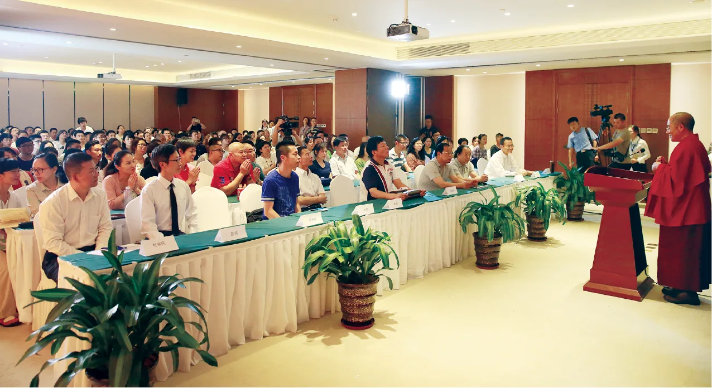
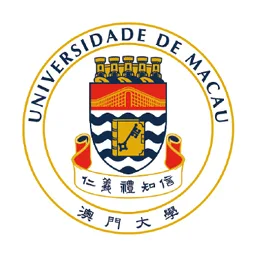
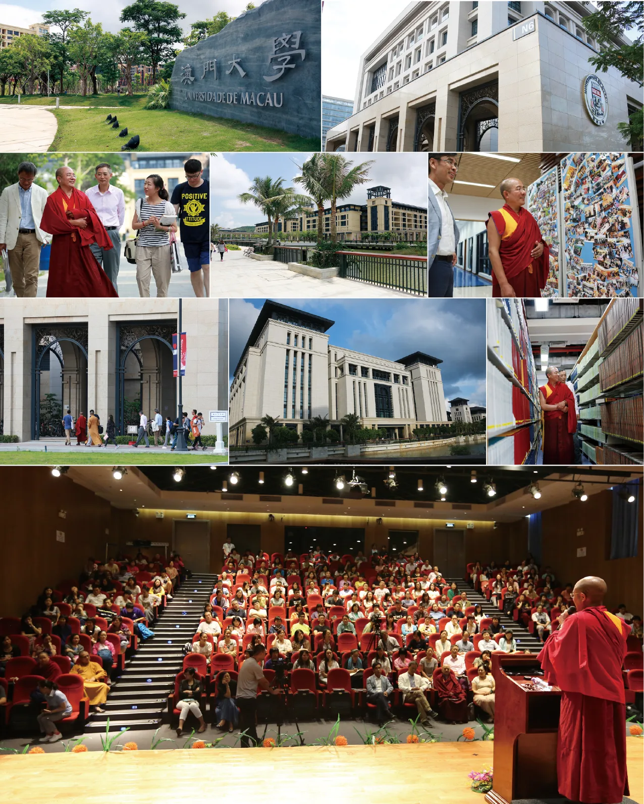
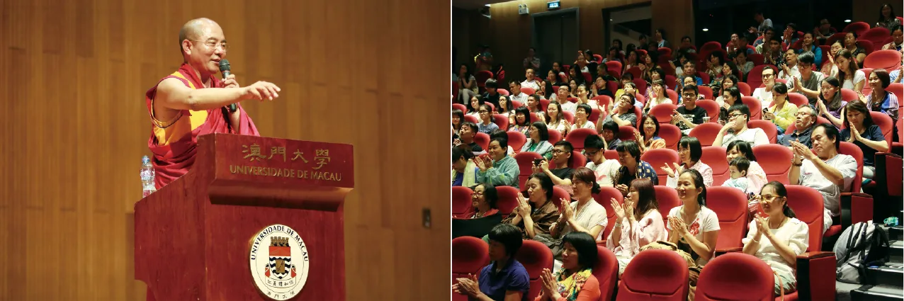
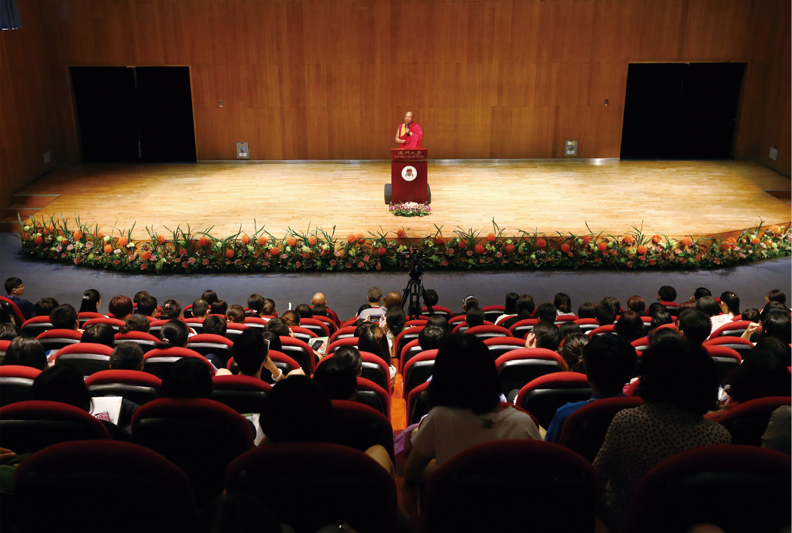
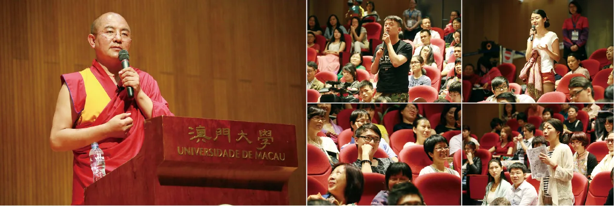
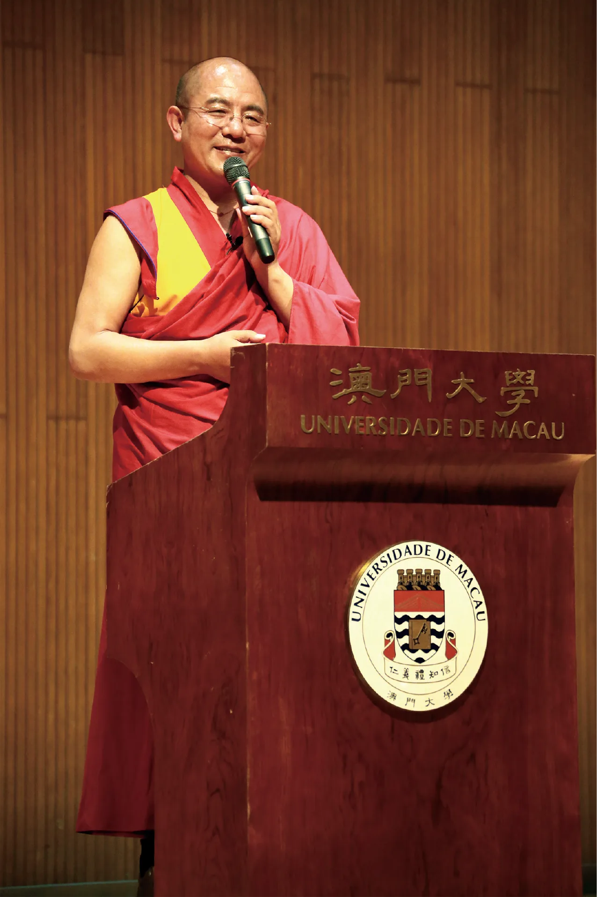
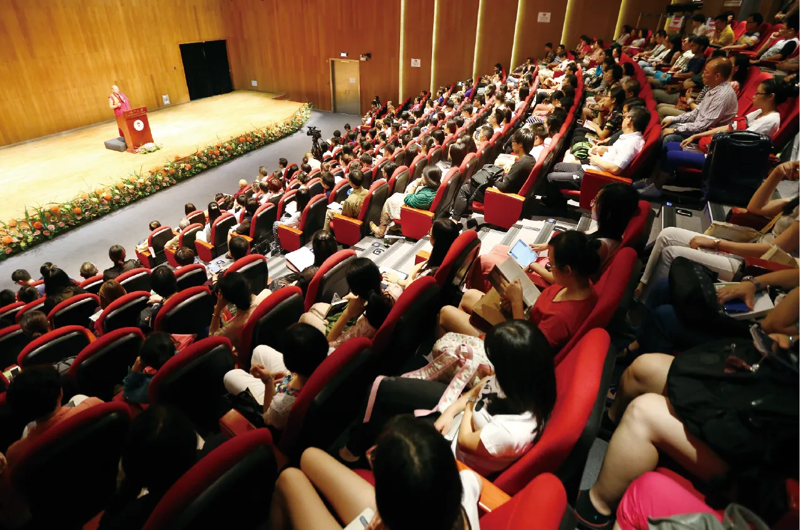

信与不信，

选择权在你。

第114场

澳门大学

University of Macao

中国·澳门

2015 / 6 / 9

## 佛教如何面对灾难

## The Importance of Buddhism at Times of Catastrophe

主持人：

各位尊敬的教授、来宾吉祥！欢迎大家前来参加由澳门大学学生会佛教学会与何鸿燊东亚书院合办的本次讲座。

学生会佛教学会是由澳大各级学生组成的学术团体，希望通过定期举办多样化的佛教相关活动，为全体师生提供一个接触、认识、理解佛教的平台。

何鸿燊东亚书院则建立于2010年，其前身东亚书院是澳大最早的两座书院之一。

接下来简要介绍讲座的主题：

从近日媒体的新闻报道中，时常能看到灾难的发生，譬如四月份尼泊尔的7.9级强震，六月份的长江船难……这些以往偶尔见诸报端的灾难，如今频频发生在身边，我们不得不预先思考：灾难当前，该如何应对？

进入夏天，天气变得异常闷热，能有幸听闻索达吉堪布开示“佛教如何面对灾难”，无疑将为燥热难耐的我们带来一剂清凉灵药。

首先有请澳门大学哲学与宗教研究课程助理教授，为大家介绍一下堪布——

郑教授：

大家下午好！

喇荣五明佛学院自创立以来，已经有一段日子了，在佛教弘扬方面做了大量工作，让正信的佛教得以在内地传扬。

今天非常荣幸，能够请到其中一位对佛教的哲理和修行非常有心得的老师——索达吉堪布，来为各位开示。

相信大家对堪布的背景都很清楚。其实他的影响不纯粹是在教理方面，在弘法上也更贴近时代，是用现代的方式，向我们传递生命实相。

他还是唯一曾在哈佛、耶鲁、斯坦福、哥廷根、清华、北大等高校留下大量讲座、开示的佛教学者，由此启发了很多年轻学子对佛教的兴趣。

出家三十年来，他身体力行，引导大众实践佛法，并维护着佛教的本来传统。他花费了很多时间翻译汉藏佛典，同时也关心社会上的慈善事业。

他认为时代在变迁，但佛教的宗旨始终没变。我们可以从佛教的观点和哲理中，找到解决种种现代问题的答案。这是他在讲座、开示中时常提到的。

他还出版了很多书，比如《苦才是人生》《残酷才是青春》《有求》等。在这些书里，堪布经常提醒人们，不管眼下的生活是富裕还是清贫，苦恼其实一直相随，我们不要把这些看成痛苦，而应该转化成认识世界实相的动力。

主持人：

谢谢郑教授。下面有请索达吉堪布进场，讲座“佛教如何面对灾难”正式开始！

感谢郑教授的介绍，也特别感谢澳门大学的邀请。这是我第一次来澳大，看到学校的建筑、风格，感觉确实像个花园，对我这个藏地普通出家人来讲，你们有如此舒适、安逸的环境，很值得随喜。

## “我不是来赌博的”

昨天过海关的时候，很多人问我：“你来赌博还是旅游？”我说“都不是”。听说澳门有赌场，有“威尼斯人”“金光大道”等很多出名景点，但我不是来赌博的，也不是来观光旅游的，而是真心想跟这里的老师同学交流探讨、相互学习。

于我本人而言，不管去哪里，遇到什么人，接触什么样的思想——宗教、非宗教……都是一种学习、成长的机缘。因此我愿意前往不同的地方，接触各种各样的人，包括一些小学，只要他们需要，我也去。

前段时间，我刚去过几所学校，其中就有两所小学、一所中学，也有北京的高校。不管怎样，我想听到不同的声音，也想把自己认为有必要让大家知道的人生哲理，通过语言奉献出来。

## 灾难并不突然，你只是缺乏警觉

这次来到澳大，跟大家交流、探讨的话题是“佛教如何面对灾难”。

这个话题，我想大家都比较关心。虽然我们平安活到了今天，但未来还会有很多灾难，谁也无法保证自己不死。当灾难发生时，该以什么方式应对？这一点，其实生而为人，都应该了解。

地球上生存着七十多亿人口，有些人遇到的灾难是轰动性、爆发性的，全世界都为之关注；有些虽然没有见诸媒体，不为大众所知，但对个人来讲关系重大，可能从此就离开了人间。

当你快乐地生活在一个舒适的环境里，又怎么能想到，某天会有一场天大的灾难，毫无预兆地降临在自己头顶？但这正是人类的一种愚痴。在人们想象中，灾难总是来得突然，却很少有人意识到，这其实很自然。

2015年6月1日国际儿童节，原本是孩子们非常欢喜的节日，但在那一天，重庆船难让442人葬身长江，只有12人幸存。这场事故吸引了全国乃至全球的关注，因为四百多条生命的消失，仅仅只在一瞬间，其中有八十来岁的老人，也有七八岁的孩童。

这是天灾，此外还有人祸。像2001年美国的“9·11”恐怖袭击事件，整座大楼倒塌只用了几秒钟时间，四千多个生命（也有统计说是三千多）就此离开人间。

我看过一个幸存者的讲述，当时他所在的楼层有三百多人被困，全靠他的同伴和另外两人一起，用血肉之躯奋力撞开变形的金属门，才带着大家在坍塌前三分钟跑出大楼，成为最后获救的一批。再晚三分钟，这三百多人都不可能逃脱。

死亡就是这么来势汹汹，往往几秒钟、几分钟、几个小时，就已经夺去无数生命。

包括马航的失踪、汶川地震、玉树地震、日本海啸、东南亚海啸……当这些灾难发生时，人们一方面会恐惧，“哇，今天死了那么多人！”一方面也庆幸自己不在其中。但如果你去观察，会发现生活原本就充满无常，在平时的每一天，遭受灾祸的人其实更多。

相比一场四百人丧生的灾难，因疾病、自杀、车祸等丧生的人数量更大。2013年有个统计数据说，地球上平均每天死亡约十七万人，仅中国就有两万多人。

从新闻里看到四百多人同时死去，大家会感到震惊，但实际上，每天都有两万多个生命离世，有的在医院，有的在家里，有的在路上……我们无从得知，也毫无察觉，更不会由此想到自己的死亡。

而这些才是我们无法回避的人生。有人认为死不吉祥，干脆不去想，但不想也没用，因为迟早它都会落在我们的头上。

## 这个时代，为什么灾难频发？

在各种各样的天灾人祸里，总能听到死亡的消息，其中一些属于自然规律——时候到了，谁都会死。今天地球上的所有人，再过一百年，还有多少能活着？大家推理一下就知道，我们的生命并不长久。

而另一些，则有它特殊的原因。为什么近十几年，天灾人祸那么多？当然，有些属于人为破坏，是坏人、恐怖分子造成的；但还有一部分，可能要归咎于人类自身，因为我们贪婪、嗔恨、愚痴，做了很多不合天理的事。

曾经有个思想叫“人定胜天”，它来自宋朝文人的诗句“人定兮胜天”。这位文人认为，人心如果安定，就能幸运地存活于自然中。后来的人们却理解成：依靠人类的智慧、勇敢和奋斗，一定能战胜自然。于是拼命开发宝藏、攫取资源，尤其当人心的贪婪日益膨胀时，更是不择手段地破坏人类赖以生存的家园。

这个时代的人们崇尚科学。在某种意义上，我也赞叹科学带来的诸多便利，这一点不可否认。如果能让人类获得快乐、幸福，让大自然得到保护，这可以说是真科学、有用的科学；但如果毁坏了道德人心、自然环境，还能否称为“科学”，则很值得观察。

与此同时，不管是道教、儒教、基督教、佛教……不同的宗教里，其实都有维护物质世界的种种方法，也有维护心灵世界的种种道德。

可是进入新时代，很多人一味地赞叹科学，抛弃古老的传统文化。在对科技的追逐中，那些极具价值的道德观念等被抛诸脑后，甚至踩在脚下，这给人类带来了什么后果，相信大家都明白。造成这些后果的主要根源，就是贪婪和欲望，在膨胀的欲望下，什么事都能做得出来。

司马迁在《史记》中说，利是动乱祸害的根源，人人言利，天下危矣。如果人们一味地谈钱、谈利、谈经济，这就是社会动乱的根源。世界将变得危险，成为斗争的世界、报怨的世界、恐惧的世界，充满烦恼和痛苦。

反观我们周围，反观自己的心，今天的各类群体中，大家都在谈论什么？可能更多的还是金钱、利益、地位、感情。

当然，人活在世上离不开这些。包括我作为出家人，对世间生活的基本需求、价值观等，也从来没有否认过。有人认为佛教看破一切，什么都不需要——这种思想的确存在于佛教的某些戒条中，但它需要比较高的修证境界，并非针对初学者或普通人。

有必要提醒大家的是，如果贪婪和欲望达到一定程度，人们会无恶不作，由此将导致什么？简而言之，就是世间灾难频发。

## 人心有多少险恶，世间就有多少灾难

很多人不知道，天灾人祸的发生其实有一种因缘。在佛教的《楼炭经》中说：“行十恶事故，天雨不时节。”意思就是，如果过分行持十不善业，这世界不会风调雨顺，人们也不会平安快乐，会出现各种各样的灾难。

没有信仰和道德观念的人，对此不一定认同，但如果你对天人合一的道理有所了解，用自己的智慧仔细观察，就不难发现，它是无法反驳的事实。

因此，为了自己的家园也好，为了整个地球也好，在平时的生活中就应该思考，哪些才是我们真正需要的？如果过于贪求那些不需要的东西，不考虑子孙后代，不考虑其他人——更不用说世界上的所有生灵，我们可能会做出许许多多恶行。

比如战争，每一次的死亡数字都触目惊心：第二次世界大战死了七千多万人，第一次世界大战死了两千多万人。当然具体数字也有不同说法。相比之下，东南亚海啸的死亡人数是五十万，日本海啸是两万，汶川地震则是七万左右，远远不及。

在此之前，还有很多的战争，比如蒙古西征，历史上记载死了三千万到六千万人；太平天国时期死的人也特别多；到了抗日战争时期，死了两千多万人，整个日本侵华的历史，后人回忆起来，都觉得非常可怕。

还有更可怕的战争被我们忽略了——人类对动物的征伐，日日夜夜都在进行。动物惨败，人类胜利，在这个过程中，每天有无数众生被杀害。屠宰场里，牛、羊、猪、鸡、鸭、鱼……各种肉堆积成山。它们被装进火车、卡车，源源不断地送往世界各地，肉挂在架子上，像森林；血流淌在地上，像洪水。

我去过一些屠宰场、卖场，亲眼见过这种景象。其实动物都有灵性，它们爱自己的生命，有苦乐的感受。可人类习惯性地、理所当然地觉得它们该杀、该吃。民间也有这种说法：“杀杀吃吃，不杀不吃。”尤其在沿海地区，对不杀动物更是难以接受，“不杀，我吃什么呢？”风俗习惯如此，我也理解，因为从来到人间开始，很多人的生长环境就是这样。但这种行为是否合理，很有必要问问别人，问问自己。

## 如何断定，不会“果报还自受”？

遵照生命平等的价值观，难道我们来到地球，因为拥有武器、会说话、各方面能力强大，就可以掠夺其他生命的生存空间吗？这样做到底应不应该、值不值得？

甚至随着科学技术的发展，从海洋、陆地到天空，很多没有实用价值的物种也被一一灭绝。而到了这种时候，人类仍然缺少真正的反思。

印度文学家、诗人泰戈尔（Rabindranath Tagore, 1861-1941），是亚洲第一个获得诺贝尔文学奖的人。他曾在一篇诗歌中写道：“当人是兽时，他比兽还坏。”

我们是人，我们都认为那些动物是畜生、禽兽，它们又坏又愚笨。但它们只是在享受自己的生活，除了豹子、老虎等肉食动物外，大部分动物都不会大肆残害其他生命。而我们呢？表面看比动物高级很多，是万物灵长，在地球上最有智慧、最有发言权，可很多人的行为，如果客观公正地衡量，可以说在短短一生中，已经夺走了身边无数生命的生存权、生活权、资源享用权。在夺走生命的同时，也把它们的生存环境毁坏殆尽。而正是这种行为，导致世间出现地震、海啸、瘟疫、疾病……

也许有人觉得不是这样，“动物就该被杀，人类就该生存，这是上帝、老天、祖先赐予我们的”，但在几十年的人生中，假如有那么一刻，你能站在动物的角度想一想“我成了它会怎样？”恐怕心中就有不同的答案。

我们会不会变成动物？如果懂得生命的奥秘，你会知道今生的很多习气，有一些来自人类，有一些就来自动物。这些习气流转于一期期的生命载体，最终让我们呈现为人的样子。但在下一世，你有没有百分之百的把握，绝对不再变成其他众生，不会变成你眼前的这头猪、这只羊、这条鱼、这只小虾？你有没有百分之百的把握，死后就像唯物论说的那样，身体灭了，心也灭了？我想你可能很难下定论。

而我的心中是有答案的，因为几十年来，确实在这些方面以极其严谨的逻辑推敲过，也了解过古今中外的各种思想，我可以肯定地说：不承认前生后世，是一种无知。也许有人不爱听这样的话，但不管大家怎么想，我还是这个结论，如果你觉得不服，完全可以跟我面对面、直言不讳地辩论。谁能驳倒我，我一定接受，而在此之前，我也不得不坚持这个观点。但话说回来，假如前生后世真的存在，而你仍然不承认，这会不会成为人生的巨大损失？

这是我想说的第一点：今天世界的各种灾难，也许跟人类集体的贪欲、恶行有密切关系；今生自己的身体疾病、家庭变故等灾难，也许跟前世或者今生早期的行为有密切关系。信与不信，选择权在你。

## 面对灾难，你需要“求生秘技”

那在灾难、痛苦面前，佛教如何应对？我也给大家讲一点常用的办法：

### 1．南传佛教：念“南无佛”

南传佛教中是念“南无佛”，称念释迦牟尼等佛陀的名号。有关经典里讲，如果以至诚心念诵佛号，灾难会化为乌有。因为佛陀的加持力非常大，不可思议。

对此，佛教徒自然相信，而在非佛教徒中，有些人即便平时不信，关键时刻也会祈祷。我认识一个无神论者，他说：“我从来不信这些，但有一次遭受车祸，实在没辙了，只能不停地祈祷佛。”确实，再坚强的人，遇到紧要、痛苦的关头也会仰望天空，看看有没有佛祖或者其他什么保佑。

包括前段时间高考，很多平时不信宗教的人，为了孩子能考好，跑去寺庙拼命烧香。我跟他们开玩笑：“你们平时反对佛教，怎么现在临时抱佛脚，跑去庙里烧香了？”他们说：“可能会有用吧，没别的办法了。”（众笑）

这样也可以，哪怕用一种半信半疑的心做善法，也比不做或者造恶业好。

### 2．汉传佛教：念“南无观世音菩萨”

汉传佛教中，遇到灾难通常念“南无救苦救难观世音菩萨”，这非常灵验。

印光大师曾说，无论遇到地水火风的自然灾害、自身四大不调的疾病，或者家庭暴力等痛苦，如果一心祈祷观世音菩萨，就能感应道交，有各种奇妙的力量帮你从中解脱。

包括东南沿海信奉的妈祖，也有说是观世音菩萨的化现，有求必应。我看过相关历史，她是距今一千多年前的人物，逐渐演变成了民间信仰，庙宇遍布全球。她有观世音菩萨救苦救难的精神，当人们真诚祈祷她，海上的种种灾难、困苦都会平息。

重庆沉船事故中就有一个幸存者，之前经历了汶川地震，没有死，这次遇上船难，也没有死，在江上漂流七个多小时后获救。网上有人说他很倒霉，每次灾难都撞上；也有人说他很幸运，每次都大难不死；还有人说他之所以走运，是因为祈祷了观世音菩萨。事实如何我也不清楚，但不管怎样，人在危难关头的确要多祈祷。

1990年，广州白云机场的空难事件中，一架被劫持的飞机与另两架飞机相撞，死了一百多人。其中有三个幸存者曾在出事前去普陀山祈福，劫机发生时，他们也心无旁骛地至诚祈祷观世音菩萨，以这些因缘，最后的确幸免于难，随身携带的佛法书籍也完好无损。这个真实事件被新闻媒体报道后，曾经轰动一时。

还有很多事例，都让人不得不相信，当危机到来时，诸佛菩萨的加持确实非常灵验。

### 3．藏传佛教：念“喇嘛钦”

而藏传佛教会祈祷莲花生大士、宗喀巴大师等传承上师。

我自己从小有这种习惯，皈依、祈祷佛法僧三宝，经常念“喇嘛钦”——这是请上师三宝护念的意思，就像念“南无佛”一样。

祈祷已经融入藏族人的生活，一旦遇到危险，比如开车、走路稍微出一点意外，大家都会大喊“喇嘛钦”，有这样的传统。

没有信仰的人，不一定懂得其中的道理，也不觉得这有什么，但实际上，它背后有甚深的意义。

总之，人生万一遇到灾难，祈祷诸佛菩萨格外重要。如果不信佛，你也可以祈祷上帝等其他怙主，只要自己有信心，都可以，我相信他们都有无形的加持和力量。

这世上的很多宗教，是从古老年代延续至今的。包括儒教、伊斯兰教、基督教等，它们植根于人类的血液、骨髓、脑海中，一代代传承下来。这些价值观对我们的生存肯定有利益。先人们并不愚笨，如果经过一段时期，发现某个宗教让身心感觉不妙、对健康没有帮助，在漫长的历史进程中，早已将它淘汰。

事实上，宗教的无形力量超出我们的想象，它不仅仅作用于肉体，更是一种精神的药，有些在生病时能用上，有些在危难时能用上。

### 4．藏传佛教：刹那往生法

藏传佛教有一个“刹那往生法”，遇到突发、可怕的事件，连念经都来不及的时候，马上观想阿弥陀佛、释迦牟尼佛或其他佛在你的头顶上方，“我要把心融入他”，一刹那的忆念就能帮你解脱。

20世纪90年代，我在去拉萨的路上出过一次车祸，乘坐的车翻进了雅鲁藏布江，车子坏了，所幸人都活着。

记得翻下去的时候，车里人全在祈祷自己有信心的本尊，有的喊着“喇嘛钦”，也有人只是“哇”地叫一声……有个老喇嘛是祈祷得最好的，一直没有间断。我不知道自己做了什么，好像祈祷过，但在撞击的瞬间就晕过去了，醒来时江水正迅速灌进车里，我们就想办法逃了出去，没有人伤亡。

翻车是因为爆胎导致的突然失控，当时眼前的最后画面是前方一棵树，心里想着：如果撞到这棵树，就完蛋了。那一瞬间脑海中闪过“喇嘛钦”的念头，刚想用手抱头时，车就翻了出去。

遇到这种情况，可能谁都会害怕，但如果平时经常念佛，乃至做噩梦也有祈祷的习惯，危急关头就能发挥作用。按照佛经论典的教证，在祈祷状态下死去是不会堕落的，也很可能不会死，因为有护法神的加持，就像《灌顶经》中所说，每个皈依三宝的人都有36位护法神恒时护佑。懂得这些道理，对自己来说很重要。

## 客观的心态，才能接受真理

作为一个人，能否只承认科学和物质层面，不承认宗教和精神层面？

当然，承认什么是你的自由，这个世界是包容的。但我看到一些没有信仰的人，特别排斥、忌恨有信仰的人，这种思想其实很愚痴。不管自己的信仰如何，对别人最好都有接纳的能力，比如我信仰佛教，但对其他宗教徒或没有信仰的人也同等尊重，因为任何选择都有其合理性，就现阶段来讲，都是适合对方、能令其欢喜的生活方式，我们不应妄加否定。

最可怕的，是对自己喜欢的，即便没有功德也拼命赞叹，用夸张的语言歌颂；而对自己不喜欢的，即便没有过失也拼命诋毁，想方设法抹黑。这不是一种客观、科学的态度。

真诚、公正、尊重事实，是人的基本法相之一，尤其在科研、教学等领域，更不能仅凭想象添枝加叶、妄加评论。我看过一篇文章，作者对很多宗教不满，于是罗列了大量与他的研究范畴完全无关的宗教现象，以所谓“科学立场”进行批判。在我们的人生中，要谨防这种行为。

应该尽量“真实”。活在这个世间，你很难十全十美，总有违背道德、良心的时候，所以要经常反思、忏悔，如果不方便公开道歉，也要心存惭愧，向诸佛菩萨、相关众生乞求宽恕，这很有必要。

也要公正、客观地判断。在座各位可以说学识渊博，有科学的底蕴，还同时研究宗教。包括澳门大学佛学会的好几个年轻人，我在世界青年佛学研讨会的现场都见过，他们曾在众多年轻人当中分享自己的见解、思想和观点。我从藏传佛教的角度，也能看出澳大有很多普世的、饱含科学态度和哲学思辨的智慧。

还要有一种责任感。人活一世，很难说是多久，但在有生之年，每个人都有自己应该履行的职责。有些是对家庭的责任，有些是身为老师对学生的责任，有些是身为企业家对员工、产品的责任，哪怕是清洁工，也有对这个城市的使命和责任。我们在各自的人生里，不一定能做特别伟大的事，但应该做到力所能及的一分。

此时，很需要借助一些机缘来提升人格、净化心灵，需要责任感、愿力和意志。这些对每个人来说，都不可或缺。

## 给学生知识，不如给一盏精神的明灯

在座的学子们正当年轻，学生时代往往满腔热忱、斗志昂扬：“等我走上社会，一定要改变世界，造福人类，营造美满生活！”很多人有这样的勇气，但当你真正进入社会，稍微遇到一点违缘、困难，也许就变得脆弱无比、苦不堪言。

经常看到一些年轻人，身强体壮，外在的各种条件非常好，内心状况却极其糟糕，一丁点小事就能让他垂头丧气、无法面对，甚至有人因此而自杀。

昨天刚到这里时，我就问身边的人：“澳大有没有跳楼自杀的？”那人说：“没有没有！”前段时间在其他高校，我也问起这个，那边的老师说：“跳楼自杀的学生太多了，学校实在没办法，只能把楼顶用铁栏杆围起来。”但这样也不是办法，不知道后来是怎么解决的。

可能这边的情况好一点。我看到澳大很多建筑都保留着独特的历史风貌，或许多年以来，人们内心也留存了独特的精神传统。而对老师来讲，教育的重点就是保护好这些精神传承，保护好学生内心的文化遗产。

其实，一个成功的老师，不一定要教多么先进的知识，与之相比，完善学生的人格更为重要。

泰戈尔说：“教育的目的应当是向人传送生命的气息。”只教知识恐怕是不行的。

现在的人并不缺少知识，打开手机、iPad、电脑……全球资讯可以瞬间来到眼前。和古人相比，我们似乎“广闻博学”，什么都懂，但这些知识是否都对生命有益？我们周围充满了碎片文化，它们短小也短暂，比懂得这些更重要的是什么？是学会做一个善良的人，是在人格上能过关。

比如在家里：就不要为了一点小事闹矛盾；对老人不恭敬、不孝顺；对孩子没耐心，动辄家暴、殴打。（堪布问台下听众：“澳门打孩子犯法吗？像美国那样不能打？还是跟内地一样？打了会不会报警？是不会打还是不敢打、不准打？”台下纷纷互动。）

不同地方肯定有不同的习俗。总而言之，家长对孩子、老师对学生，有时候的确需要忿怒相来调伏，但最根本的还是要关注他们的内心。

这个时代，从社会到家庭，矛盾都越来越多。很多人的物质生活并不匮乏，但随着财富增加、信息发达、交通顺畅，人们却变得思想复杂，情感淡薄、欲望膨胀……心灵跟物质的矛盾日益激化——这是前所未有的状况。人们穿得多姿多彩、争奇斗艳，却很难觉得美好；吃遍天下美食，享尽酸甜苦辣，却很难尝出滋味。

记得我小时候，家里比较穷，偶尔吃到一颗糖就特别欢喜，不知道你们过去是不是也这样，过年了，小孩子得到一颗糖，会好长时间舍不得吃。但现在的人，包括我自己，对糖也没感觉，对辣椒也没感觉，先是舌头对味觉麻木，后来是心对生活麻木，人在麻木中，为人处世也变得凉薄，甚至不断做出违背良心的事情。

其实来到世间，每个人都有美好的愿望和梦想，而与此同时，就像在漆黑的夜晚摸索一般，也会常常感觉迷茫、困惑、痴昧。所以需要精神的指路明灯——翻开历史，你可以在古老的传统、宗教、文化中找到它，借此照亮心灵之路。

希望大家面对个人或集体的灾难时，能用上这些妙药。依靠外在的精神力量，人们会迎来富含价值、辉煌灿烂的前程。这应该是我们努力的方向。

主持人：

非常感谢索达吉堪布关于灾难的精彩开示！灾难肇始于人的三毒心，面对灾难，我们首先要具备正知正见，才可能转识成智、遇难成祥、化险为夷。

下面是提问环节。

现场互动

问：我是澳门大学法学院的老师，有两个问题想请教。

第一个问题是，物理学家已经证明，世界不是由物质组成的，而是由它的振动态组成，它的最小单位里是能量。有个物理学家说，能量就是愿望，跟意念有关，而意念是可以选择的。既然如此，像您刚才讲到，世界上有佛、有上帝、有动物……这些都是能量，当你选择善，选择佛、上帝，下一世可能就是人，或者佛、天人；当你选择贪、嗔、痴，下一世的能量组成可能就成了动物。这种愿望的选择很难察觉，但在我们死亡的时候，它会感召相应的能量，不知道这样理解对不对？

第二个问题是，我正在学习打坐，但我有个心理障碍：二零零几年，我在德国读书，那时候还不会打坐，就只是静坐。有次静坐的时候，我突然感觉自己没了，接着看见椅子上有个苹果大小、像蓝色水晶的东西，然后一下子人又回来，感觉手也有了、脚也有了。所以我有点担心，如果现在学打坐，万一再变成这样，回不来了怎么办？那是不是就坐化了？可我又没成佛（众笑）。这个问题想请教一下，谢谢！

堪布：这位老师的问题非常好。

首先第一个问题，多年以来，我也研究过一些物理学，包括量子力学等微观世界的科学理论，的确发现在这个领域，笛卡尔（René Descartes, 1596-1650）也好、布朗（Robert Brown, 1773-1858）也好，他们的学说跟佛教对极微尘的分析非常相似。

这些道理，我在不同文章里剖析过，其中最主要的观点是，分析到物质的最小单位时，物理学家承认它是一种量——能量或磁场，是物质间的吸引力；但按照佛教观点，这种力量可以抉择为心，心的本质也是能量，并且有现相和实相上的差别：现相上的量，可以用分别念进行剖析，实相上的量，则是万法的真实面目，从微观世界继续往下抉择，最后就成了语言无法描述、分别念无法涉及的微妙不可思议境界。这种境界，要通过禅修才能认识。它并不只是一种说法，依靠传承上师的窍诀去真正修持，你能感受得到。

至于你说的，如果一直起善念，就成了上帝、佛陀；起恶念，在贪嗔痴的驱使下，就会感召恶趣——这正是从现相层面来讲的，在没有达到胜义谛或者最微量之前，心的确有这个可能；但从实相层面来讲，真正的心就是佛。

传统文化中，像诸子百家，对心的本源是善是恶也有各种辩论，但按照佛教观点，心的本初就是如来藏，是清净的法；而贪嗔痴则像空中的云雾，是偶然、可分离的法。你也许会因为贪嗔痴堕入三恶趣，但你的心并不是三恶趣的本体，乃至最后成佛，也没有一个佛的本体可得，如此抵达最究竟处，万法的实相才会呈现。

这些道理，如果深入学习佛教二转中观和三转如来藏的法门，应该可以通达。

关于第二个问题，坐禅过程中，可能会有各种各样的现象，这些叫“验相”。不过禅修之后“坐化”了，这种情况是没有的。

藏地有这样的谚语：禅修境界中，什么验相都可能发生；就像夏天草地上，什么植物都可能生长。意思是当心处于一种宁静状态时，心上本有的各种习气可能会呈现出来，但你不会因此就成了另外一种样子。包括现在的催眠，也可以让心处于特别清净的状态，此时你的前世，或者过去生活中的某个片段会展现在眼前，自己也好像沉浸其中，但实际上，这种状态并不会持续太久。

所以在禅修过程中，应该做一些心理准备，知道有可能出现各种境界：乃至显现佛菩萨的形象，也不能过于高兴；乃至显现魔鬼的形象，也不能过于恐惧，这些都只是暂时的验相。

其实，验相对于修行，谈不上有害或有利，它只不过是阶段性的现象，我们还是要不断地修，到了一定时候，心的真实境界会越来越高。

总之，任何一个禅修者，修得比较静、比较深入的时候，都可能出现一些境界、验相，但这并不是证悟。对于验相，就像我们常说的，不要特别执著，过度的欢喜和害怕，都没有必要。

问：今天的题目是“佛教如何面对灾难”，像我这样的年轻人，想做的事情很多，遇到做不了的，又会不开心，就像您说的那样，由此成了内心的灾难。那在佛教中，除了念佛，还有什么方法可以改变自己，摆脱不开心的状态？

堪布：确实，现在的人想做的太多，能做成的却不多，这样下来，可能会特别忙、特别累、特别困惑、特别不开心、特别烦恼……有很多的“特别”。其实这种时候，应该有所取舍，我的看法是：如果能对社会和他人有利，多做一点也可以；如果只是为自己，有一种满足感比较好，否则，事情是做不完的。

尤其这个时代不像从前，信息很多、瞬息万变，做什么都有机会，很多朋友也来找你，“这个项目很好”“这个投资不错”，但如果每个都做，自己的精力顾不过来，身体也撑不住。这种情况下，我们需要用智慧观察，选几件真正有意义的事去完成。

做的过程中，就像俗话说的那样：“说话开头难，做事中间难。”说话的时候，开头是比较难的，好比去演讲，刚开始往往不知道怎么讲；但做事的话，难在坚持下来、善始善终。所以，既然承诺了要做，除非实在做不下去，不得不放下，在此之前，遇到再大的困难，也一定要努力完成。

此时需要让心静下来，其实念佛、念咒都是很好的方法。我总觉得，这些是对心灵的一种按摩，好比身体特别累的时候，别人帮你敲一敲、按一按，就会轻松很多；同样，心特别累的时候，关掉手机、关上门，打个坐、念念佛，你会觉得世间也没什么不开心的事，一切都能平息下来。心静了，再去面对这些问题，就有强大的力量，一个人可以做很多事，即便身体会累，心不会。

其实做事情，有没有意乐很重要。没意乐的事，哪怕做一个小时也觉得痛苦；而如果兴致盎然，做九个小时也觉得开心，遇到再大的困难、阻挠，都心甘情愿。

所以，首先要有明智的选择，中间要有坚持的精神，最后要有完成的信念：无论如何，这是应当履行的责任。每件事都像这样依靠智慧来筹划，很有必要。

问：顶礼上师三宝！我有两个问题想问。

第一个问题是，对于“寿命无常”，我很难去观修，因为总觉得离自己的体验比较远，哪怕发生再多灾难，也觉得是别人的事，好像跟自己无关。这可能是我的习气吧，所以想请教如何生起无常观？

第二个问题是，我是教小朋友的老师，小朋友犯错时，我会批评他，当时是真的有一种嗔心，表情也很愤怒。曾经有师兄建议，让我就把自己观成忿怒金刚去教育小朋友，但我不知道对不对，想问问到底该怎样对治？

堪布：你的第一个问题，关于修无常，刚开始可能比较难，但以后就会知道它的重要性。因为在学习佛法中，如果生起了无常观，就会像前辈大德所讲的那样，起初能趋入修行，中间不会间断，最后仍会精进、努力。所以要再三阅读书中的相关内容，懂得无常的意义。

至于第二个问题，老师在教孩子的过程中，可能需要一些“忿怒相”，至少也要装作比较厉害的样子，否则管起来会比较吃力。

但老师对学生不能太高高在上了，如果完全放弃和学生的沟通，不进入他们的世界，那无论是小学老师、中学老师还是大学老师，都不会特别成功，因为你不知道他们的喜好，听不懂他们的语言。一个成功的老师，会了解学生有什么困难、爱好、兴趣、烦恼、追求……这是老师应该做的。

当然，就像前面说的，也不能跟学生太打成一片。有些老师很慈悲，跟学生同吃同住，完全生活在一起，到了一定时候，可能会缺乏老师应有的威严。

我读书时候的有些老师，他的威严形象到现在想起来还会害怕。因为当时特别调皮，老师虽然批评得不多，但会睁着大大的眼睛，从窗户里一直盯着，即便到了晚上，还觉得那双眼睛透过明亮的窗户看着我。所以老师应该有他的威严，包括穿着、语言、行为，都要像一个老师的样子，这样自然而然能在学生心目中树立起庄严的形象。

像你说的这种情况，我想该批评的还是要批评。批评学生的时候，作为凡夫人确实很难假装，有时候会真的生气，“你太不听话了，我说了那么多次，你为什么屡教不改？！”做老师的，难免会生烦恼，有了烦恼，去对治就好。

但也要看情况，温和的语言对大多数学生或许有用，对一些特别顽劣的学生则不一定。就像我们也会说，对低劣的修行人，不要跟他讲佛的功德，应该用棍棒打一顿，修行才能进步。所以遇到坏学生，可能需要一点猛厉手段。只是不能太过分了，不然老师也很容易进监狱。（众笑）

问：我是个爱旅行的人，很多年前就去了拉萨。在那里，我比较深入地接触到寺庙，接触到藏传佛教。今天听您的讲座，我有两个问题想拿出来探讨，在此之前先说明一下，我对宗教没有任何冒犯之心，虽然自己不信，但我是把宗教作为一种知识去了解的。

我想问的第一个问题是，您刚才提到现世跟来世的概念，说现在很多人的生活可能离不开吃鸡、鸭、鱼肉，由此会带来杀生，问大家有没有考虑过，来世可能会变成那些鸡、鸭、鱼。而我的这个问题，要从很多年前的一部电影讲起。那部电影叫《可可西里》，是根据真实故事改编的，讲一群志愿者为了保护藏羚羊，在可可西里做出了许多奉献。其中有一个镜头，我到现在都难以忘怀：当志愿者抓到一个剥羚羊皮的农民时，问他为什么要帮盗猎者做这些坏事，农民说，家里闹饥荒，连饭都没得吃了，实在没有其他谋生的办法，只能干这个，因为剥一张羚羊皮可以挣五块钱。这引起了我的深刻思考，当人类面临生存危机的时候，是考虑现世重要，还是考虑来世重要？

第二个问题，源于我在藏地的亲身经历。当年我去了很多寺庙，在布达拉宫，我看到一个虔诚的喇嘛在窗前诵经，遗憾的是布达拉宫不准拍照，我没能拍下这个美好的侧面；去大昭寺的路上，我看到很多磕长头的信众，他们非常虔诚，不远万里、三步一拜地到大昭寺朝圣，这些场景都令我动容。

但同样是在寺庙，我也看到另外一些触目惊心的场景：当时大昭寺正在举办十二岁释迦牟尼佛等身像的贴金仪式，洞窟里站了一排人，准备给香油点灯，外面围着铁网，门口守着一个喇嘛。我也想进去看一看，可是喇嘛拦住我问：“你捐钱了吗？”我说：“要捐多少？”他说：“如果想进去，至少要捐5000。”我放弃了，没有进去。

然后是罗布林卡，在寺庙里，我看到非常精美的藏传佛教壁画，很想拍照，但这时走出来一个喇嘛跟我说：“你要拍照吗？”我说：“可以吗？”他说：“那你先给我20块钱。”

再后来是在哲蚌寺，我看到了精彩的辩经，喇嘛们分成两组，一边辩论一边拍手，那个场面太棒了，我也想拍照，但就在准备按快门的那一刻，同样也是个喇嘛指着我说：“你要拍照吗？拿钱来。”

这是我看到的现象，所以大师，您作为一个仁波切，是藏传佛教中如此德高望重的上师，我真的很想跟您探讨，听听您会怎样解释佛教中的这些现象。谢谢您！

堪布：你提到的这部纪录片，我也看过，有段时间它很出名。这里面引出的问题，像你说的，当一个人已经遇到生存危机的时候，他要不要杀生？其实不同的人对此可能有不同的选择。过去，在藏地闹饥荒的年代，有些人刚开始坚持不杀生，等到实在没办法了，也会杀生维持生活。包括我的父亲，他是一个虔诚的佛教徒，但后来为了养活全家，让这么多孩子不饿死，也亲自杀过牛，造过一些恶业。而除此之外，在生活的其他方面，他仍然非常重视信仰，这是我从小到大的印象。

但我也听过另外的故事，比如20世纪60年代，有一个虔诚的佛教徒，他就觉得“用其他生命换自己的存活，我不愿意”。当时是自然灾害非常严重的时候，到处闹饥荒，连野菜都很难找，原本附近有羊，有一些小动物，如果把这些打来吃，他是不会饿死的，但他坚决不杀生，宁肯吃野草，后来就离开了人间。

所以在那样的年代，的确不同的人可能会选择不同的路。而对现在的我们来说，其实很多时候，不杀生也完全可以生存。在这种情况下，我不敢劝大家以后绝对不吃肉，但起码在吃肉的时候，应该避免无意义、不必要的残杀。对此我们的确需要思考。

然后第二个问题，你讲的那些也是事实，可能你遇到的多了点，每次去不同寺院，都有要钱的人出现，遇到的好人只有一个，坏人却有三个……开个玩笑。（众笑）

不过，以事论事的话，藏传佛教中确实有一部分修行人，他们非常虔诚。我家乡就有个修行人，在拉萨的一个山洞里住了二十多年。前段时间因为老上师圆寂，他回来看望，给我们讲了这些年的生活。虽然我天天给人讲课，但跟他相比就觉得很惭愧。二十多年当中，他一直住在山洞里，好像整个生活除了他的信仰，除了念经、修行，再没有其他。缺少粮食的时候，他会出去化缘，吃的用的都很简单，就这样过下来，听起来非常让人景仰。

其实在这个时代，佛教也面临很多挑战和问题，一些佛教徒特别虔诚，极其了不起，但他们内在的修证和外在的行为鲜为人知，也许是想韬光养晦，不愿意在人前炫耀，甚至有人会选择最幽深的寺院、最寂静的洞窟、最偏远的山谷，外人不一定见得到。而人们经常见到的，像你刚才提到的这几个，基本上都在对外开放的寺院里，虽然他们身上穿着僧袍，但心里可能有各种目的。我也看过很多这样的现象，甚至有人穿着这身衣服当乞丐，对此我们也很反感，一方面觉得他们玷污了佛教真正的形象，一方面也替自己担心，走在成都的街上时就想着，这些人会不会把我当乞丐？

昨天来澳门的时候，有个人问：“你是不是去赌场？”我就很害怕，跟身边的人说，住的宾馆一定要离赌场远一点，否则来来去去，看到的人可能会认为我从赌场出来。还有个人说：“你穿着这样的红衣服，是不是在赌场表演？”我跟他开玩笑：“我不在赌场表演，我的演出在其他地方。”

你见到的是一种事实，但我们要知道，它不能代表藏传、汉传或者其他佛教。佛教徒中确实有个别人，利用佛教的形象和品牌做自己的事，谋求自己的利益，满足自己的私心，但真正的藏传佛教、真正的佛教修行人，不能用他们来代表。

就像高等学府也有各种各样的情况，有些大学生特别了不起，有些则没有好好学习。前段时间的新闻里说，去年有八千多个中国留学生被美国高校退学，原因是什么？因为这些留学生开豪车、花天酒地，每天都在混日子。尤其让美国人看不惯的是，他们作弊，花钱请人代考。这些现象，大家都不愿意看到，但我们也知道，它不能代表所有的中国留学生。

每年有两万多赴美留学生，这其中大部分人是好的、单纯的、清净的，只是我们看不到，却看到了很多“复杂”。其实人的群体原本就复杂，不管是出家人、高等学府还是其他人群中都避免不了，现在更是越来越复杂。面对复杂的问题，我们不能用单一的眼光来看待。

问：想请您开示一下修行的方法。平常如果有时间，我会修准提法门，如果没时间，就在早上念十遍佛号，不知道这样做是否合适？

堪布：很多人在学习佛法时会有各种顾虑，害怕念错了、修错了或者时间错了，其实不用这样，你什么时候想起来去做，都可以。包括你说的准提法门，非常有加持力，任何时候都可以修。

只不过修行和念诵，最好能有一个比较固定的内容，这样不容易忘。因为佛法融入生活很重要，否则等需要的时候临时去找，也有点困难。平时自己的心在这方面经常串习，以后就能运用自如，比如早上起来、坐车、走路，都可以念佛、念咒。这些不像禅修，随时随地都能进行；当然，禅修到了一定阶段，也可以这样。

问：我想问两个比较简单的问题。第一个是，我中学读的是天主教学校，但家里又是拜观音的，因为受到中学的洗礼，每当压力大，或者面对一些困难不懂解决的时候，我就会在睡觉前祈祷，这已经成了一种习惯。但因为家里供着观音，妈妈也要我拜观音，每次祈祷到一半又会觉得心虚。所以我很困惑，这会不会有什么影响，该怎么解决？

第二个问题是，我大二的时候曾经和教授聊天，他跟我说，做一个认真的人最美。后来我就一直朝这个方向努力，因为未来想做中文老师，对自身的要求就更高。但走到大四时，我突然觉得，做事太过认真的人，可能会慢慢偏向固执，比如你倾尽全力去做，如果达不到想要的目标，就会变得沮丧，比平常心做事来得更沮丧。所以我想知道，在认真和固执之间，该怎样取得平衡？

堪布：拜观音和祈祷天主，应该是不相违的。我记得藏传佛教有个大德，他去西方的时候就拜过圣母玛利亚，并在拜的过程中获得了她的加持，泪流满面，他觉得圣母就是观音的化身。当然别人不一定这么承认，但他自己的确这么认为。

其实，当一个人融入宗教的最高境界时，观音也好、上帝也好，包括其他各个宗教的教主，他们都属于超越世间、超越凡夫的不同境界，这些境界并不是用世俗语言可以描述的。

所以佛教会说，不能诽谤外道。像密乘十四条根本戒的第六条，就是讲这个。既然不能诽谤，我们就可以修持，把他们当作一种超胜的对境，是不会有危害的。

诸佛菩萨的化现不可思议。就像世界上那么多教主，都在用各自的方式度化众生，虽然看起来各种各样，甚至有些显现得并不如法，但从究竟来讲，其实都对众生有直接或间接的利益。

这方面我可以现身说法。刚开始学习佛法时，我也比较固执，除了自己的宗派以外不太承认别的。后来在各个国家云游，越来越融入这个世界，我发自内心地觉得，宗教徒应该团结，互相学习。我们可以有共同的语言，求同存异；可以有共同的目标，担负起弘扬善法的责任；当然也可以有各自的修行，像藏传、汉传佛教里，都分了很多教派，其他宗教也是如此。人类应该有各自的兴趣，也有共同的努力，这才是合理的。

第二个问题，做人太认真了，可能会让周围的人感觉死板，自己也特别累，但还是要尽量做一个认真的人。

也许你的认真缺少一点善巧方便。现在这个社会，有时候要懂得变通，否则做起事来，不一定被别人认可，甚至会受到歧视。但出于良知、道德，还是要认真对待。在这个过程中，需要具足两个条件：一是智慧，一是善巧方便。有了这两者，你的认真就是值得的。无论如何，我们的行为不应该违背良心和准则。

问：现在有很多“New Age”——新时代的信仰，会把很多宗教的东西混在一起，把修行的过程讲得非常简单。比如“是心是佛”，它解释成“只要你的心想做佛，马上就能成佛”，诸如此类，都是“新宗教”里常常主张的。但实际上，在成佛的过程中，还有很多事情是修行人需要注意的，知道“是心是佛”只是个开端，下面还有很长的路要走。所以想请堪布就这个现象为我们开示一下。

堪布：法师提醒得对。现在很多人不懂佛教，有的认为自己已经成佛了，穿得像佛一样，坐在莲花上；一些千奇百怪的“宗教”也在不断滋生，这些都是非常可笑的事。我也经常跟大家讲，作为佛教徒要懂佛教，否则有人说他是佛，就有愚痴的人信以为真，去护持、供养，实际上连什么是佛都没搞懂。

真正的成佛，是要在三个阿僧祇劫当中修行，断除业障、烦恼障、所知障等种种障碍，证得一地到十地的菩萨果位……这是非常漫长的过程；成佛之后，也不会再有世间的任何烦恼。

可是有些人，把自己假装成新的佛，创立新的宗教，实则利用佛教做各种各样的事情。这时候，如果佛教徒什么都不懂，就没办法去破斥；而如果经过系统学习，有自己的智慧，明白佛到底是什么样、菩萨到底是什么样，你就有资格反驳他们。

澳门怎样，我不是很清楚，但在香港等地，这种情况比较严重。一些连佛教徒都不算的人，会装成高僧大德，包括装成藏传佛教的大成就者，戴着莲花生大士、宗喀巴大师、菩提萨埵的帽子，扮成各种形象，下面就有很多人开始信仰他、拥护他、赞叹他，到最后达成的完全是一种利益关系。

对真正的修行人，我们应当赞叹，他们对众生非常有利益；而对那些人，佛教徒有资格、有责任去斥责，把他们排除在佛教团体之外。就像一个连中学都教不好的人，想装作博导骗人，很多大学生也有资格、有责任揭穿他。

现在的乱象太多了。有些是在小的方面骗，像刚才那位女士讲的一样，穿着出家人的衣服，收你20块钱、5000块钱；有些是在大的方面骗，像马来西亚、新加坡等地，有人从书里断章取义地抄点内容编在一起，就成了“我的宗教”“我的伏藏品”——藏传佛教是有伏藏品，但哪有那么容易得到，这非常可笑！还有人把自己乱写的东西当成佛经、金刚歌……有各种现象。这时候，佛教徒如果有智慧，就有批判的权利和能力；如果自己都迷迷糊糊地被蒙骗，这个世界就完了。

问：大师您好！刚才的演讲当中提到，您特别笃信前世和今生，我就想问一个跟感情有关的问题：感情世界中，一对恋人喜结连理，步入婚姻；大龄剩男剩女寻寻觅觅，遍寻不着心中那个对的人；曾经相爱的夫妻，最后分道扬镳……今生的这些因缘，跟前世有关吗？如果有的话，我们应该如何修行，才能得到、保有心中所期待的真爱？

堪布：嘿嘿。（众笑）

按照佛经论典的说法，即生的家庭关系，的确跟前世有关。很可能前世相互怨恨的仇人，今生成了恋人；或者前世曾经发愿一起做善事，今生再次聚到一起；或者因为前世的个别因缘，相聚之后又不得不分开……有各种情况。

世间的因缘非常复杂。佛经当中有一个比喻：业力如网。就像今天的互联网一样，人们在业力这张网中，因为种种的因缘相聚，也因为种种的因缘分开。

每个人的情况不同，前世今生的一些道理，我也只能用理论来推敲。至于你所问的，今后有没有共同享乐的机会，这很难说，因为人生中发生的具体事情，有它具体的因缘，一般来讲，完全如愿很困难，但有时候因缘具足，今生和前世的习气也有重合的时候。

问：感恩堪布的演讲，我是大学老师，想问两个问题。第一个是为我的学生们问的：大学生学习任务繁忙，又有对前途的忧虑，还要面临很多诱惑，在这种状况下，内心很难平静。您刚才也讲到，灾难是因为贪欲膨胀、不知道抉择善恶而引生，大环境是这样，个人也是这样。所以想请问，如果大学生有兴趣修持佛法，了解善恶取舍，他在学业繁重的情况下，应该从哪里入手？

第二个问题是，像我这个年龄的人，对无常的感受可能比年轻人更强烈，因为身体出现了各种不适，身边也有很多人生病、去世。如果我想修持佛法，了解生命的真相，将来好有能力面对无常，可以跟您学习吗？还是说先读哪本书？

堪布：我觉得作为老师，为学生的前途考虑是非常重要的，因为孩子们刚刚踏上人生之路，对很多事情都比较迷茫。

日本企业家稻盛和夫（Kazuo Inamori, 1932-2022）在《活着》这本书里，讲过他对人生的规划：20岁之前以学习为主；20岁到60岁之间的四十年里，要为社会造福，做一些贡献；60岁到80岁——他把人生规划到80岁——要开始对来世做准备，他认为人不能一直忙着，最后的二十年应该修行了。

但如果是我来规划，不会到了60岁才安排修行，因为人老了，不管是理论上还是实修上，学起来都有一定的困难。我的建议是从小就学一点，如果学生感兴趣，读中学、大学的时候，老师也可以传授一点宗教方面的知识和道理。

在美国，相对科学知识而言，很多学校更重视人文素质的培养，这些在学生的人生中更加重要。他们将来要面对的，并非只有知识、技术层面，还有感情的无常、家庭的责任、种种痛苦遭遇……如果对此茫然无措，从学校出来后，很可能会有一种恐惧感，害怕面对生活，甚至得抑郁症。其实这种时候，老师应该提供帮助，不需要他们放下功课专门学佛，但宗教的有些思想，平时稍微提醒一下，对他们的人生或许有很大利益。

当然，没有信仰的人不学也可以，但如果从老师这里接触过宗教，以后真正遇到问题时，他们会表现得更加坚强。我遇到过这样的大学老师，他培养出来的很多学生，到了社会上，即使没有找到满意的工作，也能好好生存，内心非常强大。因为大学四年，老师潜移默化地影响着他们，对内心的成长产生了极大作用。

但有些老师的心思并不在学生身上，而是放在赚钱上、感情上、自己的各种痛苦上，甚至天天拿学生发泄情绪，结果学生也从他身上学到了这些。

其实学生会从老师身上学到很多东西，等学生当了老师，又会把这些“传承”给他的学生。所以真正成功的老师，除了教授知识之外，还要教会学生做人，这是现在的课程中比较缺少的。

不知道澳门这边的教学体系怎样，在很多学校，多年的教学体系里，都只重视传授技术，人文方面的培养太少了，这一点很需要补足。如果学生有兴趣，应该讲讲这方面的道理，这对他们可能是最有用的。

真正要学的话，我看过哈佛大学的课程安排，一个学期要看将近四五十本书，但那里的学生都很努力，也学得很开心，可能是老师的心理引导上有差别，不像我们这边，课程没有那么多，学起来还觉得很累、很痛苦。

至于第二个问题，其实作为老师，能学佛是很好的，尤其要系统地学习，因为佛教的道理非常深奥，只是看一两本书，想通达并不容易。

我在广州、珠海有一些学佛团体，在澳门只有网络共修，你可以去参加。书籍方面，我推荐《大圆满前行引导文》，网上可以买到，里面从人身难得、寿命无常、轮回痛苦、因果不虚、皈依、发菩提心、忏悔、积累资粮到最后往生，所有修行的道都圆满阐述了，如果反反复复看，相信你会变成一个强大的修行人。

问：大师您好！我的问题可能比较天真。现在很多人学佛，会选择静坐或者去寺庙修行，那是否只有通过这种形式才能趣入佛门？假如不去寺庙，只是在平常的生活中，处处留一分善心，是否也是入佛门呢？也就是说，在入世的生活中，能否也有修习佛法的态度？

堪布：刚进入佛教的人，有两种层次。一种会做些比较简单的形式，比如去寺院拜佛，烧烧香、磕磕头、做点供养，这样也可以；深一点的会去打坐，或者皈依、办个证。澳门不知道有没有办皈依证的，我看这里有很多寺庙，但好像规模不是很大。

这些形式也重要，但最重要的是什么？应该是好好学习佛教的慈悲与智慧之道，这是比较难的。最好能看一些书，网上也有很多精通佛教的法师在讲法，你可以去学。学习佛教的道理，才是真正进入佛门；仅仅办个皈依证、静坐，只能算形式上的佛教徒。真正的佛教徒会知道，佛是什么、法是什么、僧是什么，什么叫解脱，什么叫因果不虚，什么叫轮回痛苦；不仅是口头上会讲、理论上明白，而是首先通过听闻来了解，然后通过辩论、提问等再三思维，接下来实际去修持，这就是佛教中讲的“闻思修”，用这种方式，即便你要上班、学习，也可以在额外的时间里学佛。

总之，真正进入佛门，是对佛教见解有所了解，并能在行为上得以体现。除此之外，办多少次皈依、去多少次寺院，也只是停留在形式上，因为内心还没有生起真实的信心。

问：谢谢您今天的分享，带给我们很多启发。

前面好几位提问者都谈到怎么看待无常，我也想问这个问题，包括佛教怎样看待中国人沿袭千年的孝道，比如作为年轻人，得知父母病重，该怎么去接纳、面对这种大的无常，它可能不算什么灾难，但对一个家庭来讲，也相当于是灾难了。

同样的道理，假如我将来有孩子，又该怎样做一个懂得“旁观”的父母，不对他过于干预。就像最近有个新闻，讲内地这两天高考，有个母亲和儿子发生争吵，结果儿子放弃了考试，这位母亲拿着儿子的准考证，始终等不到儿子进场，只能在考场外特别悲惨地哭泣。

当然，用佛家的智慧来说，我们应该觉察自己的贪嗔痴，应该破除这种执著，但在华人群体里，家庭已经是一种如此被看重的关系，所以希望您多分享一点，关于佛家如何看待中国人的家庭关系，包括孝道以及我们的各种情非得已。谢谢您！

堪布：你说得很对，有时候家里发生的事情，对家庭来讲的确是大的灾难，虽然它不是全球新闻，没有头条报道，但对个人来讲特别严重。而且灾难往往不止一个，像人们常说的“祸不单行”，可能母亲生病之后，父亲也病了，孩子也病了，这个人就束手无策，非常可怜。

所以我认为，首先应该时时有一种警觉：“家里发生无常的时候，我该怎么办？”这种时候，心不能太脆弱了，否则会很难面对。

前段时间有个人告诉我，她妈妈病了，与此同时，丈夫在外面出车祸，孩子又在学校里出事，三天之内，接连三个变故发生在她一个人身上。遇到这种情况，人如果不坚强，的确很难扛过去。

我比较关心新闻。有时候在外面讲学，行程特别忙，但即便演讲的话题不看，我也要看新闻，感觉对自己观无常很有帮助。这几天我也看过类似的新闻，讲一个考生得了自闭症，早上不肯起床，不肯去学校，让母亲特别着急。高考期间，很多家庭都格外烦躁，格外操心，但也没办法，有时候父母越想疼爱孩子，孩子越不配合，可能这些孩子长大之后，跟他们自己的孩子也会出现这种情况。

所以第一，不能太执著了，对任何事情太执著，都反而会搞砸。第二，无常随时可能发生在家庭和个人身上，要保持警觉，“明天我可能会离开人间”“明天家里可能会有大难”，要有这样的无常观，一旦灾难真的出现，对我们会有帮助。第三，我看过汉地的一些传统，包括对家人的孝顺、礼仪等，这些不要轻易舍弃，否则，你对父母、老人、长辈失去恭敬和理解，有朝一日，你的孩子也会这样对你。

这是我的想法，一方面要有无常观，一方面不要舍弃孝道等传统文化。最近有一些这方面的政策，可能传统文化、佛教文化的复兴有了一些机遇。

问：堪布您好！今天非常高兴，看到很多人都想去了解、学习佛法，但就像您说的，学佛并不容易，里面的道理很深，不可能单看一两本书，就能解决所有疑惑，所以一定要有善知识的引导。希望堪布能教一下，怎样选择佛法老师，让我们可以按照他的方法学佛，从而得到切实的利益？

堪布：无论你在大学，还是其他知识分子的群体中，也无论你想学习佛法、其他宗教还是世间的任何知识，我的建议都是：一定要寻找真理。人生有很多真理，大学课本里的也许只是其中一部分，还有很多真理需要通过不同的因缘来挖掘。而在世间那么多的知识里，有些对今生来世都有帮助，希望你能用智慧去抉择。

至于佛法老师，佛教对此有很多资格上的要求，比如具有清净戒律、智慧、悲心、人格，还要精通世间知识等，所以寻找佛法老师的时候，不能盲目，“这个老师长得好看，我要依止他”“这个老师非常有钱，我要依止他”“这个老师一见面就有说不清楚的感觉，跟我特别相应，我要依止他”……现在的人有各种依止佛法老师的“标准”，但这些并不完全合理，你要从多方面来了解，通过智慧来观察。

在没有找到老师之前，可以看看佛教的书籍。藏传佛教中有很多，像《大圆满前行》《入菩萨行论》；汉传佛教里有《六祖坛经》《金刚经》。如果你没有很多时间，也可以看《心经》，只有两百多个字，不到一分钟就念完了，每天念一念，对净化内心很有帮助。

最后希望在座的大学生、老师，一定要关心自己的身心健康，尤其是心灵上的，要依靠出世间的智慧，经常启发自己，就像对心灵进行洗涤和沐浴，这非常有意义。身心清净了，你想服务社会、帮助身边的人，包括关爱家人，都更容易，甚至当一些重大的灾难降临时，你也能勇敢地直面。

我看到有些人非常强大，什么样的压力都扛得住，这一点我很想学习。坚强的人，身体再累也要对别人有所饶益，哪怕只有一字一句的帮助，也乐此不疲。

总之，有生之年，不管你遇到怎样的障碍、违缘，都不要低头，要坚持下去。可能会有一些阴影，但它不是永恒的，明天总会到来，要为了灿烂的明天而努力，这样的话，你会有光明的前途。

主持人：

感谢堪布幽默、智慧的解答！接下来还有一个简单的赠送纪念品仪式，有请澳门大学何鸿燊东亚书院姚院长，和堪布互赠纪念品。

时间飞逝，本次讲座即将结束，想必大家也都获益匪浅，让我们再次感谢索达吉堪布所作的精彩开示！
