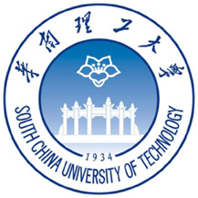
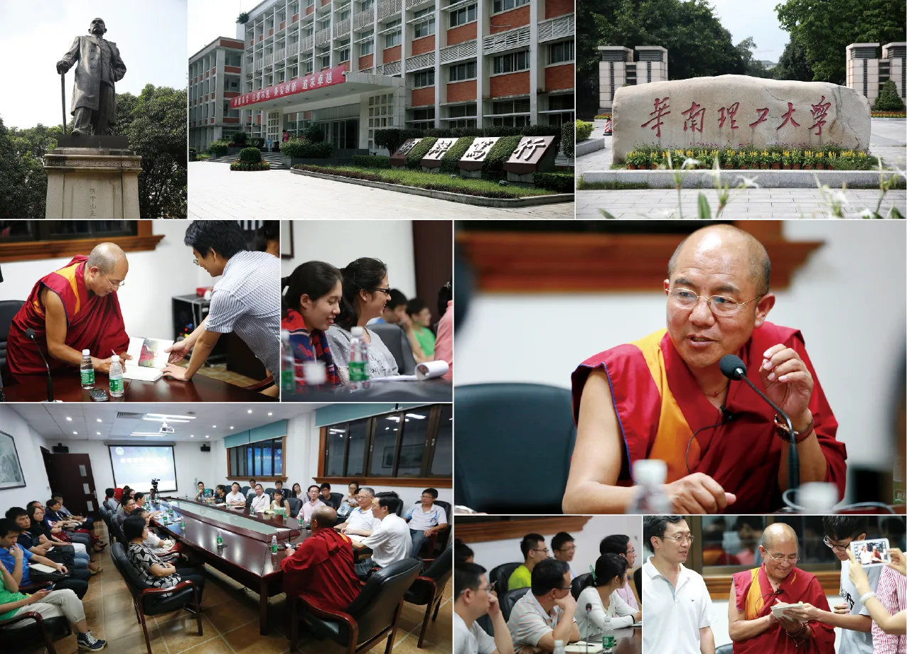
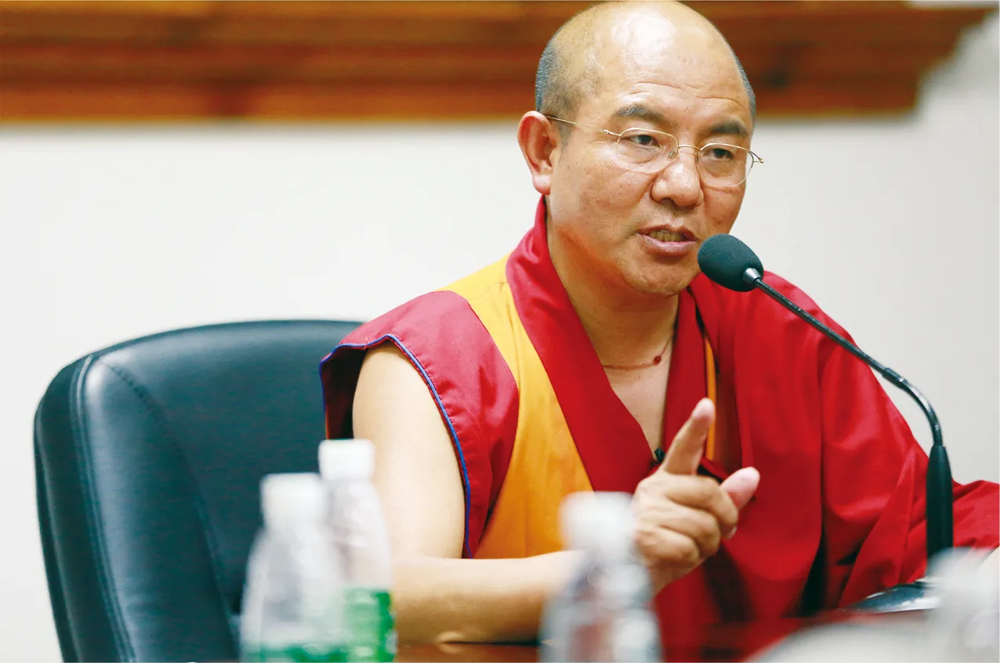

凡所有相，皆是虚妄。

第115场

华南理工大学

South China University of Technology

中国·广州

2015 / 6 / 12

## 佛教视野中的物质

## The Buddhist Examination of Matter

尊敬的院长、老师和同学们，大家好！很高兴今天有机会跟大家面对面地交流。两年前我们也曾安排过一次这样的机会，但当时我恰好拿到去美国的签证，不得不离开广州，从北京飞往美国，所以当年没能和大家见面。但值得高兴的是，今天我们终于又有因缘相聚。

对于生活在二十一世纪的人来讲，物质条件比以往任何一个时代都丰富，这一点大家也清楚。但与此同时，人们的内心却感到前所未有的浮躁、忙碌，似乎已经失去了生活的平衡。物质进步的确为我们带来一定的快乐和便利，但同时也带来许多冲击，令很多人在忙碌的生活中对人生的价值和方向感到迷茫，很少有人能真正地感到幸福和快乐。

从小学到大学，我们投入了大量的时间、精力、金钱，虽然学到了很多科学知识，但人文关怀的理念却很少接触。我们上物理课、化学课、生物课、数学课……但这些课程几乎不会教我们如何去关爱他人、孝顺长辈。因此，我觉得老师、科学工作者、宗教人士非常有必要面对面地沟通，消除彼此间的疑惑和不满，共同探讨如何提高当今社会的人文素养。

## 佛教对“物质”的分类

我想在座的各位对于“物质”都有着比较深刻的认识，我今天也很乐意和大家分享佛教在这方面的智慧和理解。

我不太愿意讲太多佛教名词，因为大家可能对这些词比较生疏，不理解它们的含义，所以它们不一定会对交流有所帮助。当年霍金在清华大学演讲，五百元的入场券一票难求，但因为霍金用的几乎都是专业名词，现场有很多人打瞌睡，甚至临时退场。听说霍金当时特别失望。当然，像清华这样的高等学府，科研实力应该很不错，但不同领域的人交流起来，太多的专业名词可能还是会造成障碍。

我对这一点也深有感触，因为不论我到哪里去讲中观、唯识、密宗或者显宗的内容，那些比较专业的词语，即使是受过高等教育的大学师生也不容易理解。比如说，佛教中的一切有部将万法分为五类：心法、心所法、色法、不相应行以及无为法。其中的色法，指大种和大种所造，这里又可以再进一步分为：有见有对色、无见有对色以及无见无对色三种。有见有对色指我们能触到、摸到、看到的种种法；无见有对色指的是像我们的眼根、耳根、鼻根等等，虽然是存在的，但是我们见不到；无见无对色也叫做无表色，指我们看不到的一种色法。诸如此类的名词，对没有系统闻思过佛法的人来讲，一开始都比较难以理解。

由此也可以看出，佛教早在两千多年前就已经对物质世界进行了系统而深入地分析，而且这种分析非常有趣。佛教认为，物质是由地、水、火、风等四大组成的。这四大并不是我们平时所说的大地、海水、火焰、狂风，而是四种特质。比如说，所谓的地大，指事物坚固的特质；火大指物质能够成熟的特质；风大指流动性、动态特质；水大指能够互相聚集成一体的特质。这与物理学中物质多样性的概念不谋而合，也就是说，一种物质可以同时存在多种属性，这种物质也被称为多样性物质。

## 佛教对物质的精准剖析

物质经过分解成为微尘，如果我们继续分解微尘的话，就会得到佛教中所谓的邻虚尘，也称极微尘，而它再被分解下去就变成了“空”。

“邻虚尘”这个名词出自《楞严经》，指的是不能再分割的粒子，再分下去就只能是“空”了，它相当于量子物理学中的普朗克尺度。在量子物理学中，因为不确定性的存在，普朗克尺度被用来定出最小单位的能量、长度、时间，而邻虚尘则是在佛法中被用来表示最小粒子。量子物理学认为，所谓的粒子都是由能量构成的，但能量又是从何而来的呢？量子物理学家目前还没有给出答案。但从目前的研究成果来看，量子物理学和佛教中的很多道理是相通的。因此，我相信佛教中有很多值得科学家借鉴的思想。

我以前读过一篇文章，作者是斯里兰卡的罗睺罗·化普乐（Walpola Rahula, 1907-1997）。他是一位大学教授，也是一所佛教研究院的院长，他不但精通现代的一些科学知识，也精通佛教理论。他在文章里提到，有一次他去参观离巴黎不远的一处核研究中心，并向工作人员介绍了公元4世纪无著菩萨对原子的“佛教定义”以及抉择空性的方法。现场的科学家们都惊叹于这一千六百多年前的东方智慧。他们说，即使是现代物理学对原子的最新发现，依旧没有超出无著菩萨的定义。大家有时间的话可以读一下这篇文章，相信你们会非常受启发。

## 没有脱离心而独立存在的物质

在某种程度上来讲，佛教对物质的认识和所谓的“常识”有所不同。佛教不承认任何与心无关的、独立存在的物质。换句话说，任何一个事物的生、住、坏、灭都和我们的心密切相关。比如，在大家的观念里，这可能就是一张桌子，一个麦克风，但实际上，它们的存在与各位前世的业、今世的心以及各种习气密切相关，但很多人可能并不了解这样的关系。

《楞严经》中还讲道：“一切众生，从无始来，迷己为物，失于本心，为物所转。”所有众生从无始以来到现在，被虚妄不实的外境迷惑，无法认识自己的本心，内心随外境而转。我们从这个道理中可以了解到，如果一味地关注外部世界，丝毫不考虑心的影响，这种研究是不究竟的，很难带我们真正了解物质世界。为什么这么讲呢？因为每个人对世界的觉知，比如世界是美好还是丑恶，是复杂还是单一，是微妙还是平凡，都与观察者的主观意识息息相关。

又比如，我们现在共处在同一个空间，可能有人感觉舒适、悦意，同时却有人感到不适，甚至痛苦。这与每个人自身的业力以及心的状态有关。佛教将果报分为异熟果、等流果、增上果和士用果四种[^1]，而这个例子就可以用增上果来解释。

就像我前面所讲的，任何物质的本体都是空性。也许你们读过《金刚经》，里面就讲：“凡所有相，皆是虚妄。”归根结底，这些“相”只不过是吸引眼球的外在表象而已，而它的本体并非真实存在。当我们把心与外境联系在一起考虑时就会知道，原来一切都是因缘而生，而这种因缘的理论，在佛教中称之为“缘起观”。

早在两千五百多年前，佛陀就在《缘起经》中宣讲了缘起观，简单而言，即因缘聚合时，外境显现；因缘消散时，外境随之改变。当我们真正领悟因缘规律时就会发现，原来一切外境真的都是心的造作，再深入观察时甚至会发现，原来所谓的“心”也不存在。正如《金刚经》中说的那样：“过去心不可得，现在心不可得，未来心不可得。”这并不是一种玄乎其玄的说法，而是当我们真正观察时，我们的心，包括生活中所产生的贪嗔痴等烦恼，都了不可得。《维摩诘经》中也讲：“心亦不在内，不在外，不在中间。”原来，心不在身体内，也不在外面的物质上，更不在内外之间。

## 站得高才看得远

可能大家在来听讲座之前，没想到我会讲空性的道理，可能很多人甚至是第一次听说空性，觉得云里雾里的，但如果大家能再深入了解就会发现，佛教的这种智慧非常深刻。就像王安石在诗里面所描绘的那样：“不畏浮云遮望眼，只缘身在最高层。”当你到达山顶上时，任何浮云都不会再遮挡你的视线，所有的景色都一览无余。朱清时教授也曾说过：“科学家千辛万苦爬到山顶时，佛学大师已经在此等候多时了。”我曾经问他：“作为一个科学工作者，又是多年的校长，你出于什么考虑这样说呢？”他明确地回答说，当代物理学的研究结果越来越趋近于佛法中对宇宙本质的描述。由此可见，我们完全可以在佛教的智慧中找到真理。

虽然我身穿僧服，在这里夸赞佛教，但我没有刻意打广告的意思，我做梦都没这么想过。佛教历史上有一位大德曾经说过：“我并不偏袒佛教，也不偏袒其他宗派，谁的观点是真理，我就追随谁。”这句话很客观、公正。我今天也既不刻意赞叹佛教观点，也不刻意赞叹科学的观点，谁的观点有道理，我就赞叹谁。

那我们究竟该如何正确认识物质呢？实际上，物质虽然显现为色法，但本体却是空性，虽然本体是空性，但又显现为色法。虽然科学家们一直在努力了解物质世界的真相，但事实上，我们通过自身的长期修证，就能现量见到。

## 看藏传佛教如何培养综合性人才

有人把佛教当作一种非常神秘的宗教，认为它与科学格格不入，但当人们盲目相信科学的权威时，其实也在不知不觉间，把科学变成了宗教。事实上，佛教不仅仅是一种宗教，藏传佛教的寺院更是教育机构，承担着传承知识的责任。比如说，寺院一般会教授《时轮金刚》和工巧明，即天文学和建筑学。藏地的桑耶寺、布达拉宫等诸多寺院，在上千年的岁月中承载着独特的建筑风格和建造技术，而这些传承都是在寺院中完成的。此外，寺院里面还教授因明学，即逻辑辩论。去过藏地寺院的人可能都见过辩论的场面。当人与人之间有疑问、不解时，就可以通过辩论来理清楚，这传承自一种非常特殊的印度学派。现在的博士生答辩恐怕都达不到藏传佛教辩论的激烈程度，这也是藏地寺院生活中非常精彩的一幕。

很多人对寺院的刻板印象就是菩萨像、老和尚和香客。但这并不是一所完备的藏传佛教寺院该有的样子。一所完备的寺院更像是一所研究院，里面的人研究天文、地理、建筑，包括临终关怀等等。他们不仅关注今生的生活，还关心死后的去向。不论是谁，只要在生活中遇到困难、痛苦、疑惑，都可以到寺院里向大师求教，因为他们不仅精通佛教教义，而且还对人文、历史等世间学问很有见地。他们这种无与伦比的智慧，可以帮你答疑解惑，引导人生的方向。虽然并不是所有的藏传佛教寺院都这样完备，但大多数都在培养综合性人才，而不仅仅只是一个烧香拜佛的场所。

大家可以有意识地去了解一下，看看藏传佛教的出家人究竟在学些什么。此外，他们并不是三四年就能从寺院毕业，很多人都要学习一二十年，甚至终生。所以，从某些角度来讲，藏传佛教出家人和世间大学生在学习的深度、广度等方面有一些差别。

我认为，为了生活或者某一项工作能有所突破，科学家可以把研究重心局限在单一的主题上，但综合性的研究更重要。这就像一个人在开车，如果他只懂修轮胎，那一旦其他零件出现故障，他就会束手无策，非常痛苦。因此，藏传佛教非常重视培养综合性人才。

## 被忽视的重要的学科——心智科学

现在台湾、香港还有美国等地，有很多人把心灵的科学叫做“心智科学”。台湾的陈宇廷在一本书里把“心智科学”称作“觉性科学”，大致也是一个意思。现在学校所传授的知识主要是自然科学和社会科学，但这并不能完全满足我们生活中的需要。生活中所遭遇的种种烦恼和疑惑都需要心智科学解决。总而言之，这样的知识对我们非常重要。

我衷心希望科学家们能在未来的工作中，既研究外在的物质，同时也关注外界与内心之间互相依赖的关系。如果我们忽略了这些因缘，仅仅研究一粒微尘或一个细胞，最终得到的结果不会很究竟。因此，大家很有必要了解缘起观，了解佛教如何解释这个世界，了解当前的科学又如何解释这个世界。如果能将这之间的关系弄清楚，那你在研究中的思考会更有深度、更有价值！

现场互动

问：佛法中经常谈到“色不异空，空不异色”。那物质究竟是空还是色？如果物质是色，那空又是什么？

堪布：实际上，我刚才已经介绍了“色不异空，空不异色，色即是空，空即是色”以及“缘起性空”的道理。色法的范围比较广，色、声、香、味、触都包括在其中。虽然色声香味触能显现，但它们的本体并不存在，就像是镜子中的影像，虽然能清楚地显现，但本体却不成立。因此，色实际上就是空，空实际上就是色。

再举个例子，虽然水月可以呈现在湖水中，但它并不是真实的，是“空”的。从这个角度来看，空和显现是同体而非他体。这就是“色不异空，空不异色，色即是空，空即是色”的道理，佛教里面也叫“现空双运”。

如果一个人能真正领悟现空双运，那他甚至可以没有任何阻碍地穿墙过壁，但如果只是理论上了解，那还远远无法达到这种境界。

佛教不同宗派对空的观点也略有不同。有实宗只抉择一切万法为空，唯识宗进一步抉择万法唯心所造，而中观宗将心和外境都抉择为空性。这种空并不是实有，也并非断灭，而是远离四边八戏的一种境界。

问：您用湖中水月来说明现空双运的道理，但前提是月亮存在于空中，否则湖中不可能会有水月。所以，从逻辑上说，天空中的月亮是第一，湖中的水月是第二，对吗？

堪布：的确，因为天空中有月亮，所以水月才可以显现，但这个比喻的目的并不是讨论月亮和水月的关系，而是说明显现如梦如幻，也就是说，水月即是空，空即是水月。

恰恰因为空的原因，所以万法可以显现，与此同时，恰恰因为万法可以显现，所以它必定是空。“空”并不像有些人所认为的那样：“瓶子里面的水倒掉后就是空。”事实上，在瓶子显现的当下，它的本体就是空性的，如果本体不是空性，瓶子就没办法显现。瓶子的显现是色法，本质是空法，一个是现象，一个是本质，这也叫做“现空无二”或者“明空无二”。

问：我对朱清时教授那句话有不同的看法。虽然他说：“科学家千辛万苦爬到山顶时，佛学大师已经在此等候多时了。”但是，如果没有科学家帮助我们认识自然界，佛教大师能够达到那样的高度吗？例如，如果没有经过科学家千辛万苦地研究，我们就不会发现电，更不会发明空调。从这个角度看，会不会是科学家帮助佛教大师认识世界？

堪布：我曾经和朱清时校长交流过，当时我对他这句话也有疑虑，所以我问他：“这句话如果是一个佛学家说的，我还可以理解，这是出自对佛教的赞叹和信心，但你作为一个科学家，尤其是中国科技大学十多年的校长，为什么也会得出这样的结论呢？网络上甚至有人说你被佛教洗脑了，你怎么看？”他认为，佛教大师通过禅修，在两千年前对宇宙本质的认识，与当代物理学家的研究结果基本一致，而禅修的方法都能在经典中找到。从他的回答里不难看出，他是发自内心地认同佛教。

还有一点值得注意的是，虽然当代人觉得电、空调非常重要，但佛陀并不是迎合各个时代人们的喜好而讲法。佛陀宣讲的是我们如何面对、解除生命中的种种烦恼，如何面对生死，前往解脱的道理。

朱清时教授并没有说：“佛学家千辛万苦到达山顶的时候，科学家早已等候多时。”因为时间上也不现实。科学只发展了几百年，而佛教已经存在了两千五百多年。这两千五百多年中，无论是对外界物质还是心识的研究，佛教的智慧都是最成熟的。正因为这样，爱因斯坦也说过：“如果世界上有一个宗教不但不与科学相违，而且每一次的科学新发现都能够验证她的观点，这就是佛教。”他还说：“我虽然不是一个宗教徒，但是我如果有一个信仰，我愿意信仰佛教。”

我去爱因斯坦故居的时候也问过关于他的事情。工作人员说，爱因斯坦临死之前的确考虑过皈依宗教。据说他还在遗嘱中交代，他死后什么都不留，骨灰要撒在空中，与宇宙融为一体。这可能是他安住于空性的一种表示吧。所以，我觉得我们可以相信某些科学家，承认他的权威，但同时也要观察他们在其他方面的觉悟。

问：人死后到底有没有灵魂？如果有，那当我们濒临死亡的时候，在轮回里有没有选择的余地？我看到有些佛教徒在去世时会请出家人念经超度，这能不能帮我们在轮回里自由选择去向？

堪布：每个人都应该重视死亡，因为不论你富有还是贫穷，未来的几十年中都必定要面对它。很多人不敢面对死亡，甚至连提都不敢提，但回避、忌讳的态度于事无补，大限来临时，谁也逃脱不了，到时再着急、再困惑、再畏惧也没用。所以，有智慧的人，应该提前有所准备。

我们计划今年在泰国召开第五届世界青年佛教研讨会，主题就是“临终关怀”。我也问了一下岭南临终关怀的情况，很多老师都告诉我，有些地方做得非常好。临终关怀真的对每一个人都非常重要，大家应该在身体健康的当下就思考这个问题：人有来世吗？

如果人死如灯灭，那关不关心来世就显得无所谓，人死后就像火焰灭了、水渍干了一样，不会留下任何痕迹。但人肯定会有来世。因此，临终做一些法事、念经非常重要。当然，念经并不能保证每一个人都不堕地狱，但至少有一部分人能通过念经、观想而转生天界。如果想要在死相现前时抓住机会往生，我们就应该在活着的时候，有针对地修行。

对于有些人而言，因为前世业力非常严重，死时可能根本来不及观察死相，更来不及选择往生的去处。在这种情况下，其他人帮忙念经就显得更加重要。虽然不能百分百地保证解脱，但仍然会有相当大的帮助。

很多西方人都在研究西藏中阴救度方面的教言，如《西藏生死书》《中阴救度法》等等，很多学者甚至将死亡当作一门科学来研究，认为身体只是灵魂的一个载体，今生结束后，灵魂还会继续流转。但在很多地方，人们活着的时候对死亡避而不谈，面对死亡时却又手足无措，但那时候什么都晚了，毕竟做事情，最好提前有所准备。

问：您刚才说人有来世，但这跟我们平时的主流宣传有非常大的差别。我们学哲学的讲究论证，您能不能给出一个例子，证明有前世后世呢？

堪布：我和很多地方的科学家们都讨论过这个问题，也引用过很多的论据，包括现实生活中的案例。此外，我还翻译过一本书叫《前世今生论》，也叫《生命的真相》，大家方便的时候可以看一看。这本书既引用了科学证据，又包含了传统思想，作者是藏地非常著名的一位学者。

佛教思想和社会上的主流思想还是有一些差别，大家一开始对前世今生这样的观点抱有怀疑是很正常的。但大家不要停留在怀疑的阶段，而是要去了解、去研究，否则，怀疑永远不会消除。

我们经常在生活中发现这样的现象。一对同卵双胞胎，不论是基因还是成长环境都是一样的，但两人可能从小就在智慧、性格、爱好等方面有所不同。又例如，在座的各位从小都有各自的喜好，有时候甚至会对一些没有深入了解过的知识有似曾相识的感觉，学起来也得心应手。这是什么原因？其实这都是前世延续下来的习气，而且我们的习气还会不断地延续下去。

美国有一位史蒂文森博士（Ian Stevenson, 1918-2007），他在加拿大、美国、泰国等地搜集了两千多个回忆前世的案例，出版了十余本书，其中一本叫《二十案例示轮回》（Twenty Cases Suggestive of Reincarnation）。史蒂文森博士去世后，他的工作被弗吉尼亚大学的塔克尔博士（Jim Tucker, 1960-）继承下来。塔克尔博士又在印度、美国和加拿大等地搜集了许多案例。我去年在美国和他有过交流，他告诉我，本来他不相信前世后世，觉得这可能只是人们的一种臆想，但在研究过这个课题后，他确信轮回存在。

所以，如果我们对一些不熟悉的领域有怀疑，那最好是能深入了解，甚至是去研究一下这个领域，这样才能下判断。如果不接受这一观点，那也要给出非常确凿的理由，这才是一种科学的态度。历史上有许多能回忆前世的案例，其中不乏没有任何信仰的人。与此同时，迄今为止还没有任何人能提出确凿的证据来推翻这一观点。这样看来，我们不得不接受前世后世的观点。如果大家可以看一下《生命的真相》这本书，应该能对前世后世有更深入的了解。

问：塔克尔博士虽然找了很多案例，但这些案例是否在某种意义上是可重复的呢？比如说外国人造了一部手机，我也仿造一部，因为他的工作可被重复，所以能证明他的制造方式是正确的。那我们能不能重复一些指标，来认证某人前世做过什么事？

堪布：讲到重复性，我想到另外一个问题。到目前为止，中国在科技创新方面还不是很先进，诺贝尔奖得主也比较少。我想这可能和我们的教育方式有关。中国的教育模式主要是观摩式的教育，孩子从小都是在统一的课程和思维模式下成长，很少有机会能自由发挥并拓展思维。这样一来，我们不得不在很多领域中复制其他国家的产品。

回到前世今生的话题。一个人前世所做的事情，可能很难通过重复实验来确认。但我们仍然可以通过深入而细致地调查来得出一些结论。斯里兰卡有过一个女孩能回忆前世的案例。当时有很多个人和组织都进行了独立的调查，这其中也包括斯里兰卡的总统、印度政府等等。最后，各方证据都表明，这个女孩的确能回忆前世。在这样证据确凿的情况下，秉持客观、公正的科学家也不得不承认案例的可靠。

问：如果一个人既做善事又做恶事，那他的善业和恶业会不会相互抵消？

堪布：如果一个官员既贪污公款又积极行善，他的这种业力叫花业，也就是既有黑业又有白业。如果他把贪污的钱，全部拿来积极行善，没有丝毫自私自利的心，那这个恶业和善业有可能会互相抵消，但也不能百分之百地保证。业力是一种非常复杂、甚深的因果关系，凭我们的分别念和想象力是很难度量的。

《俱舍论》的第四品讲了业的差别、轻重、成熟时间以及各种作用等等。如果可以学习《俱舍论》的话，相信大家就能对善业、恶业有更全面的了解。

当我们讨论因果、业力时，尽量具体事情具体分析，避免用片面的观点下结论。

所谓的业，实际上是种子的意思。你的行为产生什么样的结果，都跟这颗种子有关系。业本身并不分善恶，它以种子的形式保存在心识最深层的阿赖耶上，当因缘具足时，它就会开花结果。

问：如果那个贪官贪了一亿，并因此造成了五百个人死亡，但同时，他用这一个亿帮助五千个人过上幸福生活。那他的这个恶业和善业是不能互相抵消的，对吧？

堪布：应该是不能互相抵消的，因为幸福生活和性命之间还是有非常大的差别。

问：以前西方的神学家也做科学研究，比较有名的人有孟德尔和托勒密。您刚才说，藏地佛学院里有研究天文的，也有研究建筑的。我很好奇，他们是通过佛学走向天文、建筑，还是说他们以前研究天文、建筑，后来转向佛学？

堪布：西方神学的研究方式、汉地佛学院的授课内容都和藏地佛学院有所差别。在西方高等大学的神学院中，比如哈佛神学院和哥伦比亚大学宗教学院，人们既要研究宗教教义，又要研究人文和科技知识，但他们的立足点是在宗教的世界中接受教育，所以他们的学习几乎与宗教教义分不开。

而藏地的佛学院，不仅仅是我们学院，哪怕是在其他较小的佛学院当中，也都有人在学建筑、天文、地理。这些内容会不会偏离了佛学院的教学核心？不会的。在藏传佛教的理念当中，出家人和在家人都应该广泛地学习知识。这就像世间要普及教育，学生们要对各种社会人文、科技知识有所了解。当广泛学习到一定阶段后，那些希望能在某一方面更进一步的人，就可以进入专科班，一门深入。

在我们学院当中，有一个三十多人的班级，专门研究天文。他们每年都会计算藏历，把当年有多少个月食、日食计算得非常清楚。我们学院还有一个五六十人的藏医班，他们除了完成日常佛教功课以外，还负责藏医学的继承与弘扬。

这一点与汉地的佛学院有所不同。汉地的佛学院里可能不传授医学、建筑学、天文学等知识，甚至有些汉地佛学院只讲中观和唯识。因此，从某些方面来讲，藏地的佛学院更像是一种综合性大学，设有不同专业。这里的出家人并不像大家想象的那样，只懂念经、内观，完全不懂其他知识。

问：在世界三大宗教中，伊斯兰教有什叶派和逊尼派的冲突，基督教有中世纪的宗教审判，好像这两个宗教的包容性并不是非常高。为什么佛教没有出现过类似的情况？佛教对于其他宗教的态度是什么样的？

堪布：大乘佛教的发心是要利益天下无边的所有众生，由此可见，大乘佛教的慈悲观不分民族、国家、种族、宗教，只要是有生命的，哪怕是动物，也都要用慈悲心来对待。佛教当然也能包容不同的宗教理念，所以，佛教不排斥其他宗教，佛教徒也不会排斥非佛教徒。在大乘佛教的思想中，哪怕是加害我们的敌人，我们也要安忍，对他修慈悲心。这一点的确与其他宗教不同。

从历史上看，有些人通过政治、经济等手段控制别人，包括现在有些地区还存在宗教冲突。佛教对于其他宗教的教义不置可否，因为这要看它是否相应众生的根基，但从佛教的原则来讲，不管是追随什么宗教的人，我们都应该慈悲对待，同时用客观的眼光看待其他宗教。

2009年，在日内瓦的“国际联合宗教会”上，两百多位宗教领袖把“世界最佳宗教奖”颁给了佛教。他们给出的理由就是，自古以来，没有一场战争是以佛教名义发起的。我想这也能反映出佛教的包容性。

问：佛教讲前世今生、讲因果，这是不是意味着，我们的今世已经在前世就决定了？但是佛教又鼓励我们多做善事，这样能积累福报，消除恶业，改变命运。我觉得这好像有一点矛盾。

堪布：这并不矛盾。比如你在大学的专业决定了你以后的职业，但你在工作中的成就也要依靠后续的努力。具体一点来讲，你所学习的专业相当于因，它在一定程度上决定你可以在某一个单位上班，但这并不意味着你所从事的工作永远不能改变。你依然可以通过后续的努力，提高工作中的表现，甚至换一份工作。

虽然前世的因对今生有一定影响，但今生的行为依然能对今后的生活起作用。佛教并不认为一切都是命中注定，更不认为事情无法改变，因为因缘在不断地变化。

问：现在有很多老年人，没有什么文化知识，阅读都成问题，更没有办法正确理解佛经。所以，学佛之前是不是应该先学习文化知识？

堪布：这取决于个人的根基。有些人不需要学习文化知识，就可以在寂静的寺院当中做一个很好的修行人。他虽然没什么文化知识，但这却不会影响他的修行和成就。

但还有一些人，分别念比较重，对科学信心十足，对佛法却半信半疑，他们的确应该先广闻博学，多了解世间和出世间的道理，然后再学佛。这样一来，他的见解、信心都比较稳固。否则，他的信心很可能是盲目的迷信。

佛教非常反对迷信。如果对佛法中的道理不理解，盲目建立起来的信心往往不牢固。就像现在有些老年人，不明白为什么念佛，更不清楚念佛有什么功德，只是人云亦云，随波逐流。佛教一般不赞叹这种做法。

佛教里面有两种修行人，一种是利根随智慧者，一种是钝根随信心者。利根者凭着自己的智慧，长时间研究佛法，即便刚开始时可能对佛教带有一种排斥、怀疑，但经年累月，智慧慢慢沉淀、累积，最后怀疑全都转变成智慧。而比较钝根的人，学佛主要是凭借一种冲动的热情，他的信心并不稳固，容易听信别人的话，这是比较危险的。

问：听说在藏传佛教当中，有一个非常重要的修法叫拙火定。修行拙火定的人可以在冰天雪地里穿湿衣裳，并用体温把衣服烤干。请堪布讲一讲，我们该怎么理解这样一个现象？

堪布：听说朱清时教授曾经在玉树修拙火定，他觉得这个修法非常殊胜，在这方面也很有经验。他的老师南怀瑾先生也曾在峨眉山和二郎山一带依止修拙火定的上师，学习这个法门。

修拙火定有不同的观想方法，有些可能令人难以置信。比如，我们可以观想肚脐中有一个火焰的种子，通过念诵“嗡啊吽”以及一些其他的咒语，让这个火焰逐渐燃烧起来，慢慢把自己的身体烤热。我们那里有很多人，冬天不穿厚的衣服，但仍能维持身体的温度。这在藏传佛教的密法中叫生起次第。有些人可以修得非常成功，但有些人也可能完全修不成。

问：您所在的佛学院里有没有修得比较成功的？如果有机会的话，能不能给我们展示一下，加强科学、佛法之间的交流？我去过东北的中国雪乡，那里的气温零下三十多度，哈一口气出来都会在眉毛上结霜，靠体温烘干衣服就更不可能了，所以拙火定这个功夫真的很不一般。

堪布：应该可以找得到修拙火定的人。我不修拙火定，但我在冬天讲课的时候，穿的衣服也不是特别多，可能是因为我不怕冷吧。不过佛学院的确有很多人修拙火定，冬天穿的衣服很少。

[^1]: 异熟果主要指果报异时而熟，比如今生种下的因在后世成熟；等流果主要指从被异熟果所牵引沦落的恶趣中解脱出来以后获得人身时所感受的报应；增上果指成熟在外境上的果报；士用果指造任何恶业都将与日俱增，世世代代辗转延续漫漫无边的痛苦，恶业越来越向上增长，依此终将漂泊在茫茫无际的轮回之中。——整理自《大圆满前行引导文》。
