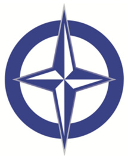
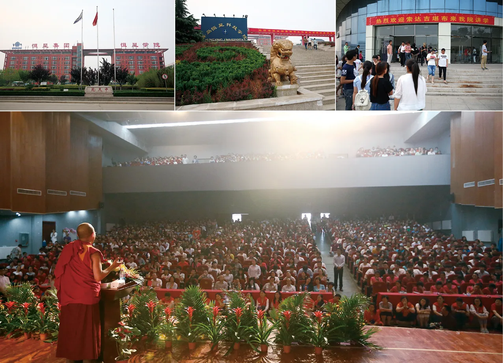
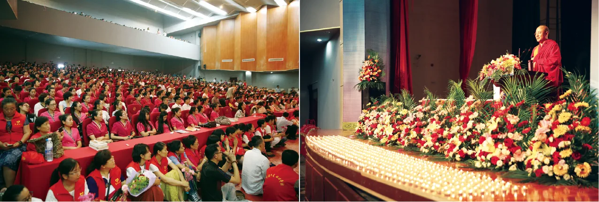
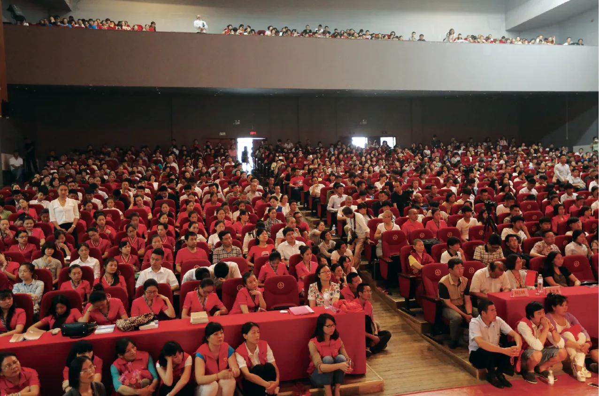

不要把幸福完全归结到物质、金钱上，

它们并不可靠。

第116场

青岛恒星科技学院

QINGDAO HENGXING UNIVERSITY of SCIENCE and TECHNOLOGY

中国·青岛

2015 / 6 / 16

## 幸福人生 从心开始

## Happiness Starts from Our Hearts

主持人：

今天的机缘非常难得，我们将与一位兼具慈悲、智慧、力量的上师结缘，和他一起探索人生的正途。

在此之前，首先请出本次活动主办方青岛恒星科技学院的陈副校长——也是航空学院的院长，来致欢迎辞，有请！

陈副校长：

尊敬的索达吉堪布，亲爱的老师、同学们，下午好！我谨代表恒星科技学院全体师生，对堪布的到来表示热烈欢迎！

堪布来自藏地喇荣，他怀着仁心善念，为汉地僧众译经讲学，不辞辛劳；他著作等身，方便说法，度人无数；他捐资助学，慰问灾区，扶危济困，广施慈悲；他到过欧、美、东南亚等许多国家和地区，弘法讲学；他曾经与北大、清华、人大、浙大、复旦等高校的学子欢聚一堂，帮助大学生探索智慧的源头，浇灌心灵的花朵，在国内外产生了极大影响。

今天恒星科技学院，就迎来了这位高僧大德，为大家做一场“幸福人生，从心开始”的讲座。时机正好，因为恒星需要层次升级，需要精神文化的构建；恒星的莘莘学子更需要安身立命、完善自我的大智慧。

下面，有请堪布为我们演讲“幸福人生，从心开始”，谢谢！

## 幸福的方向

尊敬的校长，各位老师、同学，很高兴有机缘跟大家一起交流、分享。

今天的话题是“幸福人生，从心开始”。有些人对这句话可能不太认同，觉得幸福人生应该从爱情开始、从金钱开始，或者从其他的某种因缘开始，起码不是从心开始，否则，人人都有心，岂非人人都很幸福？

这也是一种理解，但你可以仔细想想，这个让我们心甘情愿为之奔波的“幸福人生”，真的是依靠物质、金钱、异性朋友或者外在的什么因缘而来的吗？这个问题很值得深思，在接下来短短的时间里，我们可以一起探讨。

在座大多数都是学生，对于学生时代，有人希望它充满意义，有人希望它美好浪漫，也有人只想它平平淡淡……确实，学生时代弥足珍贵，但如果在此期间，我们的人生定位错了，学习方向错了，很可能从此与幸福擦肩而过。

## 看着高处，还要从低处做起

我是佛教徒，但也喜欢学习世间的各种知识。包括刚才，我用了差不多一个小时，参观了你们的各大教学楼、实验楼，这个过程让我感触颇深，不知道将来有没有因缘，也能建一所这样的职业学校。

以前参访一些小学、中学的时候，我也这样发过愿，后来的确建成了，效果还不错。而这次萌生建职业学校的想法，是因为看到今天的大学生当中，有一种眼高手低的心态，贪图享乐，却不努力学习，把时间都花在吃喝玩乐、谈恋爱上，甚至逃学、赌博、吸毒……我去过很多学校，有些状况的确触目惊心，让人从内心深处感到一种悲哀。

父母非常不容易，辛辛苦苦将孩子养大成人——如果在西方，孩子一到18岁，家里就几乎不用管了，但在国内，送进大学还要不断交学费，可孩子却没有把心思放在学习上，什么知识、技能也没学会。等在学校过完三四年，真正走上社会找工作的时候，父母才伤心地发现，孩子一无所长。

既然如此，倒不如踏实学一门技术。一方面，想读本科生、研究生、博士生……不断攀登高学历，追求更高深的知识，这很好；但另一方面，学一个对将来的工作、生活都有实际作用的知识，对大多数人来说或许更重要。

## 看好职业学校的前景

其实，国内的职业学校发展得还不太成熟。我去过一些国家，也参观过各种学校，据我了解，国外的职业学校非常完善。像年轻的澳大利亚和新西兰，建国都不到一百年历史，那里的人非常重视职业学校，很多学生把它当作报考的第一志愿，因为毕业后可以享受优厚的工作待遇；在瑞士，百分之七十的学生会选择职业学校，剩下百分之二三十的学生才去更高等的学府深造；在英、德等国，这个比重也有百分之五十……可见，国内职业学校的发展水平跟国际品牌相比，在教学模式、管理经验等方面还是有一定差距。但不管怎样，未来的生活、工作等各个层面，职业学校的教育都不可或缺。

刚才我也了解到，你们设置了航空、酒店、管理、教育、汽车等各种学科，这些具体的操作性较强的知识，对当今社会来说应该很重要。

## 万贯家财不如一技之能

虽然当前年轻人的职业规划中，普遍把公务员、白领等作为首选，但实际上，不可能所有人都成为白领，总得有人做蓝领，通过不同方式养活自己、经营家庭，乃至为社会、民族奉献价值。

而不管你如何选择，在校期间，都应该把所有琐事放下，一心一意学好这门技能，并且多多益善。世人常说“技多不压身”，本事不嫌多，今天学到的东西，将来总能用得上。

“万贯家财不如一技之能”，再多的田地、牛马、金钱、财产，也不可能永远跟随自己，倒不如一技傍身。有些父母千方百计给孩子留下黄金、房产、轿车、存款……但如果孩子自己缺少智慧、本事，到头来可能仍然穷困潦倒。

不知道你们的情况怎样，现在的大学生，不乏勤奋努力者，但也有人只想当领导、老板，至少也是会计、财务等。他们的首要目标是不跑腿、不做事，但这种想法并不现实，全世界那么多人，不可能人人都来领导、管理，被领导、管理的一个也没有。

应该把“教”“学”“做”三者结合起来，会一门技能，熟练掌握，一辈子不舍弃。用这种身体力行的方式做点实实在在的事，不也很好吗？

但有些大学生填志愿的时候，不愿意从基层干起，只想做“高大上”的工作，或者刚毕业就想赚大钱。这也是为什么很多企业找不到人，很多毕业生找不到工作，就业问题在中国越来越严峻。一方面高学历的人很多，本科生、研究生、博士生……另一方面，徒有虚名的人也多，没有实用的知识和技能，甚至连人品都堪忧。对用人单位来说，这样的“人才”，或许还不如踏实、肯干、懂技术的人好用。

## 职业教育的基础，是人格教育

由此我们也能意识到，职业教育还应该帮学生做好心理方面的准备，否则当他走上社会，很可能会发现，现实并不像在学校里想象的那么美好。

听说这里大部分是定向培养，学生一毕业就可以分配，这很好，但与此同时，还是不能忽视人格教育、国学教育乃至宗教教育，这非常关键。假如一个学生会电脑，懂技术，学了很多专业知识，但人品太差，承受能力弱，脾气暴躁，性格恶劣，有意义的事情不想做，没意义的事情特别热衷，那即便被定向培养到社会上，无论在哪个企业、单位或部门，恐怕也待不长久——对方不敢要这样的人。

希望学校不仅看重知识、技术、文化，更能重视人心的培养，让学生懂得，生而为人，不能有太大的贪婪、嗔恨、嫉妒、傲慢、懒惰、脆弱之心。

人心是可以培养的。就像在一些体育院校，很多学生刚入校时，体质非常差，但几年磨炼下来，身体会变得很好；同样，一个听课不专心，学什么都心不在焉的新生，通过老师的严格教导，不断磨炼心灵，当他从学校出来时，也会成为一个好人——具有好的人格、个性、品德的人。在这个社会，一个好人比财富、技术、知识更珍贵，因为技术教育可以培养出能干的“机器人”；而心灵教育，才让人有了温度和灵魂。

## 用感恩之心，平息抱怨

尤其要让孩子们懂得报恩。有些学生人品很不好，自己不努力学习，有什么不如意就抱怨父母，“为什么你们是文盲”“为什么把我生在农村里”“为什么没有把我培养好”……其实父母把我们带到人间，没让我们腐烂，被水冲走、被狼吃掉、被别人伤害，含辛茹苦地养到今天，谈何容易？

刚出生的时候，我们都很轻，很弱小。汉地有“过秤”的传统，孩子生下来先称称有几斤几两。娱乐新闻里也经常报道一些明星的孩子出生时候的体重。藏地倒是没这个习惯，不知道过秤有什么用意（众笑）。所以你们刚来到人间时，父母如果给你过秤，重量也只有一点点，但是后来，他们用身体的精华、各种饮食滋养你；为你揩鼻涕、擦粪便、清理不净物；供你读书，从幼儿园直到现在……才养成你今天的样子，这期间付出了多少辛苦？那些抱怨父母、抱怨社会的人，往往没有忆念过这份恩德。

其实没什么可抱怨的，对这个世界，我们更应该心怀感恩。像现在，有这么好的学校、教室、设施，我们要多想想它的来之不易：学校创始人经历过怎样的难关；教学楼由多少工人一砖一瓦地垒建；教职人员的收入是多少，而他们又付出了多少……我们所拥有的一切，从内心获得的点滴知识，到身上穿的这套校服，到每天的吃喝用度，背后都有无数人的汗水、泪水和心血。这些辛勤和努力，但凡有心智的人都会看在眼里，需要感恩的人太多了！反过来，如果对这些视而不见，只有抱怨和嗔恨，你可能会走上歧途，甚至堕入监狱。

我去过一些监狱，昨天也刚在一所监狱演讲，从犯人的表情上看效果还可以，至少听得比较专注，态度也比较好，但从他们的眼神中，还是能看出对社会的怨气。这一方面是自身贪嗔痴方面的习气所致，一方面也许是因为遭受过不公平、不合理的对待。但不管怎样，希望大家不要有这样的怨气，至少我们还拥有自由，还享用着许许多多的资源，对这些应该发自内心地感激。

## 依附于物质的幸福，并不可靠

这也是为什么要跟大家讲“幸福人生，从心开始”。幸福的确可以从当下这颗心开始，而不是像一些舆论宣扬的，要有很多钱，几百万、几千万甚至几个亿才幸福；也不是有了奢侈品、豪车、豪宅才幸福。要知道，幸福还有更广泛的内涵。

事实上，越是富贵的人，内心的痛苦可能越多，经常在电话里骂人、哭泣……有时候看到一辆顶级豪车，我会想，这辆车是最贵的，但车里人的眼泪可能是最多的；看到一辆破车，我也会想，这辆车虽然破，但车里的人或许哭得并不多。

做学生的时候，我们不一定这么想，总觉得“只要有钱，肯定幸福”，但现实就是如此，不信等你成了领导、老板，再看看这样的生活到底苦不苦。

不要把幸福完全归结到物质、金钱上，它们并不可靠。况且世间很多令人羡慕的东西，快乐、成功等等，其实都伴随着巨大的痛苦。而解除痛苦的方法，就是从内心深处明白这些道理。这样即便赚得不多，比如每天在车间修理轮胎，用踏实的劳动换来报酬，以此养活自己，也可以过得轻松、自在。

幸福有不同的沸点。就像烧开水，有些地方烧到八十度就开了，有些要到一百度；同样，有些人月薪一千就满足了，有些人要到一万。对生活的要求不同，幸福的感受也截然不同。

## 多少幸福，被金钱绑架

在我家乡的学校里，有一些支教老师，还有一些扫地、洗衣、做饭等的工作人员，有人拿一千的工资，有人拿九百、七百，他们基本上都很开心、满足；但在大城市，像青岛或者北上广，月薪六千也不够用，这是我认识的一个北京人说的。

家乡的六百、北京的六千，换来的幸福感或许是同等的，既然如此，又如何能用金钱衡量幸福？

在北京奋斗的人或许还想着：“六千月薪怎么够？六十万年薪还差不多。不光要买房，还要买车；今年先买二十万的，明年再买六十万的，后年争取换成几百万的；一辆车不够，要两辆、三辆；在中国买不够，最好在美国、加拿大也各放一辆；青岛的别墅修起来，北京、上海、广州、深圳也要有，将来还要买到美国、加拿大、日本、英国、德国、瑞士……那该多好！”可是，对财富的贪求越多，人越累，而最后离开世间时，其实什么也带不走，又变回一无所有。

我还听说有些年轻人非常讲究品质，认为高品质的生活才幸福。他们穿的衣服、背的包、穿的鞋、开的车……全是奢侈品，但实际上，这种“品质”跟真正的品味相比，恐怕也有差别。

总之，想把幸福建立在金钱上，是很困难的。

曾经有个英国女人，十年前买彩票中了五十万英镑，相当于人民币四百多万。起初她特别欢喜，觉得自己是全世界最开心的人，但一番挥霍后，她发现大奖并没有为人生带来快乐，最终也因为抑郁症而自杀。她曾经对人说，即便中了三千万也不会过得更好，钱在生活中并非万能，人们应该记住这一点。

所以我们要更多地关注内心。现在的年轻人，很多都有抑郁症、自闭症等心理疾病，一方面是因为自己对心灵的提升不重视，另一方面也是大环境使然。今天的时代，低俗文化、碎片文化、快餐文化盛行；今天的人群，虚无主义、拜金主义、享乐主义至上。

## 最精湛的技艺，是“忘我”

好比我们每天都在刷手机，但手机里是什么呢？有很多乱糟糟的信息、肤浅低俗的内容、博取眼球的广告……如果看的人与之相应，就容易被欺骗、诱导。借助网络，这样的“知识”甚嚣尘上。在古代，人们会在学问、做人方面追求更深层次的境界；而今天的人们从早到晚关注更多的，是物欲和自我，越来越缺少知足、忘我的精神。

大家在学习科学技术的时候，也不要太在意名声、财富，不要太在意自我了，如果带着膨胀的私欲，任何学识、技艺，都很难臻于精湛。

《庄子》中有一个“梓庆为鐻”的故事，讲鲁国木匠梓庆，擅长削木为鐻，上面雕刻的老虎、豹子等猛兽栩栩如生，见到的人都惊为鬼斧神工，其他木匠则望尘莫及。

他的名声传到鲁国国君那里，国君感到很稀有，就召他去王宫问话：“听说你的雕刻神乎其技，和别的木匠截然不同，你是有什么窍诀吗？”

木匠说：“哪有什么窍诀，只不过在做活的过程中，我会去掉我执，去掉求名、求利等各种杂念。”

那具体是怎样呢？守斋戒。这是一种宗教仪式，在座各位可能很多都没有听过。木匠通过守斋戒，到第三天可以忘利，忘掉谋取财富的心思；到第五天可以忘名，忘掉将会获得的毁誉；到第七天则可以忘我，忘掉对自我的执著。在这样的心态下做活，就能呈现出人们最终看到的效果。

大家也在学习各种技能，有些做零件，有些当空姐……不管将来从事什么职业，你都可以这样观察自己：第一，做之前，有没有让心静下来；第二，做的过程中，有没有忘名、忘利、忘我的心。

当然，要达到完全忘我，像菩萨那样，我们可能做不到，但至少要认真、细致，有对客户、他人负责的心态。否则，完全只想着自己的利益，你可能会不顾道德底线，可能会干出很多坏事。

## 守住内心的底线

今天的社会有很多不顾道德底线的人。大家也知道，像高速公路上的人为爆胎事故、毒奶粉和地沟油的产业链等，这些都被曝光过，置身这样的环境，我们有很多利益是得不到保障的。

食品安全问题尤其让人担忧。中午过来的时候，旁边有人给我几颗糖，我不太敢吃，担心不健康，后来他说不要紧，这是自己亲手做的，我才安心吃了。媒体的宣传或许有夸张成分；但我们也的确需要谨慎，因为不知道这一口会不会吃到化学品、添加剂、激素、毒素……

社会为什么变成这样？因为家庭也好、学校也好，对人格方面的教育还是不够。不知道同学们将来会不会干坏事，应该不会吧，但也很难说。在这样的大环境下，我们都有必要问问自己，到时候能不能守住底线？

而如果在学校里学会了慈悲、善良、感恩，内心存储着这样的知识，毕业后就更能为社会贡献力量；即便没有很大能力，至少也会对家庭，对父母、孩子尽到责任。

相反，如果缺少内在的防护和制约，未来的人生会很可怕。像一些开放地区，吸毒、贩毒的年轻人越来越多，很多人因此被关进监狱。昨天我去的监狱里，就有大概四分之一的人是因为吸毒、贩毒走上犯罪道路的。我们也可以想一想，自己会不会变成这样？

未来，你们当中或许有人非常成功、飞黄腾达，也有人一败涂地，甚至锒铛入狱，一切都有可能。所以要提前想清楚，人生的路该怎么走，然后从内心做好防护。否则就像吸毒，起初出于好玩，觉得试一下没事，结果上瘾容易戒瘾难，一旦沾上，可能再也戒不掉，从此毁掉一生。

在藏地，或许是信仰佛教的关系，基本没听说过有人吸毒。我曾经参加一个防治艾滋病的研讨会，当时有个其他民族的女老师就说：“藏族还好，不像我们那里，吸毒的人很多。”确实，在有些民族当中，吸毒、感染艾滋病的人群越来越大，尤其是大学这种年轻人聚集的场所，损害身心的因缘正不断增多，如果经不起诱惑，一旦沾染，还怎么谈未来的事业成功、前程锦绣呢？

## 不为风雨所动

学习任何知识、技能，都需要健康的心态、善良的人格，它们才是基础。如果学校不关注这些，学生以后会很可怜，给社会带来不良影响，甚至毁灭自己、毁灭他人。

希望老师在教学生时，能向他们传递更多善的教育，而在所有善的教育中，佛教还兼具很强的科学性，这样的知识，对学生、老师的人生都有利益。

有些人一提到佛教，就觉得这是宗教、迷信，其实这只会体现出自己的无知。我不是因为谁不信佛教，故意这样说，而是看到很多科学工作者都在认真研究佛教，并将其实践于自己的生活，从中获得的利益、快乐和美好难以言说。既然如此，我们想从内心获得幸福，为什么不去对它重新认识？

我发自内心地建议大家，如果想过快乐的人生，就不要只是向外寻求了，多关注内在的价值观、人生观、世界观，到了一定阶段，你会收获意想不到的快乐。

每个人都有自己的命运，你的人生也许轻易就能成功，也许极为艰难、折腾，但成功不一定是好事，失败也不一定是坏事。如果你足够坚强，走点弯路、承受痛苦、经历磨难，其实都是很好的锻炼，能让身心变得健康，强大。

想到那些自杀的人，如果他们都接触过心灵方面的教育，结局或许会有所不同。很多时候，我们把人生想得太美好了，所以一遇到不如意就难以接受，以至于结束自己的生命；而如果从小经受过痛苦、坎坷，在别人的歧视、打击下也能茁壮成长，你的心会越来越坚定、健康，对生活中的任何难题，应该有面对的能力。

在学校的教育体系中，科学、技能固然是基础，但这种知识或许更为重要——当我们遇到困难，遇到轻蔑和侮辱，遇到疾病，遇到家人或亲友离世……该如何应对。

你们有各种模拟练习，比如护士专业的人，要依靠人体模型练习打针，这是很好的教学模式，是朝着美好、希望方面的努力。但假如我来办职业学院，可能会在不那么美好的方面加以锻炼：父母死了怎么办，离婚了怎么办，孩子夭折怎么办，自己罹患绝症怎么办……这种“锻炼”，任何学校都没有。在人们看来，这很不吉利，也最好不要发生，但果真如此吗？其实越这么想，越证明人们亟须“锻炼”。

就像感情，大家觉得它特别美好，而现实是，接近百分之五十的婚姻是以离婚告终的，离婚时的感情纠结，往往令人痛苦万分。还有家人，父亲母亲、爷爷奶奶……他们不可能永远陪着你，再难以割舍也要面临最后的离别。包括工作，也随时有丢掉的风险，没什么一劳永逸的保障……当各种无常显现的时候，如果平时锻炼过，接受过这门“技术培训”，你会更加淡然，不随波逐流，不为外境的风雨所动。

## 有一种境界，叫“呆若木鸡”

从前有个国王喜好斗鸡。他找到一个经验丰富的驯养人，为自己培养能够克胜十方的斗鸡。

十天后，国王问：“鸡驯好了吗？”驯养人说：“还没有，现在太容易动气，一生气全身的毛就竖起来，叫得特别凶，目光也是炯炯的，看起来很厉害、很英雄，但其实差得远。”

过了十天，国王又来问：“鸡训练得怎样了？”驯养人说：“还不行，虽然比之前好了些，但听到其他鸡叫，还是有反应，身上的毛会竖起来，心里会有嗔恨。”

过了十天，国王再次催问：“难道还没有培养出来？”驯养人说：“差一点点，虽然身上没什么反应了，但眼神里还能看出意气。”

到了第四十天，驯养人终于说：“现在可以了，即便听到别的鸡叫，它也没有任何反应，看起来笨笨的，像木头做的一样，但这就是最高境界。其他鸡看到它，会掉头跑掉，不敢来斗。”

成语“呆若木鸡”就是从这里来的。最高的境界，是什么都不做，而能震慑所有对手。

有些老师，不用说什么、骂什么，只要一个眼神，学生就不敢了，这也是他内在的修为、境界使然。

佛教徒中同样如此，刚学到一些理论、修出一点效果时，很容易激动，什么都显露在外；而当他达到比较高的境界后，无论眼前发生什么，都会泰然处之。

我们看到一些大成就者、有修证的高僧大德，无须耗费很多口舌和心血，依靠禅定力，依靠无形的加持和力量，就能让很多人进入他的状态，被摄受、调伏。

世间也有这样的领导、管理者。你很少见他对人大发雷霆，靠声嘶力竭的呵斥、责罚管束下属，但他的目光不怒自威，他的豪情壮志令人感奋，他的怀柔恩施令人动容。在他周围，自然能感受到爱的气息，让大家沉浸其中。这是一种力量。

## 找到你的毕生热爱

我们学习到一定程度，也应该追求这样的境界。虽然很难，但非常必要。所谓“人往高处走，水往低处流”，我们不能越学越糟糕，几年读完，还是特别平庸，什么境界都没有。我也资助过一些大学生，有的到了毕业时，从他的言谈举止、待人接物就能看出来，其实并没有学会多少知识。这是不行的，人要有自己的追求，每一天、每个月、每一年，都应该有所进步。怎样进步呢？一方面要靠老师、同学的帮助；一方面要靠自己，如果自身有一种力量，学什么都可以成功。

而所谓的追求，并非只有读大学一个选择，它是因人而异的，像我小时候的理想是当老师。前段时间在一个大学，还有学生说想当国家主席，不过他后来觉得太难了，恐怕实现不了，就变成想当市长。我说，等他到了社会上，这个理想会不会越来越低，到最后成了县长、科长（众笑）。所以理想也会变。

但不管怎样，找到自己喜爱的专业，倒是很重要。

以前央视主持人崔永元去美国录节目时，采访过一个卡车司机，在他的大卡车里，有冰箱、电视、卧室、书房……应有尽有，非常舒服。崔永元惊叹地说：“你的卡车这么漂亮，简直就像一个家。”卡车司机很自豪：“你说得对，它就是我流动的家！”

接下来的采访中，崔永元问他从什么时候开始有这方面的想法。卡车司机说，他今年已经四十多岁，而他的卡车梦从6岁就开始了，当他告诉父母将来想开大卡车时，父母都非常赞叹、支持，还给他买来卡车模型当玩具。

这样的家庭在中国是比较少有的，如果孩子在那么小的年纪，说长大要去开卡车，家人可能都不同意，觉得太没追求了。但这位卡车司机在家人的鼓励下，有了如愿以偿的人生：中学一毕业就报考汽车职业学校，成功考上驾驶员，最终开上大卡车。当父母看到他开着大卡车回家时，都觉得是一种莫大的成功。

每个人都有命中注定的一份爱好，当这份爱好成了工作，就要在人生旅途中，坚守你的工作和本分，尽心尽力圆满它。

## 吃苦、耐劳、肯做事

这个世界上，总有人要当农民、当工人、当军人，也有人要当和尚——有些人说，如果全世界的人都去当和尚了，谁来劳作？谁来供养？其实这是多余的担心，因为不可能所有人当和尚，正如不可能所有人当老师或者开飞机。我们都有不同的工作要做。

但无论做什么，要学会付出。如果不愿意付出，不愿意劳动，总想着最好什么都不做，可以一直躺着、吃着，还能拿很高的年薪、月薪……这其实有点可笑。

不管是高等学府还是职业学校，都应该培养吃苦、耐劳、肯做事的人，这样的人才，什么地方都需要。像美国的很多名校或新锐的科技大学，在培养学生专业素质的同时，会训练他们方方面面的能力，包括清洁、烹饪、修理等。反观我们身边的一些孩子，在家里什么都不做，连个人卫生都是父母代劳，或者干脆请保姆——但人不可能一直靠请保姆生活，这是不现实的，应该让孩子经受锻炼，让他们将来既做得了大事，也做得了小事；做得了领导的事，也做得了乞丐的事。

这方面，我感觉自己应该还可以，有时候要做一些大的管理，有时候要干很多琐碎的活，比如提水、烧火、做饭……这些随时随地都可以做。希望同学们也能学会一种自我成长、提升的心态，一种勤奋、勇敢的心态。而这样的心，要依靠自己的意志力来锻炼。

## 内心的幸福，取之不尽

这世间，很多让我们快乐的资源都是免费的。

内心的快乐是免费的，无论人生遭遇了什么，只要你想，随时随地都可以开心；阳光是免费的，从清晨到日暮，从出生到老去，都可以沐浴在阳光下，除非被关在不见天日的监牢，或者失去双眼，但我们并没有遭遇这些；空气是免费的——青岛的空气应该比北京还新鲜——可以尽情呼吸，除非躺在监护室，靠机器维持生命，那可能非常痛苦，但我们也没有遭遇这些；还有春天的微风、夏天的细雨、秋天的月光、冬天的白雪……大自然馈赠给我们的快乐，一年四季都享用不尽。

虽然每个人的喜好、品味不同，但只要把心放宽，想得开，都能找到快乐的理由。比如：我有双腿，可以自由行走，而不是坐在轮椅上；我有双眼，可以尽情欣赏，而不是被困在黑暗中；我有双手，可以做很多事，向需要帮助的人伸出援手……那我还有什么理由，要愁眉苦脸、苦不堪言、哀嚎痛哭地活着？

任何人都可以发自内心地欢喜。这种欢喜有两种，一种是认识心的本性，得到永恒的开悟，也可以说“开心”；还有一种，是对大自然、人类社会以及身边人给予的一切，用感恩的心去迎接，这时你会发现，原来生存在世间，还有这么多值得快乐的事，还有这么多幸福的感悟。

希望大家从传统文化中，从佛教的智慧真理中，从自己的辛勤付出中，从彼此的学习合作中，酝酿出许许多多的快乐。其实快乐的种子一直就在我们心里，只不过自己没有认识、没有寻找、没有关心而已。

愿你未来都是美好的日子，过得幸福，欢喜！

现场互动

问：如果自己没有犯错，却受到别人的怪罪甚至打骂，遇到这种事，应该怎样面对？

堪布：人生不犯错是很难的。俗话说“人非圣贤，孰能无过”，刚开始我们都想做一个好人，但实际做起来就会发现，并没有那么容易，自己的身语意经常会违背世间的规则、宗教的教义、内心的良知。

当然，你问的这种情况也有——被人误解，或者另有隐情，但不管怎样，都没必要以牙还牙，人应该有一种宽容的心。你看大海为什么能容纳一切？因为它有宽广的功德。如果我们的心足够宽广，即便受到冤枉，被不合理地对待，也毫不执著，很多事情就会迎刃而解。

问：您说幸福从心开始，但我们都知道，离开学校之后，社会上的勾心斗角比比皆是，如果像您说的那样，从心开始幸福，那是不是一种理想化、不现实？

堪布：幸福从心开始，它很现实，一点都不理想化。

因为社会的现实是：即便暂时能用贪婪、狡诈、谄诳、欺骗战胜对手，赢得目标，但这些都无法长久。

真正的幸福，的确要从心上来认识，这不仅是一个美好的理想，也是完全能实现的生活方式。看到不好的现象，就说“我也要干坏事”，是非常幼稚的想法。即便大地上人人都在作恶，你也可以做个好人，到一定时候，是会开花结果的。不要随波逐流，不要轻易舍弃美好的品行，要培养善良的心，如果这样做，起初可能会被周围的人误解、歧视、孤立，但长远来看，你会幸福。

其实这个社会并没有你说的那么糟糕，也不是所有人都在勾心斗角。如果觉得社会黑暗，自己也去作恶，到头来苦的是自己；反之，如果觉得社会上有坏人也有好人，不管别人怎样，自己还是要善良，这样下去，你会收获很多机遇和资源。

比如被公司聘用，如果你不讲因果、道德、人性，过段时间，从老板、总经理到部门同事，肯定都不敢用你；但如果你坚持底线、良心、诚信，刚开始可能会遇到坏人，但慢慢地，会有更多人喜欢你，不想你离开。

因此在世间，还是要讲“善良”，善良了，幸福就开始了。即便你觉得这很“理想化”，也是有了理想一切才可能实现，对吧。

问：这是一个讲究竞争的时代，社会上的很多书籍都在教我们怎样建立自身优势、打败别人，比如培养人脉，变得能说会道，甚至用一些所谓的“价值观”去欺骗。而大部分人迫于生活、工作的压力，也不得不去提高这些“能力”。我想问，在这样的现实和您说的“从心开始”之间，该如何找到平衡？

堪布：我说的“幸福从心开始”，并不是要大家不去创业、不去竞争，而是说，就像古人的“君子爱财，取之有道”，即便这个时代有竞争，有强者和弱者的种种差别，我们身处其中，也尽量不要舍弃自己的良心。同时，在学校的时候就可以观察，如果把幸福完全寄托在物质上，寄托在外境上，一旦事与愿违，想要的得不到，你会不会绝望、崩溃？

通过竞争，的确能获得更高的薪酬、更快的晋升，对此我完全承认。凭借自己的优势跟同行较量，这种竞争在企业、文化等社会各界都很有必要。包括佛教徒在寺院里，也有激烈的辩论、比赛、考试，这些都是良性、正向的竞争。

不要理解成只要观心就好，落后挨打了也不管，而是说在这样的时代，我们要有勇气、智慧和慈悲。现在很多人只关心自己，不关心身边的人，更不用说动物和大自然，这样的人是没有爱的。如果没有爱，没有智慧和信仰，这种竞争对社会和个人都没有利益。

所以，物质能不能带来幸福？有钱会不会让人快乐？暂时来说是可以的，但它并不纯粹，也不稳固，可能刚开始让你有一点感觉，很快又会消失。

比如你今天突然赚了一百万，特别开心；到了明天就会想，这笔钱拿在手上也麻烦，看怎么办才好，于是开始筹划；等过段时间，又觉得一百万也不算多，如果用来投资，说不定能赚到两百万，于是急急忙忙找项目……最初的开心荡然无存，反而让生活更加辛劳。

此时你就会明白，幸福也许有一部分来自金钱，但更重要的来处，还是我们的内心。心如果想得开，什么状况下，你都可以幸福。

问：我在生活中遇到一些很奇葩的人，不懂感恩，也不尊重人。比如有个人向我借东西，我借了，从此她就习以为常，甚至不经允许就拿去用，还觉得我给她用是理所当然的，这让我很无奈、无语。如果您遇到这样的人，会怎么做，好让对方明白自己的不满呢？

堪布：的确有这样的人，找你借东西的时候很慈悲，要他还的时候就恨恨的，像是你在抢他的一样。藏地俗话也说：借东西的时候笑容满面，还东西的时候怒目相视。这很不好。无论是借是还，都应该和颜悦色，带着感恩，否则这样发展下去，可能会擅自拿别人东西，甚至做出更多不如法的行为。

这种事如果发生在我身上，我会先警告他，跟他说清楚。有话最好当面说，有些人心里很想说，到了嘴边却吐不出来，觉得不好意思、难为情，这是不行的。该说的话应该说，不该说的话就不说。

所以我会直接找他谈话：“你在某个时候擅自拿了我的东西，到现在也没还，如果下次还这么做，我会向领导反映，让这里的人都知道，到那时，你恐怕会不太光彩。”用这样的方式威胁他，相信这样之后，一般的人都不会再拿。

当然，如果没有确凿证据，你也不能认定就是他拿的。我们丢东西的时候很容易到处怀疑，觉得是这个人拿的、那个人拿的。藏地有个说法是，小偷只有一个过失，失主却有一百个过失。为什么？因为小偷只偷了一次东西，失主却可能怀疑了一百个人。在没有充分理由之前，怀疑自己的邻居，怀疑看不顺眼的人，都是不合理的。对这些问题，还要仔细分析。

问：老师您好，我是这里的一名学生，听了今天的演讲，我感到豁然开朗，希望您以后常来！

堪布：之前我也跟校长、院长他们说，虽然去过很多大学演讲，到今年应该有一百多所了，但来职业学院还是第一次。此行感受很深，我总在想，将来各方面条件具备了，自己也办一所职业学校——当然不可能有这么大规模，像你们的陈董事长，发心真的很大——我想我只能办个容纳一百人的。但刚才又觉得一百人的规模还是太小了，凭我的能力，应该可以办个容纳三四百人的吧……一直在想这些。

所以，一方面今天的缘起很好，虽然我讲得不好，但现场的整个氛围不错，提问也很精彩；另一方面，学校领导和相关人士都有这个要求，既然如此，我也尽量在因缘具足的时候，还来跟大家一起交流。（掌声）

问：您的话让我受益匪浅，如果想了解更多，有没有好的途径和方法？

堪布：智悲佛网上有很多内容，包括我讲过的一些课、写过的一些书。通过网络途径来了解，对你们来说可能更好。

问：首先感谢您为我们解答问题！我是一个性格直爽的女孩，有什么说什么，但有时候脾气也很大，尤其当各种问题同时出现时，情绪就会受影响，心烦意乱，以至于无法做出正确的选择，走了很多弯路。所以请求上师为我讲一个比较好的方法，能够让心沉淀下来，走在正确的路上。

堪布：无论是谁，学生也好、老师也好，包括特别成功的人，都可能因为一些事情的发生而影响情绪。我们在生活中经常看到，某个人遇到变故，一段时间当中，表情、语气乃至整个气色都不对劲，身边人也会关心：“是不是出了什么事？感觉你心情不太好，吃得不多，睡得也不安稳……”这种情绪方面的影响，每个人都经历过，它很正常。

但我们不能过度情绪化，不要让它影响到生活，当下忍住很重要。有些人没办法控制情绪，就大发雷霆，骂人、打人，甚至做出特别不如法的行为。其实在情绪波动时下的结论、做的事，很可能让自己后悔一辈子。社会上有很多这样的现象：因为一时冲动，孩子杀害父母，父母打死孩子，还有人杀了自己的朋友……佛教讲，嗔恨如同毒药，特别可怕。

一旦出现这样的情绪，我们要尽量观心的本性。其实心的本性就像天空，情绪就像乌云，但再大的乌云也无法染污天空。

昨天去监狱演讲的时候，我在二楼墙壁上看到一句话：“乌云后面，依然是灿烂的蓝天。”这是美国一位著名诗人写的。我们的心会产生嗔恨的乌云，但心的本性从来都是灿烂的晴空。即便从修行角度，这样说也完全可以。

不要为了那些乌云，做出错误的选择。有些学生遇到不开心，就把气撒在老师、父母、同学身上；有些老师情感失意，无处宣泄，就拿着棍棒打学生；有些父母生意上愁云惨淡，回家就打孩子……这都是人类的愚痴现象。

不管发生什么，要尽量保持心的冷静。在佛教中，这叫修行；在世间，这叫修身养性——培养自己的心性，传统文化中对此尤为看重。刚才院长也说，建立传统文化的教育很重要，当然，传统文化并非百分之百适合今天的时代，有些不用也可以，但余下的绝大多数仍然很好用。

传统文化中，儒家文化又只是其中一部分，它最大的好处，是讲了很多做人之道；但也有不好的地方，比如“利他”讲得比较少。我对儒家文化深入研究过，发现它对个人圆满、自身修为方面很重视，而对帮助别人，确实没有佛教这么看重。

佛教的大乘利他思想非常珍贵。如果你有这种思想，将来的很多痛苦会自然消失，因为天天忙着利他的人，是顾不上生气、闹情绪的。就像你们的一些老师，时时刻刻想着帮助学生，就很难看到他有什么个人情绪——哪有这个时间啊！

所以，最好的心灵之药，就是利他。

问：在以后找工作的过程中，很可能专业对口的工作我不喜欢，喜欢的工作，竞争又比较激烈，我要怎样从心出发，找到满意的工作和幸福？

堪布：这个问题，我刚好问过你们的老师：能不能在选择一门主课的同时选修其他，老师回答说是可以的。既然这样，我们都可以学好几门技术，以后一个用不上，还有另一个，即使全都用不上，只要把人文基础打好，也非常管用。

很多本科院校中，学的内容是理论化的，有些专业学到研究生也是这样，不会特别实用。但到了社会上，四年养成的综合素质，会产生一种能力——对各种专业触类旁通。此时，即便你的专业不对口，也可以对新工作很快掌握。

其实社会上的大多数工作，本来就跟学校里的专业不一样，但这并不妨碍你获得成就。像我的本职是出家人，但也在学习建筑、环境等方面的知识；同样，假设你对环境学没兴趣，或者觉得以后用不上，也可以另选一个喜欢的专业，默默钻研，到一定时候，你喜欢的专业就能用得上。

问：当前大学生毕业后，往往在找工作方面不是很顺利，即便找到了，工作的性质、收入等也差强人意，很多人为此沮丧、失落，这种时候，应该用怎样的心态面对？

堪布：现在的大学生，像十多年前的中学生一样多、一样普遍。因为九年制义务教育读完以后，大家基本都会考大学，这些年内地大学建得很多，普及率也越来越高，不过跟澳门比还是差一点，那边中学生毕业后，百分之九十以上是直接进入大学的。不管怎样，现在的大学生的确太多了，而且有些虽然顶着“大学生”的头衔，但学问、人品都与之不相符，这样也很难找到满意的工作。

况且，你所谓的“满意”是指什么？在人生起步阶段，不要把目标放得太高，眼高于顶，而应该从低处做起，慢慢深造。看看俞敏洪、马云这些成功人士，他们的第一份工作，薪水也不高。

很多孩子刚从学校出来，就希望能赚大钱，其实这没有必要。不如先把生活安定下来，哪怕暂时收入少一点，只要这份工作能带给你长远、可靠、稳定的收入，就可以一步一步做下去。实际上作为新人，技术能力、社会经验乃至整个智慧的沉淀和累积都远远不够，现在就要求很高的薪酬，恐怕非常困难。

这也是佛教里讲的“知足少欲”。人要有一种满足感，不能欲望太大了，带着平和的心态找工作，不会很困难的，踏踏实实去做才是关键。

现在的普遍情况是，大家互相不满意：企业、单位觉得毕业生眼高手低，不满意；毕业生觉得用人单位达不到自己的要求，也不满意。这是一个瓶颈，大家都需要做出调整，找到平衡。

问：人与人相处，为什么会那么难？

堪布：你问得非常好。人与人相处，要说难确实很难，包括对自己最爱的人，相处到后来，可能不但没有好感，还特别讨厌，很多人都有这样的经历；但要说不难，也可以是最融洽的，因为地球上的所有人，都在彼此观待、依赖、帮助下生存，如果没有别人，只有自己孤零零地活着，是多么寂寞、痛苦、悲伤。

所以我一再提到，希望学校能多一点这方面的学习、交流，比如开设专门的人际关系课程，因为很多学生走上社会之后，不会做人，在学校不能被老师说，到了单位也不能被领导说，稍微批评几句就承受不了，罢工、离职、待不下去，原因是什么？他的心从来没有锻炼过。如果从现在开始练习，跟人相处应该是不难的。

像我自己，今年是待在佛学院的第三十年了，三十年的记忆中，没有因为个人的事情和别人吵过架。我觉得这样很好，人和人之间应该可以做到没有隔阂、冲突、矛盾。如果自己的心总在排斥别人，诸多忌讳、斤斤计较，那身边人不管怎么做，的确都很难相处。

这个问题，其实也是很多年轻人共同的问题——人际关系搞不好，对上面的人不懂恭敬、尊重；对平级的人不懂相处；对下面的人不懂用爱心来维护。有些人只看领导脸色，领导高兴就好，其他不管；有些人只关心下属，领导满不满意无所谓。这都是不行的。按理来讲，应该对上下、左右、前后的人，同等地去关心。如果内心有一种爱和慈悲，想着“我要尽心尽力帮助别人”，这样做人并不难。

但我们对自我的认知，往往成为人际关系最大的障碍。认为自己了不起，不能得罪、不能碰、不能惹……这样一想，就会出现很多痛苦。

不要太自我了，应该用慈悲对待所有人。如果能这样做，你会坚强，会和周围的人都有美好的关系。

这些道理，老师是需要讲的。除了极个别人可能因为前世业力，没办法调伏，大部分学生听了这样的课，一定可以改变。这是学校更重要的职能所在：除了传授外在的技能，还培养内在的人心。

每个学生，也要做好充分准备。社会就像战场，你会遇到形形色色的对手和招数，会有各种各样的武器落在你身上，要懂得应对，要披上安忍的铠甲，要全面“备战”。

何况我们还缺少人生经验。经验很宝贵，一般来讲，人到了五六十岁，才会有丰富的经验，它不可能一两天就得到，而要在漫长的人生中积累。当你活到这个岁数，就会知道二三十岁的自己，心态是那么天真、幼稚、可笑，原来做人不应该那样，不应该马上生气、给人脸色，不应该好高骛远、想得太过美好……原来很多地方都没有做对。

所以，如果你现在觉得内心困苦，不妨多看看佛教的书，里面有很多道理，确实能对未来的人生给出指引；如果只把它看成迷信，觉得没有用，这可能会是你的损失。很多时候，并非真的有什么问题无法面对，而只是没有遇到正法，当你遇到正确的方法和教育，生活中很多困难是可以面对、解决的，并没有那么痛苦、绝望。虽然有各种坎坷崎岖的路，但你可以走过去、超越它，直至找到满意的答案。

总之，希望大家多学习、求索，不要把人生想得太简单了。很多事情，你要慢慢思考，才能真正懂得。
