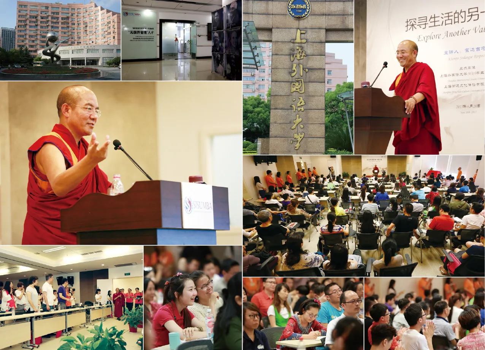
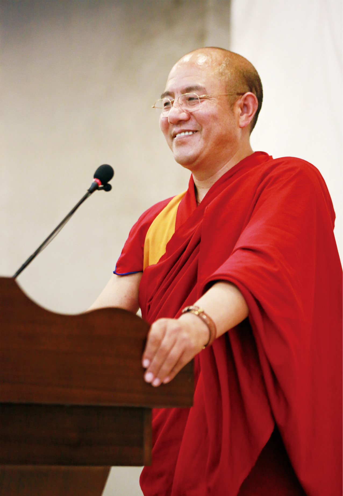
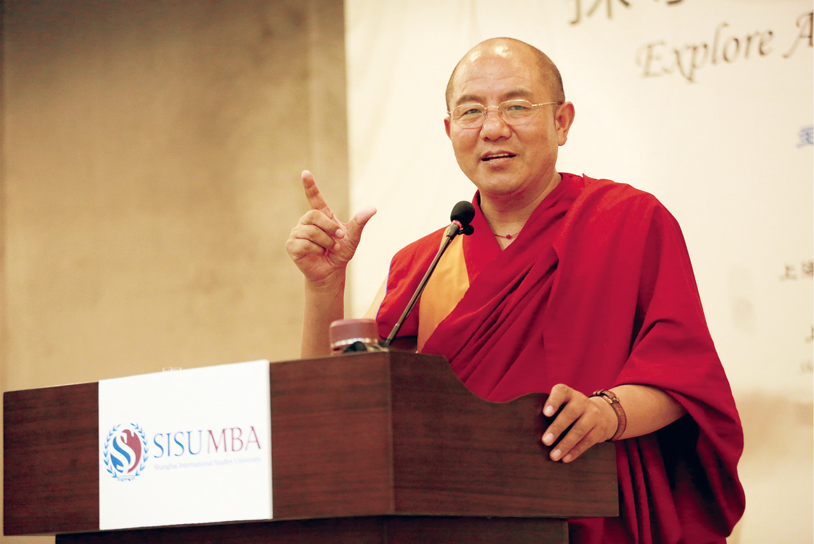
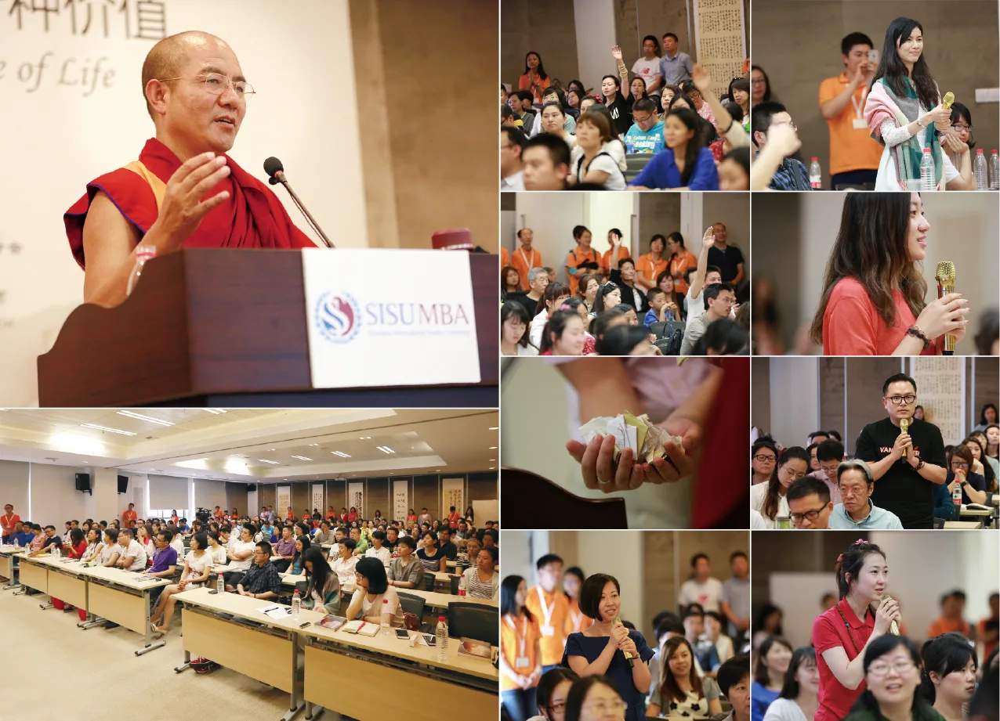
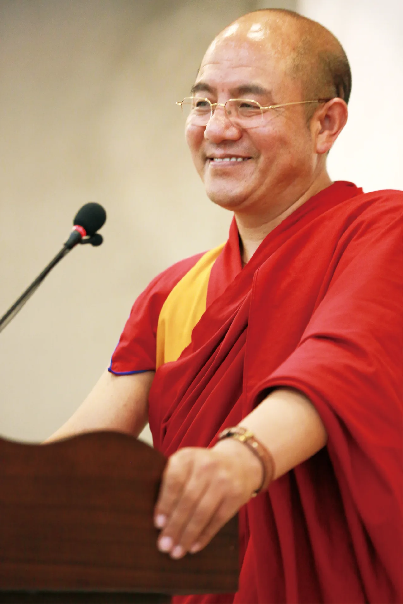
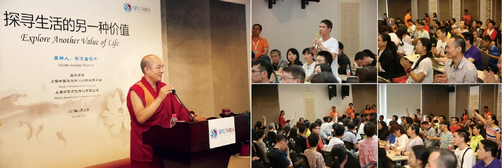

高高在上的，

总有下堕的时候；

相亲相爱的，

总有离别的一天。

第117场

上海外国语大学

Shanghai International Studies University

中国·上海

2015 / 6 / 20

## 探寻生活的另一种价值

## What do You Live For？

主持人：

各位上外及其他院校的同学们，大家好！非常荣幸能请到藏传佛教的高僧大德索达吉堪布为我们演讲。

刚刚堪布说想做一点调整，在演讲开始之前，大家有没有什么特别想问的问题，不管跟今天的主题是否相关，都可以提出来。非常简短的那种，有吗？

堪布：

你们尽量简短地问，我也尽量简短地答。

## 快问快答

观众：我这两天正好就在想一个问题，“古来圣贤多寂寞”，这句话您认同吗？

堪布：某种意义上，我认同。因为最究竟的境界，的确没有言辞可表达。

观众：那要怎样融入现实生活呢？一边保持内心的寂寞，一边生活，这中间是否要做一些调整？

堪布：需要智慧。

观众：现在社会上信佛的人越来越多了，有明星也有黑社会，当然还有我们这些普通人。我想问的是，不管什么人学佛，要做到最基础、最起码的一点，您觉得是什么？

堪布：行持十善。

观众：今天的主题是“探寻生活的另一种价值”，而冥想就是一种探索生命价值的方式。我想请问，以您的经历来说，在世俗中修行的人应该怎样冥想，才能让生活更有品质？

堪布：生活的品质有很多种标准，但我觉得内观自心，发掘它的本质和价值，是最有意义的。

观众：学佛之前，我们有很多贪嗔痴；学佛之后，发现自己和身边的道友也还是有很多贪嗔痴。想请上师开示，在追寻佛法的路上，我们该怎样戒贪嗔痴呢？

堪布：贪嗔痴即是烦恼，烦恼即是菩提。通过修行现前菩提，是最好的方法。

观众：怎样才能获得闻慧、思慧和修慧？

堪布：闻、思、修，首先听闻，然后思考、辩论，再不断串习。这三种智慧要经过长期磨炼才能获得。

主持人：

谢谢大家的提问！

今天我们的主题是“探寻生活的另一种价值”。我想先问大家一个问题：生活的价值是什么？

可能有人会说：“活着就是要追求幸福。”那幸福又是什么？是吃大餐、穿名牌，还是住豪宅、开豪车？我想，都不尽然。

“生活”拆开来是两个字，“生”和“活”。到底我们为何而生，又为何而活？

也许大家会说：“哎呀，我们都是成年人了，很多人孩子都有了，难道还不知道自己为何生、为何活？”但我们真的知道吗？

大家可能又会问：“哎，你问了我们这么多，那生活的价值到底是什么？”恕本人惭愧，看了堪布那么多著作和演讲，至今也还在苦苦追寻中。

机会难得，接下来就有请堪布为大家讲一讲，什么是生活的价值。

今天和在座各位探寻生活的另一种价值，我觉得很有意义。

## 生活，是为了生存而活着？

大家也知道，现在很多人都把财富、事业、学习、爱情当作生活的根本。这些是生活吗？也是。因为所谓的“生活”，就是为了生存所进行的各种活动。但这种生活不仅人类有，地球上的很多动物也有，它们为了生存，也要吃东西、干活、学习、繁衍后代……为自身的生存而活着。

我小时候在山上放牛，经常能看到刚出生的小牛。它们从来到这个世间起，日日夜夜都在母亲的精心呵护中，自己也会努力成长，晚上好好睡觉，白天寻找吃的。

这就是动物的“生活”，为了不饿死，能延续后代。但作为更高级的人类，我们的“生活”，是否应该有所不同？

除了赚钱、成家、立业之外，更重要的，我们应该思考人生。但大多数人，可能都没有时间思考。

## 价值观随着时代在变

我已经五十多岁了。回顾过去的生活，不管是外在世界，还是自己内心，都经历了翻天覆地的变化。

就像上海，城市的建筑风格也好，人们的思维方式也好，向前推一百年、两百年、三百年……肯定和现在不一样；往后再过几百年，会变成什么样也很难说。

从一个角度看，生活在高速发展，应该是进步了；但从另一个角度看，却好像一代不如一代，人们的思想变得越来越肤浅、庸俗化。从我们那代人，50后、60后到今天的90后、00后，观念早就变了。

刚才有个70后的知识分子就在跟我讲，他无法接受孩子现在的思维方式。之前送孩子出国留学，原本希望他能有一个开阔的视野和开放的思想，给全家的生活也带来一些提升。但是没想到，孩子回国之后，想法跟自己格格不入，追求所谓的“自由”，想做什么就做什么，不愿被父母、老师管着。有时候想聊聊找工作、找对象的事，但孩子特别反感，说：“按照国外的理念，每个人都有权过自己想要的生活，你们最好不要干涉。我就想活得洒脱、自在，这才是我要的幸福。”于是，他跟孩子之间就发生了极大的矛盾和冲突，甚至不知道这个家将来会变成怎样。

这类问题在今后的生活中，可能会发生得更加频繁和激烈，因为时代变得太快。

几十年前，在我的家乡，人们了解知识主要通过报纸，因为识字的人少，会读报纸算是比较不错的。后来慢慢有了电报、广播、电视、电话。记得一些记载上说，当时国与国之间联系都靠电报，甚至像中美建交之前，相互对话还需要打电报给“第三国”来中转。但现在，电报早就过时了，家家进入网络时代，孩子们接受的知识和教育，不再仅仅来自父母、老师、教科书，他们每天要从手机、电脑上接收全球范围的大量信息，而且一个比一个吸引眼球、震动人心，在这样的教育环境下，他们的想法和心态，跟上个世纪保守、传统的父辈相比，已经截然不同。

## 生活的更高层次

可能你们还不太关注这些，但等以后再关注，也许会不知道该如何应对。所以现在就要思考，尤其要从根本上观察：大家眼下追求的这种“生活”，是不是真正意义上的“生活”。如果仅仅是“为自身的生存而活着”，说实话，这种追求是比较低的。

佛教把修行人分了几种层次：低层的，偏重自我解脱，是小乘；高层的，想让天下无边的众生都获得解脱，是大乘。

我觉得生活也可以分几种层次：比较低层的，只求让自己和家人活下去，包括一些工地的工人、田里的农民、山上的牧民，他们可能没什么文化，靠干体力活养家糊口；比较高层的，有一技之长，掌握了某些科学技术或传统技艺，能让自己和家人衣食无忧；更高层次的，是社会上公认有智慧、有道德的精英人士，他们对“生活”的理解，应该不仅仅是这些。否则，不管哪个层次的人，都只是为了自己和家人而活着，谁又来维护和帮助这个世界？

所以，有些人会为了自己的员工，或者工作涉及的人，成百上千乃至万数，为了他们而活着；有些人则不仅想利益人类，还想利益许许多多的动物，乃至为所有的生命而活着——这样的生活更有价值。

人们总认为，要从外界得到点什么，才活得成功，幸福。但多年的佛法经验告诉我，生活价值并不仅仅体现在自我的成功和幸福上，更体现在对社会和国家做出了怎样的贡献，对提升他人的生活品质做出了怎样的利益。

人活着，如果能帮助别人，就是有意义的，当他离开世间，其他人会记住他，为此而悲痛；如果只是浑浑噩噩、自私自利地活着，给周围造成负面的影响和痛苦，甚至杀害很多的生命，那么他的离开，也许会成为其他生命的“喜讯”。

## 幸福的根本，在心

人人都追求幸福，但幸福到底是什么？就像之前主持人讲的，有钱、有车、有房，样样齐全，事事顺利，这样的日子看起来的确美满。但我们内心的幸福感，到底是这些外在的物质带来的，还是内心的修养带来的？

法国启蒙运动的代表人物伏尔泰就认为，痛苦和快乐跟物质世界有密切的关系。他和其他机械唯物主义思想家异口同声地宣称，幸福来源于外在的物质，因此要大量开发资源，改造世界。在这种思想的驱动下，人们纷纷向外寻求财富，认为有了财富就有了快乐。这股思潮席卷了欧洲乃至整个西方世界，并影响到东方的很多国家。

直到今天，我们中间绝大多数人仍会这样想：“如果给我几百万，肯定乐翻天。”但实际上，当你真的赚到钱，也许刚开始是快乐的，但它很快会变质，麻烦会接踵而至。

大家可以观察一下，那些拥有巨大财富的人，是否也拥有巨大的幸福？这是不一定的。在西方很多发达国家，GDP越来越高，人民越来越富，幸福指数却越来越低。这个结论来自全球范围的调查分析，应该是由很多人经过各方面核实之后得出来的，并不是我这个出家人的信口开河。对此很多人觉得不可思议，钱越多的时候，不是应该越幸福吗？事实恰恰相反，到了一定程度，不但不幸福，还有各种各样的痛苦与日俱增。

可见，钱，或者说外在物质，并不是幸福的根源。它可能会带来短暂的快乐，但幸福的根本，应该是心。只有调伏了内心，才能把握住幸福。

但好像大家都很忙，忙得没时间想这些。其实自己也不知道在忙什么，每天糊里糊涂的，一睁眼就开始操心股票、生意、工作、学业……连早饭都顾不上；到晚上筋疲力尽，睡得像尸体一样。这样一直忙下去，别说梦想了，连梦都做不出来。当然，操心这些不是没有必要，但最重要的，还是应该好好思考人生。

这件事非常有价值。谁都要经历生老病死的种种痛苦，而当你学会思考，也许会得到其他人得不到的快乐。

就像同在一座城市里，大家都去喝咖啡、吃美食、逛街、旅行，你却知道这些并不稳固和长久，知道真正的快乐不依赖于外境，唯一存在于内心。有了这样的心态，当挫败和痛苦出现时，你会比其他人更有面对的勇气和方法。

## 懂得接受无常

现在很多人，平时看起来阳光灿烂，可一旦遭受打击，失恋了、失业了，或者失去健康了，就会感觉霉运当头，变得很脆弱。身体也弱，内心也弱。

如果平时对此有过思考，能及时调整心态，这些打击应该不会阻挡你的前进。很多时候，困境反而是人生中最好的学习机会。

美国巨富洛克菲勒的儿子曾在一次投资中赔了一百多万美金——就像现在的炒股失败，这让他非常沮丧。父亲很有智慧，写了封信鼓励他说，失败是成功的机会，是成功的试验田。还引用《纽约太阳报》对爱迪生的采访来说明：当年那位记者问，对已经失败了一万次的发明怎么看，爱迪生却说：“我不认为这是失败，我不过是换了一万次不同的方法。”他把这当作磨炼和进步。

生活中，肯定会遇到各种各样的困难和痛苦，不可能永远成功、永远富有、永远和家人在一起。就像佛教讲：高际必堕，聚际必散。万法都是无常，高高在上的，总有下堕的时候；相亲相爱的，总有离别的一天。

国家首脑的任期，一般只有几年，顶多十几年。像富兰克林·罗斯福，是美国连任最多的总统，也才当政十二年。其他领导、官员，莫不如此。以前看到，明朝皇帝朱元璋在位长达三十多年，我都觉得惊叹。

在座各位都是高学历的知识分子，这也是一种成功，暂时来说，是站在比较高的台阶上。但走出学校，会不会还有这样的身份和光环？

我们和家人，今天相聚在一起，再过几十年，孩子会长大，老人会死去，他们都会离开，当这一切发生，心中是否做好了准备？

人生并不是一条设计完美的轨道，也不是一张按部就班的图纸。固然要有尽善尽美的规划和梦想，但当你付诸行动，就会发现很多情况并非想象中的样子。

就连梦想也是无常的。做学生的时候，我们会想着什么时候毕业，毕业之后如何创业、成家，过上自己想要的生活。我们抱着美好的希望一直等待，但等到走上社会、组建家庭，我们又会有别的希望。

从懂事开始，到离开人间，谁不是抱着一个又一个希望，拼命追求？就像一场比赛，每个人都在赛道上全速奔跑，追逐着前方的金钱、地位、感情，或者其他各种各样的目标。有的目标很大，要改造全世界；有的目标很小，只想养活自己。

## 很多追求，不一定值得

目标比较小的人，似乎还更容易快乐。就像我家乡的很多打工者，除了挣钱，没什么其他的想法，每天挣个一两百块，就是他最大的追求。看他们在工地上起早贪黑，和着混凝土，全身都是泥，按说是很累的，但晚上经过他们的帐篷，就听到里面在吃饭、打牌，时不时发出一阵大笑，进去一看，桌上摆着几块钱，玩得不亦乐乎。有些时候，还能听到愉快的歌声，我在外面静静“偷听”，心想，他们的日子过得还真不错。

而大城市里那些月薪上万的人，每天想得很多，却好像失去了最简单的快乐。实际上，我们的很多思考并不那么重要，很多追求也不一定值得。人生路上，到底有什么更深的意义和价值，也许迄今你还没有找到答案。

比如读书。按理来讲，人应该爱读书，爱学习，这是一种宝贵的品质。我在一些欧美国家，看到那里的人不管在哪里，公车上、地铁上，手里都会捧一本书，感觉对知识很渴求。但回到国内，却发现很多人不爱读书，不觉得知识是自己的所需，甚至有些地方专门只在“读书日”那天看一看，做个“纪念”，其他时间根本不学习。不知道这样的现象你们这儿有没有。

这是对人生很重要的事，但人们不追求；一些并不重要，或者不现实的事，人们却苦苦营求。

我们要探寻人生的价值，按照佛教的方法，就是闻、思、修。首先通过读书、学习获得知识；然后反反复复地思维、辩论，解除疑惑；最后不断串习、实践。在这个过程中，我们的境界越来越提升，对生活中的很多问题，能慢慢给出答案。

否则，就会有很多不正当的追求。今天这个社会，德行被冷落在一边，聪明却受到热捧，很多人在绞尽脑汁想着，玩什么套路说什么话，才能诱惑人、欺骗人。暂时看来，他们或许得到了一点利益，但能不能笑到最后，很难说。

## “时间”老人的选择

这让我想起了以前看过的一则寓言，特别耐人寻味。

寓言说，有两个人，一个叫“诚信”，一个叫“聪明”，结伴出海，结果途中遇到风暴，两人乘坐的船沉没了。当时救生艇上只有一个位置，“聪明”为了逃生，就把“诚信”推下海，自己坐着救生艇跑了。

“诚信”喝了不少海水，但大难不死，慢慢被海浪推到了一个孤岛上。他在岸边焦急地等待救援，正无可奈何的时候，远方来了一条船，船上挂着一面旗子，写着“快乐”两个字，原来是“快乐”的船。

他拼命喊：“‘快乐’‘快乐’，我是‘诚信’，你可不可以救我？”“快乐”说：“不行不行，我不能救你。我有了诚信，就快乐不起来了，只有狡诈的人才会快乐。”

“快乐”走后不久，“地位”的船来了，“诚信”又大声求救：“‘地位’‘地位’，我是‘诚信’，你可不可以救我？”“地位”说：“不行不行，我不能救你，我有了诚信，地位就保不住了。”

“地位”飞快地跑了。再过一会儿，“竞争”的船来了，“诚信”赶紧大喊：“‘竞争’‘竞争’，我是‘诚信’，你可不可以救我？”“竞争”说：“不行不行，我不能救你，这个时代竞争这么激烈，我如果诚信，还怎么跟人竞争？”说完也离开了。

正当“诚信”快要绝望的时候，“时间”老人来了，把他救到了船上。“诚信”问：“你为什么要救我呢？”“时间”老人说：“诚信所做的一切，时间会看在眼里，时间可以证明诚信的重要啊！”

返回的路上，没想到“聪明”“快乐”“地位”“竞争”的船，早已经翻在了海里。因为没有诚信，聪明会被识破，快乐不会长久，地位会被掀翻，竞争也终归失败。

这则寓言对我们有深刻的启示。很多人的确认为，做人要狡猾一点，活在世间，说话做事都应该有点“聪明”，才能成功，才有前途；而那些老实本分、认真干活的人，会被人瞧不起，会被时代淘汰。我们都被这样的浪潮推到了今天，的确有必要反思，真是这样吗？我们每天追求的生活，真是有价值的吗？跟动物相比，我们高在哪里？跟高尚的人相比，我们又缺了什么？

## “我保证：独立思考”

我想这个时代缺少的，应该是道德教育：如何把人做好。

现在的人越来越没有底线，不受约束，恣意妄为，就像前面提到的年轻人，分不清好坏、善恶、美丑。如果父母告诉他，这是不好的，这是丑恶的，他可能反而认为，父母老了，思想不进步，心态不开放，孤陋寡闻。因为他看到，这些是当今时代最流行、最推崇的东西。

他的反驳有一定道理，我们的思维方式、教育模式的确要与时俱进，以顺应时代的变化。但另一方面，也反映出我们的孩子缺少一种能力：独立思考。

今天的社会越来越呈现出“羊群效应”。一只羊跑了，其他的羊都跟着跑；一个人做了什么，其他人也都跟着做。很少会去思考，这件事到底该不该做。

我看过一个数据，说2014年的时候，全球一半的奢侈品都是中国人购买的。地球上有七十多亿人口，中国人只占不到五分之一，却消费了一半的奢侈品。其实，很多奢侈品都是“中国制造”，运到国外，价格翻了好几倍，又被中国人买回来。真的是我们需要这些吗？实际情况是，很多人的购买理由，只不过是“看到别人买了”。大部分的文化潮流、消费趋势就是这样形成的——缺乏独立思考的跟风盲从。

从学生时代起，就应该培养独立思考的能力。

美国第三任总统托马斯·杰斐逊（Thomas Jefferson, 1743-1826），曾为美国学生写了一段誓词，放在了教科书里。新生开学第一课，孩子们都要这样宣誓：“我保证使用我的批评才能，我保证发展我的独立思想，我保证接受教育，从而使自己能够自作判断。”这三个“保证”，是让孩子们发愿，要带着批评、思考和判断来学习。

当年，中国白话文的倡导者胡适去美国留学，第一次接触到这种教育，感到非常震撼。那些美国孩子，不管是做作业、玩游戏，都会思考“这样做到底好不好”，对生活会有自己的判断。包括藏传佛教的修学中，也有辩论、研讨的传统，而不是盲目地观摩，听老师、父母说什么就是什么。

其实，古代的观摩式教育也不是这样。所以现在的学校有点不伦不类，既不像东方文化重视道德，又不像西方文化重视思维。如此一来，孩子就会有各种各样的想法，甚至不愿意读书，不愿意深入地学习和思考。这对以后的父母来讲，可能会是一种比较大的压力。到底是用自己的方式教孩子，还是让他随大流，跟着学校的方式来？到底学什么才是真正对他有利，也对社会有利的？这些都需要考虑。

除此之外，人生还有一些更重大的问题，大部分人或许一辈子都没有想过，甚至会认为这是迷信、封建、落后的思想，而一味地排斥。比如对佛教中的见解和修行，实际上很多人并不了解，仅仅因为受到的教育，或者听了周围人的言论，就对它不屑一顾，抛诸脑后。但真正的批判精神，应该建立在了解的基础上，在了解之前，任何人都无权轻易下定论。否则，连它错在哪里都不知道，又怎能判它“死刑”呢？

## 随缘、珍惜、知足

在座很多都是风华正茂的年轻人，这是人生最辉煌的阶段，但也可能是最痛苦的阶段，因为都在你追我赶的竞争之中。刚进校门的时候，彼此都差不多，而现在，可能你已经超过了一些人，也有一些人远远超过了你，把你甩在后面。竞争会让我们的心产生攀比，产生傲慢、嫉妒、焦虑等烦恼。此时如果能用上佛教的方法，调整竞争的心态，也许痛苦会少很多。

就像前面提到的奢侈品，其实在国外，很少有人出于攀比去购买那些高端品牌。我曾经看过欧洲的一些报道，在他们看来，为了面子购买超出经济承受能力的奢侈品，是不明智和羞耻的事。他们说：“山鸡即使插上孔雀的羽毛，也不会变成孔雀。”

按照佛教的讲法，就是要随缘。每个人都有自己的福报和因缘，一旦超出这些，就成了奢求。如果要求不那么高，过自己该有的日子，活得不会那么累，心也能得到休息和调整，保持一份平和。这对很多人来讲，是非常重要的。

其实，人往往拥有很多而不自知。一直追求那些没有得到的东西，对已经拥有的，却不知珍惜和满足。

比如问一个盲人最想要什么，他可能说是“光明”；问一个囚犯，他可能说是“自由”；问一个乞丐，他可能说是“食物”；问一个普通的世间人，他可能说是“一辆好车”；问一个修行人，他可能说是“超越的境界”。囚犯拥有盲人最想要的“光明”，看得很清楚，但他不觉得这有什么可贵；乞丐拥有囚犯最想要的“自由”，可以在街头游荡，但他不认为这是什么福利；普通人拥有乞丐最想要的“食物”，很少为一日三餐发愁，但他不会因此而满足。只有修行人是最快乐的，因为在“超越的境界”里，这一切，有也可以，没有也可以。

各位应该感到快乐，因为拥有健康的身体和心态、过得去的家庭，还有文化、知识和信仰，这多么值得高兴；退一万步讲，至少，你没有失去光明、自由，或者沦为流浪汉。这样的幸运，按佛教徒的说法，都是三宝加持；按世间人的说法，就是老天保佑。当你不再只盯着别人有的，也能看到自己有的，就会发现，原来我是如此幸福！

## 封皮再旧，也是本好书

今天我们探寻的是生活的“另一种价值”。对于社会公认的那些“价值”，财富、地位、情感……我们可以去追求，但是不是只有这些能让我们快乐？不见得。在一些更简单、寻常的生活里，你也许能享受到更广阔的快乐和幸福。比如，给自己留点空闲，冲杯咖啡、泡壶绿茶，或者像我们那里的人，阳光下摆摆龙门阵，和好朋友开怀大笑。

尤其要懂得学习的价值，享受读书的快乐。

我看过一个故事，讲欧洲一个叫索伦的孩子，14岁的时候特别不想读书，就逃学了。后来，他在街头遇到一个流浪汉，流浪汉看出他是逃学的学生，就特意接近他，常常和他待在一起。

过了一段时间，流浪汉对索伦说：“我有个很好的东西，想要送给你。”于是把他带到一个图书馆，从书架上抽出一本封皮破破烂烂的书。流浪汉说：“希望你能读读这本书。虽然它的封皮很破，但你不要小看它。”他又指了指自己：“你是不是认为我只是一个流浪汉？”“当然，你过着那么悲惨的生活。”索伦毫不犹豫地说。流浪汉笑了，说：“实际上，我来自全世界最富有的家族之一。虽然我很有钱，但我想体验各种各样的生活，包括做个流浪汉。所以孩子，千万不要以貌取人，就像这本书，虽然看起来不怎么样，但里面蕴含的价值，将是你想象不到的。”

在流浪汉的点拨下，索伦终于有了读书的欲望，从此改变了人生的轨迹。

我们在生活里，也可能会遇到一个像流浪汉那样的人，起初觉得毫不起眼，结果却从他身上学到了很多；也可能会得到一本看似残破的书，起初不屑一顾，结果却影响了你的一生。

我在三十多年前也看到过这样一本书——《大圆满前行引导文》，从此人生有了重要的转折。它并不厚重，但在我心中有着最重的分量。我也把它推荐给了很多人，他们都或多或少从中受到启发，并改变了自己的命运。

所以生活的价值，不一定要多么“高大上”，也不一定是人人都追求的。你需要独立思考，需要用不同的方式来观察，才能收获更大的意义和价值。

## 在古老的智慧里，寻找答案

很多时候，我确实有这样的想法：希望你们能了解一下宗教，了解一下佛教。并不是要你们都去信教，宗教信仰本来就是自由的，而是希望你们能听听佛教到底在讲什么。当你从中学到哪怕一个道理，或许会给你的人生带来奇迹般的转变。当然，这也看缘分，如果完全没有信心，佛法也不可能进入你的内心，影响你的生活。但如果各方面因缘巧合，你会从最初的排斥、怀疑，变成好奇、试探，到一定时候，就能感受到佛教思想的奇妙，感受到人生很多问题，不是单靠物质能解决的，也不是单靠科学能解决的，而要依靠传统文化，特别是一些古老深奥的智慧。

有了这些智慧，虽然表面上看，你的生活和其他人没什么不同，一样有生老病死，一样要经历困苦，但你内在的忍耐力、抗压力，会完全不一样。当你把心培养得足够勇敢和坚强，大自然的风风雨雨、人群中的是是非非、生活中的磕磕绊绊，都不再能令你屈服。你可以活得有滋有味，活出人生的境界。

自己的人生，要自己思考。很多时候，周围人的意见、传统的经验、现代的法则，可能都无能为力，只有依靠自己的智慧和修为，深入思考，才能在很多问题上给出真实的答案。

比如，同一个学校、同一个专业，又是同一个老师教出来的两个人，为什么毕业后却展现出截然不同的命运：一个堕到了地下，一个好上了天；一个只能勉强糊口，一个却事业成功、爱情如意？

这里有一个重要的真相。因为我们不是石头、木头，或者其他什么物质，可以被塑造成同一个形状；我们是有生命的人，每个生命都是在不同善、恶业的感召下，来到这个世界，由此形成了各自的命运。佛教中说，所谓的命运就是“业力”的展现。它是一种无形的力量，虽然看不见摸不着，但我们今生的命运，就是前世的业带来的，今生造的业，又会直接影响来世的命运。这种力量，年轻的时候也许看不出来，但再过十年、二十年、三十年，同学聚会的时候，你们就会有深刻的体会。

这些道理，大多数人都不懂。说实话，每当看到社会上的成功人士，一方面我也随喜他们，有钱、有势、有文化，世间福报还是很不错的；但另一方面，又觉得他们可怜，活得迷迷糊糊，自己的前后世都不知道，算什么成功呢？还有很多人对此抱否定的态度，如果有理有据，否定也是可以的，但他其实并没有思考过。如果连人生的真相都不愿意去思考、去了解，学习再多的科学、技术，又有什么意义呢？

要知道，人类的幸福，并不是由科技决定的，而是掌握科技的人心在起决定性作用。如果人的心不善良，拥有再高的科技，也不会让人类觉得幸福，反而会觉得可怕。大家也看到，核武器的发明，给世界带来了怎样的苦果；利用高科技犯罪的恐怖分子，对社会造成了怎样的伤害。

我们可能会觉得自己很了不起，名牌大学毕业，是硕士、博士、博士后，有各种不错的头衔，但对世间的这些真理，包括心与物质的关系、因果轮回的真相，你去探索、发现、实践过没有？

我们可能会觉得“聪明”很好，但人类不能太聪明了，为了自己、家人或某个团体的利益，肆无忌惮地浪费资源、破坏自然、假冒伪劣、伤害生命、毁坏社会的各个领域……渐渐丧失自己的良知。当人心变得肮脏、丑陋，那些表面的繁花似锦，终究会变得暗淡无光。

不要觉得现在看不出后果，就好像无所谓，跟自己无关。当有一天，厄运现前，疾病缠身，心被各种魔障干扰，你也许会手忙脚乱、怨天尤人的；也许会大难不死、谢天谢地的。生活会变成怎样，只有自己知道。

我们应该反思科学技术所带来的利弊，但更重要的，是反思自己，“我找到人生的真理了吗？找到生活的方向了吗？”

这些与今天的主题，或许有直接的关系，或许没有。我也是忙来忙去，只能想到什么说什么，剩下的，就留给大家来思考吧。

现场互动

问：老师您好，如何看待人生中的“相遇”和“错过”？

堪布：人生当中，有很多“相遇”，也有很多“错过”，如何看待，基于你对生命的了解。

“相遇”是一种缘分。遇到好老师、好同学、好同事，是你的福报和善缘，对人生非常有意义；遇到坏人，则可能是缘分不好，对人生也有负面的影响。前段时间我去监狱，就听一个犯人说：“不知道什么原因，从小到大遇上的都是坏人，我跟他们混在一起，结果下场就成了这样。”

不过，人生难免会有不如意，还是要珍惜现在拥有的，看到这些背后，是很多人在竭力相助。这很重要。

至于“错过”，年轻时候，我就错过了学好普通话和外语的机会，不像你们，可以上这么好的学校。上外是1949年创办的中国第一所外国语大学，听说这里的人英语特别好，对没这种机会的其他人来说，这也是一种错过。

人们都怕错过，企业怕错过商机，孩子怕错过学龄，因为错过了就无法挽回，当然这也靠因缘。但我觉得，错过其他倒无所谓，错过学习，则可能是一生的遗憾。

就我而言，最庆幸是能系统学习佛法。出家的时候，我还年轻，我的上师也正在授课，如果晚几年，即便还有出家的缘分，上师也老了、不在了。到现在，上师已经圆寂十多年，回头看，没错过跟上师学佛的机会，我觉得自己很成功。

但学习世间知识的机会，还是错过了。14岁之前，我一直在放牛，连学一个拼音的机会都没有。我常想，如果当时上了学，后来会怎样？

你想问的具体事情我不太清楚，但就一般而言，只要不错过学习的机会，其他事情错过了，可能也没什么吧。

问：我有两个问题。一是生活中有很多烦恼，通过看书、看佛经，或者听一些教导，也知道烦恼要用智慧来解决，但我的心还是很不定，烦恼很难息灭。可能大家也碰到过这种情况。有没有什么方法，可以快速息灭烦恼，让心安定下来？

还有一个比较具体的问题。我家有只小乌龟，十几年了，一直养在水缸里。它很想往外跑，很向往自由，但我想了好久，要不要把它放生。一方面也是自己的执著或自私，不舍得把它放掉；另一方面它是巴西龟，我怕它在河里养不活。我为这个问题纠结了快一年，到底是把它放归自然，还是应该怎么做？

堪布：怎么十几年都过去了，现在才开始纠结。（众笑）

其实贪嗔痴为主的这些烦恼，人人都有，只不过有人严重有人不严重。要解决它，依靠佛法的智慧很重要。比如对治贪心，可以修空性，剖析人或事物的本体，认识到所贪对境都不真实。康德也说过，人类只知道现象，而根本不了解本质。这句话跟佛法特别契合。佛法讲世俗谛和胜义谛，世俗谛是世间人都能了知的，是诸法的现相；而胜义谛只有诸佛菩萨才了解，其他人不知道，是诸法的实相。

每种烦恼都有对治方法。对治嗔心可以修慈悲心，对治痴心可以修缘起法，等等。虽然一下子断掉有困难，但如果长期闻思，看书、听光盘，自己思维，烦恼会从粗大变得细微，直到彻底根除。从我们自身的修行也可以感知这个过程：没学佛之前，烦恼特别重；学了一段时间之后，烦恼虽然还在，但已经没那么严重了。

至于那只乌龟，我觉得如果把它放生到河里或者其他地方，万一活不下去，也非常可怜。既然它在你家生活了十几年，应该已经习惯了。虽然动物的本能是喜欢自由，有时候它表现得很想出去，这些我们都理解，但能活在世上还是最重要的。放生到哪里才安全呢？好像谁也不敢保证。

问：修行的时候，我口头上发大愿，要利益天下的众生，但心底里，还是很希望自己的亲人、员工、同事好，这样会不会冲突？或者说二者有没有什么关联？

堪布：大乘佛教的发心是要度化无量无边的众生，这是一个大愿，就像企业愿景一样。但在具体行持的过程中，从身边做起是合理的。佛教中修菩提心的基本次第，就是从父母开始，扩大到亲朋好友、周围认识的人，再到南赡部洲、四大部洲，直到三千大千世界的所有众生。根据自己的修行状况，把心逐步扩大。

发愿的时候，是要想着“利益天下的众生”，但如果从素不相识的人，甚至冤家对头开始，不一定能做到。就像一个孩童，想认识世界，应该从家里的东西认起；想学天下的知识，应该从基础学起。

所以你这样想也对，既然发了无上菩提心，那至少先对家人好一点，因为他们是跟你最亲的人。现在很多所谓的大乘佛教徒，跟家人的仇恨特别大，冲突很严重。有些可能是缘分不好，怎么努力也没办法；但有些就是只想着“我要度众生”，却对家人不管不顾。这样做，会给修行带来很多违缘。

希望修大乘佛法的人，能从利益家人开始，但也不能永远停留在这个阶段，对你的员工、同事、所接触到的人，都要尽量帮助，他们跟你有特殊的因缘。然后再到天下的众生，让发心一年比一年扩大。当然，究竟来讲这也不合理，但就初学而言，按照《大圆满心性休息》里菩提心的修法次第，从父母亲人开始修四无量心，最后生起缘一切众生的菩提心，是合理的。

问：如您所说，这是一个物质极大丰富的年代，也是一个精神极度空虚的年代。人们追求精神上的依靠，但在这个过程中也遇到很多问题。有些人被邪教欺骗，误入歧途；有些人找到了正确方向，又受外界影响而舍弃。我的问题是，怎样抉择、判断、建立正确的信念？

堪布：追求精神上的寄托，就像追求物质上的依靠一样，需要认真对待，甚至在某种层面上应该更加重视。如果这样，你就会对所追求的那个宗派、法门或人，预先做很多观察。

当我们寻找物质上的依靠，比如一家公司，会先了解它有没有注册，是不是正规，在什么地方，口碑怎样，年薪多少，能给我什么利益……通过各种渠道去了解，追根问底。

同样，寻找精神上的依靠——宗教、信仰或者善知识，也需要观察，不能盲目。一听说某个教派或修法对自己有利，就慌不择路，急急忙忙、慌慌张张地去供养、依止、修行，过段时间却发现上当受骗，这样没有意义。

当然，如果“仪器”和方式出现偏差，也会导致观察不到位，但它仍是必须的。就像对物质上的依靠，我们会有最好的梦想和最坏的打算；对精神上的导师或皈依处，也要准备好这样的心态，才有可能真正入道，获得心灵问题的解决方法。在那么多方法中选择一种，依此修行，你不会像从前那样空虚、无聊，会生活得充实、圆满。

物质要发展、进步，但精神不能一直下滑、倒退。否则，不成熟的思想很容易被物质所奴役，由此感受极大的痛苦。当你有一天离开人间，却发现无论对家人还是世界，都没做出什么贡献，会留下很多遗憾。

所以，哪怕在小事上，也要关心身边的人。除了物质，还要寻求精神、艺术、宗教上的依靠。这会让生命更有意义。

问：我们处在一个性开放的年代，同时离婚率也比较高。请问您怎么看待这二者之间的联系？您觉得婚姻的本质是什么？

堪布：这是一个无法阻挡的现实。网络时代的知识和教育，很多都不是来自父母和老师，全世界的信息在互联网上传递，我们就生活在这样的虚空中，生活观念和行为，已经有了很大变化。

佛教中有一个叫“邪淫”的观念：跟自己丈夫或妻子之外的人发生关系，是一种罪业。但这个年代的道德观比较缺失，人们基本不受约束，邪淫越来越重，离婚率一年比一年高。听说北京的离婚率已经超过百分之四十，我问过一些北京人，有没有那么严重，他们说：“差不多，我身边的人都快离完了。”

作为出家人，我可能关心得过头了，但不管怎样，还是要了解一点。我也问过一些西方国家的人，他们的情况一样，甚至更糟糕。因为西方国家依靠法制，很多关系是合法的，观念比中国更开放。现在大家都在学西方，这些观念对家庭带来的冲击和危害，也许将来会更加显露。

有时候看到校园里的孩子，我都在想：“他们的父母离婚了吗？”婚姻问题成了全球性的趋势，这是众生的一种业力。

不过在佛教看来，夫妻是市场上的过客。就像两个商人，偶尔相遇，做个买卖，然后分手。分离是必然的，只不过有些死去而离，有些活着而离，所以，在一起不要天天吵架，离开了不要太执著。

其实现在很多年轻人，也会签订合约、登记财产，在结婚的那天，就为离婚做好准备，他们可能比较有“修行”。婚姻的本质就是如此，聚际必散。分离随时会发生，但很多人无法面对，为了感情、孩子，连最宝贵的生命都可以不要。

所以，这个快速变化的时代，更需要佛教的无常观。刚才听人说，以前我熟悉的一对夫妻，原本非常美满，现在也离婚了，我就说：“无常无常。”在面对家庭和婚姻问题时，这种观念的确特别实用。

问：我有两个问题，第一个是，对于我们在生活、事业上设立的目标，往往感觉努力了，但总是达不到。佛教说“制心一处，无事不办”，怎样能让心达成所愿？

另一个就是，我曾在半年前梦见您，这个梦很清晰，您笑着说：“早点睡觉。”但我到现在还没弄明白，想知道这句话背后更深层的用意。

堪布：生活中的目标多种多样。有些目标定得太高了，无法实现，就像跳高运动员，如果杆放得太高，他的体能达不到，就跳不过去；有些目标在实现之前，会遇到很多困难，经历很多弯路，中途容易放弃。

因此首先要观察，这个目标是否有可能实现，否则再怎么努力，也很难达到。而一旦确定了目标，就要尽量坚持。

佛教中也有很多目标。有些修行人的誓愿非常远大：成佛度众生。这是一个终极目标，生生世世他都会为之努力——今生没有完成，来世，来世没有完成，再下一世。

但我们很多人不是这样。往往发愿的时候比较激动，信誓旦旦地说：“我一定要做成这件事！”做的时候却不够努力，时间一长，热度就慢慢退下来。

因为不清楚你的目标是什么，所以我的回答大概是这样。

至于第二个问题，你说梦见我要你早点睡觉，那不知道你做到了没有。

我自己睡得比较晚，但讲课的时候经常教大家早睡，因为看过一些中医、养生方面的书，说至少保证十一点前入睡，对身体、气脉比较好。因为十一点到三点，是人体休养的黄金时段。

佛教中也这么认为。《毗奈耶经》《长阿含经》等经典都讲到，应当初夜、后夜用功，中夜睡觉。

所以早睡是很好的。但如果比较懒惰，早早睡了，第二天很晚也不起来，就不太好。早睡早起，晚睡晚起，如果你能做到早睡，希望你也能早一点起来。

问：听讲的过程中，我粗浅理解到，从根本上影响我们的，是业力。我们可以做一些事，减轻这种业力。又考虑到俗世生活中，工作、学习的任务很重，可不可以请您分享一个我们能做的事情，让每天活得有点力气。

堪布：我们在生活中，无论是工作、学习，都要面对各种各样的问题。这些问题，有的很重要，有的没那么重要，大多数时间，其实都在无意义中度过。比如聊天，讲一些无意义的话；或者做一些不但无意义，还让其他众生不快乐的事。但生活就是这么无奈，我们往往观察不到，无法从中跳脱出来。

应该怎么生活呢？首先要有选择，不能什么都做，那会让自己很累。在“多”和“少”的把握上，如果只是为了自己小范围的利益，可以做得少一点，休息一下也好；如果是为了身边更多人的利益，可以做得多一点，累一点也值得。

在生活的同时，还可以有一些修行。修一个简单的法，来消除业力，或者让它变成顺缘。我希望大家多念“嗡玛呢巴美吽”，这个咒语很重要，也非常简便易行。

当然，如果你对它完全不信，不一定能感受到利益。就像病人对医生开的药没有信心，甚至反感、不想吃，不可能有疗效。但如果稍微明白其中的道理，无论工作再忙、生活再困难，你都可以念。其中的功德、利益，因为时间关系我先不讲，但对我们的将来，乃至生生世世，确实会有很大的帮助。

甚至可以逆转恶缘。我们在今生或前世，难免做过坏事，产生过不好的因缘，这些都留存在自己的心相续里，通过念诵咒语，能得以清净和根除。为了遣除恶业而念咒，本身也非常有功德。

这个方法很适合世间生活，上班、在家，甚至一边炒菜都可以念咒。藏族有一个很好的习惯，会把佛法修行用在日常生活中，而不需要单独辟出一段时间，“今天是星期天，我可以修行了。”不是这样。

我读小学的时候，住在一个老喇嘛那里，他从早到晚都在念“嗡玛呢巴美吽”。早上念着“嗡玛呢巴美吽”醒来，晚上念着“嗡玛呢巴美吽”睡下，中间有一点点空，哪怕吃饭的时候，咽下一口糌粑，他都会念几遍咒。修行就是他的生活。

这样的人在藏地特别多。但我们很多人会抱怨，“现在忙得很，没有时间修行怎么办？”这是佛法跟生活脱离了。一开始“修行”，就跟家人断绝关系，关门、关手机……这样可能反而带来麻烦，他们会疑惑，“你干吗要这样？”

昨天就有人说，本来想用电脑上网学习佛法，结果家人不理解、不支持：“不准看那些迷信的东西！”他也只好规规矩矩地下线、关机。

总之，每个人都要面对各种问题，如果能修一个简单而有甚深意义的法，并融入日常，生活和修行会一举两得。

问：我有两个问题，第一个问题是，马上就要毕业，不知道该找个怎样的工作。我学佛有一段时间了，本来想找弘法利生的工作，但是找不到，其他工作又感觉蛮造业的。如果想造业少一点，学佛的时间多一点，钱就会比较少；如果想钱多一点，学佛的时间就比较少，造业也可能多一点。我该找个空闲的工作，还是钱多的工作？

第二个问题是，我很着急，看到身边一些众生蛮可怜的，就特别想去帮助，想去禁止他们的一些恶行。虽然我一直在陪伴，在努力，但可能就像小学生想上大学一样，总是无能为力。师兄们也说，我现在还没有帮助别人的能力，应该先禁止自己的恶行，在这之前，暂时远离恶友，比较有利于修行。我也知道要先修自己，再度众生，有这样一个次第，但还是太执著了，特别着急。这个烦恼很重，我该怎么去调节？

堪布：你想找的弘法利生的工作，我们那边有一个，叫“弘法部”。你去当部长也可以，但是工资比较少。（众笑）

当你有了信仰，生活中暂时是会有一些矛盾纠结。因为之前不懂因果取舍，只要能赚钱，干什么都可以，这也是很多人的想法；学佛之后，懂了一点因果，知道了前生后世，自然会关心做什么可以不造业，要面临抉择。

不过，完全不造业的工作是没有的，很多大德也这样讲。但最起码，不要做跟杀生直接有关的事，不要造杀业，因为危害众生的生命最可怕。其他工作也可能会有不那么如法的地方，会夹杂恶业，但这是大环境使然，想改变也没有办法，只能看情况，尽量避免。

找工作的时候也不要太贪了，像人们说的，眼高手低。现在有些毕业生，不愿意多干活，却想在短时间内挣很多钱。这种心态在哪里都有：内地、香港以及国外。像在美国，年轻人就更想当老板，不想当员工；想当高管，拿高薪，不想从基层踏踏实实做起。其实这并不现实，看看世间的成功人士，谁都经历过风风雨雨，谁也不是一步登天。

所以，刚开始挣多挣少没关系，只要是自己感兴趣的，或者可靠、有意义的，做起来应该会开心，福报也会慢慢积累起来。这些跟前世的因缘也有关，不完全是你想的那样。

而且，作为一个新人，不要懒惰，在哪个公司、团体中，都应该多做一点。虽然表面上看，领导、同事对你都很好，但实际上，他们一直在观察，看你会不会说话、办事，是否踏实、努力，对公司有没有价值，就像警察时刻监督着犯人。你做得不好，他们会在背后评论的。

包括出家人中间也会这样。那天我跟一个出家人说：“听说你最近念经念得很不错。”他说：“你怎么知道？”我说：“你身边的人，其实都是‘警察’，都在监督你。看你有没有念经、有没有睡懒觉、有没有什么过失……”

所以，在任何一个社会群体中，都会有很多双眼睛在看着你。不要嫌活累，嫌钱少，总是跟人攀比：“为什么我比他辛苦，却没他拿得多？”应该让自己踏实下来。这是重要的锻炼，过了十年、二十年，回头看，你可能会发现自己犯了很多错误，但已经没办法重来。

人生往往如此，年轻的时候，对周围有各种批判，对将来有美好的梦想，但缺少经验，不知道该怎样去做、去实现；等到成熟之后，经验丰富了，却也许没了当年的热情和机会。时间会检验一切。

然后第二个问题，你的发心是很好的，的确应该帮助别人，只是心不能太急了。我们帮不了所有人，也做不了所有事，要随因缘，哪怕能帮到一个人，能做到一点点，都可以。毕竟能力、因缘是有限的，如果太着急，可能会乱，会事与愿违。

这就像很多佛教徒的家庭矛盾。比如家里一个人学佛，另一个人不学佛，学佛的人说：“佛法那么好，你为什么不学？”不学佛的人说：“你那些东西有什么好，干吗要学？”都想把对方拉入自己的精神领域，这其实是很困难的。用世间的话讲，应该求同存异，才能避免冲突。如果对方能接受，劝劝也可以；如果不能接受，还得尊重他的自由。

每个众生的因缘不同，强求不来。互相留一点空间，才能制造好的氛围。

问：今天很开心听到您的分享，非常感恩您。我有两个问题想请教：第一个问题是，您平时是如何修行的？第二个问题是，我们作为凡夫俗子，应该如何修行？

堪布：我在学院几乎每天都要讲课，出去也会讲一些课，跟人交流，我把这些当作重要的修行。同时早上起来、晚上睡前会有一些念诵，我的修行大概是这样。

作为凡夫俗子，我们可以根据所学的法门选择相应的修行。比如学汉传净土法门的，会常念“阿弥陀佛”，修往生极乐世界的四种因；学藏传佛教的，不同宗派也有不同的修法仪轨。但最关键的是：修出离心，想要从三界轮回中获得解脱；修菩提心，这是大乘佛教的核心意义；修无我智慧，也就是万法空性。三者之间是次第性的，需要系统闻思，明白道理，并依靠上师窍诀来修持。这样逐渐就能找到真正的解脱之路。

问：我见过您三次，得受了您的三次开示。第一次，您说每个人都要做一件弘法利生的事，我思考了半年，怎么弘法，怎么利生。第二次是在学院，您说，像上海这样大城市的人很可怜，要面对食品安全的问题，如果有机会、有能力，可以在这方面做点什么。于是这一年，我放下了之前的一些工作，全身心推动有机素食的项目，前面思考的弘法利生似乎有了切入点。第三次就是今天，您说遇到违缘、不开心的时候，要坚持，“烦恼即菩提”。您说的这三句话，非常激励我。

我的第一个问题是，希望您能对有机素食、食品安全做一点开示，特别是在上海，您也看到它这样的灯红酒绿、充满欲望，这个问题对生活在这里的人来说尤为重要。第二个问题是，我最近有机缘了解鸠摩罗什大师，他是一个伟大的译者，把佛法传到了中土；而您也是一位伟大的译者，在当代，在今生，给我们带来了另外一种价值。想知道您作为一个把藏传佛教推广到汉地的译者，对自己会有怎样的评价？

堪布：第一个问题，在食品安全方面做一点事，以及推广素食，应该是很好的。

现在食品安全问题越来越严重，尤其是肉食的危险性很大。我在一些欧美国家认识的留学生，很多都说不想回来，问他们为什么，说是对国内的食品有点害怕。虽然回国发展很有希望，但是感觉国外的食品安全一点，宁可打工也要待着。

这也有他们的道理，不过我想，如果整个国家在反贪等各方面控制得比较好，将来的情况也许会慢慢好转，不一定那么严重。尤其是大乘佛教的思想理念，如果能在社会上得到推广，很多人不再只想着自己的工厂如何盈利、自己如何吃得安全，更会想到身边人的利益，到那个时候，吃什么都会有一种安全感。

素食方面，我也一直在提倡，希望开素食店的人越多越好。听说杭州有二十多家素食店，上海这边也不少。头两年，很多素食店经常赔钱，但慢慢就热起来，因为选择素食的人越来越多了。这其中有一些佛教徒，也有一些完全没有信仰的人，他们是从医学和养生的角度，认为素食对身体健康有重要意义。以后我们可以通过各种方式，把素食这种清净的食物推广开来。这样做，一方面能减少威胁众生生命的灾难，一方面可以延长人类在这个世间的寿命，有很多利益，希望大家竭力支持。

第二个问题。鸠摩罗什是一个非常伟大的历史人物、一个伟大的翻译家，他翻译出来的经论，有相当大的加持力。其实作为一个译者，他的成就一方面与翻译的质量、风格有关，包括精准性、正确性等等；另一方面，如果他的修行很了不起，有佛教中一些超越的境界，所翻译的作品也会流传百世，这是毫无疑问的。

至于我，就算不上什么。2006年，一个杭州记者问我：“你翻译那么多，到底是什么目的？”我说只是爱好而已。确实，我对翻译的这种爱好和精神，自己也觉得还可以，每年翻译一两本书，坚持了这么多年。以后如果没有遇到特别大的违缘，我还会继续翻译，能活多久就译多少，尽量多译一点，也许对这个时代的人有帮助。不过我考虑更多的还是下一个时代的众生，因为汉地的人这么多，而藏传佛教不管从修行的次第还是传承的加持方面，都有一些非常好的论著，如果译成汉文，将来有一部分人也会得到利益。

所以不管再累，我还是不断坚持。有时候也想，像我这么忙的人，翻译工作可以一直不停，如果要对自己做个评价，这种精神还算可以。但从境界上讲，就没什么了，非常普通。

不过有些人，活着的时候默默无闻，一旦离开世间，可能会更出名。因为在世的时候，很多人出于嫉妒等各种各样的心态，不一定看重他，等他离开人间，反而重视起来。但下个时代的事我也管不上，至少现在的心是很清净的，从没想过靠翻译出名。其实靠翻译是很难出名的，直接写一本还容易些。

像今天发给你们的书，就是我的作品，是在各个大学演讲的一些精华部分的整理，送给大家。虽然不完全是我执笔，但内容的确是我的，因为每场演讲都是用自己的思维讲出来，就像今天这样，并没有让人提前准备什么讲稿。藏传佛教中很多上师也是，讲完课，弟子在旁边记下来，整理成文字。所以我想这本书可以算是我的作品，里面没有什么其他人的语言，都有录音可以对照，事后我只稍微做过一些调整和校对。不管讲得好不好，都是自己的思想和智慧。

但翻译就不像这样，每次挑一本很珍贵的书，花很长时间逐字逐句地译出来，但大家感觉好像无所谓：“哦，你又翻译出来一本啊。”我们学院里的有些人都烦了：“你每年一本接一本地出，我们连放的地方都没有，是不是太多了。”（众笑）

如果是为了名闻利养，我不一定这么做。但的确因为知道藏传佛教的价值，每当看到一个非常殊胜的法，就特别想译出来。汉族人那么多，其中也有喜欢看书、求知的人，我觉得这样做，也许会有一点意义。

至于结果，自己也不好评价什么，但其他人、后来人自然会评价的。也许是好评，也许是差评，不管怎样，在这个过程中，我的心是清净的，也付出了一些心血，在尽力而为。翻译还是很动脑筋的，每一个字、每一句话，要进入作者的内心，把他的思想和境界用另一种语言方式表达出来，并不容易。

问：《金刚经》里有一句话，“应无所住而生其心”，我想请您用通俗的语言来解释一下，以及它对现代生活有什么启示。

堪布：六祖惠能大师曾经以砍柴为生，有次去卖柴，刚好听见一个人在念《金刚经》，听到这句话的时候，他当下获得了一种开悟。所以在佛教中，“应无所住而生其心”是一句非常重要的话。

它的含义，有人在不同场合问过，我也做过解释。“应无所住”讲心的空性，“而生其心”讲心的光明，意思是说，心的本体在空性方面一无所得，在光明方面真实存在，明明清清、无可动摇，它是明空无二的。这也是佛教第二转法轮和第三转法轮的基本思想和意义。

用通俗的语言来讲，当你真实开悟的时候，证得的不仅仅是一个空性，这种空性跟光明如来藏无二无别。懂得这样的意义，才能获得佛教最高的证悟境界。

问：佛教讲人人本具佛性，佛性是自性清净的，但后来又有无明生起，导致佛性被遮障。我很想知道这个无明究竟是怎么回事，佛性既然是清净的，怎么会有无明生出来？

堪布：这个问题跟上一个问题比较类似。无明不是心的本性，它是忽然产生的，就像虚空中的乌云一样；但乌云不是虚空的本性，所以它还会消失。同样的道理，心的本来面目是光明和空性无二无别，刚才讲“应无所住而生其心”，心的本性是明空无二的。在这样的本性上面，依靠众生的因缘，会忽然产生烦恼障和所知障，但这些并不是本性，所以还会离开。一旦它们离开，就像水银消毒以后不会再有毒性，这些障碍也不会再出现，此时就获得了佛或菩萨的果位。

实际上，烦恼和障碍的本体，就是空性和光明，否则，一定会跟佛性形成遮障和对立。但并不是这样，所以众生可以通过修行积资净障，显露佛性。

主持人：

今天这个机会非常难得，感谢堪布跟大家分享了这么多关于生活另一种价值的探寻！我也希望大家回去之后，多从自己的内心思索，生活的本质到底是什么？接下来请大家起立，我们先恭送堪布离场。
