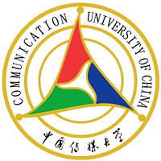
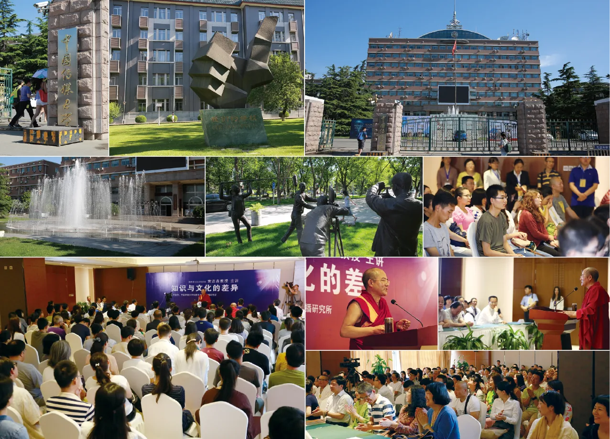
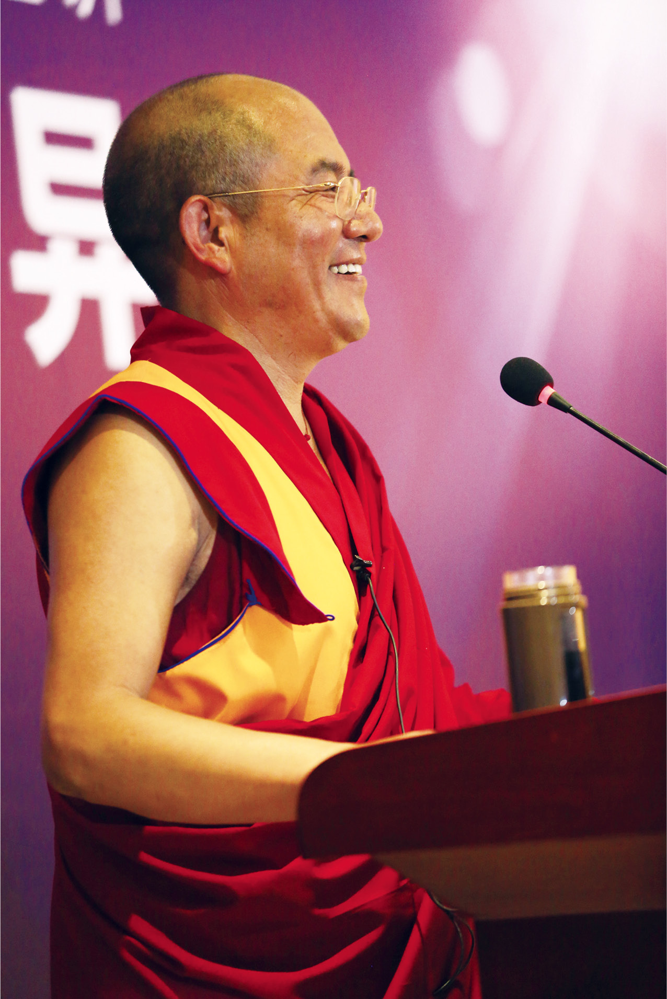
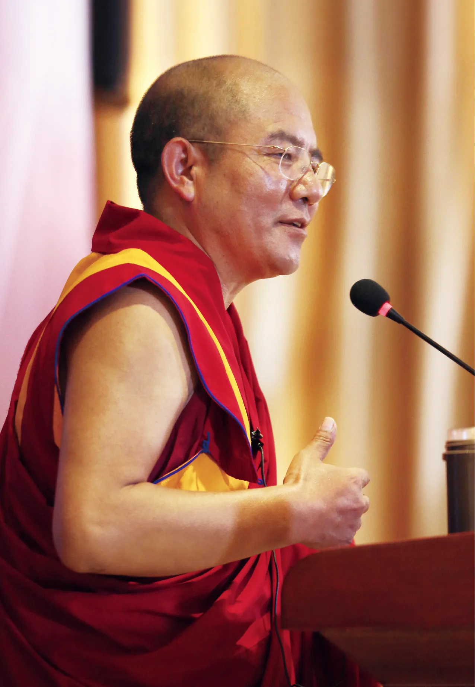

一个人可以学到很多知识，

但不一定就有文化。

第113场

中国传媒大学

Communication University of China

中国·北京

2015 / 6 / 7

## 知识与文化的差异

## Knowledge VS. Wisdom

主持人：

尊敬的索达吉堪布，各位嘉宾、朋友、老师、同学们，大家上午好！我是中国传媒大学宗教学与文化传播研究所的所长。

首先，我想先向大家介绍一首歌的几句歌词：

巍巍雄壮的雪山是我修行的地方，

茫茫无边的红尘是我抛弃的故乡，

常常慈悲的恩师是我永远的怙主，

深深密传的窍诀是我生生的珍宝，

满山鲜花的色达是我修行的圣地，

牛羊肥壮的雪域是我学密的地方……

这首歌曲的名字叫《修行之歌》，由索达吉堪布作词。堪布是四川甘孜炉霍人，生于1962年，今年是他出家的第三十年。作为四川喇荣五明佛学院的大堪布，索达吉堪布在过去的三十年中，弘法利生，饶益有情，注重教学，硕果累累——《显密宝库》《妙法宝库》《智悲宝库》为世人所关注。同时，堪布可谓足迹遍寰宇，法音响天下。

大家知道，藏文化从十一世纪开始向东传播，十三世纪达到一个高潮。进入二十一世纪后，作为给中华民族带来殊荣的藏文化载体，因应时代的需要，藏文化寻求传播的新方式、新途径，继续影响并改变着人类思想文化的进程，这也显示出藏文化伟大的生命力。索达吉堪布身体力行，是推动汉藏传统文化继承与弘扬的杰出代表。他发起的世界青年佛学研讨会、“启动爱心”的活动倡议、已付诸实施的善行等等，则是一个又一个的亮点。

作为本次讲座的学术支持单位，中国传媒大学宗教学与文化传播研究所成立于2010年。这个研究所主要是研究佛教、基督教、道教、巴哈伊教等宗教，力图创作并开发相关文化产品，努力推动传媒大学宗教学学科的发展，推动宗教文化的发展与繁荣，加强与学术界、宗教界、传媒界的学术交流，开展项目合作，增进了解，广结良缘。

下面欢迎索达吉堪布为我们开示——

尊敬的所长、各位老师和同学们：

大家好！很荣幸能来到传媒大学宗教研究所与大家一起交流。我先和大家分享一些我的观点和建议，之后也欢迎大家给我提出一些指点、批评。

现代人的思想和前人非常不同。以前的交通、信息都比较闭塞，人与人之间、民族之间、国家之间的信息往来并不是非常便利，但在二十一世纪的今天，我们则处于一个信息爆炸的时代。我们每天接收到的信息非常多，导致我们所要面对的问题、痛苦也越来越多。面对这样一个新的挑战，我们需要有效的应对方法，而人与人之间的互动、互信、互相学习不可缺少。因此，今天能与大家沟通，互相学习，我发自内心地欢喜。

我对“知识与文化的差异”有过很多思考，不过这几天刚从海拔四千多米的地方来到北京，我好像还有点低原醉氧，也许很多内容不能清楚地表达出来，但无论如何，我们今天可以一起思考。

## 知识不同于文化

我们经常听到人们这样评价别人：这个人的知识面特别广，是个文化人……绝大多数时候，人们都认为知识和文化是一个意思，但其实这两个词并不完全一样。从我的理解来看，所谓的文化，往往是传统积累的结果。从历史上来看，我们的民族文化、宗教文化乃至整个传统文化等等，都是历史延续的结果。也正因为如此，文化往往保存在人们的血液中，融入生活的方方面面，甚至体现在穿着上。

在日常生活里，人们的确会在一些场合里，用“文化”代替“知识”。拿我自己来举例：我的父母不识字，既不认识藏文，也不认识汉文，所以我经常跟别人说，我的父母没文化。但实际上，我的父母是有文化的，因为你能从他们身上清楚地看到藏民族的文化气息——他们穿着藏族的服装，讲着藏语，信仰着藏传佛教等等。他们身上的这些藏民族文化特色从没改变过。

很多人都混淆了“文化”和“知识”，认为有知识就是有文化，但这两者并不完全相同。“知识”这个词在藏文中叫“希夏”，就是所了知的东西。这样看的话，知识又可以分为科学知识、技术知识、历史知识、宗教知识、人文知识以及传媒大学所擅长的媒体知识等等。一个人可以学到很多知识，但不一定就有文化。现在人们经常讲，某某人是知识分子，因为他在学校里读完了本科、硕士、博士，甚至已经成了博士生导师。但他是不是有文化的人呢？很难说。比如，一个汉族人广闻博学、知识丰富，但对汉族五千年来的传统文化一窍不通，那他未必是一个有文化的人。

## 文化无处不在，无所不包

文化可以体现在我们生活的方方面面。在来传媒大学的车上，有人给我倒了一杯茶，从倒茶这件事情上就可以体现出各地的文化。汉族人讲“茶满欺人，酒满敬人”，茶倒得太满就是欺负人，而酒倒满了是尊敬对方。藏族人讲“茶不满，心不满”，茶一定要给客人倒满，否则就是不满客人的心愿。你看，各地的文化能体现在当地人生活的方方面面，虽然看似不同，但都有各自的价值。

文化也体现在诗歌里。拿藏族为例，六世达赖喇嘛仓央嘉措的情歌非常著名。他的情歌表面上看似讲述情节曲折的浪漫爱情，内在却包含了藏族人的生活传统以及佛教的很多思想，甚至是一些不能随意公开的甚深佛法教义。可见文化真的深入到人们生活的方方面面。

## 不要捡了芝麻，丢了西瓜

知识固然重要，否则我们将在这个信息时代里寸步难行，但与此同时，我们更要重视传统文化。其实，当今社会的很多知识都呈现碎片化，没有形成真正的文化体系，甚至可能永远都不会形成。以传媒为例，虽然新闻、影视、动漫等传媒技术能针对人们不同的兴趣爱好，为人们带来直接或者间接的快乐，满足人们的感官需求，但它们在十年、二十年乃至一百年后，会不会形成一种真正的民族文化呢？这真的很难说。

现在高校里的年轻人非常重视知识积累，可能早就把传统文化抛诸脑后了。也许有些传统文化在当代社会没有太大意义，抛弃了也就算了，但对于那些对生命有意义的传统文化，我们不但不能抛弃，还应该想尽办法保存下来，传承下去。

我们来到这个世界时，已经有很多优秀的传统由于种种原因而断代，这对我们自己和后代都无疑是一种巨大的损失，更是文化灾难，但还有一些传统，如果不立刻加以保护，则很可能断在我们的手里。因此，每个人都有责任去继承、恢复优秀的传统文化。

我经常对一些藏族的老师和同学们讲，现在的年轻人很喜欢西方的影视剧，变得越来越像西方人，甚至追求美容、整容，同时却丢掉了藏族的传统。年轻人跟老年人的爱好不同是正常现象，但我们每个人都应该反思一下，年轻人为了追逐新的乐趣、新的时髦，放弃自己老祖宗的珍贵“传家宝”，是不是值得呢？会不会成为历史的罪人？

在座各位应该都不缺知识，但缺不缺文化则不一定。有些人精通多种语言，精通电脑中各式各样的软件，但却不一定有文化。前段时间有一则新闻说，在一架刚着陆的航班里，当大家在下飞机的时候，有两个人因为踩到脚而吵架。她们先用中文吵，然后又用日语、法语、英语吵，从飞机上一直吵到候机大厅，丝毫不顾及周围人的目光。最后在工作人员的劝阻下，双方才停止争吵。可见，她们都很有知识，懂得这么多种语言，但她们有没有文化修养呢？很难说。一般来讲，有文化的人不会在公共场合中影响周围人的情绪，也不会过于斤斤计较。

## “他为什么那么聪明？”

我们只要仔细观察就不难发现，很多人都把时间浪费在没有意义的事上。现在有很多人都得了“低头症”，不管是坐火车还是飞机，但凡有时间，就是在看手机。但手机里的内容能不能提高我们的文化修养，为我们带来真实的快乐呢？不一定。我们无非是留意到这个人发了什么朋友圈，那个人发了什么微博等等，看来看去只会让自己心累。虽然也有人自得其乐，但从长远来看，这种生活不一定能为自己的生命带来真实利益。

尼采（Friedrich Nietzsche, 1844-1900）写过一篇文章叫《我为什么这么聪明》[^1]（Why I Am So Clever），他说：“我从来没有思考过那些不是真正问题的问题。我从来没有浪费过我的力量。”因为尼采懂得什么对人生有意义，懂得虚度光阴只会浪费自己的生命，所以他非常珍惜自己的时间，只学习有用的知识，不会浪费时间在那些对自己没什么用处的内容上。

## 学习也要有选择

现在网上也好、书店里也好，都有特别多的书，但真正有价值的书可能只是其中一小部分。大部分的作者在写书时都抱有商业目的，为了引起我们的兴趣，他们不仅竭尽所能地宣传自己的书，还会投机地说出各种相应我们喜好的语言。但这些书真的对我们有益吗？也许暂时能起到“心灵鸡汤”的作用，但从最究竟上来说，不一定有意义。

我曾经看过一本书，里面提到，市面上近一半的书都没什么价值，虽然有些畅销书当前非常流行，但一般要十年后才能看出它是否真的对社会和人心有意义。所以，我们一定要用智慧来选择要阅读的书籍。

我自己特别喜欢看古大德——包括禅宗、密宗以及各宗派大师们的著作。因为这些著作已经流传了几百年，甚至上千年，它们的价值经受住了时间的考验。用佛教的话来讲，这叫做金刚语。这种语言有直接、间接、暗示等多层意义，不同的人可以得到不同的利益。像这样的书，就非常值得我们去学习。

大家可以去了解一下藏传佛教里的“五部大论”，其中包括了戒律、中观、般若、因明、俱舍等五类系统，就像世间大学里面的哲学系、宗教系、新闻系等不同学科体系一样。按藏传佛教寺院的传统来讲，这五部大论一般要花十六七年才能学完。如果能坚持研究五部大论的内容，你的心灵一定能得到提升、净化。

## 分数真的那么重要吗？

我对当前的教育现状也有一些思考。现在几乎所有的老师和学生都过分地重视分数，认为分数高的一定是好学生，分数低的一定是差学生。但分数并不能完全反映出一个人的情况。佛教当中讲，每个众生都有如来藏，都是一个有待开发的大宝藏，也就是说，每个人都可以提升。一味地用分数划分学生好坏，恐怕不是一个非常合理的方法。

十九世纪末的德国有一名老师，他特别重视学生的成绩，对其他方面忽略不计。在拍毕业照的时候，他按照成绩好坏给学生们排序，把成绩最好的一个犹太学生放在校长和自己的身边，同时将一个成绩不好的孩子放在最不起眼的角落里。这个受冷落的学生就是希特勒（Adolf Hitler, 1889-1945）。后来希特勒在自传《我的奋斗》（Mein Kampf）中说，这件事让他内心十分愤怒，也是他反犹情绪的开端。后来，希特勒非常努力，不但学识丰富，演讲也越来越精彩。我看过他的演讲，虽然我听不懂德语，只能看字幕，但我觉得他的演讲非常有煽动力。我想，如果他有很好的智慧和慈悲心，一定会变成一个非常不错的人，但是他却发动了战争，力图灭绝整个犹太民族。这多少都与那位老师一味重视成绩、忽略文化修养有关。

现在有很多学校一味重视学习成绩，尤其是亚洲的很多国家，普遍存在这样的问题。老师们有时候也能看出来，现在成绩特别好的学生，以后也许会变得十分傲慢，因为他觉得自己在班级里是佼佼者，嫉妒心和傲慢心随之增长，最后不一定有前途。而有些学生，虽然成绩不够优秀，得不到老师和家长的重视，但是却为人善良，处世得体，这样的人也许前途更光明。所以，我们需要对学生有一种全面的考核，不能过分强调分数的重要性，更不能百分百地用分数去衡量一个学生。

对于这一点我也深有体会。我见过一些有硕士、博士学位的出家人，我原本觉得，他们既然有这么高的学历，肯定能弘扬佛法，利益众生；但过了一段时间我就发现，虽然这些硕士、博士的学识不错，但人格不一定优秀，心理也可能比较脆弱，再加上一些从小养成的不良习惯，有时很难和人合作，遇到一些小小的事情，马上就垂头丧气，伤心欲绝。所以，成绩和能力之间并不能完全画等号，知识与文化修养也有一定的差别。

新闻报道上说，去年有一个学生考了SAT满分，非常自信地申请了美国的哈佛和普林斯顿等几所著名大学，但这些大学却都拒绝了她的申请。美国大学给出的解释是，他们更希望录取懂得生活、有人情味的学生，而并不是只懂得学习、考试的学生。从我们的传统观念来看，如果一个考生考了满分，那他一定是个人才，没准是个天才，各个高校都应该抢着录取。这件事的背后就透露出一种心态——我们对学习成绩过分地执著。好像爱因斯坦（Albert Einstein, 1879-1955）讲过一段话，大意是如果一个学生总是得满分，并不见得是一件很好的事，因为他可能并不会生活，相反，能在一百分的考试中得七八十分的学生可能更优秀，因为他既懂得学习，又懂得生活。

## 弘扬传统文化的社会责任

我们讨论了知识和文化的区别，相比较而言，我更重视文化。我觉得每个人都肩负着弘扬传统文化的责任和使命。传媒大学的老师和同学们能在这方面作出非常大的贡献，因为大家的职业能影响整个社会的舆论。但如果大家一味提倡个人生活品质，甚至提倡为了赚钱可以不择手段，那不论是作品还是教出来的学生、编出来的教材，都不会在社会上起到正面作用。

作为一名佛教徒，我就对一些媒体的偏见有些意见。我觉得很多人对佛教一无所知，在影视作品中把出家人都描绘成社会上的失败者，让人们觉得只有遭遇家庭变故、生活受挫的人才会选择出家，导致人们在公共场合见到出家人时，都觉得这个人要么是精神上有问题，要么就是在生活中走投无路了。

我也理解这种误会，毕竟在七八十年代，人们把佛教行为看成迷信。实际上，其他国家的人并不这样看。我在美国的时候问过当地人，他们影视剧里的出家人是什么样的？他们说，每个导演对佛教的看法都不一样，有不同的表现手法，但大多数人都为出家人塑造一种比较神秘、神圣的形象。

我非常希望二十一世纪的媒体工作人员能对出家人有一个更客观的评价，希望大家能用一种客观的态度，把佛教的本质呈现给大众。当然，社会上不排除有一些披着袈裟或者以佛法的名义行骗的人，但这些人并不能代表佛教。媒体对社会的舆论导向、对整个社会价值观念、对事实的呈现都起到很大作用，所以，媒体工作者在评价任何一件事情的时候，都应该站在公正的立场上，实事求是。因此，我非常希望大家在以后的工作中，无论是对宗教还是传统文化，尽量站在公正、公平的角度，陈述事实的真相，让大众获得客观的了解。

## 从日常生活着手，传承传统文化

我觉得每个人都有责任继承自己的传统文化，例如民族的建筑、衣着以及语言等等。现在有很多人在讲汉语时夹杂一些英文，可能现在看来这不算什么，但将来英语在我们生活中的影响可能会越来越大，很多人不得不讲中英“混合语”，这会对本民族的语言产生很大冲击。我平时也要求藏族的朋友们在说话时全部用母语，尽量不夹杂其他语言。虽然精通多种语言是很好的，但自己也应该保持母语的风格。

除了语言以外，现代人的穿着也已经基本西化了。前段时间在一所藏地的学校里，我们为每位老师配备了服装，藏族老师配藏族的服装，汉族老师配的就是西装。西装的确很好看，原本长相很一般的人，穿了西装以后就变得特别帅。由此也可以看出，西方文化已经深入到了我们生活的方方面面。现在穿唐装的汉族人非常少，大多数都穿西装，有些藏族人，甚至一些仁波切也开始穿西装。

总而言之，每个人都应该用智慧来观察生活，要有一种责任感，坚持本民族传统的语言、生活方式。只要坚持，就会有好结果。

## 关注知识与文化，更要关心生命实相

相信大家平时都很关心自己的生活，但也要关心社会、关心人类。从佛教的角度来说，我们还要关心自己的来世。我们应该在生活中运用智慧，选择性地关心最重要的问题，否则难免会觉得生活令人眼花缭乱，不知道如何取舍知识、书籍、工作，甚至伴侣。藏传佛教当中说，如果自己有智慧，就尽量运用自己的智慧取舍，如果自己没有智慧，就应该向有智慧的人请教，这有助于驱散迷惑。

不管是对知识的探索还是对文化的继承，每个人都有一份责任。人生无常，几十年转瞬即逝，如果我们现在还不承担起这样的责任，那有些机会一旦错过就再也得不到了。因此，有智慧、有知识、有文化的人要珍惜这样的机会。

知识很重要，但更重要的是文化的继承、素养的提升。从我自身来讲，我也爱学习，爱看各种各样的书，但这只能帮助我积累一些知识，不能解决我的生死问题，更不要说解脱大事。所以，尽管平时再累，我也希望能尽量传播一些有用的佛教思想给大家，同时多了解一些世间知识。我觉得这样的沟通才是最有意义的。

现场互动

问：我是在北京读大学的藏族学生，出生在拉萨，很荣幸从小就是一名佛教徒，而且很可能会终生信仰佛教。我想请问堪布，您觉得我们藏族青年应该向汉族朋友学习哪些东西？同时也希望堪布能送给我们藏族青年一句勉励的话。

堪布：不管是藏族青年、汉族青年，哪怕是中年人、老年人都可以信仰佛教，也可以信仰其他宗教。

我们生活在多元文化的时代，身边更是充满了各种媒体，我们有必要采取各种方便来充实自己。你刚才提到，可能有生之年中不会舍弃自己的信仰，我非常高兴。这是对自己的民族文化负责。任何一个民族的文化，都深入到人们的骨髓里、血液里、脑海中，这种宝贵的财产是无法用钱买到的，更无法用地位和知识换到。你们生活在大都市中，但没有舍弃自己的民族文化、宗教信仰，这非常值得赞叹。

我也见过一些藏族学生，在大城市里面生活一段时间后，该学的文化知识没学到，不该学的不良习惯倒是学到不少。有些海外的留学生也是这样，西方文化的优点没学到，倒是学到不少缺点。这非常可惜，对我们来讲也是一种损失。

我去过汉地的很多大学，见到过很多对藏传佛教颇有研究的老师和同学。我觉得作为一名藏族学生，既没有语言的障碍，又没有传统的隔阂，学习藏族的传统文化和藏传佛教应该是更容易的事。所以，藏族学生可以向汉族朋友学习这种对藏传佛教虔诚的精神。

前不久，我们佛学院召开了金刚萨埵法会，也有一些来自汉地的虔诚佛教徒，很多人即便不认识藏文，但还是可以念藏文的念诵。反观一些藏族领导和学生，很多人都不太会念。有一个藏族领导跟我说：“我特别惭愧，特别不好意思！汉族人都会念《大自在祈祷文》《八吉祥颂》，还有课前课后的念诵，我却不会念。我作为一个藏族人连《大自在祈祷文》都不会念，太可笑了！我回去一定要好好学习！”极个别的藏族领导、学生的确有这种情况。当然，藏族中也有很多人在致力于保护民族文化，甚至世界文化。

我希望在汉地的藏族青年不要忘记自己的民族文化，尤其是母语。汉族人在这一点上就做得很好。我去过一些西方国家，发现汉族人到哪里都不会忘记汉语。我没听说有哪个汉族人留学回国后只说英语，不说汉语。当然，如果他只说英语的话，和父母沟通起来估计会有点麻烦（众笑）。总之，我也希望藏族青年，不论在汉地还是国外，都不要忘记藏语。此外，不论到哪里去，多学习当地优秀的知识和传统，尽量不要去不好的地方，不要学习不好的知识。

我听说传媒大学可能有二三十个藏族学生，我特别希望你们能认认真真地学习，不要把时间浪费在不必要的事情上。同时，不要忘记藏族的高尚品德。

认真学习和不忘品德，就是我对各位藏族学生的希望。扎西德勒！

问：我是一名来自北京第二外国语学院的大学生。我觉得学习和生活中有太多烦恼和修行阻碍，所以我有时候会有想要出家的想法。但顾及父母肯定舍不得，而且他们年事已高，我要好好地赡养他们，所以，这对我来说是一个两难的选择。能不能请您为我开示一下？

堪布：在人生中体验到痛苦、烦恼是正常现象。我以前写过一本书叫《苦才是人生》。刚开始很多人都不同意这个书名，但大家慢慢就理解了。

生活中确实有许多痛苦，但我不建议大家一遇到痛苦、烦恼就出家。刚才我也讲了，大家受到影视剧的误导，以为遇到烦恼、痛苦就应该出家，其实我出家的时候，不是这样的。

年轻人在生活中遭遇各种烦恼是常有的事，我们要对此提前准备：一旦遇到各种痛苦，我该如何面对？如何保持坚强？如何战胜困难？心的力量不可思议，如果我们心里对贪嗔痴等烦恼有所准备，依然可以在生活中找到乐趣。

我不论在学校里，还是在一些佛教信众当中，都经常这样讲：遇到痛苦不要马上出家。出家是一件大事，有很多人在出家后又选择还俗，尤其是那些因为失恋、失业而出家的人。《毗奈耶经》中就有这样一则公案：佛陀时代有一个人，因为丈夫死了，心里特别痛苦，于是就出家了。过了一两年之后，她心里的忧愁慢慢平复，心情逐渐变得快乐的时候，又还俗成了在家人。

可见，很多人在遇到痛苦的时候，都会产生出家的想法，但这种想法往往不可靠。如果你在开心的时候，对轮回产生了真实的出离心，这个时候出家才是最好的。

此外，以前人们有兄弟姐妹，一个人出家了，兄弟姐妹还能照顾父母。80后的孩子大多是独生子，如果独生子出家了，很多父母也是很难过的。可能再过二三十年，情况会好一点。所以，我觉得出家这件事要慢慢观察，不要一遇到痛苦就出家，其实出家后也会遇到痛苦。

问：我是一名传媒工作者，近两年也开始对佛教有一些了解。我觉得佛法真的是可以对治生活上的一些问题。我接触过一些上师，不同的上师让我念不同的经文、咒语来解决生活中的不同问题。我相信念咒、念经的确能解决一些问题，但我同时有一个疑问：我们在学佛的过程中，如何才能保持正信，避免迷信呢？

堪布：念诵佛教的咒语、经典确实能起到作用，但更重要的是理解佛教的教义，如“诸行无常、诸法无我、涅槃寂静”的道理。诸佛菩萨的咒语、名号的力量、经文的加持不可思议，对生活中的一些违缘和痛苦有一定的缓解作用，但是不是每一个人都能感受到呢？也很难说。就像一服药，不同的病人吃了，有些人的症状的确能缓解，但有些人却未必，这取决于病人自身。

我们在生活中接触到不同的仁波切、上师，只要他们是真正的善知识，那我们就可以依教奉行，修行的过程中不要带有排斥心理。

你刚才提到了正信和迷信。“封建迷信”这个词在七八十年代经常使用，那时有很多人都把佛教看作封建迷信，甚至现在还有一些老人这么说。但到了今天，很多人已经不再认为佛教是封建迷信了，因为不论是在西方还是东南亚，很多高等知识分子、科学家也开始纷纷加入佛教团体，想要通过修行达到佛教里面不可思议的境界。像爱因斯坦、罗素等人，他们对佛教的了解还是很深刻的。所以，如果大家还是一味把佛教当作迷信是不合理的。

迷信指的是迷茫、盲目的信仰，而佛教则是一种智慧的信仰。也许极个别佛教徒比较盲目，对佛教、科学都不是很理解，确实有些迷信，但还有很多人都是正信的佛教徒。总而言之，我觉得大家应该先对佛教的思想加以了解、认真学习，这是很重要的基础。

问：大乘佛法如何与世间法圆融？

堪布：大乘佛教的核心思想是利益天下的一切众生。所以，日常生活中的点点滴滴都可以融合佛法，利益众生。我看到一篇关于日本的文章，里面说日本人特别不喜欢给别人添麻烦。我们在生活中做任何事情，说任何话，心里也可以这样想：“我要尽量为别人考虑，不给对方添麻烦。”如果能把这样的信念用在生活当中，那就是大乘佛教的行为。

学习大乘佛法不一定要出家，外在的形象和仪式都不是最重要的。我们如果能在日常生活中，哪怕是在坐电梯、坐车的时候，给别人让一个座位、留一点空间，就是把大乘佛法融入了生活，是大乘菩萨的行为。

问：我对佛经里面所描述的种种不可思议的事情有一些质疑，这会不会不如法呢？

堪布：佛陀的加持、咒语的加持的确不可思议，一般人很难相信，这也情有可原，但我们通过系统地闻思学习就会明白，原来佛的智慧真的是不可思议。我并非因为自己是佛教徒才这么说，更不是在给你们洗脑，做梦都没这么想过。我是站在客观的立场跟大家交流，我觉得自己有责任和权利把我所感受的佛法加持分享给大家。这种加持经得起观察，经得起推敲，并不是一种感性、疯狂的迷信。

在这个世界上，有一种超世间的智慧，这种智慧收录在浩如烟海的《大藏经》中。如果我们能去翻阅、研究，相信每一个人都可以得到不同程度的利益。

佛教的智慧非常深奥，可能大多数人都因为工作、家庭、生活等种种原因，没有机会接触，但大家很有必要静下心来，认真地看一下佛陀到底说了什么，佛陀的追随者们，如古印度的龙猛论师、无著论师等二胜六庄严[^2]究竟说了什么。如果我们能在这方面花一些时间，会非常有意义。

问：我是中国传媒大学的博士后。我发现，最近一二十年，东亚地区的基督教人口增长得非常快，同时，我也关注到西方人对佛教非常感兴趣。我想请教上师，您对佛教的国际传播现状和未来趋势有什么样的展望？

堪布：藏传佛教大概是在六七十年代开始向海外传播，在法国、英国、德国、美国、日本以及澳大利亚等三十多个国家中，都成立了不同规模的佛教团体、寺院、中心还有学会。藏传佛教的确在以美国和加拿大为主的西方国家非常受欢迎。

我去过海外的一些佛教道场，发现佛教的传播方式还有待改进，因为很多佛教中心好像并没有着力于佛教的精髓——讲经说法。如果我们能将释迦牟尼佛以及历代大德所传下来的智慧结晶传播到人们的心里，这才叫做佛法兴盛，否则修再多金碧辉煌的道场、精舍或中心，恐怕也不能代表佛教兴盛。

我认为真正的宗教应该是心灵的宗教，而只有深入人心才能长住世间。我也留意到，有些宗教用各种各样的方式传播，甚至在一些大学里面设有专门的神职人员，经济实力也非常雄厚，传播速度比较快。但这样的传播方式能否让教义传承下去？仅仅让个别人皈依或者成立一些家庭道场究竟有没有意义？这都很难说。

我认为，佛教很有可能在世界上越来越受到认可。我看到很多西方的佛教徒，原来非常虔诚地信仰其他宗教，后来却对佛教心悦诚服，因为他们认为佛教更经得起智慧的观察，以自己的智慧无法驳斥中观、因明中的理论。而其他的个别宗教，好像是完全建立在信仰之上，很多人都对此难以接受。佛教是一个智慧的宗教，如果因缘具足，将来可能会在世界上发展得更好，但这也要看因缘，有些因缘并不像我们所想象的那样。

问：我毕业于北京大学哲学系，博士毕业后，在北京的一所高校任教。我们在教授传统文化中遇到了一个问题。就像您刚才说的，文化需要传承，但由于种种原因，传统文化的传承断了，我们现在可以说是在进行文化重塑，而这是一个非常艰难的过程。我在教学生的过程当中发现，很多人根本不关心文化的问题，也不关心智慧的问题，他们只关心文凭、证书和工作。能不能请您分享一下，佛教是怎么教育弟子的？能不能给我们传一个能启发学生善心的窍诀？

堪布：从佛教而言，尤其是藏传佛教，目前不存在断传承的现象，但儒家就不一样了。我翻译《弟子规》的时候说过，虽然现在有不少有识之士都在想办法恢复传统文化，但这有一定的困难。

可能有些人已经意识到了传统文化的价值，觉得它非常珍贵，不应该让它在短短的几十年中毁于一旦，而且觉得我们正在面临文化危机、历史危机、传承危机。虽然大家都感觉到了这样的危机，但好像也无能为力。就像佛教里面讲的那样，断臂母亲的孩子落到水里，母亲在岸上一点办法也没有，只能哭喊。

很多人觉得，在现代社会里，传统文化并不是百分百有用，但至少百分之七八十都能对人心、生活有所助益。有了文化，人才像一个人，如果没有它，我们就像考试机器、知识机器，没有人情味。

藏传佛教虽然也经历了特殊历史时期，但有相当一部分灵魂人物一直没有放弃延续传承。拿我自己来讲，我特别感谢我的上师，如果我年轻的时候没有遇到他，我可能也会出家，但不一定清楚什么是佛教。因为刚开始时我认为，出家就是换上庄严的僧服，把头剃得光光的，在寺院里面天天敲锣打鼓。因为我的嗓音非常洪亮，我还觉得自己可以在寺院里当维那师。我以为这就是我的价值。但遇到上师之后，他让我明白了一个道理——作为一名佛教徒，一定要有知识，更要有震撼心灵的智慧。在藏传佛教当中，确实有很多大德，一生之中都在践行这样的使命，使藏传佛教一代一代地传承下来。

我们佛学院培养了一些堪布，有些人确实学得很好，他们可以继续往下传，一两代内都不会有断传承的可能性，因为文化掌握在人的手里就比较容易延续。

我认为，作为一名老师，不管是弘扬传统文化还是传递现代知识，都要有一种坚定的信心，不放弃，坚持下去！藏地的很多老师一开始发心非常好，但到最后迫于买房子、还贷款的压力，对文化传播逐渐失去兴趣，甚至转到一些更赚钱的行业里去；原来的使命感慢慢淡化，不要说传统文化，连传播现代文化的勇气都没有。老师是非常伟大、非常光荣的职业，虽然经济回报并不是特别丰厚，但这份工作非常有意义。佛教讲“善有善报”，只要坚持，善的果报会出现的，你的付出不会白费。

总而言之，我觉得老师应该持之以恒地为学生们传播一些善的、健康的、真善美的智慧，这一点极为重要。

[^1]: 出自尼采自传《瞧，这个人》（Ecce Homo）。
[^2]: “二胜”指释迦光和功德光，“六庄严”指龙猛论师、圣天论师、无著论师、世亲论师、陈那论师和法称论师。
