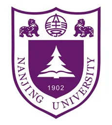
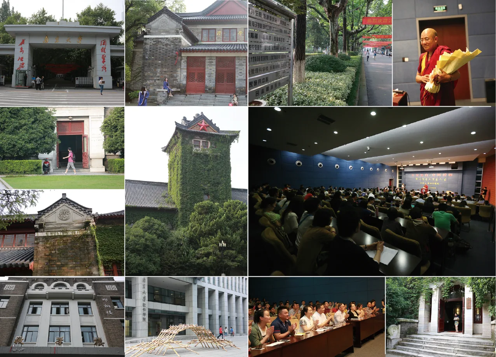
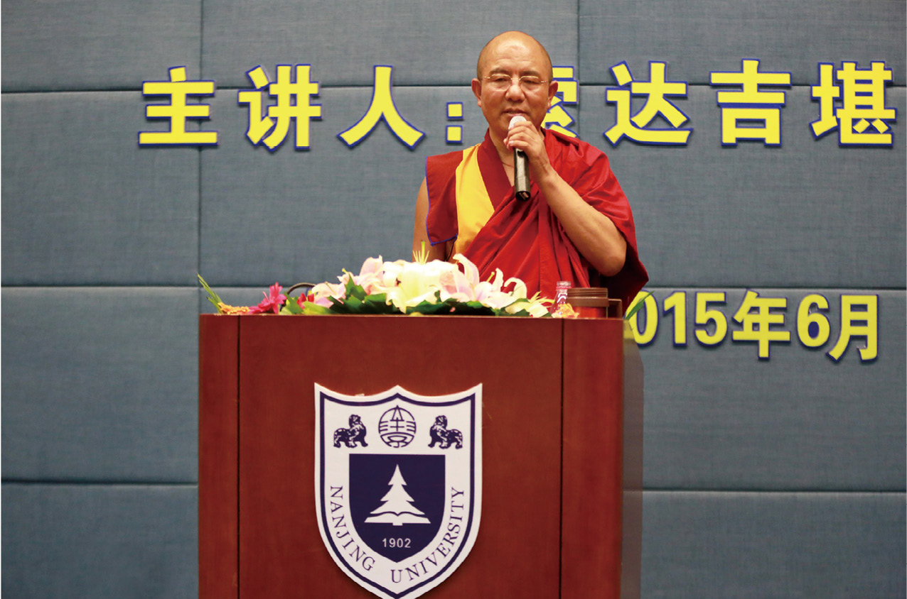
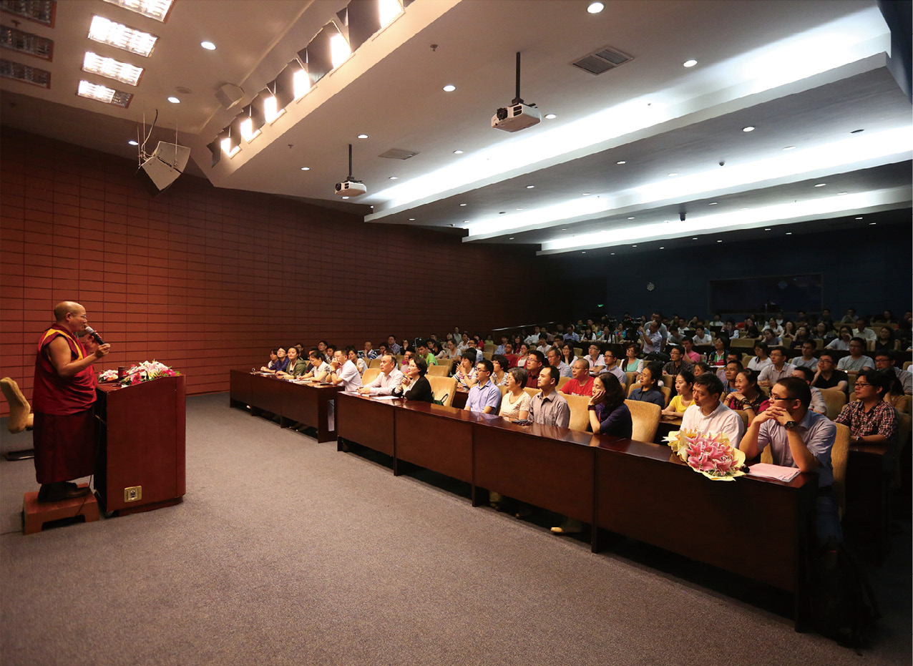
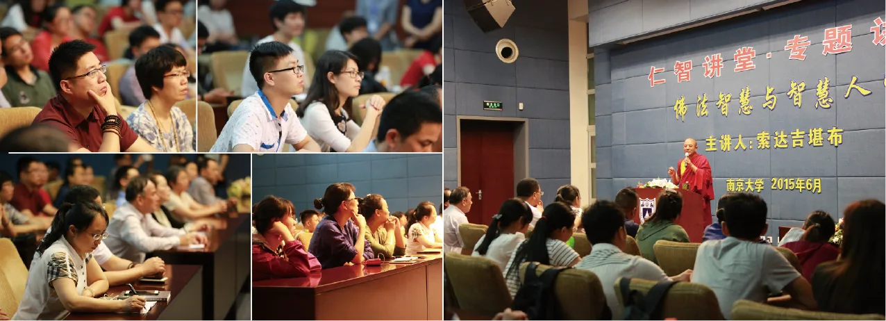
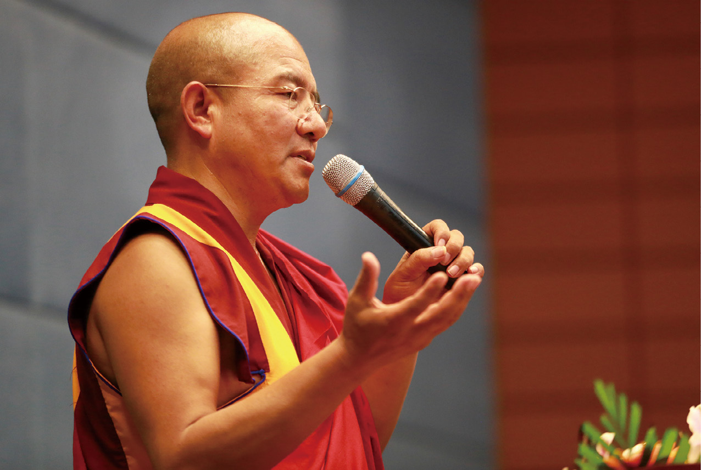
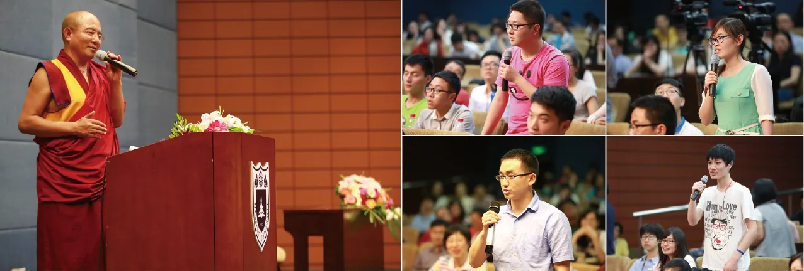
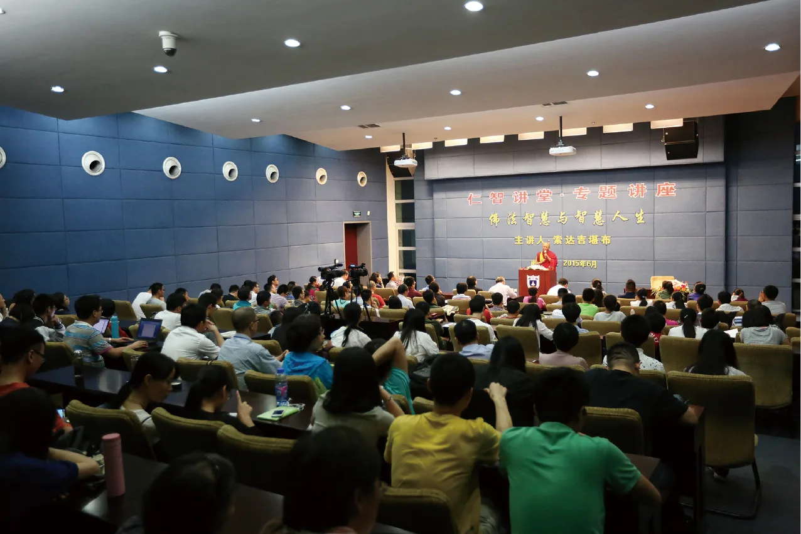

虽然有成千上万的烦恼，

但只要一个方法，

就能全部从中出离。

第121场

南京大学

Nanjing University

中国·南京

2015 / 6 / 29

## 佛法智慧与智慧人生

## Implementing Wisdom of the Buddha in Your Life

主持人：

佛教作为中国文化的重要组成部分，对当下的世道人心起着重要的作用。佛教不仅是一种信仰，更是智慧的思维方式，是中国文化的核心组成部分。不论是大乘、小乘，或是显、密，目的都是“诸恶莫作，诸善奉行”，培养世人的一颗菩提心和慈悲心。

本期我们特邀主管五明佛学院的索达吉大堪布，给大家作“佛法智慧与智慧人生”的专题讲座。在堪布站在讲台上的时候，我不禁有一个想法，想先做一个互动，大家可以就“你为什么来到这里？”提几个问题，请堪布开示——

## 快问快答

观众：我来到这里，是因为有一个小小的问题：我以前读《金刚经》，里面讲的是“空”的道理。但是后来看到《观世音菩萨普门品》，上面又说遇到任何困难，拜观世音就可以解脱。这二者是不是冲突？

堪布：观世音菩萨是可以救苦救难。按照《普门品》的说法，大多数人通过祈祷，一定能遣除生活当中的各种灾难。这来自观世音菩萨的发心和我们祈祷他的信心，以及不可思议的缘起力。

关于“空”的内容，也有其他的解释方法。

观众：我是一个大学老师，希望能把佛法的慈悲与智慧融到我的教学中。但是我的智慧不够，该怎样增长这方面的智慧？

堪布：需要善巧方便，多念“嗡阿Ra巴匝那德”，祈祷文殊菩萨。

观众：堪布第一次来南京的时候，由于因缘不足，我没有赶上，今年堪布第二次到南大来，我才有机会听到堪布的演讲。其实这不是一个问题，而是祈请，希望堪布能多来江苏，多来南京，给我们传授智慧，教育我们走上真正智慧的人生路。

主持人：非常感谢！她其实已经帮我开场了，我觉得再提问，就要被轰下来了。下面大家用热烈的掌声，欢迎堪布演讲！

## 一个月的密密行程

各位老师、同学，今天借这个机会，我们一起分享“佛法智慧与智慧人生”。这个题目是校方出的，上午我想了一下，感觉好像太大了。一方面“佛法智慧”非常广，有世间智慧、出世间智慧，出世间智慧当中又有显宗智慧、密宗智慧等等；另一方面“智慧人生”的范围也很广。现在大家经常提“佛法智慧”，但其实对佛法智慧的体系，还缺少一种认知和共识，这样泛泛而谈，可能会流于笼统，在以后的研讨、讲座或者学习中，要更细化一些。

这是我第二次来南京大学演讲，很高兴。记得第一次来南大，应该是2011年，后来，2013年来南京，2015年来南大，几乎每隔一年来一次。这趟我出来了二十多天，将近一个月，南京大学是最后一站。

我是6月1日从佛学院出发的，当天去了上罗科玛和下罗科玛两个学校；3号飞北京，在中国中医科学院、北京大学、中国传媒大学和两个佛教中心演讲；8号飞澳门，在澳门大学和一个佛教中心演讲；11号飞广州，在华南理工大学演讲，还做了一场企业讲座；13号临时飞四川，参加佛学院的一个建筑方面的会议；14号又飞青岛，在青岛恒星科技学院、一个监狱、一个佛教中心、一个爱心慈善机构演讲；18号飞上海，在上海外国语大学和一个佛教中心演讲；20号飞海口，在海南大学、一个监狱、一个佛教中心演讲；24号飞厦门，去了一个监狱；25号又去了武夷山的一个监狱；27号，也就是前天，才从武夷山飞回厦门。原本要搭乘当天下午6点的飞机来南京，结果因为南京暴雨，在机场等了一天，到下午5点的时候，说航班取消了，只好在机场过夜。到了28号凌晨，实在找不到飞南京的航班，就先飞上海，再坐车过来。昨天下午在南京农业大学那边做了一场演讲，今天是最后一场大学讲座，明天就回四川了。

从6月1日到30日，正好是一个月时间，就这么到处奔跑。今晚的讲座我也没有很多时间准备，再加上不停地飞，不停换地方，每到一个城市，讲完几场，刚刚开始适应，又要去下一个城市，人的思维也好像有点乱乱的。不过也没事吧，还是可以跟在座的老师、同学交流、分享。

我的想法大家不一定完全认同，可以求同存异，取其中的共识，保留不同的观点，还可以在后面的问答环节中，直接、尖锐地提出来。欢迎大家辩论，我能解答的就解答，实在不能达成一致的，或者你觉得“这根本不合理”，也完全可以抛弃。这种自由交流，也许对年轻学子稍微有一点抛砖引玉的作用。

做这些交流的目的，不是求名声利益，不是求所谓的世间八法，这些对出家人来讲，因为知道了它的本质，应该不会太执著。那目的是什么呢？在座的年轻人，事业、家庭等很多方面都刚刚起步，这个时候，如果在心灵的境界上，稍微能得到旁边人的指点、提醒，也许会有帮助。

## 被忽略的“人生大事”

现在的学校教育、社会教育，大多比较看重外在的物质层面。我在机场书店里看到，百分之七八十的畅销书，讲的都是成功学，怎么发展事业、怎么赚钱、怎么获得成功……而与此同时，可能忽略了人生一些最关键的问题：内在的信仰、道德，生老病死，等等。

有些人是因为各种原因，完全忽略了；有些人在某段时间会去关注，但或许因缘不太具足：想看一些这方面的书，虽然网上有很多，宗教类的、佛教类的，但不知道从哪一本入手；想依止一些心灵导师，虽然社会上也比较多，但不知道该听谁的。

## 一个指引，或许改变一生

人站在十字路口的时候，一般都需要得到指引。尤其在人生刚起步的阶段，这些指引也许对你很有用。

我们寺院里有一个老法师，今年87岁了。他二十来岁的时候，曾经依止过一个老师，叫玉科喇嘛。第一次见面，老师就给了他人生最重要、最关键的几个指点，他到现在仍记忆犹新。

以前那个时代跟现在确实不太一样。现在是碎片知识的时代，每个人看到、听到的东西都太多了，今天是这个，明天是那个。而以前的人，学过的知识、得过的窍诀，会用一辈子。

大概是前年，我有机会跟这个老法师在草地上聊天，特意问他：“听说你年轻的时候依止过一个很著名的上师，当时情形怎样？”他就把一面之交的整个过程描述给我听，包括那位上师讲了什么教言，他如何把它用在之后的人生里。

所以我想，人这一生，如果能遇到一个善知识，得到哪怕一句“诸恶莫作，诸善奉行”，也许会受益终生，甚至改变生生世世的命运。这也是佛法的智慧。

## 宏观的蓝图

那什么是佛法智慧呢？从深度上、广度上，都有不同的了解方法，关键看你从哪个方面来看。

在座的老师、同学，各自的层次也不相同，有些是多年带博士生的博导；有些可能只是大学一二年级的学生，众口难调，我不一定能讲出让所有人都接受的道理。但其实佛法智慧在面对人生关键问题时，是有一个总体蓝图的，就像指南针或者罗盘，能对我们的人生指点出一个大概的方向。它不会描述人生的每一小段要怎么走，也不会标出地图上的所有细节。当然，在讲述某个具体修法，或者身体的气脉明点时，也会很细致，但佛法智慧更多还是在一个宏观的角度，把人类心灵的来龙去脉，它的来处、去处、当下的状态、现象和本质……讲得清清楚楚。

## 一种“仁智”的教育

应该说，我本人是站在一个公正的立场来看待佛法智慧的。有时候，人们会对佛教过于神秘化，把它当作除了极个别住山的出家人以外，世间的在家人、俗人都碰不得、摸不得的东西。觉得最多去寺院里烧香拜佛，求求保佑，除此之外，跟佛教没什么可接触的。

这种想法并不对。佛教是非常有次第性、传承性、系统性的教育，这种教育各种层次的人都可以接受，从孩童到年轻人、中年人、老年人，每个人都可以在佛法智慧中，接受他所需要的知识。但现在因为社会环境的变化、各种因素的影响，很多人所认为的“佛教”，跟真正的佛教相隔千里。

其实佛教的教育，就像这里“仁智讲座”的名字，既有仁，也有智。仁是道德、仁爱、慈悲；智是智慧、妙慧，或者人们常说的懂得取舍的意识形态。佛教就是把仁爱和智慧结合起来的一种教育。

但是很多人把它神秘化了，认为佛教就是在佛菩萨面前求保佑，如果能够事业顺利、生活圆满，就是佛教给我的加持。而从来没有想到，佛教里其实有对整个世界和人生的描述，里面包含了方方面面，尤其是对内心负面情绪的分析——痛苦是什么？如何对治？如何把它转为道用？这些对我们来说更为重要。

但可惜的是，很多人都没有去了解。

## 系统学习，才能辨别真伪

近几年，学佛的人慢慢多起来，一些知识分子、公务员，也开始研究佛法，这可能是受国家政策和领导人思想的影响。但与此同时，也出现了很多鱼龙混杂的现象，一些根本不属于佛教的东西，被挂上佛教的招牌，就像世间讲的“挂羊头卖狗肉”，这类现象此起彼伏，在各地都有发生。

以前我去东南亚，那里的佛教通常比较开放，但乱象也很多：以佛教名义宣扬邪教的，利用佛教做企业、搞世间法的，等等。

而遇到这些现象的时候，如果我们没有系统学习过真正的佛教道理，自己可能就会参与其中，做很多不如法的事情。所以作为知识分子群体，作为大学里的老师和同学，不应该只是把佛教定位成一个求保佑的宗教，如果是这样，我们就与佛教的本来面目隔着一定的距离，很多真相也会被掩盖。希望大家能正确对待佛教，用正知正念寻找佛教的正见。

总之，佛教既不是迷信，也不是谁都没办法接触的神秘领域。这些都只是人们的想象，并不合理。

佛教是一种真正的智慧。从深度上讲，万法最终被抉择为一种不可思议的空性，所谓“四大皆空”，就像《中观根本慧论》《中观四百论》《入中论》《中观庄严论》《金刚经》等讲到的那样，抉择的都是同样的般若空性的境界；从广度上讲，则是爱与慈悲，这方面的道理也胜过世间许许多多的宗教，有的境界甚至令人难以想象。这些你都可以去了解、去接受。

## 什么都不信的“迷信”

在座的很多人也许都想过“佛教到底是什么？”“我到底有没有信仰？”

我看到一个美国的关于信仰的最新统计，和以前的一些结论有所不同。里面说，全世界七十多亿人口中，有宗教信仰的占61%，没有的占12%，剩下27%的人持中立态度，也或许是想隐藏起来，不愿表态。这是一次在全球65个国家范围内进行的调查，当然，这些数据不一定确切，毕竟他们没有一个一个地问我们，即便问了，也不见得每个人都如实相告，但从这些结论能大概了解人类的信仰状况。

反观我们自身，有些地方的学校和老师认为没有信仰很光荣，“我没有任何信仰”“我不信这一套”。尤其在这个新时代，很多人认为什么都不信是一种个性和魅力，老师同学都会赞叹：“哇，他很不错！”

但真是这样吗？你们要观察。如果原本是合理的、正确的、真实的，你偏不信，这样会不会反而成了迷信？

当然，如果原本就是不合理的、非法的、欺骗的，你“不信这一套”就对了，值得赞叹和提倡。但实际上，很多年轻人处在不信佛的环境中，受到家庭和社会的影响，对佛教的真实面目了解并不多，很多时候只是凭想象在抉择自己的信仰、评判别人的信仰。这是需要反思的。

## 佛法要“智信”

信仰有智信和迷信。盲目的迷信，我们都知道是不好的，包括佛陀也认为：“比丘与智者，当善观我语，如炼截磨金，信受非唯敬。”意思是，不管是出家人还是世间智者，你们对我的语言应该善加观察，觉得合理的才接受，觉得不合理的要舍弃，就像古印度用16道工序锤炼黄金一样。千万不要因为这是佛说的，就盲目相信。

这是佛亲口所说，我觉得这样的态度非常公正。印度古法锤炼黄金的过程，需要反复打磨很长时间，用各种方法来考验。同样，你们也可以用各种方法，看看佛教到底合不合理，比如把疑问提出来，或者和人辩论。

我也会在每次演讲中留出一个时间，让大家提问。你们不要觉得：“这是一个出家人，他一个人穿着这样的衣服站在讲台上，我不能问他问题，万一他答不出来，在这么多人面前太没有面子了，好可怜，我还是发一个大大的悲悯心，给他留条后路，不然他以后可能连饭都吃不到……”（众笑）

不用这么想。如果佛法确实有不对的地方，你完全可以直截了当地提出来，甚至批评、驳斥，都是合理的。因为它是智信，不是迷信，我对此深信不疑。

说实在的，我也不是因为别人说什么就信，别人去磕头我也去磕头……刚进寺院的时候，的确会这样，一看到上师就很生信心，但后来觉得，这还不是最好的信心。最好的信心是什么呢，先用智慧去观察，观察彻底了，再去相信它。佛教的信仰就是这样。

希望在座各位能对佛教有一种智信，这很重要。

## 在生活中去实践

然后，还要把佛法应用于生活中。这个时代的人比较浮躁，加上没有明确的人生目标，往往过得糊里糊涂。尤其很多大学生，总是非常着急。急什么呢？要毕业了，急着创业、找工作；工作找到了，要成家，急着赚大钱、买豪宅、买豪车……想要的很多，却很少满愿。

其实人生没必要那么急。因为大部分人只能活到七八十岁，顶多一百来岁，这一百年间，再怎么忙，也不一定都能如愿以偿；而每件事又有它自身的因缘和规律，不可能都跟随你的节奏，很多时候只是心忙而已，不可能一想什么事，马上就能成。

我经常接触大学生，很多同学的确眼高手低，觉得自己是本科生，一毕业就应该赚大钱。但其实现在的本科生供过于求，毕业后很难拿高薪。反倒是学历不那么高的人，在企业里老老实实做事，赚的钱也许还多一些。

要把自己的傲慢心降下来。二十年前、十几年前的大学生是特别受欢迎的，本科生、研究生、博士生，一个比一个吃香，但今天已经大不一样了，全球范围内，很多大学的就业都比过去更加开放。我从新闻里看到，包括德国、法国、英国在内的欧美国家，很多保安、环卫工人都是博士后，他们因为各种因缘，找不到合适的工作，就来应聘这些岗位。

因此我经常想，如果在你二三十岁的时候，就有机会接触佛教的一些理念，比如无常观、知足少欲观，还有个别的人生哲理，用来调整自己的心态、工作和生活，对将来的人生会是很好的指引。

## 海市蜃楼的启示

很多人一接触佛教，就疑惑是否还要争取事业、努力工作？这些是需要的。佛教并不是消极和悲观，你想赚钱，想做事业，都很好，只是不能太执著了。因为人生很虚幻，太执著的话，很多事情到头来可能是一场空。

龙猛菩萨的《大智度论》不知道你们看过没有，里面讲过一个故事，是关于乾达婆城（又名寻香城）的，也就是汉语中常说的海市蜃楼。故事说，有一群商人要穿过一片无边无际的沙漠。某天早上，太阳刚刚照耀大地的时候，他们看见远处有一座特别美丽的城市，城市里人来人往，感觉非常富裕。他们想，这个城市真好啊，在那里肯定能赚大钱，于是一起奔过去。他们跑得口干舌燥，筋疲力尽，但是随着时间推移，城市却逐渐消失了，这些人只有叫苦连天地继续前进。

走着走着，阳光一直炙烤大地，沙漠蒸腾出来的气体又变成了一种云雾，弥漫在地表，就像有水在流动——我们通常把这种景象叫做野马群或者阳焰水。商人们已经特别干渴了，看到这么清澈的水，又奋力赶去，等赶到的时候，才发现根本没有水，于是伤心得号啕大哭。

他们大哭的时候，听到四周传来人声，又欣喜若狂，认为已经到达了那座繁华的城市，结果却发现原来只是自己的回音。

最终他们意识到这一切都只是幻象，汉文中的“海市蜃楼”也是这样来的。

听说今天台下也坐着很多企业家，大家可能都希望自己的企业能做大、做强、做得非常成功……这没什么不好，只是我们不能太执著了，否则也许会像刚才那个故事里的商人们所经历的一样，觉得再有意义、付出再多努力的事情，到最后，当你离开这个世间，或者彻底明白了轮回的本质时，就会发现一切都是如梦如幻。虽然它曾经那么真实地存在过，但虚幻才是这世界的真实。

我们按照佛教的智慧来观察，就会切实体会到这一点。人们所执著、困惑、苦恼、焦虑的一切，其实并不存在。

佛经中曾有这样的记载。不同的人来问释迦牟尼佛，“我有这样那样的痛苦，应该怎么办？”佛给出的都是同一句话：“你不要太执著了，应该把它放下。”后来有个擅长小聪明的人，觉得佛答得不好，每个人的烦恼都不一样，答案怎么能千篇一律？于是他跑去指责佛：“您用同样的语言回答这成千上万的问题，恐怕不合理。”

佛问：“成千上万的人，在梦里感受成千上万的烦恼，如果把他们全部叫醒，梦中的这些恐惧、痛苦，还有没有呢？”那人说：“当然没有了。”佛说：“虽然是成千上万的梦，但只要从梦里醒来，就能全部止息。虽然有成千上万的烦恼，但只要一个方法，就能全部从中出离。”

我还没有讲到佛教更高的胜义谛智慧——听说在座个别人也学过中观，不知道你们学得怎样，但对胜义谛可能会有一点概念。这里是按照佛教世俗谛幻化八喻等的智慧在观察，世间万法确实是如梦如幻。也许有一天，你们会发现，现在特别执著的感情、生活、事业等等，其实都不是实有的东西，这才是它们的本来面目。

## 截然相反的观点

当我们以佛法智慧来观察人生，跟世俗的很多观点的确是比较抵触的。世间人所信奉的，在佛教看来可能恰恰相反。

比如现在的人喜欢自由，行为没有约束，想干什么干什么，如果跟他讲善有善报、恶有恶报，他可能很难接受，这跟佛教的因果观就有抵触。

又比如现在的人大多不相信前生后世，关心的只是短暂的今生如何生活，对除此之外的范畴是没有概念、不去思考、不愿承认的，这跟佛教的前世今生观又是一种抵触。

而因果、前后世，在佛法智慧中都是非常基本、简单、世俗层面的道理，如果对这些都不承认，对其他道理就更没办法理解和接受了。

世间再成功、优秀、高贵、荣耀的人，也不一定能看清万法的实质，关于生命、心识最基本的知识，大部分人都不懂。

有些人可能会说：“不懂也没事，我又不是佛教徒，何必要承认佛教里说的这些？”确实，如果业因果、前后世只是佛教的专利，非佛教徒不承认也是可以的；但如果它是所有人类，或者整个六道轮回的每一个众生都无法逃避的真实存在，那就跟你是不是佛教徒无关了。你可以不相信、不承认，但不管你信不信，真相就是真相。

有些人说：“那你要给我论证。”其实我没有必要给你论证。没有这个责任，因为我不是你的监护人，也没有这个精力去破除你所有的邪知邪见。但你对自己负有责任，你需要想一想，如果佛教讲的都是真的，要怎么面对？

## 临时抱佛脚，就晚了

人类还是很聪明、很有智慧的，可以登上月球，可以发明飞机——每次乘飞机，上去下来的时候我都感叹，现代科技好厉害，你看降落的时候，如果有丝毫的失误，就可能偏离跑道，非常危险，但雷达测得那么准，飞机刚好压在白线上，一两米的误差都没有。所以从物质上看，我们的科技已经发展到了这么高的层次，但在精神上，我们连心中最简单的烦恼也没办法对治，在生活中遇到最普通的无常，也没办法面对。我们往往在事情发生之后，才去痛苦、去思考，但这可能没有意义。

最近看到网上说李开复是“向死而生”。他是企业界的偶像，自从2013年突然查出淋巴癌，就引起很多人的关注。很多人在想他会不会死，什么时候死，但这几年过去，他不但没有死，还在和病魔抗争的过程中悟出了很多道理。他和星云大师有过交流，也经常公开发表一些自己的观点。

我一方面欣赏他的勇气，觉得很了不起；另一方面又觉得，其实佛教的智慧并不是要等到病魔缠身、灾难降临的时候才去了解的，这个时候已经来不及了。他还算幸运，没有马上死，稍微有一点思考的时间，还有跟大师探讨佛法的机会——我看过他的书，的确问过一些宗教方面的问题。但即便是这样，可能也解决不了生死大事。

佛教的生死观，是在你没有生病、没有衰老的时候，就要去观察：到底生是什么，死是什么？当死亡来临的时候，能不能认识自己的心，能不能救护自己，能不能选择下一世投生在怎样的六道轮回中？这些在佛教中，有非常丰富的教义和体验，但是人们对此漠不关心，认为只是佛教徒的天方夜谭，与自己无关。

其实，任何人都需要这些方法。

## 无常，每天都在上演

比如佛教中讲的“无常”，每天都在生活中发生。

财富是无常的。有些人一夜暴富。听说最近在某个偏远地方，五六个没钱没文化的小伙子，一夜之间成了有钱人，买了五六十万的进口车，轮流拍照炫耀，让很多人特别羡慕。虽然不知道这笔钱的来源是什么，但他们很公开，大家说不出什么名堂，只能感叹这些人福报大。也有些人变得一穷二白，比如原本是企业家，一夜之间钱全部蒸发了，最后绝望到从楼上跳下去，这样的案例也听到不少。这是经济方面的。

身体是无常的。原来好好的人，什么病都没有，到医院一检查，就发现是癌症晚期，癌细胞已经扩散到全身，最后只能做做化疗，没有什么办法。很多人到了这个时候才特别紧张，“真的有无常啊！”

权利也是无常的。看看世界上各个国家的政坛，哪怕是最高领导人，也可能突然倒台；而有些不起眼的普通人，又突然成了万人之上。

生活中充满了无常，只是人们在这些方面缺少观察和思考。

## 慈悲，要爱一切生命

又比如佛教中讲的“慈悲心”。有人说，对自己的家人、亲戚生悲心是可以的，对其他人好像很难。李开复也说，患病期间他感到最遗憾的，是没有多陪伴家人，对母亲也有很多亏欠。的确，世界上的很多成功人士，最关心的也无非是自己的家人，从某个层面看，这是一种孝道，是儒家文化、孝文化里所推崇的；但从另一个层面看，如此成功的人，临死前考虑的却只是自己和家人，是否值得我们反思？

人活在世间的价值和意义，是不是仅限于此呢？是不是只体现在自己身上，或者跟自己息息相关的极为狭窄的一个小圈子里面？能否把我们的慈悲和力量，辐射到除了父母、亲朋好友、企业员工之外的地方，去关注更多素不相识的人？

也许有人觉得，不用吧，只要我自己能得到提升和发展就可以了。但这样的想法并不是很高尚，一些动物也会这样，比如母狗生了一窝小狗，它对每一只小狗都非常关心；还有一些动物对自己的族群特别维护。人们不会因此觉得它们的智商和情商有多么伟大。

我看到你们的仁智讲堂，就在想这个“仁”所包含的仁爱，可能也只局限于儒教文化中的解释。儒教的“仁义礼智信”在修为自身和维护家族方面非常好，我也了解过；但从某种意义上，这还是一种自私的心，因为它是从“我”出发的，更关心我的国、我的家。

即便是今天全球化的理念，也带着自私性，并不是真正的全球化。因为和佛教的慈悲观相比，它不涉及动物，更不可能涉及整个六道轮回中的众生。

这样的“仁”若能注入慈悲心、菩提心的内涵，那就非常圆满。

## 伸出手，却帮了自己

当然，佛教中也讲，对素不相识的人生起爱心、同情心，日后对自己也会带来无量利益。你或许觉得难以置信，但现实中的确有这样的故事。

1814年的一个夜晚，在奥地利维也纳，一个酷爱音乐的年轻人走过街头。这个人很穷，他买不起钢琴，有时候甚至连作曲的纸都买不起，只能每天到一所小学去学习音乐。此时他正在回家路上，看见旧货店的门口站着一个穿得特别破烂的孩子，手里拿着一本旧书和一件旧衣服想要卖给别人。年轻人看见他，顿时生起一种强烈的同情心，觉得这个孩子比自己还穷，还可怜。他把身上仅有的一点钱全部掏出来，买下了那本旧书，在街上边走边看，却发现书里竟然有一首著名诗人歌德写的《野玫瑰》（Rose on the Heath）。他忍不住一遍又一遍地朗诵，整个身心都沉浸在诗歌的意境中，没想到从内心深处自然而然涌现出一段旋律。到家之后，他把这段旋律写下来，就是后来价值连城的名曲《野玫瑰》。

我曾经听过这首歌，歌词很简单，大概意思是：荒野上的玫瑰，我要把你采下来，不管你会不会刺我，我要把你采下来……

这首歌在世界古典音乐中享誉盛名；而当年默默无名的年轻人，就是日后欧洲浪漫主义音乐的代表人物，被称为“歌曲之王”的舒伯特（Franz Schubert, 1797-1828）。直到今天，大到全球性的各种音乐活动，小到家庭中播放的胎教音乐，都会选择他的作品。

但谁能想到，这首名曲的创作背景，是源于他的一颗善良之心；谁能想到，最初仅仅因为同情，想给可怜的孩子一点钱，结果买下的旧书却成了他辉煌人生的起点。

这种同情，就像佛教中自他相换的修法。当我们想要无条件地帮助别人，这种因缘最终会让自己获得强大的支持，这就是爱的力量，也就是佛教所说的慈悲。

## 善良的人，怎样都会善良

能做到这样的慈悲，在世人看来是很不容易的。

美国前总统罗斯福，曾经在一个农场打工，却被农场主克扣工资。罗斯福跟他打官司，农场主就倒打一耙，让罗斯福赔了很多钱。后来，当罗斯福成了美国总统，农场主却跑来了，原来因为经济危机，他面临破产，而银行又不肯为他借贷，万般无奈只能找罗斯福做担保人。他哀求说：“当年是我不好，对你做了很多昧良心的事，但现在实在没办法，你可不可以为我担保？”

罗斯福的夫人很反对，说：“当年他那么对你，你干吗还要帮他？”但罗斯福仍然同意了做担保。

按世间的道理来看，别人故意害我，我还要去帮，这是很不合理的，但这样的事例在大乘佛教中比比皆是。对于修习慈悲心的人，不但要常常这样做，而且必须这样做。甚至更重要的东西，包括自己的身体、性命，只要对方需要，也可以无条件奉上。

这种精神，可能大部分人都很难运用在现实生活中。但不可否认，在整个人类历史上，在那么多以利己主义为核心的价值观当中，大乘佛教的思想是非常稀有的。你们也可以思考，它到底是好还是不好？

和上个世纪相比，我们今天身处一个信息四通八达的网络时代，世界也成了多元文化交融的“地球村”，我们不再像以前那样孤陋寡闻，可以轻松获取各种各样的资讯。但与此同时，我们的思想也变得越来越复杂、迷茫，分辨不出好坏利弊，好像要找到真正对自己有价值的东西，都成了一件很困难的事。

就像市场上有琳琅满目的商品，哪些质量好哪些质量不好，除了极个别懂行的人，其他人很难分辨；同样，这个世界上有琳琅满目的知识，看得人眼花缭乱，哪些知识对人生真正有用，除了极个别有智慧的人，也可能很难辨认。

## 最好的“仁智”

今天想跟大家说的话题，就是仁爱和智慧，只是不再局限在一个简单的框架里。虽然这里没有讲到佛法更高深的层面，比如密宗对大悲空性藏的诠释；但即便按照显宗的讲法，或者只是针对世俗层面，和接近菩提心、六度的境界来对照，佛法所说的智慧和慈悲，也跟我们通常认为的“仁智”大相径庭。

归根结底可以说，佛法的仁，是最好的一种仁爱；佛法的智，也是最好的一种智慧。因为这种智慧，看透了世间一切万法的本质；这种仁爱，也不仅仅局限于我、我的家、我的圈子，而是涵盖到周围的人群乃至人类之外的所有生命。有了这样的“仁智”，当你在人生中遇到方方面面的问题时，也许不会那么痛苦。

## 给世界减压

表面上看，做一个仁智的人是在帮助这个世界，但实际上也能给自己解压。现在的人，压力都很大，我特意问过一些人，为什么觉得压力大，很多人开口第一个字就是“我”：“因为我工作不顺”“因为我太忙”“因为我心情不好”……其实就是我执比较重，这是导致压力和痛苦的根源。如果能把我执放下，少关心自己，多关心别人，即便有一些压力，也不会那么难以承受。

所以减压的方法有很多，比如发起一颗利他心，或者建立如梦如幻的空性观，能够做到这些，我们就会快乐很多，人生遇到任何事情，也会一步一步地做，心平气和、不急不躁。

现在很多人都特别着急，走路很急，经常踩到前面人的脚，因为来不及看清楚前前后后的状况；排队很急，没有耐心等待，塞车的时候一秒钟都感觉难熬，想方设法插队，不停按喇叭……大家都急着往前追，但到底在追什么呢？

其实人生的路，原本没什么可追的，再急急忙忙地追寻，也不一定有结果。

## 追寻智慧人生

今天就跟大家简单分享到这里，如果想找到心灵的归宿，佛教在这方面确实具备优势。感兴趣的话，你可以趁年轻，多去研究、去了解，将来因缘成熟的时候，也可以去修行，这对你的生活会有帮助。修行并不一定要皈依、出家，而是能去研究佛教里讲到的这些智慧，不说利益一切众生，也不说利益社会、国家甚至全世界，单单对你自身的情感、家庭、事业、人生，也许会有意想不到的突破。

这种突破不一定体现在我们所熟知的价值观上，像很多人梦想的，从早上一睁眼，看到的就是钱钱钱。其实很多大老板、有钱人，也认为金钱不过是一张纸，对内心的快乐起不到任何作用。

所以，有因缘的时候，我们可以把快乐建立在外境上，但更重要的是得到智慧。当内心明白了很多真实的道理，你会清楚该怎么做。

现场互动

问：您今天的开示围绕着“智慧”，但对我们普通人来说，可能更看重的是“聪明”，比如在对孩子的教育中，我们会夸这个孩子很聪明，却很少夸他智慧。智慧和聪明到底有怎样的关联和差异？

堪布：大多数家长的确比较关注孩子是否聪明，不仅在亚洲国家是这样，西方的很多国家也是如此。但我们也知道，聪明跟智慧是有一定差别的，聪明的人不一定有智慧，有智慧的人也不一定显得很聪明。相对聪明而言，智慧需要长时间的积淀，更为厚重。

一个智慧的人，不一定能马上展现出他的优势。比如考大学的时候，那些考得最好的学生，凭着自己的聪明和运气，进入顶尖大学，但随着他们毕业，开始工作、创业，在各方面不一定还能保持这样的辉煌；相反，有些虽然没考上名牌，但之前积累的学识，让他们在后来的整个人生中，慢慢显现出亮色，达到很高的造诣。

今天我们的价值观，普遍看重孩子的聪明，却很少关注他是否具备另外一些品质，比如听话、有爱心、乐意帮助人、坚强、勇敢、有耐心等等，但这些才是人生中更重要的功德。如果我们把孩子将来是否有前途，全部用聪明的标尺来衡量，做父母的只关心孩子的考试成绩、分数排名，在某些层面上，可能会是个错误。

因此在孩子的教育上，我觉得父母一方面要培养他的聪明和技能，但更重要的是，应该教他如何为人处世，让他有一颗善良的心。从小灌输一种理性和慈悲的教育，对他的成长很有意义。否则，老师和父母关心的都是他的成绩好不好，其他方面再差劲也不管，即便将来也许能考上一个好学校，找到一份好工作，暂时比较顺利，但越往后走，可能会适应不了，会一败涂地。

这是很有可能的，我们都需要关注。

问：我学的是物理，非常想领悟这个宇宙的真理，也很想为别人做一点事情。以前读爱因斯坦的传记，里面有句话说，这个世界上所有的生命都是联系在一起的，我对此深感信服，并由此读了一系列的相关书籍。后来在老师的指引下，我领会到了一切都是心的游舞，觉察到宇宙与自己其实并无太大的差别。我很想更进一步，当然老师也说过，要获得即身成就是不能求快的，但我现在生病了，生了很重的病，应该算是气脉紊乱吧，感觉自己的心没办法安住下来，尤其是最近五个月，修法一直比较停滞，内心有点焦急，毕竟世事无常、人生苦短。今天见到您，我很激动，希望能得到您的传法。

堪布：爱因斯坦的传记，我也很喜欢。但爱因斯坦说的宇宙同体，实际上是在微观理论中说的——万事万物源于同一个磁场，或者同一种力量。这种力量在佛教中来讲，就是“空”，空中能产生一切，但这个空不是无，而是明空无二。

想要证悟这种境界，在佛教中需要经过长期的修行，到那时，的确可以轻松了悟万法的本质。在修行过程中，最初可能会有相似的顿悟，随着不断的修持，最终也能获得真正的大彻大悟。我相信有这样的境界。

关于你的病，密宗当中有气脉明点的修法，比如，为什么我们的心像猴子一样刹那都不能安住，原因就是气脉一直在运行，如何调整气脉，在显宗当中几乎是没有提及的，但在密宗当中，依靠圆满次第的一些修法，就可以让气脉的运行平缓下来。

这里所说的气，既有呼吸的气，还有身体中运行的一种力量。通过调整身体坐式，调节每一个脉轮，控制好这种力量，我们的心就会渐渐安静下来。

关于起心动念跟气脉的关系，密宗里有一些特别好的修法和窍诀，在显宗当中确实找不到。

然后在对抗疾病的时候，心的作用很重要。十多年前我也得过严重的病，当时很多医生跟我说，可能只有六个月的生命。我就想这六个月要做点什么，因为也许会死，也许不会死，但假如真的只有六个月生命，我还是想在临死前翻译一本有意义、有代表性的书。

有天下午，我在成都一个书店里找到了藏文版的《释迦牟尼佛广传》，那本书很厚，有500多张，一千多页，我想，这个翻译完之前，自己肯定已经离开人间了，但不管怎样，还是发愿把它翻译出来。

后来我带着这本书去厦门治病——昨天在厦门我就想起了这段经历：那时候住院四个多月，每天打吊瓶，上午几瓶，下午几瓶，一边翻译《释迦牟尼佛广传》。最终用了五个月时间，翻译了三十多万字，圆满完成。

记得刚开始翻译的时候，医院后面正在建楼，我还在日记里写：这栋大厦正在修建中，我心中的智慧大厦也在修建中；这栋大厦应该会落成，而我的大厦却不一定能完成……

结果六个月之后，那座大厦已经竣工了，我的身体也基本恢复了健康。

所以我觉得，面对疾病，心的力量很重要。我们对病不用太执著了，找一件自己喜欢的、觉得有意义的事情做下去，借助三宝的加持也好，自己的努力也好，各方面因缘会慢慢好转的。

问：在大学的教育计划中，一个学生从入学到毕业，需要四年时间。由此我很好奇：一个众生从凡夫位到佛位，是不是也需要一定的时间？虽然每个人的根基不同，可能会有一些变化，但会不会还是有一个大致的定数？这是第一个问题。

第二个问题是，我很好奇生命的起源，想请您开示一下如来藏光明的问题，因为搞不清楚从如来藏光明里怎么会突然衍生出生命的。

第三个问题是，如果说生命来自如来藏的一念妄动，那成佛以后，证得如来藏光明以后，会不会因为一念妄动又堕落成凡夫呢？

堪布：第一个问题。成佛的确有一个过程，按照显宗的基本观点，就像学校里这样，大学读四年，硕士生、博士生读三年甚至七八年，这样的定数在佛教里也是有的。佛经中讲过，根据众生根性的不同，有些三个劫成佛，有些要七个劫，有些要三十三个劫。有一部论典叫《三戒论》，也讲到整个成佛的过程，需要三大劫、七大劫或者三十三大劫。而最常见的讲法是“三大阿僧祇劫”。

而无垢光尊者在著作《遣除心之黑暗》中说，以上都是根据众生心力的不同，按照最底线设置的“定数”而已，实际上如果是利根者，在短短的时间内也可以成佛。他引用《中般若经》中的一句话：“获得现见诸法清净法眼之大菩萨，若欲求正果，则七日亦可现前无上菩提圆满佛果。”利根菩萨想成佛的话，七天就可以了。对于这些教证，我们可以这样理解：成佛快慢之所以有差别，是因为众生在断除分别念的窍诀运用上，有利根和钝根的差别。

第二个问题。我们的心最开始是光明的，后来怎么出现无明，或者说关于生命的起源问题，第三世噶玛巴自生金刚专门写过一部论典叫《宣说如来藏》，噶举派的一位大德为它写过注疏，我也想翻译这部论典，但不知道有没有时间。这里面就讲到如来藏的本体像虚空、大海一样，虚空中会突然起现云雾，大海上会突然涌现波浪，用这些比喻来解释如何从如来藏光明中出现生命的起源。其中还讲到了更细微的，包括每一个无明、每一种因缘产生的过程。

第三个问题。虚空中的云，是很可能再次起现的，但证得如来藏光明之后，心为什么不会再退返呢？对这个问题，法王如意宝写过一部论典，叫《本基当中显现基现》，大概有三十多页，是法王所有著作里最重要的一部。论中就直接讲了在最初的第一刹那，众生是如何迷乱的，普贤王如来又是如何获得佛果的，对这方面的分析非常透彻。其中用了一个比喻：就像水银经过消毒之后，不会再有毒性；同样的道理，如来藏彻底遣除障碍之后，也不会再次迷乱。法王的这个比喻说得很清楚，获得成就之后是不可能再退返的。

不仅是法王的论典，因明的《释量论》中也讲了这方面的道理。它用的比喻是：就像烧坏的种子不会再发芽；如来藏上面的污垢一旦被净除，也不会再回到原来。或者说，成佛后所显发的果位功德，跟基位还是有所差别的。

这是专业性比较强的问题，可能很多人都没有听懂。

问：我想问一个很基本的问题，人活着的终极目标是什么？

因为我感觉越活越累，越活越不开心，越活越迷茫。按照现在世俗的观点，大概都奔着能当大官、有房有车、有漂亮老婆……但我觉得以后真正得到了这些，自己也不会很快乐。就像以前拿到本科录取通知书的时候，我是相当开心的；拿到研究生录取通知书的时候，已经不那么开心了；等拿到了博士录取通知书，我就只是看了一眼，直接放进抽屉里，真的一点也不激动。所以我想问一下，人生的终极目标到底应该是什么？

堪布：我写过一本书，叫《苦才是人生》。（众笑）

为什么不开心，我想可能有几个原因：第一个原因呢，如果我们把生命看成只是几十年人生的这么一个载体，不看前世，也不看后世，那么最初你会对那些没尝试过的人生感到好奇，比如没有钱、没有车的时候，就向往有钱有车的生活；而一旦你得到这些，其实会越来越没有感觉。这就是轮回的本性。

《金刚经》里讲：“凡所有相，皆是虚妄。”当你真正得到时，可能会发现很多东西仅此而已。比如没有一百万的时候，觉得做个百万富翁应该很幸福；后来真的有了一百万，会不会开心呢？也许刚开始会，但接下来就不见得。这是一个普遍规律，因为轮回的本性如此。

如果我们缺少对前后世的基本认知，看待人生是会有些悲观。这是我分析的第一个原因。

第二个原因是，现在的人不太关注对内心的修养，由此感到的快乐也比较少。因为很长一段时间以来，人们的价值观都是赚钱、成家，觉得这才是活着的意义，而当物质拥有得越来越多时，人们却发现心灵还是空虚的。就像我刚才提到的，跟物质相比，内心其实更重要。如果我们的内心有一种自我平衡的能力，起初可能会像很多人一样，也想得到物质，觉得它是生活中的必需，但慢慢会意识到，让内心得到调整和满足，更重要。

其实你在读本科、硕士、博士的时候，也可以培养内心的信仰、慈悲等，当你在这些方面付出努力，就不会只执著那几张文凭，同时也收获了自身的修养。

比如藏地很多信仰佛教的人，也看重成家、赚钱这些事，但他们很清楚，人生还有其他的目标：“我要积累资粮”“我要行持善法”“我生生世世要成为什么样的人”……这些在心里占有更重要的位置。一个有信仰的人，会把这些看得很重。

所以我们可以给自己确立两方面的目标，物质的也有，精神的也有，在物质上得到满足的同时，精神上的满足也会随之而来。

第三点呢，关于人活着的真正意义，前面我也讲了，其实不仅仅是自己成家立业，更重要的是，要想着对社会做一点什么。如果刚进大学、刚参加工作、刚开始创业的时候，就有这样的理念：“有房有车虽然好，但这不是我关心的重点。”经常想着怎样对社会有利，怎样能帮到别人，在这些方面考虑得比较多，你也许不会感到无聊的，因为觉得还有很多事没有完成。

比如我做一个企业赚了一百万，能不能至少把其中的五万捐助给其他众生？说五十万有点太多了，可能我还没有这样的心量，但从一百万里拿出五万，这样的比重还是可以接受的。用这笔钱为别人做点事情，可能自己会更加充实。

今天的很多人好像越活越没有感觉，越活越迷茫。但如果我们既懂得前世后世的存在，也懂得利他的价值，当自己获得成功的时候，会有一种自豪；遭遇失败的时候，也不会特别悲观，因为你有了最重要的事业，对此不会轻易舍弃。

问：在我没开智慧、不信因果之前，种下了很多恶因，我确信会得到恶果，应该怎么做才能弥补这些过失？

堪布：确实，在我们还不知道因果取舍，不知道善有善报、恶有恶报的道理之前，或者说即便知道，但是因为种种的原因，生活所迫、身不由己等，会做很多不该做的事。但不管怎样，按照佛教的观点来讲，这些都是可以忏悔的。

佛经里有一个很典型的例子：指鬘王受到恶师的迷惑，认为七天内杀一千个人就能获得梵天果位，于是到处杀人。杀到第999个人的时候遇到佛，连佛也想杀，后来在佛的点化下，他意识到自己造下了弥天大罪，非常伤心，于是精进忏悔，最终净除罪障，成就了圣果。

米拉日巴尊者也是这样，起初为了报仇，他杀了很多人，后来为了忏悔，他前往寂静地方，依止马尔巴罗扎精进修行，即生已经成就。

所以我想，人难免会在无知的情况下，或者因为种种原因造下严重的罪业，但如果能够虔诚忏悔，还是有清净的机会。

尤其是金刚萨埵的修法，对忏悔罪业非常有用。在我们佛学院，每年都召开金刚萨埵法会，参加的人非常多。今年我下山的时候，法会还没有开完，人山人海，小小的喇荣山沟根本没办法承载，我也累得不行。为什么人这么多？虽然很多人不会公开说，但其实大家都知道，作为凡夫人，有心无心、起心动念间，都会造很多罪，这些罪业需要我们真诚的忏悔，才有清净的时候。

问：最近跟我的MBA同学圈交流佛法的时候，说到佛法的闻思修，一个同学说，不需要，心中有佛就可以了。我想问，您认为什么样才算心中有佛？这是第一个问题。

第二个问题是关于梦的。我小时候经常做梦，有时候梦里知道自己在做梦，醒过来就可以了；有时候又不知道。我想问为什么会这样？是什么原因让我在梦中时而明白是梦，时而又不明白呢？

堪布：你的第一个问题，应该让那个说“心中有佛就可以”的同学来回答，因为是他说的（众笑）。不过我可以替他回答。

这种说法，其实是对佛教不太了解。很多人觉得心中有佛就可以，但他们心中到底有没有佛呢？很难说。心中有佛的时候，的确就像济公活佛说的“酒肉穿肠过，佛祖心间留”，但很多人都不知道，其实接下来还有两句——“世人若学我，如同进魔道”。

这种观念，跟六七十年代一些武打片的引导也有很大关系。如果心中真的有佛倒是可以，但你能不能观得起来？要达到这样的境界，是很难的。那些说心中有佛的人，往往同时在造各种恶业——喝酒、吃肉……但佛不可能让你去造恶业。所以这些人只是说起来好听，如果心中有佛，应该时时刻刻都能观佛，但我们大多数人，一年365天，能想起佛的时间可能只有几秒、几分钟，除此之外的所有时间，都在贪嗔痴里，都在昏昧中。

一般来讲，现在的人对佛教或其他宗教都不是太懂，因为没有好好地闻思修行、潜心研究过。但他们却自认为像代言人一样权威，对其他更不懂的人指指点点，“你不用学习，不用闻思修行，什么都不用……”而很多人也把这些没有发言权的人当作权威，言听计从。这个时候，如果自己受过佛法方面的教育，懂得一些理论，各方面智慧有所提升，你就不会迷惑。

目前这个阶段是比较混乱，混乱的原因在于，很多人虽然有了信仰，但不懂什么是正信，什么是迷信，于是就出现形形色色的“佛教代表”。包括在藏传佛教里，的确有一些很好的上师，但也有一些别有目的的人，跟你讲一些似是而非的“法”。特别像江南一带，各方面的条件还不错，也许来的上师比较多，如果自己没有取舍能力，就会听到什么都“很好很好”，全然接受。这是在很多佛教团体都可能发生的情况。

其实就像世间的商品，如果买家不识货，假冒伪劣产品就会纷纷涌现于世；如果大家能懂一点基本的鉴别，哪些是真的，哪些是假的，什么样的质量比较有保证，很多假货就不会有生存空间。

文艺复兴或者工业革命刚开始的时候，有很多非常复杂的情况发生；今天的社会在信仰方面也是刚刚开始复兴，既有正信，也充斥着各种情况。我始终认为，你不信仰佛教就另当别论，但如果想要信仰，最好能系统地闻思修行，要大量地学习，只看一两部论典是不行的。

听有些老师说，你们正在提倡读诵百部经典。我想问，只是读诵，还是要学？其实学习的话，从经典开始可能比较困难，因为经典的内容很复杂，会有内外密不同层面的含义。如果只是读诵，念念《地藏经》《金刚经》都很好，但如果要学，建议大家从论典入手，系统地学。经过一段时间的学习之后，你会明白佛教到底是怎样。

我也经常要求佛教徒要学习，对一些形式化的佛教不要很重视。虽然供灯、磕头、烧香也是佛教的行为，也有各自的功德，但这不是佛教的核心精神。听说有些企业家，把佛教看成仅仅是在寺院里拜个佛，在功德箱里放几块钱，给出家人做个供养，培一点福报——这些也重要，但更重要的还是佛教的核心精神：慈悲和智慧。我们怎么去修，怎么去学，对这个体系一定要了解。但了解的过程是比较辛苦的，不那么容易，要把它当作一门课程那样去学，你才会发现关于佛教的说法，哪些是真的，哪些是假的。

我认识的一些企业家，心很善良，常常去做布施、供养，但都不太懂什么是佛教。他们看到弥勒佛是笑眯眯的，一进寺院就对自己笑，可能代表我生意兴隆；释迦牟尼佛是很威严的，可能要我好好做人做事。我今天给弥勒佛交了50块钱，给释迦牟尼佛交了100块钱，已经跟“领导”搞好关系了，以后他们一定会时时关注我，如果我遇到了什么难题，他们会派四大天王来帮我解决……把佛教信仰跟民间说法都混在了一起。当然，这么理解也不是完全不行，但更重要的还是要学习，自己才不会盲目。

所以你的第一个问题，有些人的语言如果是出于好心，我们也不用否定他们的观点，但作为企业家，还是应该把佛教真正的核心问题跟它的部分仪式分开，抓住重点很重要。

至于第二个问题，梦的情况是各种各样的。按照密宗的观点，的确可以在梦中认识梦，像宗喀巴大师的《集密意续》讲义等，就有很多认识梦的方法；而按照显宗因明学的观点，梦是一种迷乱的意识状态。

所以对梦没必要特别执著，因为现在就是一场梦，你在梦中问问题，我也是在梦中回答。梦里见过你。

问：要怎样踏上资粮道，怎么去发广大的慈悲心、菩提心？我觉得我们的菩提心都不够大。

堪布：佛教讲五道：资粮道、加行道、见道、修道、无学道，资粮道是最开端的。其中资粮道又分小资粮道、中资粮道和大资粮道。加行道又分暖、顶、忍、世第一法。

资粮道的修持就是了解空性、积累资粮、净除罪障。通常认为，从我们相续中真正生起菩提心开始，就进入小资粮道了。那怎样生起菩提心呢？可能先要懂得众生的痛苦。因为无量无边的众生在轮回中所感受的三大痛苦为主的一切煎熬，是非常难以忍受的。

而在修菩提心之前，还要修慈、悲、喜、舍四无量心，四无量心没有修好之前，菩提心是很难观起来的。在藏传佛教所有的菩提心修法前面，都会讲到四无量心。当中最根本的修法，就是从“我的父母”开始，这是我最关心的人，所以不能跟他们吵架；然后是和我有关的周围的人；最后扩大到我的怨敌，把他们观想在我的前面，直到不再讨厌他们。修菩提心也是如此，逐步逐步把心不断扩大、再扩大，而不是今天刚开始修，就要去帮助天下所有的众生。这样说起来很舒服，但其实只是一句虚辞，要脚踏实地的话，就是从父母开始，一步一步扩大到所有众生。这样慢慢修，有些人在短短的时间内也会生起真实的菩提心，有些人则可能需要更长的时间。每个人的根基和次第不同。

问：善恶往往在一念之间。如果碰到不开心的事情，或者身处负面情绪中，应该怎么做才能把它转变成正向的情绪，让大家都处于正能量的环境中呢？

堪布：我们的负面情绪，在佛教里讲，有贪心、嗔心、痴心、傲慢、嫉妒等等。其实这些情绪，你不认识它的时候，可能并不知道它是负面的。尤其在这个崇尚开放、自由、浪漫的时代，很多人会觉得负面情绪挺好，爱恨情仇，才是人生。尤其是一些80后、90后的心态，确实不知道怎么说，我刚才也在问一些老师，现在的年轻大学生到底在想什么？很多观念在60、70年代的人看来，确实没办法认同。他们把这些负面情绪当作正面的东西，认为是一种生命活力的代表，用现在的话讲就是“很棒”“很酷”“很自我”。

但实际上我们都知道，负面情绪并不好。耶鲁大学的科学家通过反复实验发现，负面情绪会在人体内产生毒素，这种毒素对身心健康都有害。很多心理学家也认为，世界上70%的人都有负面情绪导致的心理疾病。

佛教讲，众生皆有分别妄念。从大的方面看，分别妄念就是一种负面情绪。正常情况下，这些是不严重的，但现在看来，很多负面情绪的产生，确实已经对人们的健康、工作和生活带来了一定危害。在这种情况下，我们要学会把它转化为正面情绪。

怎样转化呢？首先要懂得负面情绪对自己的害处。比如你特别嗔恨、大发雷霆的时候，说出的话不可能有理智，做出的行为也不可能很正常。我看过一本书叫《一生气你就输了》，每次生气过后，你可能会想起当时说别人、骂别人是不对的，但在负面情绪的驱使下，你就是控制不住。

所以，不管别人怎么说，尤其西方人的观念更加开放，很多人也会受到影响，但我们还是要认清正面情绪和负面情绪在本质上的差别：一个是药，一个是毒。

对这些负面情绪，年轻人一定要重视。今天在座有很多都是大学老师，也希望你们能跟学生多讲一讲负面情绪的危害。

现在吸毒的人也越来越多。这次我去了四个监狱，了解到监狱里的很多犯人都是因为吸毒而堕落的。佛教里把贪嗔痴叫做三毒，说烦恼像毒药一样，会损坏自己的心灵。但是很多年轻人不觉得这是毒药，还认为它很有意义。

吸毒者往往最初只是好奇，听说吸毒很舒服、很快乐，就想试试看，结果吸着吸着上瘾了，很难再戒掉。我也了解过毒品的化学成分，会对神经造成永久性损伤，到最后谁也无法控制。

虽然国家有各种戒毒所，但很多时候这些机构也没有办法。有个吸毒者已经第三次进监狱了，每次放出去又开始吸毒贩毒，让监狱长都特别头疼：一方面他不断回来，给狱方带来很多麻烦；另一方面又确实很可怜。

很希望学校、老师都能重视起来，多了解这些情况，研究一下怎么从教育上帮助年轻人。今天社会的最大威胁，并不是杀人放火，而是存在于我们身边的各种青少年犯罪，这些现象越来越严重。但实际上，很多都是不应该发生的。

问：今天非常高兴，又一次聆听您的开示。我想最后代我所有的学生，和在场第一次见到您的学生，祈请您给他们一点智慧的加持！

堪布：很多上师、堪布、活佛，用自己的身体或者其他方式给大家灌顶、加持，这很重要，但我觉得更重要的，可能是用智慧做加持。

我经常讲，如果能给大家什么“加持”的话，就是到处去讲一讲课。在讲课的过程中，有些人可能会有一点点转变；有些人可能觉得没什么；有些人可能从头睡到尾，最后大家鼓掌，才突然醒过来——我不是说今天啊，今天好像没有睡觉的，大家都很认真、专注。我有这样的毛病：台下人很专注，我就能把想讲的都讲出来；台下有一个人不专注，就讲不下去了。所以今天我的“智慧加持”应该已经都给完了。

如果还要我再“加持”一下，那就提一点希望。希望你们每个人从现在开始，既要发挥人生中的潜力，做好你的工作和事业，这是非常重要的；同时也要花一定的时间，去探讨人生中最关键的问题，包括生老死病、调整心灵等等，这些或许更加重要。

我们每个人都在绘制人生的蓝图，但有时候，人生不会是你最初设计的那样，不会沿着预期的路走。乔布斯说，在人生的每一个阶段，要听从自己内心的声音。确实如此，我们对人生有很多大致的规划，比如二十岁之前读书，三十岁之前成家、创业，等等，但到了某一个节点，可能会发现人生不是自己想的那样。原本想走的路走不下去，再换一条路走又有点困难，有时候还出现第三条路，在无从选择的时候，不如听从内心的声音。等到了人生终点，回头看，就会看到这条路有很多转折点，有些是成功的亮点，有些是失败的痛点。

但不管怎样，每一段经历都是你的人生，都是增长智慧的机会。不要对负面经历就排斥、否认，对正面经历就夸大、宣扬，不用这样。每个人都有负面和正面的经历，有些可能负面的多一点，有些可能正面的多一点，但它们都是你的真实演出，一段一段连起来，才铺成了完整的人生路。这条路走起来很不容易，但我们总会走完。在这个过程中，如果能平衡对内在心灵和外在世界的关注，无论遇到什么，你也能够应对。

前不久我发过一个微博：“每个人都有顺利的时候，也有挫败的时候，达到顶峰不要太趾高气扬，跌到谷底也不要太垂头丧气，因为这些都会过去，都会成为你的精彩经历。”

对这些道理稍微有一点概念的人，也知道一切都会过去，但更多时候还是需要一种智慧。这种智慧怎么得到呢？一方面按照佛教的传统，比如念“嗡阿Ra巴匝那德”祈祷文殊菩萨，或者念“嗡玛呢巴美吽”祈祷观音菩萨，这两位是智慧和大悲的象征，通过这种方式，可以在相续中种下善根。

另一种方式，是自己不断地学习，学习的过程中，要坚强。刚才有位同学说他的身体不好，其实身体不好也没什么，这个肉体肯定有不好的时候，内心也经常会烦恼，连拿到博士文凭都没感觉。

假如是我拿到博士文凭，肯定很高兴。你实在不想接受的话，这个证书给我用，我去别的学校到处介绍自己是博士。现在那些学校一般叫我堪布，有的叫教授，有了你的博士证书，我就很高兴地拿给他们，“看，我是南京大学的博士！”——开玩笑。（众笑）

所以，有很多办法可以调整心态，让自己开心。但总的来讲，需要智慧，也需要悲心。

谢谢大家！

主持人：

我在想，堪布讲他第一次来南京大学的时候是四年前，也就是说，我们的每一次相遇，其实都是一段不可重复的缘分。

相信今天课堂内的你们，特别是南京大学的年轻学子们，也许在今天的讲座上没有感觉到什么，但若干年后，当你回想起曾经在中美报告厅听这位大堪布讲到的某一句话，可能对你的人生会是一种点醒。

再次用热烈的掌声，感谢堪布的智慧开示！
