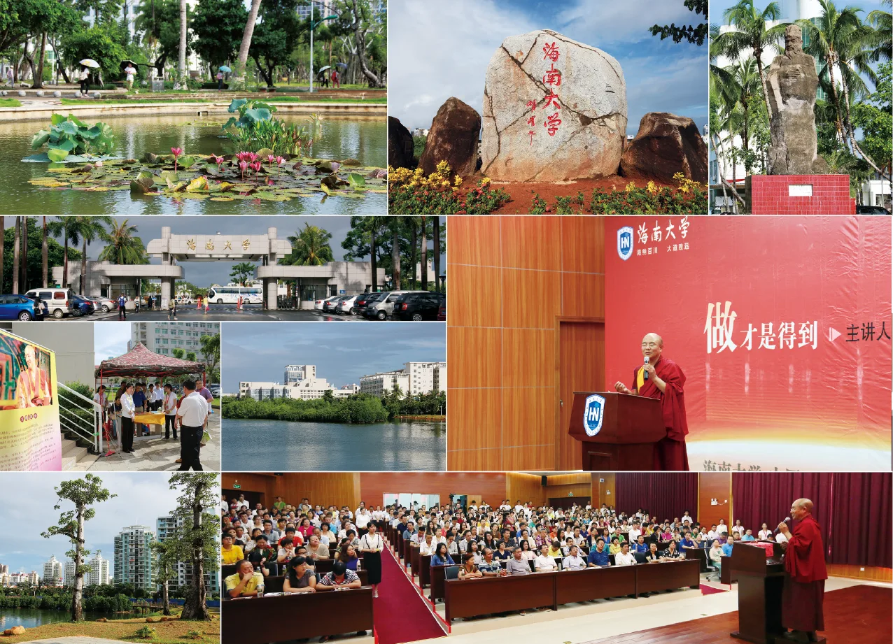
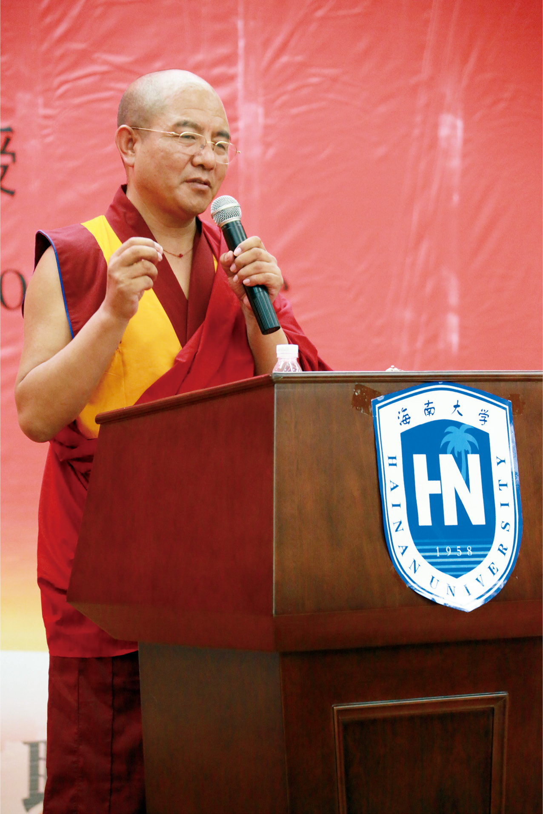
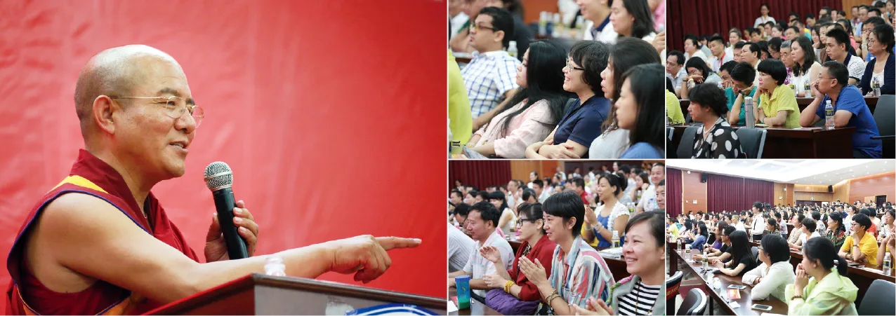
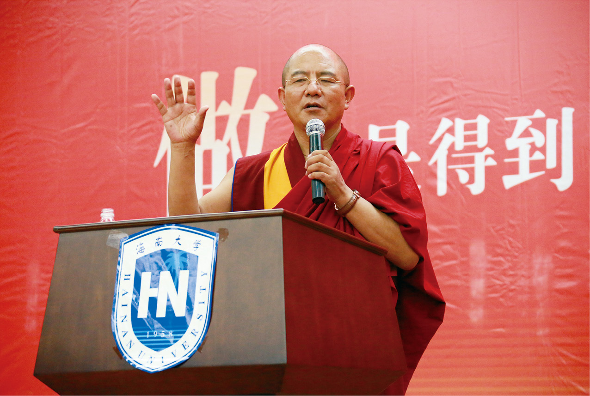
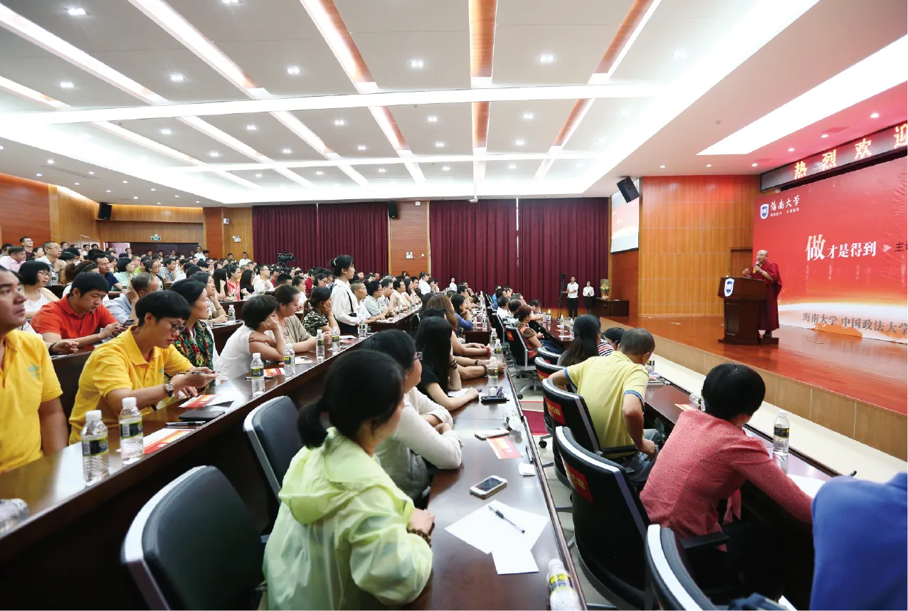
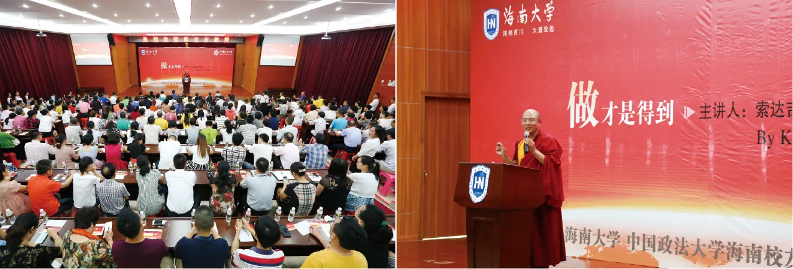

没有智慧的人，

承诺就像水上的花纹，

说完之后，

自己也忘了，

别人也忘了。

第119场

海南大学

Hainan University

中国·海口

2015 / 6 / 22

## 做才是得到

## Achieve By Doing

副校长：

今天是一个特别的日子，在海南炎热了一段时间之后，天气变得非常凉快，像是老天专门为这次活动，提供了一个最佳气温，这也反映了天人一体、人跟自然的和谐共生。

此时我们请到了索达吉堪布，给这一次文化之旅作首场校园演讲。我代表海南大学和中国政法大学，对堪布的到来表示欢迎，也对他鞍马劳顿的辛苦表示敬意。

在跟堪布商量主题的时候，我们选了“做才是得到”。当然对这个题目，我们是从一个普通世俗人的角度来理解的，一会儿堪布将会从物质、精神、行动等各个方面作更深的诠释，我想这确实值得期待。

再一次对各位的积极参与，对索达吉堪布的到来，表示欢迎和感谢！

各位老师、同学，以及其他来宾，很高兴在这样美丽的校园，和这么多有知识、有爱心、有文化的学者，有一个共同交流、学习的机会。

刚才，副校长带我参观了海南大学，看了红树林、东坡湖、白鹭，还有各个学院的建筑，我觉得在这里学习的人确实很有福报，应该非常快乐。

听副校长说，他已经来了二十多年，刚开始，这里只有两千多个学生，而现在有四万两千多，二十年翻了二十倍。

作为老师，能坚守在这个岗位上，不断地给学生传授知识，其实是很难得的。这个职业看似平凡，但如果长期、规律地做下去，会很有意义。

我也可以算是一个普普通通的老师。虽然出家了，但在佛学院的大部分时间都是讲课，少部分时间出来跟大家交流，除此之外，生活也很平淡，没什么过多的欲望和追求。

## “做”是一门学问

今天的主题是“做才是得到”。我看你们把“做”写得很大，“得到”几个字写得比较小，我想这个意思是：要“得到”，就得多“做”，否则会得不到，或者即便得到，也不一定是通过正确的途径。

有些年轻人喜欢夸夸其谈，想得很多，说得很多，但做得很少。“有其言，无其行，君子耻之。”古人也这样讲，光在嘴上说，没有实际行动，君子会为之而感到羞耻。

每个人来到人间，面前都会摆着很多机遇，有些是你的，有些不是你的。对身边出现的人和事，还有这些机遇，什么时候该争取，什么时候不能贪得无厌，就很有必要了解“做才是得到”的意义。

## 从未开显过的意义

其实“做才是得到”，也是我在两三年前写的一本书的书名，写完之后，没想到很畅销。这本书从表面上看，是针对世间没有研究佛学的普通人，从文化层面来讲的，读过这本书，或者将来读到这本书的人，自然会明白。

而从更深的层面来看，书里还讲到了佛法教义。这一点，在今天之前，我从来没有讲过。有些人可能知道其中有个别的佛教道理，但并不知道，这其中包含了藏传佛教完整的修行体系。

所以想趁今天的机会，稍微说一下。有兴趣的人可以自己去看，但不一定能看得出来。这本书分了八个章节，第一章做就是得到，讲人身难得；第二章怎样面对一切痛苦，讲轮回苦的本性；第三章讲万法都是无常的，瞬息万变；第四章讲因果不虚。这在道次第中，叫四种共同加行：人身难得、寿命无常、轮回痛苦、业因果。

后面第五章，讲佛的加持不可思议，谈到了皈依、积资、净障；第六章讲孝顺，大乘佛教如何孝顺父母等等，这是菩提心；最后讲到临终关怀，也就是往生法。这些属于六种不共加行，有一定佛学基础的人，就知道它们的重要性。

因为我是作者，所以带入了自己佛学方面的一些研究。一本书里，实际包含了这些直接、间接、隐藏的意义。

而它的直接意义就是，无论做什么事，都不能只是口头上说、心里面想、理论上了解，一定要在行为中去实践。

## 你想得到什么？

今天想跟大家分享的，就是这一点。在座的老师、学生，都可以来分析，跟过去任何一个时代相比，我们穿得越来越华丽，昂贵，有品位；吃得也不寒酸，桌上有各种美味佳肴。这些外在的物质生活，的确有所进步。但我们的内心，是否因此更快乐？我们的幸福指数，是否随着物质的提升而提升？也不一定。相反，人们想要的更多，更加不得满足。

尤其在城市里，经常听人说压力太大、时间不够，很忙、很累。人们设想了很多理念，但生活得依然不好，久而久之可能会觉得，这个时代对自己有许多的不公平。

特别是大学生活，跟社会上完全不同。曾经，你有很多激情和梦想、很多人生规划，但等你走上社会，也许会发现，很多都无法实现。

## 小心“成功学”

我接触过不少大学生，有很大一部分人都想着，一毕业就创业，自己当老板。但是看看现在的中国，那么多中小企业，还有那些大型集团，如果人人都当老板，不当员工，能不能形成这样的环境、国家和世界？

何况刚入社会的时候，你毕竟只是个学生，大学里的知识，也许百分之二十都用不上，人际关系很少，社会经验也不怎么丰富。你学到的东西，都是跟学习阶段匹配的，到了社会上，不一定能对接。在这个时候，很多梦想，可能会变成梦幻泡影。

所以刚毕业的时候，应该做一个普普通通、简简单单、脚踏实地的人，一件事一件事地去完成。就像饭要一口一口地吃，不可能一口撑成胖子。路要一步一步地走，不可能一步登天或者跨越世界。做任何事情，一件一件慢慢来，才能有一些成功。

现在很多所谓的成功学，会让我们的欲望更加膨胀，因为它只讲结果，不讲成功所需要的因缘。无论从佛学还是世间角度分析，成功都需要过程，这个过程也许很漫长，我们要日积月累，积攒到一定的技术、经验、智慧，因缘具足，才会水到渠成。

你们这里每个人都有水喝。我有时候在别的地方，看到只有前排领导有水喝，后面的人都没有。但这里不一样，基本每个位子上都有喝的，这算是海南大学的一个特色吧。虽然只是一瓶水，但大家都有得喝，感觉比较舒服、平等。如果只给领导喝，只给前排喝，其他人喝不上，可能不太好，所以特别感谢组织者。

## 想做，就拿出诚意

今天探讨的“做才是得到”，对我们的人生来讲，非常重要。不管什么人，如果想要得到，就得切实地去做。

我对自己也有一个评价：虽然不是很有智慧，也不是很能干，但只要诚心发愿要做的事，即使遇到再大的困难，也会硬着头皮做下去。并不是刚开始有一种热情，过一段时间，就慢慢消退，失去兴趣，或者推给别人：“你们去做吧，我没有时间。”不会这样。

我觉得，只要承诺过，下过决心，跟别人明确表态要做的事，有生之年就应该认真地铭记于心，要记住自己最初的发心。在我的人生中，也一直都在做，不管是翻译、讲课，或者办学校，虽然是一些不足挂齿的小事，也算善事吧，但只要是我想做的，都会努力。

## 镜子里是谁？

当然，就像山路不可能是笔直的，总会有一些弯弯曲曲；做任何一件事，也不可能从头到尾都顺顺利利，总会出现想得到、想不到的违缘和障碍。但这些违缘、障碍不一定真实存在，很多时候只是自己的心力不够。

我看过一个国外的故事，说某家公司给所有人发通知，让大家去殡仪馆吊唁某个人，说他曾经障碍过我们，现在已经死了。大家都去了，看到殡仪馆里有一副棺材，打开一看，里面却是空的，只有一面长长的镜子，照出每个人的脸。原来真正作障碍的，没有别人，只有自己。

这个故事很讽刺，我们习惯于将过错归结于他人，却不懂反观自己。比如你在某个单位，感觉领导对你不认可，同事对你不友好，似乎周围的人都在跟你作对，但事实也许是，你好吃懒做，不认真工作，其他人不想让你白吃白喝，自然对你没有好脸色。所以，遇到做不下去的情况，应该反观自己，也许是自己正在制造障碍。

## 第一种：无底线的“做”

同样是“做才是得到”，也分几种类别。

第一种类别，虽然在做，但做的不是好事。不管在学校还是社会上，对正经的学习、工作没兴趣，尽爱干坏事。

现在有一些城市，年轻人吸毒、贩毒的情况比较严重，这些毒品对人体神经产生化学作用，一旦成了毒瘾，就很难戒掉。走到这一步，会拿自己完全没办法，为了吸毒，卖血、卖家产、赌博，直至做出严重违法乱纪的行为。虽然他们也在做，但做得非常不合理，违背了良心，违背了天人合一的道。

我看过一个故事，说有人想贿赂一个官员，于是在夜深人静的时候，带着十斤黄金去见他。但官员很廉洁，不愿意接受，他说：“我不能收，这样不好。”这个人说：“没事，您收下吧，现在深更半夜的，谁也不知道。”官员却说：“你知道，我知道，天知道，地知道。”

这种说法也是对的。如果做一些不正规、不合理、不正义的事，也许暂时没人知道，但举头三尺有神明，在自己的良心上，在因果规律上，是过不去的。

希望大家都有自己的底线，宁可过平凡的生活、贫寒的生活，甚至去流浪，也不去做危害自己、危害家庭、危害社会的事。有些事，千万不能做，一旦做了，得到的将是无法承受的苦果。

## “讲个性”为时过早

有些年轻人认为：“我是自由的，我有我的个性，做什么事都不用你们管。”其实，当你只是一个学生，或者处在人生刚起步的阶段，就还不是讲个性的时候。什么时候可以讲个性呢？成了成功人士，有了丰富的人生阅历，智慧也达到了一定境界，到那时，你可以讲自己的个性、兴趣和品味。而现在，刚从大学出来，基本的家庭、工作、生活都没有，讲个性可能为时过早。

尤其不要为了所谓的“个性”为所欲为，否则得到的，不一定是好的结果。一旦被关在监狱里，一旦家破人亡，一旦身败名裂，一旦身体被彻底毁坏，你会后悔莫及的。

我们对人生应该有个正确的定位。今天的时代有各种乱象，如果遇到一些不好的因缘，结交了恶友，很可能会同流合污，或者以盲导盲，慢慢被引入特别危险、可怕的深渊，给自己的家人、朋友也带来麻烦和痛苦。

我去过一些监狱，发现里面有些人非常聪明，但就是因为太聪明了，利用这些“聪明才智”去犯罪，结果把自己困在牢狱当中，失去了自由。他们也很伤心、后悔，但事到如今，已经没办法了。

所以，在年轻时代，应该先建立一种正确的思考，这非常重要。

## 第二种：无追求的“做”

第二种类别，是什么都不想做。有些人对家里的事、工作中的事，或者作为佛教徒对修行上的事，一概不感兴趣，过得浑浑噩噩、糊里糊涂，这样也很不好。

做人做到无聊、无用、无趣的地步，是很倒霉的。人应该有所作为，如果每天都只是混日子，在世间来讲是极其失败的。什么都不想做，也就不可能得到很多。

## 第三种：半途而废的“做”

第三种类别，是虽然想做，但很难做成。就像列宁说的：“思想的巨人，行动的矮子。”他们的思维很活跃，这个也想做，那个也想做，但在实际行动中，做一点点事情，都极其脆弱，总是半途而废。

我遇见过这样的人，讲得很好，头头是道，却不一定能做成。所以如果你是领导，选拔人才的时候，不能光看口才。我有时候也要选一些工作人员，看到口才不错的，我就会想，他嘴巴特别会说，听起来也很有思路、很有理想，但他说的这些，到底能不能落到实处，感觉好像很困难。这类人，让他想，让他写，都没有问题，一旦让他做，也许因为不够坚定和努力，很容易懈怠、退失，做着做着，事情就夭折了，会有这样的情况。

## 第四种：口头上的“做”

第四种类别，是嘴上说做，其实不会做，只是说说而已。

日本有个作家，写了本书叫《行动改革》，分析了只说不做的九种人。比如，有人之所以不做，是因为喜欢找借口：没钱、没时间、领导不支持、考虑不周到、条件不具足，或者自己年龄不行、智慧不行、经验不行、处境不行……所以暂时先放着，不做。

原本承诺过的事，却一直没有落到实处，这也是很不好的。佛教著名的龙猛论师曾经说过，智者的承诺，应该像石头上刻字一样，无论经过多少岁月，经历怎样的风吹雨打，也不会被抹掉、失效，当初的承诺，永远都在。

这一点，希望大家也能记住。不管是修行，还是做任何事，所有的承诺，都应当努力让它实现。这将成为一种智慧的传统，甚至可能生生世世地延续下去。

## 两百多年的承诺

有个令我感到惊奇的故事，也跟大家分享一下。

美国纽约的哈德逊河边，有一个两百多年前孩子的坟墓。孩子名叫波洛克，年仅5岁就不幸落水身亡，死后，父母给他建了一个小小的坟墓，当时是1797年7月15日。

父母的悲伤一直无法平息，后来，他们把这片土地转让给了别人，搬去很远的地方。卖地的时候，他们跟新主人达成了一个协议：将孩子的坟墓作为土地的一部分永久保留，无论发生什么事，都不要毁坏它。

时间过去一百年，这片土地的主人换了一个又一个，但孩子的坟墓依然被完整地保留下来。直到1897年，这里被选为美国第十八届总统格兰特将军的墓地，而孩子的坟墓也在相距不到100米的地方，比邻而居。

又一个百年过去，格兰特陵园建成一百周年的时候，孩子也已经去世两百年了，纽约市市长来到这里，又重新修整了孩子的坟墓，并在总统的纪念大会上，亲自讲述了这个故事。

我曾经看过照片，孩子的坟墓很小，在一个铁围栏里，格兰特将军的坟墓比较大，就在不远的地方。去年我在纽约，有点好奇，很想去那里看看，因为这是一个延续了几百年的承诺。一个普通孩子的小小的坟墓，在这么长的时间里，即使随着这块土地被卖来卖去，即使被选作总统的墓地，它还是在那里，完好留存。如果换成其他国家，很可能过了十年八年，买主一变，就被拆掉、迁走了，更难以想象，还能跟国家总统的陵园建在一起。

从这点来看，美国还是很不错的，为一份这样的承诺，坚持了两百多年。这很令人深思，承诺并不仅仅是一句话，承诺了，就一定要做到。

## 衡量人的标准

古人也常说，有智慧的人，来到这个世界时做出的承诺，到他离开这个世界的时候，也依然存在；没有智慧的人，承诺就像水上的花纹，说完之后，自己也忘了，别人也忘了。

在世间，人们衡量一个人，也会看他当初的承诺能不能在日后的行动中做到，这是一个重要的评判标准。

如果做不到，只是口头上、理论上说得非常美妙，就成了“知道分子”——不是知识分子，他们知道很多，但在实际行动中是不会去做的。

## 切莫嘴上行船

有这样一个故事：一个专门在海上行船的船长，其实自己没有开过船，但是特别会说，把开船的理论，包括遇到漩涡、急流等等的阻碍怎么办，都讲得非常好。后来，真正开船的人病死了，大家让这个特别会说的人开船，但他只会说，不会做，结果和船一起葬身大海。

佛教的修行也是如此，光停留在口头上，肯定是不行的。理论跟实修，有非常大的差别。

可能你们对这些不太了解。佛教群体中就有一部分这样的人，喜欢讲禅宗、密宗里的最高境界，说得自己好像已经开悟了，但其实连基本的善事也不去做。

## 大禅师的小道理

唐代诗人白居易曾经亲近鸟窠道林禅师。白居易是个很有思想的文学家，他问禅师什么是佛法，禅师跟他说：“诸恶莫作，诸善奉行。”白居易很失望，觉得这么鼎鼎有名的法师，怎么讲出一个连三岁小孩都懂的道理，多么有失水准，不觉得惭愧吗？他看不上这个回答，言语中有种嘲讽。

鸟窠禅师回答说，是的，这个道理讲出来，可能三岁孩子都懂，但如果真正去实践，恐怕八十岁的老翁也做不到。

修行就是这样，有些人会讲很多大道理，但这些道理跟自己的心是分开的，无法相应。

## 敢梦敢当

在这个世界上，我们需要不断地积累、沉淀，尤其在年轻的时候。好像我这几年遇到的很多年轻人，个个都满腔热忱，想做大、做强，“我要赚大钱”“我要改变世界”“我要造福人类”……他们的心态、视野确实和过去的人不一样。

有这样远大的理想也是好的，不像有些年轻人，心里没什么想法，整天无所作为，还经常拖累父母。但也要看到，很多事情，并不是喊个口号，就什么因缘都来了。

有时候，我也会关注世间的有钱人，倒不是想跟他们学赚钱，而是因为这个时代，人们特别喜欢用金钱来衡量成功，所以我想看看，他们是怎样成功的，甚至能在短短的二十年当中，就当上世界首富。

然后你会发现，其实每个成功的背后，都有很多艰辛，比如大家熟悉的阿里巴巴、腾讯、万达。我曾经看到万达老总的创业经历，刚开始怎么借钱、怎么找地，还跟人打了两百多场官司，看他经历的这些事，就觉得成功人士的内心还是很坚强的。

我们往往只看到他们成功后的样子：有花不完的钱，不仅这辈子花不完，下辈子、再下辈子，如果还有支配权的话，也都花不完。看到这些，很多年轻人会羡慕，希望能变得跟他们一样，但实际上，在他们成功之前，也只是一个普通的员工；也曾经在某个岗位，认真勤恳地学习技术；也曾经在每一个难关面前，坚强地度过。在这个过程中，很多人坚持不下去，就放弃了；而那些不断坚持的人，就成了今天的成功人士。

## 成功人士的“秘密”

当然这种成功，作为一个佛学研究者，我会毫无疑问地认为，不可能仅仅依靠知识、技能或努力就能实现，也跟他曾经造过的善业有关，这是一些看不见、摸不着的特殊因缘。

我们经常看到，两个人一起创业，想合伙开发某个项目——现在一讲“开发”，就是分成、发财的意思。这两个合伙人，起初可能旗鼓相当，但到了后来，也会有不同的发展。

所以成功自有因缘。你的职业规划可以有很多种选择，不一定非要创业、当老板。那些世间非常成功的人，有些也不是老板，但他在一些大企业、大集团里，积累了丰厚的实力、财富和人脉。如果一开始选择创业，不一定能有今天，但因为选对了团队，找对了老板，今天的生活、事业，已经跟其他人完全不同。

佛教讲，凡事都由因缘决定，这些因缘有善有恶，对于那些善的因缘，我们应该去做，去争取。

## 舞台很大，你的心呢？

当然，同样是“做”，每个人得到的果又有不同。大部分人是为了自己和家庭的利益在做，为了个人的发展、孩子的成长；稍微扩大一点，也只是考虑自己的兄弟姐妹、整个家族的子孙后代。有没有更广阔的心量呢？很多人是没有的。而真正有智慧、有能力的人，就不会只追求自己的快乐，他会考虑更广大的人群，甚至为了所有众生而奋斗。这是最成功的“做”，也是最成功的“得到”。

如果你是老师，能够坚持天天讲课，让很多人沐浴在智慧的海洋中，当你桃李满天下的时候，就已经实现了“做才是得到”。

如果你是企业家，能够一心一意、尽职尽责地帮助员工和客户，当所有人都把赞美的语言写在天空中，写在草原上，写在心间的时候，你也会感到一种成功。

如果你是公务员或者领导，能够用公平正直、合理合法的行为，帮助百姓获得法律的保护、正义的维护，当你为此而奋斗，活在这个人间，就会非常有意义。

## 别忘记，古老的智慧

尤其在追求成功的过程中，大家不要忘记我们的传统文化。

广东外语外贸大学曾经举办过一次讲座，主题是“困境时代的作家”，请到2008年的诺贝尔文学奖得主克莱齐奥（Jean-Marie Gustave Le Clézio, 1940-），一个73岁的老人，来做演讲。

克莱齐奥说，每个人都在争取成功，但真正的成功学，在中国的老子等一些大思想家的学说里。他们的思想，是成功人生的典范。

这是一个诺贝尔奖得主的眼光。而现在的很多人，只关注当今时代的成功人士。比如现场就有人问他，是否知道莫言、韩寒、郭敬明，有没有看过他们写的书。他说暂时还不了解，将来会去看。但他特别指出，喜欢老舍和鲁迅。我想他以后也不一定会看，但由此可以了解到他的想法，是觉得成功学的根本就在儒教思想等这些传统文化当中。

我们都想做一个好人，觉得这是做人的成功，但对这个“好”字，随着各自的因缘，会有不同的定义：也许是对家人好；也许是对客户、员工好；也许是对人类，以及人类之外无量无边的众生都好。这取决于每个人的发心，而这种发心，不能忘失、背离传统文化的道。

## 大乘佛法的未来价值

有一本名叫《展望21世纪》（The Toynbee-Ikeda Dialogue）的书，可能大家都看过，是关于20世纪70年代，汤恩比博士（Arnold J. Toynbee, 1889-1975）和池田大作（Daisaku Ikeda, 1928-）的一次很有意义的对话。他们主要探讨了生命的源泉，话题涉及环境保护、政治体制、国民经济、医疗卫生等方方面面，还谈到了中国对未来世界的作用。

他们一位是基督教徒，一位是佛教徒；既是虔诚的宗教徒，也是拥有牛津等名校背景的著名学者。谈话中，他们把科学思想和宗教理念进行对比、分析，对未来进行了预测和展望，由此讲道：“要解决人类21世纪的社会问题，只有依靠孔孟学说和大乘佛法。”这句话，也值得年轻一代认真思维。

这是一位学者和一位对当今社会颇具洞察的心灵导师对世界的看法。无论在21世纪，还是未来的22世纪，孔孟思想对于解决人类的社会问题都非常重要，对于完善人格，指导自己做一个好人，也同样重要。但仅仅学习儒教是不够的，还要学习大乘佛法；不能只想着完善自身，发展个人主义、利己主义的思想，还应该培养利他的精神。尤其在这个全球化的时代，人们不能太自私了，如果大家都有一种大乘佛教的利他心、菩提心，才能把这个世界营造成真正美好的家园。

## 今天最重要

所以，希望大家除了研究各自的专业——各种科技知识、文化知识，有空的时候，也要关注自己的内心世界，这更重要。如果内心不快乐，即使拥有再高的学问、再多的财富，生活也会过得差强人意，甚至会陷在抑郁症、自闭症等麻烦当中。尤其在这个异常复杂、忙碌的时代，给自己留出时间，反观内心、找到宁静，是非常必要的。

最后，我想用一个小小的禅宗公案，作为今天讲座的结尾。

有一个人问一位了不起的禅师：“生命中的哪一天最重要？”禅师说：“今天。”这个人问：“是不是今天发生了特别惊天动地的事？”禅师说：“那倒没有。”这个人继续问：“是不是因为我的来访，所以很重要？”禅师说：“当然也不是。”这个人不解地说：“那到底是为什么呢？”禅师回答：“因为过去就像沉在海底的船，已经过去了，没什么重要的；未来就算有再多的辉煌和精彩，也还没有发生，同样不重要；而我们当下的生活，正在发生的一切，对每个人来讲才是最重要的。”

就像汉字的“念”，上面是“今”，下面是“心”，指的就是今天当下的这颗心。如果我们念念是善，在善的方面去发愿、去行动，最后也一定会成就一个善的梦想。

对应大乘佛教，就是愿菩提心和行菩提心：愿是想，行是做；做，才是得到。

现场互动

问：现在是6月份，很快就要迎来毕业季，在座的很多大学生即将步入社会。我想代表所有毕业生，请您给出一点建议。

堪布：很早以前，我就听说过海南大学。刚听到这个名字的时候，心里自然而然就感觉，这应该是个非常美丽的地方，什么时候能去参观一下。不过当时还没想过，会有机会跟大家进行内心的交流。

可能因为我喜欢读书，对大学生总有一种尊敬之心，对大学校园也有一种向往之心。虽然到了今天这个时代，大学生也许不算特别稀有，不像上个世纪七八十年代，人们看到一个大学生都非常惊讶——记得当时在我家乡，两个公社只有一个大学生，每次他放假回家，全村的人都去看，“哇！我们的大学生回来了。”这个时代不会这样，大家可能觉得大学生也没什么了不起的，但我仍然认为，大学生活对一个人的人生有着重大的意义。

所以，在各位即将步入社会的时候，我也说一点自己的想法。

第一，希望你们能怀抱美好的梦想。在选择工作、家庭、未来方向的时候，都朝着这个梦想努力。

第二，抱着美好梦想的同时，也要做好最坏的打算。要想到，选择的事业不成功，破产了怎么办？选择的对象不合适，离婚了怎么办？选择的工作不理想，失业了怎么办？很多大学生刚毕业的时候容易理想化，只看好的，不看坏的。但就像我们走路，既要盯着前方的目标，也要看到路上的各种危险。

第三，你要有决心。事业可能会破产，但精神不能破产，内心要保持淡定。佛教常说平常心，这也是一种觉悟，无论发生什么，都只当是过眼云烟，一笑了之。这世界会有很多的不可预料，你需要用智慧的眼光来看待。

有了这三种准备，即便将来各有因缘，但所到之处也会变成美好的花园。否则，世间的群体不会像大学这么单纯、清净，置身其中，你不一定知道该如何应对。步入社会就像去到另一个世界，我们需要学习这个世界的各种经验。

问：每个人都有梦想，但真正的成功只属于少数人，这些人的共同特点是：既有目标又执著，不达目的不罢休。请问，如何把目标与行动有机结合起来，保持做事的激情和意志，一步一个脚印地去实现人生的既定目标？

堪布：如何平衡人生的目标和行动，努力去做，这其中确实讲一种因缘。

在世间，很多人认为的成功，可能是有钱，有势力；但在我们佛学院，大家认为的成功可能是有修行，在思想上有一些超越的境界。所以在不同的环境，人们对成功的定义也不相同。但不管是哪一种成功，它的目标和行动应该是匹配的。同样是制定目标、付出行动，那些成功的人会有自己特殊的智慧。

有人说，创业和冒险是同义词，要想创业成功，就一定要冒险。既然如此，你就要做好承担风险的准备，很有可能在这个过程中，你会失败，会一次又一次地失败。此时就要看你锁定的目标，是不是智慧的选择。

常听人说，别人做过的事，你照着他的方式再做，不一定成功；如果你有自己的思维和智慧，在没人做过的领域，也许反而能打开局面。比如现在是因特网时代，那些有情商有智商的人，就能提前看到这一点，知道它会是将来人们关注的焦点，从而运用智慧的眼光去开发，去投资。

在佛教中有一个众所周知的说法：知道过去的事不叫智者，知道未来的事才叫智者。很多成功人士正是具备了这一点——能预见未来。他们有些是基于推测，有些可能是巧合，但不管怎样，背后肯定付出了非常多的勤奋和努力，这些努力就像滴水穿石，到最后总会得到一个结果。

所以不管你有怎样的目标，还是要努力行动。为了心中所想，持之以恒地去做，再大的事也能成，这就叫“心想事成”。当然这跟前世的因缘有关。或者今生某些方面还不够努力，也很难如愿。这些时候，虽然你有美好的梦想，但美梦尚未实现的时候，或许中途就已经醒来。

问：现实生活中，一种人生态度是先做，再得到回报；另一种人生态度是先索取才去做。请问，如何把握这两种人生态度，演绎精彩的人生？

堪布：已经得到了，还要做什么呢？

第一种，做才是得到，这是可以的；但先得到再去做，这种人生态度，可能你有不同的理解吧。我觉得已经得到了的话，可以去做一些其他的事情，比如成了成功人士，得到很多钱；这时候可以去做心灵导师，得到很多智慧；有了这些之后，又可以去做慈善，做饶益众生的事情。

想达到目标，就去做，如果不用做就能达到目标，那要怎么做？不如去做下一个。

这可能要用你自己的方式来解释，好不好？

问：如果做事不成功，该如何应对得与失？如果做事得不到领导、同事的支持，该怎么办？

堪布：不同境界的人，应该会有不同的应对方法。

如果你有大乘佛教的空性思想，就会知道：得也好、失也好，其实都不存在。就像著名的《入行论·智慧品》的结尾部分所说：“故于诸空法，何有得与失？”这是最高的一种境界。

当我们的思想达到这样的境界，对世界有了本质上的了解，的确会发现，今天忙忙碌碌、辛辛苦苦、认认真真寻找的一切，在实相当中根本没有发生过，既无须寻找，也不可能找到。就像空中的飞鸟，留不下任何痕迹。

所以，我建议年轻人还是要学一学佛法，即便没有时间，也可以读读《金刚经》《心经》这些短小的佛经，读的时候，心里的烦恼、浮躁、痛苦，自然而然会消失。就像《心经》所说，眼耳鼻舌身意、色声香味触法全都是不存在的，既然如此，我们又在痛苦什么？又依靠什么而痛苦？

空性思想很重要，它确实能减少很多的负面情绪。尤其在为梦想而奋斗的过程中，如果能真正懂得万事万物的本体就是空性，你会有面对得失的智慧。

而这种空性，并不是“杯里没有水”的那种空，如果不经过专业、系统的学习，恐怕很难懂得它的真实意义。但暂时来说，你也可以把它理解成“什么都不存在”的单空。

当然，有些年轻人正在全力以赴地追求事业的成功和生活的美好，听到“空”，可能会觉得“这不是一种消极和迷信吗？”会用极度排斥的眼光来看待。信与不信的确是每个人的自由，他人无权干涉，我在任何场合中也从来不要求或者提倡大家信什么，但作为一种不同的学说和智慧，你也可以对此进行分析，不要因为自己不知道、难以置信，就全部抛诸脑后、断然否定——即便要推翻，恐怕也需要具备一定的智慧。

很多时候，我们不愿意承认佛教中所讲的空性等道理。但实际上，谁都会承认生老病死，在面对生老病死的时候，谁也都需要一些引导和关怀。

就像高考的时候，很多不信佛的人会去寺院烧香。有时候遇到这样的人，我就问他：“你平时都反对佛教，为什么今天来烧香呢？”他说：“万一佛菩萨真能保佑我呢？我还是求一下吧。实在是找不到别的关系，只能找这个关系了。”

人往往是这样，在最困难、最需要帮助的时候，可能会想起佛陀；而在成功、快乐的时候，从来也想不起。

比如当你得了不治之症，完全失去生存的希望，这个时候你也许会想：“佛祖保佑，让我多一点寿命吧，如果我能活下去，一定报答您！”

以前我就认识一个这样的人，当时医院已经给他下了病危通知，于是他一直在心里默默祈祷佛陀。后来很奇妙，不知道是佛的加持，还是自己命不该绝，他真的脱离了生命危险。病愈之后，他马上去寺院，花一百块钱给佛上了一炷高香，感谢佛祖的再生之恩，还说以后都要好好供养。（笑）

所以我们的行为也会变，有时候，连自己都难以置信。

问：做才是得到，但是很多时候，做了也得不到。不是因为不努力、找借口，而是有人为的阻碍，比如上司、掌权者等等，给我们制造难题，不让我们得到。遇到这种情况该如何应对？我们还要不要坚持？

堪布：做了也得不到，是有这种情况（笑）。包括快乐、财富、美满的家庭等等，虽然我们一直在努力，但好像总是缺少机遇，始终徘徊不前。

其实人生就是如此。刚才的演讲中我也说了，做了，不一定就能得到，在这个过程中，看起来会有很多阻碍，来自上司、下属，或者同级的人，但实际上，也许是你自身有很多欠缺。就像演讲中提到的镜子的故事——对自己障碍最大的人，往往是你自己。

但通常来讲，为了得到想要的东西，还是要努力去做，这样即便得不到，至少你不会后悔。

谁也不敢保证，所做的事情必定会成功。尽管今天的人们为了追求各种物质，拼命在做，但如果没有一个好的因缘，还是会碰壁，会遭遇种种阻碍。这个时候，有没有必要继续呢？我的想法是，除了努力，你还需要一种智慧。如果发现继续下去将无路可走，也可以退出；但除此之外，立下的誓愿最好不要轻易放弃。只要还有希望，就坚持，坚持到一定的时候，也许会做出感天动地的事迹，也许会出现意想不到的转机。

当然，这些也不是必然的。我们所得到的，的确跟我们的勤奋有关；但并不是每一个勤奋的人，都能百分之百地得到。这中间有非常复杂的因缘，解释这一道理的学说，就是因缘学。

因缘学对我们来说很重要，如果不懂其中的道理，一旦做了却得不到，就容易怨天尤人，抱怨社会、抱怨家庭。

我听过一些大学生的抱怨：“为什么我家这么穷，别的同学都穿名牌，我的父母却什么都买不起，我怎么这么倒霉！”

其实没什么好抱怨的，一切都是因缘。没有的因缘强求不来，已有的因缘也是积聚之法，迟早又会消散。所以暂时得不到的时候，应该随缘，然后继续努力。

问：在孩子正处青春叛逆期的时候，怎样告诉他“做”这个看上去简单、却非常深奥的道理？

堪布：现在孩子所受的教育，大部分来自学校，来自父母的比较少，不像以前的人，会对孩子有一种特殊的教育。在中国的历史文献中就能看到，古代有很多母亲，为了教育孩子，自己是不出去工作的，包括今天的韩国和日本也是如此。因为母亲是孩子的第一个教育工作者，一定要陪在他身边，输送正确的观念。

但现在从幼儿园、小学开始，孩子的教育基本上都交给了老师。有些学校的环境比较复杂，待久了之后，受到的正面教育比较少，负面影响反而比较多。再加上这个时代，充斥着各种信息，很多孩子不喜欢读书，该看的不看，不该看的却沉迷其中。

我看到不少孩子喜欢拿着父母的手机玩，上网、刷屏、看动画，其实里面的很多内容都不健康。五六岁到十三岁，是记忆力最好的阶段，这个时期接触到的任何知识，都会对人的一生产生深远影响，形成他最主要的思想观念。而现在的很多知识，都是人为制造出来的，为了各种目的，想方设法吸引孩子的心识，这很糟糕。

所以在孩童时期，父母就要给予正确的引导；到了叛逆期，则要注意教育的善巧。否则，该管教的时候没有管教，等孩子长大了，又管教得特别严厉，效果可能适得其反。

每个父母都应该关注孩子的心理健康。孩子的性格、特点各不相同，可能要根据具体情况来确定适合的方法。

问：儒教与佛教的最大区别在哪里？

堪布：佛教和儒教的区别，第一个是，儒教主要讲我们这一世的为人处世、待人接物，包括孝忠礼义廉耻等道理。而佛教不仅讲今生，更关注来世——怎样获得来世的快乐？前世的因缘又是什么？所以要讲三世因果。

第二个是，佛教讲不害众生，这个众生包括了一切人类。而在儒教思想里，跟自己相关的人，例如亲朋好友，可以保护，不能伤害，但对其他人，尤其是冤家对头，就不一定。它强调一种英雄主义，为了家族和国家的利益，可以杀人，可以在适当的时候，去战胜和征服。

第三个是，佛教的不害众生，也包括了一切动物。而儒教在特定情况下是可以损害动物的，比如为了尽孝，可以钓鱼给父母吃。但在佛教思想里，任何时候都不能杀生，要爱护动物的生命。

当然还有其他的不同点，但最主要的可能是在这些方面。

问：我一直只关注自己的家人，认为君子应该独善其身。今后我应该发什么样的愿，可以培养利他的心，超越自己的小？

堪布：关心自己的家人是必须的，这很好，但有时候，再关心也还是会有遗憾。

在佛教看来，万法都是无常的，今天是和乐的一家人，到了将来某天又会分开。从大的无常来看，谁都逃不出生老病死，家人总会离开人世；从小的无常来看，人和人的情感怨亲不定，再亲密的关系也难免会有隔阂。

今天的社会，人们可能更需要观修无常，对家人不能太执著了。而除了家人，我们也应该关心社会，关心所有的众生，就像大乘佛教的修行——为了一切众生而成佛。

大家可能觉得成佛应该很重要。但什么是佛？并不是人们所认为的寺院里那些如如不动的造像——弥勒佛、释迦牟尼佛等，这些只是一种形象上的表示。

真正的佛，是觉悟，是人类最高的思想境界——觉悟万事万物的真理。什么时候你懂得了这个真理，你也可以成佛。

有一个电影叫《超体》（Lucy），你们都看过吧。里面讲人的大脑，从百分之十、百分之二十……一直开发到百分之百的时候，会发生什么。当智慧越来越提升，到最后确实会对自己的小我、小家庭、小社会，不再那么执著，能感受到一种“同体大悲”：所有众生都有苦乐，都有生命，除了自己和家人，也要悲悯其他的众生。

这是世间对心灵的一种分析。而在佛教中，对此不仅提供了理论依据，还有真实的修持。通过修行，你会真正发现，三界轮回中有那么多众生，只执著一个小小的我，是很狭隘的。这就是大乘佛教的思想，一旦心被打开，所有的行为也会豁然开朗。

这种思想在世间的其他思想中很难找到。世间的理念通常认为，关心家人是天经地义、合情合理的，而在这之外，如果有空闲、有资源，才会去关心社会，把利他当作一种额外的付出。

学习佛法多年，每当我将大乘思想和其他的知识、学说对比，就会深深感受到，这种利他的精神和行为在整个人类历史上是非常伟大的。完全无条件、忘我地帮助众生，像帮助自己和家人一样地帮助众生，有几人能做到？

我们也看到很多慈善家，他们可能会愿意帮助自己的亲人、家族，或者向某些特别可怜的人伸出援手，但对毫无关系的陌生人，把他们当作自己的孩子一样看待——不一定能有这样的境界。

很希望你们都能学习大乘佛教的思想，它可以称为这个世界上最伟大的学说。虽然在人类历史上，也有过各种各样的利他思想——西方的、东方的，但不一定如此彻底和纯正。

社会上也有一些利他的榜样，像单位里评选的先进模范，人们对他进行颁奖和表彰，把他的事迹塑造成崇高的精神典范。但实际上，这也只是小范围的一种行为。

真正的利他精神，可能只存在于大乘佛法中。

也许大家分不清什么是大乘、小乘。通常谈到钱，谈到成功，大家都比较有概念，谈到大乘思想，可能就比较模糊（众笑）。但人来到这个世间，还是要去寻找，为什么古今中外那么多有智慧的学者、心灵导师，都对大乘佛法交口称赞？它真是人类最高的境界吗？这些问题，值得我们思考。

问：有一个很有名的故事，说和尚和屠夫是邻居，每天他们都会叫对方起床，结果和尚没有得到好的果报，屠夫反而有一个好的果报，因为和尚叫屠夫起床是去杀生，而屠夫叫和尚起床是去念经。同样在做，为什么和尚每天念经，却没有得到好的果报？到底怎样做才是正确的“做”呢？

堪布：谁说和尚没有得到好的果报？（众笑）

这个故事，我们应该用智慧来分析。和尚叫屠夫早起杀生，屠夫叫和尚早起念经，这两个人其实都有好的果报和不好的果报。

问题里的说法，是一种片面的抉择。你可以说，和尚得到了不好的果报，屠夫得到了好的果报；也可以反过来说，和尚得到了好的果报，屠夫得到了不好的果报。因为屠夫在杀生，和尚在念经。懂得了吧？

念经肯定有好的果报，杀生肯定有不好的果报。既然这样，又怎能说和尚没有得到好的果报呢？

和尚有和尚的果报，屠夫也有屠夫的果报，但是果报中又有不同。

和尚的果报有好有坏。他每天认认真真念经，每念一部经的功德都不可思议，以此功德肯定会得到好报。还有他好心好意叫屠夫起床——也许他们关系不错，和尚只是担心屠夫睡懒觉，并没有想帮他去杀生，这个好心也会有好报。但和尚间接造成了屠夫的杀生，这方面的确有一些过失。

我们不能说他没有得到好的果报，念经的果报、好心的果报，都是好的。唯一只有造成杀生是不好的。

屠夫的果报同样有好有坏。杀生肯定有不好的果报，按照《正法念处经》的观点，杀一个众生，都会五百年堕在地狱当中。但和尚起床念经的因缘和功德，是依靠屠夫而实现的，所以屠夫也能以此得到好的果报。

他们所造的业，在佛教中就叫“花业”，花花绿绿的花，也就是说比较复杂，善业、恶业都混在一起；由此感得的果也是“花果”，苦果、乐果都混在一起。

所以很多时候，要想懂得佛法的道理，还是需要智慧观察，不能光用一句话来简单地断定。

问：我们在青年、中年、老年，每个时期要做的事都不一样，都在变化。我们有没有必要随之改变自己的做法，还是应该坚持原来的做法？

堪布：其实随着年龄增长，我们都不得不改变。

孩童的时候，我们特别执著玩具；到了少年、青年，可能会对玩具不感兴趣，开始执著知识、感情；到了中年，可能觉得这些也没那么美好和重要，又开始执著家庭、事业；到了老年，家庭和事业也不重要了，会执著自己的健康、快乐；最后到了离开人间的时候，这一切也都是不重要的。

我们追求的很多事，其实都只是当时觉得重要而已。孩童时代，当玩具被别人抢走，你会非常痛苦；年轻的时候，当感情、家庭受到伤害，你会特别执著；但到了老年，会觉得这些就像一场梦，对你来讲都不再重要。

每个执著，都是阶段性的，随着时过境迁，你就不会再执著；但在当时当地，旁观者清，当局者迷，你可能很难自拔。所以要懂得，今天特别执著的事，到了明天再回顾，可能根本不屑一顾。

孩子对玩具特别执著的时候，在老人看来是很可笑的。同样，我们对感情、事业特别执著的时候，在一些有修证或者懂得无常观的人看来，也是跟游戏一样。在人生的不同阶段，都有不同的对境在诱惑，你要有一种淡定的智慧。很多东西，不想舍弃也是会自然舍弃的。

问：我总是不敢承诺，心灵很脆弱，非常怕。这是为什么？

堪布：的确有这样的综合征，也是一种恐惧症：什么事都不敢说，不敢承诺，不敢想，不敢做。始终有一种担忧、害怕，怕别人反对，怕事情做不好，怕被人说，怕出现违缘的时候无法应对，怕因为这件事引出更多的麻烦，等等。

但我觉得，该做的事情还是要承诺。承诺是一种发愿，是一个开始，有了承诺，才会有后面的行动，否则很可能不了了之。

世间任何一件比较重大的事，都需要承诺。大到国与国之间的合作，不但要口头协商，还要签订正式的文字协议；小到人与人之间的合作，包括组建家庭、开展事业，也需要一些仪式和契约；乃至个人的事情，在做之前，也最好有一个承诺。

而且，这个承诺还需要有人见证，否则只是自己心里想一下，想推脱的时候随时就推掉，这不好。承诺，最好能在别人的见证下。

有些慈善家遇到我，说想资助藏地的孩子上学，我就说：“你们这样口头表态还不行，最好能有个正式的承诺，并且落在文字上——从什么时候开始资助，采取怎样的资助方式，由谁来证明，等等。”这样才会有一种监督和动力。以后即便情况变了，心态变了，你不会轻易退缩，“我当时已经在谁谁谁面前承诺过了，如果不好好做，在他们面前会特别不好意思。”

所以承诺还是很重要的，有了承诺才会有结果。

问：做才是得到，那么在做之前，应该如何选择，又该把什么作为选择标准，是人生价值、社会利益，还是其他？另外，如果在做的过程中，发现有更重要的事想做，要如何取舍？

堪布：做，才是得到。“做”是大大的那个字，记住哦。（笑）

至于做什么，是实现人生价值还是社会利益，这的确重要。但我觉得更重要的，是在做任何事之前，都有一种细致的观察、评估、规划和筹备，多询问，多思考。

比如，你去开创某个业务，或者参加某个培训，都要先对那个业务和培训机构进行了解，不能人云亦云。别人一说“有个培训班，我们一起去吧”，你就说“好好好”，一说“有公司在招人，我们去应聘吧”，你也说“行行行”，结果到了那里才发现，什么意义都没有。这都是不观察的结果。

如果打算做一件事，就要先了解跟它相关的人和事，包括做这件事会花多长时间，有怎样的社会效应，个人能从中得到多少利益，还要考虑可能会出现的意外，所担心的问题会不会发生，等等。在做之前，对这些情况都应该细致、深入地分析和掌握，这非常重要。

但现在的人缺乏这一点。包括很多佛教徒，听说某某上师在灌顶，就马上奔过去，过一段时间，听说这个上师是假的，是来化缘、骗钱的，又后悔不已，“啊！我已经在他面前得了灌顶，怎么办？”

世间人也是，听说某某气功师在办培训班，号称知名教授，就都跑过去，后来发现他根本不是什么教授，才知道被骗了。这样的现象比较多。

所以对不了解的人也好、产品也好、事件也好，都应该先用一种怀疑的态度去观察。不仅自己观察，还要多问别人的意见，从各方面来了解。了解之后，再去做。

这样即便后来发现，最初的观察并不准确和究竟，自己也不会有遗憾。你可以对自己说：“虽然这件事情好像不是刚开始想的那样，但我并没有轻易地相信、盲目地判断。我已经查过相关的资料，问过其他人的看法，自己也认真思考过，即便最终还是判断失误，那可能是缘分不好，我也没办法了。”

做之前就要这样，先观察，用智慧来分析，而不是头脑简单地全部接受。

然后，关于第二个问题，如果发现了更重要、更值得去做的事，同样也要观察：自己的精力、智慧、能力等各方面，是否允许再接这件事？它有什么好处和弊端？如果方方面面都考虑过了，可以接受，才去做。

具体问题具体分析，这句话还是很有用的。我们常常自不量力，什么都想做，结果什么都做不好。藏传佛教有一句著名的格言：走路的时候，等一只脚站稳了，再抬另一只，否则，可能会把自己摔倒在地。同样，做事也要一件一件地来，等一件事做稳、做好、做踏实了，再做第二件，否则，可能会一事无成。这样循序渐进，才会有序、有效。

我自始至终觉得，做，是需要智慧的。有了智慧，你不容易后悔，事情也会按部就班地成办。

在座的大学生、老师、学者，本身素质就比较高，相信以你们的世间学识，再结合宗教方面出世间的思想，世间法和出世间法圆融无违，会让这个“做”更加圆满。
