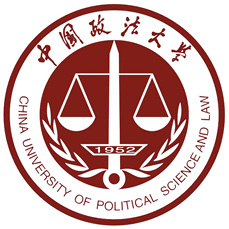
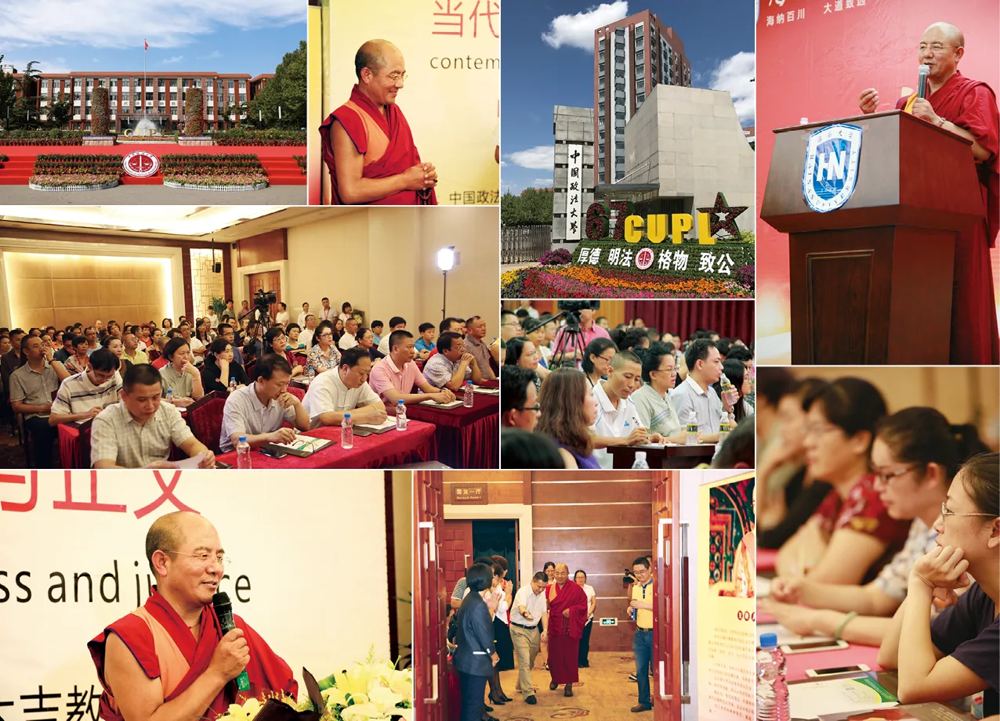
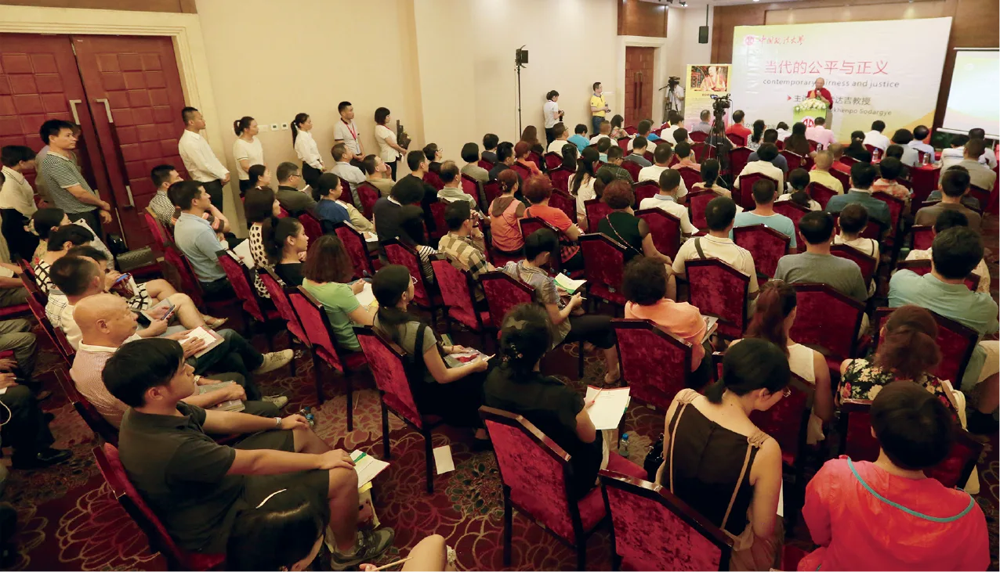
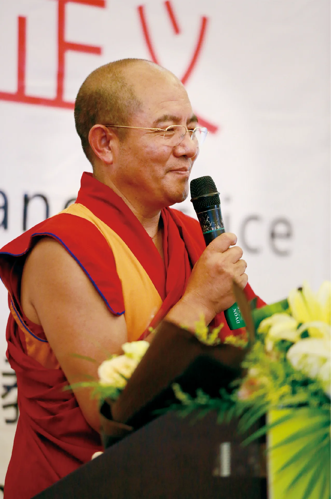
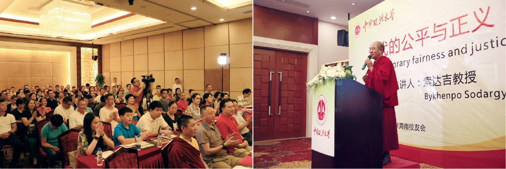
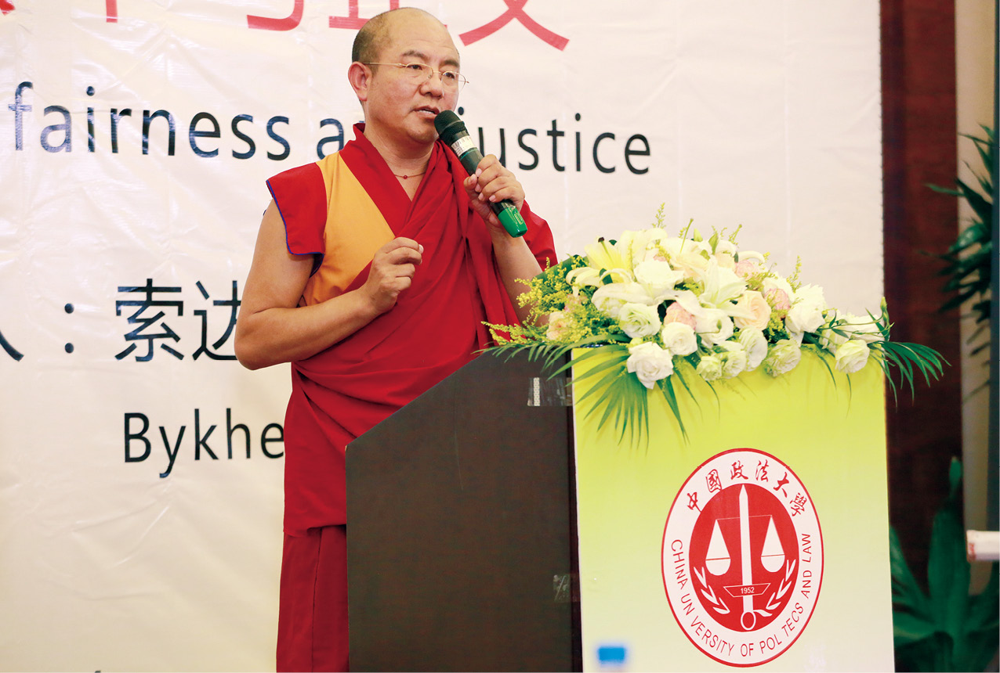

贪婪和欲望永无止境，

我们最好能清楚地知道自己真正需要什么？

该做的又是什么？

第118场

中国政法大学海南校友会

China University of Political Science and Law

中国·海口

2015 / 6 / 21

## 当代的公平与正义

## Buddhism on Equality and Justice

主持人：

尊敬的索达吉堪布，中国政法大学海南校友会的校友们，以及来宾们，大家晚上好！今天真是一个非常特别的日子，大家能有缘相聚于此，与索达吉堪布一起了解当代人内心的一些困惑和痛苦。相信今晚一定会是一场非常美妙的心灵之旅。

接下来，让我们有请中国政法大学海南校友会王会长致辞！

王会长：

尊敬的索达吉堪布、各位嘉宾，大家晚上好。欢迎大家来参加政法大学海南校友会所组织的“当代的公平与正义”交流活动。

法律上所讲的“公平”，主要指机会公平、过程公平、结果公平，而“正义”主要指利益能够得到妥善的安排，各种矛盾能够得到妥善的解决，进而让公平与正义的阳光普照整个社会。

我不占用太多时间，接下来就有请索达吉堪布与我们分享“当代的公平与正义”，希望大家都能从堪布对这个话题的研究、对人生的认识以及对觉悟的体验中收获启迪。我代表政法大学海南校友会，代表中国政法大学，再一次对索达吉堪布的到来表示欢迎与感谢！

主持人：

非常感谢王会长致辞。我相信大家都是怀着无比崇敬和期待的心情来参加本次活动，迫不及待地要聆听堪布演讲，那接下来就让我们以最热烈的掌声，欢迎索达吉堪布！

尊敬的王会长、各位领导、学者，感谢大家一同创造这么好的因缘，让我们有机会交流“当代的公平与正义”。

在座的各位是公平与正义方面的专家，对这个话题有深入的思考、探索和研究，而我只是对这个话题很感兴趣而已，谈不上有什么深刻的理解，但今天还是非常高兴能和大家相聚，一起探讨、分享这一话题。

## 一窥佛教千年的“法律”

在当今这个时代，很多人都对公平、正义有不同的分析与解读，我也不例外。我在十六岁之前是一名牧童，每天都在山上放牦牛，后来才开始读书，上小学、中学、中专，没毕业就进入寺庙出家。这么多年来，我一直过着出家人的生活，对法律以及世间的公平、正义等理念并没有太深入的探索，也没有翻阅过太多相关著作，但我对佛教中的“法律”，也就是“戒律”有过一些研究。我觉得法律与戒律之间有很多相似之处，而从某些方面来讲，戒律也深刻地传达着公平与正义的理念，非常有探索价值。

在社会上，根据不同的用途和情境，人们制定了诸如《民事诉讼法》和《刑事诉讼法》等法律，而各种机关单位也有各自的要求和管理方法。同样的道理，在佛教中，针对男众出家人（沙弥和比丘）、女众出家人（沙弥尼、式叉摩尼和比丘尼）以及在家居士的具体情况，大家在所受持的戒律上也会有一些不同的要求。例如，比丘需要受持二百五十条戒律，而比丘尼需要受持三百六十四条。戒律虽然设立于两千五百多年前，但它是针对不同人群在修行中的具体情况所制定的，因此，它不但不像有些人所认为的那样死板，而且还能在21世纪仍然保持鲜活、适用，不需要改革，这不得不说是一个奇迹。

戒律不仅是对行为的一种约束，它还能帮人们趋入精神生活的正道。除戒律以外，佛教“善有善报，恶有恶报”的思想，以及保持正知正念的修行方法，也就是经常观察自己身、语、意的相续，还能让人们在没有“犯法”时，谨慎取舍自己的行为，防止因行为不当而堕入黑暗的处境，防患于未然。

我并不是要给大家灌输佛教理念，而是想和大家探讨这样一个问题——在当今时代，什么样的法律更具有可操作性、时效性，不但能实现社会的公平与正义，还能约束自他的行为？

## 平等是社会关系的底色

政法大学的校友们大都从事司法工作，拥有一定的社会地位，手里也可能握有一些权力。手握权力的人，哪怕只是做了一个小小的举动，或说了一句简单的话语，都会对他人的生活产生一定的影响。不知道大家有没有意识到，其实权力是一柄双刃剑——如果手握权力的人心存善念，那对家庭、对社会，乃至对全人类来讲，都是一件幸运的事；但如果他动机不良、行为不善，恐怕手中的权力对自他都不是一件好事。借此机会，我们也可以反省一下自己内心深处的动机，看看手中的权力是否为自他带来过真实的利益。

法律上讲“法律面前人人平等”，而佛教中也有相似的理念，也就是“佛法面前众生平等”，这可以从三个方面来理解。从修行的基础，也就是从本性上来讲，所有的众生都具有“佛性”，也叫“如来藏”；从修行的过程上来讲，众生都可以修行佛法；从修行的结果上来讲，众生通过修行所现前的佛果也都一样。这三种平等可以统称为基、道、果平等。

我们来到这个世界时，手中既没有财产也没有权力，每个人都是赤裸裸地出生。虽然有些人的父母有地位、有权势、有才华，但他自身不一定会继承这些。所以，我们在来到这个世界时都是平等的。而当我们不得不离开这个世界时，连自己的身体也带不走，不得不随着业风离世，这时，每个人也都非常平等。在人生旅程中，大多数人在二十岁以前都在学校里读书，与同学们过着平等的生活；假如你能活到八九十岁，可能在六十岁之后，就不得不退休在家，过上与其他老年人相似的晚年生活，大家也非常平等。由此看来，只有在中间的三四十年中，有些人会额外拥有一些权力，如单位中的权力、家庭内的权力等等。这时，不如试着为自己和他人都带去一些真实的利益。

## 要活得像一块金子

公平与正义是非常宝贵的品质，也是为人处事中非常重要的原则。藏族人在评价一个公正的人时会说：“这个人对谁都一视同仁，为人公正，就像纯金一样。”纯金在任何时候都非常有价值，用它来比喻一个人，说明他在做任何事时都不偏堕，不会为了自己的利益而抹杀别人的功劳，更不会诬陷、冤枉他人。

人可以有种种的功德和优点，而对于一名领导来讲，公平、公正的品质尤为重要。从我自身来讲，我在佛学院参与过多年的僧团管理，在工作的过程中，我再三地提醒过自己，处理大大小小的事情时，应该尽量保持公平、公正，不能因为自己有权力就随意奖惩。如果我们以个人名义去帮助他人、回报他人，这是个人的事情，不能以权谋私，否则就有失公平、公正。

## 社会进步需要时间

社会的公平与正义在很多国家都得到了良好的保障，但在另一些国家还有待提高。有些人认为，真正的法治国家，就应该像西方那样——法律公平、执法公正。这种说法有一定的道理，西方有些国家的法律确实比较健全，民众的法律意识也比较高。如果你去到西方国家就能看出来，法律在人们的生活中起到了非常大的作用。但与此同时，我们也应该意识到，西方国家健全的法律体系建立在民众几千年的宗教信仰之上。如果没有这个基础，他们的法律很可能就只是沙漠建筑、冰上楼阁而已。

我认为，每个国家都有它的特点和历史背景，尤其是现在，很多人认为西方国家对于公平、正义以及个人自由的保障已经达到了很完善的阶段，但事实上，在此之前，它们往往都经历了很多年的磨炼。例如，很多人都觉得美国是一个非常民主的国家，但美国也有过一段非常不民主的历史，种族歧视非常严重。众所周知，在美国的历史上，黑人曾被当作奴隶，什么权利都没有，即使在20世纪很长的一段时间里，黑人依然受到种种不平等的待遇。

我记得有这样一个故事。拳王阿里（Muhammad Ali, 1942-2016）在赢得奥林匹克金牌之后，佩戴着奖牌去餐厅吃饭，但服务员却拒绝为他服务。他当时说：“我是世界冠军！金牌得主！”但餐厅的老板却说：“我才不管你是不是世界冠军，我们这里不欢迎黑人。”他当时非常气愤，于是在回去的路上，把胸前的金牌拽下来扔进了大海，说道：“我连在餐厅吃饭的权利都没有，我再也不愿意为这样的国家效力了！”

在20世纪50年代，美国的白人与黑人之间还发生过一件非常有影响力的事件。当时有一位黑人女性，由于在公交车上没有给白人让座而被捕。于是，马丁·路德·金（Martin Luther King, Jr., 1929-1968）呼吁全市的黑人都不要坐公交车，以此抗议对黑人的不公平待遇。据说有一位老太太，每天都要为此走很远的路，一位善心的司机建议她坐车，她却说：“我不愿意搭车，我要一直走下去，这并不是为了我自己，而是为了我的子孙后代。”后来，黑人在美国各地陆续发起了很多运动。1963年，马丁·路德·金在美国华盛顿的林肯纪念堂发表了他最著名的演讲——《我有一个梦想》（I Have a Dream），并在1964年获得了诺贝尔和平奖。

《我有一个梦想》以及马丁·路德·金的和平奖获奖感言被收录在很多书里，甚至课本当中也有，我还曾将它们翻译成藏语。他在《我有一个梦想》中提到，虽然林肯总统在一百年前就签署了《解放黑奴宣言》（Emancipation Proclamation），但这么久过去了，美国的黑人还没有得到自由，生活中还备受压迫……但那个时候谁能想到，美国人在2008年选出了一位黑人总统。奥巴马总统生于1961年，马丁·路德·金发表《我有一个梦想》的时候，奥巴马大概是两岁。从林肯总统到奥巴马总统，美国发展了近一百五十年，可见，人与人之间的公平、正义、平等、和平，可能要经过漫长的努力才能实现。

## 平等理念早已深植传统文化中

西方社会在近代才逐渐形成了平等的观念，但从历史上来看，中国自古以来就非常重视平等。以春秋战国时期为例，当时的人们就对平等、和平非常重视。孔子就曾讲过：“有国有家者，不患寡而患不均，不患贫而患不安。”对于诸侯与士大夫而言，不应担心有没有财产，而应该担心财产分配是否公正；不应担心国民人数过少，而应该担心国家是否和平、安定。可见，孔子希望人人都能过上平等、祥和的生活，避免过于奢侈、显赫或贫寒、软弱的人生。孔子生活在公元前五百年左右，那时美国还没建国吧。（众笑）

## 信仰的重要性

为了保障社会上的公平与正义，我们可以制定相关的法律条文，但更关键的是，人们的心中是否有公平与正义的理念。法律毕竟是人为制定的，而人们又可以对法律有不同的理解、诠释，采用不同的执行标准，因此，仅仅依靠法律很难保障社会的公平与正义，但如果我们心中有“人人平等”的观念，对一切众生都能像自己的父母一样尊重对待，那社会上的公平与正义自然会到来。其实，如果大家能反观、思考社会上的种种现象就不难发现，人们非常需要信仰、需要自我约束，从而实现社会的公平与正义。

很多人都认为，出家人应该在深山老林里过着清闲的生活，但事实上，从大乘佛教的利他思想来讲，佛教教义并不是只能在与世隔绝的寺庙中实践，更应该在学校、企业等社会不同群体中推广。每个大乘修行人都有责任和义务，将佛教的利他精神传递给社会。

在座的各位大都从事司法工作，主要是在公安机关、检察机关和法院工作，工作的性质主要是对人们的行为加以监督和引导，在这种情况下，大家的心中就更要有“人人平等”的理念，从而在执法的过程中秉持公平与正义。

佛教里面讲，众生皆具佛性，世间人不一定承认这一点，不承认也可以，但我们应该有一个共识，那就是每一个人都希求快乐、畏惧痛苦，只不过有些人在追求快乐的过程中，会因为贪婪、嗔恨、愚笨而做错事。这时，我们应该拿公正的尺子去衡量他们，不应该因为这些错误就忽略他们人性中好的一面。

## 在智慧的摄持下秉持公平与正义

秉持公平与正义并不容易，不论是满怀慈悲的宗教人士，还是英明的一国之君，也往往很难做到。历史上有一则很有名的故事能说明这一点。

明朝的开国皇帝朱元璋是个很了不起的人，在位三十年。有一次他微服私访，当时天气炎热，有人就给他递了一杯茶，他喝了之后觉得特别舒服，便让身边的官员去找到这个沏茶的人，要给他连升三级。官员听到后，告知朱元璋，这杯茶是一个厨子沏的，意思是说，这个人没有官位，没办法给他升官。虽然朱元璋听出了这话中的意思，但仍坚持要给厨子升官。官员听到后，便低声发了一句牢骚：“十年寒窗苦，何如一盏茶。”大意是，我寒窗苦读十年才谋取了一官半职，但这个厨子只用一杯茶就封了官，这也太不公平了。朱元璋听到后，便续上了后半句：“他才不如你，你命不如他。”从才华方面来讲，这个厨子不如你这个秀才，但你的命不如厨子的命好。

这虽然是古代流传下来的一则故事，但事实上，我们身边正在发生着很多类似的事。有些领导可能就有过类似的经验，有些人跟着他干了很多年，但他从来没提拔过对方，也没给对方加过薪，而有些人，才跟着他干了没多久，却特别受赏识，得到了很多关照。

朱元璋曾为生计所迫，在寺院里出家，有一定的佛学造诣，在中阴、梦境等方面有比较超胜的境界。在明朝的历代皇帝当中，朱元璋的佛缘比较深厚，他在诗中所提到的“命”，其实就是我们所谓的“因缘”。我们在处理问题时，一方面要了解其中的因缘，同时也要考虑法律规定，在主观感受与客观法律面前，大家需要运用智慧来秉持公平与公正。

## 人人都逃不出公平的“业网”

法律强调人人平等，但我觉得“业”和“因果”更平等，因为没有人可以超越业和因果。“善有善报，恶有恶报”的因果法则不是只对佛教徒才有效，它是自然规律，适用于所有人，而佛陀只不过是宣讲了这样的规律而已。

《善恶因果经》中提到，阿难尊者曾问佛陀，世间充满了不公平，因为有些人长得十分好看，有些人长得极其丑陋，有些人非常强大，有些人特别脆弱，有些人生活贫困，有些人衣食无忧，有些人身心极其痛苦，还有些人却能享受幸福快乐。佛陀说，其实他们都在感受各自的果报，看似不公的生活境遇，实际上源自每个人所造作的业。比如说，好看的人，是因为曾做过很多善事，积累了很多善业，而长相丑陋的人，是因为曾做了很多坏事，积累了很多恶业。事实上，每个人在业和因果面前都是平等的，造的业不同，所感受的果也就不相同，相信大家多少可以理解这一点。

为什么有些人会锒铛入狱，而有些人却能步步高升？其实也是这个道理。我出家前读过师范学校，在毕业后的二十多年里，我的同学中有人犯法进了监狱，同时也有人当上了领导，得到了很好的待遇。表面上看来，生活好像不公平，同一位老师教出来的学生，生活境遇竟如此不同，但实际上，这取决于他们所造的业。因不同，果上便会有差别。一个人干了坏事，所以才会进监狱，而另一个人工作兢兢业业，后来才获得很好的地位，享受生活。

当我们站在“业因果”的角度分析社会上的种种现象时，就会恍然大悟，原来“业网”是生命中最大的“网”，它遍布一切角落。业和因果并不需要我们刻意地去操作，它是一种自然法则，但可惜的是，绝大多数人都还不懂这样的道理。这就像毒药会让我们生病，妙药会令身体健康，但大多数人却不懂得如何区分毒药与妙药，甚至还觉得毒药好吃，于是拼命地吃，最后果报现前时，就无比后悔、痛苦万分，但这时已经无法挽回局面了。

有调查研究发现，有信仰的罪犯相对比较少。可见，我们有必要把道德、宗教作为内心的一种约束，这样一来，行为上就会有一条底线。如果人们懂得造恶业对今生、来世很不好，就会在心里给自己提个醒，行为上自然也就会有所约束。

人人都需要对自己的行为有一定的约束，虽然法律也是一种约束，但它比较被动，力量也比较微弱，如果我们的内心都有信仰，就能够主动约束自己的行为，很多事情都能防患于未然。

## 这一生应过得无怨无悔

如果大家在社会上有一定的权力和地位，或者有一定的智慧和能力，希望大家能秉持公平、正直的品质。按佛教的观点来讲，公平、正直的人，身边会有很多白法护法神相助，这听起来就是一件非常不错的事情。

如果我们在日常工作中秉持公平、正直，很多因缘就会自然而然地聚集，虽然你可能暂时看不出它的意义和效果，但将来也一定会感受到真实的利益。此外，如果能秉持公平、正直的态度，即使事情没有圆满，良心上也过得去。当大家步入老年，回忆自己的生命旅程时，会庆幸自己做了有意义的事情，把这一段生命当作光荣的历史。有智慧的人应该好好把握这一生，做到问心无愧，并尽量地为社会、为人类做一些有意义的事。

人活在这个世界上，不仅仅是为了繁衍后代，过上幸福美满的生活，更重要的是，我们要为身边的人，甚至为全人类带来一些真正的利益。对于那些受到法律制裁的人，正在经历种种身心痛苦，我们更应该尽力去帮助他们，尽可能地给他们一些机会。

我们有时候需要换位思考——如果我站在他的位置，我希望得到什么样的帮助？如果他站在我的位置，他希望提供哪些帮助给我？当一个人有钱有势时，往往很难看到身边需要帮助的人，但如果我们能用权力、智慧提供一些帮助，哪怕仅仅帮助一个人，哪怕仅仅提供短时间的支持，哪怕只能解决他部分的痛苦，都非常有意义。

## 做社会的良心

在社会上拥有一定地位的人，生活中的困难可能比较少，令人们苦恼的恐怕是对更优越生活的向往，但贪婪和欲望永无止境，我们最好能克制自己，掌握分寸，清楚地知道自己真正需要的是什么，真正该做的又是什么。

很多人都可能因为无知而犯下各种各样的错误，深陷于生活的陷阱，寻求十方的救助和支援，那在我们有能力、有资源的时候，应该尽量地为他们提供一些帮助。我们可以提供物质帮助，也可以提供精神上的安慰和开导，甚至在不违背法律的情况下，尽可能用手中的权力去帮助他们。

在这个世界上，哪里有公平和正义，哪里就会有快乐和幸福。相反，如果有权势的人可以随意“吃掉”弱者的财富，那这个社会上就不可能有快乐和幸福。有些贫穷的国家没有健全的法律体系，人们也很少会按法律的要求执法，因此，不但社会不稳定，百姓的心中也没有安全感，生活更不会快乐。所以，执法人员应该作为社会的良心底线，尽量地维护大家的权益，并且经常反思：如果我站在对方的角度，会有什么样的感受？如果对方站在我的位置上，又会如何考虑？这样的换位思考又叫“自他交换”，是大乘佛教当中非常殊胜的修法。

## 真正成功的人

希望大家能在日常工作当中，对下属关爱，对平级公正，对上级敬畏，这样的态度对人与人之间的相处非常重要。如果我们没有这种与人相处的智慧，甚至对下属嘲讽，对平级不公，对上级蔑视，我们人性的善良就无法彰显出来，即便再有钱、有权、有地位，人生都不会有太大的意义。

现在社会上非常流行所谓的成功学，在很多人的价值观中，有钱有权就必定是成功人士，没钱没权就注定是生活中的失败者。事实上，成功与否往往并不取决于财富、权势或地位，只要能彰显人性的善良，能在生活工作中秉持公平、公正，无论社会承认与否，这都算是一种成功。

我看到机场里的书店卖的大都是成功学的书和光盘，而真正能培养内心善良的课程却几乎看不到。每个人都在讲如何办企业、如何发财、如何在竞争中获胜，但即便懂得了这些知识，也无法保证你能成为比尔·盖茨、巴菲特、马云那样的富豪，更无法保证你的企业能跻身世界五百强。那如何才能获得事业上的成功呢？

佛教中讲，事业成功在很大程度上取决于前世的福报和因缘。如果没有福报，不论你如何努力，都很难成功。很多成功学老师一味强调坚持，声称只要不放弃，就一定会成功、一定会发财、公司也一定会越来越好。很多人都盲目追随这种口号，不断地拼搏，结果却可能是一次又一次的跌倒、受挫和失败。

因为前世的福报与因缘不同，同一所大学的毕业生进入社会后，有的人即便非常努力地工作，生活也不见得会有很大改善，但有些人并没有特别努力，也能过得比较舒适和悦意。以我家乡的情况来看，那里并不像海南这样富裕，很多年轻人不得不在很小的时候就开始赚钱养家，即便如此，他们的生活依然非常困难，好像完全没有办法富裕起来，但与此同时，有一些人年轻的时候并不是那么努力地工作，生活上却还比较过得去，这就是福报和因缘所导致的。

当然，我们依然需要勤奋工作，因为这本身也是一种因缘，只不过这种外在的因缘只能起到一部分作用，更重要的是我们内在的因缘，也就是前世的福报。

## 正视轮回是过好这一生的前提

很多时候，大家不得不相信前世的业力，因为不论是财富还是感情，即便我们用尽一生去追求，到头来也不一定是自己所期望的结果。人们往往对生活抱有美好的憧憬，生活的“蓝图”也设计得非常完美，但人生很难按照“蓝图”展开。建造一座建筑时，设计师做完规划，施工人员可以按照规划施工，最终得到理想中的建筑，但对人生来讲，生活中充满突如其来的变化，自己的“蓝图”很难按部就班地实现。但如果你理解“业”的道理，对这种情况就会有更多的思考。

好好地度过这一生，不仅需要满足一定的物质保障，掌握一定的科技知识，更需要对于生命的思考。只有这样，我们才能对人生、对生命有更加深刻的理解，对自己才会有真实的利益。

我并不是给大家洗脑、传教，做梦也没这么想过。我是觉得，佛教是一门教育、一种智慧，如果大家能够有所了解，生活中的很多问题就会迎刃而解。鲁迅在读过《贤愚经》和《瑜伽师地论》等诸多经论后，曾这样说道：“释迦牟尼真是大哲。我平常对人生有许多难以解决的问题，而他居然大部分早已明白启示了，真是大哲！”这些都记录在许寿裳著的《鲁迅传》里，我以前也曾翻阅过。

很多伟大的人物在经过思考后都发现，由两千五百多年前所流传下来的佛教思想，到今天依然鲜活、实用，这一点非常惊人。反观当代的一些思想，包括法律条文在内，同一时代中还不得不经常修订、更新，很难像古代智慧那样永葆活力。所以，希望大家能以公正的眼光来观察古代的智慧。

总之，不论是谁提出来的内容，只要是对人类社会有意义，我们就应该虚心接受。而没有意义的内容，无论是宗教教义还是世间知识，都可以抛弃。

现场互动

问：在繁忙的生活中，我们应如何应对压力，保持身心健康？面对身边越来越多的家人、朋友，因为忙碌的生活、工作而忙坏了身体，甚至患上抑郁症，我们该如何帮助他们？

堪布：在当今社会，不论是东方人还是西方人，大家整天都忙忙碌碌，有一种不知所措的感觉，甚至连藏地偏僻地区的一些牧民也觉得自己很忙。这样看来，忙碌恐怕是这个时代的普遍现象。

我觉得忙碌在很大程度上都是自己造成的。二三十年前，我们了解世界的主要媒介是收音机、电视以及报纸，那时候的信息并不像现在这么丰富，而现在每个人手里都有智能手机，随时随地都能知道发生在世界上任何一个角落里的新闻。如果你懂得几种语言，那所能接触到的信息就更多了。对于讲汉语的人而言，在网络上可以接触到的信息量就已经非常大了，懂英语的人甚至可以接触到更多。我们有些藏族同胞，只会讲藏语，在网络上只能接触到很有限的信息，但现在也有很多藏族人正在学汉语，因为他们知道，汉语所能带来的知识、信息更丰富。我有时候跟他们开玩笑说，你们最好不要学汉语，否则接触太多的信息，心不容易寂静下来。虽然懂得多种语言、文字能帮我们了解到更多的世间知识，但大多数都是用不上的，只是我们天天看，已经成了一种习惯。

汉地有些知识分子，平时出门不带手机，这非常好。前一段时间我去澳门大学，跟那里的几位教授沟通、交流，大家都不带手机，整个下午很轻松。

有时候，每个人都认为自己所忙碌的事情很有意义，但事实上，很多情况下是自己想得太多，觉得需要做这做那，最后把自己累垮了、累坏了。所以，我们都应该用智慧观察，看看哪些事情值得做，哪些不值得做。

我在佛学院的时候，每天上午都要处理很多事情，不得不用手机，但下午两点以后，我一定会把手机关掉。如果可以自己把控时间，就会感觉轻松很多。很多人都觉得自己特别忙，但这往往都是自己造成的。

现在有越来越多的人患上抑郁症，其中很多人可能是因为对自己强加了过大的压力才患上这种病。如果你有信仰，有自我调整的方法，这些情况在很大程度上可以避免。在佛教当中，极少听说有人得抑郁症，相反，倒是能经常听说，有一些抑郁症患者，学习了一些佛法道理，调整心态，抑郁症就被治愈了。因此，我建议大家学习一些内观的禅修方法，让心静下来，否则每天刷手机，一条接一条，看不完的，心也会变得越来越浮躁。

如果能把控自己的时间，内心就会轻松很多，如果还能养成禅修的习惯，让心安静下来，就会对身心健康非常有帮助。否则，内心一直处于紧张、劳累的状态，对身心不会有好影响。

总而言之，如果是做一些对他人、对社会真正有利的事情，那多做一点也可以；倘若对他人、对社会没有什么利益，只是为自己奔波忙碌，那就最好能掌握一个分寸，不要花费太多时间，也不要有太大压力。

问：为他人说法的功德很大，但我们自己在完全理解法义之前，该如何如法地向身边的人做法布施？

堪布：佛教当中讲，布施有三种，即财布施、无畏布施和法布施。财布施是把一些财富送给别人，这也是我们平时最常做的。无畏布施是在其他众生遇到生命危险时，将它们救下来放生，也叫生命布施。你刚刚提到的法布施其实是一种教育，就像老师给学生讲课，是智慧的传递，是非常重要的布施。

从法布施的角度来讲，老师应该精通所讲的内容。例如，我是一名幼儿园老师，那就应该在幼师教育资质方面基本达标，否则就没资格带小朋友们。同样的道理，倘若要讲一些佛教方面的内容，例如出离心、菩提心等，我至少也要对这方面有所了解、有所体会，以盲导盲肯定不合理。

那是不是在没有证悟、没有任何境界的情况下，就不能讲法了呢？也并非如此，否则很多人都没资格传法了。一般来讲，佛教里面做法布施，并不要求传法者彻底开悟，因为大多数人都没办法像六祖大师那样，通过一句话就彻底开悟。事实上，只要对所传的法义精通，同时，传法的动机并不是为了炫耀，也不是为了获得供养、名声，这个人就可以传法。相反，如果利用讲法，或者利用佛法的平台来宣传自己，那这是不允许的。

佛经中提到，两个人在一起行持善法时，一个人讲法、一个人听法的功德最大。这里面蕴含着非常合理且深刻的意义，社会上也是这样承认的——教育与智慧十分重要。但现在有很多佛教徒仅仅停留在拜佛的层面，缺少深入的学习，很多道理自己也不懂，只知道烧香拜佛。拜佛很好，是佛教中的一种行为，但如果不懂它的内在道理，拜佛也就没那么重要了。因此，我们要系统、认真地学习佛法，至少也要学习五到十部经论，明白佛法的道理，这时再自称是一名佛教徒比较好。

举个例子来讲，如果你是从某一所大学毕业的，至少也应该在这所大学中修过几门课程，否则，只是进入过这所学校的大门，见过几名老师，很难说自己就是这所学校的学生。同样的道理，光是办一张皈依证，或者声称自己对佛教很有好感、信仰佛教，这也很难说自己就是一名合格的佛教徒。只有通过一些正确的途径学习，懂得一些基本的法理，能随缘做一些法布施时，才算是一名合格的佛教徒。

我觉得很多汉地的佛教徒，信心虔诚，也有一些世间的智慧，但出世间方面的智慧，还需要通过系统的学习来进一步提升。学习不是件轻松的事，但你要想成为一名真正的佛教徒，就应该要在这上面投入一些时间和精力。

问：法律工作者，如律师、法官，在工作中是否会介入别人的因果？

堪布：不管是法官还是律师，肯定会受到业力的影响，这是毫无疑问的。这些职业的初衷非常好，例如，律师的职业宗旨就是为了落实法律的公平和正义。但在具体操作的过程中，公平和正义往往很难实现，因为打官司的时候，有的人没钱请律师，或者只能请到水平一般的律师，而有钱的人则能请到口才等各方面都非常出众的律师，这样一来，没钱的一方必然会处于弱势。

如果一位律师能站在非常公正的立场，实事求是，那他很可能实现法律中的公平和正义。但事实上，不论是原告还是被告，一般都会一再要求在官司中获胜，这便很难让律师保持客观。有时候，律师明明知道委托人有罪，但作为辩护律师，仍要站在他无罪的立场上进行辩护，也许因为律师出色的口才，再加上刻意钻一些法律漏洞，就可能让有罪的人逃脱制裁。但即便逃脱了法律的制裁，业因果也不会空耗，他以后仍要面对相应的果报，而律师也会承受一定的后果。

以前，我家乡那边的人遇到一些纠纷时，都会请民间的高僧大德和当地官员主持协调。有一次，我们去协助解决一场纠纷，当地的官员表示深信因果，口口声声说一定要公平解决，结果他后来说，虽然自己在佛像面前发愿要公正处理，但真正要决断的时候，还是忍不住偏袒了自方。

按理来讲，法律是公平、正义的，律师、法官们也都懂得这个道理。但对普通人来讲，毕竟还有自私自利的心，在实际操作的过程中，往往很难保持绝对的公平、正义。这样一来，肯定要承担相应的业因果。

问：职业的选择是否受业力的影响？

堪布：有些人可能觉得自己所从事的工作完全取决于自己的兴趣以及身边的各种资源，但实际上，这也与我们前世的业有着密切的关系。

大家可能不相信业力，觉得自己就是凭借兴趣和努力得到了一份工作，但当你深入思考这个问题时就会发现，无形中有一股力量，或者让你一帆风顺，又或者处处碰壁。

看到别人的事业一帆风顺，自己却屡屡遭受挫折时，一般人都会怨天尤人，抱怨老天不公、社会不公、领导不公，找各种各样的理由去责怪外境，但实际上，事情不是这样的。虽然自己可能遭遇了一些外在的违缘，但更重要的是，还有一种内在的无形力量，也就是我们所说的“业力”，深深地影响着我们的职业生涯。这也是为什么当我们在选择职业时，有时候是自己目标明确，有时候又好像在冥冥之中有一种力量，让我们不得不从事某一工作，就像命中注定一样。

问：在受到不公平的待遇时，我们该如何排解？

堪布：很多人都觉得自己在生活中受到了不公平的待遇，事实上，这其中有两种情况。第一种情况是你的确受到了不公正的对待。例如，你的地位、财产等等，被人无故剥夺。除此之外，还有一种情况就是，虽然自己认为不公平，但实际上这只是自己的一种分别念和妄想。

按佛教的观点来讲，当我们遭受不公平的对待时，如果能用包容的心态去面对，抱有宽恕和谅解，很多问题都能迎刃而解。这种观念和世间的习惯有所不同。很多人会觉得，如果别人对自己不公，自己还一味忍让，那就完蛋了，这个世界肯定会越来越乱。其实，在这种情况下，我们应该要学会反思：我今天所遇到的种种不公，很可能是我前世对这个人有一些债还没有还上，今生便以这种方式来还债。

当然，如果你不认同佛教的观点，你也可以用两种世间的方法来处理。第一种方法就是人们常说的“以牙还牙”。当别人对你不公平，你就以同样的方式对待对方。这也许会有些效果，但到头来不一定真的对自己有利。另一种方式就是，当别人对你不公时，你保持坚强、安忍，并勇敢地面对一切。虽然暂时看来，这好像对自己很不公平，但你逐渐就会发现，这对自己有很大的意义。

希望大家可以用智慧来观察，找到与自己最相应、最适合的方法来处理这样的情况。

问：您能否推荐几本比较通俗易懂的佛学书籍？

堪布：《西藏生死书》（The Tibetan Book of Living and Dying）讲了很多佛法教义，非常不错。此外，我曾经翻译过《普贤上师言教》，也叫做《大圆满前行》，这本书很重要。南怀瑾老师的《金刚经说什么》也很好。还有就是慈诚罗珠堪布写的《慧灯之光》系列，其中也有非常深刻的佛法道理。

以上这几本书，很多人看了之后都觉得受益匪浅。如果大家阅读的话，相信会很有收获。

问：如今已经有很多国人都认识到，没有信仰不利于社会的和谐及发展，可是我们为什么迟迟看不到像佛学这样优秀的思想、信仰得到普及？中国的佛法典籍繁多，而西方的基督教通过一本《圣经》就将信仰普及开来，且几公里之内必有教堂。究竟是我们将佛教思想复杂化了，还是哪里出了问题，才导致佛教得不到全面的普及？

堪布：大家可能有这样一个共识：物质条件越发达，或者说，生活越富裕的时候，人们就越容易意识到精神生活的缺乏。佛教是我们最古老的文化之一，而佛教的思想，就像爱因斯坦（Albert Einstein, 1879-1955）所讲的那样，完全可以跟得上现代科学的步伐。而且，现在很多人确实发觉，佛教思想可以填补现代人精神生活中的空白。

前不久我在北京也听很多人说，没有信仰很可怕，因为没有信仰的人，行为上往往没有底线、没有约束、没有自控力。而从街上的标语，以及一些领导的发言来看，现在很多人都已经意识到，佛教复兴对中国的发展十分重要。

从历史上来看，有很多皇帝都重点弘扬佛教，当时人们的道德水准可以说比较高，生活也比较幸福。而现代人的心里只有金钱，没有信仰，只追求外在的物质，忽视了道德修养。

我们文化中的很多传承，在别的国家、别的民族当中一直保存、弘扬着，可我们自己却没有在这方面给予足够的重视，不得不说这是一件非常可惜的事。现在要恢复的话，就像是帮助一个奄奄一息的人重新站立起来，有一定的困难，需要我们共同努力。

事实上，佛教的教义并不是很复杂，其中的基本观点就是“善有善报，恶有恶报”，人人都要做一个善良的人。佛教的基本思想是“诸恶莫作，诸善奉行，自净其意，是诸佛教”，大意就是说，我们不要干坏事，要尽量地做好事，同时要调整自己的心，这就是佛教。

虽然表面上看来，佛教中有汉传、藏传和南传等不同的传承，但实际上，所有的传承都奉行同样的理念，包括关爱他人、关爱动物，乃至关爱所有生命，这些都完全一致。

我相信，如果佛教像基督教那样普及，社会上的犯罪率就会越来越低，人们生活得也会越来越幸福，这些原有的传统文化也能得以继承、延续。

当然，我们要实际操作起来的话，可能还有一些困难，毕竟这里面涉及一些历史、时代的原因。短时间内转变人们的思想并不是一件容易的事。但只要我们继续努力，在不久的将来，很多人的心就会逐渐发生转变，并找到自己的信仰。

问：在当下的金钱社会中，如何才能成为一个不为金钱所困的人？

堪布：有些人认为，现在是拜金主义、虚无主义的时代，人们的内心十分空虚。我倒是认为，现在也是一个非常好的时代，尤其我们可以通过网络学到很多知识，甚至是古人用尽一生也不一定能学到的知识，我们顷刻之间就能通过网络获取到。

在这样的时代当中，我们该如何不被金钱或者是外境诱惑呢？大家首先要明白，金钱到底给我们带来了什么。对某些人而言，金钱只是银行里的一串数字，它的大小对自己的生活没有太大影响；但对生活并不富裕的人来讲，他每天都要关注自己的钱包，今天少了几百块钱，明天又少了几百块钱……不论是在藏地还是汉地，对生活比较拮据的人而言，只要几千块就能让他特别快乐，如果再能多赚到一千块，快乐就更是溢于言表。当然，对于非常有钱的人来讲，几千、几万乃至几百万也不会带来什么感觉。所以，我们可能先要懂得金钱对自己有什么实质利益和作用。

在了解了金钱对自己的作用后，我们就要看看，自己的心是否会在金钱面前动摇。如果内心容易受金钱左右，那我们很容易成为它的奴隶；如果内心不动摇，再多的金钱也可以享用。

现在有很多人都对佛教有种误解，认为佛教徒不能生活在城市里面，如果在城市里见到一名出家人，人们就会觉得很奇怪，出家人怎么跑到城市里来了？此外，人们还认为，佛教徒应该对金钱等世俗的东西绝缘，但事实上并不是这样。佛教并不是让大家抛弃所有的欲望，而是提倡“知足少欲”。佛教的戒律里面说，如果你没有强烈的贪欲，即使享用一些金钱也是可以的，没有过失。

相反，如果你对金钱没有抵抗力，即使少量的财产，对自己也有害。在这种情况下，我们应该保持知足少欲的心态。现在社会上提倡节约，反对浪费和过分的开销，这些理念与佛教观念非常契合。比如说，佛教提倡吃得饱、穿得暖就可以了，不提倡追求山珍海味、奢侈品，毫无节制地浪费几乎可以算是一种疯狂。这种节约的生活理念在佛教戒律中处处都有体现。

佛教经典里面还提到，你可以有欲望，但欲望不能过度膨胀。身处这个时代中，尤其是在家人，不可能一点欲望都没有，但也不能放纵欲望，任其发展，否则会沦落为欲望的奴隶。

此外，当我们有条件时，可以拿金钱去做一些慈善，做一些对社会有用的事。很多人拥有各种各样的资源，但一辈子都不用，最后离开人间时，自己的财富只能被五敌共享[^1]。所以，当我们还健在时，用部分财产做慈善，帮助一些可怜的众生，对社会做一些贡献，这是不被金钱诱惑的好办法，如果只是一味地积累财富，不一定会带来真实的利益。

[^1]: 五敌共享：王臣以法令取之，盗贼以非法夺取之，不肖后人以放逸衰败之，水火溺焚而毁坏之，由人共取由天没收之。
