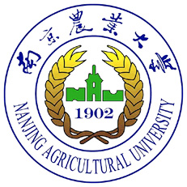
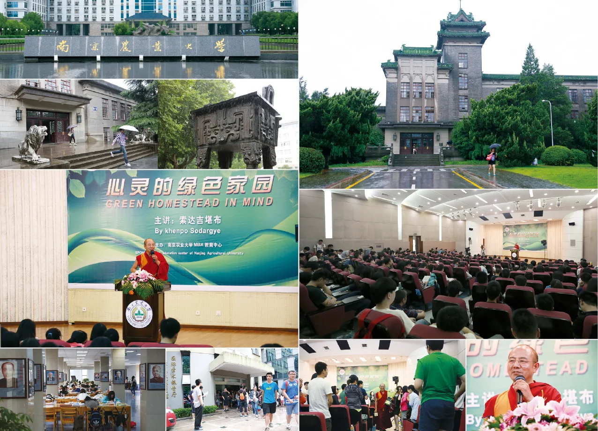
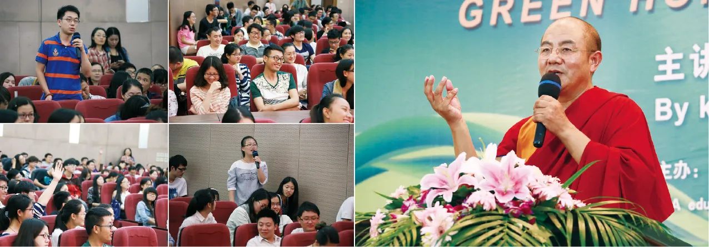
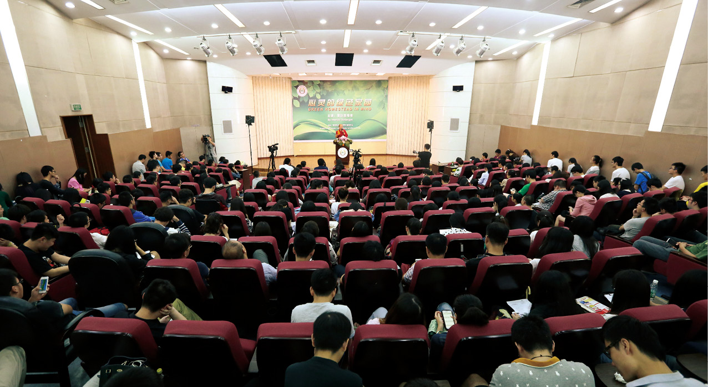
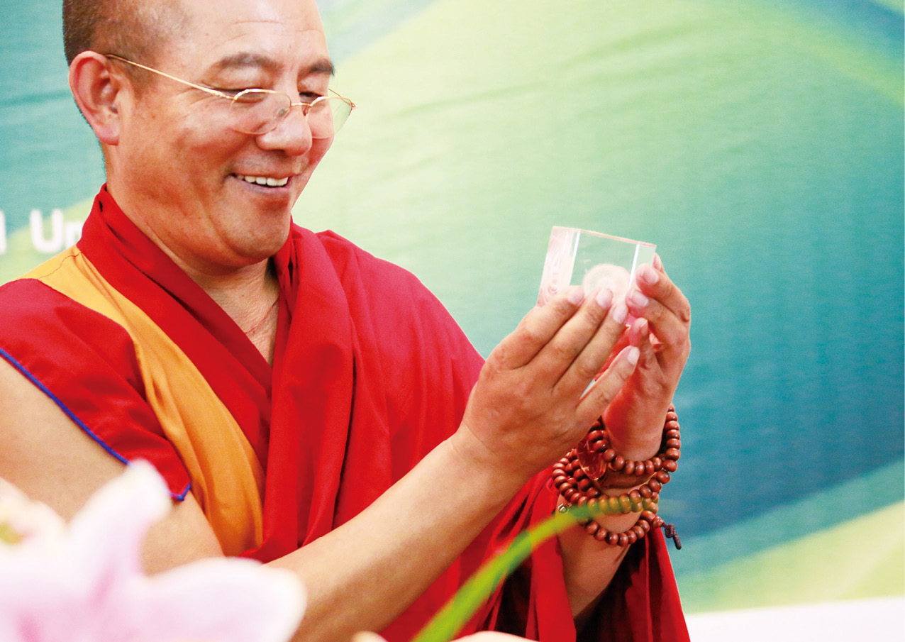
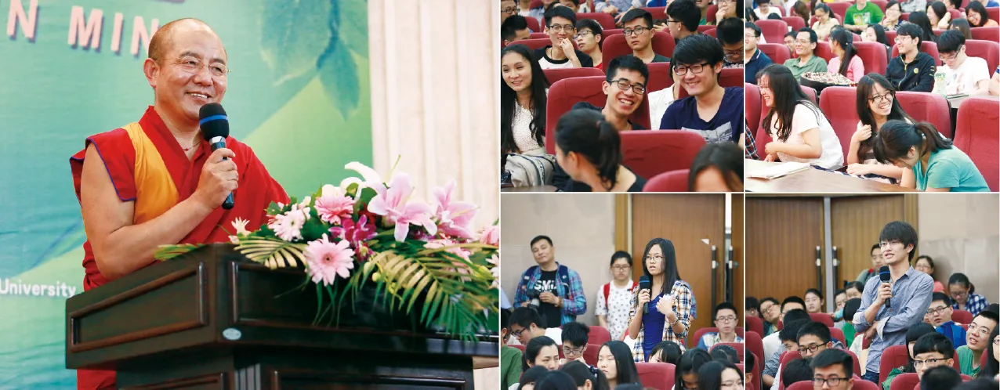

世界上很多资源都来之不易，

但贪婪让人对此视而不见。

第120场

南京农业大学

Nanjing Agricultural University

中国·南京

2015 / 6 / 28

## 心灵的绿色家园

## A Green Homestead of the Heart

主持人：

大家起立，恭请索达吉堪布仁波切！

借助一个殊胜的因缘，我们南农大MBA教育中心请到了索达吉堪布仁波切，来做“心灵的绿色家园”主题讲座。堪布不辞辛劳、远道而来，这次机会非常难得。下面有请MBA教育中心的办公室主任赵老师做欢迎致辞！

赵主任致辞：

我代表南京农业大学MBA教育中心，对索达吉堪布的到来表示热烈欢迎！

堪布是一位国际著名的佛学理论家，在国内外享有很高知名度。今天非常荣幸能请到堪布为我们做讲座，大家欢迎堪布上台！

各位老师、同学，很高兴在南农大跟大家交流！

昨天下午我还觉得，今天的讲座可能没办法举行，因为上午刚从福建飞到厦门，原计划下午六点从厦门飞南京，但在机场一直等，到五点的时候说南京大雨，航班取消。当时的情况还是比较着急的，想了各种办法，结果动车没票，包车又太远，来不及，最后只能先到上海，今天一早再从上海包车过来。

这次出行，我去了好几个地方，南京是最后一站。遇到昨天这种情况，本来想直接飞回成都比较方便，但后来又想，既然已经承诺了，那就尽量争取吧。

所以这次交流对我来说还是很不容易的。大家不一定有感觉，毕竟从宿舍楼走几步就能到现场。下午的时间也容易犯困，有些同学听讲座的时候可能会从头睡到尾，如果来到这里只是让大家睡了一觉，不知道有没有价值（笑）。但不管怎样，还是很高兴能跟大家分享。

今天讲的是“心灵的绿色家园”，一个关于“内心环保”的话题。“内心环保”可以说是我的“专业”，因为多年以来，我都非常重视内心的净化和治理，一直在这方面学习、修行。同时也和南农大的师生一样，对人类所处的生存环境以及与此相关的方方面面怀有兴趣并加以关注，像在佛学院，我也种树、养花，对诸如此类的事情有意乐、有爱好，这或许是跟大家共同的因缘。

## 心灵环保的基础：找到人生意义

大家也知道，无论什么身份的人，在这个世界上首先考虑的，必定是如何生存，没有这个基础，做什么都困难。

而当生存问题解决之后，就会想获得快乐。有人做生意，有人研究知识，有人学习技能，有人拍电影，有人游山玩水……每个人追求快乐的方法或许不同，但“我要快乐”的心是相同的。

那在快乐之上，有没有更重要的事呢？当然有。生而为人，还应该关心活着的意义。

论生存，动物也有同样的权利和能力；论快乐，动物也同样梦寐以求，尤其从一些高智商的动物身上，可以明显看到这些特点。而人与动物的不同就在于会思考：我的生命，对家庭、社会乃至世界，是否有意义？

有的人只关心自己，或者自己的父母、兄弟姐妹、亲朋好友……按佛教的讲法，这是寻求自我解脱者；但也有人不仅关心自己的圈子，还关心人类的生存、动物的安乐，乃至地球的未来，把这些当作生存的真正意义。

在座各位也可以观察，来到人间，你想圆满怎样的梦？人人都有梦，只不过有人一直做噩梦，有人一直做美梦，还有人是轮番交替。按照佛教教义，严格来讲，人生的确是一场梦，当我们离开时就会知道，此生经历的一切都会过去，就像梦中景象。

昨天的微博我也写了这样一段：每个人的人生，都有顺利到达顶峰时，也有受挫跌入低谷时。所以，成功时不要趾高气扬，落魄时不必垂头丧气，因为一切都会过去的。

所以要学会宏观地衡量人生。大家现在是学生，还没有步入真正的生活。将来，也许有人会觉得人生美好、快乐，事事顺心如愿；有人却在人生旅途中到处碰壁，苦不堪言。但即便遇到最痛苦的时刻，你也不必觉得此生无望，失去信心，失去生存的勇气和能力。

有些年轻人，遇到一次创业失败，或者感情上的一点挫折，就选择结束自己最宝贵的生命，这种现象在当今社会有很多。因此首先要明白，人生的基本价值是什么。我们需要观察，既观察自己该如何生存，也观察周围是个怎样的世界，这样观察下来就会发现，无论对环境的保护还是内心的治理，都越来越有必要。

## 人心定，才有海晏河清

讲到外在的环境保护，很多地方正面临污染，北京雾霾、天津雾霾，包括南京——几年前我问起，就说是比较严重，现在的情况可能更糟。据说雾霾已经出现在了海边城市三亚、世界屋脊的珠穆朗玛峰，乃至喜马拉雅山侧的青藏高原，甚至有种说法是它越过了大西洋、太平洋，给其他国家也带去想象不到的影响。很多人谈霾色变，如果雾霾的来源主要在国内，我想，这和我们自己的内心状况应该有一定关系。

曾经，中国大大小小的城市，都看得到蓝天白云；任何一片山林，都有清澈的溪涧，山清水秀、鸟语花香。古代禅师描写大自然的诗词，多么优美，让我们的心自然而然融入到那般清净美好的境界当中。可是如今，不少地方都要戴口罩，很多人也动辄感冒、咳嗽，活得越来越没有安全感。

不仅外在环境上缺少安全感，有各种传染、污染的威胁，内心的安全感更是匮乏。有些人读书的时候，担心考试、升学，担心比不上其他同学；成家立业了，担心生意会不会亏本，工作会不会被领导骂，明天会不会有意外；到下个阶段，人老了，又担心钱够不够花，会不会突然生病、死掉……一辈子都在患得患失、惶恐不安中度过。一方面，环境会给人们带来压力；另一方面，人们的这种心态也在向大自然施加压力。今天的地球已经不堪重荷，很大原因就来自内心环境的恶化。

为什么会这样？因为缺少一种好的、正确的价值观教育。

以前复旦大学投毒案，当凶手被问到毒杀室友的原因时，他说：“我是个很空的人，是个没有价值观的人。”的确，不要说利益他人的价值观，即便最基本的，如何做一个好人的价值观，在一些人的内心也是缺失的。从小到大，从幼儿园到大学，上过多少堂课，但其中的大多数内容，可能跟我们的人生关系并不大。

而在复杂的社会环境中，人心难免受到染污。当越来越多的知识为这样的人心所操控，知识就成了一种可怕的工具。那些尖端科技一旦落在贪欲旺盛的人手里，很可能对外在环境造成惊人的破坏。

比如，过去砍伐森林、开采矿产，主要靠人力，现在换成高科技，挖山毁林的力量骤增；过去捕鱼靠垂钓、撒网，现在的高科技不仅大肆捕捞，还对整片海洋、江河的生态都造成污染、破坏。新闻上就报道过长江流域一些世代捕鱼的人家，因为水污染，现在捕的鱼连自己都不敢吃，直接卖给别人。

## 消费透支，谁为欲望买单？

而人心的染污，就在于有了许许多多欲望。这种贪欲很可怕，原本一个人拥有的食物、衣服、车子、房子，能满足基本所需就好，除此之外的很多东西，用智慧一观察就明白，不过出于贪婪而已。这些欲望，不仅给自己造成压力，它所带来的过度消耗，也让全人类都在承受压力。

我曾经见过一个这样的人，他对佛法略知一二，但没有特意去学，闲谈的时候，说自己经济条件还不错，在全国几个一线城市都有房，每处居所都有大衣橱，每个衣橱都放置了几百件衣服。他说，这些衣服如果轮着穿，可能三四十年也穿不完。

一个人就有这么多衣服，有些不仅是衣服，还占有很多土地、房屋、资源……这样的话，其他人还能用什么？

我们很需要观察：自己正在享用的一切，与外面世界有什么关联？比如身上的衣服，好像轻而易举就能得到，但仔细去了解，它是什么布料、来自哪里、在工人手上要经过多少工序才变成现在看到的样子……就会知道它的来之不易。

前段时间，我参观了武夷山的一个茶厂，从市场上买一包茶叶是很容易的，但实际上，从采摘、晾晒到包装出厂，我们喝到的一杯茶，包含了很多工艺和辛苦；我也看过青岛的一个糖果厂，他们制作糖果的过程同样不容易，每个环节都倾注了工人的心血；我还去过一些服装厂，有些是监狱办的，也有普通工厂，在那里，哪怕一条裤子都有好几拨人分工合作，一段一段、一步一步地做出来……但人们往往把这些看得很简单，新衣服穿两回就扔在一边，又去买新的，丝毫不觉得可惜。

当我们享用这一切的时候，应该去想想它们的来源。看起来只是一件衣服、一杯茶、一颗糖，但在它们背后，是多少工人的劳动、多少工序的配合、多少原材料的消耗。这样观察之后，就会在很小的一件商品上，发现许许多多来之不易的资源。

世界上的很多资源都来之不易，但贪婪会让人对此视而不见。以前看新闻报道，一个巨贪，可以在上百座城市购置别墅、产业，拥有几十辆豪车。贪欲膨胀到这种程度，他自己恐怕还意识不到。

现状的可怕就在这里，如果人们不观察内心，就会在“我要”的驱使下毫无节制地追求。这种追求会导致什么后果，大家可想而知。

## 心的垃圾站，要清空了

今天的中国人应该是生活节奏最快的，白天连轴转，晚上特别累，稍微闲下来就只想睡觉，没什么精力，第二天睁开眼，又是奔忙的一天。走路风风火火，好像慌不择路；开车闯红灯，等不及绿灯出现；排队没有耐心，总想往前插……做什么都要快，要立竿见影。几年前，《新周刊》刊登了一篇叫《急之国》的文章，描写了很多现代人的心态。的确，如果人一直处于极度忙碌中，内心可能没办法得到安宁。

这时候的心，尤其需要清除垃圾。什么垃圾？贪婪、嗔恨、愚痴、傲慢、嫉妒、谄曲等烦恼。这些都是有害垃圾，像毒品一样侵蚀人类的心灵。它们看起来很寻常，但你不能习以为常。而佛教对内心世界的诠释、解读，正好为此提供了方法。

### 1．因缘观：人类不是主人，只是成员

人和自然界、动物界，是相互依赖、观待存在的，并非像有些人以为的那样，“一切为我所主宰”“动物是我的食物”“想吃什么都可以”……一味地破坏环境，杀害、食用其他动物，最终只会给自身带来灾难和痛苦。

宇宙之中，自然有心灵延续的规律，它形成了人们所谓的“命运”，当这条准绳被破坏，命运也将展现出可怕的一面。所以我们首先要懂得：自我的存续，与外在环境、其他生命息息相关。

但很多人相信“人定胜天”，认为人可以控制大自然，对它有生杀予夺的权利。这种观念的错误就在于，不懂万法互为因缘、互相依存的道理。

佛法中说：“诸法从缘起，如来说是因。彼法因缘灭，是大沙门说。”意思是，诸法由因缘聚合而生，这个道理是佛说的；当因缘散灭时，法随之而灭，这也是佛说的。

这句话比较专业，你们不一定能完全明白，其中包含的道理、秘诀，确实很多科学家、学者也没有发现。万事万物都有它特殊的因缘，有显现上、实相上、理论上、实践上的各种道理，我们要用智慧来观察，依照觉悟者指示的路去寻找，才能真正了达。尤其是理性思维比较强的人，不妨去探索一番，自然就会明白。

### ２．因果观：杀戮换不来安宁

外在环境和内在心灵之间也有一种因果关系。看起来，一个天堂般的美丽世界，似乎是独立的自然景观，但实际上，它直接或间接受到人们共业的影响。佛教中，这叫“增上果”，也就是说，你所感受的环境，取决于自己曾经造过的善、恶：行善多的人，身边环境会很美好；干坏事的人，则会生在恶劣、粗暴、不悦意的地方。这种因缘关系，我们也要明白。

从17世纪开始，以笛卡尔为代表的西方思想家宣称，人类是一切的主宰，但无数事实证明，我们只是大自然的一个成员。任何人在享用自然资源时，都应该谨慎而行；那些肆无忌惮破坏自然、扼杀无辜生命的人，到了一定程度，必然会受到报应和惩罚。

北京有个领导，有钱、有地位，但他为了长寿、养颜，每天都要吃一只乌龟，而且厨师杀龟的时候，他就在旁边看着，欣赏厨师在乌龟伸头的瞬间如何手起刀落，每天如此。通常乌龟可以活到百岁以上，但他为了延续自己的寿命，已不知夺去多少乌龟的生命。

有些地方的杀生情况很可怕，像广东、浙江，包括广西的玉林狗肉节，宰杀动物的种类、数量都骇人听闻。发生这种情况，国外会有环境保护组织、动物保护协会出面干涉，但在国内，这方面的知识、概念还比较缺乏，很多人尚处在愚昧迷茫中。

对此我也能理解，毕竟从小到大，课本也好、社会也好，对杀生是不避讳的，甚至大肆宣扬。所以，其他国家鲜有人穿的皮草，中国人爱穿，每年都有大量动物被宰杀，剥下的皮毛被制成防寒衣物；其他国家买不到的象牙，中国人爱买，只为了做成各种摆件、装饰；其他国家不敢吃的物种，中国人爱吃，天上飞的、水里游的，但凡觉得美味可口，就随意杀戮。

但从因果观来讲，残杀动物，判它们无期徒刑、死刑，之后又用它们的躯体满足自己的口腹之欲，做成工艺品、奢侈品……你以为这是个快活的世界？实际上，它或许会变成你的悲惨世界。

有时候想想人类的这种价值观，用生命平等的标尺来衡量，是极其恐怖的，甚至超过了恐怖主义，因为恐怖主义还有针对性，它的目标只是个别人，或者某个政党、派系；而对动物的杀戮，几乎涉及一切生命，早已突破了道德的底线。

如果人类日益失去慈爱和悲悯，不断增长贪婪和欲望，借助越来越发达的科技，最终会做出什么？对今天的青山绿水，不会在乎的；对后世的子子孙孙，不会考虑的；对身边的动物朋友，可以做出种种践踏、伤害、掠夺的暴行。只管占为己有，不惜毁坏殆尽。

我讲的，并非仅限佛教的教义，而是普世的生命平等观。真正的绿色家园，要从我们的内心来建设，如果内心布满猩红的血迹，如何能过上绿色的生活？

## 回头，看看那些古老的教诫

带着这些理念重新审视世界，它其实并没有那么美好。也许你们不太认同，觉得院子里开着那么灿烂的花，校园的绿化做得也不错，哪里不好？的确，这个时代与过去的任何时代都不同，可以创造出史无前例的绿色工程，但从另一个方面讲，今天的贪心、嗔恨、愚痴也变得前所未有的炽盛、可怕、厚重。

一个人拥有多少车子、房子、人民币都觉得不够，这种贪欲是古人没有的；各种暴力语言和行为，从网络蔓延到家庭，乃至发泄在父母至亲身上，这种猛烈的嗔恨，古人也闻所未闻；还有很多愚痴的行为，细思极恐，那么多人，每天拿着手机，刷着无意义的碎片信息，以此充斥自己的感官，似乎过得舒服惬意，其实让自己的学识、素养，都停留在一个浅薄的层面，真正有意义的书籍、思想，能深刻影响心灵的，又有多少人在看？

我们现在学的知识，也与上个时代不同，古今中外的文化交汇杂糅，难辨良莠，低俗信息又前所未有地泛滥，人们可能知道很多，但在内心深处，仍会茫然、盲目。此时，其实很需要重拾我们的传统文化——那些真正的智慧，年代越久越有价值。

我们有古老的历史，但今天的大城市，很少看到成百上千年的建筑，古建筑几乎都被推倒了，取而代之的是千篇一律的钢筋水泥。而在国外，数百年的经典建筑随处可见。

我们有悠久的文明，但在今天大部分年轻人的心里，很难找到古文化的印迹，很多知识体系都来自西方、日本、韩国，来自电影、网络、游戏……而这些又能为人生添加多少价值？吃饭、睡觉、谈恋爱，买车、买房、赚点钱，难道就是人生的全部意义？我们都应该做一点事，做一点不光自己喜欢，也对社会、世界有用的事。

## 利他心，才是人类的绿色家园

或许我有点悲观，看到很多人考虑的都是自己——自己的生存、自己如何赚钱过日子。这样的教育导向和关注点，会对外部环境、内心世界带来怎样的破坏和影响？据说包括中国在内的全球80%的资源，都掌握在20%的人手里，为什么会这样？因为人的贪婪。只要有权利、地位、手段，就可以无止境地占有。

因此这个时代，也比以往更需要培养爱心。我曾经看到一本书里说，在某个极度贫困的地方，那里的孩子苦得连表情都失去了，而大城市里的人有怎样的财富、资源、能力，大家都很清楚。

我们需要环保教育，不仅需要美化外境的环保，更需要清净内心的环保——从佛学智慧来讲，就是认识自我，知道人为什么而活。否则，我们如何能主宰自己的灵魂，又谈什么主宰自然和其他生灵？

要经常扪心自问，我是什么样的人，活着的价值是什么，又有怎样的人生梦想？只是继承家业、繁衍后代吗？如果是这样，那和蝼蚁有什么差别？它们也是终日忙碌，寻找食物、建造房屋，下雨的时候躲起来，天气好了就晒个太阳，也有自己的沟通方法，会和朋友聊天……

要有一颗利他的心，这才是人类区别于动物的灵魂。有了利他心，才能真正认识自己的使命，做自己的主人，也才有资格拥有大自然，有能力造福其他生命。

## 真正的成功，是爱与善良

而一个人如果尽己所能地想去改变世界，也完全有可能实现。

20世纪80年代的法国小镇里，有个16岁的男孩，就为家乡的环保做出了奇迹般的贡献。

当时他父亲得了严重的肺病，医生说一定要呼吸森林里的新鲜空气，才有一线生机，但小镇根本没这个条件。男孩出于对父亲的爱和报恩，决心在家门口种出森林来，于是拿着微薄的积蓄，从很远的地方买回树苗，拼命地买树、打工、攒钱、再买树……

起初很多人笑他，觉得这是不可能的事，但男孩一如既往地坚持，几十年间，真的种出一片茂密的树林。他带着父亲在林间呼吸新鲜的空气，后来，父亲的肺病果然痊愈了。

你们也是年轻人，如果内心有一种力量和勇气，从身边做起，你也完全可以改变周围的环境，改变这个世界。

我还看过一个发生在印度的故事，同样是一个16岁的男孩，从1979年开始种树，经过36年的努力，种出了550公顷森林。其中的艰辛难以想象。

刚开始，这座岛上有很多自然灾害，野生动物也在慢慢消失。男孩想保护这座岛，经过咨询，得知主要原因是缺少森林，就决定在岛上种树。他求助过相关部门，但谁都不理他，他只好独自坚持下来，用36年，凭一己之力，把这座干涸的沙岛变成了郁郁葱葱的森林。森林里有各种鸟兽，还有鹿、犀牛、老虎、大象等濒临绝种的动物，堪称野生动物的天堂。

这个故事后来被一个加拿大导演拍成纪录片，全世界的人都为之动容。

如果一个人，每天只想着自己，抱着自私自利的心，恐怕永远做不成这样的事，或者即便做着很大的事业，也不会有太大意义。很多所谓的成功人士，有钱有势，但他们追求的只是自我创造、自我扩张，从某种意义上讲，我并不觉得这很成功。真正的成功，是对别人来说的，无论从精神层面还是物质层面，无论对一个人、十个人，还是成千上万人，能让他们获得真实的利益，才叫成功。

因此成功的关键，在于你的心是否清净，有没有一份爱与善良。善良的人是有光的，这种光芒会照亮周围，逐渐扩展到整个世界，为所有人带来温暖。

今天我们讲的是“心灵的绿色家园”，对外在的绿色家园，大家都比较关心，但正如前面所说，我们更应该关注内心的清净和美好，让它永不变色、永不衰老。这才是最重要的。

现场互动

主持人：

感恩堪布的慈悲开示！信仰宗教可能需要很多因缘，但是懂得生命的平等观和因果观，我想对每个人来说都非常重要。

接下来，同学们可以和堪布展开交流。

问：堪布您好，您说要认识自我，知道自己是谁，那我该怎么知道呢？问身边的人吗？还是说问自己？

堪布：自己寻找自己。你都不知道自己是谁，别人又怎么知道？（笑）

问：可有些时候，自己的心是迷茫的啊……

堪布：可有些时候不是啊。（笑）

问：我去年到过喇荣五明佛学院，曾经在坛城附近的一个觉姆家聊天。我问她为什么来这里学习佛法，她说，因为会有一个比较好的来生。可我觉得，如果你连这辈子都过不好，只是片面地想通过学佛追求来世的美好，到底有没有意义？请问您对这件事的看法。

堪布：这个问题，你应该当场问她比较好，不过我也可以回答你。

首先佛学院的觉姆区，一般情况下男众是不能去的。觉姆是女众出家人的意思，女众区男众不能去，男众区女众不能去，你到了女众区，跟女众问话，这和我们佛学院的纪律有一点违背（笑）。但也不要紧吧，坛城附近有一些公共区域，或许你是在那里。

你问这样学佛有没有意义，那要看她有没有利他心。如果有利他心，不管这一生有钱没钱、长不长寿、在人前风不风光，都可以活得非常有意义；反过来，如果出家学佛，目的只是为来世的美好做准备，按照大乘佛教的观点，这并不是很圆满，因为毕竟有自私的想法。

不过，很多人连自己有没有来世都不知道，相对这些迷茫的人来说，这样想也可以。就像原本有今天明天、今年明年，有一群人只承认今天不承认明天，只知道今年不知道明年，而另一些人懂得了未来的存在，并且为之奋斗，这也不是愚昧。

所以对那个觉姆的观点，要看从哪个角度理解。站在利他心的高度，她还有一种自私心、片面性，并不圆满；但跟不承认后世的人群相比，她对此深信不疑，真的想在生命中为之做一些准备，这也很有意义。

包括前面第一位同学的问题，到底“我”是什么？其实很多人都不了解。虽然在座各位受过高等教育，和社会上大部分人相比，应该更加高尚、有智慧，但从某个层面来讲，如果对生命的来龙去脉、对人生的真实意义还不了解，尤其对自我的本来面目浑然不知，那可能需要在这方面努力完善。

按照佛教的方法，就是观察“我是什么”。人们都习惯了说“我我我”，认为这副躯体是“我”，存活在这一世的生命是“我”，一旦躯体死亡，“我”也随之烟消云散，除此之外，从来没有关心过是否有“从前”和“以后”。

这不怪大家，因为我们受到这个时代很多思想的牵制。但不管怎样，还是要经常想想这些问题：“我”到底是什么？生存在世间，要完成怎样的事业？……到某个时候，可能就会明白生命的意义所在。

问：您今天多次提到利他心，提到要为社会创造价值，但现在有一种现象是，老人摔倒了，大家都不敢去扶，或者类似的好人好事也不敢去做，因为怕得到不好的回报，让自己委屈。请问您对这种现象怎么看？我们要如何遣除内心的疑虑，去创造社会价值？

堪布：利他思想，我不是今天才在这里讲，不管在什么场合，只要跟当时的话题稍微有一点关联，我都会提到。人活在这个世界上，能够利益多少人，与自己的缘分、福分有关，但只要有一个人受益，就值得去做，因为人生成功与否，的确跟利他密切相关。

我一直认为，没有利他心是非常可惜的，而利他心的培养并不难，如果从小对孩子有这样的教育，对周围的朋友能传递这样的思想，很多人都可以生起利他心。

但现在有一种倾向，觉得利他、慈善好像只是有钱人的事，只是个别人的爱好，并没有把它看作人类需要共同努力的理念。

看到某个慈善家热衷于捐助善款，大家会说：“他还是可以啊，肯做这样的事。”但这丝毫不影响自己继续做一个利己主义者，不会想到自己也去付出爱心和行为。很多人觉得，利己才是生存的价值。

媒体舆论也在宣扬个人主义：老人摔倒了没人扶，孩子被车撞了没人救，环卫工人满身是血坐在路边，没有人施以援手……各种新闻报道，让人感觉这似乎是一个冷漠的社会。

但不管别人如何，我个人遇到这样的事，还是会倾尽全力去救、去帮助。而且一个人的力量有限，哪怕十个人、一百个人，力量也是有限的，需要更多人有这样的信念。

演讲中我也说过，当你有了改变世界的信念和志向时，一定可以做成一些事，尤其是年轻人，应该都有这个能力。但生活中，很多人贪的是物质、自我享受，整天只关心吃什么。像一些人聊天，无非是“你今天吃了吗？”“我吃了火锅，你呢？”虽说吃也是一种生活意义，但更重要的应该是：你今天利他了吗？

我见过很多成功人士，生活、事业各方面都经营得不错，但这种“成功”只代表他有钱、有地位，如果没有用来利益社会，我并不觉得这是真正的成功。见到老人摔倒不扶、见到别人有难不帮，再多的财富、权势、地位、能力，又起到了什么作用？甚至对某些人来说，反而会成为害人的资本。

古人说：“天之道，利而不害；圣人之道，为而不争。”这种传统是顺应自然之道的，是人生在世的基本准则，无论对人类、动物，都不害、不争，尽量帮助、利益。但今天已经反过来了，变成“害而不利，争而不为”。一个只想自己，不考虑别人的人会怎样？做了领导就会以权谋私，经营企业就会唯利是图。

这并不是中国才有的现象，全世界都是如此，从股市到科学实验室，都有利己主义的市场，这些人的所作所为非常可怕，我们置身其中，也会忐忑不安。

所以要从小培养利他的精神。即便扶起摔倒的老人，可能会遭受误解、谴责，甚至被要求赔偿，但不管怎样，还是要果断去救，毕竟那是一条生命。

这样做了，才算是高尚的人；不这样做，我又算是什么？对此，每个人都可以扪心自问。

问：堪布您好，我是国际贸易专业的。您在讲座中说，人是自然界的一部分，不应该杀生，不应该随意破坏自然，这让我有了深刻的了解。但您特别提到玉林狗肉节，我不是佛教徒，从一个普通人的价值观来看，不太明白同样是养殖的肉类，吃狗肉跟吃猪、羊、牛肉有什么区别？包括吃素和吃肉又有什么区别？佛教当中是否有具体的解释？

还有一个问题是，现在信佛的人越来越多，尤其一些明星、名人，信佛的现象很普遍，很想知道佛教为什么会有这样的吸引力？

堪布：我的意思，不是只反对吃狗肉。吃其他动物的肉，同样是不好的，只不过狗肉节的现象比较特殊，为了这么一个“节日”，杀害那么多狗，所以特意说一下。其实，吃狗肉的传统很多地方都有，从东北、广东到广西，屠杀之残暴，大家可能不太了解。赵薇、杨幂等明星都曾经直接反对，呼吁公众抵制。

实际上，狗肉只是一个代表，吃其他动物的肉同样不合适。大家可能没有和这些动物相处过，如果有机会跟它们一起生活，你会有更深的感触。

肉确实好吃，我以前也吃过，特别喜欢吃牛肉、羊肉，这方面的习气肯定有。不过藏族人不吃狗肉，因为民间有种说法是狗肉晦气，吃了会沾染不吉祥的因缘，其他一些民族也有不吃狗肉的传统。

但总的来说，倒不是因为有晦气就不吃，没有晦气就可以吃，而是当我们看过这些动物正常生活的样子，看到它们在大自然中自由自在地吃草、喝水，如此欢快，再想到它们如何被屠夫砍杀，但凡一个有悲悯心的人，都会觉得太残忍。尤其当你亲眼见过屠宰现场，这种感觉会更强烈。

大多数人是从超市里买回包装好、加工好的肉食，确实觉得跟蔬菜、瓜果等植物没什么区别，但你要知道，肉食的背后，是以生命为代价的，包含了宝贵生命被剥夺的完整过程，包含了大自然中那些天堂般生活的美好回忆。可是很多人对此毫无感觉，就是因为没有跟活生生的动物相处过。如果有一天，你能感同身受地想到，假如自己变成了狗，或是猪、牛、羊，而你吃过的动物变成一个人，提着屠刀来杀你，你会有怎样的恐惧，会如何垂死挣扎，会有什么程度的痛苦……你才会明白，原来肉食的背后，是一出出异常恐怖的悲剧，正在活生生上演。吃到你嘴里的每一块肉，都流淌着生命的鲜血，吃肉就是在吞噬生命。

当然，我并不是反对你们吃肉，要求所有人从此吃素，不是这个意思。只是对于人类的一些行为，如果不去详加观察，难免会跟着习俗、传统随波逐流。就像狗肉节这样的庆典，它背后那些不可逆转的残杀，规模已经相当于一场战争，这些可怕的事情，从过去到将来一直会发生，你要对此有清晰的认识，才能有所取舍。

相对而言，吃素当然更好。虽然从世间生物学的角度，把植物也称为“生命”，但在佛法中讲，这两种“生命”是截然不同的，我在其他讲座中已经分析过很多次，这里就不广说。总之，认为动物和植物有相同的生命，是一种错误观念，事实上，动物和人类的生命才是一样的，都有苦乐感受，都有希望和恐惧。

看到包装好的肉食，我们可能只想到这块肉是否新鲜、口感如何，但你还可以了解得更多一点。十几年前，我曾经专门去一些屠宰场采访、拍摄，也跟很多人了解杀生现场的情况，以及发生在他们身上因果报应的情节，后来写成一本书，叫《悲惨世界》。因为投入了多年时间在这方面研究，或许我的感受会更强烈，但你们也可以多留意、多思维：到底动物的血肉承载着什么？

至于第二个问题，现在学佛的人确实比较多，尤其进入21世纪后，学佛群体呈现出两个特点，一是年轻化，跨越了80后、90后，乃至00后；一是学历高，知识分子当中，教授、老师、学生都对佛学感兴趣。这其中的原因，可能有以下几个：

第一个原因，是现在的人思想比较空虚，通过信仰、皈依佛教，可以获得归属感、安全感。很多人的生活原本漫无目的，但学习佛法，至少让心有了归宿。这是从自身来看，在寻找生命意义的过程中，佛法可以体现出一种价值。

第二个原因，是一些名人，包括领导、企业家、明星等，他们往往有思想，有认真的生活态度，当他们从佛教中得到智慧、慈悲方面的感悟，就会更加投入佛法的学习。而他们的粉丝、追随者也会受其影响、带动。

第三个原因，是佛教可以给出一些科学无法给出的答案。很多人认为科学是万能的，的确，科学有它的功用、价值、意义，但在某种层面上也存在欠缺，因为它是一种经验主义。对于世界上看得见、摸得着、可思维的部分，它能借助仪器、公式、原理等简单化的途径交代清楚，而对于看不见、摸不着、无从思维的那些甚深、抽象的因缘，科学会变得盲目，在盲目的状态中，信仰科学的人有可能否认这些因缘的存在，认为“这不可能”“这是迷信”，但事实并非如此。

生活中，经常能看到科学无法解释的现象。比如有人拼命挣钱，结果不但没发财，还越发困窘；有人远远没他努力，却轻轻松松大挣一笔。又比如两个同学，就像南农大的两个毕业生，原本是同一个学校、专业、老师，也同样认真、努力，但再过十年来看，可能一个人顺风顺水、风光得意，成了人生赢家；另一个人却饱受挫折、痛苦不堪，最后一败涂地。这其中的缘由，科学分析不了，佛法却可以给出很多解释，为你揭示一条看不见摸不着，但真实起作用的因果之线，这也正是命运的奥秘所在。这些解释并不盲目，它是适合所有人的法则，依照这个法则，我们都能找到生命的规律，可以在各自的人生中对号入座。即便科学暂时不承许，真实的人生经验也不由得我们不承认。

人生并非只有一个眼睛能看到、耳朵能听到的外在物质世界，还有一个更加广袤深远的内在精神世界。对于内心的探索，科学中的最高层次应该是心理学，但这门学科也是20世纪七八十年代才萌芽，跟佛教两千多年的思想相比，差距还是比较悬殊的。因此我想，真正有智慧的人，在寻找生命意义的过程中自然会明白，仅仅依靠现代的物质主义、享乐主义，无法从根本上解决人生的重大问题，而佛学的理论和实践体系，往往能给出令人恍然大悟的答案。

当然，也有一部分人是出于盲目的信仰，这种现象肯定有。“别人在学佛，我也学；别人去烧香，我也去。”自己没什么想法，人云亦云，跟着别人跑的大有人在。

但不管是哪种层次，未来信仰佛教的人可能还会更多，特别是年轻人，通过学佛懂得一些道理，对自己的人生应该大有裨益，面对得失成败，会更加随心自在。比如失恋了、失败了，懂得佛法中无常观的人就知道，这是正常的，不要太执著；从来没学过这些道理的人，则会深陷在痛苦中无法自拔。听说这几天股市大跌，已经有人跳楼了，如果能懂得“财富都是无常的，谁也无法掌控”，应该不会这样。

佛法的利益就在这里，只是知道一个“无常”，至少不会跳楼，这也是修行的一种“大成就”。

问：我是在读研究生，平时对宗教也很感兴趣，想请教堪布一个跟印度哲学家克里希那穆提（Jiddu Krishnamurti, 1895-1986）有关的问题。您肯定也知道，他的观点是任何信仰，包括信耶稣、信佛陀，都是让别人的思想占据自己的心灵，用别人的思考替代自己的思考。像您刚才说，很多人信仰佛教，是因为有一种归宿感和安全感，而他的观点恰恰是，人生本来就没有安全感，寻找一个不存在的东西，只能陷入无明，你应该去觉知和这个世界的真实关系，这个真相只能自己寻找，找到之后，就能达到真正和谐、安宁的境界。他是反对依靠信仰耶稣、佛陀等来获得安全感的。请问您如何看待这种学说？

堪布：我对他的学说，有时候觉得不太理解。因为他反对一切学说，自己却又建立了一套学说。我看过他的很多文字，他的确反对任何的信仰，耶稣也好、佛也好，说这些都不存在，却又认为自己直接观实相的思想是合理的、存在的。如果真像他所说，一切都是假，那在假的世界中又有真实的建立，这可能并不合理。

我认为，如果他在破除一切观点的时候，能把自己的观点也包含进来，那就很好：“释迦牟尼佛、耶稣和我的观点，都是假的，都不存在。”就像佛教所说，在实相中，他方和自方的观点都要破除；在现相中，以如梦如幻的方式都可以建立。

佛教有很多层面的建立方法，既有如梦如幻的，也可以在实执重的人面前，暂时以实实在在的方式来建立，但这些都可以破除，都是假的、空的，到最后，连“假”和“空”也要破掉，统统不成立。

每种观点都有它成立的层面和场合，这些要说清楚，否则，破掉所有人的观点，却间接成立自己的，并不合理。要破，就连别人和自己的一起破，在生命的究竟实相上，确实一切观点都不存在。但他可能做不到，因为还需要在不同场合建立自己的学说，让大家安住于一种如何如何的境界。

他的书里，会讲到类似佛教安住于实相的方法，包括其他宗教中，其实也有很多类似的解说，这一点谁都可以讲。所以我们不如换个角度思考，以子之矛攻子之盾，用他承许的方式就能攻破他的承许：“既然一切观点都是假，那你对自己的观点承认否？”

问：我是国际经济与贸易专业的，个人不信仰任何宗教，但对所有宗教会怀有敬畏。

前阵子我看过一部藏传佛教的纪录片，里面讲到一对亲兄弟，他们是虔诚的信徒，平时住在简陋的山洞里；花很少的钱，维持最低的生活需求；没有任何社交关系，不和其他人接触；唯一的工作是读经，除此之外不做任何语言交流，认为那是对信仰的一种染污。

作为一个普通人，我在看片子的时候不太理解，但对他们的这种信仰特别尊敬，很想问问您，当信仰达到这样一种程度的时候，他们的人生价值在哪里？

堪布：首先，就像我前面讲过的，每个人追求幸福的方法不同，有些人是在大城市里，通过宏伟的事业来展现自己，获得快乐；有些人则是在这样的山谷、溪流边，过着极其简单的生活，尽此一生。但即便从世间来讲，这些修行人所感受的快乐，也许比我们更加特殊。像以前生活条件比较差的时候，为了一颗糖、一件衣服、一顿好吃的，人们都会一直盼着、等着。这方面，年轻人不一定有体会，那个年代的人可能更有感触。所以人的幸福感是不同的，同一件事，烦躁的人体会不出其中乐趣，但是一个清净的人，就能感受得到。

你没有信仰也正常，不可能所有人都过同一条河，每个人都有权选择自己的价值观和人生路。但是你对自己不了解、未涉入的学说和宗教心存敬畏，我觉得这非常好。

现在有些人，对自己不相信、不承认的事物，就嗤之以鼻，特别排斥、厌恶，但其实也说不出什么理由，这并不明智。我很想在这里提醒大家，对自己不了解的领域，尤其是流传几千年的这些宗教，还是不要轻易否定。

我对佛教比较了解，这么多年一直在研究、学习，对其他宗教，相对而言比较陌生，但当我进入其他宗教的殿堂时，还是很有敬畏感的，毕竟它们已经走过那么悠长的年月，相当于一位智慧老人，生存在不同的时代、社会和文化当中，至今没有衰败，没有被推翻，这说明它们有顽强的生命力，有不过时的价值。今天的人们对这些宗教应当有一种敬仰和尊重之心，这也是时代赋予我们的重要责任。

你问两兄弟从信仰中得到了什么价值，或者说他们在追求什么？在佛教看来，人生除了饮食、睡眠，还有一件更重要的事，就是完成“觉悟”大业。这个过程中，他们每天想的应该不是吃好、睡好、过得快乐，而是早一点觉悟内心的光明。当人越来越有所觉悟时，人生种种事，对他来讲也会越来越容易。

比如孩童时代执著的玩具，等我们长大再看，就会觉得很可笑。同样，在生命历程中，有着不同的智慧层级，普通人的执著放在证悟者面前，也会显得可怜、可笑。

总之，修行人的人生目标和价值，就是完成“觉悟”这件大事。对佛教没有信仰，或者信仰还不足够的人，想要马上理解这些也很困难。你所说的纪录片，只是呈现出他们外在的部分状况，而内在的生命长河，像阶梯般一步一步的进程，很难以外化的、纪录片的方式展现给世人。这是一个渐趋圆满的内心世界。

问：我是MBA的学员。人类有与生俱来的恐惧，我想它主要来自未知，比如每个人都必然要面对死亡，当我们一想到死后的世界是怎样，就会感到恐惧。对于这类未知，您刚才说到，科学是经验主义的，不一定能给出答案，我非常赞同这一点，也相信一些超自然现象的存在。但是回过头来，很想请问堪布，佛教关于轮回和前生后世的说法，又是基于什么依据，可以让我们深信不疑？

堪布：佛教前世、今生、来世三世轮回的道理，不是一两句话就能说完的，但事实上，如今也有一些真实的案例存在，你们也许相信，也许不相信。

前段时间，央视就专门报导过一个新闻——不过他们对这件事的态度比较神秘和微妙——是在湖南一个侗乡，有很多人可以清楚地回忆前世，许多新闻记者也去采访过。这是现在发生的事，还没有人能推翻和否定。

当然，前生后世并不是个别人的说法。以前我在南京大学博士论坛，也分析过前生后世为什么存在，当时用佛教教义结合现代科学的研究发现，讲得比较广。记得我站了三个多小时，因为他们疑惑比较多，我也引用了很多。

我还翻译过一本书，叫《前世今生论》，里面有大量佛法方面的论证。

在西方，很多科学家也在研究来世和轮回。我去美国弗吉尼亚大学讲课的时候，那里有一个塔克尔博士（Jim Tucker, 1960-），他和老师史蒂文森博士（Ian Stevenson, 1918-2007）都在致力于搜集轮回转世的案例，这些案例遍布全世界，其中有一些是毫无信仰的人。他们对这些人回忆的前世细节，本着科学的态度调查、核实，一一搜集。我在采访中，听他讲述了很多这方面的亲身经历。

我们受大环境的影响，从小接受的主流教育都在说前生后世不存在，从小接触的世界就不承认有前生后世。在这样的氛围中生活、长大，现在听到轮回、来世，难免会感到惊奇，产生怀疑、排斥，这是情有可原的；但我们也要看到，在藏地、不丹、印度、缅甸，在周边的很多地方，和你们年龄相仿的孩子，如果听到有人说前生后世不存在，他们也会惊讶，觉得这个人很奇怪，这种观点很迷信。

关于轮回转世的案例，我以前讲过很多，像佛教中第三世噶玛巴自生金刚的传记，对前世的回忆就非常精彩；还有不变金刚，讲述过自己长达两百世的转世过程。这些内容我已经翻译出来了，正在校对。

希望你们能在这方面专门花一些时间研究，自然就会明白，不承认前生后世其实是很荒谬的。

问：前几年网上流行一篇博文叫《世上有没有神仙》，争议颇多。我想请问堪布，您作为资深的佛学上师，对道家的修炼，比如通过辟谷治疗各种疾病之类，是如何看待的？

堪布：道教、佛教，包括儒教，这三大宗教的现状是：佛教还保留着教法的传承，也有信教群体——皈依的四众弟子；儒教只是一种思想，并没有特定的传承，比如从某位儒教大师开始，他的观点或仪式被弟子们一代代传下来——没有这样；道教也没有传承，但在部分信徒中，还是保留了一些特殊行为。

至于道教的教义，我在其他学校遇到一些道长时，也当面请教过。按照他们的观点，这个世上确实有神仙，修炼的最高境界就是成仙了道，这在道教历史中也有很多记载。

几个古老宗教都有各自的修行和成就，在世人眼中，它们神秘、奇妙，但历史上这样的成就者的确存在。所以我想，道教应该也有修行的最高境界，只不过在不同的教义体系中，对此有不同的称呼。

问：我是国贸专业的学生。前面那个哥哥问了关于来生的问题，我想问问关于今生的。

您之前讲到生命的意义，让我想起曾经看过的一本书——《再活一次，和人生温柔相拥》，它讲述了一个印度女人死而复生的经历。当时因为淋巴癌恶化，医生已经宣告她死亡，但在濒死期间，她以自己的意志选择重返人间，重生之后，淋巴癌也不治而愈。我想知道这是偶然现象吗？您有没有见过类似的例子？如果这种事情不是偶然，可以被复制，那我们是否不用再害怕绝症，可以在濒临死亡的时刻，用自己的意志创造生命奇迹？您怎么看待这个问题？

堪布：哥哥问来世，妹妹问今世。（笑）

按照佛教观点，生命中确实有很多奇迹。像西方流行的对濒死体验的研究，有些案例中，病人躺在手术台上，看起来已经死亡，但他的神识离开身体后，还能看到在场的抢救过程，后来神识重新进入身体，呈现“死而复生”。这方面我也了解过，虽然有些案例可能稍微带一点主观色彩，但大部分是比较真实的。

那是不是每个人都能创造这样的生命奇迹呢？也不一定，如果平时对死亡根本不关心，更谈不上好好修行，这是很难的。

在藏地，一些修行人从小都在练习面对死亡，想着死亡时要怎样祈祷，怎样把握自己的心识，佛教在这方面有许许多多教言、窍诀。因为活着的时候修炼过，一旦死亡真正来临，也会有一定的把握。

但是大多数人对生命如何终结，是不去关心、研究的，只会随着生老病死，离开这一世，结生于下一世、再下一世。这种自然规律必然存在。

而那些不负责任、为所欲为的人，正是因为不懂前生后世的道理，不懂这种自然规律，认为人只活一辈子，既然如此，活得光荣还是失败又有什么差别？有钱就好，得过且过就好，今朝有酒今朝醉。这种思想是不对的，佛经里讲：“不知后世，无恶不造。”如果不承认后世的存在，人会造各种各样的恶业。

有一本书叫《生命的真相》或者《前世今生论》，是我们学院一位堪布造的，他把现代科学和佛教观点结合得很不错。我把它译成了汉语，它在全世界也有多个国家的译本，你们可以去认真地看一看。现在很多人比较浮躁，看书不细致、不深入，连作者的真正意思也把握不了，这恐怕是不行的。所以我建议大家如果看的话，最好不要敷衍了事，至少看五六遍、十几遍，才有资格说前生后世到底存不存在。如果到那时仍然认为不存在，你也要举出确凿的依据，讲出清晰的理由。因为书中用各种道理论证了前生后世的存在，要反驳，也应该同样来论证。

可能对在座的年轻人来讲，前生后世是心中最大的疑惑，那不如先把这个问题解决掉，当你承认了生命的循环，再去修学佛法，就会比较容易。否则，即便学佛多年，可能也抓不住根本。

因此，不管是哥哥、妹妹，还是姐姐、弟弟，都值得在这方面下功夫。（笑）

主持人：

能现场聆听堪布关于“心灵的绿色家园”的开示，是一个非常吉祥、殊胜的缘分，相信大家也都从中有所体会、有所启发。

在今后的生活、工作、学习中，如果我们能够践行这样的价值观、因果观，一定会增长智慧，受益终生，乃至利益来来去去的每一次生命。
