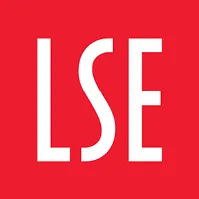
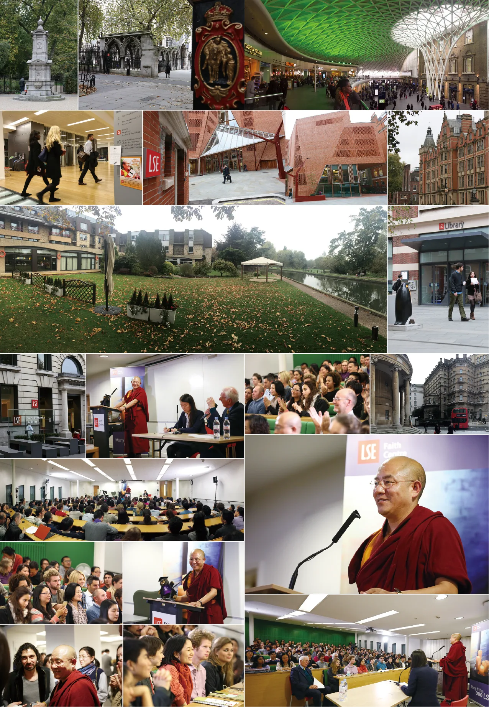
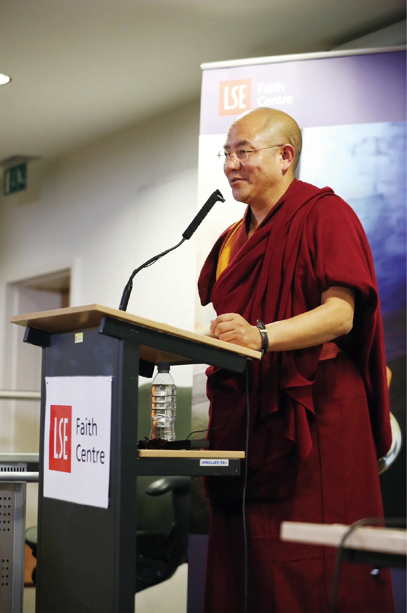
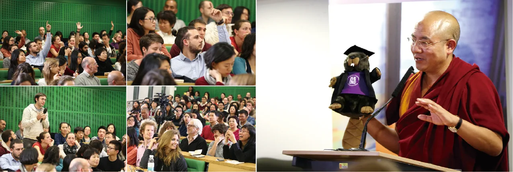

让我们痛苦的负面情绪，

犹如海面上的波涛，

并非自心的本来面目。

第131场

英国伦敦政治经济学院

The London School of Economics and Political Science

英国·伦敦

2015 / 10 / 20

## 佛教如何看待幸福

## A Buddhist View of Happiness

主持人：

大家晚上好！欢迎参加这次非同一般的活动。我是理查德·莱亚德，英国政经大学的经济学者，同时也研究和人类幸福相关的课题。在此，我非常荣幸地向大家介绍索达吉堪布仁波切，因为堪布是中国佛教界的领军人物，非常了不起。

堪布来自一所顶尖的佛教研究机构，并一直在那里研修佛法；他也是一位多产作家，著述涉及藏传佛教的各个领域；同时，堪布还是一位伟大的上师，拥有成千上万的弟子。迄今为止，堪布已在上百所大学进行了演讲，政经学院能够成为其中之一，我感到十分高兴。非常期待堪布今天的演讲。

本次演讲大约有45分钟。之后堪布会引导我们进行一个简短的禅修，相信会是一个很不错的环节。最后是观众提问，请提前准备好您的问题。希望这一个半小时能为您带来幸福！

很高兴能与这里的各位老师和同学们一起，就佛教如何看待幸福的话题进行交流。刚才我看到，你们学校有很多关于宗教的交流、讲座与修行，同时也有禅修的场所，这是非常有意义的。我个人认为，这个时代需要有一种开放的心态，在学习现代知识技术的同时，也要去了解古文化中的宗教思想。

## 佛教的政经观

首先，我想向各位简单介绍一下佛教经典中关于社会生活的一些观点。

可能有些人会认为，佛教是很古老的思想，无法跟上如今科技高度发达的现代脚步；有些人又认为，佛教思想只适合于极少数在寂静地闭门禅修的人，而对于整个东西方的都市在家人，却不一定适用。对于以上问题，我也一直在分析思考。

本来，我不是一名政治经济学的学者，从这个层面讲，我没有资格来政经学院交流。但因为我从事佛教研究的时间相对较长，所以，或许我可以用佛教的一些理念跟大家进行思想的碰撞。

佛教并不特别希求某种“实在”的幸福，而且，对于幸福的看法，佛教也持有各种观点和认知；并且在不同层面，也会有相应不同的解释。如果去研究这个来自两千五百多年前的思想体系，就会非常有意思地发现，它完全可以适用于现代化的经济生活。

佛教有一部经典，叫《杂阿含经》。经中讲到，作为佛教人士，应先学习世间的知识和技术。即便没有条件学习，也应从事农、牧业，或掌握一些建筑类等技术；或是从事工商业，生产或经营各种产品。现在所谓的工业﹑农业﹑商业，《杂阿含经》里都提到了。

而且我认为，这部经典所讲的内容，也非常契合现代经济学。比如经中讲，赚来的钱，应分为四份使用：四分之一用于日常生活开支；四分之一用于储蓄；四分之一用于扶贫等慈善；四分之一用于投资生意等。而现在很多年轻人却爱走极端，要么将赚到的钱全部投资，要么吃喝玩乐恣意挥霍。比如，很多英国人和澳洲人，会把所有的钱拿去旅游；而很多中国人，则会把钱全部储存起来。这些行为，都不太符合以上提到的将钱财分为四份使用的佛教经济观。

还有一部叫《善生经》的佛经，详细描述了什么是佛教所认为的合理的社会生活。经中并没有要求佛教徒全都出家或者都去寂静地修行，而是倡导大家应该在城市中过一种正常的生活。这部经还讲述了夫妻、父母、兄弟、主仆、亲友之间，应该如何维持良好的关系。对如何处理人际关系和社会关系，做出了非常清晰的指导，值得大家去研究。

对于符合道德的政治生活，佛教也非常重视。相关经典中，阐述了很多关于平等、和平、非暴力的思想，以及如何让人民安居乐业，让国家兴盛发达的建议。这些经典包括：《金光明经》、《仁王护国经》和《法华经》，这三部经典被称为“护国三经”。其中包含了很多治国的理念。比如，在世间方面，作为有德行、有慈悲心的国王和大臣，应该如何保护自己的民众；在出世间方面，如何通过祈祷消除世间灾难等等。以前很多修行人经常会念这些经，因为通过念诵的加持和威力，可以对国泰民安起到举足轻重的作用。以前，包括日本在内的许多国家，都非常重视这三部经。前段时间，我很想去叙利亚念《金光明经》的传承，但因为各种因缘，此计划暂时搁浅。

## 幸福禅

下面，我简单分析一下，我们应该怎样追求幸福。

大多数人可能认为：幸福来自外在的物质，比如，高档的房屋、昂贵的轿车，或者用之不竭的财富等等。一旦拥有了丰厚优裕的物质生活，就等于拥有了幸福。但实情却事与愿违，首先，财富往往是不稳固的，从开始积财，中间守财，再到后来担心财富耗尽等等，在追求财富的同时，掺杂着许许多多的痛苦。其次，即使拥有了财富，也并不意味着自己拿到了幸福的通行证。

另一些人认为，感情是至高无上的，依靠伴侣、配偶及深爱之人，能获得无与伦比的快乐。表面上看，很多人也的确从感情关系中品尝到了甜蜜。但如果以智慧来观察，依靠伴侣获得的快乐，一方面往往只是在青壮年时代比较鲜明，之前或之后的人生阶段，就难以有强烈的感受；另一方面，这种快乐所持续的时间也很短暂，若将其中的快乐和痛苦相比，大多是痛苦占了上风。

其实，依靠物质和感情来获得快乐，不是人类独有的行为，很多动物也有这两方面的追求，并且也能从中获得不同程度的安乐。

有些人将艺术作为自己的爱好，期望能依靠艺术来获取幸福。比如绘画、唱歌、跳舞，以及超越意识想象的各种美好等等，他们乐此不疲、陶醉其中。相对而言，在这些领域中获得快乐，需要的付出和伴随的痛苦都比较少。

有些人依靠世间的智慧来追求幸福。比如，某些大学教授或科学家，终其一生来研究某种学问，并将之视为快乐和享受。为了研究，甚至不谈婚论嫁，也不要求太多工资，甘愿为自己的专业付出一生的心血。

还有一些人，是通过做慈善事业来获得幸福。他们不顾自己的家庭和工作，一辈子做扶贫等利他之事，这是属于慈悲层面。

其实，不管是在慈悲还是智慧层面，如果发心清净，都会为整个社会和人类带来无与伦比的利益。

而更深层次的幸福，也许就只能从修行层面获得了。这里所谓的修行，实际上是指安住在自己的心性当中。比如现在人们常说的正念禅修，由它带来的幸福感，能够超越上述的全部类型。

为何禅修会有如此大的力量呢？因为在日常生活中，我们会产生各种各样的负面情绪，比如导致心理失衡的愤怒、贪婪、嫉妒，以及傲慢等。对人类来讲，当这些负面情绪一旦出现，即便物质再丰裕，生活也会变得一团糟糕，毫无头绪。所以，负面情绪对每个人的影响都非常大。

我认识的人很多，其中有一些是在藏地或山洞里面常年闭关禅修的人。如果审视他们的经济状况，饮食非常简单，穿着也破破烂烂，除此以外一无所有，但他们内心的幸福感却难以言喻。我也认识很多东西方国家的财多位高之人，但他们的幸福程度和修行人比起来，差距悬殊。

我倒是认为，每个人不论富有或贫穷，生活在何地，都可以享受自己本来就拥有的自性当中的幸福。实际上，当我们的心静下来时，各种各样的分别妄念全都会纷纷消于心性之中。此时，依靠这种平静和安住，我们的许多不合理的想法、不快乐的情绪和不正确的观念，统统都会被摒除。

## 快乐不必外求

我认为，很多人一心追求快乐，最终却事与愿违，是因为他们采用了向外求取的错误方法。当一个人不断外求时，就如同孩童追寻彩虹一般，无论怎样奔波，幸福反而离得越来越远；但如果能转向内求，则不管是什么身份，每个人都可以当下获得幸福与快乐。

以前，米开朗基罗（Michelangelo, 1475-1564）在意大利准备创作《大卫》（David）时，去市场考察，最终选定了一块可以作为原料的大石头。后来别人问米开朗琪罗：“您是如何发现这块石头的？”他答道：“很简单，我去采石场，看见一块巨大的大理石，我在它身上看到了大卫。我要做的只是凿去多余的石头，去掉那些不该有的大理石，大卫就诞生了。”其实，这是一个很好的比喻，它告诉我们，幸福不需外求，只要能摆脱与我们不相关的，本不属于我们的负面情绪的限制，安住于自心，当下我们就能够找到真实、本来的自我。

前段时间我们去牛津大学时，有教授说：“现在牛津大学的学生中，大概有百分之三十六的人，担心自己有各类心理疾病，从而寻求过心理咨询的帮助。”所以，虽然总体而言，21世纪的人类，在物质生活方面应该算极大丰富了，可与此同时，精神方面却越来越糟糕，心理疾病愈发普遍和严重。

对于自己心理疾病的成因，有人说是压力过大，有人说是所在地的天气不好，有人说是人际关系问题，有人说是感情破裂……其实，在我看来，上述种种理由，根本不会对一位真正的修行人的心理造成危害和影响。现在人们非常担心的各种问题，禅修者们也能轻易面对，并不会成为他们的痛苦之因。

不过，现在的很多人的确非常忙碌。所以，我在家乡藏地的时候，写过一本书，叫《你在忙什么》。就我所观察，以前没有电话时，一个人只能与身边的亲友对话；后来，出现了有线电话，如果双方所在地都有电话线，那他们之间就可以通话；现在，又兴起了无线网络，发明了包括微博微信在内的各类通信手段，这时，一个人就可以与全世界对话。但因为不同国家存在时差等原因，如果美国、北京的人都与我们联系，以一个人有限的精力，就难以应对了。我们的大脑容量是有限的，当各种信息纷至沓来、占据内心，就会使我们的正常思维模式超负荷运转，到最后，我们就可能变得不正常了。

有一种说法值得我们思考：“经济解决今天的问题，政治解决明天的问题，宗教解决未来的问题。”经济可以解决日常的诸多问题，为我们的生活带来便利；政治也许可以在更长时间内发挥作用，比如，世界上一些政治家的思想就流传了几百年；然而对于宗教，回溯过去，它已经有几千年历史，而且，未来它的思想仍会延续下去。所以，或许我们人类有必要用宗教来观察、约束自身的言行。

最后，按照教授的提议，我们将一起进行一个简单的正念禅修的练习，其内容主要是以心来观察自己的念头。希望你们可以将身心都平静下来，然后用心去看“到底我是什么样的”。在此过程中，当我们开始产生各种分别念时，就不断把心拉回到刚才的观察上。其实，随着这类禅修时间的增加，到一定时候，我们的生活会变得很有质量，很有品位。因为，世间的诸多烦恼和痛苦，是由于心的浮躁和焦虑所导致的；如果我们的心很清净，即使身在监狱或贫困之地，我们仍然会过得很开心，会变成一名乐观主义者。

禅修的时候，大家尽量平静下来，看着自己的心，观察各种起心动念。有些人可能会在此时认识自己的心。其实，当心真正静下来时，意识最深层的地方，就像大海的海底一样，才会显露出来，而它才是意识真正的本来面目；而平时让我们痛苦的各种负面情绪，则犹如海面上的波涛，并非自心的本来面目。所以，如果能经常性、习惯性地禅修，那你的快乐会与日俱增，你的生活品质和内在也会与众不同；其他人觉得非常痛苦之事，也根本不会引起你的焦虑。

下面，我们一起来禅修几分钟，在此期间，大家最好不要睡着……

现场互动

理查德·莱亚德教授：

太好了，非常感谢您！

现在我们有一些时间进行讨论和提问。有谁想要提问，请举手示意。请大家不要害羞。

问：物质上的幸福与精神上的幸福，二者可否兼得？

堪布：按照佛教的观点，追求物质而获得幸福虽然未尝不可，但更为重要的，仍然是精神上的幸福。因为相对来说，精神上的幸福层次更高，不易改变，可以持续存在，无论是青年、中年还是老年的时候都可以拥有；而依靠物质得来的幸福，也许只能存在一段时间，比如，一旦遭遇金融危机，就会消失无踪。

问：刚才您提到，很多有钱人并不快乐，因为总是担心失去钱财等等；而很多不太富有的人却通过禅修获得了快乐。那么，富有的人是否也可借由禅修处理自身的情绪问题呢？也许这会对他们大有裨益，因为他们就可以既拥有物质的快乐，也可以通过禅修获得更高层次的精神上的快乐。我想知道二者可否兼得？

堪布：富有的人在享受物质的同时，也能丰富精神、练习禅修，这是完全可以实现的，历史上有诸多先例，也非常值得随喜。相反，如果不懂得内心的禅修，想仅仅依靠物质带来快乐、充实和满足，就难以实现。而在贫穷者当中，也存在修行不好、不会禅修，各方面都窘困潦倒的人。正如我们所知，如果按照精神和物质的贫富状况进行排列组合，一般可以将人分为四种类型。

问：非常感谢您的演讲！我想问的是，佛教中是否真的有所谓的快乐？之所以这么讲，主要是考虑到西方的文化背景。其实，拥有快乐的同时，也往往伴随着失去快乐的担忧，这会带来痛苦。而佛教的宗旨，是要消除痛苦。所以，对于西方人而言，是否不应说“追求快乐”，而应说“寻求灭除痛苦的方法”，或者用“觉悟”这个词，也许更为合适？因为，西方文化对于快乐的解读，和我们今天探讨的主题还是有很大的差异。

堪布：其实你的问题，非常适合用刚才提到的大卫的比喻来解答。现在，世界上的人都认为，幸福来自很远的地方，我们必须向外求索；无论是感情还是财富，当自己拥有时，就得把它们牢牢抓住。实际上，佛教虽然也承认这是一种幸福，但除此之外，还存在一种我们自身本具的幸福和满足，只是需要我们去挖掘它、了知它、发现它、使用它。这个幸福更关键、更重要。

问：非常开心您能够来到LSE。作为LSE的一名研究生，以小主人的心情说一声：“欢迎您！”想送您一个小礼物，这是LSE的吉祥物，是一只小海狸，代表“勤勉”的意思，就如同您夜以继日地奔波于全世界弘法一般。

我的问题是，佛教会谈到“五戒”，而我的一些初学佛法的西方朋友会对此表示不理解。他们觉得，“五戒”是一种被动的约束，会限制他们的幸福。请问应该怎样看待这个问题？

堪布：很可爱，谢谢！

其实，五戒并非一种约束，它是两千五百多年前对人类制定的一种相对较高的道德规范。我认为，不管是东方或是西方，如今都很需要五戒。

“不杀人”，这条规定每个国家都有；“不偷盗”，不管在哪个国家，偷盗应该都会受到法律的制裁；“不邪淫”，是一种家庭伦理道德观念，对在家人非常重要，否则就会影响到正常的家庭生活；“不妄语”，打妄语的人，就是现在所说的骗子，我们当然也不能行骗；“不饮酒”，如果无节制地喝酒，对精神和身体健康，包括成办事情都会产生危害。所以，对一般人来讲，虽然没有“五戒”的说法，但稍微有素质的人，都应该遵守。如果违犯了五戒中的任何一条，可能都会给自他带来麻烦。

所以，我并不认为，五戒会给东西方任何一个国家造成损害。相反，通过守持五戒，人们的道德行为水准都会逐步提高。就像一所学校有学校的制度，一个国家有国家的法律，一个民族有民族的规范一样，五戒是全人类最基本的道德底线。

问：您之前演讲的第三部分提到，慈悲是获得幸福的根本因素之一。就我所知，藏传佛教极为强调慈悲心的修持。目前，在英国，为人熟知的有两种禅修，一种是正念禅修，主要关注自身；另一种是慈悲禅修，更多关注他人。我想知道，如何在这二者中保持平衡？因为正念禅修是纯粹的自我觉知，而慈悲禅修则更多地涉及关爱他人。

堪布：关注自身的这种正念禅修，是为了获得更高的修行境界，但为了别人的利益，也可以进行正念禅修。二者区分的关键，在于禅修者的意乐和动机。如果仅是为自己而禅修，力量和效果相对较小；如果是为他人而禅修，则会产生更大的功德和效益。

当我们开始慈悲心的修持以后，按照佛教的说法，就标志着进入了大乘佛教。当想帮助他人的意念不断增强，心量达到一定境界时，我们在实际行为当中，就可以真正帮助到非常多的人。为什么有的人看似弱小，但他却能帮助到世界各地的人？就是因为修行境界达到一定程度时，可以将这种神奇的力量运用自如。

当然，我们也可以按照次第来：在还未达到较高境界时，为自己而禅修；到了一定境界，心力有所提升时，再去进行慈悲心的扩展。

问：非常感谢您的分享。我的问题是，佛教如何看待死亡以及亲人的逝去？因为我觉得，虽然我们可以努力开发内心的安乐，但总有一些因素会限制我们达到那个状态。所以，我想知道，应该如何看待死亡？如何减轻死亡带来的痛苦？

堪布：当人在面对死亡时，确实不一定会快乐。

佛教从一开始，就探讨人的生老病死，因为这是每个人的必经之路。而有些国家和民族根本不能提及“死”字，他们认为这是个不吉祥的话题，故而非常忌讳。

但佛陀教诫我们，首先就应该对死亡有所准备，因为一切万法都是无常的。感情是无常的，家庭也是无常的，每一个人都终将离开人世。如果平时就有这种心理准备，面对亲友的死亡，即便会有一些伤心，但应该不会特别伤心。因为你知道真相如此，生命不可能永恒不变。每个人都会死，这是一个非常明确的规律。一旦我们对此产生了相当清晰的认知，不仅不会痛苦到难以自拔，而且会非常淡定。

我并非特意赞叹佛教，但我真心认为，对于包括无常、死亡在内的诸多问题，如果提前有过相应的修行准备，就能轻轻松松地面对生活的各种压力。

问：今天见到您来这里弘法非常开心！有一个关于放生的问题想请教：在欧洲，很难买到活的河鱼，这样就制约了很多想放生的人。另一方面，虽然在这里可以买到很多活的海鲜，但市场距离海边又有一定的距离。在这种情况下，意见就产生了分歧：有些人认为，要么不放，要放就应该运到海边去放；有些人认为，只要能把物命从屠刀下解救出来，可以先放到湖里，湖也通向海，这样总好过不放。

堪布：如果是海鲜，可能还是宁愿运输时间长一些，放到海里为宜。我们在中国放生的时候，会经常把物命运到两三个小时车程以外的地方去放生，而且每天如此。英国不算很大，应该去海边也不会很困难，所以，如果要放生海鲜，最好放到海里，以确保它们的生命安全。这方面大家要群策群力。

关于放生的问题，对放生感兴趣的人可以多加关心。我经常看到欧洲这边的动物保护主义者们举行示威游行，也开展了很多保护动物的活动，相信这方面应该积累了不少经验，希望你们好好研究。

理查德·莱亚德教授：

非常遗憾！没有足够的时间让所有人提问。不过毫无疑问，堪布的演讲让我们在场的所有人都受益匪浅！

平时我们几乎很少以这样的智慧来认知生活中的诸多问题，相反，我们更擅长于逃避。在我看来，毋庸置疑，现在西方的很多问题只有通过深邃的东方智慧，才能够得以解决。而堪布的演讲，正好精彩地展现了这一点。

很荣幸今天我们有这样的机会来聆听智者的教言！堪布，这是政经学院的吉祥物。我们大家都发自内心地感谢您！
