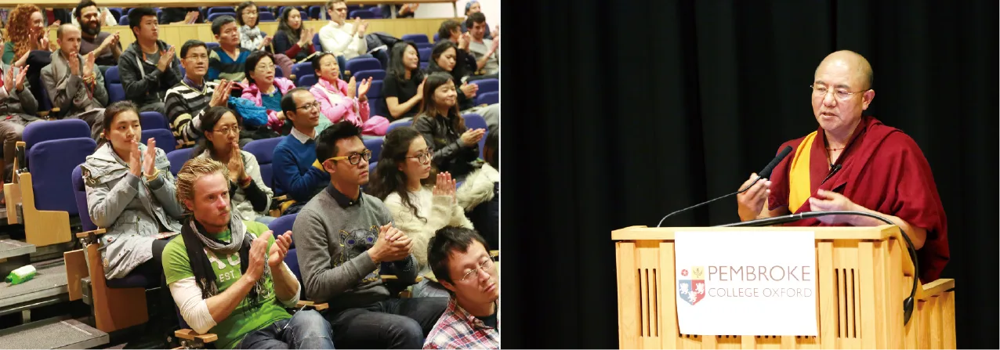
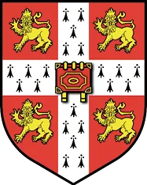
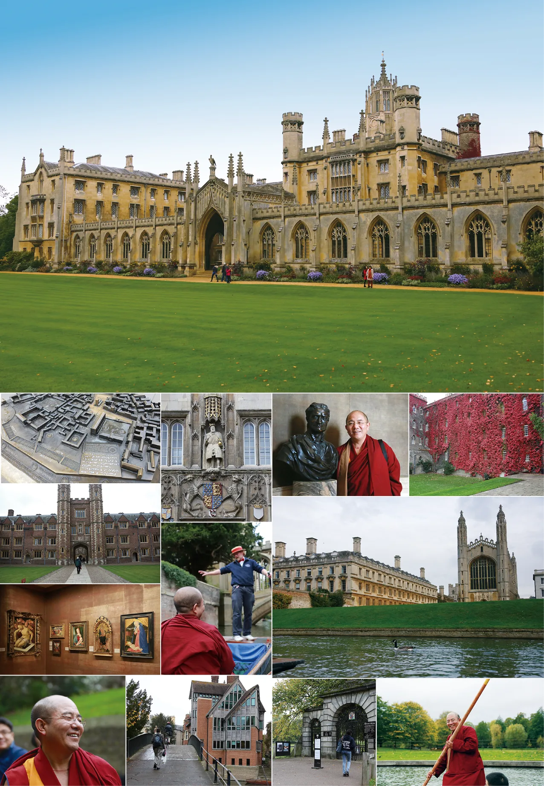
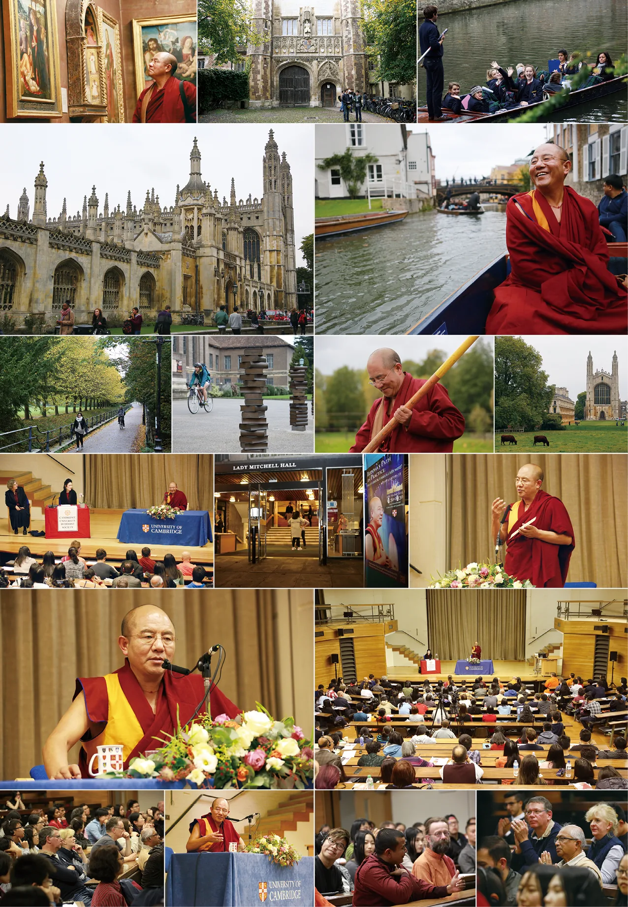
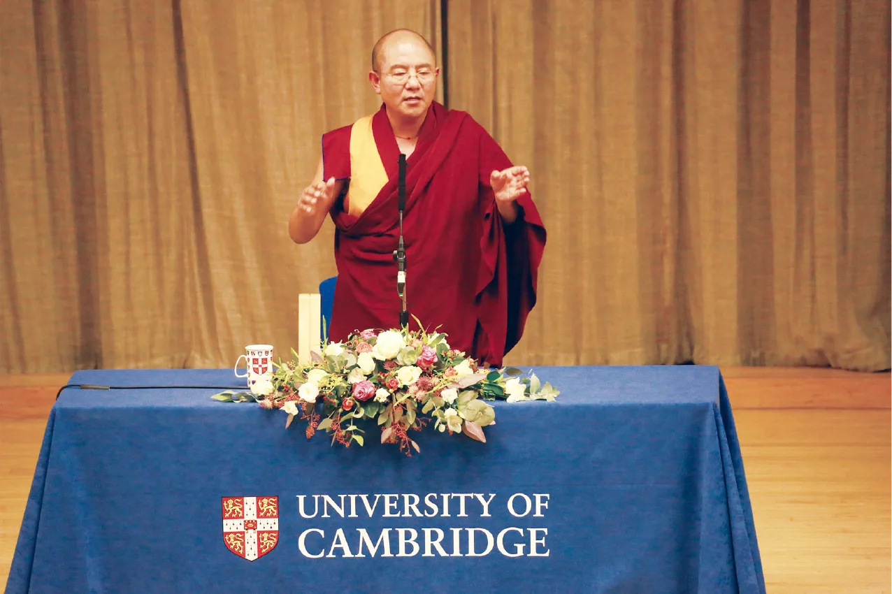
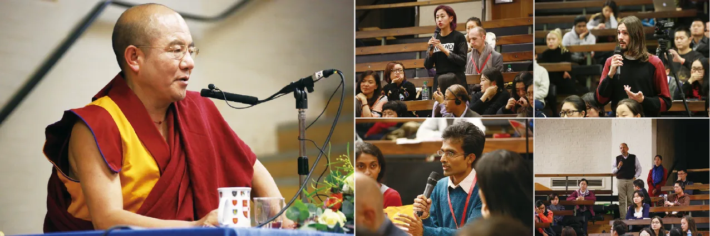
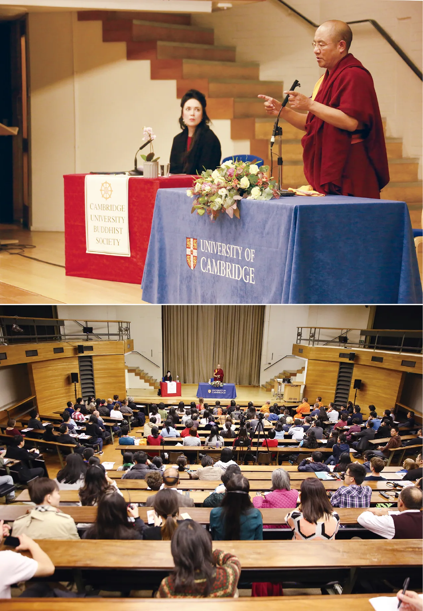
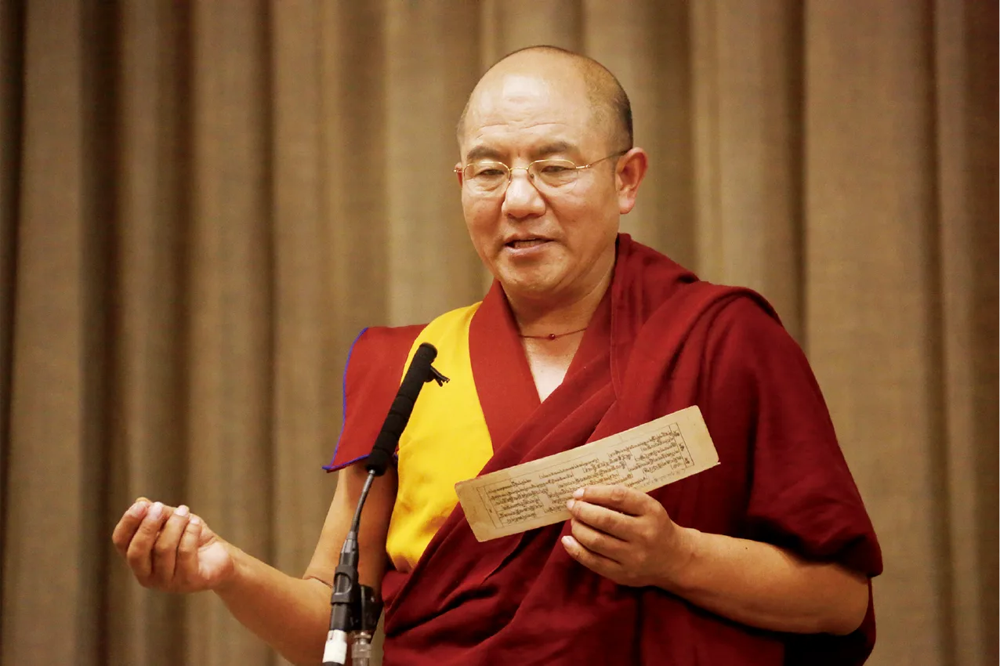

“成佛之后，

还要利益一切众生，

这才是最重要的。”

第130场

英国剑桥大学

University of Cambridge

英国·剑桥

2015 / 10 / 16

## 修持佛道

——为修而修还是通向更美好的世界？

## The Buddha's path in Practice -An End in Itself or A Means of A Better world

主持人：

尊贵的堪布仁波切、出家师父们，以及在场的各位朋友：

欢迎大家来参加由剑桥佛教协会（Cambridge University Buddhist Society）主办的这次活动！非常荣幸能够聆听索达吉堪布仁波切今晚的演讲。

堪布是在中国享有盛誉的一位上师，并且在西方国家也被越来越多的人所熟知。堪布接受过针对藏传佛教出家人的传统教育，进行了全面深入的藏传佛教理论学习和实修训练。在过去三十年中，堪布一直致力于让尽可能多的人接触佛法，让居士和出家人都能够接受到真正全面系统的佛法教育。

堪布仁波切是喇荣五明佛学院的一位资深上师。他不断通过网络与西方人交流，也造访了许多西方大学；为了使大众学修殊胜的佛法，堪布从传统而深奥的藏传佛教出发，积极将佛教的传统修持与当今的时代问题结合起来；他致力于将传统的内在禅修与外在行为融为一体，从而适应于当今世界的需求。例如，堪布建立了慈善基金，用以支持教育和健康事业；堪布总是强调慈悲关爱贫困人群的重要性，反对仅仅坐在禅垫上独自修行。

剑桥大学虽然同样是一个充满荣耀的地方，但是在座的许多人也可能体会到了，这也是一个充满痛苦的地方——源于现代生活方式的痛苦，以及生而为人不可避免的痛苦。而佛法能为我们提供的，正是治愈这些痛苦的方法。因此，怀着帮助所有人找到人生道路的心愿，堪布将进行今晚的演讲。演讲的主题，是“修持佛道——为修而修还是通向更美好的世界？”

今天能够在这里，和剑桥佛教协会的成员，以及各位老师和同学一起进行交流和学习，我发自内心感到欢喜。

众所周知，所有的佛法，都可以包含在南传、北传和藏传佛教里。今年我们在泰国，也与很多南传佛教的出家人进行了学习和讨论。尤其是在座有南传佛教的出家人，你们佛教协会也有一些是修南传佛教的，而我本人属于藏传佛教的体系，我们能如此团结友好，共同交流，这是非常殊胜的因缘。

## 人类的苦乐息息相关， 利他是我们共同的责任

20世纪是国家与国家之间频频发生战乱的一个时代，不管是宗教之间，还是人与人之间，都有不同程度的争端。从21世纪开始，情况有所好转，不管是国家、宗教以及人与人之间，以网络为媒介，而使相互的联系变得更为紧密。

当今时代的状况是，东方人在学习西方先进的科技知识，并将其运用于日常生活。尤其是东方的很多亚洲国家，他们利用西方的科学技术，进入了一个迅猛发展的阶段。同样，西方的学者和学生，也在不断汲取东方思想文化的财富。纵观历史长河，东方拥有浩瀚精深的文化遗产，能将之学习继承，我认为是非常必要的。一方面，东西方文化能够取长补短；另一方面，古今文化也能融会贯通。总之，东西方应相互借鉴，东方人学习西方的科学技术，西方人则学习东方的古文化和宗教思想。

今天我们交流的内容，主要是从佛教的角度来进行简单地分享和讨论——未来应该是为个人还是为整个社会的美好而努力？

对于佛法，我也算是闻思、研究多年。我认为，佛法不仅广博无边，而且深奥无比，想仅凭只言片语就体悟佛法妙味，实为异想天开。自利和利他到底谁更重要，也难以寥寥数语就水清石见。在有些佛法教义中讲到：当获得究竟的解脱果位时，会安住于灭尽定当中，此时没有任何烦恼痛苦，也可以说是住于涅槃。为了获得这样的成就，需要多劫修行。另有一些佛法教义则讲：成就以后，还要利益众生，即使获得了佛果，也需要继续为众生的利益而努力，利众是最重要的。

华智仁波切（1808-1889）是藏地出类拔萃的诗人和智者，是一位杰出而卓越的上师。他在《现观庄严论略义》中说过：“即便获得了佛果，也不算达到了最究竟的目的。成佛之后，还要利益一切众生，这才是最重要的。”

在座有老师说：“对当今时代的众生而言，佛法是治愈一切疾病的灵丹妙药。”不懂得佛教道理的人，可能接受不了佛法，这也情有可原。但真正的佛法研究者和修行者，都会了解佛法对身心的巨大利益。放眼当今社会，虽然建筑、居住环境等物质文明的发展，比起上个世纪有长足的进步，但如果没有一种可以修持的法，来对治各种痛苦和烦恼，人类的内心就会承受日益增多的难忍之苦，会经常被心理疾病所折磨。

在这个时代，严重的环境污染导致空气污浊，灾难频发导致大众安全感缺失。亚洲的许多国家存在着食品安全问题，很多质量不达标的食品被出售到世界各地。诸如此类的严重事件，正频频发生。又比如，从五年前开始，叙利亚就一直处于战乱之中，迄今为止，已有将近三十一万人失去了生命。目前全球有一千多万人正在被战乱所逼迫，内心承受着无法言喻的痛苦。其中有四百多万人流亡到其他国家，有六百多万人却无处可逃，滞留乱世，无丝毫安乐可言，境遇惨不忍睹！

人心相通，人与人之间的苦乐也息息相关。当某些国家发生危难时，欧洲不少国家也在接受难民。但英国的态度如何，你们应该更为清楚。我曾经与一些难民交流，能真切体会到他们内心深处的痛苦——没有住所、没有家园，一生颠沛流离、四处漂泊……

佛经中讲：“己为例，勿害众。”推己及人，假如是你们自己遭受这样的痛苦，会做何感想？也许我没有权利替难民来要求你们，但同为人类，他们如此痛苦时，我们理应去关心。

面对这些问题，身为出家人，也会感到无计可施。但我们的内心，却时时牵挂着世界上发生的各种事件。

有人也许会不理解：“出家人就应该在寺庙、山洞、神山等寂静地修行，插手世间俗事，完全是多此一举。”但正如刚才所说，不管是佛教的出家人，还是其他宗教徒，乃至我们所有人，都同样肩负着不可推卸的责任——尽己所能，努力帮助人类及所有众生遣除身心的痛苦。

## 抑郁症成为现代社会的“杀手”

现代社会有诸多日益恶化且不可调和的问题，不仅仅是战争，包括我们的内心，也承受着各种折磨。以抑郁症为例，根据世界卫生组织的统计，目前人类的第四大杀手就是抑郁症，而且五年内，它将成为仅次于心脏病的第二大疾病。今天我先讲一下抑郁症，如果有时间，再探讨其他话题。

这几天我了解到，在英国六千多万人口中，有26%是抑郁症患者，大约一千六百多万人，相当于每四人中就有一位。参照其他的报道数据，也许还有一些没有被统计的患者。据几年前中国的《人民日报》报道，中国有九千万以上的抑郁症患者。官方数据显示，这个数量已经超过了意大利、荷兰和英国的总和。

这还只是几年前的统计数据，现在的人数可能已经上亿了。抑郁症这种疾病早已有之，历史上很多名人，如牛顿（Isaac Newton, 1643-1727）、爱因斯坦、罗斯福（Franklin D. Roosevelt, 1882-1945）、丘吉尔（Winston Churchill, 1874-1965）等，都曾患有抑郁症，这在很多史料中有明确记载。更有甚者，还有人会因患抑郁症而死亡。比如，《老人与海》（The Old Man and the Sea）的作者海明威（Ernest Hemingway, 1899-1961）饮弹自尽，亚里士多德（Aristotle, 公元前384-前322）投海身亡，梵高（Vincent van Gogh, 1853-1890）开枪自杀……这些悲剧大多是由抑郁症引起的，因为三分之一的抑郁症患者最终会选择自杀。目前，世界上每年有一百多万抑郁症患者走上了自杀的路。

何谓抑郁症呢？著名心理学家弗洛伊德（Sigmund Freud, 1856-1939）在《悲痛与抑郁》（Mourning and Melancholia）中写到：抑郁症是一种心理疾病，表现为对外面的世界没有任何兴趣，对自己的生活完全绝望，痛苦不堪，认为自己活在世上没有任何意义，经常想要自杀等症状。

然而，有些人则过于杯弓蛇影，哪怕是因为太阳落山、天色转黑而心情低落，就认为自己得了抑郁症；有些人因为夫妻吵架而心绪不宁，会怀疑自己得了抑郁症；还有些人因为生意不顺导致心情沉重，也会以为自己得了抑郁症……其实，单凭这些表现，不一定就可以判断为抑郁症。抑郁症最重要的心理特征应该是：经常认为自己没有生存的意义，对生活失去信心，以至于非常绝望。

以前不管是汉地还是藏地，都对抑郁症没有清晰的概念和认知。在当时，如果没有实际接触，很多人对抑郁症并不知晓。因为当时患病的范围不广，患者也很少。“抑郁症”这个名词，也是近来才流传开来的。现在的汉地，从风华正茂到耄耋之年，众多人患有不同程度的抑郁症。听他们讲述各自内心痛苦时，我也感同身受。所以多年以来，我特别关心他们，并在做一些相关的研究。

## 佛法中治疗抑郁症的殊胜窍诀

用何种方法才能治愈这个疾病呢？

心理学普遍认为，抑郁症是压力导致的，所以需要放松、减压；有些医生认为，这种疾病与体内的“风”有关，心情烦躁的时候，也可以通过药物进行治疗。

药物也许可以起到一些缓解作用，但据说某些西药一旦停药，患者马上就会情绪低落。而且，这些药物还存在副作用，非但不能将抑郁症完全治愈，反而对大脑和身体有损害，比如会引起失眠等各类负面反应。

所以，虽然服药也算是方法之一，但效果并不理想。而我认为，不管你是否有信仰，最好的治疗方式，就是以禅修空性为主，再配合持咒、多行利他之事等，这些方法都可以切实地帮助抑郁症患者。下面我就根据自身的一些经验跟大家作一个简单分享。

### 1．禅修——四念住

在佛法中，禅修自古就有。现在有些学生以为，“四念住”禅修的历史并不悠久。其实，早在8世纪，寂天菩萨就在《入行论》中讲道：“若以正念索，紧拴心狂象，怖畏尽消除，福善悉获至。”意思是，无始以来，我们的心如同狂象，为了不让它惹是生非，就要用正知正念的绳索将它捆住。当我们用正知正念将散乱的心慢慢收回时，世间的各种疾病和怖畏都能烟消云散，所有的喜悦和安乐也会不期而至。

“四念住”的修法，是通过以心观心的方法，让心无散乱地安住。不论早晨还是夜晚，你们都可以让心安住一会儿。平时在日常生活当中，也让自心处于放松的状态，以正知正见对它进行长时间的观察。如果修得比较理想，就会达到胜观的境界，也会生起一些出世间的等持。当然，可能你们现在对禅修知之甚少，但很多学校都开设了禅修课程，你们可以选择参加。总之，禅修非常重要。

“四念住”的修法，包括用身、受、心、法等四念住的方法进行观修。

首先，是身念住。从皮到肉、血、骨、髓等，逐一去观察身体，从里到外、从头到脚，都没有清净、干净的自性。当我们看见别人的尸体时，都会认为人肉非常不干净，甚至感到恶心。同样，当我们观察身体各部分时，也会真实了知到身体的不清净，如此就能远离对身体的执著。

其次，是受念住。受分为乐受、苦受和舍受。虽然暂时看来，貌似有一些乐受，但从究竟的角度来讲，一切都是无常迁变的自性。无常皆苦，无论哪一种受，终究逃不过无常和痛苦的樊篱。而自性恒常、连续不断的安乐，是不可能存在的，对此我们要有一定的认识。

第三，心念住。我们的这颗心，总是会产生纷繁复杂的分别念。然而，通过智慧的分析会知道：未来还没产生，过去不复存在，观察当下的刹那，也没有真实的自性。对于所谓的心，经过再三观察，发现它远离了三时。既然三时只是假立，不依赖时间，就无法安立心，所以心并没有实质。我们应对以上结论生起定解。

第四，是法念住。不管是外器世界还是有情世界，对所有万法一一观察时，就会发现它们全都是无我空性的本体。

四念住，在南传佛教中也有。我今天所讲的是否和他们相同，请教一下在座学南传佛教的几位老师——“说的是一样的吗？……是一样的内容。”“是一致的吗？……好的。”

大家应该尝试练习禅修。因为通过禅修，某些心理疾病就会有所好转；即使暂无疾病，也可以起到预防作用。

### 2．观修“二无我”

《入中论》云：“无我为度生，由人法分二。”佛陀为了让众生能获得真正的解脱，宣说了人无我和法无我。

现在的很多疾病，其实都是由于对自我的执著过于强烈所导致的。尤其是有些西方人，比较崇尚自我，容易顽固自大，这样就会引发一些疾病。所以，观修二无我的修法非常重要。

### 3．念诵不动佛心咒

今天准备给大家传一个殊胜的咒语。相信通过这个咒语的加持，能切实利益到抑郁症患者。

我的窍诀，就是用持咒来治疗抑郁症。之所以这样讲，并非自夸或欺骗。虽然我的职业不是医生，但也可以算心理医生，而且我确实治愈了很多抑郁症患者。

这个咒语，我从很早以前就一直在修持。1986年，即我出家的第二年，我去某地讲法，途中在一座寺院，遇见了一位叫达色的堪布。他来自印度，当时他给了我一本念诵集。这个念诵集中的其他内容，我并未时时带在身边，但其中一篇关于不动佛心咒的，直到现在都还是我经常作为祈祷的念诵之一。二十多年来，不管去何处，我一直都将这张念诵页随身携带，从未离身。对于这种做法，不信佛的人也许难以理解，但佛教徒则很容易理解个中缘由。

我年轻的时候，性格也不是很稳重。我在其他大学也曾讲过，一开始我很想当医生，接着又想做老师，最终选择了出家，梦想总是随着外境而改变。之所以在这里提到不动佛，就是因为不动佛能帮助我们遣除内心的动摇和痛苦。依靠他的加持，后来我不管做任何事情，都会有始有终，变得非常稳重。

不管你们相信与否，这个咒语具有强大的加持力，只有十个音节左右，可以随力念诵一万到十万遍。以前我并未特意给大众介绍过它，但当有人说自己病得很严重时，我就让他念诵一万多遍这个咒语，神奇的是，好多人就这样康复了。

念诵不动佛心咒，不会有任何损害，即使是其他宗教徒想要修持，也完全可以。好比药物的功效不会因宗教信仰的不同而有所差别，咒语的作用也同样如此。由于咒语具有殊胜的力量，所以任何人都可以修持。

今天我观察到有很多特殊的缘起，所以决定给你们传授这个咒语。你们可以写下来，以后如果遇到身边有人需要，也可以劝他们念诵——“嗡赞扎玛哈若卡那吽啪的”。关于这个咒语的功德，并非我个人分别念的臆造，而是我们藏地的大智者麦彭仁波切曾经讲过的：哪怕念诵此咒一次，也能平息南赡部洲诸天龙夜叉的危害，遣除一切瘟疫病苦，乃至清净五无间罪；依靠此咒，一切息增怀诛的事业都能顺利圆满成办，一切魔障与违缘都能迅速息灭。

所以，无论你是否信仰佛教，是否得了抑郁症，持诵不动佛心咒都非常重要。

## 平时生活中需要注意的两件事

因为此次演讲是由剑桥佛教协会主办的，所以，我今天选择以佛学的理念来介绍治疗心病的殊胜窍诀。在座各位无论是东方人还是西方人，都不可能完全没有心理问题。为了能够真实利益到大家，才特意选择了这次演讲的内容。

下面还有两件事情需要强调。

### 1．放下执著

我们在日常生活中，不管是面对快乐或痛苦等任何事情时，都不要太执著，因为人生本来就是苦乐参半。藏地有一句俗语：“上到山顶必有下坡，幸福背后必有痛苦。”好比驾驶时会遇到各种路况，人生旅途中也既有上坡，又有下坡，穿过平原之后还需越过高山。同样，我们一天中的情绪也是跌宕起伏，比如，早上感觉很痛苦，到了下午又很开心，再到晚上，心情又会变得沉重起来。这是一个缘起显现的世界，无论遇到何事，大家都要鼓起勇气去面对、接纳，更需勤奋努力，这一点至关重要。在21世纪，学习和研究佛法是很有必要的事情，因为佛法中的无我观和缘起观，能对我们的日常生活有极大的帮助。

昨天我遇到一位剑桥大学毕业的学生，他正在学习寂天菩萨的《入行论·智慧品》。他说，这部论典令他感到非常惊讶和稀有，没想到东方人在那么久以前，就对内心和外在世界之间的关系有如此深刻的观察与剖析。事实上也是如此。虽然从外在的物质来讲，印度和西藏都相当落后，但若想追求智慧的提升，大家却很有必要去学习东方的智慧。比如，寂天菩萨的《入行论》问世这么多年以来，其中的观点从来没有被驳倒过。而与此不同的是，即使是一名博士生的论文，也可能会出现作者还未离世，但他的文章却因为错谬而无法流传的情况。

希望大家能充分认识到佛教经论的殊胜性。这并非自我偏袒、夸耀佛陀的教法。假如你认为有充分的理由可以驳倒佛教的观点，那么尽可去跟佛教徒辩论。如果你的道理无可辩驳，但他却不接受，那就是他的问题。作为一名真正的佛教徒，应该勇于接受来自任何人的辩论。根据藏传佛教的传统，大家在闻思佛法的过程中出现疑问，完全可以相互辩论。辩论，是一种至关重要的学习方式。

### 2．利益他人

最后，我们平时应当多行利他之事，比如，保护环境、帮助病人和难民等。尤为重要的是，要尊敬、爱护自己身边的父母和老人。我来到这里之后，听说很多老人因为没有子女的照顾，最后孤独终老。而在东方，因为有孝亲尊师的理念，大家都认为，对任何人来说，父母和老师的恩德最大，所以很多年轻人都在无微不至地尽孝报恩。老吾老以及人之老，在报答和照顾身边父母和老人的同时，也要力所能及地帮助所有众生。

非常感谢大家！

现场互动

主持人：

非常感谢堪布的演讲！这场开示非常契合当前剑桥的状况，因为抑郁症等心理疾病的发病率，在剑桥也很高；另外，剑桥人对于正念禅修以及其他佛教修持方法的兴趣也在提升。所以，能聆听这样一场开示，对我们非常有益，因为它提供了切实可行的解决方法。

接下来可以向堪布提问，谢谢！

问：非常感恩堪布慈悲而精彩的开示！请问尊贵的索达吉堪布仁波切：随着自己一天天长大，父母也在一天天老去，作为一名在家居士，应该如何通过修行来好好尽孝？比如应该念一些什么经文和咒语，才能让父母在现世得到幸福安乐、减轻病痛；去世的时候，能帮助他们往生到佛国净土？因为弟子觉得对父母的爱，在将来就可以转化为对众生的大爱。

堪布：如果主要想利益父母等老人，在藏地，通常会选择念大量观音心咒，有些人甚至会念到上亿。所以，最好多念观音心咒。

问：我曾接触过禅宗的一些教义，比如以心传心，当然这也是藏传佛教的一部分。关于依止上师，我有一些疑惑：我想知道，一个人如何才能毫无保留和毫无怀疑地依止上师？或者退一步说，是否每个人在修行的过程中，都需要一位上师呢？好像佛陀当年修行时并没有老师。

还有一个问题是，去年我在印度待了几天，相比藏地纯净的“世界第三极”形象，恕我冒昧，印度几乎到处都是垃圾。尽管可能是游客扔的，但似乎一直没人清理，这与藏地给人的印象不太一样。您认为这种现象是否和佛教教义有关？是否需要一些革新？

堪布：第一个问题，释迦牟尼佛并非没有上师，佛经中也讲过，释迦牟尼佛曾在往昔世，通过依止上师而修持菩提心。换个角度来讲，如果是与释迦牟尼佛一样的利根者，那么不依止上师也是可以的；但在现在的众生中，这样的根基非常稀有。

第二个问题，我也去过印度，目前印度无论北方还是南方，卫生条件都不容乐观，其实藏地也是这样。我也去过英国、法国等西方先进发达国家，有的地方环境的确很好，但也还是会有垃圾，有些地方仍然非常落后。我认为，这与宗教没有直接关系。虽然佛教徒也需要致力于环境卫生的改善，但环保本身是整个人类的问题，而不是宗教的问题。

问：非常感谢您的开示！您恰好从佛教的角度提到了抑郁症，17岁时我得了严重的抑郁症，在精神治疗中心待了6个月，自残过、也尝试过自杀……诸如此类的事情都做过。后来我意识到，我过去看待事情的方式、思考的方法、推理的模式，很明显是行不通的。于是我花了几年时间来调整，使自己重新恢复到正常的状态，这是我一直在努力的事情。正是这样的因缘，一年前我开始禅修，效果极其显著，禅修带给了我巨大的利益。我在想，您是否也有过类似的经历，因为抑郁而趋入佛教禅修呢？或者以此作为禅修的动力之一？

主持人：您的问题是指堪布的个人经历，还是他接触过的人？

提问者：个人经历很关键。但我想堪布肯定不会有这种问题，所以想问问堪布遇到的人的类似经历，或者这方面的一些理论。

堪布：好的。我也认识这样的病人，得抑郁症的时间很久了，看过心理医生，也去过精神病院。

其中我认识一位非常出名的记者，他自从得了这个病，多次想要自杀，而且一直在吃美国进口的药，可是五年以来，仍不见效。后来开始念我刚刚传的不动佛心咒，念了十万就起效了，他的心情变得跟以前一样愉快。虽然他在追求解脱的出离心、希求佛法方面并没有太大转变，但从此以后就完全康复了。他自己也经常说，是这个咒语拯救了他。

还有一些女性患者，通过禅修以及在学会学习，病也痊愈了。她们在生病期间，真切地体会到了轮回只有痛苦，所以很容易便能生起想脱离轮回的出离心。诸如此类的例子非常多！若要在此一一讲述，可能几天都讲不完，何况一个小时了。

问：堪布，感谢您的演讲，涵盖了很多我们感兴趣的话题。我想回到您谈的最后一点：抑郁症。西方国家的一些研究或者医学报告告诉我们，抑郁症和其他心理疾病的发病率在逐步上升。不仅仅是英国，包括美国等其他西方国家，人们倾向于认为这是个体的生理缺陷，或者说是人类基因出现缺陷所导致。但我认为这个结论不正确，而且是消极的论调。因为医学机构和心理机构只是将个体孤立地看待，而我认为，这些心理疾病的上升，并不一定是由于基因改变导致的，背后的原因，应该是传统意义上的人与人之间的纽带在逐渐弱化。例如亲友关系的淡化，所以人才会变得越来越个体化，或者像您说的，人变得更加孤立、自我更加膨胀。我们是否正面临着社会性的问题，而不仅仅是个体的缺陷？我想知道您对这个观点的看法，谢谢！

堪布：目前，东西方国家都在寻找抑郁症的根源，心理学家在探索，医学家也在探索。但我认为：心病还需心药医。因为身体的疾病主要是由四大不调引起的，但心病，却是自己打的心结。比如有的人吃穿不愁、财务自由，但他总觉得活着没有意义，一心想了断自己。如果已经产生了自杀的想法，就已经成了一种心理疾病，所以只能从心上来治疗，方法包含持咒、禅修，以及多行利他之事等。

其实，抑郁症并不算非常严重的疾病，对于佛教徒或者修行人来说，更是可以轻松应对，根本不会把自己逼上绝路。虽然也许还有一些其他原因会导致这种疾病，但我认为，治疗方面主要还是应该从心入手，最好在心上找原因，这是相当重要的。虽然也会有一些家庭和社会的因素，但这并非最主要的原因。归根结底，这种病还是从心产生的。虽然从佛教的角度来讲，还有另外一种说法，但今天我就不解释了。

问：我的问题和佛教的一个基本理念相关，也就是无欲无求。既然我们在剑桥学习，那么肯定都会有各自的目标和追求，并且有意愿去实现它们。您是否认为，这与佛教无欲无求的理念相冲突？如果有冲突，应该怎样解决呢？

堪布：这两者之间不会相违。就像佛法虽然讲空性，但是否我们的生活就不用勤奋，不需要目标，也不用追求理想了呢？并非如此。

从究竟上来讲，通过观察分析，便可了知内外一切法的本体是空性。这不仅是佛教的观点，现代物理学也发现，物质都是由无分微尘构成的。比如这个杯子，可以一直分解到无分微尘。物理学家也认为，任何物质都是空性、无有自性，这个道理很容易明白。

从世俗层面来讲，我们应当有所追求。只要能认识到，我们追寻的东西是空性的，如幻如梦、无有实质即可；如果认为它们是实有的，则需要调整观念。但世俗生活中任何的奋斗和努力，都会随之而发生如环境等的变化，这两者并没有矛盾。现在很多人不明白这个道理，所以有些迷茫。

问：扎西德勒（吉祥如意）！应该是扎西德勒彭森措巴效（吉祥如意圆满）！我出生在一个佛教家庭，妈妈是一位佛教徒，所以我每天会念诵1000遍文殊心咒，从中我获益良多，我想这也是我能考进剑桥的原因。我的问题是：作为一名学生，如何才能合理安排时间，既能念咒、坐禅，又能完成大学课程的学习？两者谁更重要呢？

堪布：也有很多人不是靠念文殊心咒考上剑桥的。（众笑）

每个人都有各自不同的修行方法，就如同有各自不同的生活方式。虽然从表面上看，似乎都是一样。藏族有一句谚语：“每个地方都有独特的穿戴，每种穿戴都有独特的语言。”在不同的地方，就会有不同的穿戴；不同的穿戴者，又会说不同的语言。同样，佛陀的教法有大小乘佛教、南北传佛教等区分。在南传佛教中，也有不同的修行方式。所以，主要根据自身的意乐来选择修行方法较为妥当。

在学校里，我认为还是应该以学习为主，学习之余再修行，因为仅靠念文殊心咒是无法通过考试的。我年轻的时候，也是以学习为主，到了一定年龄才开始禅修；又到了一定年龄，才开始持咒。所以，现在还是优先照顾学习比较好。

问：我想请教一个关于个人的问题。在生活中，每个人都会遇到很多人和事，有些人可能会给你带来一些伤害，我想知道，应该以一种怎样的心态来面对他们？如果无限度地宽容，是否其实对他们也没有帮助？如果采取自我保护，比如让他们得到某种制裁等，是否会给自己带来不好的果报？

堪布：总的来说，我们需要保持乐观的心态。因为乐观的心态不仅可以帮助他人，而且自己也不会造业，有诸多利益。但在面对一些特殊情况时，就需要运用智慧和方便来处理，尽力去帮助他人。如同父母对孩子过分溺爱，那么孩子的性格和行为等各方面，就很容易偏离正道。我们虽然会碰到各种复杂的人和事，但如果是以善心利他，也不会造业。

（堪布提示：希望你们的问题简短一些，我也会简短地回答，因为后面还有很多人要提问。）

问：我学的是社会学，抑郁症刚好是社会学中主要的研究课题之一。许多社会学学者会针对抑郁症进行实际的调查研究，并且一般认为，抑郁症的产生既有社会因素，也有个体因素。例如现代社会学之父杜尔凯姆（Émile Durkheim，1858-1917），他有一本非常有洞见性的书，书中提到：由抑郁症引发的自杀行为，实际上是一种社会现象。因此我想知道，是否有必要把个体和社会因素结合起来对治抑郁症，而不仅仅是从个人的层面来进行治疗？

堪布：人与自然、人与宗教，包括人与人之间的各种关系，在社会学中都有讲述。其实，每个人的发心和行为，都是社会的一部分。既然如此，从心上去治疗，我认为也没有不合理之处。有些道理，即便有人不承认，也不会影响它的正确性，所以希望大家多加思考。

在牛津大学，我去听了一堂课，讲的是社会学和医学之间的关系。所以，我认为我也可以说是一位社会学学者。（众笑）

问：禅修虽然能够缓解压力、减轻抑郁，但您难道不认为以这样的目的进行禅修，其实已经背离了佛陀的甚深教导了吗？因为佛陀说过“诸行无常”，纵然我们能够令内心安乐，但这也是会改变的；纵然我们能够创造一个更美好的世界，但世界也是无常的，它终将毁灭。这个世界并非真实存在，是我们赋予了它真实性，实际上它并没有自性。所以，我们难道不是应该努力去通达无我，认识世界是空性的实相，而不是仅仅为了世俗的目的而禅修吗？

堪布：这种努力是需要的，但今天提到的三种方法，主要是针对疾病。所以，在修任何法之前，重点是要明白：究竟来讲，最主要的目的是要证悟无我、要解脱，以及要成办利益众生的事业；但暂时来讲，遣除众生的疾病和痛苦，应该更为迫切。

问：堪布仁波切，我来自青海热贡，留学到这里，学习教育学。我的问题可能跟今天的主题没有太大关系，主要是一些有关教育方面的问题。现在在我们藏地，有这种现象：很多小孩在五六岁左右，就会被送去寺院接受佛法教育。在当地寺院学习两三年后，有一部分小孩就会有出家的想法。我个人对此现象的看法保持中立，但根据当今社会的发展现状，似乎不仅是宗教文化，世俗教育中的知识也应当学习。请问堪布：您认为在藏族传统的教育中，小孩在五六岁的年龄段，是应该送到寺院单纯学习佛法好呢，还是先去学校接受教育之后，再根据自己的意愿，选择到寺院出家修行更好呢？

堪布：我先向今天在座的以你为主的所有藏族人表示问候：扎西德勒！我们藏族的人口较少，不管在哪里，藏族人都为数不多。但藏地的传统文化，却受到了各界人士的广泛支持。

对于你所提的问题——从小就去寺院出家做小和尚，我认为有利有弊。就利益方面来看，自小就能在寺院里接受传统的佛法教育，比如诵经、书写，以及行为等各方面的训练，就如同在泰国，让孩子们很小出家，长大之后，便已经有了一些出家人的习性，这些都是功德相；但就弊端方面来看，有些孩子还是会还俗，进入社会之后，如果只有一些在寺院里学到的知识，就会难以适应社会，这也算是一种危险。

但就藏地而言，可能也需要保留从小出家的传统。第一个原因是，现在很多寺院在年老的出家人去世以后，一些年轻的出家人因为种种原因，没能坚持下去，继而就会出现这样的风险——寺院没有出家人继承、维持，久而久之，就很可能变成徒有其名的空庙。所以，为了不间断出家人住持寺院的传承，就需要保证僧众的来源。另一个原因是，一般人从世间的学校毕业，就将近二十岁了，已经熏染了很多世俗的性格和习气，这时如果舍俗出家，就不会像从小出家的人那么清净，对佛法的信心也不会那么坚定。

所以，基于种种原因，虽然现在有规定18岁之前不能出家，但对此还是值得探讨。

问：我刚听那个咒语时，只是听到了声音，没有明白是什么意思。然后我就想：仅仅把声音念诵出来就会有用呢？还是明白了意义，心里想着那些内容才会有用？我奶奶其实也喜欢佛，但她不学佛法，不懂佛理，她的祈祷会有用吗？如果答案是肯定的，那就说明不需要明白意义，因此，不管是选择上帝还是其他主尊进行祈祷，都能管用，为何还要选择佛陀呢？世界上的大部分人，都不懂佛学，那么他们的祈祷是否有用呢？如果没有用，我觉得就挺可悲了。

然后，我跟一位朋友想去做金光明沙，等我去世之后，就可以撒在我的身上。如果只要做了就有用，那我就应该会受益；但如果必须要明白意义，有好的想法才能有用，那我想我就完蛋了……

所以，我的问题是，到底哪一种情况才算有用？

堪布：（时间真的不够了，但是，我看见那个学生举了很多次手，一会儿给她一个机会，让她提问，我说的是那个女孩子。）

对于你的问题我做个简短回答。有些修法，必须要懂得它的意义，否则无法达到相应的效果；但有些修法，就算不懂它的意义，它也能起作用。如同吃药，医生将药配好，病人直接服用就可以了，即便病人不知道处方，但药物照样有效。同样，有些咒语虽然人们不懂得它的意义，但以智慧去观照，却明白它具有非常殊胜的加持力。如果你不相信，也没有关系。要知道，毕竟世界是非常宽阔、开放的。

问：非常感恩堪布还记得我，谢谢！因为我真的举了很久，谢谢！太激动了！我的问题是这样的：我看了一些心理学方面的书籍，里面教导了一些关于自爱、自我疗愈、对内自我关照等方法；但在佛教中，却提倡大爱、舍己为人等理念。所以，我一直以来的困惑是：应该只在意别人的感受，为了众生放弃对自我的关照，还是需要先对自己好，因为在爱自己的基础上才能去爱别人？

堪布：以佛教的观点来看，对自我的执著不能太多，越少越好。对其他众生而言，我们对自己是如何执著，他们也是如此，甚至会更加珍爱自己。虽然要做到完全没有我执，是非常困难的，但是，通过不断的反复观察，就会认识到，“我”其实是一切烦恼的根本，是一切痛苦的来源，它是苦的自性。所以，如果逐渐减少对自我的执著，就能逐渐减少痛苦。

“我执”其实大家都有，佛教也不会遮止这一点，除非是过分的执著。我们应该像爱自己一样，慢慢地逐步增上利他心，因为利他是一切功德的源泉。其实这两者之间有密切的关系，如果好好观察，就能了知其中的密意。

主持人：

非常感谢堪布仁波切！感谢他的演讲和开示！同时，还要感谢所有组织以及协助本次活动的人士！

祝愿堪布仁波切在欧洲等西方国家的弘法之旅圆满！希望仁波切能够长久弘扬佛法！谢谢！
