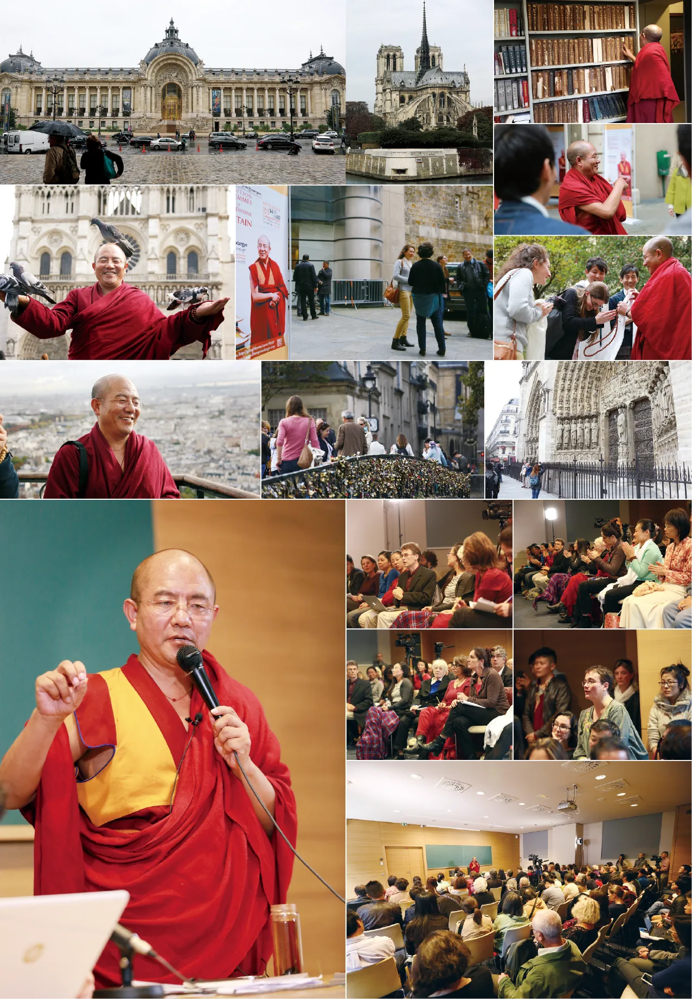
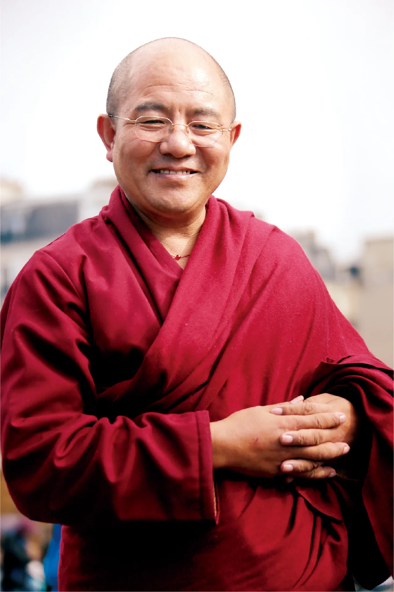
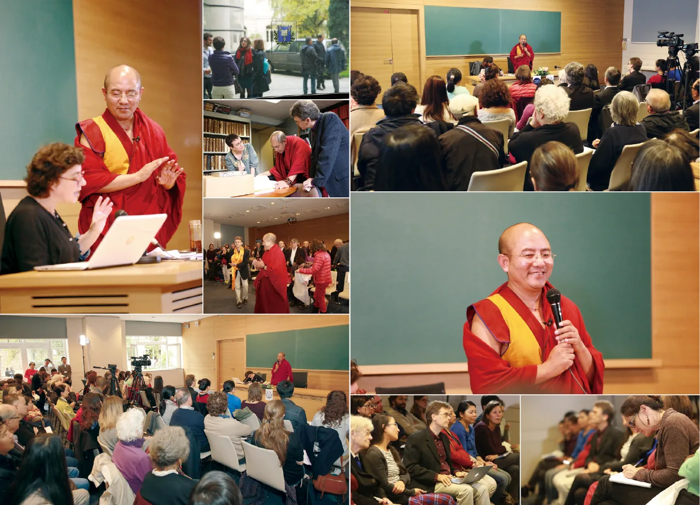

如果诋毁女性，

会犯密乘根本戒的第十四条。

第127场

法国巴黎喜马拉雅研究中心

The Center for Himalayan Studies

法国·巴黎

2015 / 10 / 7

## 女性在藏传佛教中的地位

## The Status of Women in Tibetan Buddhism

主持人：

非常感谢大家的到来，我先做一个简短介绍。

首先要感谢很多人的努力：法国的佛教团体组织了堪布此次的欧洲巡回演讲；法兰西公学院藏文化研究负责人杜丹女士代表学院接待我们，做了很多幕后工作；隶属于法国国家科学研究中心的喜马拉雅文化中心与我们通力合作；法国国立东方语言学院藏语系教授及负责人给予了大力支持；还有来自其他学院的一些帮助。在此，我对所有人表示感谢！

接下来介绍我们的来宾索达吉堪布。

堪布所在的喇荣五明佛学院位于藏东地区，成立并不久，是法王如意宝晋美彭措于1980年创办的，最初只是一所小学院，有少量弟子，但短时间内就发展成最重要的藏传佛教学院之一，甚至是目前全世界最大的佛学院。

晋美彭措法王是宁玛巴的著名大德，大圆满传承的传授者，于2004年圆寂。他提出了反对屠杀动物的非凡倡议，至今那里很多地方仍然保持着不杀生的传统。在喇荣学习的人很多，有数千男众出家人、数千女众出家人和数千在家居士，其中除了藏族，还有汉族、蒙古族和一些外国人士。

索达吉堪布是康区炉霍人，1985年来到喇荣，现已出家三十多年。他完成了所有课程，成绩优异，是法王为汉族弟子传法的翻译，后又被法王直接任命为给汉族四众弟子授课的堪布，成为现在佛学院最主要的传法者之一。

关于堪布，还有几个方面不得不提。

他致力于将大量藏文经典翻译成汉语，传讲的课程也很多，是当今藏传佛教名副其实的最具影响力的人物之一。

他在中国去过很多大学，现在又远涉重洋，来到西方的大学做演讲；他还前往监狱为犯人讲课，这属于他丰富多样的传法活动之一；他很关注女性在藏传佛教中的地位，这正是我们今天的演讲主题。

为什么要选择这个主题？因为在藏传佛教中，女性地位非常特殊。如果去了解藏传佛教近代史，尤其是藏东地区，近十几年佛教的发展格外迅速，出现了许多女性修行者、出家人，这些情况很值得关注。

有请堪布跟我们谈谈这个话题。

今天能与喜马拉雅研究中心的学者、老师以及所有工作人员一起交流、探讨，我由衷地欢喜。

大概在2013年，喜马拉雅研究中心就给我发来了邀请函，但因为种种原因没能成行。所以利用这次机会，跟大家聊一聊，并用问答的方式做些交流。

昨天在中心，我已经跟一些精通藏语的老师、博士生、学者等，在没有翻译的情况下，交流了有关藏文化、藏传佛教方面的话题。对话的体验非常好，这不仅是口头上说说，我的确从内心深处感到欣喜。

今天主要探讨“女性在藏传佛教中的地位”，或者说藏传佛教如何看待女性。我也会顺带介绍一些喇荣五明佛学院女众的地位、学习方式等情况。

## 藏传佛教是否轻视女性？

关于女性的地位、权利、利益等问题，我没有专门抽时间去研究，但从1987年开始，我就在负责佛学院汉族弟子的教学、管理工作，其中有很多出家和在家女众。对她们的特殊心态、感受和痛苦，还有其他需要关注的点，我可能会比佛学院的大部分堪布多一点经验，因为他们几十年间都在研究俱舍、因明、戒律、中观、现观等五部大论，工作重点放在闻思修、讲辩著上，和管理女众关系不大。

在我个人看来，藏传佛教乃至整个佛教中，欺辱、诋毁、轻视女性的现象，应该是没有的。只不过在别解脱戒相关的一些经典中，为了男性出家人守持清净戒律，会讲到一些女性的过患，教诫远离女性等。

这一点和其他宗教不同。比如西方的一些教会，规定女性不能担任教皇，不能主持重要的宗教活动；东方伊斯兰教的传统中，女性不能担任阿訇，虽然在中国甘肃的个别地方，也有女阿訇的报道，但大部分伊斯兰国家认为，阿訇必须由男性担任。这些情况，在藏传佛教中是没有的。

## 藏地是否轻视女性？

有些国家确实对女性比较歧视，比如印度，男女地位非常悬殊，这可能源于他们的风俗习惯或宗教传统。

历史上，印度有殉葬的传统，家中男主人如果死亡，妻子就要被活埋或烧死。这个习俗虽然后来被国家法令废除，但现在仍在一些地方延续，这方面的新闻比较多，去过那里的人也能了解到。印度还有男尊女卑的观念，比如医院里，产妇如果生下男孩，大家都特别欢喜；但如果是女孩，就觉得生活会很艰难，每个人都情绪低落。

这些情况，在藏地是没有的。但如果详细研究、慢慢了解，也会发现一些男女地位的差距。

比如历史上的藏族智者，大部分还是男性；相对女众寺院，男众寺院更多，人数也有差别。现在藏地的亚青寺和喇荣寺，觉姆（女性出家人）算是很多的，但这只是20世纪80年代之后才出现的情况。在此之前，个别地方的确有重男轻女的现象。

对此还有一些佐证：喇荣有个“阿雅达热经典研究团队”，由一些堪姆和学者组建，成立时间不长，只有四年左右，但她们已经编辑、出版了16本书，大部分是过去女性成就者的传记，其中少数是印度的，多数是藏族的。如果编写男性成就者传记，肯定会有大量资料，但关于女性成就者，似乎除了这16本，已经找不出更多。

又如，我家乡是个小县城，名叫炉霍，其中男众寺院有23座，女众寺院只有3座。炉霍县人口超过五万，如此一对比，就知道女众寺院确实很少。而寺院相当于藏地的学校，是人们接受教育的地方，男众寺院多，意味着男性受教育的机会也比女性多，这可能是藏地智者大部分为男众的原因。

所以藏地的两性地位，不能说不平等，也不能说很平等。

## 这个世界越来越懂得尊重

从人类历史或宗教来看，女性在某些方面其实比男性更强，比如看到痛苦中的众生，女性会出于本能去悲悯，甚至代对方受苦。佛经中也宣说了女性慈悲、热衷于善法等功德。但在某些能力上，确实无法与男性完全等同。

从世间权益来看，女性拥有民主权利的时间普遍晚于男性。美国是1789年确定公民选举权的，第一任总统是华盛顿，但直到1920年，女性才获得选举权，中间隔了一百多年；法国女性1945年获得选举权；中国女性是1947年。

可见，随着人类社会的发展和进步，女性的自由、平等权益才越来越受到尊重和重视，东西方都是如此。

## 佛陀为什么要讲女性的过患？

至于女性在佛教中的地位，我作为佛教学者，也可以从学术层面做一个客观分析：

佛法共有三乘：声闻乘、菩萨乘、金刚乘。在声闻乘为主的南传或小乘佛教中，出家人为了护持戒律，会说女性是烦恼的根本、过患的来源，出家人不能接触女身，也不能注视她的容貌等。在出家戒律中，这些有严格的遮止。

小乘经论中还会宣说“女身不净”：女身由血、肉、脓、髓等36种不净物组成，不应贪执。但这是对男性出家人说的，如果对女性出家人，则会同样宣说“男身不净”的道理，说男性是一切烦恼的根本、过患的来源，对此龙树菩萨的《中观宝鬘论》中就有明确阐述。

所以，并非佛教不公正、要讲女性的过失，而是无论男身、女身，剖开外面的皮囊，里面无不是肮脏、丑陋的，任何人去详细观察，都不会心生欢喜。佛教只是讲出了这个真相。

和男性相比，女性还有一些特点，比如感性、善变。就像法国人说，女人像巴黎的天空一样，说变就变。藏族人也说，女人的心就像春天的天气。这些虽然是世间说法，但在佛教看来，女性的确有一些跟男性不同的过患，需要在修行中格外重视。

我会尽量小心说话，希望女士们不要生气。（众笑）

## 声闻乘轻视女性？ 在传统和历史中澄清误解

不同地方的佛教还有各自的传统。比如南传佛教，像泰国、斯里兰卡、缅甸等很多地方，女性虽然可以出家，但没有沙弥尼或比丘尼戒的传承。又或者女性想跟寺院里的师父合影，他们会很拘束地躲开，甚至逃走；但如果在藏传或北传佛教寺院，一起照相是没关系的。对这些传统，也有必要了解。

关于比丘尼戒的传承，汉地从古至今都是有的。藏地现在没有，过去有，比如法王赤松德赞时代，有比丘、比丘尼的僧团；后译宗喀巴大师时代，有比丘尼戒的仪式、传戒小组等，这些在历史上都有记载。木雅地区的五智者之一热贝桑格的传记中，也讲到了比丘尼扎西丹顿，依靠佛法饶益了两百多位比丘尼，传讲《入行论》和戒律，同时她也是一位前行引导上师。但随着时代变迁，藏地的比丘尼戒不知道从什么时候开始，已经中断了。

不管怎样，在小乘佛教中，对女性是平等看待的，因为不管男性女性，所有的法都可以听，所有的戒都可以受。

## 从菩萨乘到金刚乘， 法越高，女性的地位越高

菩萨乘中同样如此：对男性、女性以及任何众生，都希望他们具足快乐、远离痛苦，获得暂时的利益和究竟的安乐。每个修行人都以这样的目的在饶益众生，没有不平等的情况。

至于金刚密乘，汉地的唐密或事续流传不广，主要法脉在藏地。而藏密虽然是从印度传入的，但与世俗传统不同，不仅没有男尊女卑，甚至在殊胜的方便道修法中，对女性特别赞叹。

比如密乘常说的“三根本”：加持的根本是上师，悉地的根本是本尊，事业的根本是空行，有些还会讲到护法神，但对所有密乘行人来说，这三者是最为重要的，必须念修他们的咒语。其中空行、本尊当中都有女性，像度母、金刚亥母、作明佛母、妙音佛母等，依靠她们可以成办各种事业。

再比如，具有一定境界的修行者，在没有自相烦恼的前提下，依靠女性业手印可以迅速成就。怙主龙树菩萨说：“一切虚幻中，女幻最为胜。”意思是说，修行中有圣物、咒语等很多助缘，虽然同等虚幻、无有自性，但其中的女性业手印尤为殊胜。当然这是针对利根者的修法。

以上内容都比较专业，如果你们平时没有关注、研究，可能会觉得难懂。但既然很多学者想要了解藏传佛教中女性的地位，对这些方面就不得不提及。

## 甚深修行道：恩扎布德的王妃们

佛教的显宗经论中，多数会讲到如何依出家身份修行，而出家就要断除对女色等妙欲的贪著；但在金刚密乘，尤其是无上瑜伽中，对贪嗔等烦恼、女色等妙欲都不用断除，依靠殊胜的方便道，认识它的本性就能直接成就，这样的教言、案例有很多。

比如古代的邬金国王恩扎布德有很多王妃，他听说要获得佛果必须舍弃女人而出家，于是说：“我想要一个能和众妃享受五妙欲而获得佛果的方便法。”并且唱道：“赡部花园极惬意，宁可我成为狐狸，释迦佛位永不欲，愿具妙欲共解脱。”意思是世上的花园多么令人愉悦，我宁可变成狐狸，也不希求释迦牟尼佛的果位，愿能不舍妙欲而解脱。后来，释迦牟尼佛为他灌顶，国王和所有王妃都依密法而成就。这个公案记载于可靠的佛教历史中，由此也可以了知密法的殊胜性和女性在其中的作用。

此外，金刚密乘中还讲道：“观待总别智慧母，明暗满足谤十四。”女性是智慧的自性，如果诋毁女性，会犯密乘根本戒的第十四条。这也是女性在藏传佛教中特别受重视的原因。

## 和男性僧侣的平等地位：女格西与堪姆

如果对这些不好理解，也可以从地位上分析。比如法国法律明确规定了男女同工同酬，但现实中，同一个工作的女性薪酬仍然低于男性，这其中的原因，各位可能都明白。

而在藏传佛教中，也有一些象征地位的职位。比如“格西”，历史上是否有女格西，对此还存在争议，但现在某些寺院的确有女格西考试，将来也有培养女格西的计划。

又比如“堪姆”，在藏传佛教中相当于女博士，是比较高层次的佛教学者。历史上就有堪姆，但数量不多。在喇荣五明佛学院，第一批堪姆由法王如意宝在1988年选定，包括院长至尊门措、帕卓、热西等6位空行母。这是二十多年前的事，当时也没有什么证书。第二批堪姆在1992年2月选定，总共十几位，其中有两位汉地比丘尼。从这次开始颁发了堪姆学位和证书。

今天的喇荣大概有五十多位堪姆，负责班级授课和日常管理。男众那边也同样，由堪布们负责班级授课和管理。这方面是平等的，没有什么差别。

藏文化中位于最高层的就是佛教，佛教中位于最高层的就是讲法和灌顶，这些都是金刚上师的事业，而金刚上师中同样也有女性。

可见，藏地的男女地位也不是完全不平等。

## 比男女平等更重要的，是心态的平等

在我看来，每个人的能力、见识、智慧和方便等，都有很大差别，这些并不属于性别的不平等。

在藏传佛教乃至整个佛教中，无论男女，都可以根据各自的界性、根基、意乐，选择相应的修法，也都有获得成就的机会。如果认真思维其中意义，对藏地的女性地位，应该会得出符合事实的结论。

我不会因为自己是佛教徒，就对自宗的教义、学说拼命吹捧，对本来没有的功德大肆赞叹，对本来存在的过失尽力隐藏，这种自赞毁他，是没有意义的。

今天交流的目的也在于此，希望除了探讨性别的平等，还能建立一种心态的平等：无论对宗教、科学还是其他文化，都能客观公正地去观察、衡量。这才是智慧的选择。

现场互动

问：喇荣五明佛学院有没有专门针对女性的课程，收到了怎样的成效？比如女居士的学习能力有所提高，或者有助于她们实现自我价值之类。

堪布：佛学院并不是女众道场，也没有着力扩大出家人的规模，所以没有专门针对女性的课程，也谈不上什么成效。但佛学院的主要方针是“清净戒律、闻思修行、团结和合”，因此对常住人员的戒律、学习、人格等方面都有一定要求。

如果要说对人们的利益，佛学院的堪布会经常前往藏地各个寺院、民众区传讲佛法，也传授藏文化、藏语言，以及卫生、环保、护生等很多方面的世间知识。他们每到一处，都会要求当地人重视学习，我想通过这种方式，应该能令很多人受益。

学习总是好事，世间的任何学校也是如此，教育和学习不会让人们损失什么，即使出现一些危害，也只是个别人的行为和因缘。

问：今天的主题是关于女性权益，其实亚洲有很多比较落后的国家，女性地位特别低。从我们藏地来看，卫藏稍微好一些，康巴和安多就不行，无论在家庭还是社会上，做文职还是体力劳动，女性想有一番作为都比较困难。对于改善女性地位，您有什么方法和建议？

堪布：我的看法是，女性地位问题并不只是针对藏族，从世界范围来看，这一状况都需要不断改善。实际上，相对其他一些民族和地区，藏族的女性权益并不算特别落后，在很多领域，女性的能力和权利已经超越男性。

至于未来要怎样改善女性权利，需要观待全球的发展趋势，也需要不断学习、借鉴。

其实，能力上要求男女完全平等，这在世界任何地方都不容易。比如目前各国政府的领导层中，百分之七八十是男性，女性占有的席位非常少；而家庭中，女性又往往承担了大部分家务。这些状况短时间内很难改变。

但有一些不平等现象，比如男性雇佣女性当佣人等，是各个民族都需要改变的。改变的最主要方法，就是教育和学习。

问：佛教非常深奥，像我这样的人想要完全了解还是有点困难。但我听说密宗中需要依靠女性来修行，为什么这么说，它的核心又是什么？

堪布：密宗当中是有这样的说法，依靠女性修行，但如果双方有自相的男女贪欲，是不可能获得成就的。《桑布扎续》中说：“以贪离贪等，离贪欲即解脱。”意思是，如果能认识贪欲的本体，了知它是空性、不存在的法，贪欲就能转为五智里的妙观察智。一旦证得烦恼的本性即是智慧，接触女人也好、喝酒吃肉也好，做什么都不会再被烦恼束缚；反之，只是以庸俗的心态，想用密宗的这种方式获得成就，绝不可能。

所以必须达到一定境界，才能依靠女性修行。这种境界在《大幻化网》等很多密法中有所宣说，从女性和瑜伽士的角度，都进行了详细说明。

问：得知佛学院对女性与男性有同样的学习安排，我从心底感到高兴，今天在藏传佛教里出家的女性很多，您对女性出家怎么看？比丘尼戒能在藏地恢复吗？

堪布：恢复比丘尼戒并不容易。以前哈佛大学的曲尼降措跟我说过，佛学院应该恢复比丘尼戒，这是一件非常好的事。但我觉得难度很大。在藏传佛教历史上，这件事已经拖了很久，今天想改变也同样艰难。

就喇荣五明佛学院而言，法王如意宝在世的时候，对这个问题并没有明确讲过；现在有些堪布对此很有意乐，正在做研究，写了很多论文，也开了几次会议，但进展并不顺利。

比丘尼戒的传承、仪轨很多，如果想在藏地恢复，需要从印度或汉地接过来。但各地的传承并不一致，比如汉地依大众部、藏地依一切有部、斯里兰卡依上座部，如果按照其他宗派的传承在藏地恢复比丘尼戒，就要对布萨、结夏安居等仪轨全部掌握和圆融，如果没有研究透，可能会困难重重。

印度、美国的很多藏传佛教学者和上师，则倾向于接受台湾的比丘尼戒传承，他们也开了很多次会议，但到现在还没有结果。大家都在努力中，不知道将来会怎样。

另外，出家戒不同于菩萨戒，根据所受的戒律传承，需要遵循不同的戒条，戒条的名称也有差别，所以复杂程度远远超过菩萨戒，这也增大了恢复比丘尼戒的难度。

现在佛学院也有很多汉地比丘尼，但还不具备传戒的条件。今年我们送了一百多位沙弥尼去汉地寺院受比丘尼戒，等这批比丘尼回来之后，希望从2017年开始，能在佛学院传汉地的比丘尼戒，有这方面的计划。甚至一些懂汉语的藏族觉姆，也跟着一起去受了比丘尼戒。

问：我们在海外的藏族人经常听说，国内的佛教现在非常兴盛，兴盛的方式是怎样？学佛的人又有多少？请您介绍一下这方面的情况。

堪布：现在汉地学佛的人确实比较多，而且有很大一部分在学习藏传佛教，其中有知识分子，也有80、90后的年轻人。包括我去高校交流，很多老师、学生的问题都跟藏传佛教有关。我估计，可能跟这个时代网络学佛非常方便有关。

至于人数是多少，根据2009年政府宗教管理部门的统计，说汉地有一亿学佛人，但也有其他上师说，汉地有两三亿人学佛。具体数字不是特别清楚，各个城市中并没有专门统计，只能说现在跟过去确实不一样，知识分子和年轻人越来越多，是一个特点和趋势。

问：在佛学院，女性能否进入更高层次的学习，比如高级瑜伽？因为这些修行方式，主要建立在男性的生理基础上，它是否也适合女性？有没有专为女性设置的修行课程？

堪布：佛学院总的来说，每年都有一个月闭关，比如今年的时间是藏历九月，这期间，男女众都要闭关修行。但目前还没有专门为女众设置的修行课程，以后怎样还不太确定。

其实法王如意宝在世的时候，讲过风脉明点的修法，佛学院的女众都会修。

问：我对转世有一些疑问，如果一个人有虔诚的信仰，乐于助人，却还要遭受病痛、灾难等折磨，这难道是他前世的业力导致的吗？怎样能证明前世存在？

堪布：我个人非常确信前世的存在。为什么呢？有人特别勤奋努力，希望发家致富，但总是欠缺智慧、能力，跟人也相处不来，经济状况一直不好；而有的人既没有丰厚的祖业，也没什么社会关系，却无缘无故就得到很多财富。如果不是因为前世福报，仅凭这一世的因缘，无法解释这种现象。

有人怎么努力也不会富有，有人不需要太努力也能致富——这可以作为判断前世是否存在的重要根据，对此应该好好思维。

关于前后世存在的道理，其实还有很多依据，因为这次时间不够，只能稍微讲一点，请大家谅解。
