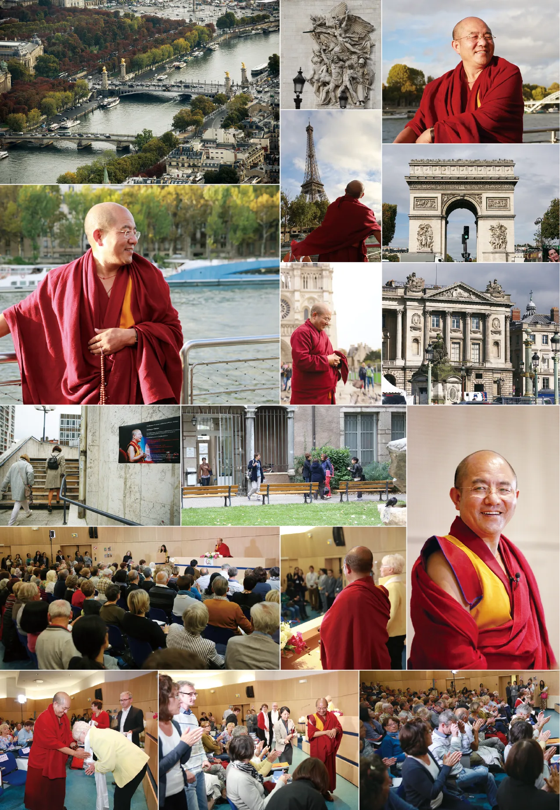
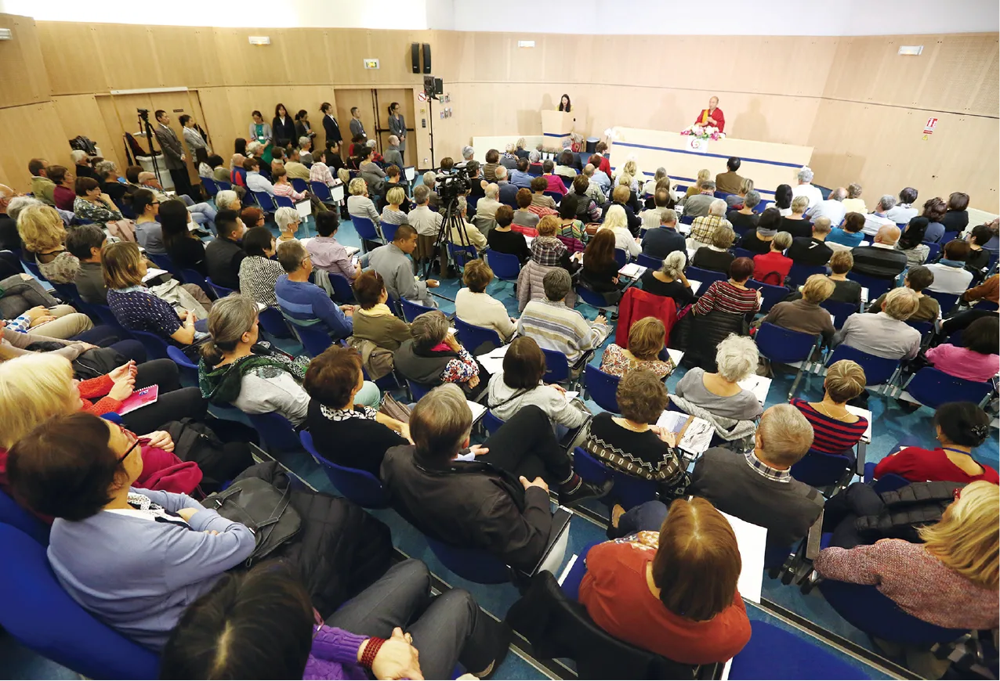
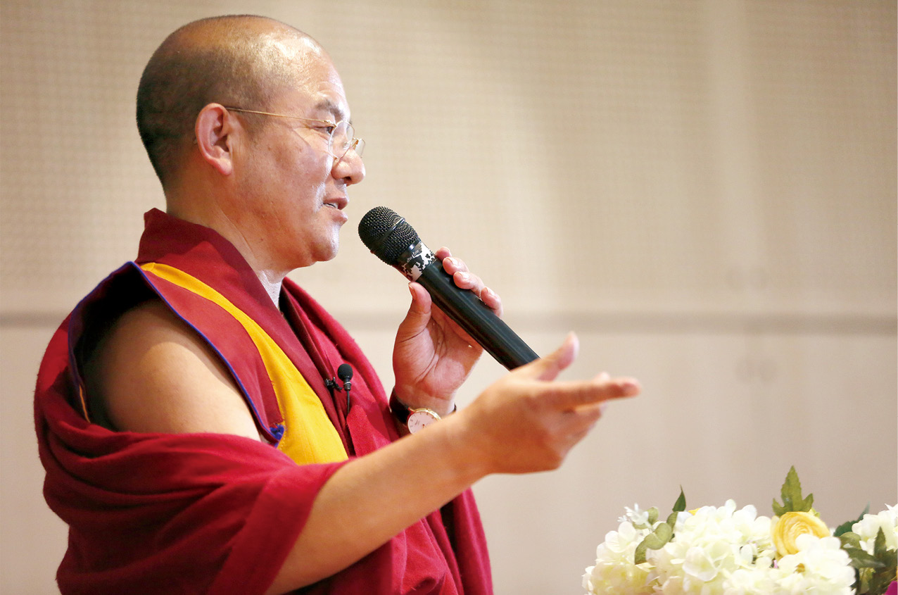
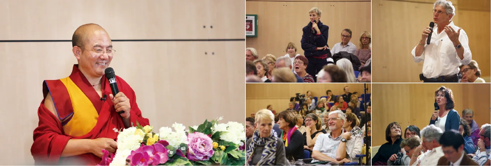
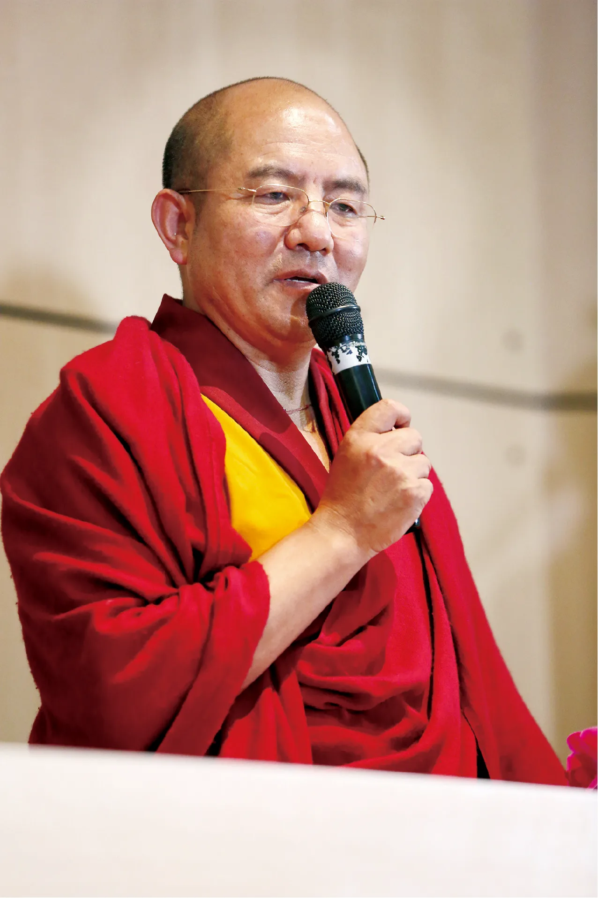
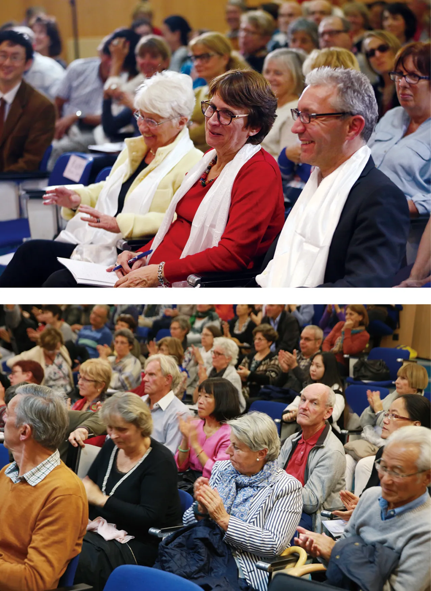

活到老，学到老。

第126场

法国多芬尼综合大学

Université Inter-Âges du Dauphiné

法国·格勒布

2015 / 10 / 2

## 幸福人生

## The Happiness of Life

教务长：

首先由我为大家介绍此次“幸福人生”演讲的主办方多芬尼综合大学（UIAD）。这所老年大学创办于1977年，2017年将迎来它的40周年校庆，目前有6000名学员、52名聘用制教师和150名志愿者教师，得益于这两种教学方式的结合，我们开设了内容丰富的课程。

大学的组织架构，包括主席、校长和一个由10名志愿者组成的办公室，分管不同的职能部门，如秘书部、财务部、内部交流部、外联部、发展战略部、行政管理部、游学培训部，以及由我负责的教务部。另外还设有6个行政管理职位。

大学设置有多个院系。艺术学院设有绘画、装帧、雕塑、花艺、艺术史、文明史等课程，文明史又包括古埃及文明、古希腊文明等；计算机学院规模很大，设有视频、图像处理、网络、平板电脑操作等课程；语言学院设有德语、英语、汉语、阿拉伯语、西班牙语、现代希腊语、意大利语、日语和俄语；文学系和哲学系会探讨古希腊语的文字拼写和哲学概论；自然科学学院有天文学、考古学、天体物理学、生物学、植物学、地理学、量子力学等课程；人文社科学院设有阿拉伯穆斯林文明、犹太基督文明等课程。另外还有法律学、语言学、记忆学、精神分析学、心理学、音乐、养蜂术、服装缝纫、文化交流等，总共将近四百八十种课程。

今晚，我们非常荣幸地请到了索达吉堪布。堪布于1962年生于藏地康区，1985年来到喇荣五明佛学院。这座当今世界最大的佛教大学，位于中国四川省境内，校长晋美彭措法王是最杰出的佛教上师之一。堪布跟随法王如意宝在那里修学，深入研习藏传佛教传统论典，并圆满密法传承，成为主要的传法堪布之一。

法王在世时，索达吉堪布是法王的首席汉语翻译，并负责汉僧的教学。到今天，堪布已经是当代最著名的佛学上师之一，集藏族喇嘛、佛教学者、藏汉语翻译家、佛学思想家等多重身份于一身，致力于将传统佛教与全球问题及现代生活相融合，影响力遍及全世界，如亚洲、北美、澳洲、欧洲等。

十分感谢堪布的到来！

## 学校，应该对生命有意义

尊敬的校长，各位老师、同学，很荣幸来到这里，跟大家共同学习、探讨。

刚才听教务长介绍了这所老年大学或者说社会大学，从1977年发展到现在所拥有的丰富教学内容、健全的师资力量等，我对此很感兴趣。因为我本人从事佛法的教育工作，建立过小学、中学，也组织过国际性的年轻人研讨会，组建过一些老年团体，这些经历跟你们有相关之处。

我去过全世界很多学校，但像你们这种涵盖不同文化、年龄，具有不同体系的综合性学校并不多见。这次有机会见到，我希望自己今生也能办一所这样的大学。

过去见到一些办得很好的小学、中学或者技术学校，我也是这样发愿的，后来都如愿以偿。我觉得，这些对社会有利益、对生命有意义的学校，在亚洲很多地方都比较罕见，也很急需。

## 每段人生都有意义，包括“老”

正如佛教讲，“人有生老病死”，无论东方人还是西方人，都要经历这四个阶段：最初降生，来到世间；中间年龄不断增长，渐渐衰老；最后死亡，离开世间；与此同时，还要遭遇地、水、火、风四大不调导致的种种疾病。生老病死的痛苦，是每个人必须经历的人生。

但一个有理想、有追求、积极向上的人，他会看到人生每个阶段的意义，看到很多精彩、灿烂之处。如果能这样看待生命，其实从童年、青春直到老年，生命都是美好的。

的确有些地方，像我去过的美国个别城市，那里的人很害怕老去，他们认为老人非常孤独、寂寞，是被社会抛弃的群体。老年人自己也有这种感受。

而东方文化完全不同。比如一个藏族人，如果在脸上发现了皱纹、在头上看到了白发，他会很自豪：“看！我现在老了。”我们那边的人，头发是从黑色变成白色，不知道你们的头发是怎样，不太清楚。（众笑）

总之在藏族传统中，“老”是一种荣耀和自豪。家庭中的老人，比如爷爷、奶奶、父亲、母亲，会被当成如意宝。因为老人通常有着丰富的阅历、广博的知识、通透的智慧，懂得取舍、抉择，无论是对家庭还是社会，都非常珍贵。

## 六七十岁不老，大有作为

大家也知道，世界上很多举足轻重的宗教人士、科学家、医学家等等，都是在六七十岁的年龄，开始显现出对社会的巨大贡献。所以不要觉得“我已经六七十岁了，做不出什么大事”，不一定是这样，不要小看心的力量。

中国历史上唯一的女皇帝武则天，67岁才登基，82岁离开人间，在位15年。印度也有一位女总统普拉蒂巴，是印度独立60年以来的第一个女总统，74岁才当选，从2007到2012，执政5年。

在印度、中国这些大国，从六七十多岁开始治理国家，还能做这么长时间，说明只要能提起心力，年龄并不是问题。

藏传佛教中有位夏扎仁波切，今年105岁，现在还经常住山洞。前段时间，我在荷兰遇到一个瑞士佛教徒，说在尼泊尔加德满都见过他，看上去身体特别好，爬山、走路像年轻人一样，蹦蹦跳跳。105岁的人还能禅修、给人传递真理，我们对自己的毅力、智慧也要有信心。

汉地有一位本焕老和尚，他一百多岁的时候我去见过他，一起吃过饭。饭后转佛塔，他跑得特别快，我都有点跟不上。他是106岁圆寂的。所以人的身体还是要多锻炼，世间人可以跑步、爬山、爬楼梯，如果是佛教徒，还可以顶礼、转绕等，这样肌肉不容易萎缩，身体也越来越健康、强壮。

不仅身体需要锻炼，心灵更需要修炼。比如做瑜伽、基督教的观想和祈祷、佛教的观修和祈祷，或者其他禅修。这些就像心灵按摩，自然而然会让你更加包容、快乐。

## 在学习中，圆满这一生

总之，希望我们的晚年都能不断学习、利他，在完善自己和帮助他人的氛围中度过。

尤其要重视学习。藏地的格言说，即使明天离开世间，今天也要认真学习，因为你学到的知识，哪怕这辈子用不上，下辈子也能继续取用，就像我们存进银行的钱一样。

大家可能看过关于藏地的一些镜头、画面，因为那里每个人都有信仰，有一种生命的归属感，所以脸上常常带着笑容。大部分人晚年也很安乐，很少觉得寂寞、怨天尤人，或者对家人不满。这是一种普遍现象，并非我在刻意宣传，事实就是如此。

就像我在家乡建的两个敬老院，一个有两百多人，另一个近一百人。老人们都活得非常充实：上午、下午学习，平时做一些祈祷、禅修。没来敬老院的时候，有些人可能在家无所事事，但来了之后，就会有一种集体感，充满活力。

在做过的事情中，我自己对建敬老院是比较满意的。每次见到那些老人，他们看我的表情很欢喜，我也觉得很开心。

人到了一定年龄，应该有共同的学习平台，这很重要。在这个平台上，可以整合性地学习，像教务长提到的那样，学习宗教、哲学、艺术、科学等知识。这些学业，靠个人不一定能全部圆满，但依靠团体的力量，就有可能。

其实大家聚在一起的时候，很多人会打扮得更加漂亮，穿得好看，气色不错，心情也舒畅；况且这个社会也有很多事情，需要大家一起来做。所以建立这样的学习平台很有意义。

中国的儒教思想中有一句经典名言，叫“活到老，学到老”，不管活多久，都要学到最后。雅典诗人梭伦（Solon, 公元前638－前559）则说：“我愈老愈学到了更多东西。”法国了不起的思想家卢梭（Jean-Jacques Rousseau, 1712-1778）也对此进行了引用和发挥。可见，东西方知识界都认为：人应该通过学习完成这一生。

## 生命有限，不要虚度

学习不要拖延，“明日复明日，明日何其多”，不要总觉得现在没时间，以后再学。这种拖延，对哪个年龄阶段来讲都不合理。

佛教中有一个故事。释迦牟尼佛在世的时候，一位80岁的老富翁正在给自己修建豪宅，房间很多，有夏天的凉房、冬天的暖房，等等。老人很有才华，亲自担任设计师、建筑师，一直忙个不停。

但是佛陀了知他时日无多，想讲一点佛法，让他获得解脱。于是亲自去跟前说：“你稍微停一下，我要告诉你真理。”

老人没有同意，说：“我现在很忙，没有时间，以后再说吧。”

佛陀只好走了。第二天，老人就在修房子的过程中离开了人间。

所以，不管是佛教、其他宗教还是世间智者，都认为生命有限，人可能很快会死亡。只要还活在世上，我们就要充实自己、认真学习、不断修行，同时为社会和家庭做有意义的事情。

## 六个字的禅修

心灵的修行，归根结底是让心获得平静。生活中的烦恼、焦虑、恐怖等，都是我们的分别念造成的，如果心能当下平静，很多事就能想开，很多快乐也能得到。

不知道在座各位有没有禅修，阿尔卑斯山下就有很多基督教、佛教的修行者，常年一个人在山洞闭关。城市里的人不一定能像他们那样，但禅修是很有意义的，不管选择哪个宗教，都可以在生活中练习。

有一种禅修，是不执著任何外境，让心定下来；还有一种禅修，是通过持诵咒语得到禅定。美国密苏里大学曾经做过研究，发现持咒的人，脑电波和普通人有很大差别，身体血凝度下降，血液循环非常畅通，这都是持咒的利益。

我们可以持诵的咒语有很多，其中观音菩萨的心咒“嗡玛呢巴美吽”，早在释迦牟尼佛成佛之前就存在，它不仅是佛教的，也包含了其他宗教和世间真理的精华。如果你们希望得到身心健康，就念诵“嗡玛呢巴美吽”，早上起床之后、晚上入睡之前，尽量持诵这个咒语，很多胡思乱想的杂念和情绪，都可以慢慢平息，让心变得澄清。

它可以称为精神的妙药。这个世界有各种药：西药、中药，有没有法国药？应该有吧，本地的一些传统药，比如草药，可以说是“法药”吧？（众笑）这些是治疗身体疾病的。而心灵也有“药”，像各种宗教的祈祷，包括咒语、仪轨等，没信仰的人不一定知道这些“疗效”，有信仰的人自会懂得它们的价值。

如果有人问，藏地的老年人也好、年轻人也好，都那么快乐，秘诀是什么？我会回答：“嗡玛呢巴美吽。”因为他们都在持诵观音心咒。

这个咒语有无量功德。那天我在意大利的都灵博物馆，看到来自西藏的一本15世纪的书，记载了很多观音心咒的功德。这些在短时间内肯定说不完，希望你们有兴趣的人，去查看，去研究。

## 老龄化社会的幸福之道

人类应该创造自己的幸福，否则人越来越老，内心的困惑、痛苦也会与日俱增，得不到疏解。

今天的世界正在老龄化，其中比较严重的是日本。我看到新闻中说，日本社会65岁以上的老人接近三千三百万，占总人口的26%，到一定时候，社会的养老压力将非常大。

中国民政部副部长在报告中说，照目前趋势看，中国也在快速老龄化，再过三十多年，到2050年，60岁以上老人将占总人口的三分之一。加上中国独生子女政策实施了很长时间，年轻人将面临沉重的负担。

法国、英国等欧洲国家，情况也基本相似，不容乐观。

我看过一幅漫画，画着一对年轻夫妻，上面顶着双方的父母、父母的父母，下面还有小孩。所以两个人要养好几个老人加上小孩，这就是老龄化社会的架构，如果大家不共同努力，压力确实比较大。

但不管将来发生什么，希望每个人在生活中、家庭中，都能用通透的智慧和淡定的心态来面对。人生难免有烦恼、有种种无常，如果我们懂得因缘法，懂得其中的利害关系，很多问题会豁然开朗。

此外，还要尽量做一个对社会有用的人。美国有一位百岁老人，四年中做了一千条裙子，送给非洲的穷人。我想她的眼睛还是很好，不然做不了这么多裙子，但新闻里确实是这样说。所以有心力的人，可以做很多有意义的事。

总之，人一生应该探索生命的真相，学习有价值的知识，尤其是传统文化和现代技术。像你们在这里学电脑、学科学，很有乐趣。学习是一件重要的事，希望大家能以健康的心态，学习对自己、他人有益的知识，这一定能为我们带来幸福和喜悦。

现场互动

问：您多次提到要致力于学习，但您不觉得会有一些阻碍吗？当一个人上了年纪，似乎很难坚持学习，很难在身心等方面继续发展。

堪布：当然，每个人的情况不尽相同。有些人在得了重病，或者生活发生变故的时候，会有中断学习的情况；但有些人即便在最危急的时刻，也不会停止学习。

我认识一位藏传佛教大德，他得了癌症，住在北京的医院里。医生跟他说还有15天寿命，但他好像不觉得痛苦，拿着一本厚厚的书不断地看、不断地学，直到生命最后一刻。这让我很惊讶，特别希望自己将来在任何情况下，都能不放弃学习。

其实我以前身体不太好，从藏语翻译成汉语的好几本书，也是在医院完成的。上海仁济医院、北京的医院、成都的医院、杭州的医院，都各自完成过一部论典，有些比较厚，有些薄一点。印象中，当时的身体特别不好，但每天还是在坚持翻译、学习。

这不是吹牛，很多汉族人都知道，书后面也有相关的文字记录。

问：在您看来，我们何时进入老年期，这取决于个人还是其他因素？

堪布：根据2013年联合国卫生组织的调查，说人类44岁之前都是年轻人。（众笑）

问：在众多书目中，您能否推荐一本适合我们学习的书？趁我们还不是太老。

堪布：我推荐一本记录马修（Matthieu Ricard, 1946-）和他父亲对话的《僧侣与哲学家》（The Monk and the Philosopher）。虽然你只要一本，但我想推荐两本，另一本是长期居住在法国的藏族学者索甲仁波切（Sogyal Rinpoche, 1947-2019）的《西藏生死书》（The Tibetan Book of Living and Dying），建议你学习这两本书，可以吗？

问：第一个问题，您刚才谈到的“知识”，是指学习的特定内容还是对智慧的理解？第二个问题，如果死亡时，我们学到的知识没有起作用，是否来世还能从中受益？想请您详细解释。

堪布：我不确定你有没有宗教信仰，所以没办法给出确定的回答。如果有信仰，像藏族人到了一定年龄，会更加重视来世，多学习善法、临终方面的教言；如果没有信仰，我也会建议你学习，因为它会让人生更有意义，让生命更有价值。这是第一个问题。

第二个问题，对不承认前生后世的人，前面提到的格言不一定能让他获益，但在佛教和基督教的教义中，都承认人有来世，只不过基督教对“做好事上天堂、做坏事下地狱”并没有详细解说。而佛教对前生后世的道理，有更加细致入微的阐述，让人清楚明白。

至于今生所学的知识，来世怎么能得到？很简单，有些人从小对某个学问非常精通，稍微一听，马上领悟；有些人对流行歌曲一学就会，甚至没有学过，也能歌善舞，这都跟前世串习有关。相反，有些人怎么学也学不懂，说明他的前世心识中就没有储存这方面的知识。以此类推，今生的储备，也会在来世显现。

如果详细研究，这些问题其实已经不是宗教范畴，而是有关人类灵魂是否存在的探讨。

问：我对您刚才提到的神奇咒语比较感兴趣，它可以让我们、我们的亲人，甚至整个人类都得到幸福。您能否教我们念诵这个咒语？我们可以自己念，也可以教给感兴趣的朋友。

堪布：这个咒语很简单，不过它的念诵方法有六个字的也有七个字的，“嗡玛呢巴美吽”或者“嗡玛呢巴美吽舍”。

既然她这样要求，我念一遍，你们念一遍：

嗡玛呢巴美吽……

嗡玛呢巴美吽舍……

问：我先生是法国人，我们经常会讨论哲学上的问题。我说：“从佛学角度看，把自己的幸福放得小一点，让别人幸福，才能给你带来真正的快乐。”而法国人的观点很实际，他说：“我自己都不幸福，怎么能把幸福给别人？”这两个观点看起来是完全冲突的。所以我希望您对今天的主题再定义一下，什么是幸福生活？对这个冲突性的观点，您的看法是什么？

堪布：东方人和西方人的思维模式确实有点不同。但在细节上，其实没有太多冲突。这种想法很多中国人也有：“自己都不幸福，干吗还要给别人幸福？”

但实际上，在利他思想看来，当我们想把幸福带给别人的时候，自然而然就会获得幸福；相反，我们的痛苦大多是自私自利心导致的，对自己越执著，可能越得不到幸福。就像前面说到，很多老年人热衷于服务社会，在这个过程中，自己也忘掉了很多痛苦。

家庭中有不同的思想很正常，慢慢磨合，这些分歧会统一的。就像国家与国家之间也有很多冲突，但20世纪的冲突到了21世纪，也会有很大不同。

其实，如果要给“幸福”下个定义，我觉得它是一种满足感。就像喝一杯卡布奇诺，或者一杯茶，如果我特别开心，感到了满足，这就是幸福；而如果没有满足感，即使有几亿美金，也不一定幸福。

幸福，安立在心上。

问：在中国乃至全世界，都存在很多“老无所依、老无所养”的现象。而且中国的“啃老”现象特别严重，年轻人会把属于他们的社会压力强加给老人，有些老人甚至不得已要外出工作。我想请问您对这个问题的看法和建议是什么？

还有一个问题源于我自身的好奇。自从反物质被发现后，它就提供了侧面的依据来证明：可能存在造物主。所以想请问您，作为一位学佛者，您是否相信佛陀和造物主的真实存在？

堪布：首先第一个问题，在中国或全世界来讲，老人的状况各有不同。我见过很多地方对老人比较关爱，敬老方面做得相当好；但也有一些地方，老人问题确实比较严重。比如日本，个别一线城市会要求老人迁居二线城市，或者更偏僻的地方——他们称之为“弃老山”，舍弃老人的山。

但从总体来看，也不是没有希望，虽然孩子和父母之间的感情比以往有所淡化，但如果能把传统文化中古人的慈爱教育不断加强，人与人之间的关系应该会有所改善。

我们看待问题，应该一分为二。由一个地方的情况类推到所有地方，以偏概全，这是不合理的。

第二个问题。我作为佛教徒，确实相信佛陀的存在。如果你去印度，在佛陀降生、成道、转法轮等地方一一观察，就能发现这一点；佛陀当时宣说的法，现在也有文字记载，这些都是历史上真正发生过的。至于造物主的真实性，你可能要去询问那些承认造物主的宗教，他们应该也有比较合理的回答。
