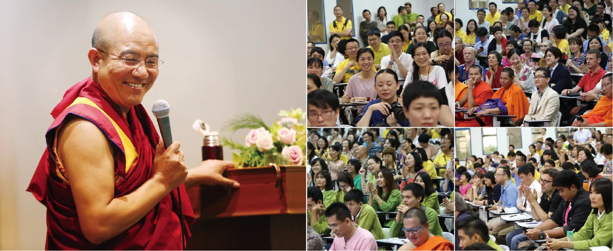
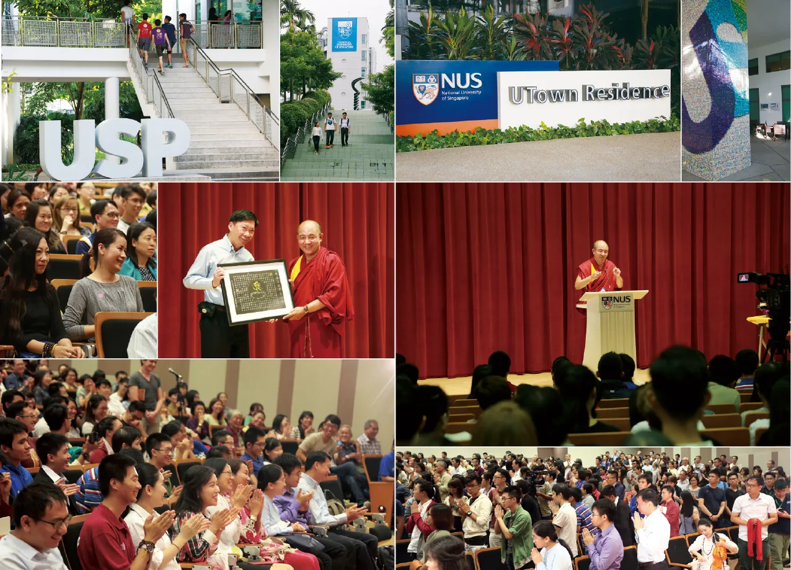
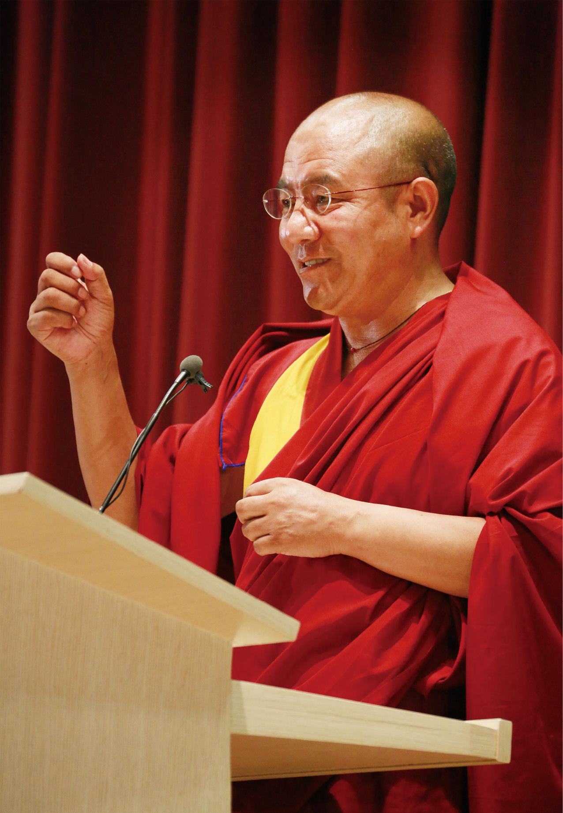
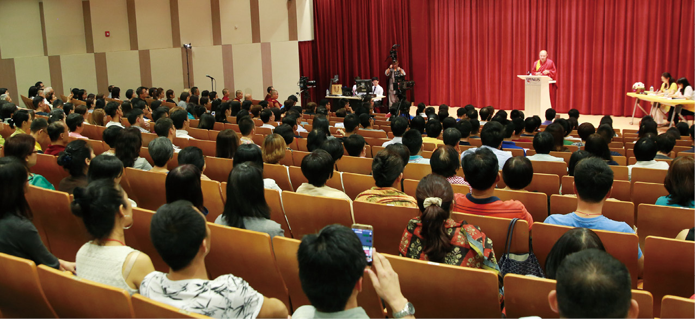
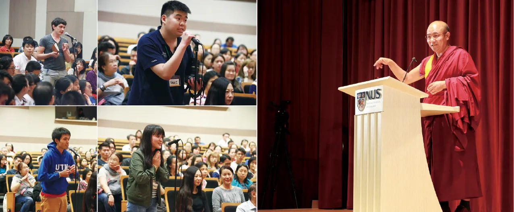
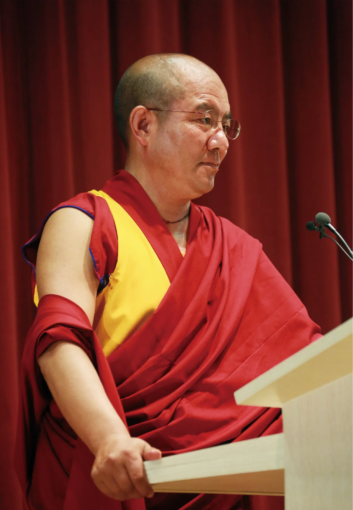

“没有信仰的科学就像跛子，

没有科学的信仰就像瞎子。”

第139场

新加坡国立大学

National University of Singapore

新加坡

2016 / 7 / 19

## 佛教与信仰

——梦幻的人生

## Buddhism and Faith: Life is but a Dream

主持人：

尊敬的新加坡国立大学佛学会成员及各位嘉宾，晚上好！国立大学佛学会非常荣幸地邀请到了索达吉堪布仁波切来作题为“佛教与信仰——梦幻的人生”的演讲。在此，我们向促成此次交流的组织者表示真诚的感谢！他们的努力为大家带来了今天的这场演讲。另外，也要向本会的志愿者们表示感谢！他们的慈悲付出，帮助我们成功地举办此次盛会。让我们向他们致以热烈的掌声！

现在，演讲正式开始，有请堪布——

感谢新加坡国立大学佛学会为我们提供这么殊胜的交流机会。这是我第二次来到国立大学，第一次来是2013年，当时在这里讲的题目是“领悟人生”。大多数情况下，一所大学我只去一次，但今天能有第二次的因缘来到国立大学，心里特别开心。

我前段时间在泰国清迈参加第六届世界青年佛学研讨会，会议结束后，从泰国飞来新加坡。我很喜欢泰国那样佛教氛围浓厚的国家，也很喜欢新加坡这样宗教开放、佛教兴盛的国家。早在二十多年前，我就陪同法王如意宝晋美彭措来过新加坡，也是从那个时候开始，新加坡给我留下了深刻的印象。

我们今天共同思考“佛教与信仰”二者之间的关系。我会以藏传佛教的传统授课方式跟大家交流，过程中会引经据典，这可能和一些人的习惯有所不同，但大家可以趁此机会了解古老的藏传佛教学习方式。

很多学生可能对“佛教与信仰”这一话题不感兴趣。在网络发达的信息时代，大多数人关心的是如何解决现实生活中的具体问题，例如，如何面对生活的压力等等。我刚才问了一些国大的学生，他们目前最关心的问题是什么？大家提到的主要还是感情、学业、生活压力等等，没有一个人的回答和今天的主题相关。

当然，今天这场活动的主办单位是国立大学佛学会，而佛学会的同学们应该是对佛法有意乐和希求的。昨天我跟理事们交流时了解到，这个佛学会已经成立三十七年了，真的很不容易。一般来讲，亚洲的大学中很难有维持这么久的佛教社团，所以，我相信还是有很多同学和老师对今天的话题感兴趣。

## “自由思想”未必对自他有利

在正式讲“佛教与信仰”之前，我们首先要知道没有信仰的过失。我记得欧洲著名作家雨果（Victor Hugo, 1802-1885）说过这样一句话：“信仰，是人们所必需的。什么也不信的人不会有幸福。”也许他的说法有些绝对，不过，没有信仰的人，行为上很可能没有约束，道德水平也不一定很高。那些在生活当中沉迷赌博、酗酒、吸毒，乃至犯下谋杀、参加恐怖活动的人，大都没有真正的信仰。有些人即便表面上有信仰，但他所谓的“信仰”对自己没有丝毫约束。正如《涅槃经》中讲：“不见后世，无恶不造。”不承认有来世的人，很可能放纵自己的行为，无恶不作。这样一来，他们不但会对社会造成不良影响，也会为自己带来许多痛苦。

汉地著名的论著《法苑珠林》中有这样一句：“生无信仰心，常被他笑具。”没有信仰的人会经常被有智慧的人取笑。这句话放在新加坡来讲尤为合适，因为大多数新加坡人都有信仰，只有小部分人没有信仰。但这小部分人并不直接称自己是“无信仰者”，因为他们也觉得这个词听起来有一丝贬义。他们更倾向“自由思想者”这一称呼，也就是说，他们标榜思想自由，认为自己在这个世界上什么都可以做。表面上来看，自由思想者很潇洒，但实际上，这也意味着他们在行为上没有任何约束，很可能为自他带来伤害。所以，“自由思想”可以从正、反两个方面来理解。

## 信仰与智慧，缺一不可

那佛教与信仰之间的关系是什么样的呢？实际上，佛教是一门智慧的宗教。世界上有众多宗教，有些就一味要求我们对它生起信心，但很多道理不一定讲得清楚，倘若你再三追问一些问题，它就不再“理睬”你了。佛教不是这样的。无论是关于宏观世界、微观世界的种种现象，还是现实生活中的各种问题，佛教理论都可以解释清楚，甚至佛教所讲的一些甚深道理，科学到目前都望尘莫及。

在刚刚结束的世界青年佛学研讨会上，我们邀请了香港理工大学的荣休校长潘宗光教授，他在研讨会上不但做了主题演讲，同时也参与了科学和佛教之间的对话。他以科学家的身份讲到，科学的研究进展，还没有触及佛教所宣讲的最高层次，也就是说，当今的科学前沿还无法探索我们心灵深处的奥秘。

爱因斯坦曾经讲过：“没有信仰的科学就像跛子，没有科学的信仰就像瞎子。”也就是说，没有信仰的指引，科学发展很可能不会一帆风顺，这就像脱轨的火车无法行驶一样。为什么人类经常面临一些极其可怕的处境？究其原因，就是缺乏正面的宗教指导。

这句话与《涅槃经》中的道理非常相似。《涅槃经》中讲：“有信无解，增长无明；有解无信，增长邪见。”如果我们徒有信仰却没有智慧，那只会增长无明，所谓的修行也无非盲修瞎炼，也就是人们所说的迷信。唐朝有一位清凉国师，他曾历经九位皇帝，并担任过其中七位皇帝的国师，他经常引用这个教证。

现在有一些佛教徒，虽然学佛几十年，但对佛法的理解没什么进展。即便是一部手机，隔一段时间不更新、升级的话，好多功能都没法再用，同样的道理，身为佛教徒也要通过学习来提升自己，避免迷信。

此外，徒有智慧而没有信仰也很危险。现在有邪知邪见的人非常多，原因就是他们缺乏信仰的引导，只是有一些小聪明，这方面值得大家仔细思考。

## 信心稳固，智慧才能增上

智慧和信仰之间相辅相成，但也有因和果的差别。具体而言，信心是因，智慧是果。佛教中有一位非常伟大的学者叫做龙树论师，他有一部非常著名的论典叫《大智度论》，其中提道：“佛法大海，信为能入，智为能度。”佛法就像浩瀚无垠的大海一样，我们在进入这片大海时，信心就像船票，而智慧则是登船，有了这样的因缘，我们才能从此岸到达彼岸。所以，佛法需要依靠信心来趋入。这个道理从世间法的角度也很好理解，因为没有信心的人是不会去了解、学习某件事的，所以信心是前提。但光有信心也不行，还要有智慧，有了智慧才“能度”。

龙树论师在《中观宝鬘论》中也宣讲了这个道理：“具信故依法，具慧故知真，此二主为慧，信心即前行。”不知道你们有没有学过《中观宝鬘论》，最好能学习一下。这句话的意思是，有了信心，就会行持正法，依靠正法，才会增长智慧，进而了达宇宙万法的真相。信心和智慧二者之间，智慧是主要的，但信心是智慧的前行。如果没有信心作为基础，以后很可能会被其他学说吸引，而存在于智慧中的一些境界也会随之消失。

从这个角度来看，信心与智慧之间是前行和正行的关系。学藏传佛教的朋友对“前行”这个词并不陌生。藏传佛教中要求修前行，它是修行过程中非常重要的一部分。如果没有前行的引导而直接修正行，最后的效果不一定理想。

我去年去了非洲的纳米比亚和南非。那里有一种拟厦鸟（Philetairus socius），长得像麻雀一样。虽然这种鸟非常小，但它们特别会筑巢。它们的鸟巢特别大，大约长六米，宽四米。鸟巢内部的布置也很精美，一个鸟巢中大概有一百间左右的隔间，每一个隔间能居住三四只鸟。此外，为了防止天敌，它们把入口设计在了巢穴的下方。它们筑巢的主要材料是树枝、树皮、羽毛以及棉花等等。可见，这些鸟在建造巢穴时是多么的“绞尽脑汁”，但它们仍犯了一个致命的错误，那就是忽略了鸟巢的重量。一个鸟巢大约重一吨，一旦选中的树木无法承受这个重量，整个鸟巢都会掉到地上，很多小鸟也就因此而丧命。

为什么讲这个故事呢？我们修行或者对佛法的信仰，也要有一个前行的基础，有了稳固的基础，才能在其上面行持正行。如果基础打得不稳固，那正行不会很顺利。因此，藏传佛教很重视前行。

总而言之，我们目前了解到，依靠信心才能生起智慧。这也是为什么讲到皈依三宝时，首先会强调信心的原因。

## 从莫名欢喜到坚信不移

接下来，我们分开讨论信仰（信心）和智慧。首先，什么是信仰呢？在藏文中，“信仰”叫“达巴”，是一个字，这跟英语一样，但跟汉语不同。汉语中，“信仰”可以拆成两个字来理解，其中的“信”是信任、信赖、认可；“仰”是仰仗、尊重、接纳。广义上讲，信仰是对某样事物非常感兴趣，进而影响、塑造自己的价值观。信仰不仅仅是一种信任，更是愿意抽出自己生命中宝贵的时间和精力去获取、接纳的一种理念。当然，并非所有人都有信仰，即使有信仰的人，其信心的程度也分不同层次。

初级的信心叫“清净信”，也就是对佛像、佛经、佛塔有莫名的欢喜心，或者非常喜欢某位善知识、高僧大德。有些人见到一些上师就特别开心：“这个上师长得胖胖的，就像弥勒菩萨一样，我好喜欢他……”清净信就是这样一种简单的信心。基督教、伊斯兰教的信仰者们看到他们的牧师、神父时，甚至有些佛教徒看到其他宗教的上师时，也可能会有这样一种莫名的欢喜心，这都可以称作清净信。

中等的信心叫“欲乐信”。比如说，你觉得某位上师很亲切，于是去主动了解他的历史、传记。在确认这位上师比较不错的基础上，你依教奉行，行持善法，同时断除恶业，从而让自己获得安乐，免于堕入地狱。由此可见，欲乐信并不像清净信那么简单，而是在其基础上，对欢喜的对境有一定的了解，这种信心更稳固一些。

还有一种信心叫“胜解信”或者“不退转信”。对于一名佛教徒而言，对佛教的信仰应该坚定，应该从骨髓里、血液中、内心最深处，产生不退转的信心。即使成千上万的人说佛教不好，但因为你有理论基础，又有修行体验，所以你的信心根本不会退转。很多佛教徒都对释迦牟尼佛有这样一种不退转的信心。这样的信心，并不是人云亦云，如山谷中的回声一般，而是自己运用智慧，经过长期学习、思维所生起的信心。真正的佛教徒都需要这样坚固的信心。

## 不要走完一生才发现这种智慧

佛教的智慧包括世间的智慧和出世间的智慧，又可以归纳为世俗谛的智慧和胜义谛的智慧。

龙树论师在《中论》中说：“若人不能知，分别于二谛，则于深佛法，不知真实义。”很多人都不会区分世俗谛和胜义谛，将二者混为一谈，这样是无法了解佛教精髓的。

胜义谛需要依靠出世间的智慧进行抉择。通过这种抉择，我们会发现，原来世间的万事万物，无论是宏观世界还是微观世界，表面上看似存在，但事实上，除了空性，别无他法。

不仅是佛教这样说，科学家也认同这一点。美国著名的量子物理学家约翰·惠勒（John Wheeler, 1911-2008）曾说：“我百分百认真地认为世界是想象出来的。”虽然我们坚信世界是真实存在的，但从量子物理学的角度来看，这一点并没有办法论证。量子物理学界著名的科学家玻尔（Niels Bohr, 1885-1962）说过：“物理学不告诉我们世界是什么，我们只能说观察到的世界是什么。”

即便是在当今二十一世纪，科学家不断地探索，仍未真正发现这个世界和我们心灵的真相，而佛教早在两千五百多年前就已经将此宣说得非常清楚了。如果大家对此心存疑虑，觉得佛教不可能这么先进，我们也可以深入探讨，大家私下里也可以再研究，看看佛教两千多年的智慧究竟讲了什么。

佛教世俗谛的智慧承认我们生活中的方方面面。有些人误以为，学佛以后要对世俗生活退避三舍，放弃一切，但事实上并非如此。佛教承认如梦如幻的生活，但同时也告诉我们，其实人生不过一场梦。很多人走完一生，在临终前都有这样的体会，这也是佛教世俗谛智慧的究竟观点。

## 老少咸宜的佛教活动

我对当前的佛教活动有几点建议。我觉得，佛教活动的内容最好不要太深奥，否则很多非佛教徒一时无法理解，更别提参与其中。佛教活动最好可以让不同背景的人都能参与进来。所以，我建议把佛教活动分为三种类型。

第一类佛教活动可以关注“身心健康”，为大众提供一些方便，比如组织大学生沙龙，不论是否有信仰，任何人都可以参加。大家坐在一起喝咖啡、吃比萨、吃印度咖喱或意大利面等等。享用过美食后，大家就围在一起聊生活、谈人生、交流禅修经验，分享各自的人生观念。

此外，大家还可以一起祈福。很多宗教都通过祈祷来实现愿望，我们也可以组织大家念诵“南无本师释迦牟尼佛”，依靠佛陀的智慧和发愿力，圆满大家的愿望，比如考试顺利、找到工作、感情圆满等等。还可以组织生日派对或禅修活动。禅修不一定要带有佛教或其他宗教的标签，大家就是聚在一起，放松身心，消除压力，自在地度过一段比较安逸的时光。禅修不需要太繁复的仪式，只要对这方面感兴趣、有意乐的人，都可以参与。

## 揭开生命的神秘面纱

第二类佛教活动叫“认识生命”。组织“身心健康”类的活动，实际上解决不了根本问题。比如，对于家人去世、感情受挫这样的情况，喝咖啡、吃比萨就起不到什么作用。但如果大家能认识生命，了解一些佛教的智慧，就能更好地面对生活。例如，如果大家了解“万法无常”的道理，认识到生命、青春、感情、财富、地位等等都是无常的，那一切变化都会更容易面对。

佛教里还讲“三界轮回，犹如火宅”，也就是说，人生都是痛苦的。我们这一生中会遭遇很多痛苦，这和前世有很大关系。如果前世做了很多坏事，今生中就会显现为体弱多病、亲人离去等等，这叫“因果不虚”。此外，还有诸如“人身难得、佛法难闻”等等道理……

对佛法一无所知的人，在遇到一些大的困难时，往往显得无所适从，但如果能在喝咖啡、吃比萨的基础上，深入地学一点佛法，对生命本质的认识更全面一些，那面对这些问题时就不会再手足无措。

## 祝你早日“认识自己”

第三类佛教活动叫“体验解脱”，也就是在前面两种体验的基础上，真正地认识自心的本体，这样一来，再多的痛苦和烦恼都会自然化解。但认识自心并不是那么容易的事，这在禅宗里叫“明心见性”，在藏传佛教密法里叫“认识觉性”，也就是认识到了觉悟的心性。这需要一定的观修，包括通过中观的智慧来剖析、推理等等。当这种修行累积到一定的量，即使没有太多助缘，自己仍能完全认识自心。这时，别人觉得天大的事情，在你眼中都是过眼云烟，处理起来也轻而易举。

我们经常讲“烦恼即菩提”，当嗔恨等烦恼生起的时候，如果能观察嗔恨的本来面目，你就会发现，原来它从来都没有产生过。虽然这对修行人的要求比较高，但很多人都可以体验，从中可以现前暂时和究竟的智慧。

## 用信心和智慧利益自他

《华严经》中讲：“信为道元功德母，长养一切诸善法，断除疑网出爱流，开示涅槃无上道。”信心是一切正道的根源，一切功德的基础，也是滋润一切善根的根本。我们应该有一种智慧的信心，只有依靠这样的信心，才能断除怀疑的业网，帮助我们出离轮回爱执的江河，并指明通往涅槃的无上之道。希望在座的各位都生起智慧的信心，不要迷信。迷信就是今天觉得佛法不错，过一段时间就离三宝远远的，这实在不是一种明智的行为。

希望大家都能以无伪的信心和佛教的智慧利益一切有情，谢谢！

现场互动

问：我成为一名佛教徒已经十多年了，我希望能做一些关于物理学与佛教的讲座去突出二者之间的联系，让不信佛的听众对佛教生起信心。所以，能否请求您加持我早日获得物理学学位？

堪布：加持很重要，但更重要的是依靠智慧来吸引对物理学和佛法感兴趣的人，解除他们心中的疑惑，进而让他们获得心灵的快乐和永恒的解脱。

问：智力低下的人还可以生起智慧吗？在生起智慧的过程中，信仰是否扮演重要的角色？

堪布：智力低下的人也有他相应的智慧。

有一则禅宗公案可以回答你的问题。有人问禅师：“狗子有没有佛性？”禅师有时回答“有”，有时却回答“无”。这是不是矛盾呢？不矛盾。狗是比较低等的动物，从解脱的速度来讲，它就像没有佛性一样，但从最终的解脱来讲，它有佛性。所以，我们也可以从这两方面来考虑。

问：在一个无佛的时代里，没有佛法可以信仰，那辟支佛又如何解脱、涅槃呢？

堪布：辟支佛出现在暗劫当中，也就是过去佛已经涅槃，未来佛还没有出世的时代。这种时代，没有佛陀宣讲佛法，但佛经中说，辟支佛曾在百劫当中依止善知识，修持善法，以过去劫中的信心作为因，今生自然而然地获得涅槃。所以说，辟支佛在过去劫中对佛法有很大的信心，只不过在他涅槃的时代中没有佛法而已。

问：西方人学佛的过程中，往往不把佛教当作宗教，而是当作一种知识来学习。您认为这种缺乏信仰的学佛方法是否可行呢？

堪布：科学思维在欧美国家比较发达，所以，很多西方人都比较理性，这也是为什么在给西方人讲佛法的时候，他们经常会问一些“为什么”。这种理性在学佛的过程中是很好的。

佛教有两种类型的修行，一种叫做“随法行”，也就是以佛法智慧为基础的修行；另一种叫“随信行”，这是以信心为基础的修行。随法行的人一般是比较利根的修行人，而随信行的人一般是比较钝根的修行人。

一般来讲，西方人在信仰方面表现得比较理性，而亚洲人则更感性一些，表现得更为虔诚，这可能是文化差异所导致。

我认为，修行过程中，理性和感性都不可缺少。如果只有理性而缺乏感性，很难获得感应和加持。例如，灌顶的加持一般要依靠虔诚的信心来获得。但如果一味强调感性而缺乏理性，学佛就比较盲目。所以，学佛的过程中，最好能将东西方的思维方式结合起来，既保持理性思维，又具备感性的虔诚信心。换句话说，理性的思维不能缺少虔诚的信心作为基础，虔诚的信心也不能缺少理性思维的推敲。

问：据佛陀所说，未来的人将不可避免地越来越浮躁，宗教也越来越衰落。在那样的时代，我们应该有怎样的信仰？

堪布：我也在思考这个问题。在当今这个时代，人们的生活越来越忙碌，压力也越来越大。我今早还在想，也许在座的各位压力还不是最大的，一二十年后的人们，压力可能更大，内心也更浮躁难安。

新加坡的新闻报道说，最近几年，信仰宗教的人口越来越少。我在荷兰、意大利等国家也发现了这样的趋势。他们本来有很多基督教教堂，但现在很多都空空荡荡的，没有人去。那里的年轻人都不太喜欢信仰带来的约束。他们对宗教的态度也比较现实，就像吃快餐一样，如果宗教能直接解决生活中的压力，他们才愿意考虑接受。除此之外，他们对宗教提不起什么兴趣。

藏传佛教有一位很伟大的人物叫麦彭仁波切，他曾说：“即便整个大地上的人都做坏事，自己仍然要坚持善良的行为。”我觉得这句话对年轻人尤为重要。未来的时代是年轻人的时代，所以，年轻人要放眼世界，展望未来，更重要的是，每个人都应该有内心的修行。这样一来，即便时代再恶劣，环境再糟糕，自己仍可以保持知足常乐，有勇气面对各种困扰。

此外，我还建议大家通过佛教的调心方法来解决生死问题。每个人最终都要面对生老病死，但在生老病死面前，物质财富起不到什么作用，只有心灵的教育、精神的财富才有用。每个人的命运都掌握在自己的手里，希望大家经常观照自心，调伏自心。
