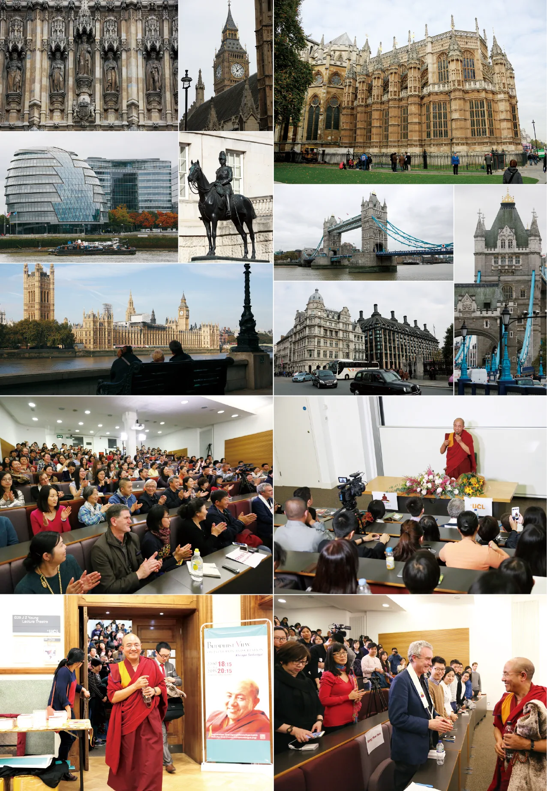
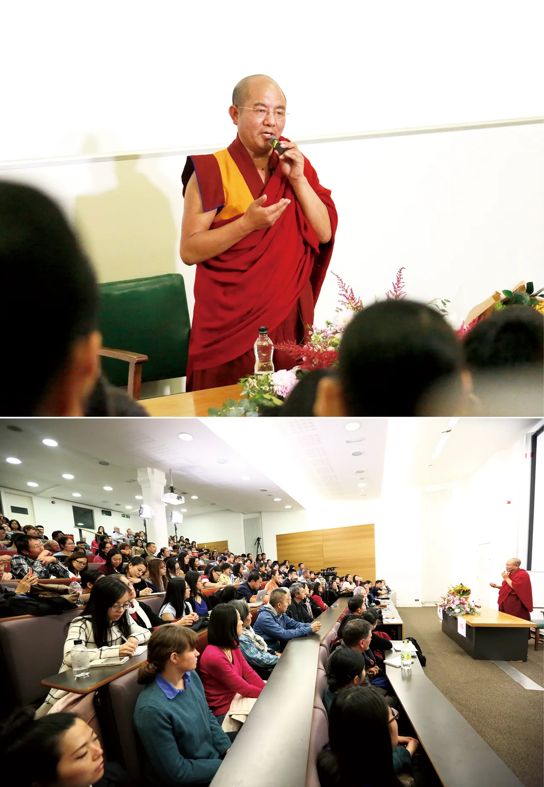
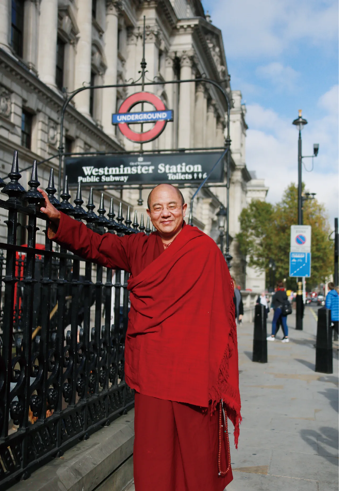
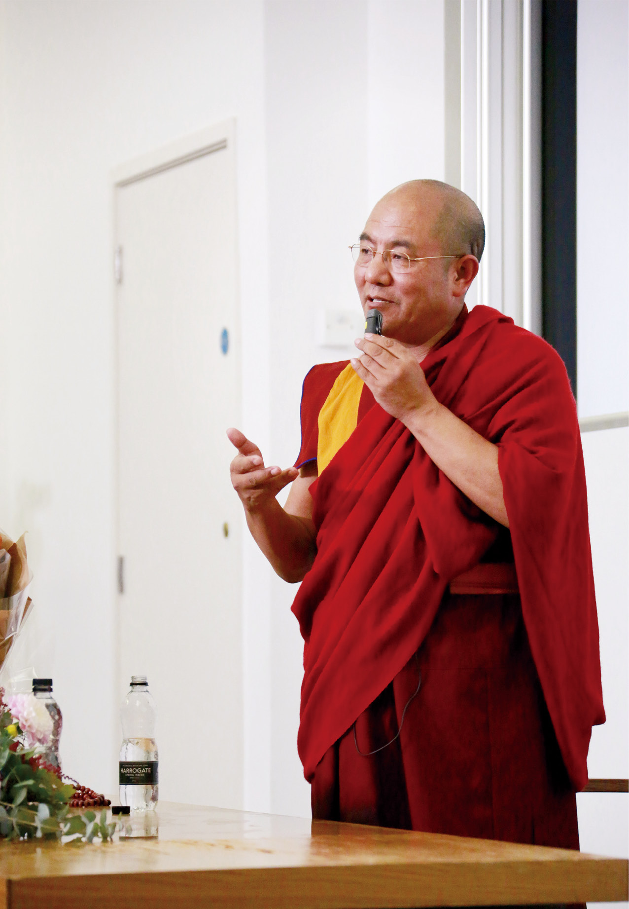

为什么有些人那么笨，

有些人却那么聪明？

有些人天生喜爱音乐，

有些人对音乐又丝毫不感兴趣？

第132场

英国伦敦大学学院

University College London

英国·伦敦

2015 / 10 / 22

## 佛教对进化论 与造物论的看法

## A Buddhist View on Evolutionism and Creationism

我来自伦敦大学学院佛学社（UCLU Buddhist Society），在演讲正式开始之前，我先向大家简单介绍一下伦敦大学学院，然后宣告一些讲座过程中的注意事宜。

伦敦大学学院是世界排名前十的顶尖大学，是英国最早建立的大学之一。因为培养了32名诺贝尔奖获得者而备受瞩目，还造就了多名杰出校友，其中包括圣雄甘地。不仅如此，它还是英国建立的第一所非宗教性大学，招生界限跨越了种族、性别与宗教。从建立伊始，UCL就倡导开放、平等的理念，并且正将这一传统继续保持发扬。

现在，我把麦克风交给今晚讲座的主持人德宁先生，他将对堪布做一个简单介绍。希望你们今晚能有所收获。谢谢！

主持人：

大家晚上好，感谢你们今晚来到现场！正如刚才提到的，我们很高兴能够邀请到索达吉堪布仁波切来为大家举办讲座。

堪布是宁玛传承的大德。宁玛派是藏传佛教的一个古老宗派，其宗旨是利益并引导众生获得解脱。堪布仁波切正在尽其所能地将他修证的智慧传递给更多的人，所以他不断地巡讲、出版书籍、投身慈善……堪布认为，佛法的核心是智慧与慈悲，这也是他将自己的官网取名为“智悲佛网”的原因所在。

涉及慈悲这一话题时，堪布再三强调利他心的重要性。在2013年哈佛大学的演讲中，堪布提道：“如果没有利他心，我们可能会研发出日新月异的新产品、新技术，但它们不仅不能为社会带来利益，反而会造成伤害。”作为精神导师，对于想要追求快乐的人，堪布创作了很多书籍，来鼓励他们培养一颗利他的心。

再谈一点堪布对智慧的看法。堪布十分关注现代科学，尤其是科学与佛教的融合以及二者的相互作用。在接受中国很有影响力的一本杂志——《人物周刊》的访谈时，堪布提到，他花了将近二十年的时间研究佛教和科学的关系，因为现在很多人相信科学，只有在科学能够对佛教作出论证的基础上，才会接受佛教的观点。

事实上，堪布很喜欢与知识分子交流，因为堪布说，和那些具有甚深智慧的人进行碰撞，会擦出很多闪耀的火花。堪布总是说，佛教是一种智慧、一种教育，所以一直以来，他提倡深入思维、学习佛法，不要盲目信仰，深入闻思是探寻真理的唯一途径。

今晚的题目，是“佛教如何看待进化论与造物论”，这两种理论经常在各宗教教派信众中引发争论，所以我猜想，在座各位一定都十分期待堪布对于这个热门话题的看法。在正式演讲开始之前，我想邀请伦敦大学学院佛学社代表Billy上台向堪布敬献鲜花。

请大家再次以热烈的掌声欢迎堪布为大家演讲——

## 上帝和达尔文

### 1．古代宗教思想与现代文明的冲突

很高兴今天有此因缘能够在这里跟大家见面。

人类已经拥有了几千年的社会发展历史，相对而言，在座的老师和同学都生活在一个特殊的时代。在短短几十年当中，我们的观念和生活方式都发生了巨大的变化。

我们都关心自己的家庭、生活、工作、未来的计划、自身的提升和成功等问题，但现在是东西方文化相互交融的时期，所以我们应该既要关心古代的传统宗教思想，也要重视现代的科技知识，同时还要考虑个人乃至全人类的未来。

如果认真去关心并思索这些问题，我们不难发现，古老的宗教思想和飞速发展的现代文明之间，存在着一些思想的碰撞，甚至有较大的矛盾和冲突。

### ２．神造论与进化论矛盾吗？

很多人认为，神造论和进化论是矛盾的。

在座的大多数人应该对神造论十分熟悉。神造论以《圣经》和一些古老典籍为依据，认为我们这个世界，最初是由一个造物主，比如真主或上帝等创造的。

后来，达尔文（Charles Darwin, 1809-1882）发表了《物种起源》（On the Origin of Species）。正是以此为开端，很多人逐渐对造物主的存在不再认可。人类对生命的认识，也开始与以往很多宗教学说有了不同。

有些人认为，神造论和进化论互不抵触，完全可以相互融合；有些人则认为，二者完全水火不容，并由此而出现了不同的学说。不同学说之间，还发生过激烈的辩论。

其实，回顾漫长的历史，不可否认的是，这两种学说对人类的发展都产生过巨大的贡献。我们应当知晓，不同的思想并非一定就是矛盾的。在每一个宗教体系内部，也有很多不同的观点，就好比在每一种科学体系的不同研究领域中，也会有不同甚至冲突的观点。

## 佛教如何认识神造论和进化论？

今天，应佛学社的要求，我将会简单介绍一下佛教对这两种观点的解读。虽然我个人并不能完全代表佛教，但因为我是一个佛教徒，而且酷爱读书，还曾经阅读过为数众多的佛教以外的如基督教、天主教等其他宗教的书籍；同时，我也阅读过大量讲解进化论、唯物论和唯心论的古今文献。基于此，我才勉强可以从一个佛教徒的角度来进行分析，并阐明自己的观点。

我认为，佛教的观点与神造论和进化论相比，有相同之处，也有不同之处。

### １．佛教与神造论的比较

关于生命起源的问题，佛教和基督教似乎有一些相同点。实际上，很多研究基督教的学者和传教大德们都认为：所谓的上帝，不一定是一个人格化的形象，而是一种抽象的力量，这种力量形成了生命的起源。生命独立的本体，实际上一直是按照某种生命体系和生命规律延续下来的。

这个观点与佛教有许多相似之处。在佛教当中，对于生命的起源有两种说法：一种是，我们的心识从无始以来一直延续到现在，如果没有解脱，会一直延续下去；另一种是，人类最初的生命可以被称为最原始的光明心性，它并非由谁创造，而是作为一个开端一直延续到现在。

所以，如果基督教的“上帝”是指生命的起源或规律，那就和佛教生命起源的理论有相同之处。

两者的不同之处在于，佛教不承认有一位特殊的创始者，以及是由这位创始者在特定的时间，有目的地创造出了世界和人类。

### ２．佛教与进化论的比较

佛教和进化论也有相同和不同之处。相同之处是，它们都不承认有一个特殊造物主的存在。不同之处是，佛教不承认人类是从动物逐渐演变来的，佛经中并没有描述过人类由猿猴演变而成的过程。

### ３．都有一个特定的起源

我们都知道，神造论的一般观点是，不管是人类还是动物，最初都是由上帝创造，每一个生命都有自己的生命体系，依靠这个生命体系，可以一直延续至今。而进化论的观点则是，最初，一个生命载体慢慢变成一个单细胞，从单细胞变成多细胞，然后再逐渐由细胞的演化和裂变，慢慢形成了动物、植物以及人类等生命体。所以，他们都认为有一个特定的起源。由这个起源开始，才演变出动物、人类乃至整个外器世界。

## 佛教的缘起观

佛教最主要的观点是，我们的起源，是依靠一种缘起。所谓缘起，包含了因和缘。佛教认为，人是由两部分组成：物质和心识。

### １．物质的因和缘

外在的物质也有其因缘，这个因缘又是由主因和外缘和合而成。以一棵树为例，树种是主因，阳光、空气、水分等就是外缘。一旦主因和外缘都具足时，外在的事物就可以不依靠任何创造者自然而然地萌生。

### ２．心识的因和缘

动物和人类的心识，也有独立的因缘，而且同样分为主因和外缘。

心识自身是明清的，与外在的物质有着本质上的不同。无明、行、识、名色、六处、触、受、爱、取、有、生、老死这十二种因缘，都来源于它。这十二种因缘的衍生与发展，即形成了每个众生之心的生长与不断流转。

我们的心识虽然没有其他的力量，但只要因缘具足，它就可能变成动物的意识，也可能变成人类或其他生命的意识。变成人类时，也许即生是富贵之人，但下一世就可能会变成贫穷者。无论如何，心识就是这样一直不停地流转。

## 精神财富在某种意义上超过物质财富

现今的人类，总是醉心于研究外在的各种科技文化、知识理论，但对于内心的研究，比如心的分类、功能，以及心可以通过修行获得安宁等方法，却并不太关心。

若以智慧来观察，既然人类的世界包含了精神世界和物质世界，那么，我们的生活也应该拥有精神和物质这两个层面的丰华。

有时候，虽然我们的物质财富已经相当丰裕，但我们的内心依然觉得空虚和不满足，这恰好说明我们还缺少精神食粮。相反，当我们的精神财富丰厚充裕，比如，拥有某种信仰，秉持慈悲观和平等观，内心充盈满足感等，即便无房无车，甚至穿着破烂，但心中却仍然会充满快乐、充满阳光。这说明，精神财富是让我们幸福的主要因素，甚至超过了物质财富。

## 对内心的研究少了一些

刚才我们在佛学社进行研讨时，其中有位学者——曾在二十年前写过关于佛教与进化论方面的书籍，说道：“虽然我们研究的进化论是非常伟大的科学，但我们对内心的关注和研究还是相对较少。”对此观点，我深表赞同。

在过去的十几年中，我一直在拜访不同领域的科学家，也接触了社会各个层面的研究人员，其中包括研究人类学、物理学、化学等学科的诸多学者。在和他们探讨的过程中，我发现，他们对外在物质世界的研究更加关注，并且将大多数的资金、时间和精力都投入其中。

按理来讲，科学界某些领域的研究者，比如生物学家、神经学家和心理学家，应该对心识的来源、心识是否独立存在等问题有所探究。然而，我经常遇到的一些神经学家，只是将研究重点放在某个区域的神经元和神经所发生的变化和反应上面；遇到的一些心理学家，也更多研究的是，当我们产生烦恼和痛苦时，应该怎样依靠自己的方式来分析这些心理状态。

总之，目前对于人类心识特征方面的研究，除了个别宗教以外，科研人员的投入寥寥无几。

## 科学的沉默

有一位叫埃尔温·薛定谔（Erwin Schrödinger，1887-1961）的科学家，在1933年获得了诺贝尔物理学奖。他曾经用了很长时间，通过物理学的方法来研究人类的心识，并得出了这样的结论：“现在我们的自然科学所描绘的世界其实远远不够，虽然它有很多的数据，排列得井然有序，但每次牵涉到一些重要的心理问题和人生问题时，科学的沉默是非常可怕的。”我们应该仔细体会他这句话的含义。

如今，科技的发展为我们的生活带来了前所未有的变化，这些变化，我们的祖辈甚至难以想象。比如，现在只要各方面因缘具足，我们就可以任意飞到世界上的任何一个角落，这是哪怕近两三百年前的人都无法设想的。不可否认，科学为我们的生活带来了极大的便利。

但我们同样没有预料到的是，现在人类的各种生理和心理疾病也是前所未有地猖獗。艾滋病、癌症、抑郁症、焦虑症等各种病症，在之前的任何历史阶段，都没有今天这么普遍且繁多。

如此之多的生理和心理疾病，来源于何处呢？我们应对此详加观察。按理来讲，现代人拥有了比古人丰富得多的物质生活，应该越来越健康和快乐，但人们脸上的微笑却在逐年递减，很可能再过二十年，我们都不会笑了。

对于欧洲的人文状况我不是特别了解。在我们藏地，以前生活条件比较窘迫时，不管是父母还是孩子，都笑声朗朗，脸上随时都挂着灿烂的笑容。然而，今天我看到的情况是，虽然我好些同乡的物质生活比以前有所提高，但内心的快乐却大打折扣，脸上失去了微笑和光芒，笑声也消失无踪。

当我们内心不快乐或者疾病缠身时，仅仅依靠科学，是无能为力的。如果我们去问科学家，应该如何解决道德下滑、信仰缺失导致的一系列心理问题，他们往往会无言以对。这也正是我刚才所引用的那位学者的结论。

面对这种情况，很有必要追溯历史。也许通过宗教的方式，就能十分简单、轻松地解决我们的各种生理和心理疾病问题。毕竟，心灵自己就有一套独特的解决方法。

## 意识是长远的体系

刚才提到的埃尔温·薛定谔，曾在他所著的一本物理学著作中写道：“我们的生命有一个起点，但意识与它是不同的，意识是独立存在的，是不依靠任何其他物质而形成的。”这句话值得诸位学者思考。

在这个世界上，存在着不同的生命体系。佛教的《俱舍论》等论典中讲到每个阶段的生命都是各不相同的，但意识是一个非常长远的体系。一直以来，我们会存有非常多的困惑：为什么有些人那么笨，有些人却那么聪明？有些人天生喜爱音乐，有些人对音乐又丝毫不感兴趣？同一个家庭的孩子，为何会有不同的爱好？针对以上问题，目前普遍的答案，是归因于父母基因的不同，但这仅是一个理论假设，并不一定完全可靠。我们需要用一种公正的态度来分析问题，这才是科学研究应具备的客观立场。

## 打破固有的观念，接受不同的文化

我今天并不想特意宣扬佛教的观点，或者去驳斥其他宗教的看法。真正的佛教是无私、包容的，是一种非常开放的思想。如果对自己根本没有的功德，为一己私利而凭空捏造、弘扬宣说或过分自赞自夸，都不符合佛教的究竟思想。

佛教还有一个独特之处在于，它非常欢迎人们以理性的思考对佛教进行批评和指正。如果对方的观点有道理，佛教完全乐于接受；反之，如果对方的理由无法令人信服，佛教也会提出合理的反驳。因为当任何一种思想或理论不符合真理或客观事实时，就完全可以推翻它。

对于佛教的辩论，相信很多思想活跃的年轻人会非常感兴趣。但是，当你们准备批评某种观点时，必须要有依据。来自年轻人的某些批评我们可以接受，但如果是仅凭一己的胡思乱想而胡言乱语，这并非真实的批评，我们也不会接受。

现在是一个高度全球化的特殊时代，此时最重要的，是相互了解、相互学习。我们要打破自己以前的一些顽固保守的观念，尽量勇敢去面对和学习不同的陌生文化。我认为这在当今时代非常重要。

## 离苦得乐是关键

作为一名学者，需要去研究生命的起源或毁灭等问题。但对于大多数人来说，了解和掌握如何远离痛苦以及如何获得快乐的方法，则显得更为关键。

佛教的《箭喻经》中有一个公案。

有个年轻人问了佛陀“宇宙的开端是什么？结束是什么？”等十四个问题。对于这些问题，佛陀拒绝回答。这并非佛陀无法回答，而是想告诫人们，不要被理论研究所束缚。经中采用了一个比喻：当一个人身上中箭时，肯定应该选择尽快将箭拔出，并马上治疗，而没有必要沉溺于分析箭的来源和做工等理论问题。

这部经典还讲到，我们现在最应关心的事情，应该是怎样解决我们的各种心理问题，从痛苦中获得解脱，以及将来怎样才能获得最究竟的快乐。

《华严经》中讲，在我们这个世界中，还有无数的世界；世界的起源，是在无数万年以前……这些内容，都超出了我们的思维和想象。所以我也经常在思考：科研工作者们绞尽脑汁，通过考古、假设、推理等手段对一些问题进行研究，但始终也没有得出最究竟的结论。大家一直在争论的诸多问题，也往往只是根据一些假设。苦苦得出的结论，又不断被质疑、被推翻。这是否意味着，某些领域其实已经超出了我们的意识范围？

## 神造论与进化论并不矛盾

关于神造学说和进化学说，为数不少的人也认为，二者并不矛盾。2014年10月，现任罗马教皇在梵蒂冈教皇科学院就发表过此类声明，还说上帝并非以魔术师那样的方式创造世界[^1]。在他看来，两者观点不但不矛盾，甚至可以用同一个方法来解释。

早在1950年，当时的教皇庇护十二世（Pope Pius XII, 1876-1958）也在文章中说，无神论的进化观点与天主教教义并不相违，灵魂由上帝创造，但在生命载体的层面，未必不可以有相同的解释[^2]。

包括宗教人士在内的很多研究者都发现，古文化和现代文化有许多相同之处，虽然二者在文字表述上有些不同，但这些不同之处是可以合理圆融的。

## 最“了义”的上帝

我也经常思索，也许我们通常所说的神或上帝，只是在某类众生面前，以人格化的形象来创造了世界。但究竟来讲，他或许是指代一种超自然的力量。

佛教的观点分为“了义”和“不了义”两类。所谓了义，是指佛陀最全面、最究竟的观点；所谓不了义，是指佛陀为了度化某种根基的众生，暂时对他们宣说的相对合理的观点，但它们并非佛陀的真正意图，而是度众的善巧方便。就像一位母亲明明知道外面没有鬼，但为了哄孩子，会跟孩子说：“不要出去，外面有鬼。”在这种情况下，母亲并没有太大的过失，因为她有自己的考虑。

我们平时所说的佛陀，就是印度的释迦牟尼佛。但佛陀曾经讲过，在某种意义上，我们不要把他看作是有形象的。《金刚经》中有一段著名的话：“若以色见我，以音声求我，是人行邪道，不能见如来。”意为：如果你们当中有人把我看作是有身形的，或者通过声音来祈祷我，那这个人已经在行持邪道了，他永远也见不到佛陀。佛陀在这段话中想表达的究竟思想就是，最了义的佛陀是没有色相的。

我有时猜测，为数众多的基督教徒是否听说过关于上帝的最终解释？最了义的上帝，并不一定是人的形象，也不一定是逐个地去制造世界上的一切事物，因为那个时候应该还没有手工艺，也没有制作的机器。

## 不同的文明要相互了解，相互尊重

去年我在新西兰奥克兰大学遇到一位教授，他对各个宗教，尤其是基督教都颇有研究。他认为，所谓的“上帝”是一种爱。我回应道：“我们佛教中也有一种说法，大慈大悲的心，也可以叫做‘佛陀’。”

所以，不管是宗教内部，还是宗教与科技人士之间，相互的对话和交流都是很有必要的。

以前你们英国有一位历史学家——汤恩比博士（Arnold J. Toynbee，1889-1975），他在一次演讲中说过：“再过一千年回头看，20世纪发生过的最伟大的事情是什么呢？恐怕不是共产主义，也不是自由主义。如果有这样一件最伟大的事情发生，那就是佛教文明和基督教文明的互相接触，这件事应该成为人类历史上最重要的一环。”

所以我认为，今后我们要秉持开放、包容的态度，相互了解、相互尊重。同时，我们也要为人类未来的共同利益贡献出自己的一份光和热。

## 送给科技研究者的一段话

最后，我听说伦敦大学一方面非常崇尚科学，另一方面，也有很多年轻人专门研究佛教，并经常禅修。

我想送给各位一句话：“当科学家千辛万苦爬到山顶时，佛学大师已经在此等候多时了！”这是中国科技大学前校长朱清时讲的，我在其他场合也多次引用。我与他本人也曾有过交流。这句话的意思是：当科学家辛辛苦苦地爬到山顶时，却发现两千五百多年前的佛教思想早已在那里恭候多时了。这句话值得我们在座的人加以思考。

## 要有一个公正的判断

如果这句话是像我这样穿着僧衣的佛教徒说的，你们也许会认为：“因为你是佛教徒，所以才会这样讲。”但朱清时是一位一辈子都在研究科学的学者，他为何要这样说呢？我当时也很好奇，还专门问他：“你为什么要说出这句话呢？这是你的真实想法，还是另有原因？”他回答说，他的确是这样认为的。并且，他还在自己的一篇很重要的物理学文献中以这段话作为结尾。

朱清时曾任校长的科技大学在合肥，我以前在那里做过一场主题为“喧嚣中的宁静之道”的讲座，并和该校的师生做了一些交流。当时有很多老师支持这个观点，他们认为，佛教的思想确实非同凡响。

我曾经也说过，如果按照进化论的观点，人类应该一直在进化，思想也应不断进步。然而，时至今日，回溯两千五百年前古人的思想，我们却会发现它们依然深不可测。

我并没有特意宣扬佛教的意图，因为我也十分推崇客观的理论。所以，无论是信仰科学、佛教还是基督教，希望大家都能有一个公正的判断。即使没有信仰，也无可厚非，但是，我们要相信真理。谢谢大家！

主持人：

再次感谢堪布！关于造物论和进化论的主题演讲非常有趣，让我们知道了不同宗教对此的观点以及彼此的联系，也知道了如何才能更好地理解这些不同的观点。

现场互动

问：我想问一下，应该怎样在行住坐卧、动静交替的日常活动中，保持心绪的平静？

堪布：我们刚开始练习禅修时，只有在座上安住，才能进行禅修。一旦接触外面的人物声响，宁静的心境就会被打破。但是，随着修行的持续进行，到了一定时候，不管是坐车、开车还是做家务，心都可以保持平静。所以，关键之处在于修行时间的长短。当修行时长到量时，行住坐卧中都可以禅修；相反，则只有在座上安住时，才能维持禅修的状态。

问：您刚才提到，佛学的中心思想应该是因缘——主因加缘起。那么，这个因缘是仅限于有意识的人类才有，还是所有的动物和植物都会有？

堪布：刚才我所说的因缘，实际上也叫做缘起，意思是由因缘而起现，由因缘而毁灭。佛陀曾经讲过：“诸法因缘生，诸法因缘灭。”即不管是像植物这样的无情物，还是动物和人类，都是因缘所生。

因缘包括外因缘和内因缘。外因缘是指微尘等无情物部分，内因缘则是指心识。不管是外因缘还是内因缘，都是由主因和外缘产生。

当然，你刚才提到的植物和动物，它们虽然都有一个共同的名称——“生命”，但植物的生命归属在外因缘之中。比如花和树木等植物，虽然在生物学中可以被称为“生命”，因为在某些情况下，它们也会出现一些生死或应激反应，但植物与动物、人类的差别之处，在于没有思想，不会产生诸如“应该去寻找具有营养的处所”等想法，所以，植物与动物是有很大差别的。

另需补充一点，我们现在通常认为，细菌和细胞也是有生命的，而植物是由细胞组成，所以应该属于有情。但实际上，细胞并不具足生命的思想体系。仅有生命还不够，还得有生命的思想体系，这样才能被称为“有情”，即有心识的众生。如果没有离苦得乐的思想体系，就不能被叫做具有意识的众生。

总之，外因缘包括植物等外器世界，内因缘即指动物和人类的心识的不断产生和流转。

问：为什么修佛的人要吃素？这跟因缘有关系吗？

堪布：并非所有的佛教徒都在吃素。比如，南传佛教的很多人并没有吃素，大乘佛教中的部分人则非常强调吃素。但按照大乘佛教中《楞严经》《涅槃经》的观点，作为佛教徒，是应该吃素的。虽然在某些经典当中，佛陀开许可以吃三净肉。但正如我刚才所讲，这只是暂时针对个别人的权宜之说。尽量断除食众生肉，才是佛教最终的观点。

而且，现代医学和营养学也表明，其实吃肉对身体并无益处。如果想长命百岁，最好的选择就是吃素。

问：我想问一个关于作为与不作为的问题，自我感觉这个问题纯属个人分别念。在这个世俗的世界里，要想成就很多事情，必须做出某些妥协。有时候，如果我们选择谨守自身的德行，也许只能行三分的善。如果我们选择一些妥协，虽然做了两分恶，但也许能行八分的善。要是我们选择独善其身，只能一点一点地行持小善，我们应不应该为自己的不作为而感到羞耻？如果我们选择同流合污，那是否会在经年累月以后，变得非常冷漠和残忍，从而造下更多的恶？请问该如何抉择？

堪布：如果做善事所造成的危害，大过了善事本身的功德，那这件善事就不能做。相反，虽然做了恶事，但它所带来的善的功德，能够超越恶事本身的危害，那这件恶事就可以做。比如，佛经中有一个公案，一个商人发现另一个商人想杀害五百个人，前者认为如果把后者杀掉，五百个人就可以获救，那么，像这种杀人的行为，此时就是可以被开许的。

但尤其要强调的是，只有十分确信善的结果会超胜于恶时，才能去做这件事。如果仅依靠自己的感觉判断：“这件事有两分的恶，应该不会超过它八分的善。”像这样仅凭个人的揣度估计而行事，是不行的。

同时，在这个社会当中，我们如果想做善事，首先应该具备约束和控制自我的力量。否则，为了达到某个目标，而与其他人同流合污，到了一定时候，才发现早已身不由己，则悔之晚矣。佛教有一个比喻：将一盆开水倒在冬日的寒冰上，也许暂时能够把这一块冰融化。但由于四周仍然有大量坚冰的缘故，过了一段时间，所有的开水又会冻结成冰。

所以，我们要观察环境、观察心态、观察力量，这三者极为重要。

问：能否请您从藏传佛教的看法或者您自己的理解，去解释一下轮回这个概念？作为一名哲学系的学生，在研究佛教时，我会持有怀疑的态度。因为大部分的佛教徒，都否认有一个永恒存在的自我。如果没有这个自我，那过去、现在和未来是怎样联系在一起的呢？

堪布：其实，在求学过程中，最初阶段保留一些怀疑是很有必要的。因为有了怀疑，你才会去寻求答案；通过不断的探索，最后才会迈入正确的道路。但是，如果一直抱守怀疑，同时也不采用相应的方法去消除它，这种态度就不太合理了。

不仅是藏传佛教，整个佛教的轮回学说都认为：每个众生在未获解脱时，会流转为人类、动物、饿鬼或天人等六道众生。通常所说的自我，在佛教里被称为“五蕴”，即我们的身体和各类心识活动所组成的一个载体，并且它会不断地在轮回中流转。

佛教有一部叫做《正法念处经》的经典，其中详细描述了轮回的过程。而这个过程是如何开始的，则在另一部《阿难入胎经》里有讲。其实，佛陀在两千多年前就宣说了《阿难入胎经》，其内容与现代医学的胚胎说完全一致。但是，医学只讲述了身体的发育过程，而对于心识是怎样形成的，却没有提及。

在某种意义上，可以这样讲：每一个生命载体的出现，实际上都是一个物种起源的过程。如果你专门就这些方面的内容进行细致研究，就很容易遣除这个怀疑。

问：您这一次演讲的主题，是科学与宗教。但正如我们所知，科学会有一套系统的论证方法。一个正确理论的背后，总会存在相关数据的支持。但宗教却并不总会有相关的论据，去证明每一句话的正确性。就如同某个人说了一句话，却又不能证明他说的话是对的，那是否可以认为，他说了一句不一定正确的话呢？

堪布：实际上，科学和宗教相比，科学可能并非找到了所有问题的答案。有一本书里讲：“所谓的科学，其实是指正在论证的过程。”也即就科学而言，其中有一部分，是有证据能够证明的；但还有相当一部分，却还未找到确切的证据去证明。

比如，我们今天提到了达尔文进化论，其实，到今天为止，科学还没有找到充分的证据足以证明猿猴是怎样变成人的，而只是猜测。可能在一千万年以前，有这样一个演变的过程，但也仅是一种假设。所以，我们在对比科学和宗教的时候，要对二者同等观察。

其实，宗教并非纯属想象。正如我刚才所讲，按照佛教的认知方法，如果一个道理可以用推理来论证，那么就会建立相关理论。如果无法建立理论，那么就会采用现量认知来确立。如果这两者都无法建立，那就只有引用相关经典的教言来证明。

与此类似，很多科学家、哲学家和心理学家在研究过程中，如果遇到实在无法用推理来证明的问题，也会引用前辈的理论——比如爱因斯坦（Albert Einstein, 1879-1955）、牛顿（Isaac Newton, 1643-1727）、尼采（Friedrich Nietzsche, 1844-1900）、弗洛伊德（Sigmund Freud, 1856-1939）、荣格（Carl Jung, 1875-1961）等人的观点作为依据，然后再进行推理。同样，佛教也是如此。如果某些观点已经超出了人类思维范畴时，就会引用佛陀或菩萨的教言来进行证实。当然，不信仰佛教的人，也许就不会承认这些观点。

然而，科学也面临同样的问题。你们或许知道，有一本书曾经提道：“20世纪最大的谎言，就是进化论。”大多数人对于这个观点，是不相信的；但另外一部分人则认为，这个问题确实需要好好观察，他们的理由是：进化论的建立，已经造成了人类道德的沦丧与人性的泯灭。所以，如果把科学当成一种完全可以信赖的全知和权威，恐怕也是不合理的。

当然，宗教的某些学说，也会遭到来自各方面的批判，这属于正常现象。比如，作为佛教徒，虽然他们认为佛教是无懈可击的，但或许其他宗教就会来进行争辩；同样，如果是天主教徒，虽然他们认为天主教是绝对正确的，但也许别人会持有不同的观点。

总之，如刚才所说，作为人类，要一直保持对真理的忠诚，这是至关重要的。从某个层面来讲，如果不附加科学或宗教的包装，而只选择相信真理、相信和平，也许人类会找到更加美好的前程。

[^1]: When we read about Creation in Genesis, we run the risk of imagining God was a magician, with a magic wand able to do everything. But that is not so.—Pope Francis.当我们读到《创世记》中描述上帝造物的场景时，我们会想象上帝是一位魔术师，他用魔杖可以做任何事情。但事实并非如此。——教皇方济各
[^2]: If the human body takes its origin from pre-existent living matter, the spiritual soul is immediately created by God…The teaching of the Church leaves the doctrine of evolution an open question.—Pope Pius XII, Human Origins就算人类的身体起源于先前存在的生命物质，灵魂也是由上帝直接创造的……对于进化论的学说，教会保持着开放式的态度。——教皇庇护十二世《人类通谕》
