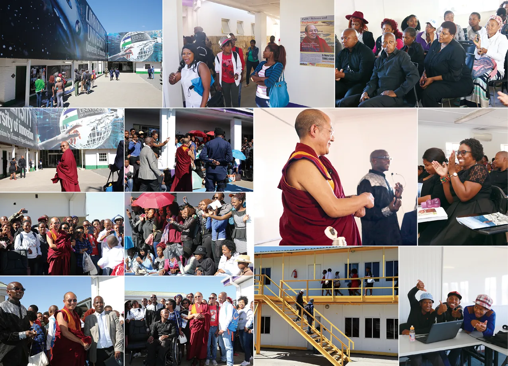
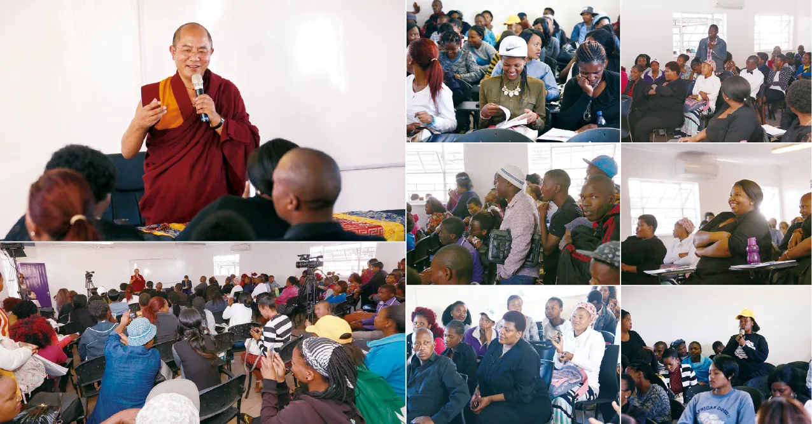
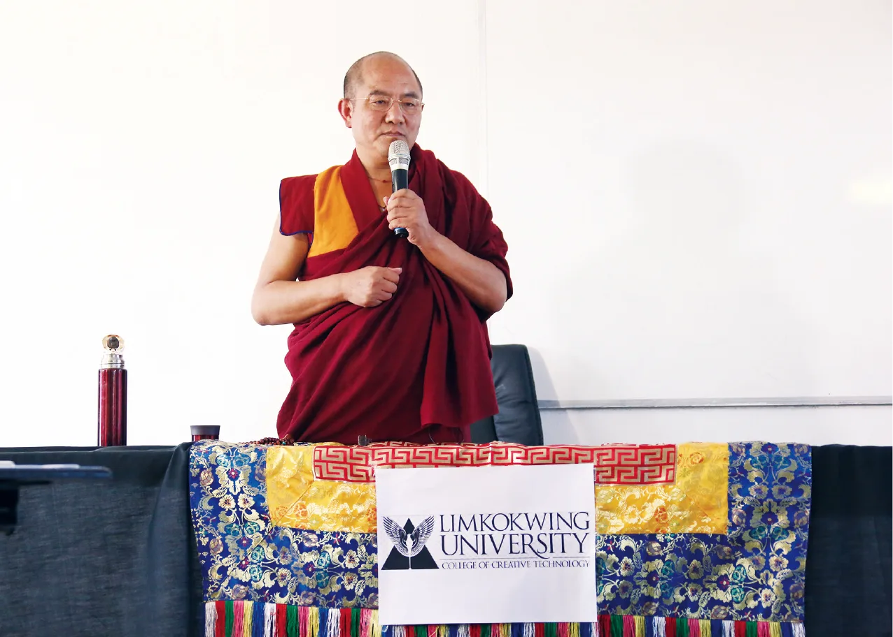

“信仰，

是人们所必需的。

什么也不信的人不会有幸福。”

——雨果

第133场

莱索托林国荣创意科技大学

Limkokwing University of Creative Technology

莱索托·马塞卢

2015 / 11 / 2

## 信仰与科技

## Spirituality, Science and Technology

主持人：

下午好！今天是林国荣创意科技大学有史以来最幸运的一天，因为我们邀请到了索达吉堪布。

在这里，我要告诉大家一个秘密：今天堪布到访的第一个地方是我的办公室。所以我的办公室是最有福气、得受加持最多的地方。

不再耽误时间，接下来有请堪布——

我是来自喜马拉雅山脉附近的藏族人，而且是藏族出家人。你们很多人以前也许只是在电视上见过藏族出家人；我也是同样，之前只在电视上见过非洲，并没有到过这里，这是我第一次来到非洲。

我们藏族的很多人性情开朗、能歌善舞，所以青藏高原上常常回荡着藏民的悠扬歌声。最近我发现非洲人也有类似的天性。昨天我坐在南非去往莱索托的飞机上，当时飞机颠簸得很厉害，让人有些害怕，不过前排的几个非洲人一直欢歌笑语，我不禁想：“应该不会出事，因为他们的笑声非常动听。”有时欢乐的笑声确实给人带来一种安慰。

## 一、引言

今天跟大家交流的内容是“信仰与科技”，主要谈谈信仰与科技的关系。

以前我常听说非洲是一个战争横行、疾病遍布的地方，但是到了这里发现也并非这样，反而感受更多的是这里人们的纯朴和善良。实际上，不论在人类演化还是自然变迁方面，非洲都发挥了独特的作用。

前段时间我在开普敦大学遇到一位考古学教授，他认为：全世界的人都具有非洲布须曼人的基因[^1]。相当多的考古学家、遗传学家和人类学家认同这一观点。因此，可以说人类起源于非洲。

另一方面，世界陆地也发源于非洲。按照地质学的观点，地球表面覆盖着坚固的板块，由于地球内部巨大能量的推动，有的板块漂移形成亚欧板块，有的漂移形成美洲板块……而非洲板块一直没有移动，它应该是全球陆地板块的起源地。

由此可见，非洲是人类以及世界陆地的发源之处。

不过从现今的状况看，不论美洲、欧洲、大洋洲还是亚洲的很多国家，都在现代科技方面取得了飞跃的进步，而非洲却不那么理想。今天在座的老师和同学，你们是非洲未来文化、政治、经济等领域的接力者，有责任思考这个问题。

## 二、信仰与科技的碰撞

### 消失的文化

如今是一个特殊的时代，科学技术被大力弘扬的同时，传统文化却遭受着前所未有的冲击。很多年轻人出生的年代，正是因特网诞生之际，因此他们心中不一定有传统文化和信仰的印迹，有的只是现代科技和知识的身姿。他们会唱流行歌，而不懂民族歌；知道一些流行名词，却对传统道理知之甚少；一些家族文化在他们心中也难觅踪影。

所以，这个时代的未来走势让人担忧，不论非洲人还是亚洲人，将来也许只信奉一种“宗教”，那就是科学。然而科学只是一种知识，如果被好人掌握，可以造福人类，如果落入坏人之手，就会给人类引来灾难。

### 科学家的忏悔

大家可能知道，19世纪60年代左右，瑞典的诺贝尔（Alfred Nobel, 1833-1896）有感于开山工人的辛苦劳累，想要为他们减轻负担，于是经过不懈的努力，研发出了炸药。不过非常不幸的是，炸药后来被应用于战争，它的巨大威力让很多人的生命瞬间灰飞烟灭。

由于研发炸药，诺贝尔获得了巨额财富，但是他的内心却充满悔恨，因为炸药给人类造成了极大危害。为了消除内心的愧疚，诺贝尔捐出部分财产设立了诺贝尔基金，用于奖励那些为世界做出巨大贡献、造福人类的人。一百多年以来，诺贝尔奖一直不断地在颁发，很多人获得这一殊荣。

与此类似，爱因斯坦出于利益人类的初衷而研发原子弹，后来美国将两枚原子弹投放在日本的广岛和长崎，使得那两座城市瞬间面目全非。这件事让爱因斯坦痛心疾首，直至临终前还对研发原子弹后悔不已。

由此可见，一项新科技的出现，可能带来利益，也可能引发弊端。

如果能用信仰和道德的准绳框定科技的发展方向，就会避免其弊端。所以，明智的人一方面会学习高新的科学技术，另一方面也不会丢失传统文化和信仰。

在如今的非洲，很多世界级企业到这里寻找市场，比如美国的微软和谷歌、中国的华为等，在这种情形下，非洲年轻人乍一接触高新产品，诸如手机、电脑等等，也许会被彻底吸引，而将传统信仰和文化统统抛弃。

因此我有一个忠告：希望非洲的年轻人牢牢守护有价值的民族传统文化，在此基础上再接纳高科技，尤其你们本有的信仰不要丢失，这很重要。

## 三、信仰，心灵的归宿

信仰对人，有着不可估量的作用。不过遗憾的是，如今很多人没有信仰。这一点其实很可怕。法国著名作家雨果曾说：“信仰，是人们所必需的。什么也不信的人不会有幸福。”也许你们有些人不一定明白这句话的意义，但确实每个人都需要有个心灵归宿——一份宗教信仰。就在座的各位而言，可以选择信仰原有宗教，也可以去信仰外来宗教，比如佛教、基督教等。

以佛教来说，如今越来越受到人们的关注，全世界很多高校都在开展佛教禅修。前段时间，我去了英国的牛津大学、剑桥大学和伦敦大学，这几所大学都设有佛教研究会和禅学社，很多老师和学生在修持正念禅。

禅修确实对人心有很大的利益。现代人普遍非常忙碌，很容易陷入焦虑、忧郁的心态中，比如在英国，越来越多的人被抑郁症困扰，而禅修可以让心灵恢复宁静、获得安乐，因此那里的不少人为了调整内心而努力禅修。

不知道莱索托有没有人得抑郁症？可能没有，看起来每个人都很快乐。即使有也是少数——这是我的估计。

总而言之，在这个躁动不安的时代，信仰能给人带来切实的利益，因此大家有必要花时间研究一下佛教等宗教，如果能学会运用宗教的智慧调整内心，就可以找到真实的快乐。

现场互动

问：应该如何对待外来宗教？

堪布：对待外来宗教，要有开放的态度——在守护原有宗教的同时，可以去了解和学习外来宗教。

我是一名佛教徒，但是也相信基督教的慈善理念，会去基督教的教堂祈福、供灯，还会跟很多人探讨《圣经》的道理。如果我很狭隘，只容纳自己的宗教，可能就无法做到这样。

如今是多元文化的时代，宗教徒在不违自宗信仰的情况下，可以去了解其他宗教、文化与知识，这是完全合理的。否则如果认为除了自己的宗教，其他一概都要排斥，那么连现代科学也要拒之千里了，而实际上现代科学成果很多人都在享用。

问：生活中出现挑战时，如何运用禅修应对？

堪布：不是遇到挑战才想到禅修，而是未雨绸缪，平时就要常常修持禅定。

人的很多痛苦源于心，比如一个小问题，依靠智慧完全可以解决，但是心态不好的人，可能会把问题看得很大，最终导致无法收拾。这种人如果能每天早上禅修一会儿，五分钟、十分钟，或半小时、一小时，内心就会逐渐放松，趋于平和，能更好地处理各种问题和挑战。

也许有人觉得：“禅修是宗教方法，我不太愿意用。”这也没关系，现在牛津大学提倡一种无宗派禅修——不提宗派、只是调心，这可能适合这个时代中的部分人。

问：您今天的演讲中，哪些是需要我们记住的关键点？

堪布：我今天讲的内容，主要有两个要点：

第一，继承本有的文化和信仰。现在很多年轻人一味追逐新世界，把传统抛之脑后，这对未来是无利的。希望非洲的年轻人不要这样，应当好好珍惜和继承传统文化和信仰。

第二，接纳先进的科学技术。在如今的时代，非洲人民也应该勤奋学习各种高新科技，以此造福自己的国家乃至全人类。

一方面不丢失传统文化和信仰，另一方面抓住机遇学习和接纳现代科技，这是我的两个建议。

问：佛教可以消除人的不好情绪吗？

堪布：可以的。依靠佛教，我们能清楚觉察心中的破坏性、负面情绪，继而进行调整。

如今世界上很多高校开设禅修课，就是因为一般人难以认识烦恼，诸如贪欲、嫉妒、傲慢、愤恨等，如果能借助禅修等佛教方法，就可以全面把握这些负面情绪，进一步控制它们，避免它们带来伤害，就好比识破了小偷，就能随时关注他，避免他为非作歹一样。

主持人：

今天我们学到的道理比任何一天所学的都丰富、珍贵，让我们至诚地感谢堪布！

[^1]: 布须曼人是生活在非洲南部的一个原住民族，现今约有五六万人。
