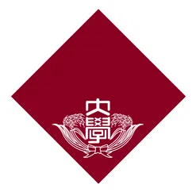
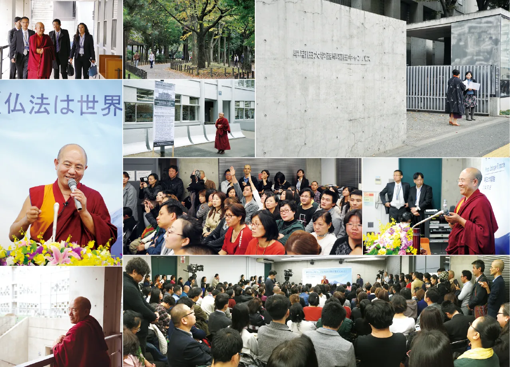
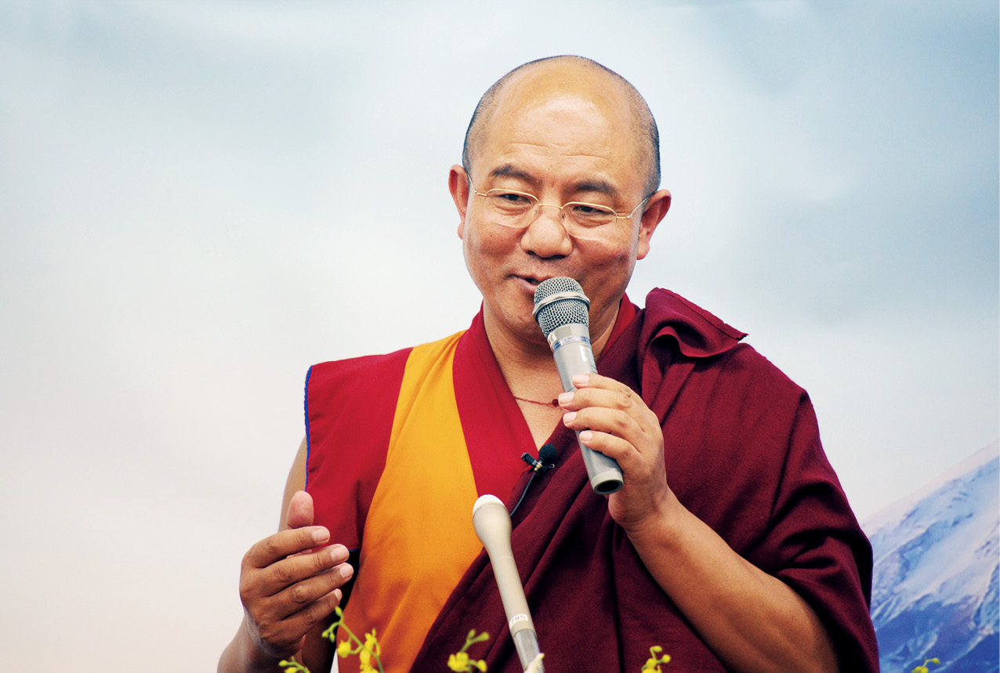
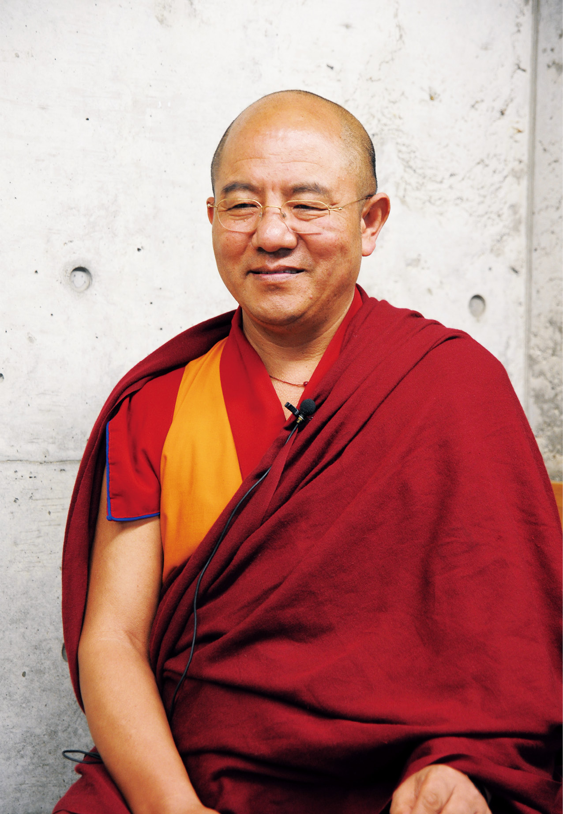

一切外在的富足，

在内心中本自具足。

第137场

日本早稻田大学

Waseda University

日本·东京

2015 / 11 / 13

## 快乐人生

——佛法可以改变世界

## A Happy Life: Making a Difference with Buddhadharma

主持人：

非常荣幸能邀请索达吉堪布来到我们早稻田大学。日本作为一个先进国家，人们的物质生活比较富裕，但是也有不少人感受着精神上的困惑与苦恼。今天索达吉堪布将为我们开示佛教的智慧，如果能够对大家有所帮助，我将甚感欣慰。谢谢！

很高兴能够跟大家交流，对我而言，这也是一次学习的机会。今天我们探讨的主题是“快乐人生”。

## 一、追寻快乐

### 世间快乐的本质

世间任何人，不论生活在哪个国家，也不论是何种身份，都在孜孜不倦地追求幸福，为此而不断地奔波忙碌。不仅是人类，我们看得到的动物也一直在忙于营造自己的幸福生活。可以说，得到幸福是所有众生的共同愿望。

我本人也曾努力寻求世间的幸福。不过学习佛法后，逐渐认识到世间的幸福并不可靠，它短暂虚幻，终归破灭。

佛教中讲，人生有三大苦：苦苦、坏苦、行苦。我们感受的每一种快乐，都在不断变化，虽然当时感觉很开心，似乎幸福的生活拉开了帷幕，但很可能这份快乐正悄悄酝酿着痛苦。所以，世间快乐的本质是一种“坏苦”。

后来我逐渐发现，值得每个人追求的是出世间的快乐，它是一种真实的快乐。

出世间的快乐不依赖于外物，是从内心获取的，所以比较容易得到，因为每个人都有一颗心。相反，如果要依靠外物得到快乐，首先不容易得到；即使得到，也容易失去；即使没有失去，也会变来变去，整个过程都给人一种不安全感。不过如今的人非常关注外部世界，却很少关注内心，这一点是很可惜的。

### 思索生活的意义

大家都知道，20世纪是一个弥漫着硝烟的世纪，爆发了第一次世界大战、第二次世界大战等大大小小的战争，很多很多人生活在血腥中。21世纪算是比较和平的世纪，更重要的，它是一个信息爆炸的时代——人们早上睁开眼睛，打开电视、iPad或手机，全世界的新闻就全部呈现在面前——“哦，这个国家发生了地震，那个国家发生了水灾，那个国家的一架飞机掉到海里了，那个国家爆发了内战，多少万人无家可归……”诸如此类触目惊心的事顷刻间就全部知晓。

在这种情况下，跟自己的思想、行为相背离的信息，每天也在冲击着人们的内心。

美国有一位未来学家这样说：“人们现在得到的很多信息，不一定是资源，反而可能带来危害，成为染污，让人迷失方向，无法抉择。”确实如此，我们每天接收那么多信息，有多少对提升生命品质和生活质量有帮助？这方面值得大家认真思考。

事实上，很多人特别感兴趣的一些事物，表面上很吸引人，但却可能让人的内心越来越浮躁，越来越边缘化和低俗化。

早在8世纪，印度的寂天论师就说过：胜义谛不是凡夫的行境，凡夫能了知的只有世俗。意思是，凡夫人不具备甚深的智慧，凭感觉和喜好追求各种事物，但并没有触及世界的真相。比如很多人看到广告中大肆宣传的产品，就立刻萌生购买的欲望，但这些事物不一定有坚实的意义。

1969年诺贝尔文学奖获得者、法国作家塞缪尔·贝克特（Samuel Beckett, 1906-1989），也说：“我们庸俗的感知只涉及庸俗的现象。”

我这样说，并不代表我对现代生活失去了信心，成了悲观主义者，我只是想唤起大家对生活真实意义的思索。

### 人生苦味

今天的主题是“快乐人生”，但是这个世间的人真的快乐吗？从各类媒体报道看，世界各地的人都有不少痛苦——不论孩童、年轻人还是老年人。

就孩子而言，他们中的有些人上学期间常常遭到其他同学的欺凌，身心都感受很多痛苦。这种现象在很多国家屡见不鲜。既要背负学习的重担，又要承受他人的歧视、欺负，对于这些孩子，快乐只是一个遥远的梦。

年轻人快不快乐呢？有些非常快乐，但大多数年轻人承担着工作和生活的巨大重负，需要从早到晚不停地忙碌，有甚者一天工作十几个小时，个别人承受不住压力，甚至选择了自杀。

今年7月8号英国《每日邮报》报道：如今日本男子中，约有一百万宅男[^1]。日本人口并不多，而宅男、宅女却占了很大比例，这些人不愿与人沟通，白天睡觉，晚上看漫画、上网等等。这种人在世界其他地方也有很多，据说有个年轻人三年中没有跟任何人交往，一直待在家里，除了吃饭、睡觉、上厕所之外不做其他事。他的父母只有看到房间灯亮着，才会有一点欣慰：“哦，我们的孩子还活着。”这样的年轻人快乐吗？肯定不快乐。

再说老年人，这个年龄段的人生如夕阳西下，他们不再拥有年轻时的精力、美貌和地位，不仅承受身体上的种种衰相，内心也常常陷入寂寞与失落的状态。

由此可见，世间的人难得有多少真正快乐的，每个人都有不同的痛苦。

### 苦因不在外面

对于痛苦，一般人往往将其归咎于外在原因：“我的钱财不够多”“我的名声不够大”“我的权位不够高”……其实这也不一定，如果你赚了很多钱，得了很大的名声，拥有了很高的位子，痛苦也许更严重。

纵观世间，很多坐拥万贯家财的人，真的就快乐吗？比尔·盖茨是这个世界上最富有的人，但是他常常很苦恼，由于微软的运营消耗了他的大量精力，导致他经常不能陪伴家人，这让他感觉痛苦。

与之类似的人还有很多，他们拥有丰裕的财富、显赫的名声等，但是内心却常常陷入痛苦。

相反，如果一个人具有信仰、智慧和悲心，即使物质条件有些匮乏，内心却可以非常快乐。

藏地历史上有一位大修行人叫米拉日巴，可以说是一个食不果腹、衣不蔽体的流浪汉，但是他口中却唱出很多洋溢着欢乐的道歌。这些道歌表达出他内心的喜悦，同时也使得无数人对人生有了新的感悟，并最终找到快乐。其实一旦内心得到开发，每个人都可以享受这种喜悦。

### 三种人的快乐

印度的龙猛菩萨在《大智度论》中说，世间有三种人：上等者，依靠利益众生而获得快乐；中等者，希求后世的快乐；下等者，希求今生的快乐。

这其中的第一种人，心中有种信念——“我要利益全世界的人，乃至所有动物，我一定要尽力帮助他们”。在这种情况下，他们即使承受工作的压力、身体的劳累等等，内心不会有很多痛苦，因为利他心有一种自然的力量，能够带来快乐。

公元6世纪中叶[^2]，佛教由中国传入日本，之后不断传播，如今成为很多日本人心中根深蒂固的信仰。不过日本佛教徒中，有多少是这里所说的上等者？恐怕不是很多。

第二种人，对来世很关心，希求来世的快乐。在藏地，大多数人虽然也关心今生，但更重要的，他们会想“我来世乃至生生世世都不要堕入三恶趣”，所以他们会将财富、时间等资源更多地用于营办来世的安乐。这类人今生中即使工作比较忙、生活有些枯燥，但依然会活得很开心。

第三种人，追求今生的快乐。日本民众中也许这类人比较多，不仅是日本，就世界范围看，希求今生快乐的人也占大多数。他们听到“来世”“出离轮回”时没什么感觉，反而对今生的相貌、身体、生活非常关心。

当然，追求今生快乐，在佛教中也是允许的，不过人生非常短暂，仅仅追求这种快乐并不值得。

我前段时间去非洲，了解到那里很多国家的人均寿命只有四五十岁。日本的医疗条件比非洲先进很多，国民寿命更长些，不过即便长命百岁，一生中事事顺利，也是短暂的时光，很快就会过去，因此应该关注更长远的未来。

## 二、佛法中的妙方

### 心中的宝藏

为了改善生活而追求物质，这本身也无可厚非，不过如果只是关注今生的衣食受用，那跟动物的差别也不大了，因为动物也是通过吃草喝水、接触异性等获得满足。因此，人类应该有更高的追求，应该寻找更高层次的快乐——并非依附外物，而是从内心流露的快乐。

佛教历史上有一位黄檗禅师，他说：“心即是法，法即是心。”这告诉我们，一切外在的富足在内心中本自具足，如果能开发内心，就会拥有取之不尽、用之不竭的宝藏，源源不断输送出快乐，受用不尽。

### 禅修，让愿望实现

在座的有些人可能清楚，佛教中有很多充实内心的方法，禅修就是其中之一。

比如，作为管理者，如果能运用禅修让自心变得柔和、自在，那么所有员工也会慢慢变得调柔，从而会实现最高层次的管理；作为教育工作者，如果能借助禅修调整自己和学生的心态，就可以开发自他的潜在智慧，提高教学质量；作为运动员，如果能常常禅修，就可以让身心达到最佳状态，从而提升成绩。

总之，依靠禅修，不同的人都可以实现愿望、获得利益。

### 深究与广学

如今的日本佛教界，既有让人随喜的地方，也有不容忽视的问题，比如佛教的边缘化和形式化，再比如系统学习的缺乏——日本很多佛教徒的闻思修，跟中国藏地等地方的人相比，确实存在一定的差距。

不过从另一个角度看，日本拥有先进的科技、优良的礼节，整个社会都很有组织性。我觉得日本人民如果能运用特有的智慧和力量研究与弘扬佛法，会给世界精神领域带来巨大的影响。

站在全球范围看，日本制造的产品常常赢得大家的信赖。比如上世纪80年代，人们使用的小录音机，如果产自日本，大家都会说：“哦，质量肯定很好。”那么在精神层面，日本人民如果投入更多精力，应该会有超胜物质领域的成就。

当然，在学习佛法时，有时要深度挖掘，有时要全面通晓。

昨天我在东京大学遇到一位教授，她曾去过哈佛大学等著名大学，她问我：“早在十年前，您到了高校，常常传讲《中观根本慧论》等有深度的论典，现在只是介绍浅显的佛理，为什么？在东京大学这类学校，您应该传讲甚深、专业的佛法。”

我回答：“其实我也喜欢讲深一些的佛法，虽然我的智慧不是很高，但是我对甚深的佛法很有兴趣。不过如果在大学里传讲这类法，现场会有很多人打瞌睡，我不愿看到这种场面，只好讲些简单的道理了。”

最初收到一些大学的邀请时，我确实都会选择传讲如来藏、中观空性等法门，但是在现场，除了个别教授，其他人都不太专注。后来再到学校演讲，我就讲些简单的佛理了。可以说，我一年中大概三分之一的时间到大学等地方交流简单的佛法，三分之二的时间在我们佛学院中讲解甚深的法要。

那个教授又问：“您为什么选择去名牌大学演讲呢？”

我回答：“实际上我去演讲的地方有名牌大学，也有一些非重点大学，还有中专、中学、小学、孤儿院以及监狱、戒毒所等等。只要哪里有因缘，我都愿意去交流佛法。不过地方不同，效果也有所差异，如果是一所名气很大的学校，就更容易引发关注。比如同样是‘藏传佛教思想’这个内容，在一座小寺院讲，世间人不一定关心，在一所名牌大学讲，世间人就会格外关注，由此可以让他们结下佛缘。”

作为佛教徒，不论你是大学教授还是普通民众，一方面有必要研究甚深佛理，另一方面也应当学习浅显法门。不过现在不少人容易落入极端：或者心高气傲——“我只听中观、大圆满，其他的都不听”；或者自卑畏怯——“我只要明白皈依、无常就可以了”。这两种情形都不可取，最好全面学习佛法。

## 结语

日本禅师池田大作曾说：“掌握了哲学，就等于在心里燃烧起一个太阳，以后将是以哲学照亮、开拓黑暗人生的时代。”佛法可以说是最甚深的哲学，如果大家能对它进行全面、系统的学习，就会逐渐明白心的奥秘，对内心有一定的把握和感悟，由此人生会变得快乐，外在世界也会变得美好。

现场互动

问：两年前我家里出了些事，之后我就一直无法摆脱低落的情绪，该怎么办？

堪布：每个人都可能遇到挫折，此时心态往往受到影响，这对一般人是很难避免的，只不过有的人情绪波动比较严重而已。

不过在日本，很多人说：“我在其他方面修得不一定好，但无常修得很娴熟，因为地震、海啸等灾难随时都可能发生。”这也是很好的，佛经中说：最深的修法就是观无常。

一个人如果有了无常的观念，就会明白生活中不论发生什么变故，家人患病、离世，或者感情破裂等等，都是正常的现象，最好以平常心面对。所以，你也不妨多观修无常，心态应该会有所改变。

问：我是早稻田大学经济学研究科二年级的学生。我觉得佛法可以控制我的烦恼，因而走上了学佛的路。不过有些人是没有烦恼的，比如我的母亲，她很乐观、善良，她跟我说：你有烦恼，我没有烦恼，所以我不需要学佛。对于像我母亲这样的人，怎样说服她学佛呢？

堪布：你的母亲如果没有烦恼，那有必要找人狠狠地训斥她，看她会不会生气、会不会起烦恼。

以前有个人也说：“我没有烦恼，始终很快乐。”他的老师说：“你可能确实没有痛苦，不过你为什么偷我的东西？”那个人听了怒不可遏，这时才猛然发现自己在起烦恼。

你的母亲虽然跟你讲自己没有烦恼，但可能只是口上说说而已，你可以慢慢观察：她一生中真的一直快乐吗？生病时会快乐吗？面对死亡时会快乐吗？其实很多人生痛苦都是不可避免要经历的。

另一方面，我们不要把佛法想得很简单，认为学佛像吃止痛片一样，只是暂时控制烦恼。实际上，佛法的最重要作用是解决生死大事。一个人如果没有了脱生死，生生世世都不可能获得真实的安乐，会接连不断地感受各种痛苦。我们可以看到，不论哪个国家的人，也不论有钱人还是没钱人，都有很多痛苦。而唯有依靠佛法，才能彻底摆脱这些痛苦，因此从解决生死大事层面，佛法才展示出独特的威力。你也可以从这方面劝导你的母亲，让她对佛法生起信心。

问：虽然我相信有来世，但是又不在乎来世过得怎样，我这种想法的问题出在哪里？

堪布：你说相信来世，但是这种相信是否像相信明天或下半生存在那样坚定？如果是的，你不会不在乎来世。所以你的问题，主要在于信心的程度不够深。

问：正如大家所见，我是一个老人。虽然日本人口有减少的倾向，但世界人口依然在增长，因此有报道指出，50年或100年后人类会因为粮食和水资源匮乏而必须移民到其他星球。另外，60年前，我曾看过一部电影，情节是小行星撞地球。我认为这很可能是50年或100年后会出现的事。请问您如何看待这些问题？

堪布：现在各大传媒报道的信息，有些是真实的，有些可能只是为了吸引公众眼球，比如讲一些外星人的离奇故事或恐怖之事。

世界人口在近四五十年中确实增长很多，不过如今不少国家呈现老龄化，人口出生率降低，年轻人不愿结婚生子，比如荷兰、比利时、新加坡、日本等国。相关专家也做过这方面研究，从中得出结论：世界人口增长会逐渐放缓，将来不会出现上世纪曾出现的人口暴涨状况。

因此，如果人类能节约资源，暂时不用担心资源枯竭。尤其是你和我，已经不是年轻人，在我们离开之前，地球上应该还有饭吃。（众笑）

问：不同人对幸福的理解不同，那幸福到底是什么呢？

堪布：对于这个问题，我观察过很长时间。我认为当一个人对所追求的事物有一种满足感，从此不往外求，而获得内心的自在，这就是真正的幸福。

主持人：

感谢大家的莅临，感谢堪布给我们带来的精彩演讲和答疑！

[^1]: 宅男与宅女，是指长期足不出户的人。
[^2]: 中国南北朝或日本飞鸟时期。
