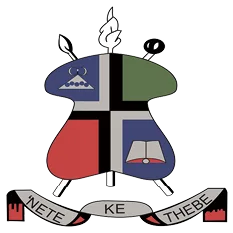
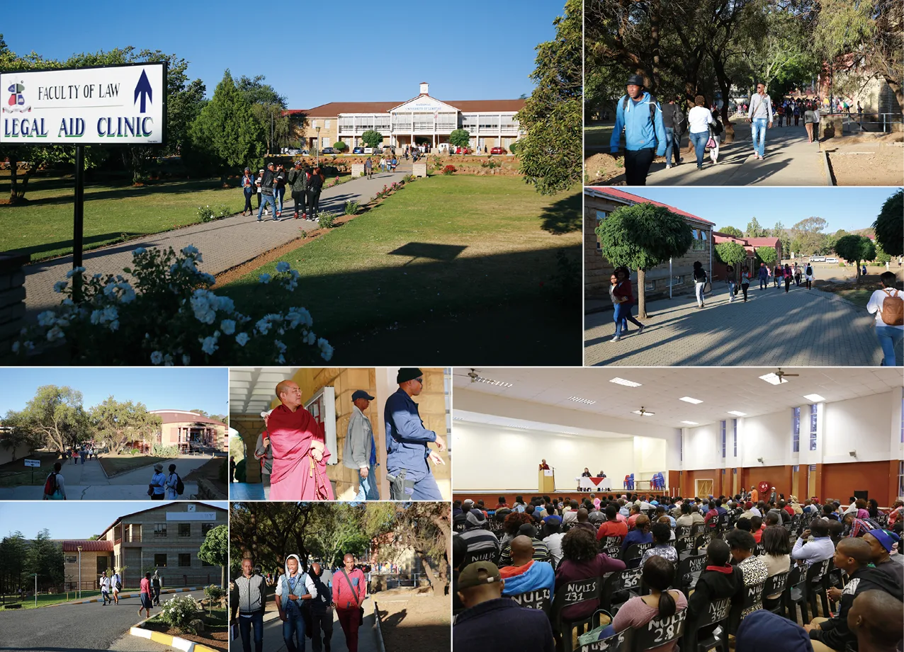
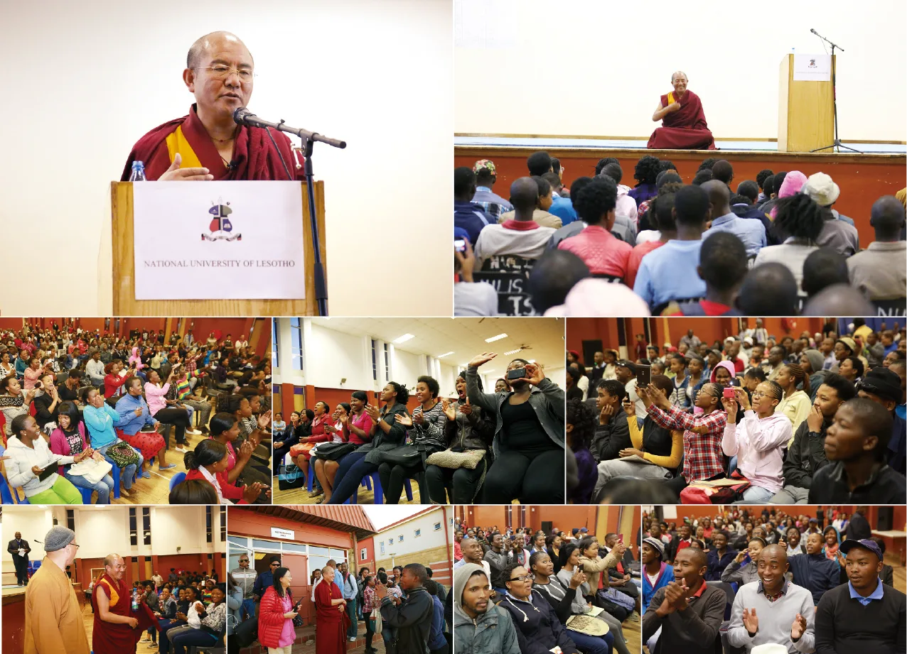
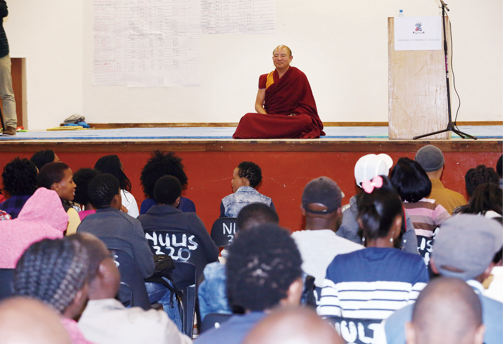

“爱，

是一种无穷无尽的能量源，

能降服一切。”

——爱因斯坦

第134场

莱索托国立大学

National University of Lesotho

莱索托·马塞卢

2015 / 11 / 2

## 有爱的生活

## Living a Life with Love in Your Heart

主持人：

女士们、先生们，大家晚上好！今天非常殊胜，因为尊贵的索达吉堪布将要为我们带来别开生面的演讲。

索达吉堪布任教于著名的喇荣五明佛学院，是这所佛学院中最重要的导师之一。与此同时，堪布还是一位多产的佛教翻译家和佛教思想家，闻名于东西方。近年来，堪布受邀前往世界很多高校演讲，在与高校师生的交流中，堪布将传统佛教与现代生活融合，站在崭新的视角分析一些全球性问题，因此我们专心聆听堪布的演讲必定会获益匪浅。事实上，我确信今天的演讲将会激动人心。有请堪布——

很高兴跟大家交流！我是第一次来到莱索托，也许你们很多人也是第一次看到我这样穿红色僧衣的人。

今天我跟大家分享的主题是“有爱的生活”。实际上，不论哪个地方的人，也不论哪种身份的人，都需要爱。

## 如何兑现爱？

“爱”，虽然只有一个字，但每个人从呱呱坠地，到步入童年，历经青年，乃至迈进中年、暮年，整个生命历程都不能离开它——小时候需要父母的爱，长大后需要朋友和家人的爱，老年时需要子孙的爱；与此同时，人们还需要付出爱——关爱家人，热爱人生，对国家乃至世界奉献爱。

要实现对他人乃至对世界的爱，首先要强大自己，否则即便理想很远大、口号很响亮，最终也只会落于空谈。

南非前总统曼德拉在一本书中讲述了一则发人深省的故事。在伦敦威斯敏斯特大教堂地下室的墓碑林中，静静地躺着二十多位英国前国王以及牛顿、达尔文、狄更斯等名人的墓碑，在这些墓碑旁边有一座墓碑很普通——没有姓名，没有生卒年月，甚至没有墓主的介绍文字，但这块墓碑却对曼德拉影响至深，因为它上面刻着这样一段话：

“当我年轻的时候，我的想象力从没有受到过限制，我梦想改变这个世界。

“当我成熟以后，我发现我不能改变这个世界，我将目光缩短了些，决定只改变我的国家。

“当我进入暮年后，我发现我不能改变我的国家，我的最后愿望仅仅是改变一下我的家庭。但是，这也不可能。

“当我躺在床上，行将就木时，我突然意识到：如果一开始我仅仅去改变我自己，然后作为一个榜样，我也许可以改变我的家庭；在家人的帮助和鼓励下，我也许能为国家做一些事情。然后谁知道呢？我甚至可能改变这个世界。”

这篇碑文确实发人深省，据说它改变了曼德拉（Nelson Mandela, 1918-2013）的一生。

在座的年轻人，你们是国家的未来、民族的希望，应该胸怀梦想——立志为国家和人民做出贡献。要实现这一目标，首要之事就是充实自己。如何充实自己呢？一方面努力掌握各种科技知识，一方面牢牢继承民族传统文化。

另外，大家在追逐梦想的过程中，也许会遭遇各种困境，诸如疾病的缠绕、贫穷的重负，但是不要放弃，应当坚持下去。古人云：“君子忧道而不忧贫。”就是说，有智慧的人会关注道德和高尚的知识，不会对世间财物孜孜以求，即使身处贫困，也能勇敢面对并超越。

以前听说莱索托等非洲国家的经济条件不太好，不过这次来到这里，我感觉，跟我求学时比，你们富裕得多。我以前读师范时，班里大概有三十多名学生，这中间有三四个人穿着布满补丁的衣服，我是其中之一。那时在老师和同学跟前，我常常不愿提及自己的家庭状况，总觉得不好意思。有时到了星期天，我就到街上做买卖——用酥油和奶渣跟其他同学或附近的老乡换取旧衣服，这时如果被班里同学看到，还会感觉特别羞愧。

所以，我的学生时代也有很多故事。在座的很多同学，现在和将来可能也会面对各种困境，此时要有一颗坚强的心，勇敢地往前走。

## 旧衣服的启示

你们很多人应该比较熟悉迈克尔·乔丹，他被认为是历史上最伟大的篮球运动员，绰号“飞人”。我看过他的传记，感觉他的成功和荣誉也是得来不易的。

迈克尔·乔丹小时的家境非常贫寒。在他十三岁那年，有一天父亲递给他一件旧衣服，问道：“你觉得这件衣服能值多少钱？”

“大概1美元。”乔丹回答。

可是父亲希望乔丹把旧衣服卖到2美元。乔丹虽然觉得不太可能，但还是愿意试一试，他把旧衣服洗干净、刷平整，来到一个地铁站，叫卖了六个小时，终于卖掉这件衣服赚了2美元。

过了十多天，父亲又递给他一件旧衣服：“你想想，这件衣服怎样才能卖到20美元？”乔丹觉得这很困难，但父亲鼓励他尝试一下。

终于，乔丹想到一个办法，他的表哥擅长画画，于是他请表哥在衣服上画了一只可爱的唐老鸭和一只顽皮的米老鼠。之后他把衣服拿到一个贵族子弟学校的门口叫卖。最终这件衣服被一个小少爷买走了。那个小少爷非常喜欢衣服上的图案，除了支付20美元，还给了5美元的小费。25美元对于乔丹无疑是一笔巨款。

回到家后，父亲又递给他一件旧衣服：“你能把它卖到200美元吗？”这一回，乔丹没有犹疑，而是平静地陷入了思考。

两个月后机会来了，当红电影《霹雳娇娃》（Charlie's Angels）的女主演法拉佛西（Farrah Fawcett, 1947-2009）来纽约做宣传，小乔丹挤到她身边，举着旧衣服请她签名。法拉佛西看到是一个纯朴的孩子，就签了名字。

乔丹将这件衣服拍卖，获得了1200美元！

当他把钱拿回家，父亲非常欢喜，问他：“孩子，你从卖衣服的事情里，学到了什么呢？”

乔丹说：“任何一件事，只要努力，总会有办法的。”

父亲说：“这也没错，不过不是我的初衷。我只是想告诉你，一件只值1美元的旧衣服，都有办法高贵起来。更何况人呢？我们家只不过穷一点，这又有什么关系？我们不应当对生活丧失信心。”父亲的话深深印在乔丹心里。

不到二十年，迈克尔·乔丹的名字传遍世界的每个角落。

在座有些人，尤其在读书期间会遇到各种困难，此时可能会萌生放弃的念头，但放弃不是明智之举，坚定信心并努力想办法超越障碍，才是正确的选择。另一方面，教育是让一个人从根本上改变命运的重要途径，因此大家处在学生时代时，要不畏苦难、克服艰辛，努力求取更高、更深、更多的知识。

## 带给世界快乐的“黑皮肤”

我很喜欢看非洲名人的传记，因为非洲人中涌现出很多热爱和平、倡导平等的人，还有很多在不同领域荣获“世界第一”的人。

比如著名民权运动领袖马丁·路德·金（Martin Luther King Jr. , 1929-1968），他于1963年发表了著名演讲《我有一个梦想》（I Have a Dream），极大地推动了20世纪黑人民权运动，并于1964年获得诺贝尔和平奖。

还有刚才提及的曼德拉总统，他于1993年获得诺贝尔和平奖，而在此之前他曾因抵制种族主义而遭受了27年的监禁，不过他并没有放弃，在重获自由后继续投身于人类和平事业，最后为南非乃至整个世界做出了不可磨灭的贡献。我看过他的传记，非常感人。

黑人中还有很多卓越者，比如摇滚歌星迈克尔·杰克逊（Michael Jackson, 1958-2009）、球王贝利（Pelé, 1940-2022）、拳王阿里（Muhammad Ali, 1972-2016），还有1993年获得诺贝尔文学奖的莫里森（Toni Morrison, 1931-2019）——她撰写了《最蓝的眼睛》（The Bluest Eye）《黑人之书》（The Black Book）等经典著作。诸如此类，很多黑皮肤的人给世界带来了欢乐和喜悦。

当然，刚才提及的这些名人里，有些人所从事的职业，我平时并没有很关心，比如踢球，我从未踢过，也看不懂，还有打拳也是如此。

## 爱是无穷的能量源

不管怎样，这个世界需要爱。而这种爱，也为不少科学家所提倡。

20世纪80年代末，爱因斯坦的女儿丽瑟尔将爱因斯坦写的1400封信捐给了希伯来大学。在其中一封写给女儿丽瑟尔的信中，爱因斯坦这样说：爱，是一种无穷无尽的能量源，能降服一切，如果我们想拯救这个世界和每一个居住在世界上的生灵，爱是唯一的答案。

可以说科学研究的最终目的，也是爱。

科学有很多分类，诸如生物科学、物理科学、心灵科学等等，其中心灵科学中的宗教学是很重要的。

作为现代人，应当以开放的心态了解各种宗教，有必要时通过宗教方法来调整自心，这会让你的工作更有效率、生活更加快乐。

我去过世界许多高校和科研机构，发现其中很多人借助佛教的禅修调心，最后获得了超乎想象的快乐，而这些快乐依靠物质无法得到。

在座的也许有佛教信仰，也许没有，这都没有关系，重要的是知道佛教确实是对自他有利的学问。我从事佛教研究多年，可以坦诚地告诉大家：佛教既不违背科学，也不违背其他任何高尚的文化，佛教的宗旨是让所有人乃至动物都获得暂时和究竟的安乐。

当然，如果你对宗教不感兴趣，也可以用快乐、轻松的心态面对生活。总之，在生活中，我们要学会帮助他人，同时自己经常处于快乐中，不要因为一件小事就生气、痛苦。如果你能保持一颗欢喜心，就会发现世界其实很美好。

现场互动

问：您能否谈一下如何禅修？

堪布：禅修时，双手结定印、双足跏趺坐，然后双肩放松、脊椎端直，颈部略往前倾，舌头抵上颚，眼睛稍微眯一点，直视鼻尖；心里什么都不想，观照着自心，如果产生妄念，不要跟随它，再次安住下来。

如今在西方很多大学，普遍采用这种方式禅修。

问：“爱”有不同类别吗？

堪布：“爱”有很多类别，简单而言，可以分“大爱”和“小爱”两种。

“大爱”，就是不仅爱亲人，还爱怨敌，乃至爱所有人。这种大爱，一般人难以做到。不过如果能在心中生起这种爱，人生会充实而快乐。

“小爱”，就是仅仅喜爱某个对境，比如觉得某人很可爱，给自己带来了温暖，于是很想跟对方经常在一起。这种爱能带来一些快乐，但往往会引发痛苦。世间也有种说法：“爱得越深，恨得越深。”所以，这是一种会导致苦恼的爱。

问：我有一个建议，我们也学习各种宗教，包括佛教，那么有没有可能你们佛学院跟我们学校之间组织一些人才交流活动？

堪布：这个建议很好。我这次的行程很匆忙，不过也在了解你们的本土宗教和民族习俗，从中确实学到很多。所以，我也在想可以把我们佛学院的学生派到你们这里，你们把本土文化介绍给他们，他们把佛学知识传给你们。

现在是一个开放的时代，与上个世纪或更早时期截然不同，因此加强地域之间的交流与学习很有必要。

问：接受了大学教育后，我总觉得受教育越多，越会遇到新的问题，比如失业。那么教育是否制造了问题？

堪布：不能这样理解。如今在世界范围内，失业都是一个棘手的难题。我这次去欧洲，了解到法国的失业率不断攀升，英国失业人数也在增长，而美国这方面也不乐观，中国也是如此，你们莱索托也是一样的。失业不是某个国家特有的现象，而是全球性问题。

失业并非教育造成的，相反，教育会让人获得更多机遇。你们学到的大学知识总有一天会派上用场，尤其中文、英文等语言，所以一定要把握学习机会。

另一方面，政府部门在兴建教育设施的过程中，往往付出了很多努力，承受了很多压力，因此每一位学子都应该心怀感恩，努力学习以作回报，而不能总是观过失。

问：您的梦想是什么？实现了吗？

堪布：我小时候的梦想是出家，已经实现了。我现在的梦想是什么呢？我觉得创办孤儿院和学校非常有意义，希望在这方面贡献力量，以此帮助更多人。这是我正在追求的梦。

在座每个人都有各自的梦，不过我觉得一个人的梦想最好不要是自私的，而应当是利益社会、奉献国家的，这很重要。

问：您觉得什么样的人最了不起？

堪布：我觉得如果一个人能把一生奉献给人类，为全人类的幸福而奋斗，就是最了不起的。在这个世界上，古往今来，曾涌现过千千万万这样的人。

主持人：

希望大家能从堪布的分享中受益，再次感谢堪布！
