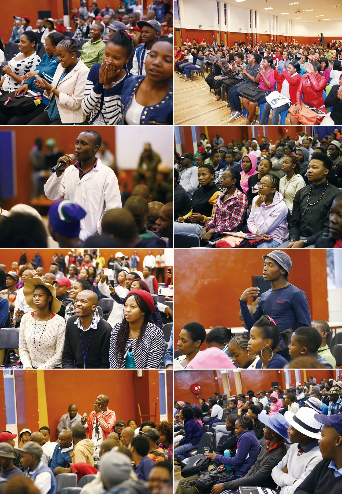
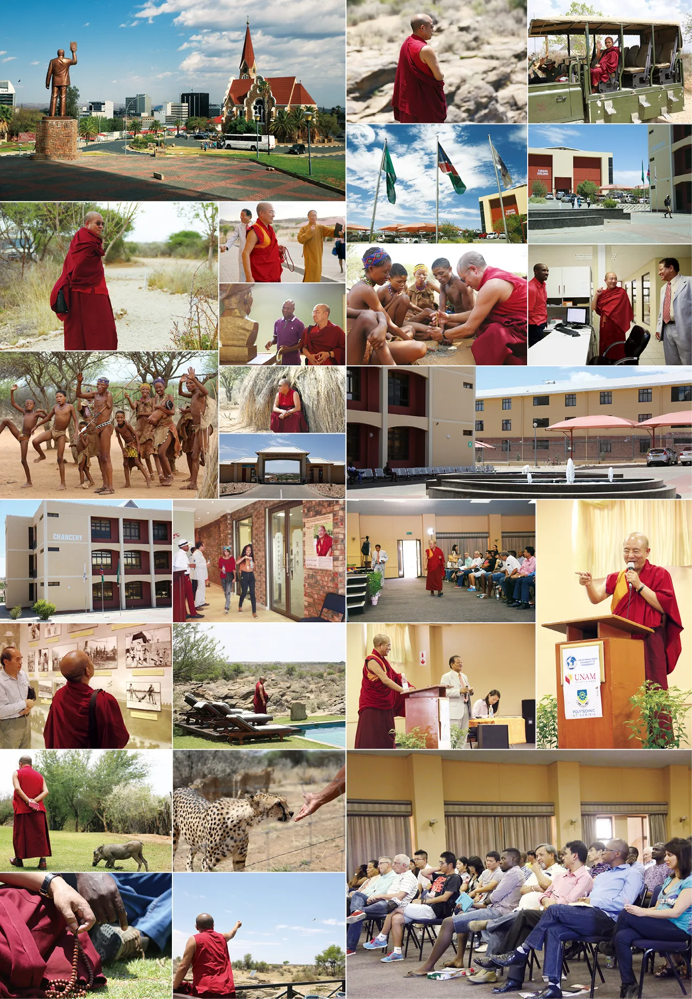
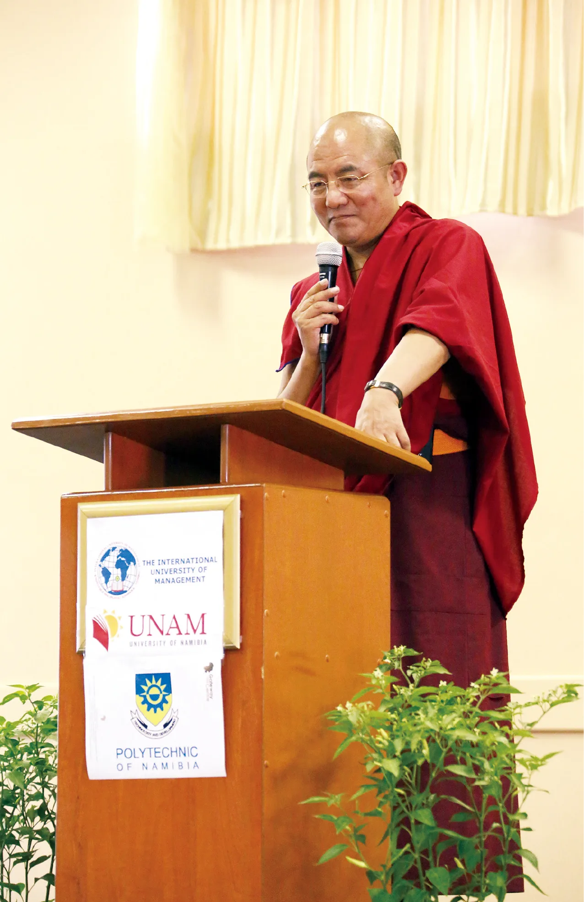
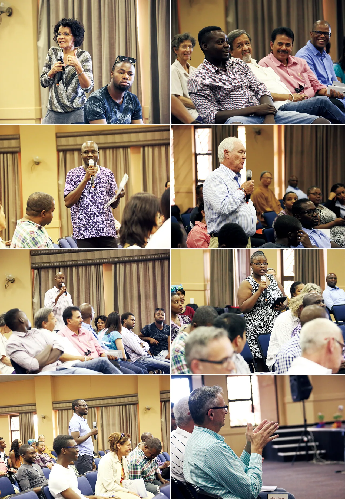
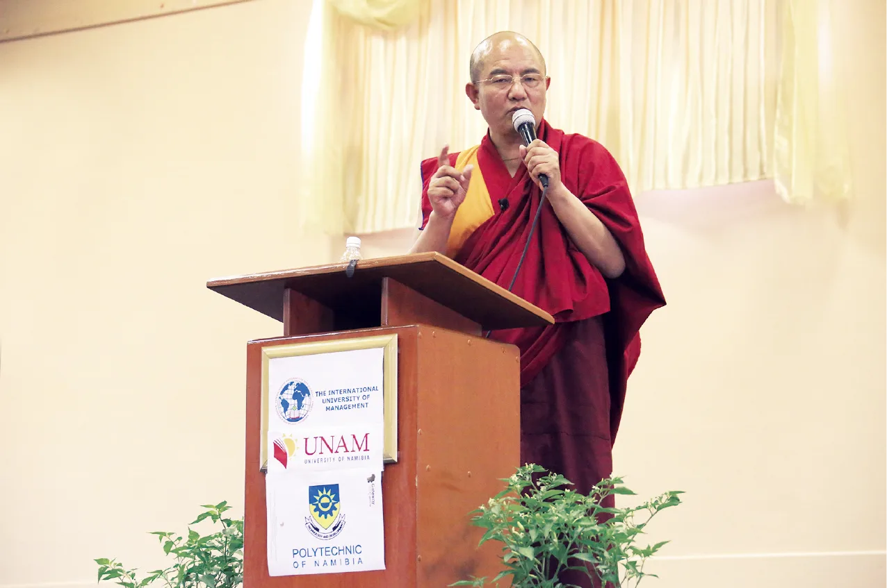
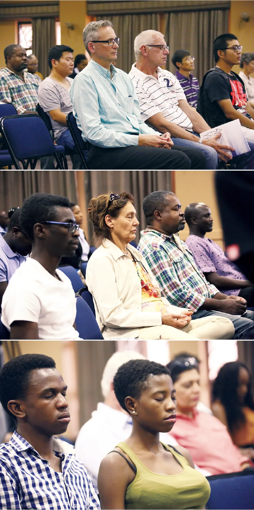

人心就如同骆驼，

你抓得越紧，

它越会奔跑跳跃，

你自然放松，

它反而变得寂静调柔。

第135场

纳米比亚理工学院

Polytechnic of Namibia

纳米比亚国际管理大学

International University of Management

纳米比亚大学

University of Namibia

纳米比亚·温得和克

2015 / 11 / 4

## 现代社会的正念与禅修

## Mindfulness and Meditation in the Modern World

校长：

非常高兴能邀请索达吉堪布来我们这里做一个简短的演讲，并为我们展示和平的真正意义。

感谢校长的夸奖。我很喜欢去学校、企业、寺院等地方交流佛法。在与不同人交流的过程中，我感觉不论什么身份的人，也不论什么肤色的人，都要保持一个宁静的心态。为什么？一个人如果内心宁静，即使遇到人生的严重困境，也能轻松面对；而如果内心浮躁，即使问题并不严重，也会难以应对，甚至可能走上不归路。

## 引言：躁动不安的世界

前段时间在欧洲，我发现那里很多人因为内心的不平衡而发泄着：在德国，很多人在示威游行，抗议总理默克尔接收难民；在法国，一家航空公司员工在罢工抗议；在英国，一些工人对薪酬不满，也在抗议。之后我来到非洲，首先到了南非，开普敦大学的学生在游行，抱怨学费太高；又到了莱索托，莱索托的很多司机在总理府前游行，说南非的司机抢了他们生意。好像不论走到哪里，我都会看到游行的队伍。

昨天我到了纳米比亚，目前还没听说有游行，不知道有没有？希望我离开之前不要有，否则我这次行程会深深烙下“游行”的印记。不过下一站我准备去日本，听说那里也有人在游行。

当然，这些人的行为也无可厚非，每个人心中可能都会存在或多或少的不满，通过游行的方式表达愿望和诉求，这是一种自由。不过也有一些人是因为欲望膨胀、贪婪加剧，始终无法满足，于是进行游行；另外还有人是在嗔恨的驱使下加入游行的行列。

贪欲和嗔恚，会导致人与人的矛盾、冲突，让人陷入痛苦。而如今，确实不少人的内心被贪欲和嗔恚所萦绕。

看到这些社会现象，我有时也会反观自己，此时往往不禁感慨：佛法让我避免了很多痛苦。我1985年出家，一直致力于修学佛法，至今已经30年了，感觉内心越来越安乐、自在，很少有痛苦和担忧。当然，我也并没有放逸散乱，而是一直尽力为社会、为人类贡献自己的力量。

其实我最初走上出家路时，并没有得到周围人的认同。那个时候我刚从一所师范学校毕业，很多同学知道我要出家，哭着说：“你以后会非常可怜的，也许会饿死。”但是20年后的同学会上，大家谈及走过的人生，我发现他们中的很多人因为婚姻、家庭等原因，流过各种心酸、痛苦的眼泪，只有我虽然过得平淡，但并没有感受很多痛苦。

对于出家，不了解佛教的人也许会诧异，甚至指指点点。不过不管怎样，只要能调整好心态，不论何种身份，也不论身处何处，都能活得快乐。

今天我主要讲两方面内容：一、佛教中的重要调心方法——禅修；二、对非洲年轻人的一些建议。

## 一、禅修的重要性

### 各有特色的禅修

在现代社会，很多人承受着巨大的压力——来自工作的，来自家庭的，抑或来自学业的。如果想要消除压力，就非常有必要学会调心，让心获得平静安住的能力。

在众多调心方法中，禅修是非常行之有效的一种，因此在美国、加拿大以及一些欧洲国家里，很多大学都设有禅学社等相关机构。

对于心灵领域，科学很少涉足，甚至是一片空白，因此也就很少有禅修方面的成果。与之不同的是，很多宗教都对禅修有一定研究，并探索出各不相同的修法。比如：伊斯兰教运用很多与苏菲派教义相结合的方法禅修，诸如调整呼吸、祈祷、安住等；非洲盛行的巴哈伊教，通过祈祷让自心跟上帝相应，从而达到专注；基督教通过专注于耶稣、圣母玛利亚等的图像，来接收上帝的爱；佛教中的禅修方法尤为丰富，因为南传佛教、藏传佛教和汉传佛教各有自己的禅修方式。南传佛教，主要通过修持四念住而认识自我；藏传佛教，依靠九住心法指导禅修，逐渐达到如如不动、内心堪能的境界；汉传佛教中的禅宗运用“参话头”的方法，比如观察“我是谁”，从而认识自我。

### 认识自我

认识自我，不仅是禅宗的目标，也是佛教其他派别所追求的境界。广而言之，认识自我，对于世间每个人都有不一般的意义。这世间的种种矛盾，诸如部落战争、邻里冲突、家庭内战，乃至两个小孩因为一件小事而争执，究其根源都是没有认识自我。

那么如何认识自我呢？在佛教中，主要有两种方法。

一种是用智慧观察：“我”在哪里？在身体的上部、下部还是中央？“我”是身体还是心？禅宗的“参话头”就是此类方法。

表面看来，“我”是身体和心识的组合。为了满足身体，我们会营办物质条件；为了满足心识，我们会寻找精神食粮，诸如艺术、宗教等。但是如果仔细观察“我”到底是身还是心，最终会得出结论：“我”并不存在。一旦认识到这一点，就不会再产生很大的烦恼和痛苦。

另一种方式，让心安住在寂静的状态，以此逐渐了悟自我。

人的心中如果充满妄念，就会障碍对自我的体认，因此需要减少妄念。那么如何减少妄念呢？

佛教中说，人心就如同骆驼：对于骆驼，你抓得越紧，它越会奔跑、跳跃，你自然放松，它反而变得寂静、调柔；同样的，对于自己的心，你越是执著，各种妄念越是难以平息，你如果自然安住，恐惧、嗔恨等妄念都会消失。又如同水自然放着，浑浊就会慢慢消失，人心坦然安住时，各种妄念也会寂静下来。

如果妄念得到了有效控制，再依靠上师的指点，就比较容易认识自我。

纵观人类历史，原本浮躁、焦虑、充满嗔恨的人，依靠修行而当下认识自我的也不乏其例，从此他们的生命就出现了转折——不论过何种生活、做何种事情，内心都洋溢着快乐。这样的境界，每个人只要努力都可以得到。一旦达到这种境界，就如同拥有了一笔心灵财富，其价值远远超过物质资财。

### 生命中的“核桃”

有这样一个故事，一个山谷里住着一位老禅师，他有一个徒弟非常勤快，每天忙着化缘、打扫等等，从早到晚片刻也不歇息。这看来并没有错，但是小徒弟内心却很挣扎。

终于有一天，小徒弟忍不住来找师父，问道：“我每天都很忙、很累，但是修行却没什么进步，这是什么原因呀？”

老禅师让他取来一个钵，又让他去取些核桃装满钵。小徒弟于是捧来一堆核桃，十几颗核桃一下把钵装得满满的。

老禅师问：“装满了吗？”

“是啊，再装就掉出来了。”

老禅师说：“那好，你再往里面装大米。”

小徒弟于是沿着缝隙，又放进大米，他边装边若有所悟：“哦，原来刚才钵没有满。”

老禅师又问：“现在满了吗？”

小徒弟回答：“现在满了。”

老禅师说：“再装一些水进去。”小徒弟把少半碗水倒进去，这次连缝隙都被填满了。

老禅师问：“这次满了吗？”小和尚看着钵，不敢回答了。

老禅师笑着说：“你再去拿一勺盐。”小徒弟取来盐，老禅师把盐化在水里，水一点儿都没溢出。

此时，老禅师问：“这说明了什么呢？”

“我知道了，这说明时间只要挤，总会有的。”

老禅师笑着摇摇头：“这并不是我想告诉你的。”

接着，老禅师倒掉这些东西，拿着空钵说：“刚才我们是先放核桃，这回倒着来，看看会怎样？”他先放了一勺盐，再倒水，倒满后再放大米，这时水已经溢出了。当钵里已经装满大米时，老禅师问小徒弟：“你看，现在钵里还放得下核桃吗？”

小徒弟这时恍然大悟，生命就是一只空钵，如果被大米般细小的事塞满，核桃还怎能放进去呢？

确实是这样的，那么哪些事情才是生命中的“核桃”呢？我觉得禅修是其中之一——如果能够坚持禅修，就能培养出调整内心的能力，从此不论人生中出现什么境遇，你都可以自在、快乐地面对。

### 贵在坚持

禅修过程中，持之以恒的努力是非常需要的。实际上不论做任何事，期望短时间中获得了不起的成就，都不现实。

禅修最初，一般人往往妄念纷飞，一会儿想这个，一会儿想那个，此时很容易灰心丧气：“我修得太差了！”其实不必要这样，禅修是一个循序渐进的过程——大多数人刚开始禅修时，心识像陡坡水一样片刻不息，不断修下去，慢慢就会像江河水，之后像大海水，最后像须弥山一样，可以平稳安住很久——一旦达到这种境界，哪怕面对严重的人生变故，也能如如不动。

我曾看过日本老人木村秋则的故事，颇受启发。

木村秋则是一名普通的果农，因为妻子对农药过敏，他偶然接触了一本《自然农法》的书，于是下决心在种植苹果树的过程中不使用化肥和农药。这样实行之后，最初他的果园里昆虫肆虐，很多果树枯萎了。不过这并没有让木村气馁，他不断寻找合适的解决办法，锲而不舍地努力着。

八年过去了，木村的全部收成只有两个苹果，但是这两个苹果却好吃得令人惊讶。又历经三年艰辛，他的果园终于迎来丰收，不仅结出的苹果挂满枝头，而且这些无农药苹果香甜可口，深得人们的青睐，顷刻间就被抢购一空。

如果大家想要禅修，也要学习木村秋则的忍耐与坚持精神，这样才会有所收获。

## 二、给非洲年轻人的建议

最后，我有一些建议，供你们参考。

我这次待在非洲的时间不算长，在这个过程中有种感受：非洲国家跟其他很多国家在生活水平、医疗条件等方面确实存在差距。

要从根本上消除这种差距，仅仅依靠国际援助无法实现，依靠某个政府、组织或个人的帮助也不现实，关键还是非洲人自己强大起来，尤其非洲的年轻人，应当担负起改变国家命运的责任，思考如何解决这些问题。在解决问题的过程中，找到问题根源很重要。

我最近跟很多非洲本土人士接触，发现他们特别热情、开朗，但他们有一些固有的观念，可能跟世界先进理念相去甚远。这方面值得在座的老师、学生以及相关人员重视。

非洲的人均寿命很短，有的国家是53岁，有的48岁，有的30多岁。为什么会这样？其中一个原因是贫困，还有就是跟艾滋病等疾病有关。我听说非洲有些地方的人有种不正确的观念，认为只要把艾滋病传给别人，自己就会康复。这是一种极其颠倒、可怕的邪见。

有报道说，2013年非洲艾滋病感染者约2500万，占全世界总感染人数的三分之二。在撒哈拉以南的非洲地区，艾滋病毒造成了大量人口的死亡：2013年，该地区共有110万人死于艾滋病，受艾滋病毒疫情影响最深的国家是南非和尼日利亚。

站在世界范围看，不仅是非洲国家，在其他很多国家和地区，艾滋病也呈现蔓延态势，包括我们藏地也是如此。不过在藏地，不少老师和学生深入民间宣传艾滋病的防治，这种活动近年来一直在开展，而非洲在这方面做得不够。

所以，我非常希望非洲很多老师和学生组织社团到部落里进行宣传，改变人们对艾滋病的陈旧认知。每个人的生命都如此可贵，我们不应该眼睁睁看着他们因无知而陷入痛苦的深渊。

另外，非洲的教育也亟须改变。当然，要彻底改善教育并非易事，但是不管怎样，至少让每个非洲孩子都能接受基础教育。

最近我去了这边的学校，发现有种现象不太合理，就是很多未满18岁的孩子已经结婚了。当然，这种状况并非仅在非洲存在，尼泊尔、印度等地也有。国际相关统计称，发展中国家三分之一的女孩，未满18岁就结婚了。

这种情形会产生很多负面作用，比如影响这些孩子的教育和成长。一般而言，一个人至少要到20岁，甚至45岁，价值观、人生观才能成熟。

希望非洲年轻人能认识到这些问题，并且运用智慧逐渐去解决。

最后，特别感谢以校长为主的一些老师创造这样的交流机会，希望非洲能有更多老师和学生以开放的心态去了解各地的宗教和习俗，用包容的心态接受新知识和新观念。你们的有些观念要改进，但是有些观念却要坚守，不能让它们因新观念的冲击而消失。

现场互动

问：人在死亡之后，心还会存在吗？

堪布：人死亡后，身体通过火葬、天葬等方式消失了，但心识还会继续存在。曾荣获诺贝尔医学奖的英国科学家约翰·艾克理（John Eccles, 1903-1997），经过研究发现：心识，是身体之外的一种存在，身体死亡后，心识依然会延续下去，甚至可以永生不灭。

我听说非洲有些本土宗教认为自己的祖先一直存在于世间。既然这样，世间其他人的心识也应该一直存在。

另外，我们可以观察到，世界上每个人的习气都不同，而习气是以心识为载体的。一期生命结束时，人的身体留在世间，携带着习气的心识则会继续流转，可能转生为其他地方的人或动物等。

所以，人的心识不会因死亡而终结，它还会继续存在。

问：暴恶的环境，会对人心产生很大影响吗？

堪布：这要看这个人的内心境界。如果他长期接受心灵训练，到了一定时候，即使处在暴恶的环境中，也不会受很大影响。

我的老师法王晋美彭措年轻时就有很好的禅定，当时社会上发生动乱，子弹打到法王身边的树和岩石上，但是他依旧如如不动地禅坐。

因此，有修行境界的人，能够很好地调整内心，即便面对纷乱的外境，也不会受到影响；相反，没有什么修行境界的人，因为不会调整内心，即便遭遇一点不如意的小事，也会非常厌烦，久久无法平静。

问：对于非洲在教育、艾滋病防治等方面存在的问题，您认为什么才是有效的解决方法？

堪布：我觉得要解决这些问题，转变观念很重要。在有些非洲国家，国王或政府，可能为了保持一些本有的传统，并没有把先进的理念传递给普通民众，这就让问题变得难以解决。

非洲很多有知识的年轻人应当在这方面贡献力量——首先自己去除陈旧、错误的见解，树立正确的观念，之后在小范围内传递这些理念，改变周围人的想法，然后不断扩大宣传范围。如果足够努力，到了一定时候，上至国家领导，下至部落平民，都会在观念上有所转变。一旦人们树立起正确的观念，整个局面就可能从根本上改观。

我听说非洲人很善良，不过也听说非洲人有些懒惰，不像中国人那样勤奋，如果是这样，非洲的经济等领域很可能逐渐被外来力量占领。因此，非洲的年轻人应当奋发图强，立誓改变自己国家的落后之处，即使这一代人无法实现，下一代人也继续努力，这非常有必要。

问：世界上有那么多宗教，但为什么还有那么多人自杀或患上抑郁症？

堪布：我用一个故事回答你。

一天一个肥皂商遇到一位禅师，他对禅师说：“佛教传到今天已经两千多年了，但是世上依然有人偷窃，有人相互残杀，佛教起了什么作用呢？”禅师沉默不语。

过了一会儿，他们路过一个地方，那里有很多小孩在泥浆中玩耍。

禅师跟肥皂商说：“你说肥皂能让人干净？我不相信。肥皂已经存在几千年了，可是这些小孩还是满身污泥。”

肥皂商说：“禅师呀，除非人把肥皂拿来使用，否则它发挥不了作用。”

“确实如此，”禅师说，“肥皂本身无法使人清净，除非人拿来使用。同样，佛法无法改变人，除非人把它用在生活中。”肥皂商听后，恍然醒悟。

问：人生存于世间的目的是什么？

堪布：每个人的生存目的都不同：有的人觉得只要不饿死、不病死，能活下去，就达到目的了；有的人不仅自己要活下去，还要给周围人带去希望和力量，让他们也活下去；还有的人不仅要活下去，还要超越轮回，实现更深广的生命意义。

问：禅修能否去除心中不好的念头？

堪布：是可以的。以我为例，禅修让我的内心有了很大改变。

我读书时脾气不太好，经常跟同学打架。另外，晚上睡觉时，旁边有嘈杂声，我也会痛苦。但经过不断禅修，现在我不会对别人产生嗔恨心，而且不管住在什么地方，即使周围再喧闹，也不会出现厌恶、痛苦的情绪。

所以，我常常想：“禅修真是太好了！真希望所有内心痛苦的人都能得到这副精神妙药。”

当然，不可能每个人都对禅修有信心，但是哪怕少数人认识到它的利益，愿意去修持，也是很好的，所以我经常去不同的地方交流佛法，讲解禅修的道理。

问：我学习佛法很多年了，有时也禅修，不过只要我走出房间5分钟，和出租车司机等人接触，所有烦恼都会冒出来，该如何解决这个问题？

堪布：一般人的心长期处于自由、放纵的状态，现在突然要让它调顺、柔和，有一定困难，就像要求一个被宠坏的调皮小孩变成恪守规矩的好学生，很难一时实现。所以，你说的现象实属正常。

不过如果你坚持禅修，虽然有时还会因为烦恼跟别人发生争吵，但是第一次争吵时，你特别气愤，吵得不可开交，甚至想打对方；第二次争吵时，程度就会减轻，心中的怨恨会削弱一些，这就是进步。

任何一种心灵境界都是逐渐获得的，不可能轻易达到，所以坚持不懈的努力很重要。

问：您禅修时，得到的验相是什么？

堪布：我的禅修验相，主要有三个。

第一，不再害怕死亡。我以前想起死亡就非常恐惧，现在不那么怕了，觉得死亡是一种自然现象。

第二，藏地的冬天非常寒冷，但是我在那里讲课一直穿短袖衫，并不觉得特别冷；夏天去大城市讲课，也穿这种衣服，也不觉得太热。不过这也许不是什么验相，只是适应了气候。

还有一个，也是最重要的验相——不论面对什么人，亲人、怨敌还是陌生人，我都会以善心对待。这方面我只有进步，没有退步。

我的禅修给你汇报了，我反过来问你：你禅修没有？境界怎么样？能不能给我也讲一下？（众笑）

问：禅修对工作与生活有什么帮助？

堪布：你们也许看过苹果创始人乔布斯（Steve Jobs, 1955-2011）的传记，传记中讲，乔布斯每天上班前都会禅修一会儿，开会前也会静坐一会儿。这是很好的方法，可以让心宁静下来，使工作效率得以提升，并且锻炼内心不易受到干扰和影响。

在生活中，很多人禅修后，不仅自己变快乐了，还会给周围人带来无形的加持。禅修很好的人，他的语言、微笑和眼神都能传递出快乐、平静和安详。

有一位女士跟我说，她的丈夫禅修时，即使她跟他吵架，甚至打他，他也如如不动。所以，禅修的确有不一样的力量。

问：能不能请您给我们念一些传承，并且带领我们禅修一下？

堪布：可以。

（堪布用藏语念诵传承……）

下面我们用短短的时间禅修，大家身体不动摇，内心仔细观察“我的心是怎样的”，如果出现妄念就提起正念，再次安住……好。

主持人：

感谢堪布的到来，谢谢您带给我们的禅修教授和指导！请大家用掌声表示感谢！
