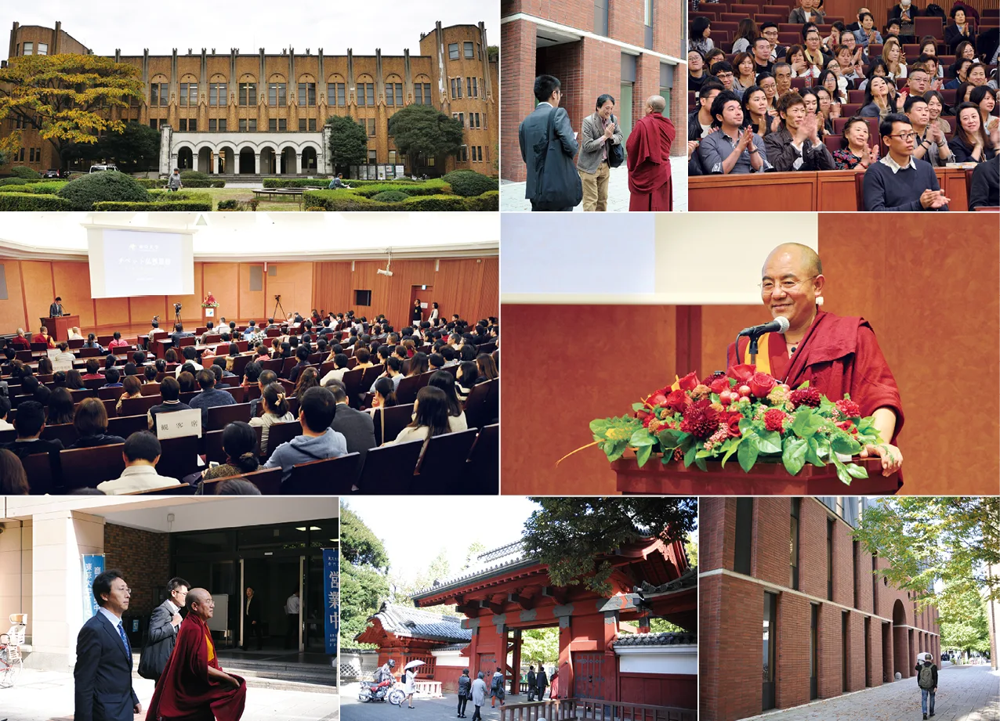

即使对待害过自己的人，

也要心怀慈悲。

第136场

日本东京大学

The University of Tokyo

日本·东京

2015 / 11 / 11

## 藏传佛教思想

## The Philosophy of Tibetan Buddhism

很高兴今天有机会跟大家探讨“藏传佛教思想”。

在座的有些人非常关注藏传佛教，有些也不一定。不过不管怎样，如今全世界掀起一股“西藏热”或者说“藏学热”，所以大家利用短短的时间了解一下藏传佛教也有必要。

## 一、藏传佛教的清净法脉

两千五百多年前，释迦牟尼佛三次转法轮宣说了八万四千法门，自此佛教在这个世界上生根发芽。

公元5世纪左右，印度建立那烂陀寺，它堪称当时世界最著名的佛教大学。那一时期，印度还有一所吉祥戒香寺，这两所寺院可谓“东方文化的摇篮”。对于这些历史，你们东京大学东亚思想研究所的研究人员应该非常清楚。

时至今日，佛教思想已经在全世界范围内广泛传播。

可以说，现代科学主要起源于西方，之后逐渐向东方传递，而人类的古老思想，则主要发祥于东方，之后渐渐往西方传播。

印度那烂陀寺自创建以来，涌现出不可胜数的卓越修行人，诸如寂护论师[^1]、莲花生大士、寂天论师，以及龙猛菩萨、月称论师等等。在座很多教授对他们的思想非常感兴趣，刚才有的教授跟我讲：“非常希望您能传讲《中观庄严论》，我们很想了解寂护论师的观点。”不过《中观庄严论》比较深奥，在座的不一定都能听得懂。因此，今天我还是简要介绍一下藏传佛教的整个思想体系，这样更合适些。

公元8世纪中叶，那烂陀寺的法脉传到藏地第一所寺院——拉萨桑耶寺，之后在藏地不断流传，形成前译派和后译派两大宗派。

在藏地，公元7世纪到11世纪之间翻译出的经论，被称为前译，遵从这些经论的称为前译派，也即宁玛派。如今藏地依然有很多前译派寺院，寺里的僧人们一方面学习显宗的因明、中观和般若等，一方面也修学甚深密法，比如光明大圆满。公元11世纪到13世纪之间翻译的经论，称为后译，遵从这些经论的宗派，称为后译派。后译派有很多支分，比如阿底峡尊者开创的噶当派，宗喀巴大师为代表的格鲁派，还有萨迦派、噶举派、觉囊派等等。后译派在学习显宗的中观、因明等教理的同时，也学修密法。萨迦五祖中的萨迦班智达根嘎嘉村著有《量理宝藏论》——一部极具代表性的藏传因明学、逻辑学著作，与此同时萨迦派也教授密法。噶举派由玛尔巴译师开创，主要修持大手印。觉囊派主要开显第三转法轮的如来藏思想以及《时轮金刚》的义理。

## 二、遍及世界的“藏学热”

直至上世纪六七十年代，藏传佛教的传播都主要局限在藏地，后来因为一些特殊原因，藏传佛教在欧美和东南亚等地也以种种方式兴盛起来。

如今在世界范围内，藏传佛教在不同场所中得到传播，比如禅修中心、瑜伽机构，以及公司和社团等。

更重要的，世界上很多大学和科研机构将藏传佛教融入各类科研领域。比如在澳大利亚，有些大学教授从心理学侧面研究藏传佛教；在美国的哥伦比亚大学和哈佛大学，一些教授对藏传密法以及藏传佛教的男女平等观进行研究，美国科罗拉多大学的部分教授将藏地环保与藏文化、藏传佛教结合起来研究。这次我去欧洲，了解到牛津大学有些教授一直在研究藏传佛教的正念禅，有些教授在探索藏地文献以及藏传佛教文章的写作风格。总之，世界上越来越多的学者、教授对藏传佛教产生浓厚的兴趣，将它作为研究对象或研究参照境，从不同角度探索藏传佛教。

## 三、正确认识藏传佛教

### 消除偏见

对于藏传佛教的思想，如果能够运用细致、敏锐的智慧去挖掘，必定会大有收获，不过如果只是浅尝辄止，也不一定能通达其甚深奥义。

以前有些学者在研究藏传佛教时，就产生了一些偏见，比如你们学校的个别老教授，曾经发文章批评藏传佛教的龙钦巴尊者，指责他否认佛教的因果法则。实际上龙钦巴尊者是藏地家喻户晓的大德，他的有些观点是站在至高层面宣说的，此时确实无善无恶；而且龙钦巴尊者的著作不胜枚举，其中不乏阐述三世轮回、因果报应的内容，如果没有看到这些论著，就以偏概全、望文生义地轻率评论，这不太合理。

当然，现在是言论自由的时代，如果藏传佛教真的有错误之处，任何人都可以直言不讳地提出来，我们也乐意进行探讨，甚至展开辩论。

你们可能知道，藏地寺院的僧人从小就喜欢围绕佛教进行辩论，如果自己举不出合理的理由，观点就无法成立，如果自己有充分的理由，即使对佛的教言，也可以驳斥。学术界难免有人对藏传佛教的有些道理心存疑惑，我觉得这些人很有必要到藏地寺院里，跟那里的格西、堪布当面辩论。这样谁对谁错就一目了然，到时还可以用摄像机拍摄下来，全世界的人都会一清二楚。

我虽然是一个藏传佛教徒，但是并不会毫无道理地袒护藏传佛教，实际上我始终认为藏传佛教宣说的是非常纯洁的佛法，值得人们正面了解，而不是误解甚至诋毁。

当然，刚才说一些人对藏传佛教存在偏见，这可能是很早之前的现象了。如今随着信息传播越来越便捷，人的思想也越来越开明，很多教授和学者对藏传佛教和藏文化的了解日益加深，对问题的分析也更加严谨，产生偏见的情形应该会不断减少。

### 真正的藏传佛教徒

虽然藏传佛教非常完美，对于21世纪的人，不啻为一剂心灵妙药，但是这并不代表藏传佛教的教徒十全十美。他们中不论藏族人还是其他民族的人，有些学得很好，行为也如理如法，而有些只是打着藏传佛教的旗号搞非法行。

在日本，多年前就有个别教派借用藏传佛教的名义招摇撞骗，由此伤害了很多人。其实如果了解藏传佛教的思想，就可以轻易识破这些骗局，不过当时的日本民众对藏传佛教知之甚少。即使是现在，在日本乃至全世界，依然有不少人抓不住藏传佛教的关要，把个别当成全体，把枝末看作核心。

事实上，如果把握了藏传佛教的灵魂——它的思想，那么外在的仪轨、建筑等就有了意义；如果没有这个灵魂，外在的形式就成了空空的皮囊。

纵观如今的时代，很多所谓的“藏传佛教徒”，也许只是徒有虚名。

比如，有些人对藏传佛教的某个上师很有信心，像世间的粉丝一样迷恋他，但是对藏传佛教的思想一窍不通，这不是真正的藏传佛教徒；有些人热衷于供养藏传佛教的寺院，或者参加各种慈善活动，这些属于善行，但是否以此就成为藏传佛教徒呢？也不一定，如果丝毫不学习藏传佛教的理论，也从不修行，只能称为功德主或施主；有些人把佩戴藏传佛教物品当作时髦，脖子上挂着嘎乌盒，手腕上绕好几串念珠，认为这样就是藏传佛教徒，实际上也不一定；有些人到藏地拍了很多照片，自己骑马、放牦牛、吃糌粑、喝酥油茶，以及唱藏族歌、跳藏族舞、穿藏装的样子都拍下来，认为这样就成了藏传佛教徒，但这也不一定；有些人读了藏传佛教的一两本书，就认为成了藏传佛教学者，其实一两本书根本无法涵盖藏传佛教的全部。

那么，怎样才算真正的藏传佛教徒呢？

我认为只有长期听闻藏传佛教的道理，并且认真思维，之后去修行和实践，才会成为真正的藏传佛教徒。这样的人，如今也不乏其例，而且分布于不同国家，遍布于不同阶层，有普通工人、政界官员，也有演艺明星等等。他们通过学习藏传佛教的思想，诸如无常、菩提心、空性等，确实找到了快乐，不过他们不一定处处标榜“我是藏传佛教徒”。最近在日本，我接触的一些大学教授也是这方面的榜样——通过常年如一日地闻思修藏传佛法，他们的内心变得十分放松，生活变得非常自在。

因此，希望大家通过多种途径正面了解藏传佛教，与此同时，也可以花时间深入修持藏传佛教，这样必定能给你的生活带来很大变化。

### 固执的“商人”

有些人之所以对藏传佛教产生误解，主要原因是缺乏学习，因为即使是很简单的道理，如果不去学习，也会产生错误的理解。比如有人认为藏传佛教是喇嘛教，是个别喇嘛创建的；有人认为汉传佛教是和尚教，是一两个和尚设立的。这些观点都比较奇怪，稍有历史知识的人都知道佛教起源于印度，而藏传佛教和汉传佛教都是佛教的分支。还有些人认为藏传佛教是密教、汉传佛教是显教，这也是错误的。藏传佛教诞生一千多年以来，一直是显密融通的，而汉传佛教也有唐密的教法。实际上藏传佛教可以囊括南传佛教和汉传佛教。这一点并非我的一家之谈，大家翻阅经论就会明白。

我曾利用约五年时间翻译了二世敦珠法王的著作《藏密佛教史》，这本书叙述了藏传佛教的很多真实历史，三十多万字，西藏藏文古籍出版社出版过。你们感兴趣的话，可以去阅读。

希望不论学者还是一般人，从一开始就能正确了解藏传佛教，避免陷入误解和偏见，否则一旦习气坚固了，就会难以改变。

佛教里有这样一个寓言故事，一个商人从远方返家，发现家中被土匪洗劫一空，房子也被烧毁了。他在废墟中找到一具小孩尸体，就以为是自己儿子的残骸。实际上他的儿子仍然活着，只不过被土匪掳走了。但是商人深信那具小孩尸体是儿子的，禁不住悲声痛哭。后来他把尸体火化，将骨灰放在一个丝绒布袋里，日夜都抱着这个布袋。某一天夜里，他的儿子从土匪那里逃出来，来到父亲新造的房子前，兴奋地敲着门：“父亲，我回来了！”但是商人固执地认为儿子已经死了，对他说：“你这个顽皮的小鬼，你才不是我的儿子呢，我的孩子三个月前已经死了。他的骨灰现在就在我怀里。”商人的儿子一遍遍恳求父亲开门，但是不断被拒绝，最后他只好黯然地离开了，商人从此失去了儿子。

很多人也许觉得故事里的商人太愚笨，不过生活中不少人跟这个商人大同小异，他们被偏见固化了思维，从而难以转变。

不论何时何地，正确的知见都至关重要——知见不出偏差，言行才能不离正轨。

### 智慧的意义

要树立正确的知见，需要具备智慧。

实际上智慧在佛教信仰中一直扮演着重要的角色。有了智慧的摄持，信心、悲心等才具有意义；离开了智慧的摄持，信心可能变成迷信，悲心可能酿成苦果。我经常想，这是佛教跟其他宗教的一个显著区别。

佛陀曾在经典中教导弟子：即使对于我的教言，你们也应当运用智慧进行观察，如同锤炼黄金一样，如果觉得合理，就去接受，如果觉得不合理，完全可以舍弃，而不能因为恭敬我就接受这些教言。佛陀的这一教诫反映出佛教在智慧层面的不共特点。

很多宗教都倡导慈悲的理念，佛教也不例外，但是与其他宗教不同，佛教的慈悲情怀中浸染着智慧的色彩，因为佛教会告诉你为什么要慈悲。佛经中说：每个人都希求安乐、不愿痛苦，因此我们应当慈悲每一个人；每个动物都拥有生命，会感知苦乐，这一点跟人类并无二致，因此我们应当爱护每一个动物。

而且按照佛教的观点，即使对待加害过自己的人，也要心怀慈悲。为什么呢？通过观察可以发现，我们自己被烦恼驱动时，甚至一些恶事也做得出来，而怨敌损害我也是受烦恼的驱使，所以慈悲怨敌也完全能接受。

由此可见，佛教的慈悲是理智观察后的选择，而不是毫无道理的强求。

我想在座的如果能深入研究佛教，一定会大有收获，因为佛教一向都是运用智慧探索物质与心灵的奥秘，最后以理说服自己。

### 以法乐自娱

我对日本人的生活不是很了解，不过感觉日本的音乐、绘画以及人的言谈举止中都自然流露出一缕禅意。听说在日本，很多人信仰宗教，他们的一生都弥漫着宗教的气息，比如降生时以基督教仪轨洗礼，死亡时以佛教仪式送终。这样是很好的，不过还有所欠缺，欠缺什么呢？就是对宗教道理的扎实闻思修。

我以前问一些日本朋友：“你们信仰佛教吗？”

回答说：“信仰。”

“为什么信仰？你们学过什么佛教经典吗？”

“没有学过，只是从小受到家庭的熏陶，就有了佛教信仰。”

当然，这些人不能代表所有日本佛教徒，但是也反映出一些现象。在泰国也有类似的状况，由此导致泰国佛教在很多方面越来越趋于形式化。

实际上只要你是佛教徒，不论在家出家，都有必要学习佛教理论，否则就成了徒有虚名。

佛教的《维摩诘经》中说：“有法乐可以自娱，不应复乐五欲乐也。”意思是，一旦享用了佛法中的真实法味，就不再希求世间的五欲之乐。希望大家都能通过学习佛法而真正享受到法乐。

## 结语

大家都清楚，日本的有些文化源于中国，但是如今中国的一些传统文化，在国内并没有被很好地继承，而在日本却得到传承和发扬，比如孝顺父母、礼让他人。以前日本发生地震时，在那么严峻的时刻，大家依然井井有条地排着队，互相谦让。这是很好的素质。

与此类似，佛教的有些内容在中国并没有很好地保存下来，但是在日本却一直流传，这一点非常值得随喜。希望日本佛教徒能在此基础上，进一步深入学习佛法，让佛教在这片大地上散发更多的光芒。

我今天也并不是演讲，只是分享自己的想法。如果你们觉得合理，可以接受；如果觉得不合理，也欢迎批评和指正。

现场互动

问：慈悲的理念，可以用于世间政治吗？

堪布：是可以的，这种理念可以使得国家之间减少冲突，和睦相处。

近些年，我去世界不同地方时，越发感觉：人不论做任何事，都要有慈悲心。尤其前段时间在非洲，这种感受更加强烈——非洲有着丰富的钻石资源，于是其他洲的有些国家竞相前来抢夺，由此而发动了很多战争。没有慈悲心的人或民族就是这样，往往会侵占其他人或民族的利益，进行文化掠夺、经济掠夺。

就藏民族而言，佛教是其主流思想，慈悲和空性的理念渗透于它的政治、经济等领域，给这个民族带来了祥和，也给全人类带来利益。

总之，在如今各种矛盾和冲突不断涌现的世界局势下，慈悲心越发显示出不一般的价值。

问：学习佛教理论是可以引生信心和智慧的，不过很多学者虽然非常乐于研究佛教理论，在日本尤其如此，但是他们并没有因此生起信心和慈悲，这是什么原因呢？

堪布：对于佛教，有些人当作信仰，有些人看作研究对象。后面这类人仅仅喜欢研究佛教，但并不信仰佛教，所以不会去修慈悲心，也不会守持佛教的戒律。这类人，不仅在日本存在，在美国、中国汉地等地也并不少见。不过这样做也是他们的个人自由，就像有些人喜欢研究鸟类，三十多年一直在非洲大陆上跟踪拍摄它们一样。

问：您刚才提到很多不是藏传佛教徒的情形，那么怎样才是真正的藏传佛教徒，能再讲解一下吗？

堪布：现在有不少人自认是藏传佛教徒，但实际上离藏传佛教徒还有一段距离。

比如，有些人特别热衷于做火供——“哇，火供仪式特别好啊！”这种情形在中国汉地比较普遍；有些人非常喜欢做朵玛，道友们聚在一起时就是做朵玛；还有些人热衷于吹螺、打手鼓。他们也许都觉得自己是名副其实的藏传佛教徒，但如果问他们：“什么是出离心？什么是菩提心？什么是空性慧？”可能就无言以对了，老师不明白，学生也不清楚。

本来藏传佛教具有甚深的见解、严格的戒律和慈悲的行为，如果对这些一窍不通，即使形式上再轰轰烈烈，也不是佛法，不仅对自己无益，对他人还会造成负面影响——导致他们产生误解：“藏传佛教天天就是敲敲打打呀。”事实上，敲打唱念只是藏传佛教的部分形式，在拥有藏传佛教灵魂的情况下，才具备意义，否则就成了一副皮囊。

举个简单的例子，东京大学的核心是学科教育，在这所学校里成立舞蹈队无可厚非，但如果东京大学只有一支舞蹈队，而不存在任何专业知识的传授和学习，那就不能称为东京大学了。

同样，藏传佛教的灵魂就是它的思想，只有掌握了这个思想，才会成为真正的藏传佛教徒。

问：藏传佛教、南传佛教与北传佛教，分别是怎样的历史由来？

堪布：佛教起源于印度，它传播到斯里兰卡、泰国、缅甸等国家，形成南传佛教，这一派系主要强调出离心，希求自我解脱；佛教传入汉地，形成北传佛教，这一派系属于大乘佛教，主要修持禅宗和净土宗；佛教传到喜马拉雅山脉附近，在藏地兴盛而成为藏传佛教。也就是说，佛教进入三种文化体系后，形成了三个流派。

问：藏传佛教的主要内容是什么？

堪布：藏传佛教包含显宗和密宗两部分：显宗主要讲出离心、菩提心和无二慧；密宗则主要讲述外密和内密的甚深法理，修法上分为加行、正行和后行。

问：经商容易沾染恶业，在家学佛者还能经商吗？

堪布：佛教的《阿含经》里说：作为一个世间人，从事正常的经商、务农等都是开许的。佛教《善生经》中教诫在家人远离恶法、行持善法，以此经营生活和事业。因此，不损害他人的前提下，在家佛教徒也可以经商。

总之，在对他人尽量饶益，或者至少不损害的前提下，世间的工作可以去做。

问：藏传佛教重视传承，如果藏族上师用汉语为弟子传讲藏文经典，传承会打折扣吗？我很想更好地学习藏传佛教，有必要学学藏语吗？

堪布：如果这位上师传讲的经论内容直接传入弟子耳中，弟子应该可以得到传承。

佛法最初是以梵语宣说的，传播到世界各地后被译成各种语言，但是传承和加持并没有减损。同样，对于藏文佛经，即使上师以汉语传授，传承和加持也不会打折扣。

当然，如果你能掌握藏语也很好。我到不同的国家时，都会冒出想学这个国家语言的念头。不过人生很短暂，不一定来得及。

问：如何在日常生活中磨炼智慧？

堪布：要在日常生活中磨炼智慧，有一个重要方法：不论面对什么对境——好人抑或坏人，青山秀水抑或荒山野岭，美味佳肴抑或黄齑白饭，都当作磨炼智慧的机会，对境炼心。

问：我刚刚接触佛法，感觉看佛教经论时，对有些内容的理解不一定准确，这也许会导致后面的学佛路出现偏差，该怎么办？

堪布：对于初学者，我认为首先需要寻找一位有经验、有智慧的老师，或者说上师，这很重要。找到上师后，就在他跟前认真听闻佛法，或者通过网络平台听受他传讲的经论，然后仔细思维，并且付诸实践。

另外，学习佛法要持之以恒，至少八年、十年不断串习，因为佛法非常深奥，短时间的学习是不足够的，像看小说一样走马观花也不可取。

以《中观庄严论》为例，我第一次在上师面前听时，并没有听懂，后来我自己学了两遍，又给别人讲一遍，再后来又把这部论译成汉文，又用汉语传讲，现在我基本明白里面的道理了。

对于佛法，反复学习很有必要，尤其是殊胜的经论，可以一生中每年看一遍，最后自心的习气就会转化为书中的智慧。

问：一般人遇到曾经损害自己的人，会禁不住心生厌烦，修行人如何对待怨敌呢？

堪布：确实大多数人不喜欢接触怨敌。不过作为修行人，尤其修行很好的人，不仅能接触怨敌，还能依靠对方的损恼而取得进步，比如藏传佛教的阿底峡尊者经常带着一个脾气暴躁的侍者，通过这种方式修安忍。

对于毒药，一般人避之唯恐不及，但是高明的医生不仅不畏惧，还可以通过调配将之转为妙药。同样，尚不具备修行境界的人，看到怨敌会心生畏惧，进行排斥，而具有修行境界的人，会把怨敌看作修行的助缘。

人的根基和境界不同，心态和行为也就不同。

[^1]: 即静命论师。
