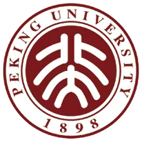
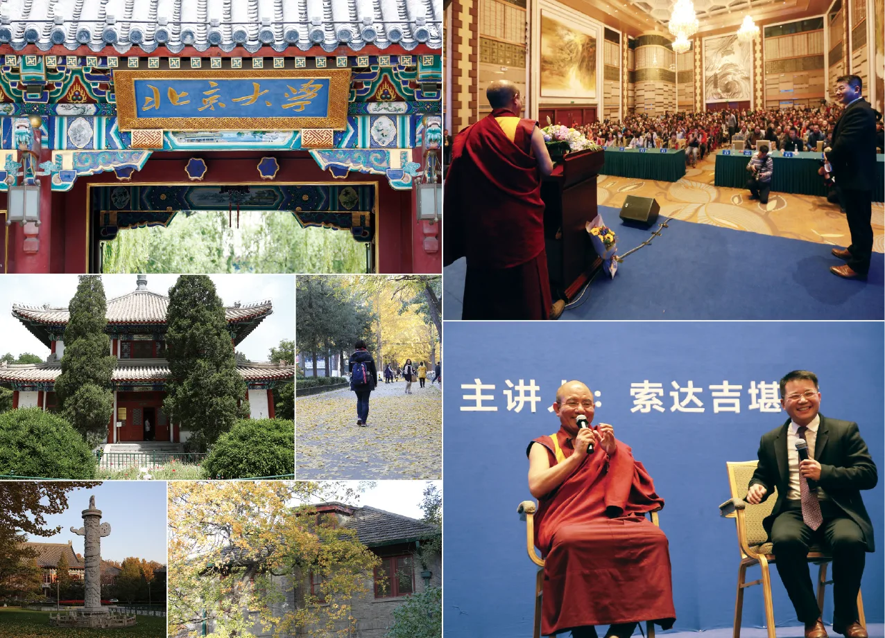
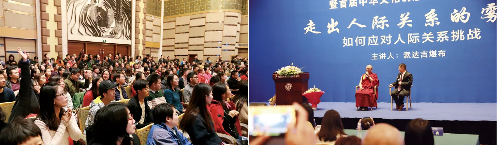
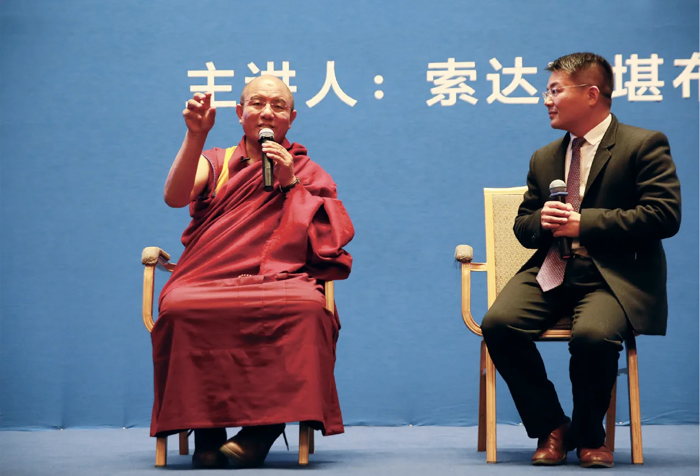

“因”在你自己身上，“缘”是在别人身上，只有因和缘积聚了，做事才非常容易成功。

第140场

北京大学

Peking University

中国·北京

2016 / 11 / 6

## 走出人际关系的雾霾

## Overcoming Interpersonal Barriers

阎雨院长：

在座的各位老师、同学们，大家晚上好！我是今晚报告的主持人，来自北京大学的阎雨。欢迎大家莅临本院的学术会场！

我们知道，佛教是摄受众生的宗教，佛学是开启心智的学问。雪域高原拥有着寺院、佛塔、经幡、独特的活佛转世制度以及博大精深的显密兼修的修行次第，蕴含着人生无穷的智慧与奥秘，使大家对此无比向往。

今天，我们非常荣幸地恭请到一位藏地的班智达（学识渊博的大学者）——索达吉堪布仁波切来我们北大讲学，为我们开示佛学的奥秘并分享心灵的智慧。

人际关系问题大多是我们生活中繁琐的小事，虽然小，却像鞋子里的沙子使每一步的行走都渗透着不适，无形中影响着我们的心情，并且还会蔓延到日常的人际交往中，由小积大，甚至还出现了震惊社会的复旦大学宿舍投毒案、云南大学马加爵杀害同学等恶性、极端的事件。

在社会的转型期，由于价值观的善变等因素，人际关系的摩擦和冲突更容易延展和升级。如何对待感动与疼痛并存、谴责与反思交织、传统与现代同在的现实社会以及复杂的人际关系，这始终困扰着我们，特别是自尊、自信、自爱、自负的90后大学生。

大堪布这些年去过很多场合，与海内外相关学者针对道德、环保、和平、人生教育等问题进行跨宗教、跨文化的主题交流，特别是拨冗关注大学生的人生观、价值观、世界观的教育引导，对于大学生如何走出人际关系的雾霾、如何适应人际关系的挑战，大堪布也有着独特的见解和高屋建瓴的洞察力。

下面，我们就用最热烈的掌声，欢迎索达吉堪布为我们讲学——

首先，我特别感谢阎雨院长以及各位老师、相关人员，给我们提供这么舒适的环境和这么好的交流平台。在进会场之前，我跟阎院长做了一些学术方面的交流。不过我们都因时间仓促而感到意犹未尽，若今后因缘成熟，会把交流内容延伸到社会学、宗教学、哲学，以及现在人们特别关心的人心管理、人际关系处理等相关主题。

今天在座的各位来自四面八方。我来北京大学已好多次，和这里的老师、学生应该有非常好的因缘。如若无此因缘，恐怕我们之间很难有这种交流机会。

今天大家共同关心的主题，是“走出人际关系的雾霾”。

提起雾霾，北京人应该比较熟悉。我自己也亲身体会了一次：昨天原本下午就该到北京了，结果因为雾霾，飞机晚点至凌晨两点才到。所以，今天虽然要讲“走出雾霾”，但我到现在还有些云里雾里的感觉。当然，这是气候的雾霾，而人际关系的雾霾其实也同样存在。

## 了解人际关系的重要性

说到人际关系的雾霾，其主要的成因，说到底还是人们的自私。

和以往任何一个时代相比，我们这个时代的科技确实有所成就，可是从另一方面看，人们为了自己的利益，对环境乃至整个世界的破坏也是前所未有的。过度开发有限的矿产资源、制造各种各样的商品……种种对环境的破坏大家都是有目共睹的，这些行为对整个人类的生存和发展带来许许多多危害。

这需要我们人类从自身出发去关注和反思。表面上看，人们穿着比以往任何一个时代都漂亮、精致和华美的衣服，吃着和以往任何时代都不同的美食，可是，我们的人心是否也同样有提升呢？这是值得观察的。

其实“关系”两个字，对每个人来说都是不陌生的。我们其实就生存在关系的世界里。每个人的生命，就是关系组合。我们来到这个世界，有了和父母的关系；待稍微长大，就有了和老师、同学的关系；等步入社会，就有了与同事和上下级的关系。除此之外，我们还有与大自然、社会、动物之间的关系。因此，关系处理得好与坏，对每个人来说是十分重要的。

如果处理得好，你可以称为是一个成功人。如果一个人在家里跟上上下下关系都很好，那他是非常成功的；如果一个人在学校里与老师、同学以及身边人的关系都处理得好，他也是非常优秀的。当我们走入社会后亦是如此。

从某种意义上讲，现在人与人之间的关系变得越来越差了。以前人们过的大多是庄园式的生活，而现在几乎都身居高楼。也许是人类的生存方式发生了变化，人与人之间变得没有信任感。以前人们常说“远亲不如近邻”，虽然自己的亲朋好友不在身边，但邻里、陌生人之间能互相帮助和照应。你不在家的时候，邻居会很愿意为你代收邮递员送来的信件或者包裹。而现在，邻里之间变成了“无缘隔壁不相识”，互相都有一种防范心。很多人会对自己的孩子说：“不要给邻居开门，不要接触来往。”这样其实是淡化了人与人之间的关系。

表面上看来，人们的社交工具越来越多，每个人都有好几种：座机、手机——有些人手机还有两三部，还有微信、微博、电子邮箱等等。一个人有多种途径跟全世界的人建立各种关系，但正因这种复杂、频繁的关系，人与人之间的感情也是越来越不深刻。

在这样的社会当中，我们能体会到人际关系所带来的影响：哪怕我们和一个人的关系没有处理好，都会为此痛苦很长时间。比如说，家庭里父母之间、婆媳之间，或是老师和学生之间的关系不好的话，你的生活、学习和工作就会受到不同程度的影响。由于心情不好，从而导致工作效率低下。因此，我们要冷静思考关系对于我们的影响及其重要性。

## 不同的文化，不一样的“关系”

有时候我也在思考所谓“关系”这个词。我来自藏地，现在很多藏族人也用汉语说：“你跟领导关系好不好？”“关系”两个字已经变成了非常通用的词汇。有些人说“关系是生产力”，关系好的话，什么事情都OK，容易成办很多事；如果关系不好，就会变得寸步难行，并且原本应该能办的事情都办不好。在东方，在亚洲，在中国，大家都看重关系。在单位里，同事之间，即使你文化程度不高、能力不强，但只要你有关系，就有升官发财的机会；如果关系不好，即使你有才华、智慧和能力，也不一定被接受和认可，这是比较令人苦恼的事情。

当然，这个现象也值得我们深入研究。有些法律、道德和规则上并不被明确允许的事，由于关系的介入，也可以超越其上。反之，如果关系不好，也就没有这个机会。在西方，关系的定位和意义与我们有不同之处。现在东西方文化的交融非常特殊，“关系”两个字在其他语种中的含义，并不是我们所理解的那样，他们理解的“关系”仅仅是人与人之间存在的一种联系，但是我们所说的那种“关系”，在英国、美国、澳大利亚等西方国家是很难实现的。

有一次我去澳大利亚，有位大学生的母亲跟我说了一件事：由于她的孩子与老师关系不融洽，她想为孩子处理好和老师的关系，于是就给老师包了六万人民币的红包送过去。但由于这个国家没有“搞关系”的概念，结果那位老师特别反感，认为学生母亲的这种行为侮辱了自己的人格，随之也认为孩子的人品有问题。自此之后，老师与她孩子的关系变得更差了。

我们会感觉到，东西方存在着文化和价值的差异。在西方人的理解范围内，所谓的关系，不能超越道德、规则、法律，否则就要受到一定的惩罚。表面上，这种做法死板、机械化，甚至有点冷酷，但实际上，我们到底需要怎样的价值观？人生观和价值观有什么样的变化？也值得仔细观察。作为一名老师、学生，在社会中当然需要关系的存在，特别是我们熟悉的很多人，想在短时间内通过搞关系得到最大的成功，但所谓的“成功”还可以依靠什么途径来获得？这是需要我们用更大格局去思考的。

## 揭开人际关系的真实面纱

今天，我不和大家谈论东西方人际关系差异的问题，而是讲一讲何为现在人们所认为的人际关系。

实际上，世间人的人际关系背后，有一个秘密。这个秘密也许很多人还没能发现，那就是因缘。从数学上讲，人与人之间的这种关系，被称为“概率”，从佛学角度讲，叫做“因缘”或是“缘分”。而这种种缘分并不是每个人都有。70多亿人口中，为什么今天是我们各位集聚在一起，利用宝贵的时间交流而不是其他人？我们为什么是在北京，而不是在其他城市？因为我们之间有一种眼睛看不到、耳朵听不到、身体摸不到的特殊因缘。这种因缘，也许是我们今生所造，也许是前世所造。

今天在座的各位，有些不承认前后世，也不承认善恶业。你不承认是完全可以的，任何信仰和价值观都不该以洗脑的方式而强加于人。我到任何一所学校、一种场合，都秉持着一种非常自由随意的交流方式，而所谓“有目的性地借用传播文化来控制别人”的想法，我连梦中也不曾有。但是，我在这里不得不告诉大家一个事实：今生中遇到的任何一件事，不一定是我们想象得那么简单，在其背后有着非常复杂的因缘。

如果不明白这种因缘，那在今生遇到的一切，都可能让你难以面对，甚至会觉得社会、同事、家人对自己不公平，有非常多的抱怨、怨恨。而这个原因就是：任何一件事情的背后，都有复杂的因缘，人与人之间的关系也是其中之一。这是按照佛教观点来讲述的，至于这种观点是否合理，希望在座的老师和同学加以观察。如果你通过观察觉得有不合理的地方，稍后的问答环节可以用最尖锐的语言来驳斥或辩论。因为这里是非常开放的学术平台，我也乐于接受大家的不同见解，这是完全可以的。

人际关系之间的善恶因缘，是未做不遇——如果往昔你没有造过，即生就不会遇到相应的情境。

佛教当中有一个故事：释迦牟尼佛已断除了一切障碍，智慧圆满，功德圆满，遍知万法的实相。但有一次佛陀去某个地方，那里的人都不喜欢他，没有人来听他讲课。我们现在有时候也是这样：即使是有些教授、非常了不起的学者讲课，也没有人去听。

佛陀回来后，他有一位证得阿罗汉的弟子，叫舍利子，佛陀便让他去讲课。舍利子一去，那里的人非常喜欢他，来听课的可以说人山人海。佛陀的弟子们都对此感到非常困惑：“佛陀的断证功德、智慧、慈悲、利他都圆满具足，为什么这么一位伟大的证悟者去讲课，却没人理他？为什么他的弟子舍利子去同样的地方，却被这么多人接受呢？”

佛陀为此讲了这么一段因缘：舍利子前世是一个以砍柴为生的樵夫，有一次他在森林中砍柴时遇到一个蜂窝，樵夫当下给蜜蜂们念咒，与它们结上了善缘。现在村子的村民就是那些蜜蜂的转世，借此因缘，舍利子今生去讲课时会受到如此欢迎。而功德圆满具足的佛陀，因往昔没有与他们结过此等善缘，所以不受村民们的待见。

有时候需要想一想，我们人生中也有类似的场景。我遇到的有些大学生和老师，他们的智慧、才华都非常不错，可是不被他人认可和接受，原因是什么呢？就是没有与对方结过善缘。

今生中结善缘固然重要，但更关键的是，我们在前世有没有结过。如果前世没与他人结过善缘，即使你这辈子有智慧、有能力，也还是不会被大众认可。在座的各位，尤其是学生，毕业后也许不能马上找到工作，即便找到了，别人也不欣赏你的才华。有些特别了不起的学生，毕业后的工作令人很不满意，但也无济于事。所以佛教讲“未结法缘，先结人缘”，我们今生应该尽量去帮助别人来广结善缘，这种做法不管在今生有没有成熟果报，对来世都是非常有意义的。如果没有这样结善缘，即使是很了不起的学者，此生也不一定有多少作为。

因此，我今天不讲学术方面的内容，而是以很简单的道理来激发大家对工作和生活的思考。在座的北大师生们，你们的学识在一定范围内，肯定没有什么问题，但你们将来的福德、人缘等到底如何，这个很难说，因为里面有非常复杂的因缘。

以前我看过一个故事，说的是明朝皇帝朱元璋有一次微服私访，经过一座古庙时感到特别口渴，一位不相识的农夫把自己的热茶给了他，这令朱元璋非常感动。他随即询问这位农夫的名字，回去后立刻赏赐农夫当了县令。

有个和农夫同村的秀才，得知后特别不满，写了两句诗贴在庙门口：“十年寒窗下，不如一杯茶。”意思是，我这个秀才苦读十年，都还没有考取功名，那农夫竟然能凭借一杯茶换取一个县令，真是没有天理。后来，朱元璋又一次出巡，途经这座古庙时，看到了这两句诗，笑着在诗后续道：“他才不如你，你命不如他。”

同样，有些人在工作中，一直想被提拔却没机会。我问过周围的一些领导：“你现在有什么想法？”对方答道：“没什么别的想法，就想赚钱，就想升官，但一直不顺利。”其实，这里面有一个原因：除了“命”中注定的因缘之外，还要看这个因缘是否成熟，有没有水到渠成、瓜熟蒂落。其实这很容易理解，你看刚才那位农民，由于因缘成熟时给了朱元璋一杯茶，以此就触动朱元璋封他做官。如果没有这个因缘，那么他努力十年、二十年、三十年，即生中也不一定有这个机会。

因此，如果遇到一位提拔你的领导，或是任何帮助你的人，说明你的因缘成熟了。“因”在你自己身上，“缘”是在别人身上，只有因和缘积聚了，做事才非常容易成功。人与人之间是有特殊因缘的，有些人你见第一面的时候，就会产生一种特别亲切的感觉，不同于其他人；而有些人你却非常不喜欢，感觉很不舒服，这都是你们之间因缘的深浅、好坏等诸多因素所致。

我想起《毗奈耶经》里有一个故事：有一次，佛陀在讲经时对阿难说：“在某某地方有个村庄，你去给我提一桶水来。”阿难便去了。到了那里，阿难遇到一位白发苍苍的老太太在洗衣服，她刚好有水。阿难对老太太说：“老人家，您能给我些水吗？”老人家听后不耐烦地回答：“这里的水，只有我们村的人才可以用，不能给外人。”于是，阿难一滴水都没得到，无奈地回来了。佛陀了知阿难的遭遇后，又让弟子舍利弗去要水。那位老太太见到舍利弗后，对他的态度完全相反，非常欢喜地把空桶装满了水，还从家里拿了好多吃的供养舍利弗。

这个故事背后的因缘是什么呢？原来，这位老太太前世是一只动物，死后曝尸荒野。阿难的前世是一个商人，看到尸体后捂着嘴，非常厌恶地离开了。舍利弗的前世是个文人，看到这动物的尸体后，随即产生了怜悯心，找了一块地方把它掩埋了。就是因为这迥然不同的心态，老太太对他们今生的态度也截然不同。

现实生活中，人和人的因缘各不相同，也许大家觉得有点奇妙，但我是特意讲给你们听的。表面上，这些是非常简单的故事，但在故事背后，就是人际关系种种复杂问题的答案。这些值得我们深思、观察，值得从学术角度去研究。

这都是在历史上真实发生过的事情，但这样的事情不仅仅只发生在古代，在我们现代生活中，也是频繁不断地在出现。有些人特别容易办成事，而有些人则相反，处处碰壁、人际关系特别糟糕。

## 改善人际关系的灵丹妙药

我看到现在有些大学生从来不关心别人的感受。举个非常简单的例子，比如在寝室里，很大声地看电影却不用耳机，跟别人大声聊天弄得全寝室都非常讨厌他，他自己却根本不在乎。尤其现在都是独生子女，有些人根本不考虑周围人的感受。

如刚才阎院长所提及的，这几年大学里发生了很多极端事件，这个原因是什么呢？就是因为很多人对前世今生不了解，整天只考虑自己，照顾他人的意识越来越淡漠。

前段时间，我看到一则新闻，说中国人去澳洲旅游时随地大小便，结果被警察抓了。我们这里十月国庆期间，旅游者随地吐痰和随地大小便也是比较常见的现象。甚至一些人到了宗教场所，也做了很多不如法的行为。

如今这种现象越来越多，究其原因，其实还是需要我们大家在道德、人格上进一步提升。尤其作为一名老师，不仅仅是技术知识的传递者，更重要的是要教导学生如何做人，如何提升道德观念，包括待人接物、为人处世等各方面的人格修养。这些对年轻人来讲，比获取知识技能更为重要。

如果我们没有重视这方面的培养，学生只是很单纯地在学校获取一些知识技能，拿到名校的文凭就沾沾自喜，认为自己一定会被社会认可。但是当这些学生到社会上屡屡碰壁，工作频繁更换，最终感受到：自己虽有名校的文凭，但实际上也不一定能得到社会认可。为此内心会感到迷茫而患上抑郁症，甚至有些极端的人选择自杀，这样的现象现在是越来越多了。

因此，从学校和老师的角度出发，实际上更要注重人文关怀，培养学生人文素养，让学生们知道怎样面对痛苦，怎样搞好人际关系。

对此，我有一些想法和建议跟大家分享：

要处理好人际关系，有这么几个方面需要了解和重视。首先，要知道人际关系的亲疏变化有三种可能。第一种，由于每个人前世今生的因缘不同，因此和其他人的关系也不同。比如说，有些人与别人刚开始关系非常融洽，但之后就慢慢褪色乃至变色。现在很多年轻人在感情上、家庭上就有类似情况。

还有一种，双方刚开始是不共戴天的冤家对头，但因为关系的“无常”，使得大家慢慢变得亲热起来。

再有一种情况，由于前世没有因缘的纠缠，今生中你再怎么想讨好对方，都无法增进关系的密切度。

大家要了知这几种不同的关系情况。不管怎么样，如要收获良好的人际关系，就要用行动实践佛教里的“六度四摄”。其中四摄的含义是：爱语、布施、利行和同事。四摄对我们人际关系的建设是非常有必要的。

### 1．爱语

现在是网络信息的时代，可能很多人觉得：只要把别人错误、不好的地方暴露出来进行谩骂、指责，这是很大快人心的。实际上，这种行为恰恰是非常不好的。现在有些人不管做什么事，都会辱骂、痛斥别人，这会结下不善的因缘，以至于影响今后乃至下一世的人际关系。所以，我们的一些领导层、管理层，在和下属沟通谈话时，尽可能不要拍桌子，不要处处利用自己的权力而大骂别人，这样的果报非常可怕。我们最好能用慈悲心、爱心、柔软心，去说些启发他人的语言，这就叫做爱语。爱语是发自内心的，并不是心里一套嘴上一套，当你在不同的场合中，用自己的表情、微笑或肢体来表达善意以及利他的行为，这实际上也是一种爱语的诠释。

我们在不同场合中，应该用爱心和别人交流。在付出自己的爱心时，暂时不一定有明显的回报，但从长远来看，它已在你的阿赖耶上深深种下一个善因缘的种子。当这种善的力量逐渐成熟，便会随之发芽、开花，并最终结果。

因此，希望我们在座的每一位，今后不管对父母、孩子、同事或其他人，虽然有时候会克制不住说些粗暴、刺耳的语言，但还是要尽可能减少或避免这样的交流方式。这对个人的心态调整、人际关系处理都会有所帮助。

有些人原来脾气特别暴躁，动不动就会大发雷霆、火冒三丈。这么凶神恶煞的人，通过学习大乘菩提心，心态也会慢慢变得柔和起来，之后在处理事情时，他会冷静地去思考，也会使用爱语、柔软语来交流。

使用爱语确实是一个很好的选择。现在一些父母养育孩子的时候，经常会用暴力的言语来教训孩子。这样的孩子，由于受父母教育方式的影响，以至于在今后的生活中，也会采取同样的方式对待自己的孩子以及周围的人。这种暴力的延续，会直接或间接带来更深的痛苦。

### 2．布施

布施，就是要学会付出和给予。我们每个人都希望“我要获得”，但要获得的前提，却是“我要付出”。也许这种付出暂时不一定有好的果报，但实际上，这种举动是很有意义的。

这个社会，的确需要很多无条件或自愿为他人付出的人。我们常说“舍就是得，不舍就不得”。大家都知道，现在整个社会显得比较冷漠，也经常会有做慈善、做好事的人受到欺负，而那些干坏事的途径和资源却顺手拈来，非常丰富。表面上看这种现象很正常，但实际上这是很可悲的。因此，我们不管对熟悉的人也好、不熟悉的人也好，都应该尽量给予，而非一味索取。

当然，给予的东西，不一定是指物质和钱财，更多应该是精神层面上的，比如自己对别人的成功、快乐非常欢喜，这也是一种十分重要的给予。如果我们能长期这样随喜他人，内心生起这样的欢喜心，给予别人快乐的心态慢慢成熟后，自己不管遇到任何事情，都能自在面对、轻松化解，并保持快乐的心态。

### 3．利行

就是要尽量利益他人，去做对社会有利的事，去饶益每一个生命个体。

前段时间我在微信上看到一个短视频，那是在俄罗斯，有位老人要过马路，开车的司机都很自觉地把车停下来，有个车主还主动下车把老人扶到马路对面，而等待着的车主也十分有耐心。这看似是一件非常小的事，但却展现了这个国家的国民素质，也体现了人们的利他心。然而，现在有些人的行为却截然相反，比如街上红灯还未灭，就开车迫不及待地闯过去，好像除了自己以外，其他人和动物根本不放在眼里。

正因为人们有这种自私的心态，未来果报是相当严重的，而且人类最后也需要为自己的行为买单。为什么这几年我们的环境一直在遭到破坏，包括现在雾霾天气的产生，都是人类自私自利的心所导致。如果我们能多些利他心，就会为子孙后代考虑，为周围的人考虑，为我们赖以生存的地球母亲考虑。如果是这样，雾霾也不至于在原本蔚蓝的天空出现。

直到现在，我们人类社会还是极度自私、极度自我，这个果报也是人类自己必须要承受的。因此，利他之心就显得尤为重要，我们需要以利他的行为去取代自私、自我。

### 4．同事

同事，就是以身作则的意思。作为老师或者学生，这些都要自己真正去做，去善待自己的人际关系，这样才能影响到他人。

以上和大家分享了“四摄”。

下面还有一个窍诀，也是我很想和大家分享的，就是佛教中说的“自他交换”。自他交换是什么呢？我们可以试着如是思维：“把我的快乐给他人，他人的痛苦由我代受。”表面上看，这只是心里的一种想法，但实际上，它是自己获得快乐的最好捷径和窍诀。

我们很多人每天只想“我要快乐”，所有的一切都是围绕自己转，嫉妒心、嗔恨心使我们只愿意看到关系好的人发财、顺利，而希望关系不好的人发生痛苦、倒霉、破产等情形。

藏地有一本书叫做《大圆满前行》，是一部引导内心解脱的殊胜佛教论典，系统讲述了佛教理论体系和修行次第。书中有一段内容，是对西藏一位出家人的深刻描写：这位出家人与另一位出家人互相为敌。有一次，当他得知自己的对手破戒了，居然高兴地对侍者说：“哈，我们今天要吃顿好的！刚听说我那位对手破戒了，他完了，太高兴了！”

一位大德听到这个消息，认为破戒的过失固然很大，但若随喜他人的过失，所产生的果报则更可怕。

我们常常也会这样：和自己关系不太好的人，如果遭遇一点点倒霉的事，就会觉得非常欢喜、开心。这种心态其实非常不好，会让自己变得更加自私，心胸狭窄、冷漠，而自己本身也会感受一定程度的痛苦。所以我们从现在开始，应该要努力改过来。

怎么改过来呢？对于关系不好的人，把他观想在自己的前方，真切希望对方能快乐、顺利，自己的一切美好愿意毫无条件地给予对方，对方的痛苦由自己心甘情愿地承受。当然，刚开始尝试这一做法时，可能会觉得有点难，但我们的心是可以被调伏和转变的，久而久之，越串习会越自然。

如果你慢慢试着这么做，就会明显发现，你的心态和以往完全不同，你能处理好人生中的任何关系，也会变得无忧无恼。

自他交换，是藏传佛教中一个非常重要的窍诀，其实在汉传佛教当中也有提及。我曾在撰写的书籍里引用过一个故事：有个和尚在回寺院的路上，天降大雨，于是不得不就近找个地方躲雨。他看到一个庄园，急忙跑过去敲门想进去躲雨，但门开后，庄园的仆人得知来意，说道：“我们家老爷不喜欢出家人，您还是去别处躲雨吧。”

和尚再三请求，想让庄园主人行个方便让自己在这里过一夜，可惜并未如愿。

最终，和尚恳请仆人能否通融一下，让自己在屋檐下躲雨。做不了主的仆人只能再去请示主人。但是，当他回来后，告知和尚的结果却是：“我们家老爷不答应，您还是就此离开吧。”

在临走之前，和尚和气地问道：“请问您家老爷的尊称？”仆人如实说了，和尚便离开了庄园，冒着大雨回到寺院。

一晃过了三年。那位庄园主的生活、事业皆如鱼得水，并且还娶了个小妾，对其宠爱有加。有一天，小妾想去庙里烧香，那位老爷便欣然同去。在庙里，他突然看到一块写着自己名字的牌位，觉得很奇怪，立刻找寺院的人问道：“我的名字怎么会在庙里？”寺里的出家人回答：“这是因为我们住持三年前去一户人家避雨，由于和这位施主没有结过善缘，便被赶了出来。住持临走时特意问了这家施主的姓名，坚持每日念经回向给他，愿他一切顺利，多和佛法结善缘并早日解脱，离苦得乐……好像大致就是这样。”

庄园主顿时恍然大悟，想起了那天的情形，内心非常感动，但也对自己当时的行为感到自惭形秽，懊恼不已。后来，他成了这座寺庙的大施主。

这是一个真实的故事。从中可以看出，人与人之间，难免会有关系不好、因缘不好的，但是，当面对这些不好的对境时，你要慈悲地把自己的一切善根、一切美好回向给对方。

在藏传佛教的日常修行中，专门有一项磕头的修行，意在通过消除贪嗔痴三毒而显现佛的智慧，从而自证佛性。在磕头的时候，我们需要将父母观想在自己左右，而将更重要的前方位置留给怨敌。为什么这样呢？因为怨敌在我们的修行过程中会时不时冒出来，“自我”会非常排斥和不愿意接受，若将这些怨敌观想在自己的前方，以慈悲心把善根和功德回向给他们，这样做对消除我执、提升修行大有利益。这是一个调心过程，也是让自己生起慈悲心的一种串习。

这种观想方式，对我们来说，可能比较难以做到，因为世间常说：“人不犯我，我不犯人；人若犯我，我必犯人。”如果有人真要害我，我必须想办法反抗，把他打倒。但佛教，尤其是大乘佛教，却与此截然相反。它教导我们要把关系最不好的敌人观在自己的前面，并生起慈悲心想着“我要经常饶益他们”。哪怕有稍许这样自他交换的心态，当你处理各种关系时，他人若对你有一些过分的言行，你也不会因此产生太大的负面情绪。

在座的老师、同学们可能在自己的人生当中都遇到过一些不好的人际关系，其实这里面蕴含着复杂的因缘。在我们这一生，应该尽量避免结恶缘，增上自己与他人的善缘，这很重要。

## 对今后的几点建议

概而言之，我想给大家总结一下，“走出人际关系的雾霾”最关键是要靠自己，要尽量放下自私自利的心态。现在很多人认为，具备强大的自我是成功的保证，但这样的意识也会慢慢给自己带来痛苦。因为贪心、嗔心、傲慢、嫉妒等诸多烦恼，会直接或间接损害我们的身心。如果我们按照佛教的智慧来观察和观照自己，尽量缩小自我意识，减少我执，了知空性的道理，就会逐渐意识到，利他法门是如此智慧！当我们说话也好、做事也好，如果常有利他心，那在任何一个群体中都会活得自由自在、开心快乐。

具有利他心、具备成功因素的人经常会主动关心他人：“你现在怎么样？”“你有什么困难？”这些都是站在关心他人的角度出发的，当别人在叙述自己的经历、痛苦和诉求时，他也会认真仔细地倾听，并尽己所能去帮助对方。

而自私心重、不成功、没有利他心的人，往往只会夸夸其谈，谈论的重点都是自己：讲自己的故事、诉说自己的忧愁、倾诉自己的委屈，根本不考虑他人的感受，也不给别人说话的机会。

其实，不管是国际交往还是人际交往，最重要的就是要有利他心，哪怕在一个很小的问题上，我们都要学会关心别人。否则，别人有什么样的感受、想法，我们一律不管不顾，只是一味考虑自己，人际关系的雾霾将会越来越严重。

在企业的发展中，如果领头人有真正的利他心，也会为企业创造很多有利的机遇。我曾听过关于俞敏洪的一些故事，虽然他不一定赢得所有人的认可，但还是有一些闪光点。当他在大学时代，就经常喜欢帮助他人：帮同学提水、洗衣服、搬行李，还承担了全寝室的很多事情，心甘情愿地为他人付出。在他创业之际，不管是认识他的老师还是同学，都愿意支持，并主动给予他很多帮助。因为他们知道，和俞敏洪合作，他不会只是考虑自己。

你们在学生时代，也要培养一种站在别人角度考虑事情的利他心。如果具备这么一个心态，那么在将来，不管是学习也好、创业也好、生活也好，发展空间会非常大，而且在这个过程当中，如果遇到了困难和痛苦，自己也不会被压垮。

人际关系，其实就是处理自己与他人的关系。在一定程度上，如果自己的心态调整好，常常为他人着想，那跟任何人交往都能得心应手、十分和谐：对上层的人恭敬有加，与同等的人和睦相处，对不如自己的人也会以慈悲心爱护。

反之，如果完全是自我主义、个人主义，像西方处理人际关系的某些理念，这只会让自我意识不断加强，变得越来越自私和孤立，最终任何事情只能靠自己，即使是父母或兄弟姐妹也指望不上。

在我们藏地，科技虽然不发达，但和西方某些情况相比，大部分人始终有利他的心态。如果有人生病了，周围的人都愿意帮助他，哪怕是孤苦伶仃的老人，也愿意照顾他或是把他送去医院。大家认为这是理所当然的事情，这种利他意识十分强烈。

不难发现，我说的这种利他意识，在当今越来越退化，这也是西方文化冲击东方文化的一种具体表现。越来越多人接受了自我膨胀意识的灌输并不断去培养，这种以自我为中心的理念，使他们有了强烈的“万事为自己”的观念。如今在很多大城市，即使父母生病了，孩子也会找借口不去探望，或是碍于面子最多打个电话问候一下，邻居或其他人更是指望不上。

这个时代为数不少的人，在人际关系方面确实出现了严重问题。如果自己有钱有地位，别人还会阿谀奉承地来巴结你，如果哪天你变得一无所有，即使具有血缘关系的家人眷属，也会对你置之不理。

所以我希望，我们可以用一颗真诚的利他心来对待社会和周围的一切。

最后，我希望大家今后能具备这几颗心：

### １．要有一颗坚定的心

在以后的学习和生活中，如果心时常动摇不定，很多事情会半途而废。就像蜜蜂采蜜一样，今天在这个部门，明天在那个部门，短暂的人生没有一个落脚点，始终漂泊不定，这是非常可怜的。所以，不管做什么事情，我们要用智慧去观察，一旦决定要做，就用一种坚定的心、稳定的心好好往前走。

### ２．具备一颗精进的心

懒惰的人会与诸多良机失之交臂。不管是当学生、老师，还是在人生哪个阶段，我们都不能放弃学习。学习对我们各方面起着提升作用。不管你是学宗教还是学世间知识，这些都不是问题，最重要的是要看你学的这些对人生是否有意义。各种宝贵的精神财富，我们不能缺少。有些学生在毕业以后，把所学的知识全部丢弃，其实，人应该“活到老，学到老”，这种精神我觉得很重要。

有些懒惰的人，始终以各种借口来明日复明日地拖延，这样的话，自己的知识和技能会日益退化。人很年轻时智慧没有提升，最后可能被社会淘汰。

这个时代，不管是科学技术还是其他方面，都在不断更新、不断变化，如果我们没能与时俱进、坚持学习，最终将跟不上时代的步伐。所以，我们很需要精进地学习。

### ３．要有宽容的心

当今社会关系特别复杂，人与人之间的联系虽然频繁，但变得越来越淡漠。处于这个时代的我们，经常受到各种冲击和刺激，若没有宽容心，就会斤斤计较，很多事情变成自讨苦吃。当你具备了宽容之心，会坦然地面对任何事情，不管结果是否成功，心态也会比较积极。

作为有智慧的人，不该为小事感到闹心、烦恼，这会导致自己连基本的生存都丧失勇气。尤其是像你们这样有知识、有能力的人，如果变得如此，的确非常可惜。人生中发生的很多事情，就如过眼云烟，不要特别去在意。事情该发生的时候会发生，不该发生的就不发生，并不是我们能完全控制的，因为里面牵涉到因果、因缘等诸多因素。所以我们不要十分在意自己的得与失，那真的不重要。拥有这样的一种宽容心态，才会让我们从自我的束缚中解脱出来。

### ４．要有一颗利他之心

利他心在我们人生中是极为宝贵的。如果没有它，人类社会就会变成一个非常可怕的群体。正因为我们是人，区别于动物，所以，除了生存以外，对周围的环境、人类，乃至我们的朋友——动物要有善待的责任心。有了这么一颗利他心，无论你接触什么样的人，都能令其成为自己的好朋友。

在这个世界上，我们最好不要有敌人。少一些敌人，多一些朋友，那么在人生中是十分美好的。

现场互动

主持人：

堪布高屋建瓴、深入浅出地给我们做了这么一个精彩的报告。接下来就进入互动的环节。

问：我是中国石油大学研究量子力学的老师，感谢堪布的精彩讲解。我有一个问题：佛教讲究神通，尤其是藏传佛教。但科学界从没有公开承认过神通，请问您对这个有什么看法？

堪布：科学界并没有否定佛教中的神通一说。虽然科学界没有明确对佛教界中诸如五眼六通这些有所承认，但也没有任何依据来驳斥神通不存在。

在前年，我与中科大朱清时教授有过对话交流，就佛学的某些超越普通认知境界、科学界至今无法证明的话题进行探讨，如绝地火、前后世等。对方从科学家的层面客观地承认：当今科学领域对于人的内心这一最深层面的课题研究，暂时还未能有相关的成果和突破。但是科学在不断进步，他相信将来科学界通过涉足某些领域，是可以对眼前这些研究作出很好的科学解释的。

其实，佛教中大部分所谓的神通都是心性上的一种特殊功能，科学界对此在一定程度上是认可的。包括台湾大学前校长李嗣涔教授[^1]，从科学层面来理解和阐释所谓的神通，并且还对此在不同的报告会上做了演讲。

曾经在我们藏地有一个很特别的人，他通过念诵佛教咒语，居然能把烧红的滚烫的铁贴在嘴唇上而未受到任何损伤。如今在藏地，人们所念诵的一些佛教咒语的确具有特殊的加持力，对此我也问了很多科学家作何解释，他们说：“从科学的角度来看，这叫做特异功能，除此之外无法做出回答。”这也可以认为是科学界对佛教神通一种比较特殊的认可方式吧。

现代科学技术和先进仪器设备对心理的研究依旧是比较滞后，今后在某种程度上，科学界和佛教应该对此会有些共同的探讨和研究。

问：扎西德勒！我是北京大学哲学系的硕士研究生。我所学的专业是西方哲学，这能否和我学佛的信仰做一个结合？您认为西方哲学的思想对形而上学的研究与佛教信仰之间是否具有共通点？

堪布：你刚才说“扎西德勒”的时候，我想你是不是藏族人？（对方回答“是”）你说的汉语很好啊。

西方哲学，尤其是远古的西方哲学，如：亚里士多德、柏拉图的思想演变出的形而上学的思辨哲学，和佛教思想在某种意义上是有交集的。因为他们认为感知，或者说我们的兴趣，是由人固有的一种思维方式而产生的。

从某种意义上，我们对佛教真理的信仰或是对科学追求的信仰，也有广义和狭义之分。广义上，西方哲学和东方文化都在追求人的终极关怀或是生命的真理，都在用不同的追求方式来获取生命的终极意义。

你既研究哲学又研究宗教是非常有意义的。耶鲁大学有一群学者，他们从西方哲学的层面来研究汉传佛教的禅宗和藏传佛教的大圆满，最后得出的结论也让自己找到了人生的目标。若是对此用佛教名言或专业术语来讲会更丰富些，但由于时间关系我不展开，希望大家以开放的心态来学习和追求真理，这是非常有意义的。

问：我是北京科技大学的博士生，现正在学习《入行论》中如何对治嗔恨心的“安忍品”。刚才您一直在强调人际关系，说我们需要有一定的包容心。但在现实生活中，若他人无端对你进行加害而你用修持安忍心来对治当下的话，就会被认为是胆小怕事，或者认为你特别懦弱。请问，我们该怎样说服他人理解自己的行为，从而不会对佛教徒或者佛教产生邪见？

堪布：如果他人由于不理解，你非要采取以牙还牙的方式那也可以，但从历史或人生的角度来看，事情不一定要通过对抗才能解决。人生中，你若能运用安忍这一窍诀，也许今生的很多机遇会纷至沓来。反之，如果用暴力的方式处理，会使自己更加懦弱。

佛教并不赞成只通过战争或打斗的方式才能获得胜利。人获得胜利的方式有两种：第一种，依靠真理和适当的对抗来取胜；第二种，依靠以暴制暴的方式来战胜。这两者之间需要我们用智慧来选择。虽然大多数人的观念是对于害自己的人要以直报怨，并且从小也被灌输这样的理念：“不要帮助别人，不然别人超过你后，你就会变成弱者。”我们现在所谓的强势，就是要让自己胜过一切，但这也需要我们仔细观察它的内涵再做决定。

问：我是北京大学化学系的研究生。我非常喜欢听您讲的《妙法莲华经》，您经常在这部经中引用《维摩诘经》的公案，请问是否有机会给我们传讲《维摩诘经》？

堪布：《维摩诘经》也叫做《无垢称经》，这部经诠释了密宗的很多见解，如“万法本来清净”这样的道理。

《维摩诘经》是一部如桥梁般衔接显宗与密宗的大乘经典。就把你今天所说的愿望当作一个缘起，我本人也有这个意乐——依靠这种因缘，尽量在有生之年为大家讲一遍这部经。

问：我是北京大学哲学专业的大一本科生。听说佛学是一门可以改变心态的学问，昨晚在读《心相篇》[^2]的时候，看到“忮念求胜，图名利”[^3]这句话，我觉得很符合现在尤其是一些精英大学生的内心表现。请问堪布，还有什么办法可以改变自己的心态？

堪布：我非常希望大家用一种很开放的心态去研究佛教或其他宗教，以及相关学说，其中也包括道教文化。在大乘佛教中，也有诸多改变自身心态的方法。曾经这里的有些老师和学生心态非常浮躁，虽然自己工作或就读于顶尖的高等学府，个人的智慧也超胜于人，但由于种种原因，他们心里有很多无法解开的问题，从而经常感到痛苦和抑郁。但后来，他们通过学习大乘佛教的中观、菩提心等思想，同时进行念咒等修行，逐渐让自己心开意解，内心变得释然和开心起来，从而对人生又充满了希望。

当今人们若能在生活中实际运用改变自身心态的窍诀和方法，的确对自身非常有利。刚才阎院长也和我提到，如今藏传佛教在汉地比较兴盛，但会不会很快消失？我回答道：理论和修行是两重修行方式，藏传佛教不但理论性非常强，并且通过修行，对人们的生活和心理起到息息相关、对症下药的作用，所以我相信藏传佛教会长久兴盛。对此大家也可以去了解和学习，由于每个人接受的程度不同，各自应该会有很多不同的收获。

我们的心态变了，生活也就很容易改变。现在很多人无法改变生活的主要原因，就是自己的心在作怪。如果自己很快乐、凡事都想得开，那遇到什么都可以迎刃而解；反之，即使有钱、有地位，住纯金造的宫殿，每天也依旧会愁眉苦脸，非常焦虑。因此，自心的调整非常重要，这样的窍诀在佛教中有很多，虽然我修行境界还要提升，但一直在不断探索佛学的相关知识，这对内心调整也有非常大的帮助。我也希望，很多人能和我一样真正享受到佛法的美味。

问：我想请教堪布两个问题：第一，能否推荐一本关于如何正确打坐的书籍。第二，您从凌晨几点开始打坐修行？

堪布：我推荐一部叫《大圆满前行》的书，书中有很多观修内容，还包括寿命无常、人身难得、皈依和发菩提心以及相关打坐的修行方式。你想了解的打坐观修方式在书中都讲得非常圆满，所以我推荐这本书。

我本人打坐修行的时间不定，大多数时间是六点半左右起床。今天我起得比较晚，因为凌晨才到北京，并且将近三点才睡，所以起得有点晚——但也不算特别晚。（大笑）

问：我是北京中医药大学的大五学生，平时在医院接触到很多精神疾病或者人际关系较为糟糕如自闭症、抑郁症的这类患者。佛教里的禅修（Meditation）与止观（Comtemplation）的修行能帮助那些患者走出内心的雾霾，但在真正实施治疗的时候，好多患者并不能接受这种方式，导致临床上都是直接给患者使用药物治疗。我觉得心理治疗也不容忽视，希望堪布对于自闭症和抑郁症的治疗给予相关指导和建议。

堪布：如今在这个特别散乱的时代，不管是企业、医院还是高校都需要禅修，这是非常重要的。在英国、美国，很多人虽无任何宗教信仰的背景，但他们依靠禅修、止观的方式使心态处于平静状态。人当心态平静的时候，不管是工作、学习还是生活，各方面都会得心应手。

我很早就来过北大的禅学社并且特别感谢这个组织，因为禅学社给北京的很多高校在各方面都树立了良好的影响，它对周边很多学校有非常大的贡献。同样，复旦大学的禅学社也在这方面积极运作着。作为一所高校，老师和学生都应具备一个很好的心态，若自心无法调整好，人会变得越来越迷茫、浮躁和抑郁，最后可能各方面都无法得到提升。

禅学社的很多理念仍需要不断分享到各个高校，但这过程中没必要非带有宗教的标签，因为这会给大学带来不便。今后在学校、企业或是医院开展工作时，不需要强调这是佛教的禅修，但我们要具备禅修的理念，比如每天打坐半小时、一小时，甚至几分钟都可以。美国的哈佛大学、哥伦比亚大学、麻省理工大学等高等学府名声响亮，但他们的禅修课形式却特别简单，大家打坐时仅是坐着而已，目的就是让心能安住下来。

佛教和其他宗教中都讲了很多关于练习禅修的益处。自闭症和抑郁症多是由于执著自我的心太重，又没有很好地做调整，直到无法控制而形成了一系列心理问题——听说如今在英国，抑郁症的危害也越来越多。

希望大家每日起床后花五到十分钟时间尝试静坐。即使你的坐姿不标准也无碍，只要能坐着，试着什么都不想就好。可能有人会在此过程中睡着，但即使能在这种状态中入睡也很好。在晚间睡觉前我们也可以这样训练禅修，只要长期坚持，自己的心就会得到滋润和营养。不仅健康人群需要这样的禅修，得抑郁症的患者亦可通过这样的方式使疾病得以治疗和好转，因为禅修对心态调整的确有非常大的帮助。

问：佛陀涅槃时说过一句话：以经为师，以戒为师。但他又说过：我未曾说过一字。禅宗是不立文字、直指人心，包括著名的《六祖坛经》中惠能大师也是不识字的人。有人说您书中所宣讲的佛教是基于您自己的理解而并非佛陀本意，但我们又无法与佛陀对话去进行验证。请问堪布，佛陀所宣讲佛教的本意到底是什么？我们又如何能走出学佛的雾霾？

堪布：佛经中提到，佛陀从成道至涅槃的四十九年中一字未说，禅宗也不立文字，但这都是从实相意义上去理解的。从显现的角度看，佛陀仍传了八万四千法门，转了三次法轮。

以《坛经》为代表的很多禅宗境界，在究竟意义上，的确没有立过任何文字。因为文字也是表象，当你认识本性时，一切文字都无法真正宣说，证悟境界是不可思议、无法言说的。

我本人还未走出修行中的雾霾，但一直在努力。也希望大家能够去除周围关系的雾霾。若想找到真正的解脱之道，需要自他的努力和勤奋。虽然在实相中一切都是空性，但我们在这如梦如幻的梦境未醒之前，仍需要努力，以期早日获得解脱和开悟。

问：我是中国石油大学数学系的大三学生。我对物理有着浓厚的兴趣，在学量子物理时也思考过科学与佛教融合的问题。简单地说：眼睛看到的，是接收到的光子，而并非是我们真正意义上看到的；手所触碰到的，是分子和分子之间的斥力，而并非是真正意义上的感觉；通过六根（眼、耳、鼻、舌、身、意）所感受到的，并不是世界的实相。请问您，科学是在相的层面上做研究，这种探索究竟对理解佛教有怎样的意义？

堪布：佛教说眼、耳、鼻、舌、身、意都是“非量”。佛陀也在《三摩地王经》里讲，六根不是正量。量子力学解释说，我们看到的色法、听到的声音、手触的东西这些都只是“场”的暂时现象，如果再进一步分析，世界除了无形的“场”之外，就别无他物。物理学家们通过对量子力学更深入的研究也得出结论：整个世界都是一种幻觉。这样的量子力学研究很有意义，因为它与佛教的相关理念是吻合的。

佛教里有一部论叫《大毗婆沙论》，其中对微观世界的揭示，与当今量子力学所发现的结论基本吻合，但量子力学对这部论典中的有些内容还未能做出相应的科学解释。有位著名科学家曾感慨道：“当科学家千辛万苦爬到山顶的时候，佛教大师早已在此久候多时。”

2500多年前，佛教对宏观和微观的描述早已达到了一定境界。虽然我只上过中学，但也特别喜欢量子力学，可惜在师范学校读书时没有这门学科。量子力学和佛教的思想的确是有相同之处，并且佛教进一步对所谓的场、量、夸克都已有相关的描述，而量子力学对此的研究也未超出佛经中所描述的范畴。你若详细研究《大毗婆沙论》《三摩地王经》的内容，就会发现其中与科学有诸多融合之处。当今世界很多发现和发明也依赖于佛经中这样的研究，我觉得这非常有意义。

问：我是来自西藏拉萨的藏族大学生。在活动开始之前，有一部分听众通过所谓的人际关系，可以和您近距离接触，跟您拍照、得到您的祝福、获得您的签名等，有一部分听众因为没有这样的关系不能够得到这些福利。您觉得这是人际关系当中的雾霾还是自然现象？

堪布：借用朱元璋的一句话：“他才不如你，你命不如他。”这就是人际关系背后的一个秘密。而实际上我们都要走出这种雾霾。

问：我是一名中医大夫，有学习佛法的经历，想请您谈谈佛法里对医方明和中医传承的理解，中医该如何更好地利益到大家的身心？

堪布：藏传佛教里也有医方明，它与佛教的很多缘起是息息相关的。我原本也想当一名医生，但人的命运比较奇妙，我没有成为真正的医生，但也希望自己变成一名心理医生。

我之前看过《本草纲目》之类的书籍，但对此并不很了解。总的来讲，藏医和中医等很多本土医学都非常重要，尤其是对人的气脉以及四大的调整很有用处。具有医德的医生通过传统医术来帮助别人是非常有意义的，因此一定要按照传统的医学方式来了解病人的病因，之后还要懂得如何进行治疗。作为一名医生，要不辞辛劳地付出时间和精力来帮助别人，解除众生的痛苦，这是每一位医生最基本的职责。

问：我是北京科技大学外国语学院的英语老师。我想请问您，在美国、英国这类主要信仰基督教的国家，以及其他具有全民宗教信仰的欧美及非洲的国家和地区，是否还有弘扬佛法的必要性？如果有，应该如何展开？

堪布：美、英、法等国家我去过多次，包括像非洲的莱索托以及一些中非国家，他们都有自己的信仰，但是这种信仰并不稳定。如今藏传佛教在美国和英国是非常兴盛的。大家都知道，仅一位大德在美国和英国就设立了大概一百多个佛教中心，可以说很多人信仰藏传佛教。其原因是，比如基督教和伊斯兰教等宗教，内容和形式较单一，简单到大家就一起唱歌、读《圣经》，除此之外没有如佛教这般具有非常丰富的理论体系，并且也没有很人性化的修行方法。虽然一部分传统的美国人和英国人信仰基督教，但年轻一代的心里已经不能完全接受，他们觉得单纯依靠一种信仰对自己的生活未必带来很大意义，因此现在很多年轻人对佛教的禅修，尤其是对中观和因明的推理、辩论都特别感兴趣。很多大德也意识到佛教未来在美国和英国的发展趋势，能够很好地在当地弘扬佛法。

非洲也有自己的本土文化，有一些属于非洲土著的基地，非洲大多数地区都信仰伊斯兰教。在当地，人们认为佛教是魔教，尤其是非洲的个别国家，人们从小就对佛教有这样的概念，因此在当地弘扬佛法还是有困难，但如今通过很多大德的弘法已改变了一些对佛教的看法。

所谓的弘扬佛法，需要观待因缘。因缘成熟时，即使在眼下会遇到一些阻碍或者排斥，若佛教能直接利益到人们的生活，那他们也会愿意接受的。好比我们推销自己的产品一样，虽然市场上的产品已是琳琅满目，但只要我们的东西对他人有用，那人们也会愿意尝试使用。

问：顶礼索达吉堪布！我有两件事情：第一，我必须要表达我的感谢。去年您来到北京参加一个书会的活动，那天我是全场唯一坐轮椅的人，特别幸运的是那天堪布给我作了摸顶加持，如今我已经非常健康地站在这儿了，所以今天一定要表达我对您的感谢！第二，《般若摄颂》挂件是否可以随亡人火化？最后作为一个好的缘起，我代表所有的佛教徒祝福堪布法体安康，长久住世。

堪布：第一，我想开个玩笑：“去年你坐轮椅，现在你好了，这叫做特异功能。”第二，《般若摄颂》的挂件可以随亡者火化，也可以经常戴在身上，两种情况都很好。

主持人：

非常感谢堪布今天给我们带来如此精彩的报告。堪布把佛教清净安详的境界带给了我们，启发了我们，为我们传递了一个乐观向上的人生正能量，展示了博大精深的佛教文化。佛教之所以能够在中华大地根深叶茂，是因为能和中华大地儒家文化的自强不息、救邦兴命、修齐治平很好地相互补充、互相成全。我们今天近距离地感受了堪布大师的这种能量和智慧，这是同学们的一种福报，也是一种殊胜的机缘。

让我们再次以最热烈的掌声感谢堪布的开示，今天的报告会就此结束，再次感谢大家！

[^1]: 李嗣涔教授用科学实验证明“佛神灵界”的存在。
[^2]: 《心相篇》的作者是道教学者陈希夷，即传说中的“陈抟老祖”。
[^3]: 忮念求胜，图名利，到底逊人；恻隐心多，遇艰难，中途获救。
