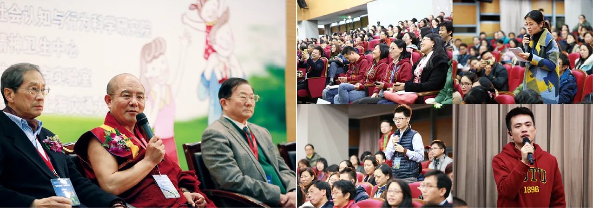
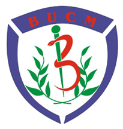
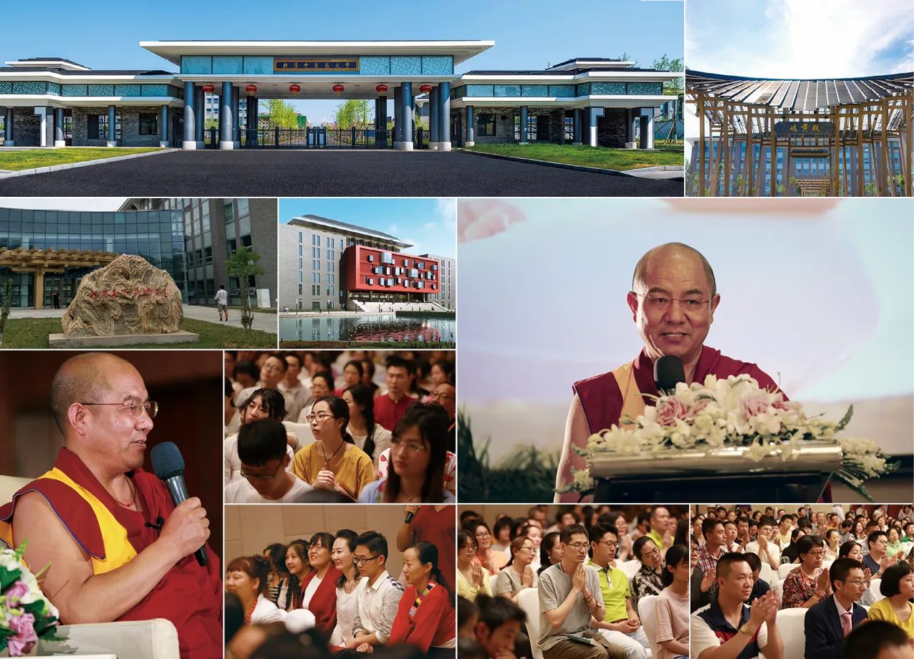
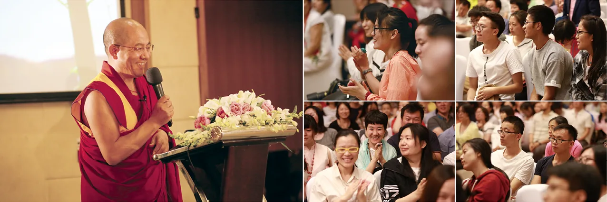
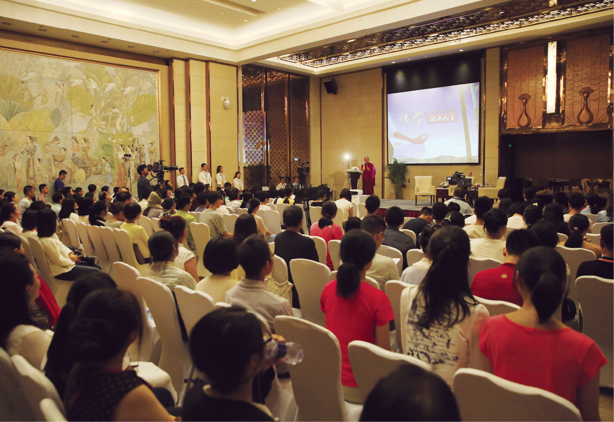
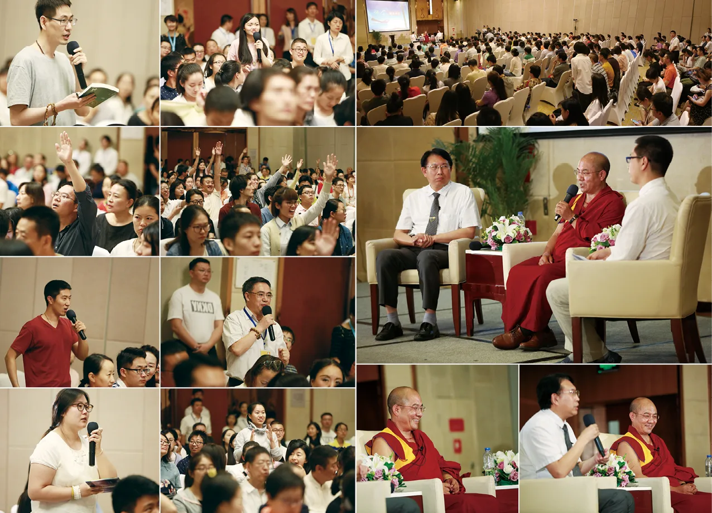

不要只把医学当作一个专业或理论研究，

内心还应该有一种特殊的“功夫”。

第146场

北京中医药大学

Beijing University Of Chinese Medicine

中国·北京

2017 / 6 / 10

## 佛学与健康

## Buddhism and Health Management

主持人：

尊敬的索达吉堪布，以及医学界的前辈同仁们，晚上好！今天，大家有幸欢聚一堂，聆听堪布的法语甘露。

接下来，让我们有请堪布——

很高兴和大家相聚在这里，一起学习佛学与健康人生的关系。就我个人而言，一直以来对佛学很感兴趣，对医学也有很大信心。以前读完中学后，我连考试都不想参加了，一心想要成为一名优秀的医生。因为我在小的时候，跟一位藏医老师学过一段时间，包括号脉、采药、问诊的方法等等。所以，我一直对医学有着浓厚的兴趣。但最终我并没有成为一名医生，而是成为了一名佛学老师。我个人也认为，我比较适合在佛学领域中发展，运用佛法来帮助大家治疗一些心病。

## 影响身心的因素

今天在座各位大多是学医的老师和学生，也有一些医学研究人员。我始终认为，健康不仅是身体的健康，更重要的是心灵的健康，这一点非常重要。如果一个人的心灵不健康，即使身体再强壮，也无法过上幸福的生活。尤其现在这个时代，影响人们身心健康的因素越来越多。

大家也知道，这个时代是一个特殊的时代。从物质文明方面看，这一代人在物质享受上，已经到了前所未有的程度。住的是高楼大厦，坐的是飞机、高铁，还有先进的通讯工具。这些古人从来没有享受过，甚至都没有梦到过。而在心灵的健康和快乐方面，跟以往任何一个时代相比，我们原本应该是心灵最健康的一代，但事实正好相反，现在人们烦恼非常严重，有说不尽的欲望，以及愤怒、嗔恨、嫉妒、攀比等不良心态，还有很多过度的追求。

所以，有时候也说不清，这个时代到底是在进步，还是在退步？我们的身心到底是健康，还是不健康？对于当代人而言，这是一个值得深思的问题。从某种意义上讲，生活在这个时代，我们应该感觉很幸运，因为没有大的战争和饥荒，也没有非常严重的社会混乱。但从另一个角度讲，生活在这个时代，我们也是比较可怜的，因为每天都要面对生活、情感等各个方面的压力，甚至连每天呼吸的空气都带有雾霾。

去年有段时间，我一直住在成都，那里也是雾霾最严重的城市之一。事实上，以前根本没有“雾霾”这个词，它是后来才出现的一个新词。在藏文当中，叫做“得震”，意思是带有毒的雾气。如果吸入到身体里，会对肺、肝、胃等器官造成损伤，是导致严重疾病的一种因缘。

现在受整个环境和气候的影响，全球每年的死亡人数都在不断增加，我们的生命越来越没有安全感。在这种情况下，佛教的调心方法非常适用。虽然佛教创立距今已有两千五百多年，但是佛陀给我们留下来的智慧精华，依旧焕发着新鲜的活力。因此，不管是老师还是学生，抑或是其他行业的能人志士，都可以在佛教中寻找到某种意义。尤其是心灵净化方面，很有必要去进行一些探索，这个过程中，也许会发现其中的奥义。

## 以佛法净化身心

我们应该找到一种适合自己的健康的生活方式。随着现代医学越来越发达，人们也越来越重视健康。以前，在医疗条件比较落后的地方，人均寿命为四五十岁。而现在已经有所延长了，这也是科学技术发展带来的好处，卫生条件各方面都有所改善。但是，如果没有注重调心，时代发展给我们带来的压力也是很大的。

在这种情况下，我们可以运用佛学方法来净化身心。大家应该清楚，佛学可以跟很多文化结合在一起，因为它是理性与感性的结合。佛学对任何一种思想和道理，都保持着理性的思维方式，比如藏传佛教中的辩经，就完全是一种理性的抉择。还有一种感性的方式，比如祈祷、发愿、念咒等等，就完全是一种发自内心的感应，一般人很难想象，但在某种意义上确实可以得到。所以，佛学是以理性与感性相结合的方式来净化内心。

此外，佛学中也有动静结合的方式。“动”是指身体力行的运动方式，包括磕头、转神山等等；“静”是指以毗卢七法的坐式禅修，每天可以静坐一两个小时。事实上，把禅修和运动结合在一起，对身心健康非常有利，同时还能消除很多贪嗔痴烦恼。

## 练就特殊的功夫

前段时间，我看了一本畅销书，叫做《未来简史》（Homo Deus: A Brief History of Tomorrow）。作者在书后的致谢部分写道：“感谢我的老师萨蒂亚·纳拉扬·戈恩卡，他教导我内观禅修的技巧，让我能够观察事物的真相，更了解心灵及世界。如果没有过去15年来禅修带给我的专注、平静及见解，我不可能写出这本书。”事实上，他的老师是南传佛教的一位印度学者。由此可见，无论是这些非常有名的著作，还是那些超乎常人想象的感应，实际上都有一种特殊的因缘。

因此，对于医学专业人士来说，除了理性的思维以外，还应该有感性的智慧。有一种超越世间的特殊祈祷，比如祈祷药师佛。很多信佛的藏医和中医，以及一些没有信仰的医生，他们为了提高自己的专业水平以及治病的效果，或是为了获得一定的成就，通常会把药师佛当作一个特殊的本尊或是偶像来进行祈祷。这样祈祷之后，确实会起到非同一般的作用，因为祈祷的力量是不可思议的，咒语和佛号的力量也是不可思议的。

我希望大家不要只是把医学当作一个专业或理论研究，否则过于理性、过于僵硬了。除此以外，内心还应该有一种特殊的“功夫”。这不是指所谓的特异功能，也不是在谈气功，而是与科学契合的一种佛菩萨的加持力。对于没有感受过的人，不一定能体会得到，但实际上这种加持非常重要。

## 病来源于贪嗔痴

从佛教的角度讲，众生大多数的病来源于由我执产生的贪嗔痴烦恼。通过什么方式可以治疗呢？佛陀在《阿含经》中专门讲到，首先要知道病的来源，然后选择治病的方法，最后预防病情不再复发。有关这方面的窍诀，佛陀在两千多年前就已经宣说了。在《阿含经》里面，清楚地讲到了很多关于健康人生的教理。在藏传佛教的密宗里，这方面的教言也有很多。比如，藏传佛教有一个特殊的法门，叫做伏藏法。在伏藏法里面，有很多关于配药、治疗的方法。汉传佛教的显宗中，也记录了很多相关内容。有的人可能也研究过，在《金光明经》《涅槃经》《法华经》《毗奈耶经》当中，都有涉及到医学方面的教言，也讲到了很多治病的方法。

现在的年轻人对这方面不一定有研究兴趣，但其实很有必要去学习、探索这些知识。从佛教的教义来讲，所有的病都跟前世有一定的关系。所以，如果我们今生能够断除杀生，这是对治疾病最好的方法。大乘佛教和小乘佛教中都有讲到，今生多病往往来源于前世杀生；如果这一世还继续杀生，身体就会变得更差。在《佛说佛医经》中，主要讲了病因和病的本体，以及一些治疗方法，并且结合了三皈五戒的戒律。这样看的话，确实大多数的病都跟前世有一定关系。比如，你今天头痛或牙痛，表面上看可能是今生因缘导致的，但实际上也有一定的前世因缘。不然，为什么两个人都有躺着看书的习惯，结果一个人变成了近视眼，而另一个人却没有近视呢？从外在的因缘上讲，两者没有什么差别。而按照佛教的说法，虽然表面上的因缘一样，但两个人内在的主因并不相同。

## 杀生不是长寿因

仅从表面上看，人得了同一种病，需要吃同一种药，但实际上有些人的病，仅靠吃药是远远不够的，因为各自的主因不相同。佛经中讲到，杀生会导致今生短寿多病。如果前世爱杀生，今生就会多病，并且有的病还治不好；如果今生爱杀生，来世就会短寿多病，甚至今生也会得病。事实上，这个观点不仅在佛教中有讲，在中医里也有提及。孙思邈的《千金方》，是中国古代中医学经典著作之一，里面就曾一针见血地指出：“杀生求生，去生远矣。”意思是说，为了保全自己的生命，而去杀害其他众生，只会让自己离长寿越来越远。中医的这个说法与佛教的观点完全不谋而合。

然而，现在这个时代的人特别喜欢杀生。很多病人妄想通过杀鸡、杀羊等来达到长寿的目的。但事实上，这不但没法让你长寿，反而会让你的生命越来越短促。这种因果关系是不可思议的。作为医学界的专业人士，大家应该认真地去思考，去观察。

## 愿为良医济苍生

其实，古人也非常重视医学。北宋时期的范仲淹，从小就有一个雄心壮志：为国家为人民做一些有意义的事情。有一次，他到寺院里面求签，首先问：“我以后能不能做宰相？”结果不许。然后又问：“既然做不了宰相，那能成良医吗？”结果也不许。过几天，有人问范仲淹：“大丈夫立志当宰相，是理所当然的，您为什么又祈愿当良医呢？”范仲淹回答说：“要么是一人之下万人之上的宰相，要么是普济万民的良医。如果我能当宰相，手握大权，就可以帮助许许多多的人；如果当不了宰相，那我就要当一名良医，救治很多人的生命。”通过范仲淹后面的行为来看，他也的确是这样做的。

其实，每个人都应该有一个理想。可以立志成为像范仲淹那样的大人物，造福苍生；也可以发愿做一名善良的医生，帮助众生解决病痛。在佛陀的传记中，就有很多这样的故事。

在这个时代当中，我们不仅需要身体的健康，还需要心灵的健康。如果身心都健康，就会过得很快乐；如果身体不健康，心灵一定会受到它的支配，变得不快乐；如果心灵不健康，天天产生贪嗔痴，身体就会容易生病，也不会快乐。

因此，我们可以发愿做一名医生，或者学习一些相关的知识，我认为这很有意义。

现场互动

问：我是一名中医。在给病人开药的同时，会辅助一些针灸疗法。但一位自称有神通的老师跟我说，我需要好好修行，因为他感受到我的气场很混乱，可能是给病人扎针时接收了太多病气导致的。另外，他还说，作为一名医生，白天要用中药和针灸医治病患，晚上要持咒治愈其他众生。请问这样做可以吗？

堪布：如果这位老师真的有神通，那你按照他说的去做也可以。但是，有神通也不是那么容易的一件事。因此，我对宣称有神通的人一直是半信半疑。当然，我跟你的老师并不认识，所以也不敢说他有没有神通。

事实上，神通是一个很神秘的领域。我个人认为，你白天在对病人进行治疗时，也可以默默地念一些咒语，这样意义可能更大些。晚上再做自己的功课，或是禅修一会儿，这样也很好。不管是医生，还是其他行业人士，心态都要纯正清净，还要有一颗慈悲善良的心。这样的话，你周围整个的磁场都会发生改变。

当善的正能量积聚得越来越多，不管是接触病人，还是其他亲朋好友，都可以给他们带去快乐。时间久了，喜欢与你接触的人自然也会增多。相反，如果你的情绪和心态都不好，再加上手段也比较恶劣，那周围的人都会远离你，给人治病也会起到反作用。

所以，我们要时时刻刻调整自己。如果你是一个善良的人，有形或无形地对身边人，乃至整个世界，都会起到不可思议的作用。

问：我是北京中医药大学的学生。医学生在做科研时，不得不经常用动物做实验。但您说杀生是造成疾病的一个重大因缘，古人也讲：“杀生求生，去生远矣。”请问应该如何面对这个问题？

堪布：按照佛教的观点，每个众生的生命都是非常宝贵的。所以，佛教并不赞叹杀生，在这方面也不开许。作为一名佛教徒，遇到你说的情况，可能只有好好地忏悔了。佛教中有很多忏悔的方法，可以念诵百字明等咒语，或者观修空性。

大家以后有机会的话，可以经常去放生。比如，你以前做医学实验时，杀了一百个众生，那现在可以放生一百条生命。这种善恶能不能对换，从因果上讲很难说，但也算是一种对生命的赔偿。无论是西方的医学院，还是东方的医学院，这种事情都会时有发生。除非你放弃这个专业，否则很难避免。

因此，如果你不得不做这些事情，最后也只能是通过忏悔来减轻过失。佛经中也讲过，虽然罪业本身没有什么功德，但若能认识到罪业而做忏悔，那么罪业本身也具有功德。这就是我的建议。

问：我是北京中医药大学毕业的一名硕士研究生，现在从事中医工作，也是您的一名弟子。从古到今，中医一直非常注重传承。在《灵枢篇》中讲到，有一种叫唾痈咒病。它是运用意念来治病，但现今已经面临着失传的境况。前不久机缘巧合下，我亲眼见识了这种治疗方法，但这个咒是道家的咒符。祈请堪布为我们这些有缘的医药界同仁，传授一下皈依和药师佛心咒。

堪布：我先给大家念一下药师佛心咒——达雅塔，嗡贝喀匝耶贝喀匝耶，玛哈贝喀匝耶，绕匝萨么嘎得娑哈。这个咒语有很强大的力量。我刚才讲到的《智慧善巧方便经》里面，也提到了很多药和咒语有不可思议的力量。

我以前依止过一位藏医。他在给别人治病的时候，经常会提前念诵《药师经》，然后默默地念一些咒语。包括现在很多著名的藏医，也经常用这种方式给人治病，这也算是无形中给病人赐予了一种加持和力量，对病人有很大利益。

问：在临床治疗过程中，我们经常会使用一些虫类药的饮片，并不是杀活的众生，都是已经死了的，这类药确实有一定的治病疗效。但我平时在用的时候，也会心有余悸。于是，我会把它们视为和我结缘的众生，回家后把念经、诵咒的功德回向给它们。但我只是一个薄地凡夫，没有任何的功德，所以我担心如果解决不了，它们以后会来找我，请问我该怎么办？

堪布：实际上，任何一个人，不管是学医的，还是务农、放牧的，想要过一个绝对清净的生活，确实有些困难。

在藏传佛教中，有一位特别了不起的大德，名叫措智让珠。他曾经讲过，我们吃的任何一种粮食，包括用的生活用品，其实里面多多少少也有一些造罪的成分。比如，我们平时吃的蔬菜，在耕种的过程当中，也会造下杀生等过患。但是，如果你没有故意想杀它的念头，罪业应该不会很重。从因果的角度讲，如果没有故意想杀众生的心，虽然可能也有一些罪业，但不一定会来找你算账。

一般来说，现在大多数佛教徒都是吃素的，包括藏传佛教、汉传佛教的出家人。佛经中有讲，如果为了让药效更好，在药物中加入少量自然死亡的动物肉，这是没有过失的。比如有些藏药里，就会配有少量的肉，包括动物的肝、脾、胆等。因此，在药物里面有少量的这种成分，应该不算是吃肉。

问：刚才您讲到，我执是一切病的根源。在《入行论》中提到，菩提心是我执的违品。请问菩提心就是治病的良药吗？

堪布：实际上，用佛法调整心态是理性与感性的结合。从理性上讲，就是在菩提心的摄持下，我们要发愿当众生的医生。《入行论》最后一品中讲道：“愿吾住世间，尽除众生苦，众生诸苦痛，愿悉报吾身！”意思是说，但愿我以后变成药、医生或者护士，遣除众生所有的疾病。这是一千三百多年前，具有菩提心的寂天菩萨的发愿。用现在的话来讲，也是一种理想吧。

在佛教的历史中，经常会讲到有些菩萨变成动物，把自己的血肉布施给众生。所以，我发自内心地认为医生非常了不起，可以帮助到很多众生。但医生有时也很累，再加上赚不到钱，病人又特别多，可能也会生烦恼，甚至想要转行。但大家要明白，如果从利益众生的角度讲，医生是最有意义的职业之一。

问：我觉得念经就是跟菩萨进行一种共振，尤其是以菩提心摄持时，共振会更加强烈。请问这样可以调理身体吗？

堪布：通过一心一意的祈祷或念经，确实会跟诸佛菩萨有一个很好的沟通。比如，在药师佛或某一位佛菩萨面前，特别虔诚地去祈祷，当下你所有的烦恼，也许就会荡然无存。当你想要帮助别人时，也可以虔诚地念诵一百遍观音心咒或一百遍药师佛心咒。这个时候，你的气场和身体会发生完全不同的变化。可见，祈祷和念经对我们的身心健康确实有很大帮助。

年轻人也可以到寺院里面体验一下。我并不是让你们出家，只是希望大家能够了解一下不同的文化。在一些古文化里，有很多有价值的内容，比如佛教中就有很多医学方面的教言。在西方医学里，也有很多值得学习的地方。

因此，大家应该有一个开放的心态。否则，中医排斥西医，西医排斥中医，很多藏医也持有类似的观点，这样并不是很好。我们需要多维度去思考问题，这样才更有意义。

问：我的一些亲人和朋友，都是以自杀的方式结束了自己的生命，这也成了我的一个梦魇。请问佛教如何看待自杀？

堪布：有些人会因为对生活失去信心，最终选择自杀，这让人十分惋惜。事实上，每一个生命都值得尊重，不仅仅是我们人类的生命，还包括其它动物的生命。从佛教的观点来讲，人最好不要自杀，这种行为在戒律里被称为堕罪，会有一些罪过。

现在很多人会选择这种极端方式。在佛教中讲，可能是前世业力使然，令他最后不得不选择这条路。此外，也有一些外缘的影响，包括抑郁症、网络暴力，以及家庭压力、社会压力、感情破裂等等。

不管怎样，自杀都不值得，活着才最重要。要知道，人世间最痛苦的事情，莫过于被关在监狱里失去自由。但即使你坐八年、十年的牢，出狱之后仍然可以看到太阳从东方升起，也还有重新再来的机会。所以，人世间最宝贵的就是生命。现在的年轻人，在事业、家庭、个人感情方面，稍微有一点压力，动辄就说：“我不想活了，我要自杀。”这可能跟现在的影视剧有很大关系。有些电影或电视剧里的人物，一旦生活过得艰难，觉得无路可走的时候，就会选择一死了之。

每个人都应该懂得生命的重要性。无论生活如何艰辛，都要勇敢地活下去。不要像恐怖分子一样，完全不把自己和别人的生命当回事，随意践踏生命，这是非常可怕的一种行为。

问：我来自西藏。请问藏传佛教与汉传佛教的药师修法有什么区别？

堪布：大概去年六七月份，我用汉语讲过一遍《药师经》，参考的是藏文版的《药师琉璃光七佛本愿功德经》。其实，这两者没什么区别，只有一两个字不同。一般来说，不同版本佛经里面的咒语也会有所不同，这也是正常的。

所以，藏文版和汉文版的《药师经》没什么差别。如果你有信心的话，念哪个都有加持力。

问：我目前在一家互联网公司上班，已经上班五年了，这五年对我的身体是一个巨大的消耗。在这样一个快节奏的社会里，很多人都处于一种亚健康的状态，身心都无法安静下来。请问这是不是魔的加持？另外，祈请上师为我们宣讲可以击溃一切魔军的《楞严经》。

堪布：很多人认为，生病可能是魔众的加持，但事实并非如此。在藏医学里面，有一张图画的是一只鸟在天空中飞行。正在飞的时候，看不见它的影子。可一旦落到地上，它的影子就会显现出来。同样的道理，有些病平时看不出来，一旦四大不调的时候，人就会生病。因此，有些病并不是魔在加持，而是因为身体的本质就是一个众苦器。

另外，大家应该对自己有信心。很多人在小学时是最快乐的，到了初中、高中、大学，压力就会越来越大。这就是人生的路，不会永远平坦。如果你能认识到这一点，应该也没什么问题。

我确实发过愿要讲《楞严经》，但并不是为了自己的健康。而是我最近发现，藏地只有少部分地区保存着《楞严经》的传承，绝大部分地区都没有传承了。因此，我才计划将藏文版和汉文版的《楞严经》进行对照，然后给大家宣讲。

当然，在遣除身心魔障方面，《楞严经》确实有很大的加持力。

问：我是北京中医药大学的一名学生，专业是医学英语，主要目的是把中医学的知识传播出去。作为一名佛教徒，我最大的愿望就是把佛法弘扬到世界各地。但我之前了解到，古时候的佛经翻译家，大多都是圣者的转世，而我只是一个凡夫俗子，请问怎么做才能更好地实现这个愿望？

堪布：你的这个愿望很好。其实，每个人都应该有一个大愿望，然后再努力去实现它。我去澳大利亚和加拿大的时候，发现那边也都有中医院。因此，如果你比较精通英语，心里又有这样的发愿，因缘具足的时候，应该会成功。

不管怎样，有些小时候的理想，终生都不应该放弃。即使遇到了一些人生挫折，也要坚定自己的信念。像南非前总统曼德拉，他一直希望南非能够获得和平、解放和自由。虽然他被关在监狱里27年，但仍没有放弃这个理想。后来出狱后，他成为南非第一任黑人总统，还获得了诺贝尔和平奖。

由此可见，无论在任何环境中，只要我们心怀坚定的理想，一定会有实现的一天。哪怕是凡夫俗子，只要愿力足够大，我相信也可以实现。

问：我是一名产科医生，随着现在孕期检查的精细化，经常会发现胎儿畸形的情况，而且现在发病率更高了。面对这种状况，很多人会要求做引产手术，请问怎么做才能利益这个胎儿？另外，我们经常会参与一些重大的抢救，请问如何以佛法利益抢救者？

堪布：有的时候，我们确实心有余而力不足。因为众生的业力不可思议，而我们的能力又很有限。所以，我们经常会看到，那些善良的医生在面对生命逝去时，表现出来的伤心和无奈。尽管已经尽了最大的努力，但也确实无能为力。

如今这个社会比较复杂，除了金钱以外，很多人对生命漠不关心，对信仰更是如此。我们最好不要随波逐流，要始终保持一颗真诚的心。很多大学生刚走出校园时，满腔热忱，也有利益众生的理想，但到了社会上以后，慢慢就退化了。

因此，作为一名医生，无论是对患者，还是患者的家属，都应该尽心尽力地去付出，这样到最后也不会有遗憾。如果刚开始时热情高涨，后面看得多了，最后就麻木了。这样不是很好，应该要善始善终，不断努力。

问：我是北京中医药大学的学生。听了这次的讲座，我有了一种罪恶感，相信在场很多人也有此同感。祈请堪布为我们做一个加持。

（堪布为在场的人念经加持……）
