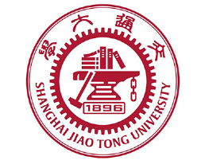
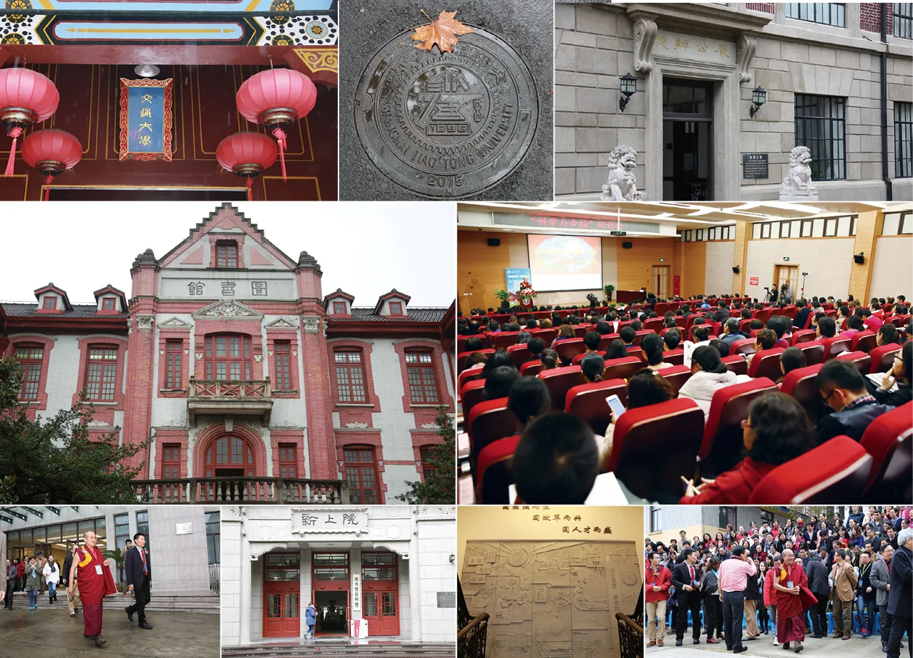
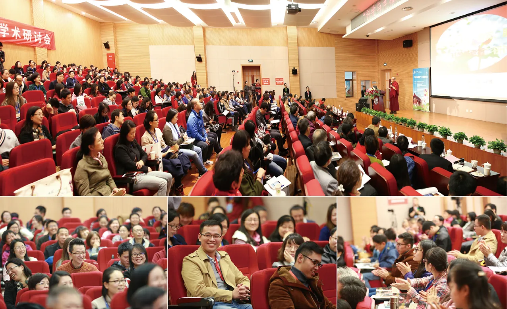
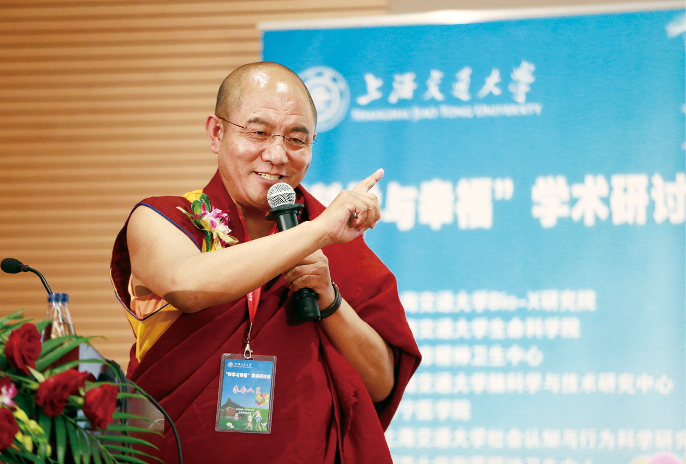
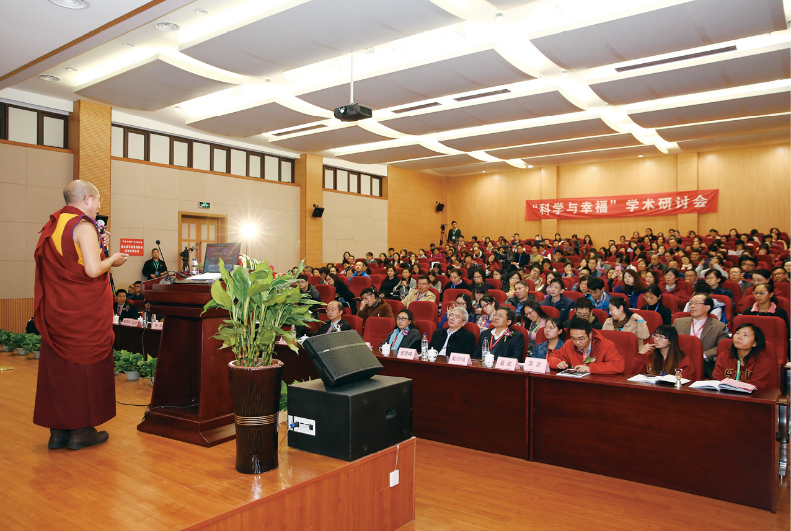
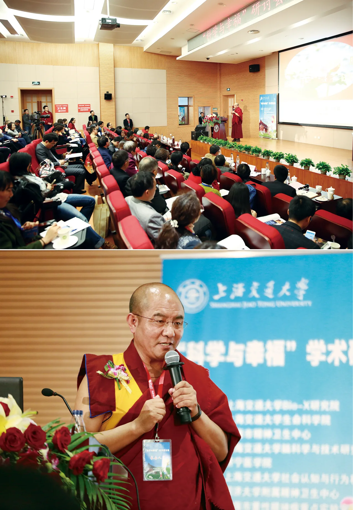
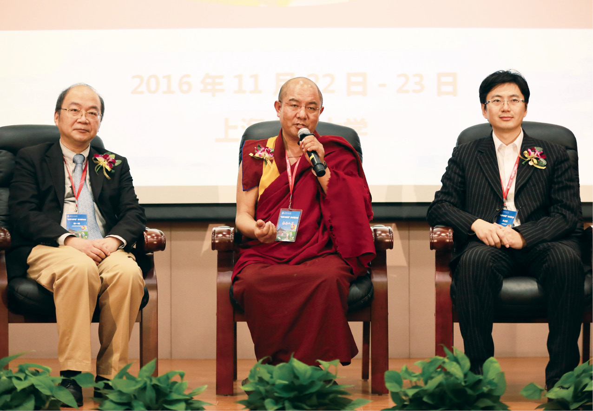
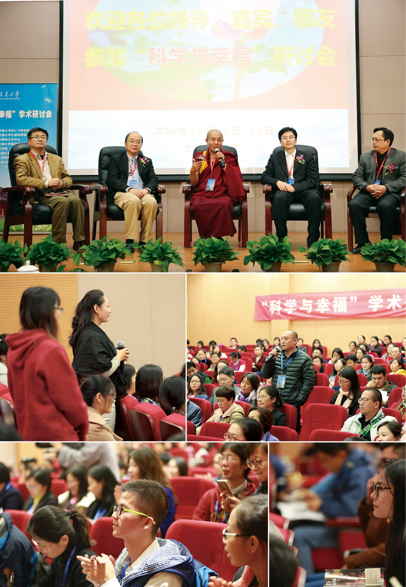

走到人生最低谷的时候，

不用垂头丧气，

更无需对生活失去信心，

也许转机就在不远处。

第144场

上海交通大学

Shanghai Jiao Tong University

中国·上海

2016 / 11 / 22

## 修行与精神健康

## Spirituality and Psychological Well-Being

主持人：

我们“科学与幸福研讨会”非常荣幸地邀请到了四川甘孜喇荣寺的索达吉堪布。堪布今天将和我们分享“修行与精神健康”，让我们有请堪布发言！

很荣幸能有机会参加“科学与幸福研讨会”。我今天没有准备PPT和演讲稿，但不是不重视这场研讨会和学术交流，只是因为最近确实有些忙，没来得及准备。我今天就在现场和各位老师、同学分享一些想法。如果有讲得不合理或者与各位的观点有冲突的地方，希望大家可以在稍后的互动环节里提出来，我们继续探讨。

## 一个不容忽视的现状——不幸福

很多专家、学者都已经从不同的角度，阐述了自己对“科学与幸福”的研究和发现，我觉得这些都非常有意义。在21世纪，科学有了突飞猛进的发展与进步，而生活在这个时代的人们正拼命地，甚至可以说是疯狂地追求着各自的幸福。但很多数据却显示，真正感到幸福的人并不多。从表面上看，我们正处于信息时代，科技高速发展，物质资源极度丰富，以往任何一个时代都无法与当今相比，但与此同时，当代人的内心却比前人更加迷茫、焦虑和不安，精神问题层出不穷。

今天上午，我跟中国科技大学原校长朱清时教授进行了一次简单的对话。他非常担心青年一代的精神健康。他说道，最近北京大学的一位老师在演讲中提到，北大有大约百分之三十的学生患有“空心病”，他们整天处于一种迷茫的状态，根本不知道自己要什么，也不知道为什么而活。北京大学是我们最顶尖的学府之一，是人才集聚的地方，每个学生都是同龄人当中的佼佼者，但如果连他们都处于迷茫之中，那我们对未来的种种美好憧憬，又从何实现呢？

我和朱清时教授也探讨了当前的各种社会关系。我们都觉得，不管是师生关系、医患关系还是工作关系，现在都出现了种种问题——大家觉得不幸福。在本次研讨会中，很多专家从人文与科学的角度来剖析幸福，我觉得这非常有必要。人们拼命地追求幸福，尤其是对年轻人来讲，更希望自己能在幸福中度过一生，但幸福到底在哪里呢？

## 心病还需心药医

我今天要和大家分享的角度，跟专家们有所不同。刚才有一位老师从艺术的角度阐述幸福，直言不讳地说他的观点与科学家不同，这种开放、直接的交流方式非常好。所以我也会从宗教的角度，从佛教哲学的角度，直截了当地分享一些不同于学术界的观点。

在这两天的研讨会上，很多学者都试图从大脑、感官、物质，乃至情感方面寻找幸福、解析幸福。但我认为，幸福是一种心的主观感受，这一点跟主流的心理学观点没有太大差别，所以，我们应该从内心深处寻找幸福。如果仅仅从外界事物上寻求，也许会有所收获，例如，在发财、结婚、生子、升职的时候，人们的确会拥有短暂的美好时光，但这样的幸福转瞬即逝。因此，我觉得大家有必要从佛教的角度来审视、了解一下幸福。

人人都向往幸福，年轻人更是如此。有些人觉得，自己已经四五十岁了，人生没什么希望了，但我并不这么想。川普七十岁才当选总统，连他都还有信心管理美国，处理各种国际事务，所以四五十岁应该还算比较年轻。就像孔子说的那样，“三十而立，四十不惑，五十而知天命”，尤其是到了五十岁，对人生中的缘起、因果等规律有更成熟、清楚的了解，对人生会更有把握才对。

## 一个触目惊心的现实——高自杀率

人人都在追求幸福，但仍然有很多人感到不幸，甚至选择结束自己的生命。根据疾病监测系统的数据显示，中国每年有28.7万人自杀，其中大约15万人是学生，而且在这15万人中，因为学习压力和心理健康等原因而自杀的人数大约占一半。从人口数量上来看，中国人口大约占全世界人口的五分之一，但自杀人数占五分之二，属于高自杀率国家。此外，很多人都相信，GDP越高的国家，人民生活越幸福，那生活在英国、美国以及日本等国家的人们应该很幸福才对。但事实上，虽然这几个国家的科技、经济非常发达，但自杀率却在不断上升，而且远高于中国。

学生自杀的一个主要原因，是心理问题。如果我们从不帮助学生去了解内心、解开心结，那当他们遭遇挫折时，很可能会发生悲剧。成年人也是如此，很多人因为生活和工作的压力过大，一时想不开，就可能用安眠药或者跳楼等方式寻求“解脱”。针对这些问题，我觉得佛教能提供一个很好的角度，帮助大家深入思考。

## 不要只关注失去了什么

佛教的《百喻经》中有一则“杀群牛喻”，相信可以引发大家的思考。有一个放牧人，拥有二百五十头牛。他非常喜欢这些牛，就像保护自己的生命一样，细心地照顾着它们，每天带它们去吃草、喝水，让它们自由自在地生活。可是有一天，其中一头牛被野兽吃了，自此以后，这个人就觉得牛群因为少了一头而不再完整，非常不开心。最终，他将剩下的二百四十九头牛全部赶下悬崖摔死了。从这个故事来看，这个人特别愚笨。按理来讲，他只是失去了一头牛，仍然拥有剩下的两百多头，生活不会受到什么影响，不至于这样。

我们再反观现在的大学生，他们会不会也因为不能接受生活的全部而选择自杀呢？有位教授在报告中提到，有些学生就是为了几千块钱，或者因为失恋而自杀，这值得吗？失去几千块钱也好、失恋也好、失业也好、失学也好，人生当中难免要失去一些东西，但这并不意味着人生失去了所有的希望。

有一位同学曾对我说，她失恋了，觉得自己没有继续活下去的理由。我当时说，世界上有那么多的帅哥，你难道不可以找其他人吗？她说，她已经对所有的男人失去了信心。可就算你对男人失去信心也不至于自杀吧，难道没有其他活下去的理由吗？我们不能像故事里的放牛人一样，失去一头牛，就以为失去了整个牛群。我们在生活和工作中，最好能打开内心，全面地认识并接受生活，否则，一味地关注在自己所失去的东西上，很有可能会患上抑郁症，甚至选择结束自己的生命。

我最近去了南京、苏州、北京和哈尔滨等地，一些学生的父母和我说，正在读中学的孩子主动说，自己好像有些心理问题，希望爸爸妈妈能带自己去看一下心理医生。现在连中学生都觉得自己有心理问题，这非常值得我们注意。我接触城市里面的人已经三十多年了，在早期的时候，几乎没遇到过这样的情况，但现在，不论是学生、老师还是医生，都有人因为压力过大、精神过于紧张而导致种种心理问题。我们该如何应对这些现象呢？我建议大家在生活中要有意识地修行，哪怕时不时地到清净的寺院中去看一看。

## 生活起起伏伏，不要放弃希望

居住在大城市里面的人，物质条件非常富足，但精神生活比较空虚，生活中除了金钱和爱情，好像没有其他的追求。一味将幸福寄托在物质或者情感之上，并不会给我们带来真正的幸福，相反，它还可能会让我们感受到种种不幸，因为不论是物质还是情感，都不稳固，随时都会失去。

当我们感受到一些快乐与幸福时，不能洋洋自得，不要以为自己现在很幸福，以后会永远这样幸福下去。即便你当前的地位、财富、名声、相貌都非常出众，说不定哪一天，你也会失去这些优势。世间的规律就是这样，到了顶峰后就要开始走下坡路，而到达低谷后又要走上坡路。所以，当我们遇到挫折，走到人生最低谷的时候，不用垂头丧气，更无需对生活失去信心，也许转机就在不远处。很多人不一定思考过这个道理，但实际上，如果你仔细想想就会发现，生活的确如此。

这就像有些教授展示的曲线图一样，比如离婚率一开始比较低，但随着时间的推移会越来越高；此外，人们在刚结婚时的幸福度比较高，但往往在七年后，幸福感就开始下降，这都是非常有意思的研究结果。虽然我没有经历过这样的“幸福”，但如果结婚的幸福这么容易就失去，那我也的确不希求。（众笑）

## 有乐就有苦，这是生活的必然

其实这些结果都揭示了一个现实：我们虽然能在生活中体验到幸福，但它往往伴随着痛苦。按照佛教的观点来讲，有幸福就会有痛苦。不知道大家是否听说过古印度的圣天论师，他有一部特别著名的论典叫《中观四百论》，其中有一句是：“若喜彼集聚，何不喜彼离，集聚与分离，岂非俱时有？”大家最好能把这句话记下来。意思是说，既然你特别喜欢与亲朋好友相聚，那为什么会不喜欢分离呢？难道相聚和分离不是同时存在的吗？有相聚就一定会有分离，就像有生就必定会有死，这是一种规律。世间也有类似的说法，就如《三国演义》开篇讲的那样：“天下大势，合久必分，分久必合。”又如人们常挂在嘴边的“三十年河东，三十年河西”、“风水轮流转”、“此一时，彼一时”以及《道德经》中所提到的“祸兮福之所倚，福兮祸之所伏”。事实上，道教、儒教的经典中都提到过祸福相依，祸中有福、福中有祸的无常之理。

人生有快乐也有痛苦，但大多数人只是习惯性地追求快乐，希望一生平平安安、健健康康，一切都圆圆满满、顺顺利利，一点也不想遭遇逆境、天灾人祸，更别提死亡了。可事实上，人生就是由好、坏种种因素组成的，就像有了冬天就一定会有夏天，有了春天也一定会有秋天，有白天就会有黑夜，有此时就必定有彼时，有生便会有死……从这个层面来讲，很多人都没有打开自己的心，没能平等地接受人生中的好与坏。倘若我们打开自己的心，用开放的心态，平等地接受一切，那就可以坦然面对种种境遇。例如，当你和好朋友相聚时，你会感受快乐，而当他离开你的时候，你也不会过分痛苦，因为你知道，有相聚就会有别离，这是必然规律。

但事实上，我们大多只接受悦意的一边，排斥不悦意的另一边，这可以说是绝大多数人的共同心理。而佛教对此有非常详细的分析。

## 福祸相依，形影不离

月称论师是一位古印度的著名论师，他曾对《中观四百论》写过一部注疏，其中引用了一个非常精彩的故事。虽然这个故事表面上看来像是一个神话，但如果你能深深思维，就会发现它背后所传达的深刻道理。

有个人的家里来了一位客人，是一位相貌特别庄严的美女。主人问，你是谁？美女回答，我是吉祥天女，我为人们带来福祉。这家主人特别欢喜，急忙说，来来来，请你快进来。这时，他看到门外还有一个相貌特别丑陋的女人，于是又问道，她是谁？吉祥天女说，这是我的妹妹黑耳女（祸神）。这家主人又急忙说道，我只邀请你，那个丑女可别进来。吉祥天女说，这是不可能的，我们两姐妹形影不离，从来没有分开过，不管去哪里，我们要么一起去，要么都不去。

不知道大家有没有体会到这个故事背后的含义？当我们享受快乐的时候，悲伤就隐藏在其中。比如说，你是一个有威望、事业、财富的商人，企业经营得非常不错，但也许一个决策失误，就会导致你失去一切，下半生不得不在痛苦中度过。或者说，你在今生的肆意享受，也许就在为来世的痛苦埋下伏笔。这些都很有可能。

## 想遇见幸福，先把修行带入生活

因此，我觉得大家非常有必要从哲学和宗教的角度对人生进行深度剖析，在这个过程中，我们先要从理论上了解人生的真相，明白种种道理，进而再在日常生活中实际修行、体验。

所谓的“修行”不一定就是Meditation（禅修）。当然，禅修也是一种方法，而且是一种非常流行的减压、休闲方式。但更重要的是，我们要在生活中深入思考无常、生老病死，乃至苦集灭道的道理。一旦心中对这些道理产生了深刻的认识，有了切身体验，大家就不会再为生活中的不如意感到痛苦。

有些人每天都处于一种修行的状态，或者热衷于行持利他的事业，他们很少会有诸如抑郁症或者自杀倾向等心理问题。但如果我们经常处于自私、紧张的状态中，或者非常喜欢与他人竞争、攀比，内心始终得不到真实的满足，时间久了，精神方面就可能会出现一些问题，这样一来，身体健康更无从谈起了。

## 不稳固的财富与地位，又怎会带来稳固的幸福

大多数人认为幸福取决于身体、财富、地位，但佛教智慧告诉我们，以上这些条件所能带来的幸福感一般非常微弱，它往往只是由很小的福报所引生的一种短暂的快乐，当新鲜感、满足感消失后，你又会产生新的欲望，这时，你会痛苦的。

人们一般都相信，钱越多越快乐，但当你有钱的时候，未必真的感到快乐。很多人都是因为钱而想不开，为了几百万、几千万或者几亿而自杀。我每次看新闻的时候都觉得，世界上有这么多大富翁，一味地在物质上追求幸福，恐怕他们到头来很难活得轻松、愉快。

事实上，财富就像流水，今天你是它的主人，但也许过不了多久，它就流到其他人手里，而人们所执著的房子，短短的时间内也可能换很多主人。所以，物质财富不能带来稳定的快乐。不要觉得自己现在有几十万，这几十万就永远属于自己，说不定过一段时间，这笔钱就全部转移到别人手里，没准你还要借钱度日。

## 解除心的禁锢，才能迎来真正的幸福

就像我前面所提到的，幸福源自内心，因此大家有必要从信仰、修行的层面入手，从内心寻找真正的幸福。当你内心充实、满足时，即便随着年龄增长，外貌越来越衰老，但快乐是不会有所损减的。刚才有些教授说自己已经五六十岁了，我当时想，也许大家越老的时候就越快乐，因为随着人生阅历的不断增长，你会对无常等人生真相有更深刻的认识，进而在平淡、简单、淳朴的生活中，体会到无法替代的快乐。

因此，我建议大家在生活的点滴中修行，例如修大乘佛教的“自他交换”。从我自己的感受和体会来讲，这个修法非常殊胜。怎么修呢？当我们羡慕别人的财富，甚至希望得到别人的财富时，可以主动地转变思维：“希望别人能得到我所拥有的快乐。”一般来讲，我们都是以嫉妒、竞争等心态去追求幸福，但这往往很难帮助我们实现目标。相反，如果能用无私的奉献精神化解心中的负面情绪，例如把自己的快乐给予别人，希望对方快乐、富裕，拥有名声、权力、智慧等，有了这种彻底放下自我的精神，你的心自然而然就像从监狱中被释放出来一样，能体会到难以言说的自由、快乐和幸福。

当然，学术界不一定承认“自他交换”的效果，毕竟学者和修行人在观点上还是有一定的差别。但我还是希望学术界能够深入研究大乘佛教的究竟利他思想所带来的利益。

## 借助仪器一探修行的力量

有些西方学者通过仪器监测佛教修行人的大脑活动，发现他们的幸福指数普遍都比较高，这也说明修行有效果，而且这种效果多多少少可以通过仪器监测出来。上海交大也有老师深入藏地去监测出家人和藏民的大脑活动，试图了解他们的幸福程度，我觉得这样的研究非常有必要。有些西方高校、研究中心从很早以前就尝试研究修行人内心的状态，可能我们在这方面的研究还比较少。我非常期待科学工作者们能在以后的研究工作里，实施更多、更具体的研究项目。

当然，我不认为仪器可以完全监测到修行人的境界。例如，有些出世间的大乐，或者修行人的智慧境界，很难被仪器测出来。但是，从某些方面来讲，我们还是可以通过监测对比修行人与非修行人心中的正面情绪与负面情绪，尤其对比修行人与那些生活在大城市中，每天奔波不断，时刻处于高度紧张、高强度压力下的非修行人的心理状态。我刚才看到，有些学者已经展示了类似的结果，非常有意思。其实，可能除了个别修行人以外，大多数人的心中都是负面情绪比较多，例如恐惧、焦虑、担忧以及紧张、失落等等，而正面的智慧、慈悲、利他，以及欢喜、满足、快乐等情绪，往往只占一小部分。

## 开放的心，没什么不能接受

不论是生活还是修行，我们都应该保持一个从容的心态。每个人的福报都不相同，很多人都想赚大钱，但福报不具足，再努力也没有办法，一辈子都过得比较拮据。而有些人福报圆满，无需特别努力，财富就会自然而来。所以，我们最好能用从容的心态去面对生活，这样比较轻松。

当然，当你财富圆满时，还是应该加以注意，不要肆意挥霍，否则，财富可能在很短的时间当中就全部流走。就像一些痴迷炒股的人，赚了大钱后，又连本带利投进股市，没过几天就全部赔进去了，心中特别痛苦。

人生中难免会有一些浮浮沉沉、大起大落，当我们遭遇这些状况的时候，希望大家还能够用一颗开放、包容的心去面对、接受。事实上，我们在人生的旅途当中，什么都可以接受，哪怕是失去了重要的东西，也是如此。

我正在准备一本书，主题就是不论我们失去什么，都可以接受。很多西方人都有各种各样的担心，有些担心失去家人，有些担心失去工作，有些担心失去青春。听说西方人到了四五十岁，脸上就布满皱纹。像希拉里，她虽然妆化得比较不错，但从照片上来看，还是满脸皱纹。当然，她毕竟已经七十来岁了，但很多西方人都担心老了以后，别人就不再喜欢自己了，还有人担心自己没有钱花，担心生不出孩子等等。如果我们能以轻松、开放、包容的心去面对接纳这些问题，相信你的感受会和以往有所不同。

## 幸福来自欢喜和开放的心

我们有必要用智慧面对人生，化解心中的种种苦恼，这会让我们的身体和内心更加健康。因此，当我们面对生活的时候，不要只接受生活中悦意的那部分，要全部都接受，这样一来，即便遭遇不如意的事，我们也能从容面对。

可能是受到电影和电视的影响，很多人都把一生的希望寄托在某个人或某件事上。例如，很多父母就将所有的希望都寄托在孩子身上，一旦孩子发生意外，父母很可能会精神崩溃，认为自己没有任何希望了。此外，还有人把希望全部寄托在恋人或者银行存款上。其实这都没有必要，人生远不止孩子、恋人和存款。

我们要学会用欢喜和开放的心态去接受生活的全部。有了这样的态度，我们就会生活得更加幸福，不会轻易被困难打败。希望大家都能从容面对人生的苦与乐！

现场互动

问：我是上海对外经贸大学的大二学生。我发现在大学的课堂上，教授主要讲授学术知识，而回到宿舍里，大家也只是在打游戏、看电视剧等活动中消磨时光，所以大学生们缺乏价值观和心理健康方面的引导。我有志成为一名咨询师，希望能给大家带来正能量。堪布能否开示一下，我应该具备哪些素质呢？

堪布：听说今天的研讨会现场有很多老师，我由衷地希望老师们能在传授知识的同时，也能给学生们讲一些人生的道理。虽然有些老师很年轻，但跟学生比起来，老师都算是过来人。

很多学生从小就离开父母，缺少了家庭教育，所以，如果老师们只传授知识，对学生来讲恐怕是不够的。事实上，这个时代一点都不缺知识，只要在网上一搜，全世界的知识都会呈现在你的眼前。很多西方著名高校都有公开课，例如耶鲁大学的幸福课等等，即便想听一百堂都没问题。学生们缺少的是道德教育和人生经验，而老师们可以藉着和学生面对面的机会，纠正他们错误和不成熟的观念，包括一些负面的思维模式等等。

我前年在美国了解了一下当地的讲课方式。其实，很多老师只会用一部分的课堂时间讲课，讲完之后走下讲台，问学生们有没有什么困惑。如果有的话，就当场与学生沟通，解决问题，我觉得这样的授课方式非常好。

你要想对他人的心理健康有所帮助，那你首先要思考用哪方面的知识去帮助他们，是佛教、心理学还是医学？此外，不管你用哪一种知识去帮助别人，都应该先努力完善自身人格，同时有充足的知识积累和实践经验，才能在恰当的时机，力所能及地去帮助他人。

现在各所大学里有很多优秀的大学生，以志愿者的身份帮助他人，这是非常好的尝试。同时，老师们也很有必要向同学们提供道德方面的教育，并传授一些人生经验。

问：我来自浙江大学，我想问堪布仁波切一个关于“大圆满”的问题。今天在座的听众中可能很少有人知道大圆满，甚至更少的人知道“车确”和“托嘎”。您认为，大圆满向内地传播的过程中，应该设置哪些条件？

堪布：这位教授问得比较直接。在佛教中，“大圆满”是比较秘密的问题，因为很多修法是不能随便传的，但他直接就讲“车确”和“托嘎”。当然，这种直接的交流态度也很好。

我对大圆满有很大的信心，前一段时间，我用了两个月传了大圆满中非常深奥的《益西喇嘛》，也就是《大圆胜慧》。这部法是全知智悲光尊者造的，算是大圆满当中最权威、最有影响力的法之一。大概在28年前，我在我的老师那里得到了这个法，法本一直保存至今。很惭愧，我不具备大圆满的传法资格，但从某种意义上来讲，我也可以念个传承。

对内地的大圆满求法者，我只有两个条件。第一个条件是修完五十万加行。今年我们听课的人比较多，但每个人都要圆满五加行，否则就不能听受。第二个条件是，每个求法者要得过大圆满的灌顶。如果满足了这两个条件，我觉得不管是汉族人、藏族人还是其他民族的人，都没有什么区别。

当然，每位传法上师对听受大圆满的要求可能不同，但我这边传承的要求比较严格，必须要修完五十万加行。修加行不是件容易的事，皈依、发心、百字明、顶礼、供曼茶都要修满十万遍，尤其是顶礼，对很多人来讲非常困难。但只有五十万加行圆满后才可以听受大圆满，这一点是必须的。

问：我觉得，从佛教的角度来讲，那些有抑郁症以及自杀倾向的人，可能会受到一些魔障、附体的干扰，而堕过胎的女性也可能会面临这样的一些问题。那对于身边有自杀倾向或者有魔障干扰的朋友，我们该如何帮他们呢？

堪布：抑郁症确实是一个很大的社会问题。据说，现在世界上抑郁症最严重的国家是英国，大约每五个人中就有一人患有抑郁症，很令人震惊。而且他们也觉得抑郁症很可怕，有些人得知自己的朋友患抑郁症，心里都会产生一种恐惧感。当整个环境都被这种病魔所笼罩的时候，没病的人都可能觉得自己有病，久而久之，也会深陷痛苦和恐惧之中。

我想，对于抑郁症患者而言，心理疏导非常重要，同时也不能忽视医学治疗和宗教引导，这些不同层面的帮助都非常有必要。

对于你刚才提到的情况，尤其是以前堕过胎的人，如果有信仰，可以念一些咒语。

东北那边对于“附体”“大仙”等现象的说法比较多，南方这边比较少，但也有一些。对于这些现象，佛教中比较明确地说，可以做一些佛事，例如超度。对没有信仰的科学工作者而言，这可能难以理解，但对于有信仰的人，或者半信半疑的人来讲，如果心里有一些障碍，可以通过做佛事，如除障法等，来遣除障碍和违缘。

就像汉地的《了凡四训》里所讲的那样，人的命运是可以改变的。我们通过积资净障，可以遣除命运中的一些障碍和违缘，这就像大气中出现雾霾的时候，我们通过种种方式将其驱散一样。

所以，对于你所提到的这些情况，如果他们信仰佛法，我的建议是做一些佛事，忏悔、念经或者禅修。禅修不需要以信仰作为基础，在座的老师和同学们都可以禅修。通过学习和禅修，大家也许就会发现，原来所谓的抑郁症也不是那么可怕，我们可以通过禅修解开心结，消除种种负面情绪。

问：那对于有信仰的人，念什么样的咒语比较合适呢？

堪布：我去年去了剑桥大学，那里的老师和同学们特别重视不动佛心咒，所以，我当时就给他们传了不动佛心咒：嗡赞扎玛哈若卡那吽啪的。

目前藏语里还没有“抑郁症”这个词，对藏族人来说，这个病很陌生，这可能跟藏族人经常修行、念诵咒语有关吧，很少有人患抑郁症。所以，如果大家能念诵不动佛心咒是很好的。
