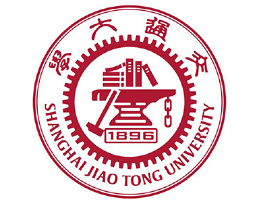
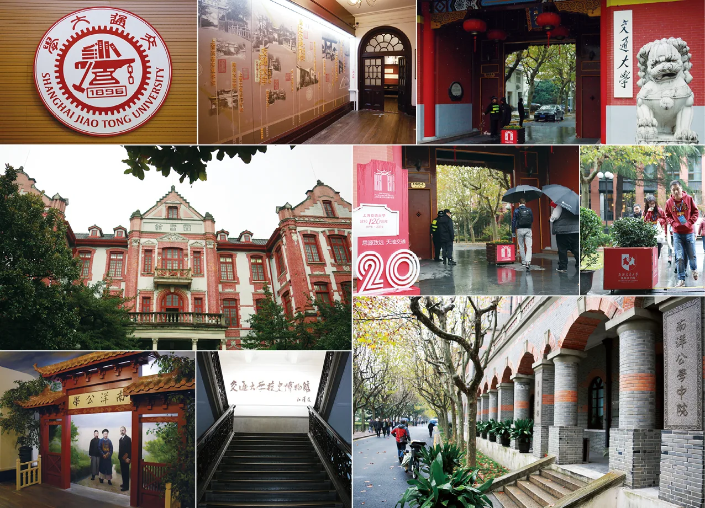
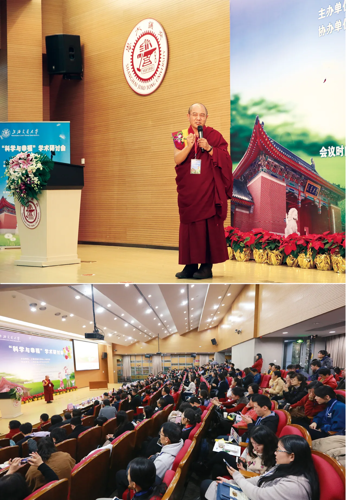
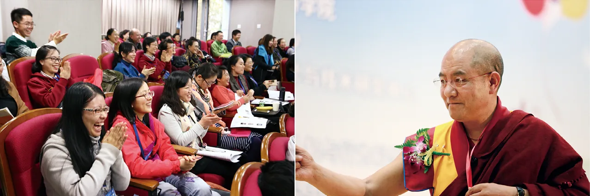
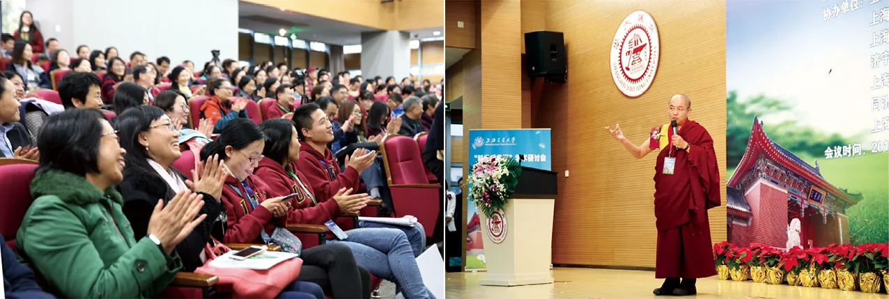
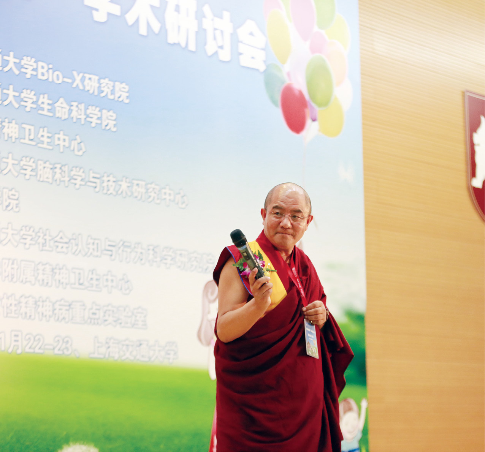
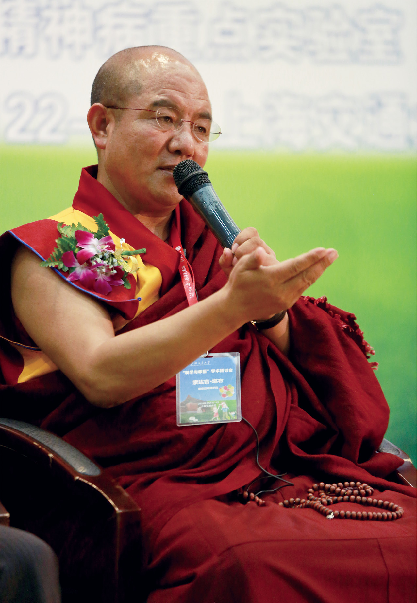

真正的幸福，来自于智慧。

第145场

上海交通大学

Shanghai Jiao Tong University

中国·上海

2016 / 11 / 23

## 大学生与幸福

## Heartfelt Advice on Happiness to University Students

主持人：

接下来，请佛学大师为我们讲述“科学与幸福”的主题，并带领我们从另一个角度来看待这一课题。

请允许我先介绍主讲嘉宾——索达吉堪布。堪布仁波切长期关注青年学生和知识分子关于“幸福”的课题，并出版了大量的书籍，如《苦才是人生》《做才是得到》《残酷才是青春》等。仁波切用自己无碍的智慧帮助所有人去除烦恼获得幸福，围绕“科学和幸福”的主题，尤其针对目前大学生和老师群体普遍存在的心理和精神健康问题，做出了相关的解答。

其实，上海交通大学在课堂教学以及科学研究等方面也开展过一系列的这类工作。尤其在2015年成立了上海交通大学脑科学与技术研究中心，以及“解码大学生主观幸福感基因”“冥想科学基础”等文理交叉重点项目，这些研究也是我们今天召开“科学与幸福”研讨会的一个缘起，我们期望从不同的角度来解码幸福，探讨提升幸福之道，提升大学生精神健康。

这次研讨会非常荣幸地邀请到了尊贵的索达吉堪布仁波切来为大家做“大学生与幸福”的主题演讲。这是堪布的慈悲，也是在场代表和所有人的荣幸。下面就让我们以恭敬心和幸福愉快的心来聆听大师的开示，也请大家用热烈的掌声欢迎堪布为我们做演讲——

各位老师、各位同学：

大家好！今天我在这里简单分享一下“大学生与幸福”这个主题。

昨天下午，我表达了自己的看法，我觉得今天又安排我发言不太合适。我曾经也参加过一些世界青年佛学研讨会，一个人如果频繁在不同会场出现，会让人感到讨厌。所以，我就请求今天不做演讲。但被告知，由于今日的会场不同，参与的人也不同，所以还是坚持让我做演讲。那么，我就尽量缩短演讲的时间，否则，原本这么一件令人感到幸福的事情，若因为我的频繁出现，让参与活动的老师和学生产生稍许不快或痛苦就不太好了。相关人员提出的有些要求我基本上接受，所以决定在这次研讨会接近尾声时，给大家做简单的分享。

经过这两天的学习，我收获非常大。我认为学习是人生中最有意义的事，也是最长久和稳固的一种幸福。许多人自认为很幸福，但有些表面上看似幸福，实际却成为今后的痛苦之因；或者因为当下的幸福稍纵即逝、瞬息万变，最终变成了痛苦——佛教把这种痛苦称为变苦、行苦。

这次“科学与幸福”的研讨会，从各个不同的维度和角度阐述了幸福的本质。有些嘉宾在演讲幸福的主题时，让大家都真切感受到了幸福，而有些嘉宾在演讲的过程中，大家都处于一种说不清楚、不可思议的状态中。所以，人的内心确实会随着演讲嘉宾的语言而产生相应变化。我们很多人心随外境而转，还没有达到境随心转的境界，若能达到后者的状态，确实会享受到真正的幸福。

大家生活在大城市里，有来自家庭、学习、工作的各种压力，每天都是特别繁忙。但很多人一直放不下手机，时不时就要查看微信信息，他们说这是“微信依赖症”。有些人天天都要把未读消息的红点提示全部点完，否则就觉得有事没完成，从而导致他们五到十分钟就要刷一次微信……我想，大家若能在半天的时间里关掉手机，这是一件幸福的事，也是一种闭关、一种修行。

因此，从某种意义上，这次研讨会是很有意义的，我发自内心地特别喜欢。我也希望，今后主办单位以及各位老师能给大家多提供这样一些因缘，既有非常强的学术性，又能从医学、遗传学、文学、艺术、宗教、道德等各个维度来观察讨论某一课题，这是非常有意义的。

我看到刚才有些专家虽然只做二十分钟的演讲，但为了这二十分钟的内容，他们把大量国内外的资料做了总结，并利用短暂的演讲介绍给我们。虽然我们不一定能完全消化那么丰富的信息和智慧，也可能不同专家用强迫性或者艺术性的方式给我们注入这么多知识、做不同的主题分享，会让我们感觉头有点痛，身体有点累，但我想这就是最美好、最幸福、最快乐的时刻。曾经我们连续开了七天的研讨会，那时我也很认真地做笔记，不管是老师还是大学生做演讲，不论对方有无信仰，我都会把相关内容记下来，过一两年再翻看会很有意思，每一位演讲者从不同角度所阐述的内容对我都有价值。

所以首先，我特别感谢主办单位为我们提供这么好的一个学习机会，如果在市场上用钱来衡量，这个价值应该是很昂贵的。能让我们聆听这么多专家的分享，不是件容易的事情，因此特别感谢你们！

## 年轻人该如实描绘自己的人生效果图

今天想和大家分享的课题，主角是我们的大学生。现在他们的压力比较大，对未来的人生蓝图做着规划和准备，把“效果图”描绘得非常壮观、庄严，但能不能实现这一目标？可能有一定的难度。

这几天在上海有人对我说，如今上海房子涨价，一平方米好几万，80-100平方米要好几百万，这么多钱对于刚毕业的大学生来说，依靠微薄工资来供房是很困难的。如果房子、车子都买不起，谈婚论嫁就更困难了。作为一个年轻人，要承担如此压力，让我们不得不深思。如今很多人变得很现实，在现实的压迫下，追求知识的梦想很容易破灭。有些人想得很好，但在人生中付诸实践时却事与愿违，因为他没想到事情会有诸多不确定的负面因素。这方面，今天很多专家在演讲中都有提及。

大家都知道，如今国内外很多年轻人承受着各种心理疾病的困扰——焦虑症、抑郁症、自闭症、恐惧症等，这些病症来自于内心的压力及不愉悦。那如何解决呢？坦率地说，希望各位同学在追求最美好的人生愿景的同时，一定要想到还可能发生诸多未知情况。好比有人将来组建家庭，同时也要考虑到，或许今后感情会出现某些问题，或是自己、家人的身体会遭遇不幸等。对此考虑得越多、越周全，那在人生的道路上，遇到坎坷或挫折时，自己就会越坚强，越能勇敢坦然地面对。否则，一味把事情想得太美好，最终无法实现时，这样的落差就会导致心理疾病。

藏地有一个很出名的故事叫“月称的父亲”[^1]，这个故事家喻户晓，很多人都熟悉，但今天我想给大家讲一个古希腊《伊索寓言》（Aesop's Fables）中的故事，故事的主人公看似愚痴，但从中我们也会多多少少看到自己的影子。一个卖牛奶的农家女孩，她每天把挤完的牛奶倒入桶中，顶在头上拿到市场去卖。有一天，她在去集市的路上边走边想：“今天如果牛奶卖得好，我就用赚来的钱买好多鸡蛋，然后鸡蛋孵出很多小鸡，等它们长大后我就可以卖掉赚很多钱。我用这些钱买一件漂亮衣服，穿着它去参加宴会，到时很多年轻男子会被我迷倒，很多追求者都向我求婚，我会一一拒绝，直到心中的白马王子出现……”她一边这么想一边兴高采烈地走着，由于她高兴得摇头晃脑，不慎把顶在头上的牛奶洒在了地上，最终，她的梦想全部化为乌有——好在故事结尾没提及这个女孩为此自杀或得抑郁症，但当今有些人会不会像这女孩一样呢？

这故事听起来非常幼稚、可笑，大家都会觉得这女孩太傻。的确，作为旁观者，你会对此不以为然，但如果用当下的标准去评判，有人可能觉得，故事中的女孩富有创造力和理想，有梦想去追求未来的人生，是特别美好的想法，哪怕这是一种空想，甚至是幻想。同样，如今有些年轻人是否也如出一辙，根本没衡量过自己的真正能力和实力，就开始一味幻想人生呢？其实，这和我们现在的教育有着必然联系。

## 当今教育应注重什么

昨天在会议上，有些老师也提出了一些尖锐的问题，现场老师回答得比较婉转柔和，但个别老师确实对当前自身的责任感及社会上的一些现象感受非常强烈。于是我在思考，大部分人包括年轻群体的价值走向究竟是什么？据说，今天也有不少大学老师在场，因此我想借此机会给老师们提一个希望。什么希望呢？前两天也提过，就是希望老师不仅为学生们教授知识，更重要的是教他们懂得做人的方法。

《资治通鉴》里有一句话：“经师易得，人师难求。”我们很有必要去好好体会。如今，把书本上的知识教授给学生的老师，在大学里不是特别稀缺——今天现场也有很多大学教授，每一位都带有各种特别了不起的头衔——但除此之外，老师真正需要做的是什么？就是关心学生的心灵健康。这些孩子将来都是一个家庭的主人，是人类社会的接班人，更是一个国家的希望，如果他们心灵不健康，存有较大的报复心、愤怒心等不良心态，未来的社会将变成什么样可想而知。也许有时我们的想法太悲观，悲观的人看这个世界都是黑暗的，不像乐观的人看这个世界处处光明。再加上由于我是佛教徒，以出离心来看待这一切时，更让大家感到比较沉闷。但无论如何，当今教育上确实出现了一些不容乐观的现象。

前段时间我看过一则新闻：一个小学三年级的孩子，放学后欢天喜地地对妈妈说：“今天我有好消息要告诉你！”妈妈问是什么事，孩子说：“我们班有个同学死了。”妈妈问：“那有什么好高兴的？”孩子回答：“这样我就少了一个竞争对手。”

这孩子的行为反映出什么？人心的某个角落是很黑暗、很自私的。每一位老师和学生对净化人心都是有责任的，并不是社会已经无可救药了，也不是到了病入膏肓的程度。这时代如果大家共同努力，尤其是每所大学的权威老师，无论是否有宗教信仰，都应该肩负起挽救社会人心的使命。然而，现在的社会舆论导向也存在一定的问题，只要网上出现一些正面、积极、慈善、助人的消息时，大家都似乎不屑一顾，甚至连转发的兴趣都没有，但当出现一些负面、可怕、愤恨的事件时，大家都疯狂地去转发，非常有兴趣参与其中。

前段时间，藏地有一个女孩只因花了几百万去放生，结果藏地很多年轻人就骂她，说她不应该放动物、不应该善良，因为越善良越脆弱。还有人说她不该把这么多钱交给屠夫。网上除了两三个人发出赞叹之外，大部分人都不发声。如今的藏地也成了这样，人们的心不像当初如蓝天白云般纯净。现在只有一些老年人过着有信仰的幸福生活，许多年轻人由于受消费主义的冲击、西方文化的影响，看到放生女孩有这种善行时就用藏语来攻击她，甚至还有所谓的“宗教人士”站出来说“不该放羊”。一个善举引起了这么多骂声，以至于现在网上都在讨论“值不值”的问题，大多数人认为这女孩做了一件“不值得”的事。

几年前，三名18岁的大学生因救了两个孩子而丧命，网上觉得他们这样做“不值得”。上世纪80年代，也有一名大学生为了救一名七十多岁的掏粪老人而失去生命，大家同样觉得“不值得”。其实，看待一件事情“值得”与否，不能这么看，每个人的生命都是非常宝贵的，不应该用学历或年龄来衡量。所以，我们的社会风气需要将光明和黑暗、正面和负面区分开，正如今天有位教授提到，人和动物是不一样的，动物只追求感官刺激，人应该有更高级的心灵提升，懂得善和恶的差别，这一点对我们很重要。

作为老师，在给学生传授专业知识的同时，还需要给他们灌输善和美的教育。刚才有些老师也提到，作为大学生，如果切实去做一些利他的善行，内心的快乐会油然而生，即使得不到这世间的种种，也依旧会过得很满足，这样的心态我们每一个人都应该具备。所以我觉得，大学有必要开设一门关于幸福的课程——虽然今天有些老师持有不同的意见，这也完全正常，这个世界有不同思想的碰撞、不同见解的存在，都是非常合理的。但我个人根据大乘佛教的思想，认为对所有众生都要尽心尽力帮助，哪怕能帮到一个众生，我们也应该全力以赴。即使别人对你特别不好，自己也应该对他人好，这样做虽然不容易，但古圣先贤早已给我们做出了榜样。

## 这是人生的大智慧

大家都知道苏格拉底，有一天，他在过河时不小心滑入河里，在水里不停地挣扎并大喊“救命”。那时刚巧有一个渔夫经过，渔夫不仅没有救他，反而立马转身离开。最终，苏格拉底被弟子从河中救出。之后有一天，苏格拉底和学生们一起在河边散步，听到附近有人溺水呼救，他们想尽办法用竹竿把落水者救了上来。事后才发现，落水者正是之前见死不救的那个渔夫。众弟子非常后悔救了他，苏格拉底是怎么跟弟子说的呢？“我们应该救他，这正是我们和他的不同之处。”所以，很多人在做善行时，如果遇到不被他人理解甚至是毁谤，这也是正常的，毕竟现在的风气不同于以往。但即便如此，我们坚强的意志和智慧也不要因此而轻易退转。

曾有位藏传佛教的大德被关在监狱里21年，当他被释放后有人问他：“你被关在监狱里的这些年，最怕什么？”这位大德回答：“我最怕对伤害我的人失去慈悲心。”可见，作为真正的修行人，最怕的东西跟普通人不一样，普通人可能更在意监狱里的条件如何，饿了怎么办……考虑一切事情的出发点都是自己。而真正的圣者对他人具足悲心，能用这种慈悲心对待所有人，这其实也是我们人生的核心价值观。

如果我们的价值观建立在“利他”的基础上，自己会感到很幸福；若我们把所有的重心都建立在自私、我执，或是自我膨胀的基础上，一定会感到很痛苦。佛教中经常提到“世间八法”[^2]，即：喜欢别人赞叹我，不喜欢别人批评我；喜欢别人重视我，不喜欢别人蔑视我；喜欢自己享受快乐，不喜欢自己感受痛苦；喜欢自己获得成功，不喜欢自己遭受失败。这八种法，如果我们特别在意，心就会越来越脆弱，从而感受的痛苦会越来越强烈。

这也是如今经常提及的软实力和硬实力吧。如果你内心（软实力）不够强大，没有慈悲、没有智慧、没有信心、没有能力，即使自己的物质条件（硬实力）——包括金钱、工作、家庭什么都好，样样圆满，也不代表你真正快乐，能实现自己的人生价值。如果你非常坚强，爱帮助别人，即使住普通的环境，赚微薄的收入，内心也会感到充实、自在。所以，从某种意义上，人生不能完全安立在外在的物质上，而应该建立内心的满足感。当然，基本的生活条件也是不能或缺的，“知足少欲”不是让人穷到连吃饭都成问题，否则，就有悖于佛教所说的不堕入极端的理念。

## 恒时不忘感恩之心

今天很开心能和大家分享这些道理，通过这样的交流，你们或多或少会对生活的目标重新定位，思考一下：“曾经我追求的是什么？现在想要的又是什么？我要借助自己的能力、智慧、各种资源获得什么样的人生？”这些思考对你来说相当重要。我们若只谈所谓的成功学，一味地向往金钱，认为有钱等同于成功，如果没有钱，即使有善良的人格、健康的身心、坚强的意志、慈悲的胸怀、和睦的家庭、宁静的生活，在他人眼里也没有什么了不起，这样的社会现状确实需要调整。当下靠我们的分别念来寻求幸福生活，可能会有偏差，而一些宗教的普世观念里，包括儒释道古圣先贤的文集中，我们依旧会感悟到真正的幸福到底为何物。

真正的幸福来自于智慧。这方面，我也听过来自于各位老师的不同观点，对老师们重视教学寄予希望。像我家乡那里的偏僻地方，有些中学、小学的老师并不专注于教学，而是每天都想着挣钱，开咖啡厅、开网吧、炒股、做生意……他们经常不给学生布置作业，更不会把孩子放在心上，甚至不正常教课却勤于课余补课，以获得相当可观的收入，三年就可以买二十万左右的车。当然，作为劳动成果的体现，稍微收些补课费也正常，但如果过于注重经济收入而忽视了教育本分，师生之间除了像交易关系以外，原有的真挚感情慢慢淡化，那学校将走上一条什么道路可想而知。像上海这样的国际大都市，像交大这样一流的高等学府，可能不会有类似的情况，但也不能一概而论。

前几天，有个上海人和一个藏族歌星在网上发生了争吵，原因是那个上海人说了西藏这样偏僻地方的诸多不好，藏地没有出名的明星等，最后那个藏族歌星火冒三丈，双方便开始争执不下。的确，在北上广生活的人，一方面有很多压力，需要一定的智慧和能力才有生存空间，但另一方面，他们也有一定的优越感，对其他地域的人会有傲慢心，看不起别人。佛教讲这些就是贪、嗔、痴、傲慢、嫉妒五毒，就像刚才有位老师比喻的，毒一直在心里也还好，但若是流露出来，到哪里都是危险品。其实我们是否生活在一、二、三线城市，这些不重要，最要紧的是所有人——包括大学老师在内，要懂得关心他人、关心学生。如果学生在你眼里无足轻重，那可能连做老师的资格都没有。

其实，一名好老师对社会的贡献非常大，因为他的责任是传递知识、引导人心，在当今时代很少有岗位具备这样的作用。所以，我们很有必要去鼓励和支持老师们肩负起自己的重担。同时，学生对老师的感恩之情也相当可贵。现在忘恩负义的人虽然非常多，但对老师、对父母的恩情永远不能忘。我今天正好看到一个藏文帖子，大致意思是：喂一条狗三天，它三年不会忘主人；养一个人三年，他三天就忘了恩人。这句话虽然很有讽刺意味，但某种意义上又的确如此。有些老师辛辛苦苦地培养学生，结果学生们毕业了不但没有感恩之情，反而对他特别不满，甚至可能到处诽谤，这的确让人特别寒心。

其实，作为一个人，要懂得感恩，尤其对父母和老师，他们是世界上对自己最有恩德的人。以母亲为例，她为我们流过无数的泪：我们还未降生时，她为我们流下了希望的泪；当我们呱呱坠地时，母亲流下了激动的泪；当我们平日不听话时，她流下了伤心的泪；我们事业成功、成家立业时，她流下了开心的泪；当母亲老了，如果我们忤逆不孝，她会流下绝望的泪。

所以，每个人要恒时有一颗感恩之心，我们的生命靠父母而来，智慧靠老师而来，因此要感恩父母、感恩老师。今天在场的很多演讲嘉宾，也是我们的老师，感恩你们！

现场互动

主持人：

我们今天的会议进入最后一个互动环节。昨天大家互动得非常好，有很多参会者还觉得意犹未尽，所以，我们把昨天的美好带到今天来延续。接下来，请堪布与大家来互动。

问：我听到古希腊那个故事时非常有感触，但还是有一个疑惑，故事中的主人公想着未来很美好，于是有些得意忘形地打翻了牛奶，这故事告诫我们，在期待未来时不要得意忘形。但是，若对未来感到恐怖，非常害怕将来的生活，又该怎么办？有什么公案或教证来指导自己？

堪布：刚才所讲的古希腊故事，其实表达了一个含义：对未来不要不切实际地幻想。未来虽然可能如梦般美好，但也有可能迅速破灭。

其实，有智慧的人还能看到故事的另一层含义，它告诉我们，未来还有希望！虽然主人公的牛奶打翻了，但奶牛并没有死。所以，未来的希望一直都在。如果小女孩并未因此对人生感到绝望，那她就还有希望。

问：您教导我们修习自他交换时，要观想众生的痛苦、灾难、厄运变成黑气吸入自己体内，随后将自己的福德等变成白气呼出去给这些众生。曾有人问这样修是否会让自己倒霉，您回答说不会。我想，这是否是您对初学者的回答，当我们真修到一定境界时，是否就可以代替众生感受肉体上的痛苦，甚至把自己的福德、寿命分给他们？我们是否真能做到这一点？

堪布：如今的科学研究发现，当我们用爱的语言、爱的目光、爱的意念投注到植物身上，它们会自然而然长得很好，乃至开花结果；若我们用仇恨的表情、恶毒的语言、愤恨的意念对待植物，它们在短时间内就会出现枯萎的迹象。所以，心的力量是不可思议的。

我们通过自他交换的修行，一方面可以让众生有机会减轻痛苦、获得快乐；另一方面，自己的心量和修行也会不断增上。这是一个必然规律，也是无数人通过实修得来的经验总结。

问：我想从事一个科学研究项目，目的是为了利益周边的农民。但是，这个技术一旦成熟，就很有可能会被他人利用来伤害别人。就像昨天李老师讲到人工智能的两面性，为此，我不知道该如何取舍，请堪布开示。

堪布：关于你这个问题，其实不论如何，开展任何一个项目，首先自己应该去做细微的观察，从而了知所创造出的产品项目的结果，否则真的会不好把握。

之前很多明星在接广告或活动的时候，由于有些人相信因果，首先会了解项目的相关内容，因为一旦接手之后，自己所产生的影响力可能比较强。同样，当年爱因斯坦刚开始研究核物理的时候，并没有想到后果会变成那样；诺贝尔刚开始发明炸药的时候，也未想到自己的发明会起到这样的作用，之后为了忏悔，他设立了诺贝尔奖留给世人。

我不知道你做的是什么项目，但最好先用智慧去观察，通过多种途径了解之后再决定，这才是有智慧的选择。

[^1]: 从前，一个穷人得到了许多青稞，他将这些青稞装入口袋里，挂在上方，自己躺在口袋的下方。他不禁暗自思忖：“我现在用这一大袋青稞作为本钱，想必将会拥有大量财物。到那时娶上一位好妻子，她必定会生一个儿子，取名字就是我的责任。那么，该给儿子取什么名字好呢？”这时，刚好看到月亮从东山升起，于是他想：“缘起太好了！干脆我就为儿子取名月称吧。”正在这时，悬挂口袋的绳子被老鼠咬断了，袋子恰巧落在他的身上，他就这样一命呜呼了。
[^2]: 世间诸法略有八种：一、利，二、衰，三、毁，四、誉，五、称，六、讥，七、苦，八、乐。得可意事名利。失可意事名衰。不现诽拨名毁。不现赞美名誉。现前赞美名称。现前诽拨名讥。逼恼身心名苦。适悦身心名乐。谓此八法，世间所爱、所憎，而能扇动人心，名之为风。苟心所有主，安住正法，不为爱憎之所惑乱，即八风不能动也。
