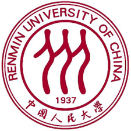
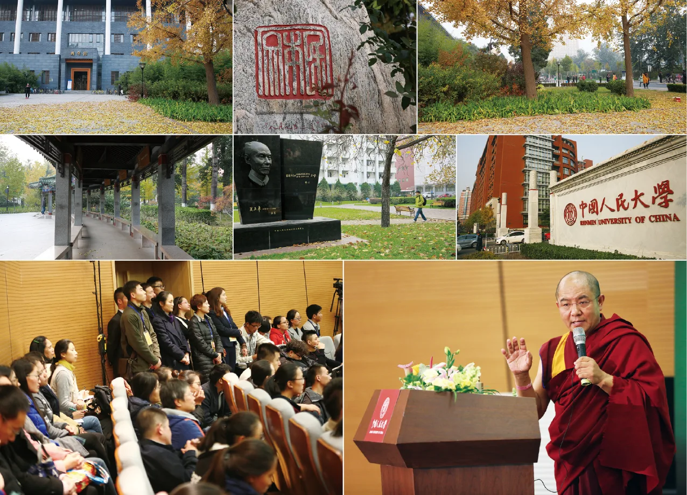
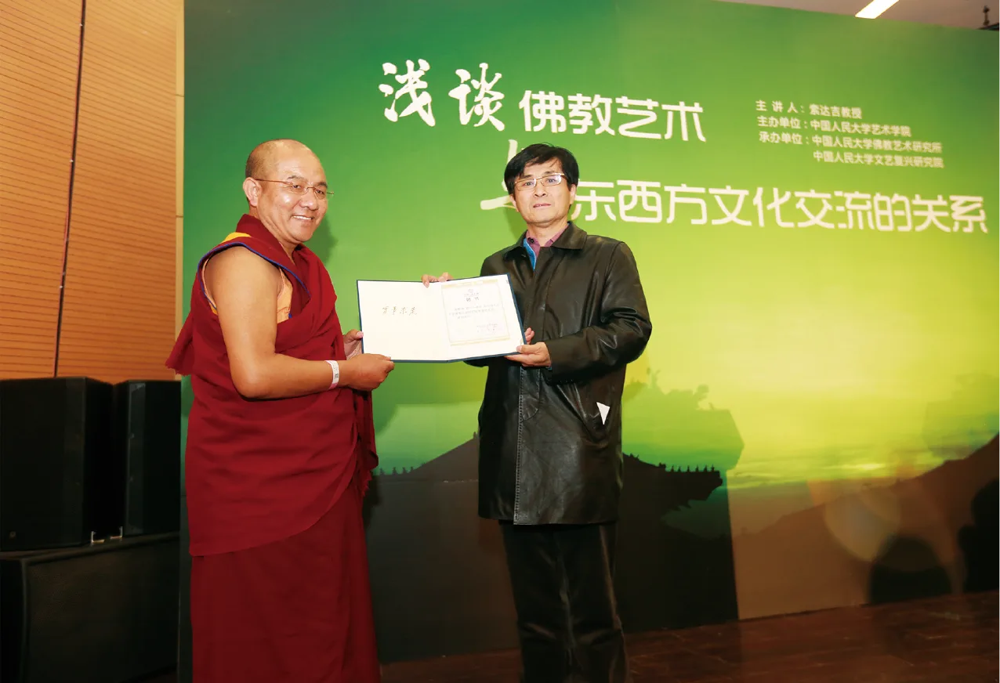
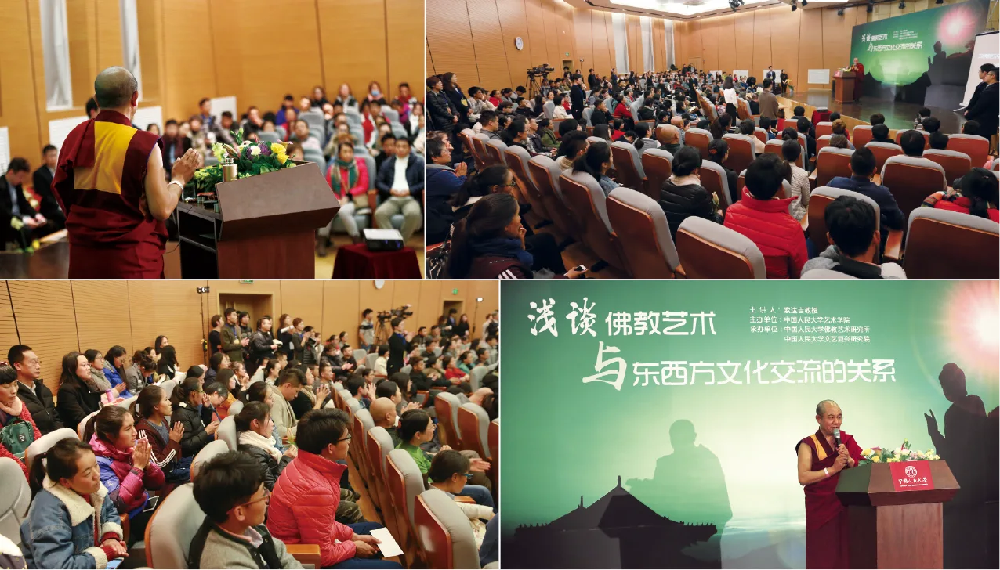
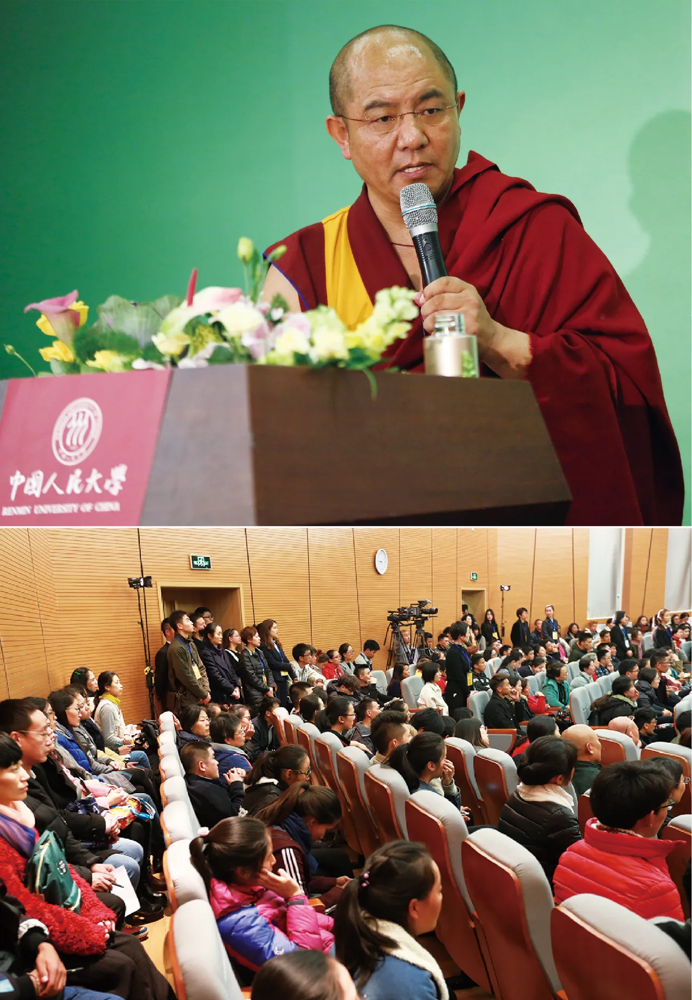
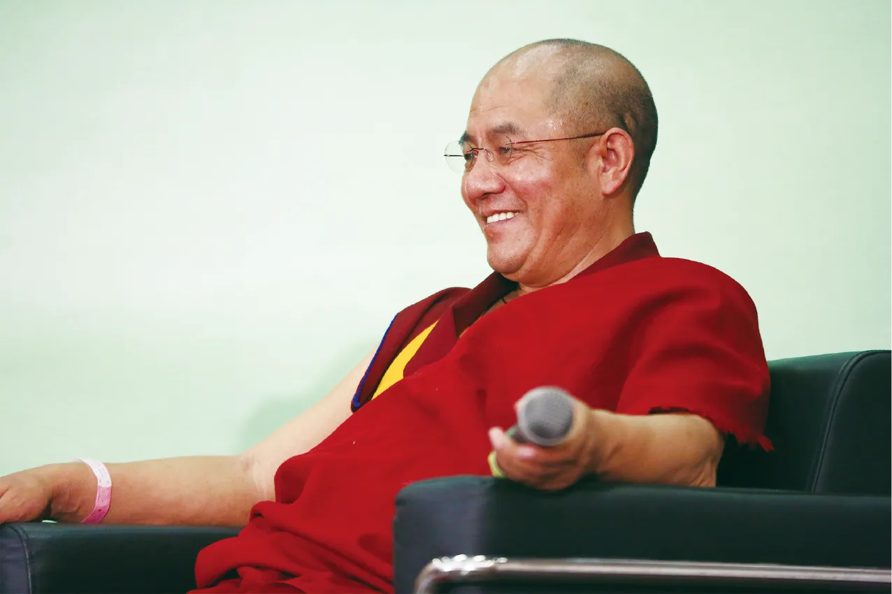

佛教的真正价值，

就是引领我们认识自己，

最终令内心回归自在与宁静。

第141场

中国人民大学

Renmin University of China

中国·北京

2016 / 11 / 8

## 浅谈佛教艺术

——东西方文化交流的关系

## Buddhist Perspective on the Arts and Cultural Exchanges

主持人：

在座的各位来宾、领导、老师以及同学，大家晚上好！很高兴与大家相聚在中国人民大学艺术学院音乐厅。今天的活动主题是“浅谈佛教艺术——东西方文化交流的关系”。我们非常荣幸地邀请到了中国人民大学艺术学院的丁院长，以及中国人民大学佛教艺术研究所的张所长。在活动开始之前，有请丁院长向大家介绍主讲嘉宾——

丁院长：

尊敬的各位来宾，晚上好！佛教艺术是东方艺术源流中一条璀璨的溪流，它既传承了文化，又促进了交流。当前，我们伟大的民族正走向文化与艺术的复兴，迎来回归。作为东方文明中重要的一环，佛教艺术如何在东西方文化交流中发挥它的价值？在互联网经济时代，佛教又如何通过艺术的形式，缓解人们内心的压力、和谐人心？今天，我们就在这里探讨佛教艺术。

今天的演讲嘉宾是四川甘孜喇荣寺的索达吉堪布，一位具有世界影响力的藏传佛教大德、导师。让我们以热烈的掌声，欢迎堪布！

主持人：

人民大学艺术学院在今年成立了中国佛教艺术研究所，旨在重点研究佛教艺术，而今天在座的所有嘉宾、老师和同学将共同见证丁院长为索达吉堪布颁发中国佛教艺术研究所荣誉研究员的证书。有请索达吉堪布上台，谢谢！

（颁发证书）

让我们记住这一时刻，希望索达吉堪布可以与人民大学的教授、学者们，一起探讨佛教艺术、推广佛教文化，推动佛教文化的融合、推广、复兴与传承！

接下来，我们就将时间交给索达吉堪布——

非常感谢中国人民大学艺术学院的丁院长和张所长给我颁发荣誉研究员的证书。我们刚刚很开心地参观了佛教研究所、东方艺术研究所、佛教艺术研究所以及文艺复兴研究院等等，我觉得这里的工作非常有意义。

艺术对人类的精神生活至关重要。而在当今时代，人们的内心变得越来越焦虑，我们更有必要通过种种方式，弘扬佛教艺术与传统文化，传达艺术的正能量，让人们的内心回归自然、回归宁静。我想，这就是艺术真正的意义与价值。

我可能不是讲佛教艺术的最佳人选，因为我并不是学佛教艺术的，谈不上对艺术有很深入的研究，更谈不上能拥有“艺术研究员”这样的称号，今天恐怕要班门弄斧了。此外，我最近正在医院里检查身体，今天中午还接受了全身麻醉，现在是“请假”过来与大家交流，还有点晕晕乎乎，像走在云海上一样。所以我今天的思路可能不会很连贯，这也许可以算是一种行为艺术吧（众笑）。不论怎样，我想简单地分享一下我对佛教艺术和东西方文化交流的想法。

## 艺术与宗教密不可分

我觉得艺术家可能需要一种“慢心态”，因为艺术创作一般都比较花时间，但在21世纪的今天，不论是东方人还是西方人，连走路都越来越快，很多人根本慢不下来，这为艺术创作带来了巨大的挑战。此外，从历史上看，我觉得艺术与宗教密不可分。例如，佛教在藏地、汉地乃至整个亚洲的文化中都扮演了重要的角色，有其独特的魅力，深刻地影响了亚洲的艺术。但我们也可以看到，当前的艺术创作正在衰落，很多人都担心，会不会有一天艺术的传承就此中断？因此，专家、学者以及老师们，需要承担起责任，努力应对时代的危机，实现艺术复兴。

## 西方主流价值观的弊端

众所周知，在全球现代化的进程中，西方文明在世界范围内扩张，对人类社会造成了巨大的影响，尤其是在物质文明方面取得了辉煌的成就。但与此同时，我们也不得不承认，西方文明所主导的物质进步直接或间接地导致了环境恶化，加剧了社会中的各种矛盾和冲突，也导致很多人患上精神焦虑。从这些方面来看，我们正面临着种种严峻的危机。世界观察机构在一份调查报告中提道：“随着世界进入21世纪，国际社会要么团结起来共同扭转危机，要么陷入环境恶化和社会解体的恶性循环。”结合当今世界的现状来看，这一点并不难理解。

很多人一味地推崇西方文化，对本民族的传统文化却毫不重视，态度极其鲜明，但我觉得西方文化有利也有弊。弊端是什么呢？就是西方所提倡的个人中心主义（Individualism）和人类中心主义（Anthropocentrism）——由于人人都以自己为中心，只顾自己的利益，进而导致社会各个层面的二元对立非常尖锐，想必大家也清楚这一点。

## 物质进步不代表心灵进步

现在有很多东方人都把孩子送到西方去留学。一方面，这的确能帮助孩子们增长见闻，学习先进的科学知识，但与此同时，他们在西方会逐渐习惯以个人为中心，回国后不一定像传统的东方孩子那样孝顺。我们深受儒家思想的影响，传统上非常重视孝敬父母，但西方留学回来的人，往往只关注自己，个性非常鲜明，常常忽视身边的父母、亲友，甚至自己的孩子。

个人中心主义的盛行，恐怕跟当前人类社会上的种种矛盾脱不了干系。这不仅是社会的问题，也是家庭问题、个人问题。西方人的感情相处模式、子女与父母之间的相处模式等等，在东方文化环境里并不完全适用。也许你们辛辛苦苦地送孩子去留学，他成绩很好，内心也很坚强，但思想却完全西化了，不像你所期望的那样孝顺。

与此同时，西方文化所提倡的人类中心主义在很大程度上导致人类在生存、发展的过程中忽视身边的朋友——动物。人类的科技水平越来越发达，生活条件越来越好，能力也越来越大，但与此同时，越来越多的动物却变成了人类的食物。实际上，我们的口已经变成了最大的“动物屠宰场”，胃也已经成了最大的“动物墓地”。为了满足口腹之欲，很难想象一个人会在一生中夺去多少生命，这其实是对生命的肆意践踏。事实上，人类中心主义已经导致了人类有史以来对大自然所造成的最严重的破坏。

德国哲学家马克思·舍勒（Max Scheler, 1874-1928）曾说：“研究人的各种科学与日俱增、层出不穷，但无论这些科学如何有价值，它们却掩去了人的本质，而不是照亮它……在历史上没有任何一个时代像当前一样，人对自身这样困惑不解。”恐怕我们也不得不承认，当前的发展的确对人类造成了很大困惑，甚至引发了种种危机，而艺术的研究与创作，也难以避免地受到了深刻的影响。

很多人认为，我们正处在最好的时代，因为历史上从未有过如此琳琅满目的产品，但我们可能也正身处最坏的时代，甚至可以说是终结性的时代，因为人类的欲望从来没有像现在这样强烈过，似乎永远得不到满足。在这样的背景下，我们更加有必要通过艺术转变人们的心态，改变人们的行为。

## 用心的作品才会经久不衰

艺术家往往要依靠一种极其微妙的心态创作，但让我担心的是，现代人内心浮躁，在艺术创作中追求效率和回报，质量方面并不是特别重视，相信从事艺术研究与创作的朋友们对这方面有所体会。

我去过很多地方，见过很多喜欢艺术的年轻人，有些人的确把艺术当作自己的生命，不论创作什么，都全身心地投入其中，享受创作的过程。但更多的人仅仅是把创作当成一份工作，力图在短时间内创作出大量的作品，诸如卡通、漫画、电子游戏以及影视剧等等。因为创作的时间周期很短，创作的过程也就比较粗糙，不会经过缜密、细腻的思考，这样的作品恐怕不会有深远影响。

这一点不难从生活中有所察觉。从上世纪八九十年代至今，有很多艺术作品问世，虽然这其中也有一些给人们留下了深刻的印象，但数量并不多。相比较而言，千百年前流传下来的作品却往往震撼人心，有着非常深远的影响。这可能是因为古代的艺术家们大都有一颗清净的心，在创作过程中能专注于当下的工作。

我曾去过日本，发现他们在文化和艺术方面的传承保存得非常好，不论是做饭还是艺术创作，很多人将一生都投入到一项事业中，几十年就做同一件事。不仅如此，他们还会将技艺传承给下一代，让后人能继续从事这项事业。很多人将这种精神称作“匠人精神”。在这样的心态下所创作出来的作品，的确和很多年轻人的作品有很大差别。

这与佛教所强调的“调伏自心，自净其意”的精神有些相近。也就是说，作者要在创作的过程中调整心态，在清净而又专注的心态下创作出来的作品，效果往往会非常好。

## 慢不是问题，关键是用心

众所周知，世界上最伟大的艺术品中，相当一部分都有宗教背景，而宗教越兴盛的地方，艺术品越丰富，意大利和法国就是非常典型的例子。从这些作品中，我们可以看得出来，作者对创作十分用心。例如，法国的巴黎圣母院至今已有七八百年的历史，它始建于1163年，建成于1345年，整个过程持续了近两百年。

我们现在不可能再花这么久的时间去造一座建筑，连我自己也是这样。我们佛学院建经堂的时候，我曾反复和施工队强调，一定要在两年内完成施工，三年的时间都太长了，等不了，但古人的心态不是这样的。

我以前翻译过一篇乐山大佛的介绍，里面就提到，乐山大佛历经九十年才修建完成。最早的时候，由海通法师主持建造，可修到肩部时他便圆寂了。然后，他的徒弟继续主持修建，之后又有人继续主持，前后经历了三代人才得以完成。反观现在的工程，由于人们一味地追求效率，施工过程也就马马虎虎，敷衍了事。

与内心浮躁的现代人不同，古人的内心更加沉稳、细腻，我觉得这与宗教熏陶有一定的关系。不论是玛雅、古希腊、古印度，还是藏地、汉地等地方，都从古代流传下了众多精美的艺术品，尤其是宗教题材的艺术品；当我们看到实物时，往往都能感受到创作者沉稳、清净的心，不得不说这是历史对我们的馈赠。

## 佛教艺术是智慧传播的媒介

刚才在佛教研究所，我们也交流了“一带一路”的理念。“一带一路”是“丝绸之路经济带”和“21世纪海上丝绸之路”的简称，这可能是目前国际上最长的贸易通道，途经65个国家（截至2016年）。“一带一路”的历史背景是古代的丝绸之路，它起源于西汉，后来也逐渐成了佛教传播的通道。

早在西汉末年，汉明帝就曾派遣使者前往天竺，邀请竺法兰来汉地，并在洛阳建立白马寺，这也标志着佛法传入汉地。从那开始，很多高僧大德都通过丝绸之路西行求法，这其中包括了朱士行、法显、玄奘等人。此外，也有高僧大德通过丝绸之路来到汉地弘法，这其中就有鸠摩罗什。佛教起源于印度，后来传到周边多个国家和地区，包括缅甸、柬埔寨以及云南等地，现在东南亚的一些国家甚至成了佛国，全民信仰佛教。

这样大规模的文化交流，或者说佛教思想的传播，其背后有一股无形的力量，这种力量可以通过佛教艺术的形式呈现出来。事实上，佛陀所宣说的八万四千法门，浩如烟海，人们往往很难直接了解其全部的内涵，而佛教艺术就是一种呈现佛教甚深智慧的方便方法，让大众能轻而易举地明白其中的甚深意义。

## 寺院是佛教艺术的宝库

我觉得寺院可以称得上是佛教艺术的宝库。很多人都曾去过一些寺院，不知道大家感觉怎么样？我并不是因为自己是出家人才这样赞叹，我们可以一起来回顾一下。

佛教寺院一般都处于山清水秀、鸟语花香的环境中，人们能在这里感受大自然，而艺术家们也都非常向往这样的环境，能够找到创作的灵感。此外，寺院的建筑也很有特色，如金碧辉煌的金顶、庄严的经幢……这些都是佛教的建筑艺术。不论是汉地、藏地还是其他地区，都有从古代流传下来的建筑，极具特色，而我们往往很难从当代建筑中找到那种感觉和味道。

站在佛殿里，你能看到一尊尊微妙庄严的佛像。虽然佛像各有不同，有些是泥塑，有些是木雕，但它们都非常寂静、威严，有的人看着看着就会泪流满面，心中自然生起信心，并虔诚地在佛像面前祈祷起来。寺院的墙壁上、门上还绘有各种不同的画像，如六道轮回图等等，这些绘画非常精美，向世人展示着去恶向善的种种道理。

同时，你还能在寺院中听到僧人们念经的声音，汉传佛教中的早晚课唱诵就非常好听，相信音乐专业的老师和同学们会喜欢，甚至从中收获灵感。我小的时候学过一首吉祥偈的唱诵，教我的那个老师很厉害，但我学得非常吃力，因为短短的四句偈颂却有着固定的唱腔和抑扬顿挫，唱诵本里还有各种各样的符号，要求非常严格，这和现在的歌唱理论有很多相通之处。在藏传佛教中，人们对唱诵时的配乐要求十分严格，需要各种乐器同时配合，因此，唱诵时会有“交响乐队”伴奏，有些人敲鼓，有些人敲钹，还有人吹海螺，等等。通过这种唱诵的声音，人们心中的烦恼、痛苦等负面情绪自然消失。

我建议年轻人多去寺院里看一看，虽然很多内容都是古人传下来的，但非常值得大家去感受其中的神韵，感受一下古人的传统与当今艺术之间的种种共通之处。

## 初识唐卡

接下来，我再向大家介绍一下佛教中的唐卡艺术。有些学者认为唐卡是藏地独有的一种艺术形式，但事实上，汉地、尼泊尔、印度等地也有唐卡，只不过现在世界各地的博物馆所收藏的唐卡以藏地唐卡为主。

一千三百多年前，藏王松赞干布用自己的鼻血绘制了一幅“白拉姆”唐卡，这也是藏地历史上的第一幅唐卡。这段历史被写进了布达拉宫的介绍，收录在五世达赖喇嘛所著的《水晶宝镜》中。自“白拉姆”开始，藏地的唐卡绘画越来越兴盛。

唐卡的绘制要求与普通绘画有所不同。例如，它的颜料大都是用金、银、玛瑙、朱砂、珊瑚、松石、琥珀等珍贵的七宝为原材料，按照极为严格的配方制成，特别珍贵。因为唐卡是由纯天然的颜料绘制，因此，历经千百年，它依然能保持颜色鲜艳，光彩夺目。从题材来看，唐卡不仅仅是佛菩萨、护法神的画像，它还涵盖天文、地理、医学乃至自然界的方方面面。

## 唐卡的灵魂源自画师的心

画师能赋予唐卡一种特殊的力量。当然，如果画师心浮气躁，比如一边打电话一边作画，这样的态度恐怕不行。我去过一所唐卡学校，那里的人一边作画，一边回微信，这种三心二意的心态下所绘的唐卡不是很出色。相比之下，另外一所唐卡学校的要求就十分严格。除了星期天，平时所有人都不能用手机，而且每天早上念诵经文，晚上还要回向。画师们遵循着传统的唐卡绘制方法，如作画前要沐浴、更衣，平时要守持戒律、不吃葱蒜……在作画的过程中，画师还需要观想，以非常专注的心态来作画。这样一来，诸佛菩萨的加持就会融入画师的心，作品也自然富有感染力。对很多人而言，唐卡只是一幅画，但实际上，它还传递着一种无形的力量。

一幅上乘的绘画作品需要形神兼备，但现在很多作品往往有形而无神，这与画师的心态有非常大的关系。现在有很多的绘画作品，虽然看起来特别逼真、写实，但很难让人感受到那种无形的力量，而古代的作品却不是这样。据说大英博物馆中有八百多万件来自世界各地的收藏品，其中有部分是东方的绘画艺术品，非常精美，给人们的感受也完全不一样。敦煌莫高窟中也有大量的佛教艺术品，有很多甚至融合了印度、伊朗、希腊等国的艺术特色。当我们面对这些艺术品时，确实能感受到它们所传递的力量，甚至可以体会到创作者的心态。

以前孔子学琴的时候，弹了一首曲子，老师听后，觉得他已经学会了，便让他学另外一首。但孔子说，自己只是学会了旋律，技巧尚未熟练，想要再练习一段时间。过了一段时间，老师对孔子说，你的技巧已经熟练了，可以学下一曲了。孔子却说，他还不了解曲子的用意。当老师再来催促他学新曲子时，他又说，虽然他已经了解了曲子的用意，但还不知道这首曲子所描写的这个人的长相。又过了一段时间，孔子说道，我知道这个人的长相了，这首曲子所歌颂的人，身材魁梧、清瘦，应该是周文王。老师听后非常欢喜，因为这首曲子就是《文王操》。

很多艺术家都在用自己的生命创作。以这样的态度创作出来的作品，不管是绘画还是雕塑，都能深入人心，历经千百年，仍具有深远的影响，因为它传递着心的力量。

## 有内涵才有生命力

前段时间有一场展览，其中也展出了郎卡杰[^1]所绘的释迦牟尼佛唐卡与度母唐卡，我看了以后特别欢喜。因为我自己非常喜欢唐卡、佛像，因此对唐卡绘制和佛像制作的要求就比较高。拿佛像制作来说，首先要保证佛像的尺寸标准、造像庄严，符合标准后，才会大量制作，这样的佛像才会对自他有意义。

在座的人里面，有些人信仰佛教，也有人不信仰佛教，但不管怎么样，我们都可以把佛教当作一种艺术载体。而佛教艺术，除了艺术价值外，还应该有一种无形的感染力，如果没有这种力量，完全只是现代理念的视觉呈现，恐怕没有太大意义。事实上，很多艺术家、学者也是这样认为的。

梁思成是近代非常了不起的建筑史学家，曾积极地保护北京古建筑，但他的愿望并没有完全实现，这不得不说是一个遗憾。现在看来，各个城市里面的建筑都差不多的样子，没什么特色，而以前的建筑，江南有江南的风格，东北有东北的风格，北京有北京的风格，不但极具历史价值，而且耐人寻味。

有一次，梁思成见到一尊宋朝的观音菩萨像，这尊像被雕塑成了世俗生活中婀娜多姿的美女形象，梁思成对此评价道：“佛像至此，可谓已入魔道矣。”[^2]现在有很多思想前卫的艺术家，通过当代的艺术手法来表现佛像，虽然也受到了很多人的喜爱，但恐怕无法表达出佛像的深刻内涵。所以，我觉得艺术家首先要有一定的思想内涵，这样才能通过作品传递出超越语言、震撼人心的力量；而且只有这样的作品，才有长久的生命力和艺术价值。

## 优秀的作品要有超越的思想

现在有很多人都在唐卡创作中加入当代的艺术理念，但我觉得，如果没有特殊的用意，最好还是尊重历史和传承，尤其是从事与佛教相关的专业，最好能先积累一定的佛教知识，再进行艺术创作。

上世纪七八十年代，很多影视剧中出现的佛教人物都有点不伦不类，在佛教徒看来，有些内容并不符合佛教精神。例如，大家都比较熟悉的内容就是，只有走投无路、对生活心如死灰的人才会出家，而且出家人的穿着必须破破烂烂，如果穿得干净整齐，这个人就一定不是正规的佛教徒。我还看到过一幅作品，作者用某种方式把佛像的眼睛毁掉了，说这是一种艺术表现手法。此外，还有人给佛陀穿上高跟鞋、带上黑墨镜等等，恐怕这都不是非常妥当的做法。

俄国艺术理论家车尔尼雪夫斯基（Nikolay G. Chernyshevsky, 1828-1889）说：“艺术来源于生活，却又高于生活。”可见，艺术作品中要有一种超越生活的思想。有一个外国人曾连续十二天，赤身裸体地在大众当中行走，还曾和骷髅睡在一起。很多年轻人都觉得这是非常棒的行为艺术，认为这个人特别了不起。当然，现代人有各种各样的想法、喜好，自然会有人对这样的表演感兴趣，但真正的艺术，应该是将那些很难通过语言和文字来表达的甚深思想，用艺术手法呈现出来，让人们从中获得启发，回味无穷。

艺术超越生活，它可以为人们提供生活中所得不到的心灵安慰。比如说，一个人原本内心迷茫、烦躁，但通过音乐，他能获得心灵慰藉，又或者通过一幅画陷入沉思，能让心静下来，这样一来，所有的烦恼和痛苦全部都会荡然无存。一件优秀的艺术作品往往要能起到这样的作用。

## 最究竟的艺术是带你认识自己

我还想和大家分享一下，佛教艺术创作的目的与意义。佛教艺术并非只停留在表达真善美的层面，它最终的目的和意义是启发人们，让心回归自然与宁静。从佛教角度来讲，无论是传神、逼真的画作，还是动听、悦耳的音乐，都是无常的，不脱离空性的本质。这一点在藏传佛教的坛城艺术中体现得淋漓尽致。

要完成一幅坛城并不是那么容易，僧人们往往要花很多天的时间，用各种颜色的彩砂精心绘制，过程极为复杂，坛城也非常精美，其中有很多象征意义。一旦所有的仪式完成，僧人们则会用刷子把彩砂全部收回来，倾倒在河里，瞬间一切都荡然无存。为什么要这么做呢？因为尽管万法绚丽夺目，但它终究是无常的，从究竟上来讲，它也离不开空性的本质，最后还是要回归自然，没有一丝一毫值得执著。

自古以来有众多的艺术家，他们的作品在千百年间利益了无数人，可随着时间流逝，这一切终究逃不出无常的网，其本质完全都是空性。这恰恰就是佛教艺术所要表达的甚深思想，也是佛教艺术与其他艺术的不同之处。

一直以来，东西方文化中有很多人，都在依照自己的理解和能力来认识自我。例如，阿波罗神庙中就雕刻着古希腊先贤的一句箴言：“认识你自己（Γλῶθισανό）。”大多数人认为，所谓的“认识自己”，指的是知道自己是什么样的人，认识自己的职业，如军人、医生、老师……但从佛教观点来看，真正的认识自己，是认识自己的本性，认识到自身只是五蕴的假合。佛教真正的价值，就是引领我们能认识自己，最终引领内心回归自然与宁静。不论是佛教修行，还是佛教艺术，最终都是这样一个目的。

## 重视传承，尊重文化

最后，我希望大家能够重视传承，把自己从老师那里学到的知识和技艺传递给后人。有些老师一生没有学生，当自己离开世间时，一生所积累的知识和技艺也随着一并消失，这非常可惜。人离开这个世间是不可避免的，但我们宝贵的知识、技艺与传承，应不断地传递到下一代手里。毕竟教育的目的，就是培养下一代。

德国音乐教育家卡尔·奥尔夫（Carl Orff, 1895-1982）认为，音乐是一种教育手段，它最终的目的是育人。事实上，唱歌、绘画等各种艺术形式，都是培养人才的工具和手段。既然如此，我们的传承就不能中断，否则，艺术便很容易沦落为挣钱的工具，而创作的目的也只不过是为了获得财富、名声和权力等等。与培养人才相比，这些目标都比较狭隘。因此，我们每个人都要担起责任，将前辈所积累的艺术思想以及创作技巧一代一代地传承下去。这样一来，珍贵的艺术文化就能够长久地保存在人类文明之中。

与此同时，我们很有必要尊重前辈艺术家们所传承下来的风格、传统、思想以及他们对文化的理解。现在有很多人并不是那么尊重前辈所积累下的智慧，他们更喜欢独树一帜。例如，有些人喜欢贪嗔痴的主题，作品中便充满了血腥、暴露、暴力、恐怖的内容。虽然这样的作品能吸引大众的眼球，但同时也会给人们带来负面影响，甚至对社会和人类带来危害，没有太大的价值。所以，年轻艺术家们最好能尊重前辈们积累下的智慧，在创作的过程中，对社会、对人类负责，同时也能尊重生命，包括对身边的动物负责，因为生命的价值极为可贵。

## 用心创作伟大的作品

艺术创作需要天赋，同时也需要技术。而现在有一些艺术家更重视技术，觉得只要技术过关，作品就会很优秀。事实上，清净的内心更加重要。如果作者内心清净，他的作品就会非常有意义。当然，现在有很多人对有内涵、有意义的作品并不感兴趣，他们更喜欢那些只为博人眼球，却不重视社会影响的作品，但这对自他并没有任何利益。

佛教艺术特别强调作品的正确性和真实性。虽然艺术有各种各样的表现形式，但总体而言，其内在的思想应该能引导人们前往正确的方向。虽然佛教暂时向大家宣讲生老病死、临终关怀，但最终的目的是让每一个众生觉悟。从这个方面来讲，我觉得东西方艺术没有太大差别。虽然西方佛教史并不是很长，我们无法在西方国家找到古老的本土佛教艺术品，但肯定可以找到其他宗教的艺术品。而这些艺术品的作用，往往也是希望引领人们体验更圆满的生命。

总而言之，希望大家都可以依靠清净心、欢喜心，热爱自己的专业。同时，不论是在艺术创作还是日常生活中，都能想到利益身边的人和动物。在这种发心下所做的一切都会对自他有益。

现场互动

问：我来自中央音乐学院小提琴专业。我觉得自己的身口意上既有正能量的部分，又有与佛法相违背的地方。比如我很容易产生贪嗔痴的烦恼，这些情绪会影响到我的演奏，我该如何调节这些情绪呢？

堪布：音乐是无影无形的动听声音，可以传递正能量，让大家心生欢喜，但大多数音乐、歌曲都掺杂着贪心。上世纪藏地著名的旅行家根登群佩曾说，从佛教的别解脱戒来讲，贪心是比较严重的罪业，但从菩萨戒来看，它也可以成为利益众生的一种方便。对自他而言，“爱”至少要比“恨”好。

在某种意义上来讲，艺术的来源是爱，艺术表达可以传递爱的力量。所以，音乐也可以传递这方面的正能量，只要自己没有恶念，没有伤害众生的意图，就可以创作一些歌舞、演唱一些歌曲，让大家欢喜，例如藏地传统的“八大戏剧”，其中既有佛教故事，也包括世间情爱。

如果你觉得自己的演奏中有些不如法的地方，可以通过佛教的方式做一些忏悔，例如念金刚萨埵心咒。与此同时，你仍可以保持对音乐演奏的热爱。

问：我来自北京邮电大学英语专业。我的父母都是非常善良的人，饮食作息也都非常规律，但最近两年，他们相继被诊断出癌症，而且都是中晚期。我非常消沉，甚至有些质疑“好人有好报”。请问堪布，我该如何帮助自己以及家人走出这个阴影？

堪布：佛教中说“好人有好报”，但这个“报”不一定在今生实现，因为我们今生的很多经历都取决于前世的业。换句话说，今生是感受前世果报的阶段。同样，在今生当中做好人，一般来讲，善业会在下一世成熟。

“业因果”分很多类，一些比较特殊的业会现世现报，但这种情况非常少见。这和我们找工作有点类似，即便你成绩非常优秀，但不一定马上就能找到好工作，因为这不仅要求好成绩，还要求一定的积累和沉淀。这需要时间。

我很理解你和家人所受到的煎熬，父母生病的时候，孩子肯定很痛心。每个人都要经历生老病死，迟早都会离开这个世界，佛教徒需要反复修行这些道理，因此，心里也就早早做好了准备。今年六月份的时候，我母亲过世了，虽然我当时很悲伤，但并没有流泪，因为我知道，不论是父母还是亲朋好友，都是无常的，迟早都会离开世间，只不过有些人在年轻的时候离世，有些人在晚年离世。

希望你能再三思维无常、因果以及生死轮回的道理，你一定会明白，原来并非只有自己的父母才会经历这样的痛苦，事实上，今天在座的所有人，若干年后都会离世。

佛教系统地介绍了如何面对生老病死，这样的教育能让我们更坚强地面对生活。希望大家能了解这些智慧，勇敢地面对人生。

问：我来自北京城市学院英语翻译专业。改革开放以来，西方的教育体系和价值观逐渐被国人接受，大家普遍认为这是一种先进的知识和主流观点，而佛教通常被认为是过时的、老人才会学习的内容，请问堪布怎么看待这个问题？

堪布：整体而言，全世界都比较认同西方价值观，尤其是西方的领先科技，更受到大家的肯定。但佛教并非是陈旧的思想，大家之所以有这样的认识，主要是因为在上世纪七八十年代，很多人将佛教、儒家、道教等宗教的思想归为陈旧、过时、迂腐、消极的内容，但现在看来，这样的观点恐怕不符合事实。其实现在有很多年轻人、知识分子以及科学家，不但对佛教思想非常感兴趣，而且还投入了大量的精力去学习、钻研。

西方价值观在科技发展等方面有它的优势，但佛教等传统文化也有不可否认的价值。作为现代人，我们应该结合现代文化和传统文化，结合西方观念与东方观念，更重要的是，依靠智慧去粗取精。如果只是片面、极端地取一舍一，恐怕并不明智，也不会走得很远。因此，希望年轻人在重视现代文明的同时，更要回顾古代先贤的论著和思想精髓。

问：我来自北京大学化学院。请问堪布，如果您有机会拍电影，会拍什么故事呢？

堪布：以前有人建议我拍电影，但各方面的因缘不是很具足。如果条件具足，我可能会拍两种题材。第一种可能的题材是一个量子科学家或者天体物理学家潜心研究，最终发现真理的故事。另一种是释迦牟尼佛或者佛教大德的传记。

十几年前，我在佛学院编排过一个释迦牟尼佛前世为义成王子的故事。但那不是拍电影，只是编排一个节目，当时反响还不错。

问：我该如何正确地爱一个人？

堪布：出家人不一定懂爱，不是有首歌叫《法海你不懂爱》。（众笑）

但是我觉得，要想正确地爱一个人，首先不能把他控制得死死的，应该给他一定的空间。放松地爱对方。

问：佛教讲圆融，但又讲无常、出离，要求人们彻底走出轮回。我觉得这里有一点矛盾，不知道该怎么理解。

堪布：什么是圆融呢？比如说，人与人之间要和睦相处，家庭中要其乐融融，社会上要和谐共进。事实上，佛教的圆融，或者说佛教所提倡的平等、包容，是非常广大的理念。但即便如此，我们最终还是要超离这个世界，获得解脱，否则被束缚在烦恼中，生生世世都会沉溺于轮回，感受各种各样的痛苦。这就是无常观和出离心的意义，也是佛教中很重要的两种修法。

可能大家都明白无常的道理，因为我们身边的万事万物，如青春、地位、生命都是无常的。心中有了无常的观念，做起事情来比较从容，否则，一旦在生活中遭遇突然的变化，你很可能就会手足无措，无法应对，甚至一蹶不振。

我今天在医院里遇见了一位比较有地位的领导，他最近也生病了，虽然病情不是特别严重，可他好像完全无法面对。但对一个修行人而言，生病、死亡都是很正常的现象，如果不懂得生活无常、生命无常，那么不论是生病还是死亡，都很难接受。

事实上，万事万物不可能没有变化。感情会有变化，青春会有变化，事业会有变化，身边的同事也会有变化，就像物理学中所提到的那样，没有一个静止的物质，万事万物都在运动当中。

无常可以分为粗大的无常和细微的无常，我们暂且不讨论细微的无常，粗大的无常比较好理解，它就是我们肉眼可见的变化，如春夏秋冬的交替等。当我们真正懂得了无常的道理，就会产生从轮回中获得解脱的想法，这叫出离心。所以，无常与出离心二者不矛盾。

在日常生活中，我们要在家庭生活、日常工作中圆融，要对他人和蔼可亲。但与此同时，我们懂无常，要有出离心，这是精神层面的提升。

问：我来自中国人民大学商学院。有些科学家认为，意识是一种量子现象，而佛教又以唯心为主，这其中仿佛有一些共通之处。因此，有很多人认为，自然科学和佛学像从南坡、北坡攀登珠峰，有一天必定会在山顶会合。您可以谈谈您的看法吗？

堪布：经典物理学和量子物理学对物质的运动、能量等方面有深入的研究，并且取得了很大的进步，但它们对意识活动仅仅是有所涉及，还没有深入的了解。事实上，恐怕量子物理学很难透彻地研究意识。目前对意识有较深入研究的领域，一个是心灵科学，这门学科只有七十多年的历史，另外一个是对人类大脑有一定探索的生物科学。

现在还有很多人将研究意识活动的学科叫做心智科学（Science of Mind），它主要是通过不同的手段来研究人的心态、心理活动和心理状况。这样看来，在诸多学科中，心智科学对意识活动比较有针对性。

虽然有人说，科学家正在努力地攀登“意识”高峰，但恐怕距离与佛学的会合还有一段路程。众所周知，现在全世界的科学研究还主要集中在物质层面，对于意识的研究并不多，而真正涉及前世后世的研究就更少了。我去年见过一些专门研究前世今生的美国学者，他们的研究还停留在现象层面，并没有涉及佛法中所揭示的深刻道理。所以，我觉得科学与佛法之间还有一段距离。

[^1]: 郎卡杰（约1610－1690），甘孜炉霍人，人称“神变画师”，是举世闻名的唐卡画师。
[^2]: 梁思成曾对大足北山石刻中的“十三观音变相窟”评价道：“再南一龛，中镌观音半跏坐像，丰神丽容，宛若少妇。其左右仕像各五尊，皆靓装冶容，如暮春花发，夏柳枝低，极逸宕之美。佛像至此，可谓已入魔道矣。”
